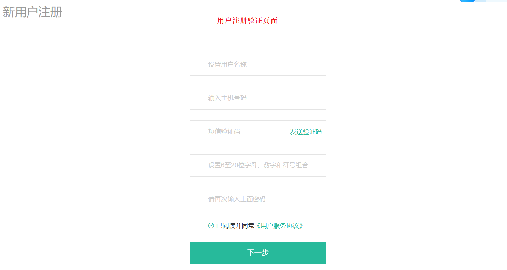
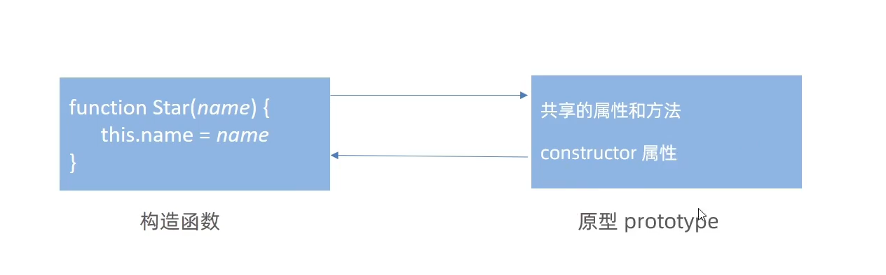
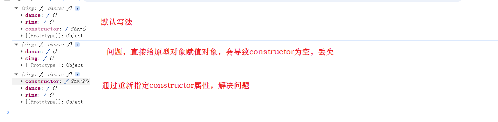
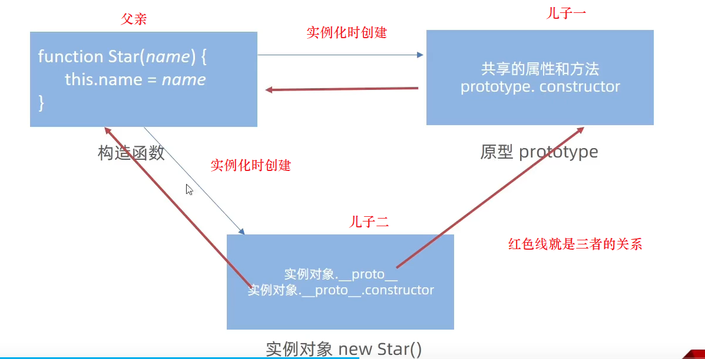
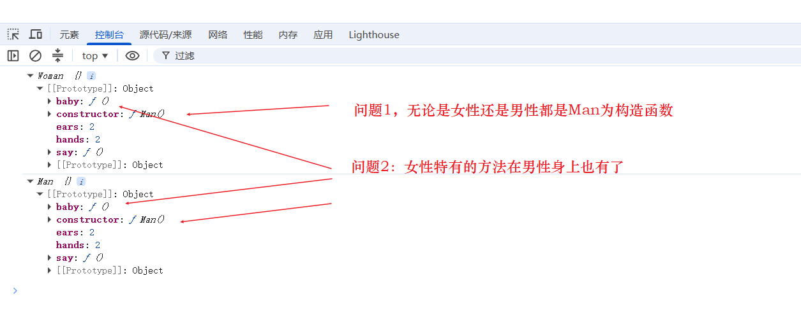
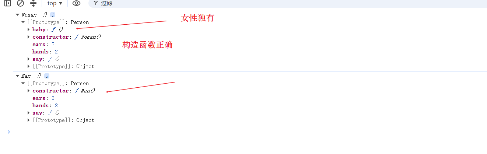
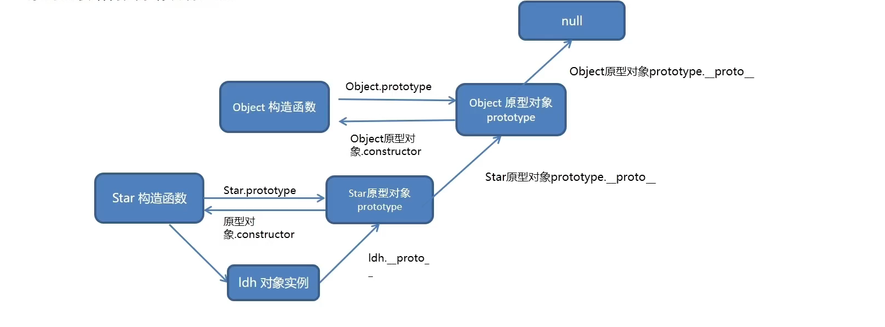

# ES

[TOC]

## 一、ECMAScript简介

ECMA(European Computer Manufacturers Association)称为**欧洲计算机制造商协会**，这个组织的目标是评估、开发和认可电信与计算机标准。1994年后该组织改名为**Ecma国际**。

ES全称EcmaScript，是脚本语言的**规范**，而平时经常编写的JavaScript是EcmaScript的**一种实现**，所以ES新特性其实指的是**JavaScript的新特性**。

EcmaScript是由Ecma国际通过**ECMA-262标准化**的脚本程序设计语言。Ecma制作过很多标准，ECMA-262标准只是其中一个。

ECMA-262标准是由TC39组织维护的，该组织的会员都是公司，主要是浏览器厂商，例如苹果、谷歌、微软、因特尔等。它们会定期召开会议，会议由会员公司代表和特邀专家出席。

ES各版本历史简要：

| 版本    | 年份 | 版本内容                                                     |
| ------- | ---- | ------------------------------------------------------------ |
| ES1     | 1997 | 制定了语言的基本语法                                         |
| ES2     | 1998 | 较小改动                                                     |
| ES3     | 1999 | 引入正则、异常处理、格式化输出等。IE开始支持                 |
| ES4     | 2007 | 改动过于激进，未发布                                         |
| ES5     | 2009 | 引入严格模式、JSON、扩展对象、数组、原型、字符串、日期方法   |
| **ES6** | 2015 | 模块化、面向对象语法、Promise、箭头函数、let、const、数组解构赋值等内容，内容增加很多 |
| ES7     | 2016 | 幂运算符、数组扩展、Async/await关键字                        |
| ES8     | 2017 | Async/await、字符串扩展                                      |
| ES9     | 2018 | 对象解构赋值、正则扩展                                       |
| ES10    | 2019 | 扩展对象、数组方法                                           |
| ES11    | 2020 | 往后每年都会发布一个新版本                                   |

## 二、 ES5语法

ES5的基础语法就是js的语法，js基础中已经学习过了，这里对其内容进行补充，涉及许多**js高级语法与原理**。例如：原型、正则等内容。

### 2.1 正则表达式

正则表达式(Regular Expression)是用于**匹配字符串**中字符组合的模式。

正则表达式通常用来**查找**、**替换**、**提取**那些符合正则表达式的文本，许多语言都支持正则表达式，例如 java,c++，js等。

正则表达式的使用场景：

1. 例如表单验证(**查找匹配**)，用户名只能输入英文字母、数字或者下划线。匹配用户名：`/^[a-z0-9_-]{3,6}$/`；
2. 用于过滤掉页面内容中的一些敏感词(**替换**)；
3. 从字符串中获取想要的特定部分(**提取**)等。

#### 2.1.1 正则表达式语法

正则表达式分为两步：

1. **定义规则**，定义正则表达式的语法为：`const 变量名=/表达式/`；其中`//`就是正则表达式的**字面量**;
2. **查找**，验证是否符合规则。`test()`方法用来查看正则表达式与指定字符串是否匹配，是就返回true，不是就返回false。`exec()`方法，用于在一个指定字符串中执行一个搜索匹配。匹配成功就返回数组，其中包含第一个匹配字符串的**位置索引**，失败返回**null**。

```js
const str = "你好，杀杀杀，学习前端吗，前端顶顶顶，杀杀杀";

//定义规则，查找前端这个字符串
let reg = /前端/;
//test()
let result = reg.test(str);
console.log(result); //true
console.log(reg.exec(str)); //匹配成功返回数组 ['前端', index: 9, input: '你好，杀杀杀，学习前端吗，前端顶顶顶，杀杀杀', groups: undefined]
reg = /abc/;
result = reg.test(str);
console.log(result); //false 没有abc这个字符串
console.log(reg.exec(str)); //null
```

除了字面量写法外，还可以使用构造函数`RegExp`创建正则对象。

```js
//字面量写法
var str = "mjjss";
var p = /mjj/g;

if (p.test(str)) {
  console.log("匹配成功"); //匹配成功
} else {
  console.log("匹配失败");
}

//构造函数写法
var p1 = new RegExp("mjj", "g");
console.log(p1.test(str)); //true
```

#### 2.1.2 元字符

正则中的字符分为两大类：

1. **普通字符**：普通字符就是字符本身，它仅能够描述它们本身，普通字符**只能匹配字符串中与它们相同的字符**。例如所有的字母或数字。
2. **元字符**：又叫**特殊字符**是一些**具有特殊含义的字符**，可以极大提高代码的灵活性与匹配功能。例如：规定用户只能输入英文26个字母，使用普通字符必须写abcdefg...把26个字母写完，换成元字符就是`[a-z]`。

正则测试工具在线网址：https://tool.oschina.net/regex和https://regexr.com/

元字符主要分为三大类：

1. 边界符(表示位置，开头和结尾，必须用什么开头，用什么结尾)
2. 量词(表示重复次数)
3. 字符类(比如`\d`就表示0~9)

##### 2.1.2.1 边界符

边界符用来提示字符所处的位置，主要有两个字符`^`表示匹配行首的文本，也就是以什么开始。`$`表示匹配行尾的文本，也就是以什么结束。

```js
//表示有哈就匹配成功
console.log(/哈/.test("哈")); //true
console.log(/哈/.test("哈哈")); //true
console.log(/哈/.test("二哈")); //true
console.log(/哈/.test("二哈二")); //true

console.log("----------------------------------");
//使用行首边界符，表示必须以哈开头才能匹配成功
console.log(/^哈/.test("哈")); //true
console.log(/^哈/.test("哈哈")); //true
console.log(/^哈/.test("二哈")); //false
console.log(/^哈/.test("二哈二")); //false

console.log("----------------------------------");
//使用行尾边界符，表示必须以哈结尾才能匹配成功
console.log(/哈$/.test("哈")); //true
console.log(/哈$/.test("哈哈")); //true
console.log(/哈$/.test("二哈")); //true
console.log(/哈$/.test("二哈二")); //false

console.log("----------------------------------");
//同时使用行首行尾边界符，表示精确匹配,就是必须与规则内部一模一样才匹配，必须只有一个哈
console.log(/^哈$/.test("哈")); //true
console.log(/^哈$/.test("哈哈")); //false 注意是false
console.log(/^哈$/.test("二哈")); //false
console.log(/^哈$/.test("二哈二")); //false
```

`^`与`$`同时使用表示**精确匹配**，精确匹配表示字符串与规则内部一模一样才匹配成功。

##### 2.1.2.2 量词

量词用来设定某个模式出现的次数。

| 量词    | 说明             |
| ------- | ---------------- |
| `*`     | 重复零次或更多次 |
| `+`     | 重复一次或更多次 |
| `？`    | 重复零次或一次   |
| `{n}`   | 重复n次          |
| `{n,}`  | 重复n次或更多次  |
| `{n,m}` | 重复n次到m次     |

```js
//1.出现0次到多次哈，*大于等于0
console.log(/^哈*$/.test("哈")); //true
console.log(/^哈*$/.test("")); //true
console.log(/^哈*$/.test("哈哈")); //true
console.log(/^哈*$/.test("哈哈哈")); //true
console.log(/^哈*$/.test("二哈哈")); //false 因为是精确匹配,里面只能有哈，不能出现其他字符.
console.log(/^哈*$/.test("哈哈二")); //false
console.log(/^哈*$/.test("a哈二")); //false
console.log("------------------------------");

//2.出现1次到多次哈，+大于等于0
console.log(/^哈+$/.test("哈")); //true
console.log(/^哈+$/.test("")); //false
console.log(/^哈+$/.test("哈哈")); //true
console.log(/^哈+$/.test("哈哈哈")); //true
console.log(/^哈+$/.test("二哈哈")); //false 因为是精确匹配,里面只能有哈，不能出现其他字符.
console.log(/^哈+$/.test("哈哈二")); //false
console.log(/^哈+$/.test("a哈二")); //false
console.log("------------------------------");

//3.出现0次与1哈，?大于等于0小于等于1
console.log(/^哈?$/.test("哈")); //true
console.log(/^哈?$/.test("")); //true
console.log(/^哈?$/.test("哈哈")); //flase
console.log(/^哈?$/.test("哈哈哈")); //false
console.log(/^哈?$/.test("二哈哈")); //false 因为是精确匹配,里面只能有哈，不能出现其他字符.
console.log(/^哈?$/.test("哈哈二")); //false
console.log(/^哈?$/.test("a哈二")); //false
console.log("------------------------------");

//4.出现n次哈，{n}写几次就必须出现几次 n
console.log(/^哈{4}$/.test("哈")); //false
console.log(/^哈{4}$/.test("")); //fasle
console.log(/^哈{4}$/.test("哈哈")); //fasle
console.log(/^哈{4}$/.test("哈哈哈哈")); //true
console.log(/^哈{4}$/.test("哈哈哈哈哈哈")); //false
console.log(/^哈{4}$/.test("哈哈哈哈ss")); //fasle
console.log("------------------------------");

//5.出现n+次哈，{n,}写几次就必须大于等于几次 >=n
console.log(/^哈{4,}$/.test("哈")); //false
console.log(/^哈{4,}$/.test("")); //fasle
console.log(/^哈{4,}$/.test("哈哈")); //fasle
console.log(/^哈{4,}$/.test("哈哈哈哈")); //true
console.log(/^哈{4,}$/.test("哈哈哈哈哈哈")); //true
console.log(/^哈{4,}$/.test("哈哈哈哈ss")); //fasle
console.log("------------------------------");

//6.，{n,m}必须出现n次到m次之间 n~m，逗号左右两侧千万不能有空格，否则会出错
console.log(/^哈{4,6}$/.test("哈")); //false
console.log(/^哈{4,6}$/.test("")); //fasle
console.log(/^哈{4,6}$/.test("哈哈")); //fasle
console.log(/^哈{4,6}$/.test("哈哈哈哈")); //true
console.log(/^哈{4,6}$/.test("哈哈哈哈哈哈")); //true
console.log(/^哈{4,6}$/.test("哈哈哈哈ss")); //fasle
console.log("------------------------------");
console.log(/^哈{4, 6}$/.test("哈哈哈哈哈哈")); //false 有空格会出错
```

##### 2.1.2.3 字符类

(1)匹配字符集合`[]`,`[abc]`表示后面的字符串只要包含abc中的**任意一个字符**，就返回true。

```js
console.log(/[abc]/.test("andy")); //true
console.log(/[abc]/.test("baby")); //true
console.log(/[abc]/.test("cry")); //true
console.log(/[abc]/.test("die")); //false

console.log(/^[abc]$/.test("andy")); //false 精确匹配只能匹配一个字符
console.log(/^[abc]$/.test("a")); //true
console.log(/^[abc]$/.test("b")); //true
console.log(/^[abc]$/.test("c")); //true
console.log(/^[abc]$/.test("abc")); //false

console.log(/^[abc]{3}$/.test("abc")); //true，使用量词可以精确匹配多个

console.log(/^[mM][jJ]+$/.test("mjj")); //true，使用量词可以精确匹配多个
console.log(/^[mM][jJ]+$/.test("mJj")); //true，
console.log(/^[mM][jJ]+$/.test("MjJJJ")); //true，
console.log(/^[mM][jJ]+$/.test("MmjJJJ")); //false
console.log(/^[mM][jJ]+$/.test("MjJJJy")); //false
console.log(/^[mM][jJ]+y?$/.test("MjJJJy")); //true
console.log(/^[mM][jJ]+y?$/.test("MjJJJy~~~~~~~&&")); //false
console.log(/^[mM][jJ]+y?[~~~&&\.!]*$/.test("MjJJJy~~~~~~~&&")); //true
```

`[a-z]`是指26的小写字母任意匹配一个。`[A-Z]`是指26的大写字母任意匹配一个。`[0-9]`是指0到9任意数字匹配。

`[a-zA-Z0-9]`是指除了特殊字符外，所有字母数字都匹配。`[\u4e00-\u9fa5]`匹配所有中文字符,利用中文的**Unicode码**。

```js
console.log(/^[a-z]$/.test("p")); //true
console.log(/^[a-z]$/.test("P")); //false
console.log(/^[A-Z]$/.test("P")); //true
console.log(/^[A-Z]$/.test("p")); //false

console.log(/^[a-zA-Z0-9]$/.test("p")); //true
console.log(/^[a-zA-Z0-9]$/.test("P")); //true
console.log(/^[a-zA-Z0-9]$/.test("7")); //true 只能出现英文字母与数字
console.log(/^[a-zA-Z0-9_]$/.test("_")); //true 只能出现英文字母、数字以及下划线

//腾讯QQ号 QQ号必须从10000开始，首位不能为0
console.log(/^[1-9][0-9]{4,}$/.test("222222")); //true
console.log(/[\u4e00-\u9fa5]/.test("张三")); //true
```

[]中可以加上`^`符号，表示匹配除中括号中以外的部分，也就是**取反操作**。`[^a-z]`表示匹配除小写字母以外的字符。

```js
console.log(/^[^a-z]$/.test("p")); //false
console.log(/^[^a-z]$/.test("P")); //true
console.log(/^[^A-Z]$/.test("P")); //false
console.log(/^[^A-Z]$/.test("p")); //true
```

(2)`.`匹配除了换行符外的任何单个字符。

```js
console.log(/^.$/.test("p")); //true
console.log(/^.$/.test("P")); //true
console.log(/^.$/.test("@")); //true
console.log(/./.test("\n")); //false 匹配除换行符外的所有字符
console.log(/^.{2}$/.test(`\n`)); //false 匹配除换行符外的所有字符

console.log(/^.$/.test("/n")); //false 匹配所有字符单个字符 /n是两个字符
//特殊字符，担心出错可以使用转义字符
console.log(/^[!*\.%\^\+\~\-#@\$]+$/g.test("..+^~$@")); //true
```

案例：验证用户名，用户名长度为6~16位，必须由英文字母、数字、下划线或者短横线组成

```html
<!DOCTYPE html>
<html lang="en">
  <head>
    <meta charset="UTF-8" />
    <meta name="viewport" content="width=device-width, initial-scale=1.0" />
    <title>Document</title>
    <style>
      span {
        display: inline-block;
        width: 250px;
        height: 30px;
        vertical-align: middle;
        line-height: 30px;
        padding-left: 15px;
      }
      .error {
        color: red;
        background: url("./images/error1.png") no-repeat left center;
      }

      .right {
        color: green;
        background: url("./images/right.png") no-repeat left center;
      }
    </style>
  </head>
  <body>
    <input type="text" />
    <span></span>
    <script>
      //准备正则
      const reg = /^[a-zA-Z0-9-_]{6,16}$/;
      const input = document.querySelector("input");
      const span = input.nextElementSibling;

      input.addEventListener("blur", function () {
        //正则检测
        if (reg.test(this.value)) {
          span.innerHTML = "输入正确";
          span.className = "right";
        } else {
          span.innerHTML = "请输入6~16位的英文数字下划线";
          span.className = "error";
        }
      });
    </script>
  </body>
</html>
```

(3)**预定义**：是指某些常见模式的简写方式，就是**预定义好的字符集**。

| 预定义类 | 说明                                                         |
| -------- | ------------------------------------------------------------ |
| `\d`     | 匹配0-9之间的任一数字，相当于`[0-9]`                         |
| `\D`     | 匹配0-9以外的字符，相当于`[^0-9]`                            |
| `\w`     | 匹配任意的字母、数字和下划线，相当于`[a-zA-Z0-9_]`           |
| `\W`     | 除所有字母、数字和下划线以外的字符，相当于`[^a-zA-Z0-9_]`    |
| `\s`     | 匹配空格(包括换行符、制表符、空格符等），相当于`[\t\r\n\v\f]` |
| `\S`     | 匹配非空格的字符，相当于`[^\t\r\n\v\f]`                      |

```js
//日期匹配
console.log(/^\d{4}-\d{2}-\d{2}/.test("p111")); //false
console.log(/^\d{4}-\d{2}-\d{2}/.test("2012-04-08")); //true
```

##### 2.1.2.4 修饰符

修饰符用于约束正则执行的某些细节行为，例如:是否区分大小写(`i`是ignore缩写)、是否全局匹配(`g`是global缩写),表示**匹配所有满足正则表达式的结果**、是否支持多行匹配(`m`)、等;

```js
//i表示不区分大小写
console.log(/^java$/.test("java")); //true
console.log(/^java$/.test("JAVA")); //false
console.log(/^java$/i.test("java")); //true
console.log(/^java$/i.test("JAVA")); //true
console.log(/^java$/i.test("Java")); //true

//g表示全局匹配,使用字符串的replace方法进行字符串替换

const str = "java是一门好的语言，学好Java工资很高";

const r1 = str.replace(/java/i, "js");
console.log(r1); //js是一门好的语言，学好Java工资很高 结果只替换了一个

const r2 = str.replace(/java/gi, "js");
console.log(r2); //js是一门好的语言，学好js工资很高 结果是全部进行替换

const r3 = str.replace(/^java$/ig, "js");
console.log(r3); //java是一门好的语言，学好Java工资很高 精确匹配是无法成功的

const r4 = str.replace(/java|Java/g, "js");
console.log(r4); //js是一门好的语言，学好js工资很高 |表示或运算，就是满足任何一个就进行替换
```

案例:过滤敏感词

```html
<!DOCTYPE html>
<html lang="en">
  <head>
    <meta charset="UTF-8" />
    <meta name="viewport" content="width=device-width, initial-scale=1.0" />
    <title>Document</title>
  </head>
  <body>
    <textarea name="" id="" clos="30" row="10"></textarea>
    <button>发布</button>
    <div></div>
    <script>
      const tx = document.querySelector("textarea");
      const btn = document.querySelector("button");
      const div = document.querySelector("div");

      btn.addEventListener("click", function () {
        div.innerHTML = tx.value.replace(/激情|基情|爆炸/g, "**");
        tx.value = "";
      });
    </script>
  </body>
</html>

//执行结果
你好。爆炸，你很基情，也会激情的人。变为：你好。**，你很**，也会**的人。
```

##### 2.1.2.5 分组匹配

分组匹配可以使用`()`对匹配进行分组。一个括号就表示匹配一组。可使用`RegExp`对象获取每组单独的值。

```js
//1.最简单的分组
const str = "2023-02-17";
const regex = /(\d{4})-(\d{2})-(\d{2})/;
//使用中括号是没有分组效果的
//const regex = /[\d{4}]-[\d{2}]-[\d{2}]/;
regex.exec(str); //必须使用exec或test函数执行后，才会有分组值
//使用RegExp对象获取每组的值，$1表示第一组
console.log(RegExp.$1); // 输出 "2023"
console.log(RegExp.$2); // 输出 "02"
console.log(RegExp.$3); // 输出 "17"


//2.新方式分组写法
const match = regex.exec(str);
if (match) {
  console.log(match[1]); // 输出 "2023"
  console.log(match[2]); // 输出 "02"
  console.log(match[3]); // 输出 "17"
}

//3.使用repalce方法进行替换 替换字符串中可使用分组$获取分组内容
const text = "Hello, my name is John Doe.";
const regex2 = /name is (\w+) (\w+)/;
const replacedText = text.replace(regex2, "full name is $2 $1");
console.log(replacedText); // 输出 "Hello, my full name is Doe John."

//4. 使用循环匹配全部，要使用g模式
const str3 = "Hello World! Hello Universe!";
const regex3 = /Hello (\w+)/g;
while (regex3.exec(str3)) {
  console.log(RegExp.$1); // 输出 "World" 和 "Universe"
}

//5. 匹配复杂字符串
const regex4 = /(http|https):\/{2}w{3}\.(baidu|sss|google|ddd)\.(com|cn)/g;
const str4 = `http://www.baidu.com/ 
https://www.sss.com/
http://www.google.com/
https://www.ddd.cn/`;
//不一定非要使用exec，使用test效果也是一样的
while (regex4.test(str4)) {
  console.log(RegExp.$2); // 输出 "baidu"  "sss" "google" "ddd"
}
```

可**不捕获分组**，使用符号`?:`在括号中

```js
//不捕获分组?:
const str = "2023-02-17";
const regex = /(?:\d{4})-(\d{2})-(\d{2})/;
regex.exec(str); //必须使用exec或test函数执行后，才会有分组值
//使用RegExp对象获取每组的值，$1表示第一组，使用不捕获后就变成实际的第二组
console.log(RegExp.$1); // 输出 "02"
console.log(RegExp.$2); // 输出 "17"
console.log(RegExp.$3); // 输出 ""
```

ES9新增了**命名捕获分组**`?<变量名>`，就是给分组捕获结果命名，并放到`groups`属性中。

```js
let str = '<a href="http://www.baidu.com">百度</a>';

//提取url与标签文本 使用分组但不捕获的方式
const reg = /<a href="(.*)">(.*)<\/a>/;

//执行
const result = reg.exec(str);
console.log(result[1]); //http://www.baidu.com
console.log(result[2]); //百度

//使用分组捕获,groups中就有数据
const reg1 = /<a href="(?<url>.*)">(?<text>.*)<\/a>/;
const result2 = reg1.exec(str);

console.log(result2.groups.url); //http://www.baidu.com
console.log(result2.groups.text); //百度
```

##### 2.1.2.6 正向预查

所谓**正向预查**又叫**正向断言**，就是只匹配规则，但实际结果不捕获规则内容。

正向预查分为**正向肯定预查**使用符号`(?=规则)`和**正向否定预查**`(?!规则)`。

```js
//不使用正向预查
const reg = /\d+元/g;
const str = "201元 2002元 203刀 204磅";
let match;
do {
  match = reg.exec(str);
  console.log(match); //匹配的结果为201元 2002元
} while (match);

//使用正向预查 就是只匹配数字，不匹配元字,但元依然属于规则中
const reg1 = /\d+(?=元)/g;
const str1 = "201元 2002元 203刀 204磅";
let match1;
do {
  match1 = reg1.exec(str1);
  console.log(match1); //匹配的结果为201 2002
} while (match1);

//使用正向否定预查，就是不是元结尾,但数字没考虑进去
const reg2 = /\d+(?!元)/g;
const str2 = "201元 2002元 203刀 204磅";
let match2;
do {
  match2 = reg2.exec(str2);
  console.log(match2); //匹配的结果为20 200 203 204
} while (match2);

//使用正向否定预查,排除数字的情况
const reg3 = /\d+(?!元|\d)/g;
const str3 = "201元 2002元 203刀 204磅";
let match3;
do {
  match3 = reg3.exec(str3);
  console.log(match3); //匹配的结果为203 204
} while (match3);
```

##### 2.1.2.7 反向预查

所谓**反向预查**又叫**反向断言**，就是只匹配规则，但实际结果不捕获规则内容。

反向预查分为**反向肯定预查**使用符号`(?<=规则)`和**反向否定预查**`(?<!规则)`。

```js
//不使用反向预查
const reg = /￥\d+/g;
const str = "￥201 ￥2002 $203 @204";
let match;
do {
  match = reg.exec(str);
  console.log(match); //匹配的结果为￥201 ￥2002
} while (match);

//使用反向预查 就是只匹配数字，不匹配￥字,但￥依然属于规则中
const reg1 = /(?<=￥)\d+/g;
do {
  match = reg1.exec(str);
  console.log(match); //匹配的结果为201 2002
} while (match);

//使用反向否定预查，就是不是￥字开头,但数字没考虑进去
const reg2 = /(?<!￥)\d+/g;
do {
  match = reg2.exec(str);
  console.log(match); //匹配的结果为01 002 203 204
} while (match);

//使用反向否定预查,排除数字的情况
const reg3 = /(?<!￥|\d)\d+/g;
do {
  match = reg3.exec(str);
  console.log(match); //匹配的结果为203 204
} while (match);
```

##### 2.1.2.8 dotAll模式

`.`在正则中表示处换行符外的任意字符,它叫**dot**。**dotAll模式**就是后面加了`s`模式，有了该模式`.`就可以**匹配任意字符**。这样`.`就可直接匹配一长串空格或者换行字符,html标签匹配就更容易。

```js
let str = `
<ul>
      <li>
        <a>张三</a>
        <p>上游时间：1100-01-12</p>
      </li>
      <li>
        <a>阿甘正传</a>
        <p>上游时间：1630-01-12</p>
      </li>
    </ul>
`;
//1.没有dotAll模式的情况
const reg = /<li>\s+<a>(.*?)<\/a>\s+<p>(.*?)<\/p>/;

//执行
const result = reg.exec(str);
console.log(result); //Array3,只匹配一个li的内容

//2.有dotAll模式的情况
const reg1 = /<li>.*?<a>(.*?)<\/a>.*?<p>(.*?)<\/p>/s;
const result1 = reg1.exec(str);
console.log(result1); //Array3,只匹配一个li的内容

//3.有dotAll模式的情况 全局匹配
const reg2 = /<li>.*?<a>(.*?)<\/a>.*?<p>(.*?)<\/p>/gs;
let result2;
let data = [];
while ((result2 = reg2.exec(str))) {
  data.push({ title: result2[1], time: result2[2] });
}
console.log(data); //[{title: '张三', time: '上游时间：1100-01-12'},{title: '阿甘正传', time: '上游时间：1630-01-12'}]

//4.使用matchAll方法 matchAll返回结果是iterator对象
const result = str.matchAll(reg2);

const arr = [...result];
console.log(arr); //展开数组 [Array(3), Array(3)]
//遍历
for (let v of str.matchAll(reg2)) {
  console.log(v);
}
```

#### 2.1.3 方法

正则的方法：

+ `test()`方法，返回一个布尔值，表示当前模式是否能匹配参数字符串。

+ `exec()`方法，返回匹配的结果，如果发现匹配，就返回一个数组，数组中的成员都是匹配的子字符串，否则返回null。

```js
//test
var str = "hello world";
console.log(/world$/g.test(str)); //true
console.log(/wod$/g.test(str)); //false

//exec
console.log(/world$/g.exec(str)); //['world', index: 6, input: 'hello world', groups: undefined]
console.log(/wod$/g.exec(str)); //null
```

除了正则的方法外，string字符串也有方法可以使用正则表达式。

+ `match()`方法，对字符串进行正则匹配，返回匹配的结果。

+ `search()`方法,返回第一个满足条件的匹配结果在整个字符串中的位置，如果没有匹配就返回-1。跟exec很像。
+ `replace()`方法，可以替换匹配的值，它接受两个参数，第一个是正则表达式，表示搜索模式，第二个是替换的内容。

```js
var str = "hello world";
var reg = /l/g;
var reg2 = /oo/g;
//match
console.log(str.match(reg)); // ['l', 'l', 'l'] 返回的是所有的匹配结果
console.log(str.match(reg2)); //null

//search
console.log(str.search(reg)); // 2 2是第一个l出现的索引位置
console.log(str.search(reg2)); //-1

//replace
console.log(str.replace(reg, "**")); // he****o wor**d
console.log(str.replace(reg2, "**")); //hello world

var timestr = "2019.02.20";
//.必须转义，否则表示所有字符都匹配
console.log(timestr.replace(/./, "-")); //-019.02.20
console.log(timestr.replace(/\./g, "-")); //2019-02-20
```

#### 2.1.4 验证简单案例

```js
//1. 检查用户账号
//验证规则：由字母，数字，下划线组成，以字母开头 4-16位
function checkUser(str) {
  var re = /^[a-zA-Z]\w{3,15}$/g;
  if (re.test(str)) {
    return "账号匹配成功";
  } else {
    return "账号匹配失败";
  }
}

console.log(checkUser("h12h1h_dddd")); //账号匹配成功
console.log(checkUser("h12")); //账号匹配失败
console.log(checkUser("_h12sss")); //账号匹配失败

//2. 匹配手机号
//验证规则：11位，以1开头，3 5 7 8
function checkMobile(str) {
  var re = /^1[3|5|7|8]\d{9}$/g;
  if (re.test(str)) {
    return "手机号匹配成功";
  } else {
    return "手机号匹配失败";
  }
}

console.log(checkMobile("13333909900")); //手机号匹配成功
console.log(checkMobile("03333909900")); //手机号匹配失败
console.log(checkMobile("133300")); //手机号匹配失败

//3. 匹配电话号
//验证规则：区号+号码  01088888888 010-8888888 0934-7777777
function checkPhone(str) {
  var re = /^0\d{2,3}-?\d{7,8}$/g;
  if (re.test(str)) {
    return "电话号匹配成功";
  } else {
    return "电话号匹配失败";
  }
}

console.log(checkPhone("010-8888888")); //电话号匹配成功
console.log(checkPhone("010-88888888888")); //电话号匹配失败
console.log(checkPhone("0934-77")); //电话号匹配失败

//4. 匹配身份证
//验证规则：18位或者15位，15位全是数字 18位前17位是数字最后一位校验位可能是数字也可能是x或X
function checkCard(str) {
  var re = /^(\d{15}$)|(^\d{17}(\d|X|x)$)/g;
  if (re.test(str)) {
    return "身份证匹配成功";
  } else {
    return "身份证匹配失败";
  }
}

console.log(checkCard("520251111135647")); //身份证匹配成功
console.log(checkCard("52025111113564700X")); //身份证匹配成功
console.log(checkCard("520251111135647001")); //身份证匹配成功
console.log(checkCard("52025111647001")); //身份证匹配失败
console.log(checkCard("520251111135647001111")); //身份证匹配失败

//5. 匹配邮箱
//验证规则：第一部分@第二部分.com|cn|net
function checkEmail(str) {
  var re = /^[a-zA-Z0-9-._]+[@][[a-zA-Z0-9-._]+\.(com|cn|net)/g;
  if (re.test(str)) {
    return "邮箱匹配成功";
  } else {
    return "邮箱匹配失败";
  }
}

console.log(checkEmail("294@qq.com")); //邮箱匹配成功
console.log(checkEmail("294qq.com")); //邮箱匹配失败
console.log(checkEmail("294@qq.sss")); //邮箱匹配失败
```

#### 2.1.5 综合案例

实际开发中使用正则验证的案例。参考上边的简单案例进行开发。



基本页面`register.html`

```html
<!DOCTYPE html>
<html lang="en">
  <head>
    <meta charset="UTF-8" />
    <title>小兔鲜儿 - 新鲜 惠民 快捷!</title>
    <meta http-equiv="X-UA-Compatible" content="IE=edge" />
    <meta name="renderer" content="webkit" />
    <link rel="stylesheet" href="./css/common.css" />
    <link rel="stylesheet" href="./css/register.css" />
    <link
      rel="stylesheet"
      href="https://at.alicdn.com/t/font_2143783_iq6z4ey5vu.css"
    />
  </head>
  <body>
    <div class="xtx-wrapper">
      <div class="container">
        <!-- 卡片 -->
        <div class="xtx-card">
          <h3>新用户注册</h3>
          <form class="xtx-form">
            <div data-prop="username" class="xtx-form-item">
              <span class="iconfont icon-zhanghao"></span>
              <input name="username" type="text" placeholder="设置用户名称" />
              <span class="msg"></span>
            </div>
            <div data-prop="phone" class="xtx-form-item">
              <span class="iconfont icon-shouji"></span>
              <input name="phone" type="text" placeholder="输入手机号码  " />
              <span class="msg"></span>
            </div>
            <div data-prop="code" class="xtx-form-item">
              <span class="iconfont icon-zhibiaozhushibiaozhu"></span>
              <input name="code" type="text" placeholder="短信验证码" />
              <span class="msg"></span>
              <a class="code" href="javascript:;">发送验证码</a>
            </div>
            <div data-prop="password" class="xtx-form-item">
              <span class="iconfont icon-suo"></span>
              <input
                name="password"
                type="password"
                placeholder="设置6至20位字母、数字和符号组合"
              />
              <span class="msg"></span>
            </div>
            <div data-prop="confirm" class="xtx-form-item">
              <span class="iconfont icon-suo"></span>
              <input
                name="confirm"
                type="password"
                placeholder="请再次输入上面密码"
              />
              <span class="msg"></span>
            </div>
            <div class="xtx-form-item pl50">
              <i class="iconfont icon-queren"></i>
              已阅读并同意<i>《用户服务协议》</i>
            </div>
            <div class="xtx-form-item">
              <button class="submit">下一步</button>
              <!-- <a class="submit" href="javascript:;">下一步</a> -->
            </div>
          </form>
        </div>
      </div>
    </div>
  </body>
</html>
```

`register.css`样式，公共样式common.css内容是统一的就不多说了

```js
.xtx-wrapper {
  background: #f5f5f5;
  line-height: 1.4;
}

.xtx-wrapper .container {
  width: 1240px;
  margin: 0 auto;
  padding: 50px 0;
}

.xtx-card {
  width: 100%;
  height: 800px;
  background: #fff;
}

.xtx-card h3 {
  font-size: 26px;
  font-weight: normal;
  color: #999999;
  padding-left: 50px;
  height: 180px;
  line-height: 180px;
}

.xtx-form {
  padding-left: 460px;
}

.xtx-form .xtx-form-item {
  position: relative;
  padding-bottom: 24px;
}

.xtx-form .xtx-form-item .msg {
  color: #ff4d4f;
  position: absolute;
  left: 2px;
  bottom: 2px;
}


.xtx-form .xtx-form-item.pl50 {
  padding-left: 40px;
  cursor: pointer;
}

.xtx-form .xtx-form-item span.iconfont {
  position: absolute;
  left: 15px;
  top: 13px;
  color: #666;
  font-size: 18px;
}

.xtx-form .xtx-form-item i {
  color: #27BA9B;
  font-size: 14px;
}

.xtx-form .xtx-form-item input {
  width: 300px;
  height: 50px;
  border: 1px solid #e4e4e4;
  padding-left: 40px;
}

.xtx-form .xtx-form-item.error input {
  border-color: #ff4d4f;
}

.xtx-form .xtx-form-item input::placeholder {
  color: #cccccc !important;
}

.xtx-form .xtx-form-item .submit {
  width: 300px;
  height: 50px;
  background: #27BA9B;
  border-radius: 4px;
  display: block;
  font-size: 16px;
  color: #fff;
  text-align: center;
  line-height: 50px;
  cursor: pointer;
}

.xtx-form .xtx-form-item .code {
  position: absolute;
  left: 190px;
  top: 16px;
  width: 100px;
  color: #27BA9B;
  text-align: right;
}

.xtx-form .xtx-form-item .code.ing {
  color: #cccccc;
}

.xtx-steps {
  display: flex;
  justify-content: space-between;
  width: 720px;
  height: 96px;
  margin: 0 auto;
}

.xtx-steps .item {
  position: relative;
  width: 48px;
  height: 48px;
}

.xtx-steps .item .text {
  text-align: center;
  width: 120px;
  position: absolute;
  left: 50%;
  transform: translateX(-50%);
  top: 63px;
  color: #999;
}

.xtx-steps .item .step {
  border: 2px solid #e4e4e4;
  color: #ccc;
  background: #fff;
  border-radius: 50%;
  line-height: 46px;
  text-align: center;
  font-size: 28px;
  z-index: 999;
  display: block;
  position: relative;
}

.xtx-steps .item::after, .xtx-steps .item::before {
  content: "";
  position: absolute;
  top: 23px;
  left: 24px;
  height: 2px;
  background: #e4e4e4;
  width: 120px;
}

.xtx-steps .item::after {
  transform: translateX(-100%);
}

.xtx-steps .item:first-child::after {
  display: none;
}

.xtx-steps .item:last-child::before {
  display: none;
}

.xtx-steps .item.active .text {
  color: #27BA9B;
}

.xtx-steps .item.active .step {
  background: #27BA9B;
  color: #fff;
  border-color: #27BA9B;
}

.xtx-steps .item.active::after, .xtx-steps .item.active::before {
  content: "";
  background: #27BA9B;
}

.xtx-form-label {
  padding-left: 360px;
  margin-top: 80px;
}

.xtx-form-label .xtx-form-item {
  position: relative;
  padding-bottom: 24px;
  display: flex;
}

.xtx-form-label .xtx-form-item label {
  width: 100px;
  padding-right: 15px;
  text-align: right;
  font-size: 16px;
  height: 50px;
  line-height: 50px;
  color: #999;
}

.xtx-form-label .xtx-form-item input {
  width: 300px;
  height: 50px;
  border: 1px solid #e4e4e4;
  padding-left: 10px;
}

.xtx-form-label .xtx-form-item input::placeholder {
  color: #cccccc !important;
}

.xtx-form-label .xtx-form-item input:read-only {
  background: #f5f5f5;
  color: #999;
}

.xtx-form-label .xtx-form-item .submit {
  width: 300px;
  height: 50px;
  background: #27BA9B;
  border-radius: 4px;
  display: block;
  font-size: 16px;
  color: #fff;
  text-align: center;
  line-height: 50px;
}

.xtx-form-label .xtx-form-item .captcha {
  line-height: 50px;
  height: 50px;
}

.xtx-form-label .xtx-form-item .captcha img {
  width: 134px;
  height: 50px;
}

.xtx-form-label .xtx-form-item .captcha a {
  color: #27BA9B;
}

.xtx-form-label .xtx-form-item .code {
  position: absolute;
  left: 310px;
  top: 16px;
  color: #27BA9B;
}

.xtx-form-label .xtx-form-item .code.ing {
  color: #cccccc;
}

.xtx-success-box {
  padding-top: 250px;
  text-align: center;
  color: #999999;
}

.xtx-success-box .iconfont {
  font-size: 80px;
  color: #1DC779;
}

.xtx-success-box .tit {
  font-size: 20px;
  padding: 20px 0;
}

.xtx-success-box .desc {
  font-size: 16px;
  padding-bottom: 20px;
}

.xtx-success-box .btn {
  width: 300px;
  height: 50px;
  background: #27BA9B;
  border-radius: 4px;
  display: block;
  font-size: 16px;
  color: #fff;
  text-align: center;
  line-height: 50px;
  margin: 0 auto;
}
```

验证代码`register.js`

```js
//使用立即执行函数防止命名重复
(function () {
  //0.发送短信验证码模块功能
  const code = document.querySelector(".code");
  let flag = true; //节流阀
  code.addEventListener("click", function () {
    if (flag) {
      flag = false;
      let i = 5;
      code.innerHTML = `0${i}秒后重新获取`;
      let timerId = setInterval(function () {
        i--;
        code.innerHTML = `0${i}秒后重新获取`;
        if (i === 0) {
          clearInterval(timerId);
          code.innerHTML = `重新获取`;
          flag = true;
        }
      }, 1000);
    }
  });
})();
//验证模块
(function () {
  //1.用户名验证，使用change事件，blur事件是光标移开就会触发，change事件是input内容变化时才会触发
  //正则：/^[a-zA-Z0-9-_]{6,10}$/
  const username = document.querySelector("[name=username]");
  username.addEventListener("change", verifyName);
  //正则验证函数，验证内容都封装为外部函数
  function verifyName() {
    const span = username.nextElementSibling;
    const reg = /^[a-zA-Z0-9-_]{6,10}$/;
    if (!reg.test(username.value)) {
      //验证失败
      span.innerText = "输入不合法，请输入6~10位";
      return false;
    }
    //验证成功就清空错误信息
    span.innerText = "";
    return true;
  }

  //2.手机号验证，使用change事件，blur事件是光标移开就会触发，change事件是input内容变化时才会触发
  //正则：/^1(3\d|4[5-9]|5[0-35-9]|6[567]|7[0-8]|8\d|9[0-35-9])\d{8}$/
  const phone = document.querySelector("[name=phone]");
  phone.addEventListener("change", verifyPhone);
  //正则验证函数，验证内容都封装为外部函数
  function verifyPhone() {
    const span = phone.nextElementSibling;
    const reg = /^1(3\d|4[5-9]|5[0-35-9]|6[567]|7[0-8]|8\d|9[0-35-9])\d{8}$/;
    if (!reg.test(phone.value)) {
      //验证失败
      span.innerText = "输入不合法，请输入正确的11位手机号码";
      return false;
    }
    //验证成功就清空错误信息
    span.innerText = "";
    return true;
  }

  //3.验证码验证，使用change事件，blur事件是光标移开就会触发，change事件是input内容变化时才会触发
  //正则：/^\d{6}$/ 6位数字
  const code = document.querySelector("[name=code]");
  code.addEventListener("change", verifyCode);
  //正则验证函数，验证内容都封装为外部函数
  function verifyCode() {
    const span = code.nextElementSibling;
    const reg = /^\d{6}$/;
    if (!reg.test(code.value)) {
      //验证失败
      span.innerText = "输入不合法，请输入正确的6位验证码";
      return false;
    }
    //验证成功就清空错误信息
    span.innerText = "";
    return true;
  }

  //4.密码框验证，使用change事件，blur事件是光标移开就会触发，change事件是input内容变化时才会触发
  //正则：/^[a-zA-Z0-9_]{6,20}$/ 6~20位数字字母组合
  const password = document.querySelector("[name=password]");
  password.addEventListener("change", verifyPassword);
  //正则验证函数，验证内容都封装为外部函数
  function verifyPassword() {
    const span = password.nextElementSibling;
    const reg = /^[a-zA-Z0-9_]{6,20}$/;
    if (!reg.test(password.value)) {
      //验证失败
      span.innerText = "输入不合法，密码是6~20位数字字母组成";
      return false;
    }
    //验证成功就清空错误信息
    span.innerText = "";
    return true;
  }

  //5.再次密码框验证，如果本次密码不等于上边输入的密码，就返回错误信息，不需要使用正则验证
  const confirm = document.querySelector("[name=confirm]");
  confirm.addEventListener("change", verifyConfirm);
  //正则验证函数，验证内容都封装为外部函数
  function verifyConfirm() {
    const span = confirm.nextElementSibling;
    if (confirm.value !== password.value) {
      //验证失败
      span.innerText = "两次密码输入不一致";
      return false;
    }
    //验证成功就清空错误信息
    span.innerText = "";
    return true;
  }

  //6.已阅读确认验证，我同意模块
  const queren = document.querySelector(".icon-queren");
  queren.addEventListener("click", function () {
    //切换类
    this.classList.toggle("icon-queren2");
  });

  //7.提交模块，
  // 如果没有勾选我同意模块，提示需要勾选。使用classList.contains()看看有没有包含某个类，如果有返回true,没有返回false
  // 如果上边input表单只要有一个模块验证错误返回的是false，就阻止提交默认行为
  const form = document.querySelector("form");
  form.addEventListener("submit", function (e) {
    //如果没有勾选我同意模块
    if (!queren.classList.contains("icon-queren2")) {
      alert("请勾选同意协议");
      e.preventDefault(); //阻止提交
    }
    //依次判断上边每个模块，是否通过，只要有一个没有通过就阻止提交，
    // 这里也解释了为什么之前每个模块都有封装为单独的函数，就是为了这里使用
    if (!verifyName()) e.preventDefault();
    if (!verifyPhone()) e.preventDefault();
    if (!verifyCode()) e.preventDefault();
    if (!verifyPassword()) e.preventDefault();
    if (!verifyConfirm()) e.preventDefault();
  });
})();
```

 ### 2.2 原型

使用构造函数实现**封装对象**时，我们会发现**存在内存浪费的问题**。例如：我们只需要每个对象属性不同，但方法可以共用时，会发现每个对象上的方法都是单独存在的，这样就**导致内存浪费**。

> **注意:**
>
> 对象属性只在栈中占用空间，内存不大，因此可以忽略。
>
> 对象方法是**引用对象**，它会在堆中开辟空间，栈上也占空间，空间占用较大，引用对象占用空间不能忽略。

```js
//浪费内存的问题
function Star(uname, age) {
  this.uname = uname;
  this.age = age;
  this.sing = function () {
    console.log("唱歌");
  };
}

const ldh = new Star("ldh", 18);
const zxy = new Star("张学友", 19);
console.log(ldh === zxy); //false
console.log(ldh.sing === zxy.sing); //false
```

如果希望所有对象使用同一个函数，节约内存，就可以使用**原型**来解决。

#### 2.2.1 原型概念

js中规定，每个构造函数中都有一个`prototype`属性，**指向外部的另外一个对象**，这个对象就是**原型（prototype）**，又叫做**原型对象**。这个对象可以挂在函数，对象实例化不会多次创建原型上的函数，节约内存。

原型主要功能就是实现方法共享，构造函数通过原型分配的方法是**所有对象实例都共享的**。因此可以把不变的方法直接定义在prototype对象上，这样所有对象的实例就可以共享方法了。当然也可以**共享属性**。

```js
//之前的写法
function Star(uname, age) {
  this.uname = uname;
  this.age = age;
  this.sing = function () {
    console.log("唱歌");
  };
}
const ldh = new Star("ldh", 18);
const zxy = new Star("张学友", 19);
console.log(ldh === zxy); //false
console.log(ldh.sing === zxy.sing); //false

//打印原型
console.dir(Star.prototype); //类型是object，原型有一个constructor属性，它的值就是构造函数ƒ Star(uname, age)

//原型的写法
function Star1(uname, age) {
  this.uname = uname;
  this.age = age;
}
//原型对象添加方法
Star1.prototype.sing = function () {
  console.log("唱歌");
};
const ldh1 = new Star1("ldh", 18);
const zxy1 = new Star1("张学友", 19);

console.log(ldh1 === zxy1); //false
console.log(ldh1.sing === zxy1.sing); //true
//调用结果是一样的
ldh1.prototype.sing(); //完整写法
zxy1.sing(); //简写

//原型与静态成员的区别
Star1.aaa = function () {
  console.log("静态成员函数");
};
Star1.aaa(); //静态成员函数
ldh1.aaa(); //静态成员不能使用实例对象调用 报错
```

> 原型对象的原理：
>
> 1. js创建构造函数时，**自动给其添加了一个`prototype`属性**。该属性指向一个对象。
> 2. 原型指向的对象是引用类型，它是**对象实例**，因此它会堆中单独开辟了一个空间，`prototype`**属性存放的是对象地址**。
> 3. 有空间后，js还会自动在原型对象实例上添加一个属性`constructor`,该属性存放构造函数，它是指向之前构造函数的。
> 4. 当使用原型给构造函数添加方法时，js会在原型对象空间中上添加方法，然后让`prototype.sing`属性存放该地址。
> 5. 当构造函数创建实例对象时，它只会开辟空间存放实例化构造函数本身的内容，prototype属性内容是不会变化的。因此不管是哪一个实例对象，它们的**prototype属性指向的都是对象一个，当然里面的方法也是同一个**。调用时也是同一个。
>
> 原型的本质，其实就是**在构造函数外部单独放一个对象，然后让构造函数的一个属性固定指向该对象**。这种用法跟class的静态方法很像。
>
> 原型也很像之前讲的**构造函数的静态成员**，但两者还是有所不同。

#### 2.2.2 this指向

**构造函数和原型对象中的this都指向实例化对象**。因为它们都是实例化对象调用的。

```js
//this指向
let _this;
let _this1;
function Star(uname) {
  _this = this; //保存构造函数this
  this.uname = uname;
}
Star.prototype.sing = function () {
  console.log("唱歌");
  _this1 = this; //保存原型中的this
};

const zxy = new Star("张学友");
console.log(_this === zxy); //true 构造函数的this指向实例对象

zxy.sing(); //通过调用者也可以看出原型this指向zxy
console.log(_this1 === zxy); //true 原型的this指向实例对象
```

案例：给数组对象扩展求最大值的方法和求和方法，要求所有数组都能用。

```js
const arr = [1, 2, 3];
// const arr = new Array(1, 2, 3);

//最大值方法
Array.prototype.max1 = function (arr) {
  return Math.max(...arr);
};
console.log(arr.max1(arr)); //3 这种写法太low

//优化最大值方法
Array.prototype.max = function () {
  //this指向实例化对象
  return Math.max(...this);
};

//最小值
Array.prototype.min = function () {
  return Math.min(...this);
};

//求和
Array.prototype.sum = function () {
  return this.reduce((prev, item) => prev + item, 0);
};
console.log(arr.max()); //3
console.log(arr.min()); //1
console.log(arr.sum()); //6
```

#### 2.2.3 constructor属性

每个原型对象里都有一个`constructor`属性(又叫constructor构造函数）,它是原型对象自带的。

`constructor`属性的作用是指向**该原型对象的构造函数**。简单理解：指向我们父亲，我自己又是我父亲的儿子，构造函数是父亲，原型是儿子。



```js
//constructor 单词翻译就是构造函数
function Star() {}
const lad = new Star();
console.log(Star.prototype); //constructor:ƒ Star()

console.log(Star.prototype.constructor === Star); //true
```

`constructor`属性使用场景：原型中同时有多个对象的方法，想要同时赋值，可以采取**原型对象对象形式赋值**。

1. 给原型对象进行对象赋值，会覆盖构造函数原型对象原先的内容，修改后的原型对象`constructor`就不再指向当前构造函数，
2. 此时可以在给**修改后的原型对象**中，添加一个`constructor`指向原来的构造函数。这样就既保留原先的构造函数也使用的对象赋值。

**直接使用原型对象赋值对象**的问题

```js
//constructor应用
//原先的写法
function Star() {}

Star.prototype.sing = function () {
  console.log("唱歌");
};

Star.prototype.dance = function () {
  console.log("跳舞");
};

console.log(Star.prototype); //{sing: ƒ, dance: ƒ}

//直接使用原型赋值对象,会导致constructor为空
function Star1() {}

//同时赋值多个方法
Star1.prototype = {
  sing: function () {
    console.log("唱歌");
  },
  dance: function () {
    console.log("跳舞");
  }
};

console.log(Star1.prototype); //{sing: ƒ, dance: ƒ}

//解决问题
function Star2() {}
Star2.prototype = {
  //重新指回创造这个原型对象的构造函数,使用属性赋值
  constructor: Star2,
  sing: function () {
    console.log("唱歌");
  },
  dance: function () {
    console.log("跳舞");
  }
};

console.log(Star2.prototype); //{sing: ƒ, dance: ƒ}
```

结果：**没有constructor后就会导致不知道原型对象属于哪个构造函数**。



#### 2.2.4 对象原型 `__proto__`

思考：为什么实例对象可以**直接访问**原型对象里面的属性和方法呢？

实例对象都会有一个属性`__proto__`(**对象实例化时js创建的**)指向构造函数的**prototype原型对象**。之所以对象可以直接使用构造函数prototype原型对象的属性和方法，就因为对象有属性`__proto__`的存在。该属性就被称为**对象原型**。

本质就是把原本的写法转化了`Star.prototype.name`调用属性的方法变为 `ldh.__proto__.name `。这就是

``__proto__``是JS非标准属性，因此有两种形式：`[[prototype]]`和`__proto__`，它们意义相同，就是`[[prototype]]`不是代码写法只能在浏览器(google)中看到，`__proto__`才是代码写法。该属性是**只读属性**。本质`__proto__`就是实例对象中**prototype属性的别名**。

`__proto__`作用是用来表明当前实例对象指向哪个原型对象prototype。`__proto__`对象原型里也有一个`constructor`属性，也指向创建该实例对象的构造函数。



```js
//对象原型
function Star(name) {
  this.name = name;
}

const ldh = new Star("aaa");
console.log(ldh); // Star {name: 'aaa'}
console.log(ldh.__proto__); // {} 当前原型对象内容为空
console.log(ldh.__proto__ === Star.prototype); // true 说明对象原型就是指向原型对象
//对象原型里面有constructor指向构造函数 Star
console.log(ldh.__proto__.constructor === Star.prototype.constructor); //true

Star.prototype.sname = "张三";
console.log(ldh.__proto__.sname); //张三
//__proto可以省略 简写写法
console.log(ldh.sname); //张三
console.log(ldh.prototype.sname); //报错 无法使用prototype名直接读取属性，__proto__相当于它的别名
```

#### 2.2.5 原型继承

继承是面向对象编程的另一个特征，通过继承可以进一步提升代码的封装程度，js中大多数是借助原型对象实现继承的。

所谓继承就是两个构造函数例如：男人与女人，它们都有共同的属性手和耳朵，共同的方法说话，这时就想把这些共同的东西再次提取到一个**父亲对象**Perosn，然后让它们继承Person，这样就可以再次节省大量的代码。

如果需要在子类中扩展自己特有的方法，例如女人会生孩子，男人就不会。这时使用原型继承如果继承的是**同一个父类对象**，就会有问题。

```js
//注意这时Person是对象
const Person = {
  ears: 2,
  hands: 2,
  say: function () {
    console.log("说话");
  }
};

//女人
function Woman() {
  //两个耳朵两只手,会说话，公共内容都提取到父对象上
  // this.ears = 2;
  // this.hands = 2;
  // this.say = function () {
  //   console.log("说话");
  // };
}

//继承使用原型，因为是公共的内容
Woman.prototype = Person;
//原型赋值对象，必须重新赋值构造函数
Woman.prototype.constructor = Woman;
//女性添加特有的方法
Woman.prototype.baby = function () {
  console.log("孩子");
};

//实例化，父类对象的内容是放在[[prototype]]中的
const red = new Woman();
console.log(red);

//男人
function Man() {}

//继承使用原型，因为是公共的内容
Man.prototype = Person;
//原型赋值对象，必须重新赋值构造函数
Man.prototype.constructor = Man;

const blue = new Man();
console.log(blue);
```



产生上述问题的根本原因就是，两个构造函数的父类对象是同一个对象，因此里面的内容都会指向同一个。要解决该问题，就是让原型指向不同的对象，但对象中的内容要求一样。这时就使用**构造函数的实例**就可完成。

总结一句话：**赋值子类的原型对象为父类构造函数的实例对象**就是原型继承的核心原理。子类是构造函数。`子类的原型=new 父类构造函数`。

```js
//注意这时Person是构造函数
function Person() {
  this.ears = 2;
  this.hands = 2;
  this.say = function () {
    console.log("说话");
  };
}

//女人
function Woman() {
  //两个耳朵两只手,会说话，公共内容都提取到父对象上
  // this.ears = 2;
  // this.hands = 2;
  // this.say = function () {
  //   console.log("说话");
  // };
}

//这两句话就是继承的核心代码
//继承使用原型，因为是公共的内容 使用构造函数的实例赋值
Woman.prototype = new Person();
//原型赋值对象，必须重新赋值构造函数
Woman.prototype.constructor = Woman;

//女性添加特有的方法
Woman.prototype.baby = function () {
  console.log("孩子");
};

//实例化，父类对象的内容是放在[[prototype]]中的
const red = new Woman();
console.log(red);

//男人
function Man() {}

//继承使用原型，因为是公共的内容
Man.prototype = new Person();
//原型赋值对象，必须重新赋值构造函数
Man.prototype.constructor = Man;

const blue = new Man();
console.log(blue);
```


使用原型继承因为每个父对象都是单独的对象，因此还是**会浪费内存问题**，因为每个对象都会单独在栈中开辟内存。


#### 2.2.6 原型链

原型对象的继承使得不同构造函数的原型对象关联在一起，并且这种关联关系是一种链状的结构，我们将原型对象的链状结构关系称为**原型链**。

简单举例来讲:一个Star构造函数，它的prototype指向一个构造函数对象，可通过`__proto__`获取该对象。而该对象中又有**它自己的prototype**指向一个再上一级的构造函数对象，也通过`__proto__`获取对象，这样不停向上直到到达顶层对象`Object`，该对象`Object.__proto__`就指向`null`。

```js
function Star() {}

const aaa = new Star();
console.log(aaa); // Star {}
//获取aaa实例的原型对象
console.log(aaa.__proto__); //{}

//获取原型对象的原型对象 它就是顶层的Object对象
console.log(aaa.__proto__.__proto__); //{__defineGetter__: ƒ, __defineSetter__: ƒ, ...}
console.log(aaa.__proto__.__proto__ === Object.prototype); //true

//获取Object的原型对象 这样原型对象一层层链接就是原型链
console.log(aaa.__proto__.__proto__.__proto__); //null
console.log(Object.prototype.__proto__); //null
```



总结：只要是对象就有`__proto__`指向原型对象，只要是原型对象就有`constructor`指向构造函数。

原型链的查找规则：**js中访问一个对象属性/方法时**

1. 首先查找这个对象本身有没有该属性，有就直接获取；
2. 如果没有就去查找它的原型对象prototype,看原型对象在是否有该属性，有就获取；
3. 如果还没有就查找原型对象的原型对象；
4. 依此类推一直找到Object原型对象null为止，找到就返回，没有找到报错。

**原型链查找类似冒泡**，是一层层向上查找直到null为止。原型链好处就是只要链路上有一个原型对象中有方法就可以使用。

`__proto__`对象原型的意义就在于为对象成员查找机制提供一个方向，或者说一条路线，可以使用`instanceof`运算符用于检测构造函数的prototype属性是否出现在某个实例对象的原型链上。

```js
//instanceof 检测是否是由某个构造函数实例的对象 是就是true
function Person() {}
const aaa = new Person();

console.log(aaa instanceof Person); //true
console.log(aaa instanceof Object); //true
console.log(aaa instanceof Array); //false

console.log(Array instanceof Object); //true Array不是实例对象，这是简写
//完整写法
console.log(Array.prototype instanceof Object); //true
```

#### 2.2.7 综合案例 模态框

案例需求：多个模态框是一样的，而且每次点击都会出来一个。把模态框封装为一个构造函数Modal，它的功能是打开open、关闭close。这些方法是共享的，要写到Modal原型对象上。使用了**面向对象的编程思想**。

```html
<!DOCTYPE html>
<html lang="en">
  <head>
    <meta charset="UTF-8" />
    <meta name="viewport" content="width=device-width, initial-scale=1.0" />
    <title>Document</title>
    <style>
      .modal {
        width: 300px;
        min-height: 100px;
        box-shadow: 0 0 10px rgba(0, 0, 0, 0.2);
        border-radius: 4px;
        position: fixed;
        z-index: 999;
        left: 50%;
        top: 50%;
        transform: translate3d(-50%, -50%, 0);
        background-color: #fff;
      }

      .modal .header {
        line-height: 40px;
        padding: 0 10px;
        position: relative;
        font-size: 20px;
      }

      .modal .header i {
        font-style: normal;
        color: #999;
        position: absolute;
        right: 15px;
        top: -2px;
        cursor: pointer;
      }

      .modal .body {
        text-align: center;
        padding: 10px;
      }

      .modal .footer {
        display: flex;
        justify-content: flex-end;
        padding: 10px;
      }

      .modal .footer a {
        padding: 3px 8px;
        background: #ccc;
        text-decoration: none;
        color: #fff;
        border-radius: 2px;
        margin-right: 10px;
        font-size: 14px;
      }

      .modal .footer a.submit {
        background-color: #369;
      }
    </style>
  </head>
  <body>
    <button id="delete">删除</button>
    <button id="login">登录</button>
    <!-- 额外再新增模态框 -->
    <button id="add">新增</button>

    <!-- 模态框的html结构样例 -->
    <!-- <div class="modal">
      <div class="header">温馨提示<i>x</i></div>
      <div class="body">你没有权限操作</div>
    </div> -->
    <script>
      //1.Modal构造函数封装 模态框盒子 title是标题，message是提示信息
      function Modal(title = "", message = "") {
        //创建div标签
        this.modalBox = document.createElement("div");
        //给div标签添加类名
        this.modalBox.className = "modal";
        //modal盒子内部填充2个div标签并且修改文字内容
        this.modalBox.innerHTML = `
        <div class="header">${title}<i>x</i></div>
        <div class="body">${message}</div>`;

        // console.log(this.modalBox);
      }

      //2.给构造函数原型对象上挂载open方法
      Modal.prototype.open = function () {
        //4.解决多次点击显示很多模态框的bug,在open中判断页面是否已经有modal盒子，有就移除上一条添加新的，没有就直接添加
        const box = document.querySelector(".modal");
        box && box.remove(); //box有为true就执行后面remove移除，没有就执行box

        //要用this不用箭头函数
        //把创建的modalBox添加到body中 也就是显示 this就是当前盒子的实例对象
        document.body.append(this.modalBox);

        //绑定关闭点击事件,必须是当前盒子绑定，不要用document
        this.modalBox.querySelector("i").addEventListener("click", () => {
          //使用箭头函数的this,该this指向上一级的div.Modal实例对象,使用普通函数就指向i而不是实例对象
          this.close();
        });
      };

      //3.给构造函数原型对象上挂载close方法 x关闭按钮是在模态框中的，因此显示这个模态框时就绑定事件，也就是在open中写
      Modal.prototype.close = function () {
        this.modalBox.remove();
      };

      //删除按钮
      document.querySelector("#delete").addEventListener("click", () => {
        //调用Modal构造函数创建实例
        const del = new Modal("温馨提示", "你没有权限操作");
        //实例对象调用open方法
        del.open();
      });

      //登录按钮
      document.querySelector("#login").addEventListener("click", () => {
        //调用Modal构造函数创建实例
        const login = new Modal("友情提示", "你没有登录");
        //实例对象调用open方法
        login.open();
      });

      //额外再新增模态框，上边的内容不要再写直接就可使用
      //登录按钮
      document.querySelector("#add").addEventListener("click", () => {
        //调用Modal构造函数创建实例
        const add = new Modal("强烈提示", "你没有新增权限");
        //实例对象调用open方法
        add.open();
      });
    </script>
  </body>
</html>
```

### 2.3 深浅拷贝（重点）

所谓拷贝，实际就是**复制对象**。如果直接使用`=`进行**赋值复制**，对于简单数据类型没问题，但对于引用数据类型会有下面问题：

```js
const obj = {
  uname: "zzz",
  age: 18
};

const o = obj;
console.log(o); //{uname: 'zzz', age: 18}

//修改复制的对象 ,会发现原本的对象也会被修改，因为=复制的是引用对象的地址，因此两个是一个对象
o.uname = "张三";
console.log(o); //{uname: '张三', age: 18}
console.log(obj); //{uname: '张三', age: 18}
```

为了解决上述问题，我们就考虑使用深浅拷贝，注意**浅拷贝、深拷贝只针对引用类型数据**。简单类型之间使用`=`就行。

#### 2.3.1 浅拷贝

浅拷贝可以完成简单的引用类型的拷贝。如果对象内部是简单数据类型，拷贝**值**；如果是引用数据类型拷贝的是**地址**。常见的浅拷贝方法：

1. **拷贝对象**：`Object.assgin()`/展开运算符`{...obj} `;
2. **拷贝数组**：`Array.prototype.concat()`/展开运算符`[...arr]`。

```js
const obj = {
  uname: "zzz",
  age: 18
};

//1.浅拷贝 展开运算符
const o = { ...obj };
console.log(o); //{uname: 'zzz', age: 18}

//修改复制的对象 原本的对象也不会修改
o.uname = "张三";
console.log(o); //{uname: '张三', age: 18}
console.log(obj); //{uname: 'zzz', age: 18}

//2.浅拷贝 assign ol是要复制的对象，obj是被复制的对象
//这里可以使用const，因为浅拷贝复制的依然是地址
const o1 = {};
Object.assign(o1, obj);
console.log(o1); //{uname: 'zzz', age: 18}

//修改复制的对象 原本的对象也不会修改
o1.uname = "张三2";
console.log(o1); //{uname: '张三2', age: 18}
console.log(obj); //{uname: 'zzz', age: 18}

//3. 拷贝数组
const arr = [10, 20, 30];
//方式1
// const arr2 = [...arr];
//方式2
const arr2 = Array.prototype.concat(arr);
console.log(arr2); //[10, 20, 30]
arr2[2] = 40;

console.log(arr); //[10, 20, 30]
console.log(arr2); //[10, 20, 40]
```

由于浅拷贝依然拷贝的是地址，因此面对**复杂对象/数组**时就会有问题

```js
const obj = {
  uname: "zzz",
  age: 18,
  // 对象中嵌套对象
  famliy: {
    baby: "ccc"
  }
};

const o1 = {};
Object.assign(o1, obj);
console.log(o1); //{uname: 'zzz', age: 18, famliy: {baby:"李四"}

//修改复制的对象简单数据，原本对象的内容不会改
o1.uname = "张三2";
//修改复制的对象中对象数据，原本对象的内容也会改变，这个问题跟之前一样
o1.famliy.baby = "李四";
console.log(o1); //{uname: '张三2', age: 18, famliy: {baby:"李四"}
console.log(obj); //{uname: 'zzz', age: 18, famliy: {baby:"李四"}
```

#### 2.3.2 递归函数

如果一个函数在其内部可以**调用自己本身**，那么这个函数就是**递归函数**。简单来说，递归函数就是函数自己调用自己。

递归函数的作用和**循环**效果类似，但由于递归很容易发生**"栈溢出"错误(stack overflow)**,所有必须要加**退出条件 return**，防止无限递归。

```js
let i = 1;
function fn() {
  console.log(`这是第${i}次`); //运行结果就是打印6次
  if (i >= 6) {
    return; //退出递归
  }
  i++;
  fn(); //递归调用
}

//函数调用
fn();
```

案例：利用递归函数实现setTimeout模拟setInterval的效果,页面每隔一秒输出当前时间

```js
<!DOCTYPE html>
<html lang="en">
  <head>
    <meta charset="UTF-8" />
    <meta name="viewport" content="width=device-width, initial-scale=1.0" />
    <title>Document</title>
  </head>
  <body>
    <div></div>
    <script>
      function getTime() {
        document.querySelector("div").innerHTML = new Date().toLocaleString();
        //递归调用
        setTimeout(getTime, 1000);
      }
      getTime();
    </script>
  </body>
</html>
```

#### 2.3.3 深拷贝

深拷贝拷贝的是完整对象，不再是地址。常见的深拷贝的方法：

1. 通过**函数递归**实现深拷贝；
2. 使用JS工具库`lodash/_.cloneDeep`；
3. 通过`JSON.stringify`转化对象为json字符串，然后再通过`JSON.parse(json字符串)`转化为对象的方法实现。

自己实现浅拷贝函数

```js
const obj = {
  uname: "pick",
  age: 11
};

const o = {};
//拷贝函数
function shallowCopy(newObj, oldObj) {
  //遍历旧对象
  for (let k in oldObj) {
    //旧对象的值赋值给新对象
    newObj[k] = oldObj[k];
  }
}
shallowCopy(o, obj);

console.log(o); //{uname: 'pick', age: 11}
o.age = 23;
console.log(o); //{uname: 'pick', age: 23}
console.log(obj);//{uname: 'pick', age: 11}
```

在浅拷贝函数的基础上，利用递归实现深拷贝(该深拷贝是简易版，特别复杂的**对象相互引用**的情况不考虑)

```js
const obj = {
  uname: "pick",
  age: 11,
  hobby: ["乒乓球", "足球"],
  family: {
    baby: "xxx"
  }
};

const o = {};
//拷贝函数
function deepCopy(newObj, oldObj) {
  //遍历旧对象
  for (let k in oldObj) {
    //判断是否属于数组类型，必须先数组后对象，因为数组也是对象，对象放到上边就不会执行数组了
    if (oldObj[k] instanceof Array) {
      //先给新数据赋值空数组
      newObj[k] = [];
      //递归调用
      deepCopy(newObj[k], oldObj[k]);
      //判断是否属于对象类型
    } else if (oldObj[k] instanceof Object) {
      //先给新数据赋值空对象
      newObj[k] = {};
      //递归调用
      deepCopy(newObj[k], oldObj[k]);
    } else {
      //简单数据的值直接赋值给新对象
      newObj[k] = oldObj[k];
    }
  }
}
deepCopy(o, obj);

console.log(o); //{uname: 'pick', age: 23, hobby: ['篮球', '足球'], family: {baby: '宝贝'}}
o.age = 23;
o.hobby[0] = "篮球";
o.family.baby = "宝贝";
console.log(o); //{uname: 'pick', age: 23, hobby: ['篮球', '足球'], family: {baby: '宝贝'}}
console.log(obj); //{uname: 'pick', age: 11, hobby: ['乒乓球', '足球'], family: {baby: 'xxx'}}
```

lodash是一个一致性、模块化、高性能的JS实用工具库。**使用lodash的深拷贝函数**。

```js
<!DOCTYPE html>
<html lang="en">
  <head>
    <meta charset="UTF-8" />
    <meta name="viewport" content="width=device-width, initial-scale=1.0" />
    <title>Document</title>
  </head>
  <body>
    <div></div>
    <!-- 先引入lodash工具库 -->
    <script src="./lodash.min.js"></script>
    <script>
      const obj = {
        uname: "pick",
        age: 11,
        hobby: ["乒乓球", "足球"],
        family: {
          baby: "xxx"
        }
      };
      const o = _.cloneDeep(obj);
      console.log(o); ////{uname: 'pick', age: 11, hobby: ['乒乓球', '足球'], family: {baby: '李四'}}
      o.family.baby = "李四";
      console.log(obj); //{uname: 'pick', age: 11, hobby: ['乒乓球', '足球'], family: {baby: 'xxx'}}
    </script>
  </body>
</html>
```

利用JSON实现深拷贝,其原理就是将对象转化为字符串，再用字符串转化为新的独立对象。(这就是**对象序列化**)。

```js
const obj = {
  uname: "pick",
  age: 11,
  hobby: ["乒乓球", "足球"],
  family: {
    baby: "xxx"
  }
};

//先把对象转化为json字符串,字符串就没有引用的问题
const str = JSON.stringify(obj);
//把字符串转化为对象，这个对象就是完全独立的对象
const o = JSON.parse(str);

console.log(o); //{uname: 'pick', age: 23, hobby: ['篮球', '足球'], family: {baby: '宝贝'}}
o.age = 23;
o.hobby[0] = "篮球";
o.family.baby = "宝贝";
console.log(obj); //{uname: 'pick', age: 11, hobby: ['乒乓球', '足球'], family: {baby: 'xxx'}}
```

### 2.4 异常处理

异常处理是指预估代码执行过程中可能发生的错误，然后最大程度的避免错误的发生导致整个程序无法继续运行。

#### 2.4.1 throw 抛出异常

throw用于抛出异常信息，程序到这里会终止执行。throw后面跟的是错误提示信息。Error对象配合throw使用，能够设置更详细的错误信息。

```js
function fn(x, y) {
  if (!x || !y) {
    //1. 直接抛出异常信息
    // throw "用户没参数";
    //2. 抛出异常对象，推荐
    throw new Error("没有参数传递");
  }
  return x + y;
}

console.log(fn());
```

#### 2.4.2 try/catch 捕获错误信息

可以通过`try/catch`捕获错误信息(浏览器提供的错误信息)，**try试试捕获**、**catch拦住**、**finally最后执行**。将预估可能发生错误的代码写在try代码中，如果try代码出现错误后，会执行catch代码段，并捕获错误信息，finally不管是否有错误都会执行。

```html
<!DOCTYPE html>
<html lang="en">
  <head>
    <meta charset="UTF-8" />
    <meta name="viewport" content="width=device-width, initial-scale=1.0" />
    <title>Document</title>
  </head>
  <body>
    <div>123</div>
    <script>
      try {
        //可能发生错误的代码 写到try中
        const div = document.querySelector("di"); //div写错为di
        div.style.color = "red";
      } catch (e) {
        //拦截错误，提示浏览器错误信息，但不会中断程序
        console.log(e.message); //错误信息打印： Cannot read properties of null (reading 'style')
        //要中断程序需要用return 或者throw抛出错误
        // return;
        throw new Error("出错");
      } finally {
        console.log("最终内容"); //finally的内容不管前面是否中断，都一定会执行的代码
      }
      console.log("aaa");
    </script>
  </body>
</html>
```

#### 2.4.3 debugger 

debugger就是打断点的作用,直接写在代码中就可让代码一执行就跳转到此处。

```js
const arr = [1, 3, 5];
const newArr = arr.map((item, index) => {
  //debugger就是打断点的作用 直接写在代码中就可让代码一执行就跳转到此处
  debugger;
  console.log(item);
  console.log(index);
  return item + 10;
});
console.log(newArr);
```

### 2.5 this

this是js中最迷惑的知识点，不同应用场合下this的取值可能意想不到的结果。

**this只在`全局`或者`函数`中才有，对象中是没有this的。**

js中还允许指定函数中this的指向，有3个方法可以动态指定**普通函数**中this指向(注意是普通函数，箭头函数是不行的):

+ `call`,会改变函数内部this指向，同时调用函数。可以传递参数。
+ `apply`，会改变函数内部this指向，同时调用函数。传递参数为**数组**，可用于求数组最大最小值。
+ `bind`，会改变函数内部this指向，不会调用函数。可以传递参数。常用于改变定时器内部this指向。

#### 2.5.1 普通函数的this指向

普通函数的调用方式决定this的值，即**谁调用this的值它就指向谁**。普通函数没有明确调用者时this值为window。

```js
//全局变量this
console.log(this); //window
//普通函数
function fn() {
  console.log(this); //window
}
fn(); //window.fn()简写

//函数表达式
const aaa = function () {
  console.log(this); //window
};
aaa();
//定时器
setTimeout(function () {
  console.log(this); //window
}, 1000); //window.setTimeout简写

//页面点击
document.querySelector("div").addEventListener("click", function () {
  console.log(this); //this指向<div>
});

//对象中方法
const user = {
  uname: "aaa",
  walk: function () {
    console.log(this); //user
  }
};
//对象动态添加函数
user.fn = fn;

user.walk(); //this为user
user.fn(); //this为user
```

严格模式下没有调用者this的值为undefined。

```js
"use strict"; //使用严格模式
function fn() {
  console.log(this); //undefined
}
fn();
```

**普通函数的this**是在运行时决定的，取决于**怎么调用它而不写写在哪里**。普通函数绑定的四种方式：1.**默认绑定**,2.**隐式绑定**,3.**显式绑定**,4.**new绑定**。**普通函数的this取决于谁调用的函数**。

```js
//1.默认绑定
function show() {
  console.log(this);
}
show(); //严格模式是undefined，非严格模式是windows

//2.隐式绑定
const obj = {
  name: "A",
  show() {
    console.log(this);
  }
};
obj.show(); //{name: 'A', show: ƒ}

//3.显式绑定
function show() {
  console.log(this);
}
show.call({ name: "B" }); //{name: 'B'}

//4.new绑定
function Person(name) {
  this.name = name;
}
let p = new Person("C");
console.log(p); //Person {name: 'C'}
```

#### 2.5.2 箭头函数的this

箭头函数中的this与普通函数完全不同，也不受调用方式的影响，事实上**箭头函数中并没有this**。(学完箭头函数，再看这里)

箭头函数会默认帮我们绑定外层this的值，所有箭头函数中this的值与外层的this是一样的。箭头函数中的this引用的就是**最近作用域中的this**。如果最近的没有，就继续向外层作用域中查找，一层层向上查找this，直到有this为止。

```js
//普通箭头函数
const aaa = () => {
  console.log(this);
};
aaa(); //window

//对象中箭头函数
const user = {
  uname: "aaa",
  //箭头函数上层是对象，对象中没有this,再上一层就是全局window
  walk: () => {
    console.log(this);
  }
};
user.walk(); //window
```

箭头函数不适用的三个场景:1.DOM事件回调函数中如果**需要DOM对象的this**，不要使用箭头函数。2.原型对象，构造函数也不推荐使用，因为原型对象需要this指向当前对象实例。

```js
//1.DOM节点中的箭头函数
const div = document.querySelector("div");
div.addEventListener("click", () => {
  console.log(this); //window
});

//普通函数中的this
div.addEventListener("click", function () {
  console.log(this); //div对象
});

//2.原型对象
function Person() {}
Person.prototype.walk = () => {
  console.log("走了");
  console.log(this);
};
const p1 = new Person();
p1.walk(); //window
```

**普通函数与箭头函数this对比**

```js
//普通函数
const fa = function () {
  console.log(this);
};
fa(); //相当于window.fa(),结果是window

const myobj = {
  uname: "zhangshan",
  sayHi: function () {
    console.log(this);
  }
};
myobj.sayHi(); //{uname: 'zhangshan', sayHi: ƒ} myobj对象

//箭头函数this
//1.this指向window,因为箭头函数局部作用域中没有this，this就会去上一层寻找this,这时就找到全局window
const fn = () => {
  console.log(this); //window
};
fn();

//2. 对象方法是箭头函数的this，this依然指向window,因为对象箭头函数局部作用域中没有this，this就会去上一层寻找this,这时就找到全局的window,对象中没有this
const obj = {
  uname: "zhangshan",
  sayHi: () => {
    console.log(this);
  }
};
obj.sayHi(); // window

//3. 对象普通方法中有箭头函数的this，this指向对象,
// 因为箭头函数中没有this,它就会往上层的普通对象方法中寻找this，这时普通对象函数方法中有this指向对象，因此这时this指向对象。
const obj2 = {
  uname: "zhangshan",
  sayHi: function () {
    let i = 0;
    const count = () => {
      console.log(this);
    };
    count();
  }
};
obj2.sayHi(); // uname: 'zhangshan', sayHi: ƒ} obj2对象

//依次类推就可以看到如下结果
const obj3 = {
  uname: "zhangshan",
  sayHi: () => {
    let i = 0;
    const count = () => {
      console.log(this);
    };
    count();
  }
};
obj3.sayHi(); // window
```

#### 2.5.3 call

使用`call`方法**调用函数**，效果跟使用`()`调用函数差不多，只是该函数**可指定被调用函数中的this值**。其返回值就是**函数的返回值**，它本质就是调用函数。

```js
function fn() {
  console.log(this);
}
fn(); //window 普通调用

const obj = {
  uname: "pink"
};
//call调用函数 第一个参数thisArg 指定this的值，其实就是指定调用函数的对象 ，后面的参数就是函数的参数
fn.call(obj); //{uname: 'pink'} this指向obj

//实参传递与返回值
function fn1(x, y) {
  console.log(this);
  return x + y;
}

const re = fn1.call(obj, 2, 5); //{uname: 'pink'}
console.log(re); //7
```

#### 2.5.4 apply

使用`apply`方法调用函数，同时指定被调用函数中this值，它跟call很类似，只是参数不同。第一个参数依然是`thisArg` 指定this的值，第二个参数是`argsArray`，传递的值必须是**数组**。

```js
function fn(x, y) {
  console.log(this); //{uname: 'pink'}
  return x + y;
}

const obj = {
  uname: "pink"
};

// fn.apply(obj); //{uname: 'pink'}

//apply要求第二个参数必须是数组,这也是apply与call的区别
// fn.apply(obj, 1, 2); //不是数组会报错CreateListFromArrayLike called on non-object
const re = fn.apply(obj, [1, 4]);
console.log(re); //5
```

apply的运用，因为apply跟数组有关。可以用来求数组的最大值。

```js
//Math函数只能求非数组的最大值
const max = Math.max(1, 2, 3);
console.log(max); //3

//使用apply求数组的最大值
const arr = [10, 20, 30];
//不用this可直接指定为null
const max2 = Math.max.apply(null, [1, 2, 3]);
console.log(max2); //3
const max3 = Math.max.apply(Math, arr);
console.log(max3); //30

//使用扩展运算符求数组最大值
console.log(Math.max(...arr)); //30
```

#### 2.5.5 bind(重点)

`bind`方法**不会调用函数**，但是能改变函数内部this指向。参数跟call方法一样。其返回值由指定的this和初始化参数改造的**原函数拷贝的函数(新函数)**决定。

当我们只想改变this指向，并且不想调用这个函数时，可以使用bind，例如：改变定时器内部的this指向。

```js
function fn() {
  console.log(this);
}

const obj = {
  uname: "pink"
};
//bind返回值是改造后的函数
const fun = fn.bind(obj);
fun(); //{uname: 'pink'} this是更改后的obj

//bind使用，需求点击一个按钮，点击后按钮里面就禁用，2秒后再开启按钮
const btn = document.querySelector("button");
btn.addEventListener("click", function () {
  //禁用按钮
  this.disabled = true;
  //不能直接使用this，因为定时器的调用者是window,这时就可以使用bind改变，不调用函数,这里不能使用apply
  setTimeout(function () {
    this.disabled = false;
  }.bind(this), 2000);
});
```

## 三、ES6语法

之前的JavaScript基础，大部分语法都是ES5以前的，而**ES6版本增加了很多新特性**，使得JavaScript**语法更简洁**，功能更丰富，并且像Vue这些框架开发也是使用了新语法的。ES6是前端的发展趋势，是必备技能。

ES6只是一个纸面上的标准，具体到实际必须由各浏览器开发相关功能才能实现，因此对于不同浏览器就会有兼容性问题，因为有些浏览器没有相关功能开发就可能不支持该语法。

兼容性问题解决方法也很简单，就是将ES6代码转换为ES5代码，这样就不会有兼容性问题。转换编译工具我们常用`Babel`。Babel是一个 JavaScript编译器，它的功能就是**将ES6以上版本的代码转换为ES5**。

### 3.1 let变量

`let`是ES6新增的关键字，作用跟var一样用来声明变量。大部分使用跟var相同，但它拥有一些新特性。

ES6新增了**块级作用域**，在ES5中只有三种作用域，分别是**全局作用域**、**函数作用域**以及**eval**。eval是ES5严格模式中才会出现。

所谓块级作用域，就是`{}`包含的代码块内部有效，出代码块无效。**块级作用域不仅包含{},if，else,for,while都有块级作用域。**

**let声明方式**,跟var基本一样

```js
//声明使用let跟var一样
let a;
let b, c, d;
let e = 200;
let f = 42,g = "sss",h = [];

```

**let的新特性**

```js
//let新特性
//1. 变量不能重复声明,这样可以防止变量命名重复，从而被污染
var star = "aaa";
var star = "bbb"; //不会报错

let star1 = "aaa";
let star1 = "bbb"; // 重复声明会报错 Uncaught SyntaxError: Identifier 'star1' has already been declared (at ES6.js:15:5)
let star = "ccc"; //重复声明var变量也会报错

//2. 拥有块级作用域，在ES5中只有三种作用域，分别是全局作用域、函数作用域以及eval,eval是ES5严格模式中才会出现
//let拥有块级作用域,块级作用域不仅包含{},if，else,for,while都有块级作用域。
{
  let gril = "andy";
  var boy = "张三";
}
console.log(boy); //正确打印"张三"
console.log(girl); //会报错  girl is not defined 变量未定义

//3. let没有变量提升
console.log(song); //undefined,不会报错
var song = "aaa";

console.log(song2); //直接报错 Cannot access 'song2' before initialization 不能在变量声明之前使用
let song2 = "bbb";

//4. 不影响作用域链，跟var作用域链一样
{
  let aaa = "sss";
  function fn() {
    console.log(aaa); //打印正确，sss，函数作用域没有aaa,它会向上一级找变量，因此就会找到aaa。说明作用链有效。
  }
}
```

案例：**let经典实践案例**

```html
<!DOCTYPE html>
<html lang="en">
  <head>
    <meta charset="UTF-8" />
    <meta name="viewport" content="width=device-width, initial-scale=1.0" />
    <title>Document</title>
  </head>
  <body>
    <div class="item">111</div>
    <div class="item">222</div>
    <div class="item">333</div>
    <script>
      //获取div
      let items = document.getElementsByClassName("item");

      //遍历并绑定事件
      for (var i = 0; i < items.length; i++) {
        items[i].onclick = function () {
          //点击变化文字颜色为红色，只能使用this
          //  this.style.color = "red";
          //使用items[i]会报错， Cannot read properties of undefined (reading 'style')，
          //原因就是i是var声明的，为全局变量，当点击事件发生时，for循环已经执行完成,i已经变为3，items[3]超出数组范围，会得到undefined
          items[i].style.color = "red";
        };
      }
 
      //解决办法 var i变为let i
      for (let i = 0; i < items.length; i++) {
        items[i].onclick = function () {
          //使用items[i]不会报错，
          //原因就是i是let声明的，为块作用域变量，因此每个for中循环中都有单独的let i变量。
          //当点击事件发生时，虽然for循环已经执行完成,但每个for中的变量是固定的，第一次循环i就是0，第二次i就是1，items[i]不会超出数组范围，而会得到对应的对象
          items[i].style.color = "red";
        };
      }
    </script>
  </body>
</html>
```

### 3.2 const常量

`const`常量是指值不能修改的量。

**常量的声明方式**，跟let,var一样。

```js
//声明常量，方式跟var let一样
const SCHOOL = "哈佛";
console.log(SCHOOL); //"哈佛"
console.log(typeof SCHOOL); //值类型是string
```

**常量的新特性**

```js
//const特性
//1. 常用初始化必须赋值
const A;//会报错 Missing initializer in const declaration

//2. 常量不能修改值
SCHOOL = "aaaa"; //会报错 Assignment to constant variable.

//3. 一般常量名使用大写，这个是规范格式要求，但依然可以写小写，不会报错
const a = "nbbb"; //不会出错

//4. SCHOOL也是块级作用域，且常量名也不能重复
const SCHOOL = "ccc"; //常量名重复 报错 Identifier 'SCHOOL' has already been declared

{
  const CCC = "ccc";
}
console.log(CCC); //报错 ssignment to constant variable.

//5. 对于复合类型，数组或对象的元素修改是可行的
//可行原因，因为const实际保存的值是指向内容地址，修改内容不会修改原本的地址，也就是未对常量进行修改
//由于该特性,以后声明数组对象都可以使用常量声明更稳妥，只修改内容,防止误操作被随意赋值
const arr = ["aaa", "bbb", "ccc"];
arr[0] = "1111";
arr.push("ddd");
console.log(arr); //['1111', 'bbb', 'ccc', 'ddd']
arr = 100; //直接赋值会报错
```


### 3.3 解构赋值

ES6允许按照一定的模式**从数组和对象中提取值**，对变量进行赋值。这种方式就被称为**解构赋值**。本质上解构赋值就是一**种快速为变量赋值的简洁语法**。

**数组解构**，是将数组的单元值快速**批量赋值**给一系列变量的简洁语法。

```js
//1. 数组的解构
const f4 = ["aaa", "bbb", "ccc", "ddd"];
//赋值数组的值给4个变量，每个变量的位置就对应数组位置的值
//相当于let a1='aaa';let a2='bbb';let a3='ccc';let a4='ddd';的简单写法。
let [a, b, c, d] = f4;
console.log(a, b, c, d); //aaa bbb ccc ddd
//2. 单元值少，变量多的情况
const [a1, b1, c1, d1] = [1, 2, 3];
console.log(a1, b1, c1, d1); //1 2 3 undefined
//3. 单元值多，变量少的情况
const [a2, b2] = [1, 2, 3];
console.log(a2, b2); //1 2
//4. 利用剩余参数解决：单元值多，变量少的情况
const [a3, b3, ...c3] = [1, 2, 3, 4];
console.log(a3, b3, c3); // 1 2   [3, 4] c3是真数组
//5. 防止undefined传递，加默认值
const [a4 = 0, b4 = 0] = [1];
console.log(a4, b4); //1 0

//6. 按需导入赋值
const [a5, b5, , d5] = [1, 2, 3, 4];
console.log(a5, b5, d5); //1 2 4

//7. 多维数组解构
const [a6, b6, [c6, d6]] = [1, 2, [3, 4]];
console.log(a6, b6, c6, d6); //1 2 3 4

//8.数组解构应用，两个变量交换值
let a7 = 1;
let b7 = 3;
[b7, a7] = [a7, b7];
console.log(a7);
console.log(b7);
```

**对象解构**，是将对象属性和方法快速批量赋值给一系列变量的简洁语法。

```js
//1.对象的解构
const zhao = {
  name: "赵云",
  age: "不详",
  zhandou: function () {
    console.log("武将会战斗");
  }
};

//2.使用属性名与变量名进行一一对应赋值，相当于给变量重新改名
let { name: myname, age: myage, zhandou: myzhandou } = zhao;
console.log(myname, myage); //赵云 不详
myzhandou(); //武将会战斗

//3.如果属性名与变量名一样，就可以简写(最常用),方法名后面要用
let { name, age, zhandou } = zhao;
console.log(name, age); ////赵云 不详
zhandou(); //武将会战斗

//4. 也可以不全解构，最常用就是直接解构方法
let { zhandou: zhandou1 } = zhao;
//不解构方法调用
zhao.zhandou();
zhao.zhandou();
//解构后的方法调用，可省略对象名
zhandou1();
zhandou1();
```

特殊的对象解构

```js
//1.解构数组对象
const pig = [
  {
    uname: "zhangsan",
    age: 18
  }
];

const [{ uname, age }] = pig;
console.log(uname, age); //zhangsan 18

//2. 多级对象解构
const person = {
  sname: "派大星",
  famliy: {
    mother: "aaa",
    father: "bbb",
    sister: "ccc"
  },
  age: 6
};

const {sname,famliy: { mother, father, sister }} = person;
console.log(sname, mother, father, sister); //派大星 aaa bbb ccc


//3.数组中多级对象解构 
const person2 = [{
  sname2: "派大星",
  famliy2: {
    mother2: "aaa",
    father2: "bbb",
    sister2: "ccc"
  },
  age2: 6
}];
const [{sname2,famliy2: { mother2, father2, sister2 }}] = person2;
console.log(sname2, mother2, father2, sister2); //派大星 aaa bbb ccc


//4.实际案例中后台获取的数据结构如下，按需要进行解构，注意获取到的属性都是有引号的，说明是json结构的对象
const msg = {
    "code": 200,
    "msg": "获取新闻列表成功",
    "data": [
        {
            "id": 1,
            "title": "5G商户自己的收入下降",
            "count":58
        },
        {
            "id": 2,
            "title": "国际媒体头条速览",
            "count":56
        },
        {
            "id": 3,
            "title": "俄罗斯与乌克兰持续冲突",
            "count":1669
        },
    ]
}

//需求1，请将msg对象进行结构，只要data方面的内容
const { data } = msg;

//需求2 msg是后台传递过来的数据，我们需要把data选出当作参数传递个函数 这是以前的写法
const {data:data1}=msg
function render1(arr) {
    //只要data数据
    console.log(arr) //[{…}, {…}, {…}]
}
render1(data1)

//需求3，为了防止msg里面的data名字混淆，要求渲染函数里面的数据改名为myData，并且该函数接收的实参就为msg
//最新的写法，也是常见的解构写法
function render2({data:myData}) {
    //只要data数据
    console.log(myData) //[{…}, {…}, {…}]
}
render2(msg)
```


### 3.4 模板字符串

ES6引入了新的声明字符串的方式**模板字符串**,符号用的是`反引号`。ES6之前**声明字符串**只能使用**单引号**或者**双引号**。

```js
//1. 模板字符串声明格式跟引号声明格式差不多
let str = "ES5字符串";
let str1 = `ES6模板字符串`;
console.log(str, typeof str); //ES5字符串 string
console.log(str1, typeof str1); //ES6模板字符串 string
```

**模板字符串的新特性**,对比与普通字符串的区别

```js
// 2.模板字符串与普通字符串的区别
// a.模板字符串内容中可以直接有换行符
// 之前必须使用+号才可换行连接
let str2 = "<ul>"
  + "<li>aaa</li>"
  + "<li>bbb</li>"
  + "<li>ccc</li>"
  + "</ul> ";
//模板字符串直接换行就行
let str3 = `<ul>
  <li>aaa</li>
  <li>bbb</li>
  <li>ccc</li>
  </ul>`;
//打印结果也不同，原版没有换行，模板字符串结果有换行
console.log(str2); //<ul><li>aaa</li><li>bbb</li><li>ccc</li></ul>
console.log(str3); /*<ul>
  <li>aaa</li>
  <li>bbb</li>
  <li>ccc</li>
  </ul> */

// b.模板字符串可以直接进行变量拼接,拼接格式就是${变量}
let lovest = '张三'
let out1 = lovest + "是一个好人";
let out2 = `${lovest}是一个好人`;

console.log(out1, out2); //张三是一个好人 张三是一个好人
```

### 3.5 对象简写

ES6中允许在大括号里**直接写入变量和函数**作为对象的属性和方法。这样的书写更加简洁。这个之前在解构赋值中就已经接触到了，就是**属性名与变量名一样时**就可简写。函数写法也可简化，可移除`:function`重复部分。

```js
//简化对象
let name = "张三";
let change = function () {
  console.log("change函数");
};

//ES中原版完整写法
var school = {
  name: name,
  change: change,
  improve: function () {
    console.log("原版函数");
  }
};
console.log(school.name); //张三
school.change(); //change函数
school.improve(); //原版函数

//ES6简化写法
const school1 = {
  //变量简化
  name,
  change,
  //函数写法的简化
  improve() {
    console.log("ES6简化函数");
  }
};
console.log(school1.name); //张三
school1.change(); //change函数
school1.improve(); //ES6简化函数
```

### 3.6 箭头函数（重点）

#### 3.6.1 箭头函数基础

ES6允许使用**箭头**`=>`定义函数，这就是常说的**箭头函数**或者**lambda函数**，lambda函数是指**匿名、简洁的一次性函数**。

```js
//箭头函数
//ES6之前声明函数方式
let fn = function () {
  console.log("函数内容");
};
//箭头函数声明方式
let fn1 = () => {
  console.log("箭头函数内容");
};
//有参数与返回值的箭头函数
let fn2 = (a, b) => {
  return a + b;
};
console.log(fn2(3, 5)); //8
```

**箭头函数新特性**

```js
//箭头函数特性
// 1.this不能作为构造函数new实例化对象,因为内部没有Construct方法
//ES5中构造函数声明
function Person1(name, age) {
  this.name = name;
  this.age = age;

  this.greet = function () {
    console.log("我的名字" + this.name);
  };
}
//实例化构构造函数
const me = new Person1("张三", 18);
me.greet(); //我的名字张三

//使用箭头函数声明构造函数
let Person2 = (name, age) => {
  this.name = name;
  this.age = age;
  this.greet = function () {
    console.log("我的名字" + this.name);
  };
};
//实例化构构造函数
const me2 = new Person2("张三", 18); // 会直接报错 Person2 is not a constructor
me2.greet();

//2. 箭头函数中没有arguments变量
let fn3 = () => {
  console.log(arguments); //会报错 arguments is not defined
};
fn3(1, 2, 3);

//3.没有prototype，因为不能构造实例，就无需原型
function Ctor() {
  console.log("aaa");
}
const inst = new Ctor();
console.log(Ctor.prototype); // 打印结果：{}
console.log(Object.getPrototypeOf(inst) === Ctor.prototype); // true

//箭头函数
const Ctor2 = () => console.log("aaa");
console.log(Ctor2.prototype); // undefined
```

#### 3.6.2 箭头函数中的this

**箭头函数中的this是静态的**，箭头函数没有自己的this值。无论使用什么方式调用它，它的this始终指向**声明函数时this所在的作用域下的this的值，如果没有就会逐级往上寻找**。

```js
// 普通函数中有this，指向调用函数的对象
function getName() {
  console.log(this.name);
}
//箭头函数中的this是静态的，this始终指向函数声明时所在作用域下的this的值，它并没有自己的值，声明箭头函数，这时this是指向window的
let getName2 = () => {
  console.log(this.name);
};

//设置window对象的name属性
window.name = "window的name";
const school = {
  name: "对象中的name"
};
//不同方式调用箭头函数
//直接调用，结果一样，this都指向window，相当于window.getName();window.getName2();调用.
getName(); //window的name，相当于window.getName();
getName2(); //window的name，window.getName2()，但它的结果不是因为调用它的是window;

//call方法调用，call方式是可以直接改变函数内部this的值,相当于shcool.getName();shcool.getName2();调用。结果不同，箭头函数值依然是window的
getName.call(school); //对象中的name
getName2.call(school); //window的name
```

**重点案例：箭头函数this应用场景**

```html
<!DOCTYPE html>
<html lang="en">
  <head>
    <meta charset="UTF-8" />
    <meta name="viewport" content="width=device-width, initial-scale=1.0" />
    <title>Document</title>
    <style>
      div {
        width: 200px;
        height: 200px;
        background: red;
      }
    </style>
  </head>
  <body>
    <div id="ad"></div>
    <div id="ad2"></div>
    <script>
      //需求：点击div 2s后颜色变为蓝色
      let ad = document.getElementById("ad");
      let ad2 = document.getElementById("ad2");
      ad.addEventListener("click", function () {
        //解决方式1：临时保存this,这时的this就是点击div对象，常用的变量名有_this,that,self
        let _this = this;
        //定时器，注意定时器中的函数是回调函数
        setTimeout(function () {
          //修改背景颜色 使用this
          // this.style.background = "blue"; //会出错，this指向的是window而不是点击的div对象 Cannot set properties of undefined (setting 'background')
          _this.style.background = "blue";
        }, 2000);
      });

      //解决方式2，直接使用箭头函数，因为箭头函数this始终指向函数声明时的对象，函数声明时this就是指向div对象，跟定时器无法了
      ad2.addEventListener("click", function () {
        //定时器
        setTimeout(() => {
          //修改背景颜色 使用this
          this.style.background = "yellow";
        }, 2000);
      });
    </script>
  </body>
</html>
```

#### 3.6.3 箭头函数简写

**箭头函数简写**,主要分为两种方式：

1. **省略小括号**,当**形参有且只有一个**时，可以省略，注意没有形参是不能省略的;
2. **省略花括号+return**,此时return必须省略，语句的执行结果就是函数的返回值。条件是当**代码体只有一条语句时**，才可省略。这种省略return的返回被称为**隐式返回**。

```js
//箭头函数简写
//1. 省略小括号,当形参有且只有一个时，可以省略，注意没有形参是不能省略的。
let add = (m) => {
  return m + m;
};
console.log(add(1)); //2
//省略写法
let add1 = m => {
  return m + m;
};
console.log(add1(2));//4

//2. 省略花括号+ return,此时return必须省略，语句的执行结果就是函数的返回值。条件是当代码体只有一条语句时，才可省略。
let add2 = m => m + m;
console.log(add2(3)); //6

//3. 返回对象的简写，必须要加小括号，否则它会将{}理解为函数体的结构，这样就不会有return返回值
let make = () => ({ name: "张三" });
console.log(make()); //{name: '张三'}

//错误写法
let make2 = () => {
  name: "张三";
};
console.log(make2()); //undefined
```

**重点案例：箭头函数简写实践**

```html
<!DOCTYPE html>
<html lang="en">
  <head>
    <meta charset="UTF-8" />
    <meta name="viewport" content="width=device-width, initial-scale=1.0" />
    <title>Document</title>
  </head>
  <body>
    <script>
      //需求：从数组中返回偶数的元素
      const arr = [1, 5, 6, 4, 100, 20, 33];
        
      //原来的写法
      const result = arr.filter(function (item) {
        if (item % 2 === 0) {
          return true;
        } else {
          return false;
        }
      });
      console.log(result); //[6, 4, 100, 20]

      //箭头函数的写法,直接使用简化写法
      const result2 = arr.filter(item => item % 2 === 0);
      console.log(result2); //[6, 4, 100, 20]
    </script>
  </body>
</html>
```

总结：

1. 箭头函数适合使用在**与this无关的回调函数**上，例如：定时器或者数组的方法回调等。
2. 箭头函数不适合使用在**与this有关的回调函数**上，例如：①DOM元素的事件回调函数，默认需要this指向事件源，如果换成箭头函数，this可能就不再指向事件源而是指向window对象。②对象的方法,因为箭头函数的this不指向对象。

```html
<!DOCTYPE html>
<html lang="en">
  <head>
    <meta charset="UTF-8" />
    <meta name="viewport" content="width=device-width, initial-scale=1.0" />
    <title>Document</title>
    <style>
      div {
        width: 200px;
        height: 200px;
        background: red;
      }
    </style>
  </head>
  <body>
    <div id="ad"></div>
    <script>
      let ad = document.getElementById("ad");
      //1.不适合使用在DOM元素的回调函数上
      ad.addEventListener("click", () => {
        console.log(this); //this是Window对象
      });

      //2.不适合使用在对象的方法上
      window.name = "window的name";
      let person = {
        name: "张三",
        getName: function () {
          console.log(this.name);
        }
      };
      person.getName(); //张三

      let person1 = {
        name: "张三",
        getName: () => {
          console.log(this.name);
        }
      };
      person1.getName(); //window的name
    </script>
  </body>
</html>
```

#### 3.6.4 综合案例 商品渲染与筛选商品

**商品渲染**

```html
<!DOCTYPE html>
<html lang="en">
  <head>
    <meta charset="UTF-8" />
    <meta name="viewport" content="width=device-width, initial-scale=1.0" />
    <title>商品渲染</title>
    <style>
      * {
        margin: 0;
        padding: 0;
        box-sizing: border-box;
      }

      .list {
        width: 990px;
        margin: 0 auto;
        display: flex;
        flex-wrap: wrap;
        padding-top: 100px;
      }

      .item {
        width: 240px;
        margin-left: 10px;
        padding: 20px 30px;
        transition: all 0.5s;
        margin-bottom: 20px;
      }

      .item:nth-child(4n) {
        margin-left: 0;
      }

      .item:hover {
        box-shadow: 0px 0px 5px rgba(0, 0, 0, 0.2);
        transform: translate3d(0, -4px, 0);
        cursor: pointer;
      }

      .item img {
        width: 100%;
      }

      .item .name {
        font-size: 18px;
        margin-bottom: 10px;
        color: #666;
      }

      .item .price {
        font-size: 22px;
        color: firebrick;
      }

      .item .price::before {
        content: "¥";
        font-size: 14px;
      }
    </style>
  </head>
  <body>
    <div class="list">
      <!-- 渲染内容的div结构 -->
      <!-- <div class="item">
      
      <p class="name"></p>
      <p class="price"></p>
    </div> -->
    </div>

    <script>
      // 后台数据
      const goodsList = [
        {
          id: "4001172",
          name: "称心如意手摇咖啡磨豆机咖啡豆研磨机",
          price: "289.00",
          picture:
            "https://yanxuan-item.nosdn.127.net/84a59ff9c58a77032564e61f716846d6.jpg"
        },
        {
          id: "4001594",
          name: "日式黑陶功夫茶组双侧把茶具礼盒装",
          price: "288.00",
          picture:
            "https://yanxuan-item.nosdn.127.net/3346b7b92f9563c7a7e24c7ead883f18.jpg"
        },
        {
          id: "4001009",
          name: "竹制干泡茶盘正方形沥水茶台品茶盘",
          price: "109.00",
          picture:
            "https://yanxuan-item.nosdn.127.net/2d942d6bc94f1e230763e1a5a3b379e1.png"
        },
        {
          id: "4001874",
          name: "古法温酒汝瓷酒具套装白酒杯莲花温酒器",
          price: "488.00",
          picture:
            "https://yanxuan-item.nosdn.127.net/44e51622800e4fceb6bee8e616da85fd.png"
        },
        {
          id: "4001649",
          name: "大师监制龙泉青瓷茶叶罐",
          price: "139.00",
          picture:
            "https://yanxuan-item.nosdn.127.net/4356c9fc150753775fe56b465314f1eb.png"
        },
        {
          id: "3997185",
          name: "与众不同的口感汝瓷白酒杯套组1壶4杯",
          price: "108.00",
          picture:
            "https://yanxuan-item.nosdn.127.net/8e21c794dfd3a4e8573273ddae50bce2.jpg"
        },
        {
          id: "3997403",
          name: "手工吹制更厚实白酒杯壶套装6壶6杯",
          price: "99.00",
          picture:
            "https://yanxuan-item.nosdn.127.net/af2371a65f60bce152a61fc22745ff3f.jpg"
        },
        {
          id: "3998274",
          name: "德国百年工艺高端水晶玻璃红酒杯2支装",
          price: "139.00",
          picture:
            "https://yanxuan-item.nosdn.127.net/8896b897b3ec6639bbd1134d66b9715c.jpg"
        }
      ];

      let str = "";

      //使用forEach遍历数据
      goodsList.forEach((item) => {
        //解构对象数据
        const { name, price, picture } = item;
        //直接拼接Html字符串
        str += `<div class="item">
         
         <p class="name">${name}</p>
         <p class="price">${price}</p>
        </div> `;
      });
      document.querySelector(".list").innerHTML = str;
    </script>
  </body>
</html>
```

**商品价格筛选**

```html
<!DOCTYPE html>
<html lang="en">
  <head>
    <meta charset="UTF-8" />
    <meta name="viewport" content="width=device-width, initial-scale=1.0" />
    <title>商品渲染</title>
    <style>
      * {
        margin: 0;
        padding: 0;
        box-sizing: border-box;
      }

      .list {
        width: 990px;
        margin: 0 auto;
        display: flex;
        flex-wrap: wrap;
      }

      .item {
        width: 240px;
        margin-left: 10px;
        padding: 20px 30px;
        transition: all 0.5s;
        margin-bottom: 20px;
      }

      .item:nth-child(4n) {
        margin-left: 0;
      }

      .item:hover {
        box-shadow: 0px 0px 5px rgba(0, 0, 0, 0.2);
        transform: translate3d(0, -4px, 0);
        cursor: pointer;
      }

      .item img {
        width: 100%;
      }

      .item .name {
        font-size: 18px;
        margin-bottom: 10px;
        color: #666;
      }

      .item .price {
        font-size: 22px;
        color: firebrick;
      }

      .item .price::before {
        content: "¥";
        font-size: 14px;
      }

      .filter {
        display: flex;
        width: 990px;
        margin: 0 auto;
        padding: 50px 30px;
      }

      .filter a {
        padding: 10px 20px;
        background: #f5f5f5;
        color: #666;
        text-decoration: none;
        margin-right: 20px;
      }

      /* css实现tab切换 */
      .filter a:active,
      .filter a:focus {
        background: #05943c;
        color: #fff;
      }
    </style>
  </head>
  <body>
    <div class="filter">
      <a data-index="1" href="javascript:;">0-100元</a>
      <a data-index="2" href="javascript:;">100-300元</a>
      <a data-index="3" href="javascript:;">300元以上</a>
      <a href="javascript:;">全部区间</a>
    </div>
    <div class="list">
      <!-- 渲染div结构 -->
      <!-- <div class="item">
      
      <p class="name"></p>
      <p class="price"></p>
    </div> -->
    </div>

    <script>
      // 后台数据
      const goodsList = [
        {
          id: "4001172",
          name: "称心如意手摇咖啡磨豆机咖啡豆研磨机",
          price: "289.00",
          picture:
            "https://yanxuan-item.nosdn.127.net/84a59ff9c58a77032564e61f716846d6.jpg"
        },
        {
          id: "4001594",
          name: "日式黑陶功夫茶组双侧把茶具礼盒装",
          price: "288.00",
          picture:
            "https://yanxuan-item.nosdn.127.net/3346b7b92f9563c7a7e24c7ead883f18.jpg"
        },
        {
          id: "4001009",
          name: "竹制干泡茶盘正方形沥水茶台品茶盘",
          price: "109.00",
          picture:
            "https://yanxuan-item.nosdn.127.net/2d942d6bc94f1e230763e1a5a3b379e1.png"
        },
        {
          id: "4001874",
          name: "古法温酒汝瓷酒具套装白酒杯莲花温酒器",
          price: "488.00",
          picture:
            "https://yanxuan-item.nosdn.127.net/44e51622800e4fceb6bee8e616da85fd.png"
        },
        {
          id: "4001649",
          name: "大师监制龙泉青瓷茶叶罐",
          price: "139.00",
          picture:
            "https://yanxuan-item.nosdn.127.net/4356c9fc150753775fe56b465314f1eb.png"
        },
        {
          id: "3997185",
          name: "与众不同的口感汝瓷白酒杯套组1壶4杯",
          price: "108.00",
          picture:
            "https://yanxuan-item.nosdn.127.net/8e21c794dfd3a4e8573273ddae50bce2.jpg"
        },
        {
          id: "3997403",
          name: "手工吹制更厚实白酒杯壶套装6壶6杯",
          price: "100.00",
          picture:
            "https://yanxuan-item.nosdn.127.net/af2371a65f60bce152a61fc22745ff3f.jpg"
        },
        {
          id: "3998274",
          name: "德国百年工艺高端水晶玻璃红酒杯2支装",
          price: "139.00",
          picture:
            "https://yanxuan-item.nosdn.127.net/8896b897b3ec6639bbd1134d66b9715c.jpg"
        }
      ];

      //1. 渲染函数封装 上一个案例的内容
      function render(arr) {
        let str = "";

        //使用forEach遍历数据
        arr.forEach((item) => {
          //解构数据
          const { name, price, picture } = item;
          //直接拼接Html字符串
          str += `<div class="item">
            
            <p class="name">${name}</p>
            <p class="price">${price}</p>
            </div> `;
        });
        document.querySelector(".list").innerHTML = str;
      }
      //打开页面默认渲染全部
      render(goodsList);
      //2. 过滤筛选 使用事件委托绑定tab切换
      document.querySelector(".filter").addEventListener("click", (e) => {
        //dataset是自定义属性
        const { tagName, dataset } = e.target;
        //判断是否点击了a标签
        if (tagName === "A") {
          //返回的新数组,设置初始值为goodsList就是为了4选项全部渲染
          let arr = goodsList;
          //判断筛选的按钮,4没有dataset是自定义属性,也就是除了123外就是4
          if (dataset.index === "1") {
            //使用filter方法筛选数组,符合条件的元素作为新数组返回
           arr= goodsList.filter((item) => item.price > 0 && item.price <= 100);
          }else if(dataset.index === "2") {
            arr= goodsList.filter((item) => item.price >=100  && item.price <= 300);
          }else if(dataset.index === "3") {
            arr= goodsList.filter((item) => item.price >=300);
          }

          //渲染数组
          render(arr);
        }
      });
    </script>
  </body>
</html>
```

### 3.7 函数参数默认值

ES6中允许给函数**参数赋初始值**，这里的参数指形参。

```js
//1. 函数参数的初始值
function add(a, b, c) {
  return a + b + c;
}
console.log(add(1, 2)); //参数c没传值，结果为NAN

function add2(a, b, c = 3) {
  return a + b + c;
}
console.log(add2(1, 2)); //结果为6

//初始值一般要定义到最后，否则会无效。因为还需要传三个参数才行。
function add3(a, b = 2, c) {
  return a + b + c;
}
console.log(add3(1, 3)); //结果为NAN,相当于1+3+undefined

//2. 函数初始值可以与解构赋值结合使用
//原版的写法
function connect(options) {
  let host = options.host;
  let username = options.username;
  let password = options.password;
  let port = options.port;
  console.log(host, username, password, port);
}
connect({
  host: "localhost",
  username: "root",
  password: "root",
  port: 3306
}); //localhost root root 3306

//使用解构赋值的写法
function connect1({ host, username, password, port }) {
  console.log(host, username, password, port);
}
connect1({
  host: "localhost",
  username: "root",
  password: "root",
  port: 3306
}); //localhost root root 3306

//可以在解构赋值中给属性赋初始值，这里是对象就不用在意位置
function connect2({ host = "127.0.0.1", username, password, port = 8080 }) {
  console.log(host, username, password, port);
}
connect2({
  username: "root",
  password: "root",
  port: 3306
}); //127.0.0.1 root root 3306
```

### 3.8 rest参数

ES6中引入了**rest参数**又叫**剩余参数**，它主要用于**获取函数的实参**，用于替代以前的`arguments`。

```js
//rest参数
//ES5获取实参
function data() {
  console.log(arguments);
}
data("aaa", "bbb", 123); //arguments并不是数组，它的原型是object,是伪数组，伪数组不能使用数组中的函数方法。

//rest参数,标准写法
function data1(...args) {
  console.log(args);
}
data1("aaa", "bbb", 123); //结果是数组 ['aaa', 'bbb', 123]

//rest 参数必须要写在参数最后,不写在最后直接报错
function data2(a, b, ...args) {
  console.log(args);
}
data2("aaa", "bbb", 123); //结果是数组 [123]

//直接报错 Rest parameter must be last formal parameter 
function data3(a, ...args,b) {
  console.log(args);
}
```

本质上，rest参数可以看作是下面我们要讲解的**扩展运算符**的一种使用。

在ES9中进一步强化的rest参数，不仅可以针对数组参数，**对象参数**也可使用。

```js
//不使用rest参数的写法
function connect({ host, port, username, password }) {
  console.log(host);
  console.log(port);
  console.log(username);
  console.log(password);
}

connect({
  host: "127.0.0.1",
  port: 3308,
  username: "root",
  password: "root"
});

//使用rest参数 user就可以代替后续所有的参数
function connect1({ host, port, ...user }) {
  console.log(host);
  console.log(port);
  console.log(user.username);
  console.log(user.password);
  console.log(user.aaa);
}

connect1({
  host: "127.0.0.1",
  port: 3308,
  username: "root",
  password: "root",
  aaa: "ddd"
});
```

### 3.9 扩展运算符 ...

扩展运算符`...`是能将**数组**转换为**以逗号分隔的参数序列**。

```js
//扩展运算符
const arr = [1, 2, 4, 6, 8]; //使用...就会转化为1,2,4,6,8
console.log(...arr); //结果为: 1 2 4 6 8 相当于console.log(1,2,4,6,8)

function fn() {
  console.log(arguments);
}

fn(arr); //结果是一个伪数组，length长度为1，也就是将数组整体当作一个对象传入伪数组中了
fn(...arr); //结果还是一个伪数组，但length长度为5,相当于fn(1,2,4,6,8)调用
```

**扩展运算符的应用**

```js
//扩展运算符的应用
//1.数组的合并
const arr1 = ["aaa", "vvv"];
const arr2 = ["123", "456"];
//之前的写法
const arr3 = arr1.concat(arr2);
console.log(arr3); //['aaa', 'vvv', '123', '456']
//扩展运算符写法
const arr4 = [...arr1, ...arr2];
console.log(arr4); //['aaa', 'vvv', '123', '456']

//2.数组的克隆
const sanzhihua = ["E", "G", "M"];
const sanyechao = [...sanzhihua];
console.log(sanyechao); //['E', 'G', 'M']

//该克隆是浅拷贝，有引入类型依然是拷贝地址
const fuhe = [1, 2, { age: 23 }];
const fuhe2 = [...fuhe];
console.log(fuhe2); //[1, 2, {age:23}]
fuhe2[2].age = 100; //修改克隆对象会影响原对象
console.log(fuhe); //[1, 2, {age:100}]

//3.将伪数组转化为真正的数组
const divs = document.querySelectorAll("div");
console.log(divs); //NodeList [div],是伪数组
const divArr = [...divs];
console.log(divArr); // [div],是真正的数组，arguments伪数组也可使用该方式转化

//4.快速求数组最大最小值
const arr = [1, 2, 3];
console.log(Math.max(...arr)); //3
console.log(Math.min(...arr)); //1
```

> 理解的扩展运算符，之前的rest参数原理也能打造推出，相当于把arguments伪数组值转化,利用arguments获取参数值，然后内部执行一步转化`arg=[...arguments]`。

ES9中进一步提高了扩展运算符的功能，可以**直接展开对象**。可进行对象快速合并。

```js
const ss = {
  q: "aaa"
};

const ss2 = {
  w: "111",
  d: "ccc"
};
//直接展开是不可直接打印的其结构就是q:"aaa",必须使用{}进行接收
console.log({ ...ss });

//可以直接展开对象进行合并
const r1 = { ...ss, ...ss2 };
console.log(r1); //{q: 'aaa', w: '111', d: 'ccc'}
```


### 3.10 Symbol数据类型

ES6引入了一种新的**原始数据类型**`Symbol`,**表示独一无二的值**。它是javaScript语言的第七种数据类型，是一种类似于字符串的数据类型。

Symbol特点：

1. Symbol的值是唯一的，专门用来解决命名冲突的问题；
2. Symbol的值不能与其他数据进行运算,加减乘除、大小比较、字符串拼接等都不能做；
3. Symbol定义的对象属性不能使用`for...in`循环遍历，但可以使用`Reflect.ownKeys`来获取对象的所有键名；

```js
//1.创建Symbol
let s = Symbol();
console.log(s, typeof s); //Symbol()注意值并不是一长串字符串，它对于我们来说是不可见的，内部实现了唯一性。类型是 'symbol',

let s2 = Symbol("张三"); //内部字符串，只是说明注释作用
let s3 = Symbol("张三");
console.log(s3 === s2); //false，说明相同注释得到的Symbol也是不同的

//使用Symbol.for进行创建,这时Symbol是一个对象，上边的Symbol是一个函数，这种又叫做函数对象
let s4 = Symbol.for("李四");
let s5 = Symbol.for("李四");
console.log(s4 === s5); //true,这种方式可以通过描述字符串得到唯一的Symbol值

let s6 = Symbol.for("张三");
console.log(s3 === s6); //false

//2. Symbol不能进行运算 会报错
let r1 = s + 100; //Cannot convert a Symbol value to a number
let r2 = s > 200; //Cannot convert a Symbol value to a number
let r3 = s + "11"; //Cannot convert a Symbol value to a string
let r4 = s + s; //Cannot convert a Symbol value to a string
```

Symbol使用场景就是**给对象添加属性和方法**，表示独一无二的属性与方法。

```js
let game = {
  name: "aaa",
  up: function () {
    console.log("原本的up");
  },
  down: function () {
    console.log("原本的down");
  }
};
//如果对象太复杂，就不能确定原本的对象中有什么属性与方法，直接添加可能会导致属性覆盖
game.up = function () {
  console.log("新的up");
};

game.up(); //打印结果：新的up，这时就导致新的内容覆盖原本的内容

//使用Symbol的方式1：声明一个对象
let methods = {
  age: Symbol(),
  up: Symbol(),
  down: Symbol()
};

//添加方法属性,因为Symbol唯一，不会出任何问题
game[methods.age] = 25;
game[methods.up] = function () {
  console.log("Symbol的up");
};

game[methods.down] = function () {
  console.log("Symbol的down");
};

console.log(game);

//symbol属性调用
console.log(game[methods.age]); //25
game.down(); //原本的down
game[methods.down](); //Symbol的down


//使用Symbol的方式2：
let youxi = {
  name: "aaa",
  //不能直接使用Symbol()因为它一个动态的值，必须用中括号包含才行
  [Symbol("sex")]: "男",
  [Symbol("say")]: function () {
    console.log("我可以说话");
  }
};
console.log(youxi);
//获取对象上所有Symbol键
let keys = Object.getOwnPropertySymbols(youxi);
//获取对象所有键，不管是Symbol还是非Symbol
let keys2 = Reflect.ownKeys(youxi);
console.log(keys); //[Symbol(sex), Symbol(say)]
console.log(keys2); //['name', Symbol(sex), Symbol(say)]
console.log(youxi[keys[0]]); //男
youxi[keys2[2]](); //我可以说话
```

ES10新增了一个Symbol的属性`description`,可以直接获得Symbol的描述值。

```js
let s = Symbol("张三");
console.log(s.description); //张三
```

### 3.11 Symbol内置值(了解)

除了定义自己使用的Symbol值以外，ES6还提供了11个内置的Symbol值，指向语言内部使用的方法。它们都是**来控制对象在特定场景下的表现**。

| 内置值                    | 作用与使用方法                                               |
| ------------------------- | ------------------------------------------------------------ |
| Symbol.hasInstance        | 当其他对象使用`instanceof`运算符，判断是否为该对象的实例时，会调用该方法。相当于自定义`instanceof`运算逻辑进行类型检测。 |
| Symbol.isConcatSpreadable | 对象的该属性等于的是一个布尔值，表示该对象用于`Array.prototype.concat()`方法时，是否可以展开。值为true就可以展开，false就不可以展开。 |
| Symbol.unscopables        | 该对象指定了使用`with`关键字时，**哪些属性会被with环境排除**。 |
| Symbol.match              | 当执行`str.match(myObj)`时，如果`Symbol.match`属性存在，会调用它，返回该方法的返回值。 |
| Symbol.replace            | 当该对象被`Symbol.replace(myObj)`方法调用时，会返回该方法的返回值。 |
| Symbol.search             | 当该对象被`Symbol.search(myObj)`方法调用时，会返回该方法的返回值。 |
| Symbol.split              | 当该对象被`Symbol.split(myObj)`方法调用时，会返回该方法的返回值。 |
| Symbol.iterator           | 对象进行`for...of`循环时，会调用`Symbol.iterator`方法，返回该对象的默认遍历器 |
| Symbol.toPrimitive        | 该对象被**转为原始类型的值**时，会调用该方法，返回该对象对应的原始类型值 |
| Symbol.toStringTag        | 在该对象上面调用`toString`方法时，返回该方法的返回值         |
| Symbol.species            | 创建衍生对象时，会使用该属性                                 |

`Symbol.hasInstance`使用

```js
//class跟构造函数差不多，也是为了实例化对象
class Person {
  static [Symbol.hasInstance](param) {
    console.log(param); //参数就是o对象 { name: "aaa" }
    console.log("用来检测自己的类型"); //用来检测自己的类型
    return true;
  }
}

let o = { name: "aaa" };
//检测o是否为Person类型，就会调用Symbol.hasInstance定义的方法
console.log(o instanceof Person); //true,返回值由定义的函数执行逻辑决定
```

`Symbol.isConcatSpreadable`使用

```js
const arr = [1, 2, 3];
const arr2 = [4, 5, 6];
console.log(arr.concat(arr2)); //[1,2,3,4,5,6]
//设置Symbol.isConcatSpreadable为false,表示arr2不可展开
arr2[Symbol.isConcatSpreadable] = false;

console.log(arr.concat(arr2)); //[1, 2, 3, [4,5,6]]
```

`Symbol.search`的使用,其他字符串类型方法的使用跟这个类似

```js
//定义一个symbol
const mySymbol = Symbol("My symbol");

class MyMatcher {
  constructor(value) {
    this.value = value;
  }

  // 自定义查询字符串方法
  [mySymbol](string) {
    const index = string.indexOf(this.value);
    return index === -1 ? null : [index, index + this.value.length];
  }
}

const str = "This is my custom match function.";
const matcher = new MyMatcher("custom");
//触发时机str.search方法调用
console.log(str.search(matcher)); // 4
```

### 3.12 迭代器 iterator(重点)

迭代器是一种接口，**为各种不同的数据结构提供统一的访问机制**。任何数据结构只有部署**iterator接口**(js中就是对象中的一个属性)，就可以完成遍历操作。

ES6中新增了一种新的遍历命令`for...of`循环。iterator接口就是提供给`for...of`消费的。简单来说就是，只要你的数据部署了iterator接口，就可以使用`for...of`来进行**自定义遍历**。

js中**原生具备iterator接口的数据**有：1.Array、2.Arguments、3.Set、4.Map、5.String、6.TypedArray、7.NodeList等。

```js
const arr = ["111", "222", "aaa", "ccc"];
//使用for...of遍历 v保存键值
for (let v of arr) {
  console.log(v); //111 222 aaa ccc
}
//对比for...in遍历的不同 v保存键值
for (let v in arr) {
  console.log(v); //0 1 2 3
}

//arr数组的原型对象上是有Symbol(Symbol.iterator)属性,对应的值是一个函数
console.log(arr);
console.log(Object.getPrototypeOf(arr));
console.log(arr.__proto__);
```

**iterator工作原理**：

1. 创建一个**指针对象**。指向当前数据结构的起始位置；
2. 第一次调用对象的`next()`方法，指针自动指向数据结构的第一个成员；
3. 接下来不断调用`next()`方法，指针一直往后移动，直到指向最后一个成员;
4. 每次调用`next()`方法都会返回一个**包含value和done属性的对象**，当返回到最后一个成员的下一个成员时，返回的值就是`{value:undefined,done:true}`,done为true就表示遍历完成。

```js
const arr = ["111", "222", "aaa", "ccc"];

let iterator = arr[Symbol.iterator](); //获取iterator对象,相当于创建指针对象
console.log(iterator);
//调用next方法
console.log(iterator.next()); //{value: '111', done: false}
console.log(iterator.next()); //{value: '222', done: false}
console.log(iterator.next()); //{value: 'aaa', done: false}
console.log(iterator.next()); //{value: 'ccc', done: false}
console.log(iterator.next()); //{value: undefined, done: true}
```

**重要案例**：迭代器的应用，**需要自定义遍历数据的时候，就要想到迭代器**。

```js
//声明一个对象，遍历该对象，要使用for...of进行遍历，并且遍历的内容只是stus部分，其他部分不进行遍历
const banji = {
  name: "01班级",
  stus: ["aaa", "bbb", "111", "张三"],
  //定义iterator
  [Symbol.iterator]() {
    //声明索引
    let index = 0;
    let _this = this;
    return {
      next: function () {
        if (index < _this.stus.length) {
          const result = { value: _this.stus[index], done: false };
          //下标自增
          index++;
          return result;
        } else {
          return { value: undefined, done: true };
        }
      }
    };
  }
};
//使用for...of进行遍历，结果跟我们想的一致
for (let v of banji) {
  console.log(v); // aaa  bbb 111 张三
}

//直接使用forEach可以得到结果，但如果属性stus不允许外部访问时，该方法就不可行。
banji.stus.forEach(function (v) {
  console.log(v); // aaa  bbb 111 张三
});
```

### 3.13 生成器

生成器就是一个特殊的函数，叫生成器函数`*`。**生成器函数**是ES6提供的**一种异步编程解决方案**，语法行为和传统函数完全不同。

> 常见异步编程任务：定时器、IO文件读写操作、数据库读写、ajax请求等。

ES6之前实现异步编程就是**纯回调函数**。这样会容易出现回调中再回调的**回调地狱**。生成器函数就可解决回调地狱的问题。

**生成器函数声明与执行**

```js
//1.生成器函数,声明与普通函数不同，在函数名前要加一个*，*号位置靠左靠右都行
function* gen() {
  console.log("hello generator");
}

//2. 生成器函数的执行,返回的其实是一个迭代器对象
let iterator = gen();
console.log(iterator);
iterator.next(); //执行函数内容 "hello generator"

//3. 生成器函数中可以出现yield,yield相当于函数代码的分隔符,将函数分成几块
function* gen2() {
  console.log(111);
  yield "aaa";
  yield console.log(222);
  yield console.log(333);
  console.log(444);
}
let iterator2 = gen2();
let r1 = iterator2.next(); //111
console.log(r1); //{value: 'aaa', done: false}
iterator2.next(); //222
iterator2.next(); //333
iterator2.next(); //444

//4. 还可以使用for...of进行遍历,v的值对应的是yield返回的值，没有默认就是undefined
for (let v of gen2()) {
  console.log(v); //aaa undefined undefined
}
```

**生成器函数的参数**,有了参数传递，异步编程才能真正的实现。

```js
function* gen(arg) {
  console.log(arg); //AA
  let a = yield 111;
  console.log(a); // aaa
  let b = yield 222;
  console.log(b); // bbb
  let c = yield 333;
  console.log(c); // ccc
}

//函数调用传入参数，就是函数默认的参数
let iterator = gen("AA");
//next函数也可传入参数，该参数为上一次yield语句的返回结果
console.log(iterator.next()); //第一次不传参数，因为有默认参数 {value: 111, done: false}
console.log(iterator.next("aaa")); //{value: 222, done: false}
console.log(iterator.next("bbb")); //{value: 333, done: false}
console.log(iterator.next("ccc")); //{value: undefined, done: true}
```

案例：1s后输出111 2s后输出222 3s后输出333。利用生成器函数**解决回调地狱**。

```js
//异步编程 使用定时器来演示
//1s后输出111 2s后输出222 3s后输出333
//回调函数嵌套写法实现，如果嵌套太多，会让代码无线向右延展，极不方便阅读与修改
//该现象就是回调地狱
setTimeout(() => {
  console.log(111);
  setTimeout(() => {
    console.log(222);
    setTimeout(() => {
      console.log(333);
    }, 3000);
  }, 2000);
}, 1000);

//生成器函数写法
//1.声明三个任务函数，分别完成三个异步任务
function one() {
  setTimeout(() => {
    console.log(111);
    //核心：执行完成任务一就调用next函数执行下一个任务
    iterator.next();
  }, 1000);
}

function two() {
  setTimeout(() => {
    console.log(222);
    iterator.next();
  }, 2000);
}

function three() {
  setTimeout(() => {
    console.log(333);
    iterator.next();
  }, 3000);
}

//2. 编写生成器函数
function* gen() {
  yield one();
  yield two();
  yield three();
}
//3.调用生成器函数
let iterator = gen();
iterator.next();
```

案例：模拟获取数据，获取数据有顺序，必须先获取用户数据、然后获取订单数据、最后获取商品数据。利用**生成器函数传参**。

```js
function getUsers() {
  setTimeout(() => {
    let data = "用户数据";
    //核心：调用next方法并将数据传入
    iterator.next(data);
  }, 1000);
}

function getOrders() {
  setTimeout(() => {
    let data = "订单数据";
    iterator.next(data);
  }, 1000);
}

function getGoods() {
  setTimeout(() => {
    let data = "商品数据";
    iterator.next(data);
  }, 1000);
}

function* gen() {
  let users = yield getUsers();
  console.log(users);
  let orders = yield getOrders();
  console.log(orders);
  let goods = yield getGoods();
  console.log(goods);
}

//调用生成器函数
let iterator = gen();
iterator.next();
```

### 3.14 Set 集合

ES6提供了新的数据结构Set(集合)。它**类似于数组，但成员的值都是唯一的**。相当于**一种特殊的数组**。Set类型是**object对象**。

集合实现了iterator接口，所以可以使用**扩展运算符**和`for...of`进行遍历。

```js
//1. 集合set声明,返回的是一个object对象
let s = new Set();
//带有初始值的声明
let s1 = new Set(["aaa", "ccc", "111", "aaa", "bcc"]);
console.log(s, typeof s); //{} 'object'
console.log(s1, typeof s1); //{'aaa', 'ccc', '111', 'bcc'} 'object' 自动去除数组重复的内容

//2. 集合属性与方法
//元素个数
console.log(s1.size); // 4
//添加元素
s1.add("张三");
console.log(s1); //{'aaa', 'ccc', '111', 'bcc', '张三'}
//删除元素
s1.delete("张三");
console.log(s1); //{'aaa', 'ccc', '111', 'bcc'}
//检测元素
console.log(s1.has("张三")); //false
//清空集合
s1.clear();
console.log(s1); //{}

//3. for...of进行遍历
let s2 = new Set(["aaa", "ccc", "111", "aaa", "bcc"]);
for (let v of s2) {
  console.log(v);
}
```

**set实践功能作用**

```js
let arr = [1, 2, 4, 5, 11, 23, 2, 4, 6, 7, 8, 1, 2];
//1.数组去重
let result = new Set(arr); //集合对象
let myarr = [...result]; //集合转化为数组
console.log(myarr);
//简化代码
console.log([...new Set(arr)]); //[1, 2, 4, 5, 11, 23, 6, 7, 8]

//2.求数组交集,所谓交集就是两个集合都有的元素
let arr2 = [4, 5, 6, 6, 5];
//先去重
let r1 = [...new Set(arr)].filter((item) => {
  let s2 = new Set(arr2);
  //判断s2中是否有元素item
  if (s2.has(item)) {
    return true;
  } else {
    return false;
  }
});
console.log(r1); //[4, 5, 6]
//简化代码
let r2 = [...new Set(arr)].filter((item) => new Set(arr2).has(item));
console.log(r2); //[4, 5, 6]

//3.求数组并集,就是合并两个数组中所有不同元素,先合并数组再去重
let union = [...new Set([...arr, ...arr2])];
console.log(union); //[1, 2, 4, 5, 11, 23, 6, 7, 8]

//4.求数组差集，就是找出数组arr中有数组arr2中没有的，与交集结果恰恰相反
let diff = [...new Set(arr)].filter((item) => !new Set(arr2).has(item));
console.log(diff); //[1, 2, 11, 23, 7, 8]
```

### 3.15 Map

ES6提供了Map数据结构，它类似于对象，其内容是**键值对的集合**，相当于**一种升级版的对象**。Map的类型依然是**object对象**。

Map的键不一定是字符串，可以是**任何类型的值包括对象**。Map也实现了iterator接口，所以可以使用**扩展运算符**和`for...of`进行遍历。

```js
//1.声明map
let m = new Map();
console.log(m, typeof m); //{} 'object'

//2.map的属性与方法
//添加元素,先添加键，再添加值
m.set("name", "aaa");
m.set("change", function () {
  console.log("函数");
});
console.log(m); //{'name' => 'aaa', 'change' => ƒ}
let key = {
  school: "AAA"
};
//键为对象，值为数组
m.set(key, ["aaa", "ccc", 111]);
console.log(m); //{'name' => 'aaa', 'change' => ƒ, Object => Array(3)}

//删除元素
m.delete("name");

//获取元素
m.get("change")(); //函数
console.log(m.get(key)); //['aaa', 'ccc', 111]

//元素个数
console.log(m.size); //2

//清空元素
m.clear();

//3.for...of进行遍历，遍历的每个元素是一个数组，数组第一个元素是key值，第二个元素是value值
let m2 = new Map().set("name", 111);
for (let v of m2) {
  console.log(v); //['name', 111]
}
```

### 3.16 class 类(重点) 

ES6提供了更接近传统语言的写法，引入了Class类这个概念，用于作为对象的模板。

通过`class`关键字就可以定义类，通过类来实例化对象。ES6中新class写法只是**让对象原型的写法更加清晰**、**更像面向对象编程的语法**。但其绝大部分功能ES5都可以通过**构造函数**实现。

#### 3.16.1 ES5与class实现的方式的区别

```js
//1.ES5构造函数的写法
function Phone(brand, price) {
  this.brand = brand;
  this.price = price;
  //封装方法  注意sing是对象上的方法，并不是原型上的方法
  this.sing = function (sang) {
    console.log("唱的歌曲为" + sang);
  };
}
//通过原型对象添加方法 mycall是原型上的方法
Phone.prototype.mycall = function () {
  console.log("可以打电话");
};
//实例化对象
let Huawei = new Phone("华为", 5999);
console.log(Huawei); //Phone {brand: '华为', price: 5999, sing: ƒ}
Huawei.sing("aaaa"); //唱的歌曲为aaaa
Huawei.mycall(); //可以打电话


//2.ES6 class语法实现
class Phone2 {
  //构造方法 名称固定为constructor new实例化时会自动执行该方法
  constructor(brand, price) {
    this.brand = brand;
    this.price = price;
    //注意sing是对象上的方法，并不是原型上的方法
    this.sing = function (sang) {
      console.log("唱的歌曲为" + sang);
    };
  }
  //添加方法 不能使用ES5的写法 mycall:function(){}的写法 mycall是原型上的方法
  mycall() {
    console.log("我可以打电话");
  }
}
let onePlus = new Phone2("1加+", 3999);
console.log(onePlus); //{brand: '1加+', price: 3999, sing: ƒ}
onePlus.sing("bbbb"); //唱的歌曲为bbbb
onePlus.mycall(); //我可以打电话
```

#### 3.16.2 class静态成员 static

在ES5中我们知道，构造函数**不仅是一个函数，也是一个对象**。构造函数对象上的属性与实例化对象的属性是不互通的。构造函数对象上的属性我们就称之为**静态成员**。

> 实例化对象的属性与构造函数对象**原型上的属性**可以互通。

```js
//Phone是构造函数，也是一个构造函数对象
function Phone() {}
//给构造函数对象添加属性
Phone.sname = "手机";
Phone.schange = function () {
  console.log("手机功能");
};

let nokia = new Phone();
console.log(nokia.sname); //undefined 实例化对象上没有构造函数对象上属性
// nokia.schange(); //报错
console.log(Phone.sname); //手机
Phone.schange(); //手机功能


//实例化对象与原型上的属性方法是互通的
Phone.prototype.myname = "电话";
Phone.prototype.mychange = function () {
  console.log("电话功能");
};
console.log(nokia.myname); //电话
nokia.mychange(); //电话功能
```

class中需要使用关键字`static`来定义静态属性与方法。

```js
class Phone {
  //静态属性
  static sname = "手机";
  static schange() {
    console.log("手机功能");
  }
}

let nokia = new Phone();

console.log(nokia.sname); //undefined
// nokia.schange(); //报错
console.log(Phone.sname); //手机
Phone.schange(); //手机功能
```

总结：**静态属性与方法只属于类而不属于实例化对象**。

#### 3.16.3 继承 extends

ES5中使用原型实现继承效果

```js
//ES5中实现继承效果
//手机 父级
function Phone(brand, price) {
  this.brand = brand;
  this.price = price;
}

Phone.prototype.mycall = function () {
  console.log("手机打电话");
};

//智能手机 子级
function SmartPhone(brand, price, color, size) {
  //调用父级构造函数代码 this指SmartPhone构造函数实例对象，通过call方法调用Phone的构造函数
  Phone.call(this, brand, price);
  this.color = color;
  this.size = size;
}

//设置子级构造函数原型为父级
SmartPhone.prototype = new Phone;
SmartPhone.prototype.constructor = SmartPhone; //做矫正的，可不写

//设置子类方法
SmartPhone.prototype.photo = function () {
  console.log("可以拍照");
};

const chuizi = new SmartPhone("锤子", 3999, "黑色", "5.5");
console.log(chuizi); //{brand: '锤子', price: 3999, color: '黑色', size: '5.5'}
chuizi.photo(); //可以拍照
chuizi.mycall(); //手机打电话
```

class实现继承,使用关键字`extends`完成

```js
class Phone {
  constructor(brand, price) {
    this.brand = brand;
    this.price = price;
  }
  mycall() {
    console.log("手机打电话");
  }
}

class SmartPhone extends Phone {
  constructor(brand, price, color, size) {
    super(brand, price); //super表示调用父类的构造函数，相当于之前的Phone.call(this,brand,price);
    this.color = color;
    this.size = size;
  }
  photo() {
    console.log("可以拍照");
  }
}

const chuizi = new SmartPhone("锤子", 3999, "黑色", "5.5");
console.log(chuizi); //{brand: '锤子', price: 3999, color: '黑色', size: '5.5'}
chuizi.photo(); //可以拍照
chuizi.mycall(); //手机打电话
```

子类对父类方法的**重写**，就是子类中出现与父类方法同名的方法，它就会覆盖原本父类的方法。

```js
class Phone {
  constructor(brand, price) {
    this.brand = brand;
    this.price = price;
  }
  mycall() {
    console.log("手机打电话");
  }
}

class SmartPhone extends Phone {
  constructor(brand, price, color, size) {
    super(brand, price); //super表示调用父类的构造函数，相当于之前的Phone.call(this,brand,price);
    this.color = color;
    this.size = size;
  }
  photo() {
    console.log("可以拍照");
  }
  //方法重写
  mycall() {
    console.log("智能手机可以打电话"); //不能使用super调用父类方法，只能完全重写
  }
}

const chuizi = new SmartPhone("锤子", 3999, "黑色", "5.5");

chuizi.mycall(); //智能手机可以打电话
```

#### 3.16.4 get与set

`get`方法是**获取属性时**触发的方法，`set`是**设置属性时**触发的方法。

```js
class Phone {
  //类中不写构造函数也是合法的，相当于没有任何属性的空构造函数
  get price() {
    console.log("获取到价格属性");
    return "价格12元";
  }

  set price(value) {
    console.log("价格属性被修改了" + value);
  }
}

let s = new Phone();
//设置价格 会触发方法set
s.price = 12; // 价格属性被修改了12
//获取价格 会触发方法get
console.log(s.price); //获取到价格属性 价格12元
```

通过get与set方法的编写，就可以**对属性进行自定义封装**，让属性的访问可被限制，属性值也不一定非要在构造函数中初始化了。

```js
//标准的写法
class MyPhone {
  constructor() {
    this._price = 0;
  }

  set price(newValue) {
    //_price来保存属性值，这里不能直接使用price名
    this._price = newValue;
  }
  get price() {
    return this._price;
  }
}

let s2 = new MyPhone();
s2.price = 1200;
console.log(s2.price);
```

#### 3.16.5 私有属性 #

在面向对象的编程中，私有属性是很常见的，可以保护属性不被滥用。ES11在class对象中新增了私有属性，使用`#`进行命名。

```js
class Person {
  //公有属性
  name;
  //私有属性
  #age;
  #weight;
  constructor(name, age, weight) {
    this.name = name;
    this.#age = age;
    this.#weight = weight;
  }

  //内部方法访问私有属性
  intro() {
    console.log(this.name);
    console.log(this.#age);
    console.log(this.#weight);
  }
}

//实例化
const girl = new Person("andy", 18, "45kg");

console.log(girl.name);
// console.log(girl.#age); //会报错 Private field '#age' must be declared in an enclosing class (at ES6.js:18:17)
girl.intro(); //成功打印内部私有属性
```

## 四、ES6之后扩展

ES6后续的新增内容比较少，就统一放到一起整理了。

### 4.1 数值扩展

ES6中新增的一些**Number对象**的属性与方法，用于完成特定的功能。Math也新增了两个方法。

```js
//1.Number.EPSILON是js表示的最小精度值，其值接近2.220446049250313e-16
console.log(Number.EPSILON);
//常用于比较两个浮点数，如果它们的差值小于Number.EPSILON，就表示两者是相等的，精度可忽略不计
console.log(0.1 + 0.2 === 0.3); //false
//解决浮点运算问题
function equal(a, b) {
  if (Math.abs(a - b) < Number.EPSILON) {
    return true;
  } else {
    return false;
  }
}
console.log(equal(0.1 + 0.2, 0.3)); //true

//2.Number.isFinite  检测数值是否为有限数
console.log(Number.isFinite(111)); //true
console.log(Number.isFinite(100 / 0)); //false
console.log(Number.isFinite(Infinity)); //false

//3.Number.isNaN  检测数是否为NaN
console.log(Number.isNaN(124)); //false
console.log(Number.isNaN(NaN)); //true
console.log(Number.isNaN(undefined)); //flase
console.log(NaN === NaN); //false

//4.Number.parseInt  Number.parseFloat 字符串转整数,会截断末尾的字符
console.log(Number.parseInt("4124125foloow")); //4124125
console.log(Number.parseFloat("3.124125faaaloow")); //3.124125

//5.Number.isInteger  判断一个数是否为整数
console.log(Number.isInteger(11)); //true
console.log(Number.isInteger(2.5)); //false

//6.Math.trunc 将数字的小数部分抹除
console.log(Math.trunc(3.5)); //3

//7.Math.sign 判断一个数到底是正数 负数还是零

//js中数字各种进制的表示方式：二进制0b，八进制0o, 十进制,十六进制0x
let b = 0b1010;
let o = 0o777;
let d = 100;
let x = 0xff;
console.log(x); //255
```

ES7后新增了幂运算符`**`与`toFixed`方法

```js
//ES5中的幂运算
console.log(Math.pow(2, 10)); //1024

//ES7使用幂运算符
console.log(2 ** 10); //1024

//toFixed方法，可以让数字指定保留几位小数位数，有四舍五入
const num = 10.923;
console.log(num.toFixed()); //11
console.log(num.toFixed(1)); //10.9
const num1 = 10;
console.log(num1.toFixed(2)); //10.00
```

ES11新增了大整型数据类型`BigInt`，用来表示很大的整数。比js中最大整数还要大。

js中有个最大安全整数`Number.MAX_SAFE_INTEGER`,超过该数的加减js中是会出错的。因此就需要使用大整数来代替运算。

```js
//大整形数据表示很大的数
let n = 521n; //它是在普通整形后加n
console.log(n, typeof n); //521n 'bigint'

//可以将整形转化为大整形
let n2 = 123;
console.log(BigInt(n2)); //123n
// console.log(BigInt(1.2)); //不能使用浮点数，会报错

//js中有个最大安全整数Number.MAX_SAFE_INTEGER是number类型最大数
let max = Number.MAX_SAFE_INTEGER; //9007199254740991
console.log(max + 1); //9007199254740992
console.log(max + 2); //9007199254740992 错误

//使用大整型计算，注意大整形只能与大整形相加减
let max1 = BigInt(Number.MAX_SAFE_INTEGER);
console.log(max1 + BigInt(1)); //9007199254740992n
console.log(max1 + BigInt(2)); //9007199254740993n
console.log(max1 + BigInt(55)); //9007199254741046n
```

ES11引入了一个特殊变量`globalThis`。它表示一个固定的this，全局的this，就是始终指向全局对象的。浏览器就是window对象。

```js
//浏览器环境下
console.log(globalThis); //winodw对象

//nodejs环境下
console.log(globalThis);//global对象
```

其作用就是需要**忽略环境**对全局对象进行操作，就可以直接使用该对象。


### 4.2 对象扩展

ES6中新增的一些**Object对象**的属性与方法。 `Object.assign`对象合并,可用于**拷贝对象**，也常用于**给对象添加属性**。

```js
//1. Object.is 判断两个值是否完全相等，作用跟===很类似,但有时又不同
console.log(Object.is(120, 120)); //true,
console.log(NaN === NaN); //false
console.log(Object.is(NaN, NaN)); //true

//2. Object.assign 对象合并
const config1 = {
  host: "localhost",
  port: 3306,
  name: "zhang",
  password: "111",
  mydemo: "demo"
};
const config2 = {
  host: "127.0.0.1",
  port: 11110,
  name: "新",
  password: "2222",
  mykey: "ddd"
};
//拷贝对象 返回值是合并后的对象
const config3 = {};
console.log(Object.assign(config3, config2) === config3); //true
console.log(config3); //{host: '127.0.0.1', port: 11110, name: '新', password: '2222', mykey: 'ddd'}

//意思是将config2的内容合并到config1中,相同属性名的就覆盖，不同的就保留,用于给对象添加属性
console.log(Object.assign(config1, config2)); //{host: '127.0.0.1', port: 11110, name: '新', password: '2222', mydemo: 'demo',mykey:'ddd'}

//3.Object.setPrototypeOf 设置对象原型  Object.getPrototypeOf 获取对象原型,
const school = {
  name: "aaa"
};
const city = {
  xiaoqu: ["北京", "上海", "重庆"]
};
//设置school的原型为city,这种方法虽然可以设置原型,但不推荐使用，效率没有使用Object.create创建对象时设置原型好
Object.setPrototypeOf(school, city);
console.log(school); //{name: 'aaa'}
//获取原型
console.log(Object.getPrototypeOf(school)); //{xiaoqu: ["北京", "上海", "重庆"]}
```

ES8中对象方法有新的扩展,可以直接获取对象中所有键名`Object.keys`与键值`Object.values`。使用`Object.entries`可直接获取所有键值对。

ES10对象新增了`Object.fromEntries`,该方法就是将多维数组转化为对象的结构。它其实是之前`Object.entries`的逆运算。

```js
//对象
const school = {
  name: "战士",
  cities: ["北京", "上海", "重庆"],
  xueke: ["111", "222", "aaa", "ccc"]
};

//1. 获取对象所有的键名的数组
console.log(Object.keys(school)); //['name', 'cities', 'xueke'] 数组

//2. 获取对象所有的键值的数组
console.log(Object.values(school)); // ['战士', Array(3), Array(4)]  数组

//3. entries将对象转化为多维数组，获得键值对的数组
console.log(Object.entries(school)); // [['name':'战士'], Array(2), Array(2)] 数组
//entries结果可快速用于创建Map
const m = new Map(Object.entries(school));
console.log(m.get("name")); //战士
console.log(m.get("cities")); //['北京', '上海', '重庆']

//4. fromEntries,是将多维数组转化为对象
const result = Object.fromEntries([
  ["name", "张三"],
  ["cities", '[北京", "上海", "重庆"]']
]);
console.log(result); //{name: '张三', cities: '[北京", "上海", "重庆"]'}

//与Map结合使用,可以直接把Map转化为对象
const m2 = new Map();
m2.set("name", "sss");
m2.set("ddd", ["aaa", "111"]);
const result2 = Object.fromEntries(m2);
console.log(result2); //{name: 'sss', ddd: Array(2)}

```

`Object.getOwnPropertyDescriptors`该方法主要用于获取对象属性描述的对象。对象属性的描述常用于**深层拷贝**。常见的对象属性描述有：

+ **configurable**:表示是否可以**删除**；
+ **enumerable**：表示是否可以**枚举**；
+ **value**: 对象值；
+ **writable**: 表示是否可写；

使用`Object.create`创建对象时就可设置这些参数。

```js
//获取对象属性描述的对象
console.log(Object.getOwnPropertyDescriptors(school));

const obj = Object.create(null, {
  name: {
    //设置值
    value: "张三",
    //属性特性设置
    writable: true, //是否可写
    configurable: true, //是否可以删除
    enumerable: true //是否可枚举
  }
});
console.log(obj); //{name:'张三'}
console.log(Object.getOwnPropertyDescriptors(obj)); //{value: '张三', writable: true, enumerable: true, configurable: true}
```

案例：页面展示，将对象的属性`const spec={size:'40*40cm',color:'黑色'}`展示在div中在如下`40*40cm/黑色`

```html
<!DOCTYPE html>
<html lang="en">
  <head>
    <meta charset="UTF-8" />
    <meta name="viewport" content="width=device-width, initial-scale=1.0" />
    <title>Document</title>
  </head>
  <body>
    <div></div>
    <script>
      // 真实的后台数据是这样的
      const goodList = [
        {
          id: "1111",
          name: "aaaa",
          price: 298,
          pictrue: "xxxx",
          count: 2,
          spec: { color: "白色" }
        },
        {
          id: "22222",
          name: "bbbb",
          price: 398,
          pictrue: "cxxxx",
          count: 12,
          spec: { size: "40*40cm", color: "黑色" }
        },
        {
          id: "333333",
          name: "bbcccbb",
          price: 1398,
          pictrue: "dddd",
          count: 1,
          spec: { color: "黑色", sum: "一大四小" }
        }
      ];
      //获取到需要的属性
      const spec = goodList[1].spec;
      //所有属性值获取过来并转化为字符串
      const str = Object.values(spec).join("/");
      //放入div中
      document.querySelector("div").innerHTML = str;
    </script>
  </body>
</html>
```

### 4.3 数组扩展

ES7中数组新增了一个`includes`方法，用于判断是否包含某个元素。

```js
//includes方法
const arr = ["aaa", "展示柜", "张三", 111];

console.log(arr.includes("张三")); //true
console.log(arr.includes("张三111")); //false

//ES5使用的是indexof判断,返回的是下标
console.log(arr.indexOf("张三")); //2
console.log(arr.indexOf("张三111")); //-1
```

ES10中新增了两个数组方法`flat`与`flatMap`。`flat`表示平的意思，可以**将多维数组降低维度，例如二维转一维**。`flatMap`方法相当于map+flat方法的组合。

```js
//flat表示平的意思，可以将多维数组降低一维度，例如二维转一维

const arr = [1, 2, 3, 4, [4, 5]];
const arr2 = [1, 2, 3, 4, [4, 5, [5, 6], [7, 8]]];
console.log(arr.flat()); //[1, 2, 3, 4, 4, 5]
console.log(arr2.flat()); //[1, 2, 3, 4, 4, 5, [5, 6], [7, 8]]
//2表示深度2层，直接将3维变为1维数组
console.log(arr2.flat(2)); //[1, 2, 3, 4, 4, 5, 5, 6, 7, 8]

//flatMap就是将Map和flat两个操作结合在一起使用
const arr3 = [1, 2, 3, 4];
//让返回结果为2维数组
const result1 = arr.map((item) => [item * 10]);
console.log(result1); //[[10], [20], [30], [40], [NaN]]
console.log(result1.flat()); //[10, 20, 30, 40, NaN]

const result2 = arr.flatMap((item) => [item * 10]);
console.log(result2); //[10, 20, 30, 40, NaN]
```

### 4.4 字符串扩展

ES10新增了两个字符串扩展方法，`trimStart`与`trimEnd`。它跟ES5的trim功能相同，都是用于清除空字符串的。`trimStart`用于清除字符左侧的空字符，`trimEnd`用于清除字符右侧的空字符。

```js
let str = "    你好顶顶顶  L来了    ";
console.log(str.trim()); //你好顶顶顶  L来了
console.log(str.trimStart()); //你好顶顶顶  L来了    注意这个后面的空字符是没清除的
console.log(str.trimEnd()); //   你好顶顶顶  L来了
```

### 4.5 可选链操作符 ?.

ES11针对对象有多层属性，**需要多次判断属性是否存在的情况**，可以使用可选链操作符进行代码简化。

```js
//ES5之前的写法
function main(config) {
  //config && config.db的写法就是防止config为空的情况不报错
  const dbHost = config && config.db && config.db.host;
  console.log(dbHost);
}

main({
  db: {
    host: "localhost",
    username: "root"
  },
  cache: {
    host: "127.0.0.1",
    username: "aa"
  }
}); //localhost
main({}); //undefined

//可选链写法 ?.
function main2(config) {
  const dbHost = config?.cache?.host;
  console.log(dbHost);
}
main2({
  db: {
    host: "localhost",
    username: "root"
  },
  cache: {
    host: "127.0.0.1",
    username: "aa"
  }
}); //127.0.0.1
main2({}); //undefined
```

## 五、模块化

模块化是指将一个大的程序文件，拆分成许多小的文件，然后将小文件组合起来。这里的小文件就是**模块**。

模块化优势有：1.可**防止命名冲突**，因为每个模块都是独立的，各个模块中的变量是可以重名的；2.代码复用；3.高维护性。

在ES6之前，js是没有标准的模块化规范的，但一些js社区有一些模块化产品被使用：

1. **CommonJS模块化**，**NodeJS**、Browserify就是使用该规范；
2. AMD，requireJS使用该规范；
3. CMD，seaJS使用该规范。

### 5.1 ES6模块化语法

ES6模块功能主要由两个命令构成：`export`和`import`。

+ export命令用于规定模块的对外接口，就是**哪些数据需要暴露对外，在前面加export**；
+ import命令用于输入其他模块提供的功能,就是**导入模块暴露对外的功能**。

最基本的模块化使用,创建一个模块文件m1.js

```js
export let aaa = "展示柜";

export function teach() {
  console.log("模块的功能");
}
```

在html中引入模块文件内容

```html
<!DOCTYPE html>
<html lang="en">
  <head>
    <meta charset="UTF-8" />
    <meta name="viewport" content="width=device-width, initial-scale=1.0" />
    <title>Document</title>
  </head>
  <body>
    <!-- 注意设置type类型必须为module -->
    <script type="module">
      //通用的引入模块内容的写法 *表示全部引入，as m1就是将内容放入对象m1中
      import * as m1 from "./m1.js";
      console.log(m1); //模块化对象类型为 Module
      console.log(m1.aaa); //展示柜
      m1.teach(); //模块的功能
    </script>
  </body>
</html>
```

export方式有三种:

1. **分别暴露**，就是给每个暴露的内容前都添加export;
2. **统一暴露**，就是使用`{}`包含所有暴露的内容；
3. **默认暴露**,使用`default`关键字来连接暴露数据。

```js
//1.分别暴露
export let aaa1 = "展示柜1";
export function teach1() {
  console.log("模块的功能1");
}

//2.统一暴露
let aaa2 = "展示柜2";
function teach2() {
  console.log("模块的功能2");
}
export { aaa2, teach2 };

//3. 默认暴露 default后可以跟任意数据类型，但大部分时候都是对象
export default {
  aaa3: "展示柜3",
  teach3: function () {
    console.log("模块的功能3");
  }
};
```

```html
<!DOCTYPE html>
<html lang="en">
  <head>
    <meta charset="UTF-8" />
    <meta name="viewport" content="width=device-width, initial-scale=1.0" />
    <title>Document</title>
  </head>
  <body>
    <!-- 注意设置type类型必须为module -->
    <script type="module">
      //通用的引入模块内容的写法 *表示全部引入，as m1就是将内容放入对象m1中
      import * as m1 from "./m1.js";
      console.log(m1); //模块化对象类型为 Module

      console.log(m1.aaa1); //展示柜1
      m1.teach1(); //模块的功能1

      console.log(m1.aaa2); //展示柜2
      m1.teach2(); //模块的功能2

      //使用default暴露的模块 要使用default对象获取
      console.log(m1.default.aaa3); //展示柜3
      m1.default.teach3(); //模块的功能3
    </script>
  </body>
</html>

```

import导入方式也有三种:

1. **通用的导入方式**，使用`* as 别名`的方式；
2. **结构赋值的方式**，通过`{}`将暴露内容赋值给特定变量，该变量可使用as取别名；
3. **简便方式**，只能对default暴露有效。

```js
//1.分别暴露
export let aaa1 = "展示柜1";
export function teach1() {
  console.log("模块的功能1");
}

//2.统一暴露
let aaa2 = "展示柜2";
function teach2() {
  console.log("模块的功能2");
}
export { aaa2, teach2 };

//3. 默认暴露 default后可以跟任意数据类型，但大部分时候都是对象
export default {
  aaa3: "展示柜3",
  teach3: function () {
    console.log("模块的功能3");
  }
};
```

```html
<!DOCTYPE html>
<html lang="en">
  <head>
    <meta charset="UTF-8" />
    <meta name="viewport" content="width=device-width, initial-scale=1.0" />
    <title>Document</title>
  </head>
  <body>
    <!-- 注意设置type类型必须为module -->
    <script type="module">
      //1. 通用的引入模块内容的写法 所有暴露方式都可用
      import * as m1 from "./m1.js";
      console.log(m1); //m1有所有暴露内容

      //2.解构赋值形式
      //引入分别暴露
      import { aaa1, teach1 } from "./m1.js";
      console.log(aaa1); //展示柜1
      teach1(); //模块的功能1

      //引入统一暴露，as可以取别名
      import { aaa2 as myaaa, teach2 } from "./m1.js";
      console.log(myaaa); //展示柜2
      teach2(); //模块的功能2

      //引入default暴露，必须使用as取别名 不能直接使用default
      import { default as m3 } from "./m1.js";
      console.log(m3.aaa3); //展示柜2
      m3.teach3(); //模块的功能3

      //3. 简便形式 只能针对默认暴露
      import m4 from "./m1.js";
      console.log(m4); //{aaa3: '展示柜3', teach3: ƒ} m4只有default暴露的内容
    </script>
  </body>
</html>
```

除了script标签中引入模块外，也可直接使用外部js文件引入默认

```html
<!DOCTYPE html>
<html lang="en">
  <head>
    <meta charset="UTF-8" />
    <meta name="viewport" content="width=device-width, initial-scale=1.0" />
    <title>Document</title>
  </head>
  <body>
    <!-- 引入外部文件app.js,设置type类型必须为module 之前script中的模块代码放入了app.js中-->
    <script src="./app.js" type="module"></script>
  </body>
</html>
```

### 5.2 Babel编译流程

上边代码中，我们都是**直接在html中直接引入模块文件app.js**。但在实际开发项目中，往往不会这样做，这样一是防止兼容性出现问题，二是ES6模块化不能直接对**npm安装的模块（又叫包）**进行导入。

实际项目中，我们往往使用**Babel**对ES6**代码进行转化**。Babel是一个Javascript编译器，它的主要功能就是将ES6后的新语法转化为ES5之前的语法。转化完后，再使用打包工具**对代码进行打包**，最后打包好的文件再直接引入html中使用。

实际项目流程演示，代码就用上边的模块`app.js代码`为例，该代码放到项目根目录下的js文件中。

```js
//1. 通用的引入模块内容的写法 所有暴露方式都可用
import * as m1 from "./m1.js";
console.log(m1);

//2.解构赋值形式
//引入分别暴露
import { aaa1, teach1 } from "./m1.js";
console.log(aaa1); //展示柜1
teach1(); //模块的功能1

//引入统一暴露，as可以取别名
import { aaa2 as myaaa, teach2 } from "./m1.js";
console.log(myaaa); //展示柜2
teach2(); //模块的功能2

//引入default暴露，必须使用as取别名 不能直接使用default
import { default as m3 } from "./m1.js";
console.log(m3.aaa3); //展示柜2
m3.teach3(); //模块的功能3

//3. 简便形式 只能针对默认暴露
import m4 from "./m1.js";
console.log(m4); //{aaa3: '展示柜3', teach3: ƒ}
```

其中`m1.js`也是同一目录下。

```js
//1.分别暴露
export let aaa1 = "展示柜1";
export function teach1() {
  console.log("模块的功能1");
}

//2.统一暴露
let aaa2 = "展示柜2";
function teach2() {
  console.log("模块的功能2");
}
export { aaa2, teach2 };

//3. 默认暴露 default后可以跟任意数据类型，但大部分时候都是对象
export default {
  aaa3: "展示柜3",
  teach3: function () {
    console.log("模块的功能3");
  }
};
```

流程步骤：

1. 安装工具，`babel-cli`(babel的命令行工具) `babel-preset-env`(babel的编译环境) `browserify`(没使用webpack是因为这里只是简单演示)

   ```cmd
   npm i babel-cli babel-preset-env browserify
   ```

2. 使用babel命令对`app.js`源代码进行转化，因为npm是局部安装，因此要使用`npx babel`来执行babel命令.

   + `js`是存放app.js源文件的目录，
   + `-d dist/js`表示转化后的文件存放目录
   + 预设参数为`--presets=babel-preset-env`,这里只是简单设置，一般参数都会设置在配置文件中

   ```
   npx babel js -d dist/js --presets=babel-preset-env
   ```

   编译好后，就可以在dist/js目录下看到一个新的app.js文件，该文件还不能直接引入html中

3. 打包,使用`npx browserify`来执行browserify命令

   + `dist/js/app.js`是打包的入口文件路径；
   + `-o dist/bundle.js`是输出打包的内容到bundle.js文件中

   ```cmd
   npx browserify dist/js/app.js -o dist/bundle.js
   ```

4. 在html直接中引入bundle.js

   ```html
   <!DOCTYPE html>
   <html lang="en">
     <head>
       <meta charset="UTF-8" />
       <meta name="viewport" content="width=device-width, initial-scale=1.0" />
       <title>Document</title>
     </head>
     <body>
       <!-- 引入打包好的bundle.js文件 -->
       <script src="./dist/bundle.js"></script>
     </body>
   </html>
   ```

5. 如果修改了app.js中的内容，就需要再次进行编译打包，然后html中的内容才会生效。

### 5.3 ES6模块引入npm包

使用npm i安装包，以jquery为例

```cmd
npm i jquery
```

安装完成后，引入安装的包,其中路径就是包名，跟commonJS很像，$就是引入的变量名

```js
import $ from 'jquery'
```

在app.js中引入的变量使用，代码跟平时使用jquery一样

```js
import $ from "jquery"; // const $=require('jquery');
$("body").css("background", "pink");
```

代码编写完成后，就需要对app.js进行**babel编译打包**，最终引入编译后文件才能看到效果。

### 5.4 动态import

ES11之前，我们引入模块都是在调用之前就引入，不管后续是否需要使用。这种一股脑的引入就不能实现按需加载模块，也就是懒加载模块。

拥有动态import后，我们就可以**在代码调用时才引入模块**，实现动态加载模块。

案例：点击按钮导入模块内容

页面文件`index.html`

```html
<!DOCTYPE html>
<html lang="en">
  <head>
    <meta charset="UTF-8" />
    <meta name="viewport" content="width=device-width, initial-scale=1.0" />
    <title>动态加载</title>
  </head>
  <body>
    <!-- 按钮点击加载模块 -->
    <button id="btn">点击</button>
    <script src="./app.js" type="module"></script>
  </body>
</html>
```

入口js文件`app.js`,注意没有使用静态直接导入。`import`动态导入的方法**返回一个Promise对象**。

```js
// import * as m1 from "./hello.js"; 这种就是之前的导入，静态导入

//获取按钮
const btn = document.getElementById("btn");

btn.onclick = function () {
  //import动态导入返回的是一个Promise对象
  import("./hello.js").then((module) => {
    module.hello(); //成功时调用模块内容
  });
};
```

模块文件`hello.js`

```js
export function hello() {
  alert("模块内容");
}
```

## 六、Promise(重点)

Promise是ES6引入的**异步编程的新解决方案**，与生成器的解决方式不同。

语法上Promise是一个构造函数，用来封装异步操作并可以**获取其成功或失败的结果**。

### 6.1 Promise

#### 6.1.1 Promise对象

Promise的基本使用主要分为两大步：

1. **实例化Promise对象**，使用`new Promise`实例对象，参数是一个回调函数，回调函数中封装异步任务,封装异步任务的核心就调用`resolve`与`reject`两个函数(函数名可自定义)，分别对应执行成功与执行失败两个状态；
2. 使用**promise实例对象**调用`then`方法，参数是两个函数，分别对应执行成功与执行失败两个状态。

```js
//1.实例化Promise对象
const p = new Promise(function (resolve, reject) {
  setTimeout(function () {
    let flag = true; //表示操作是否成功
    if (flag) {
      //数据库获取数据操作模拟
      let data = "数据库中用户数据";
      //resolve 执行成功时调用,会修改promise对象的状态为成功
      resolve(data);
    } else {
      let err = "数据库读取错误";
      //reject 执行失败时调用,会修改promise对象的状态为失败
      reject(err);
    }
  }, 1000);
});

//2.调用promise对象的then方法,then方法有两个参数，都是函数
//第一个参数对应执行成功的函数resolve
//第二个参数对应执行失败的函数reject
p.then(
  function (value) {
    console.log(value); //数据库中用户数据
  },
  function (reason) {
    console.log(reason); //数据库读取错误
  }
);
```

**案例：Promise封装读取文件**

```js
//引入nodejs中fs模块
const fs = require("fs");

//1. 默认使用回调函数读取文件的写法
fs.readFile("./111.txt", (err, data) => {
  //读取文件失败
  if (err) throw err;
  //读取文件成功
  console.log(data.toString());
});

//2. 使用Promise封装
const p = new Promise(function (resolve, reject) {
  fs.readFile("./1111.txt", (err, data) => {
    //读取文件失败,修改promise状态为失败
    if (err) reject(err);
    //读取文件成功，修改promise状态为成功
    resolve(data);
  });
});

//调用then函数
p.then(
  function (value) {
    console.log(value.toString());
  },
  function (reason) {
    console.log("读取失败：" + reason);
  }
);
```

**案例：Promise封装ajax请求**

```js
//a.原版ajax请求的写法
//1.创建请求对象
const xhr = new XMLHttpRequest();
//2.初始化
xhr.open("GET", "https://api.apiopen.top/getJoke");
//3.发送ajax请求
xhr.send();
//4.绑定事件，处理响应结果
xhr.onreadystatechange = function () {
  //readyState等于4表示请求已经处理完成
  if (xhr.readyState === 4) {
    //判断响应状态码
    if (xhr.status >= 200 && xhr.status <= 300) {
      //表示请求成功
      console.log(xhr.response);
    } else {
      //表示请求失败
      console.error(xhr.status);
    }
  }
};

//b.使用Promise进行封装
const p = new Promise(function (resolve, reject) {
  const xhr = new XMLHttpRequest();
  xhr.open("GET", "https://api.apiopen.top/getJoke");
  xhr.send();
  xhr.onreadystatechange = function () {
    //readyState等于4表示请求已经处理完成
    if (xhr.readyState === 4) {
      //判断响应状态码
      if (xhr.status >= 200 && xhr.status <= 300) {
        //表示请求成功
        resolve(xhr.response);
      } else {
        //表示请求失败
        reject(xhr.status);
      }
    }
  };
});

p.then(
  function (value) {
    console.log(value);
  },
  function (reason) {
    console.error("请求失败：" + reason);
  }
);
```

看着使用Promise是把原本读取的方式变复杂了，但如果遇到回调地狱，就会发现会简化很多。

核心原理就是**处理成功失败的时机也发生的改变**，原版的写法是**直接在回调函数中处理成功失败**。Promise则是在回调函数修改promise对象的状态，将**真正处理放到了then方法的回调**中。

#### 6.1.2 Promise对象状态

**Promise对象状态**，由promise实例对象中的一个属性`[[PromiseState]]`展示,其对应的值有三个：

1. `pending` 未决定
2. `resolved/fullfilled` 成功
3. `rejected` 失败

promise对象的状态只有两种，且一个promise对象状态**只能改变一次**。

改变状态的方式有三种，结果有两种：`resolved()`状态由**pending变为resolved**、`rejected()`以及`throw`抛出错误,状态由**pending变为rejected**。

无论变成成功还是失败，都会有一个结果数据，成功的结果数据一般称为`value`,失败的结果数据一般称为`reason`。

#### 6.1.3 Promise对象值

**Promise对象值**，由promise实例对象中另一个属性`[[PromiseResult]]`展示,其保存的是**异步任务成功/失败的结果**，可用`resolve函数`或者`reject函数`对其值进行封装修改。最终值由then函数中的`value`与`reason`参数获取。

### 6.2 then方法与链式调用

之前我们只是使用promise对象上的then方法（`Promise.prototype.then`）来处理结果回调，但**then方法的返回结果**还没有介绍。

then方法的返回结果是一个**promise对象**。该promise对象状态由**回调函数的执行结果来决定**。通常以下几种情况:

1. 如果回调函数中返回结果是**非promise类型的数据**,状态为**成功**，返回值为promise对象的成功值，不写return，默认返回undefined，结果依然是非promise类型。例如 `[[PromiseState]]:"fulfilled",[[PromiseResult]]:111`

2. 如果回调函数中返回结果是**promise对象**,返回结果**由返回promise对象的状态与值决定**：

   成功：`[[PromiseState]]:"fulfilled"",[[PromiseResult]]:'ok'`

   失败：`[[PromiseState]]:"rejected"",[[PromiseResult]]:'aaa'`

3. **直接抛出错误**，状态为失败，返回值为promise对象的失败值,例如：`[[PromiseState]]:"rejected",[[PromiseResult]]:Error: 出错了`。

```js
//回调函数使用箭头函数简化
const p = new Promise((resolve, reject) => {
  setTimeout(() => {
    resolve("用户数据");
    // reject("出错了");
  }, 1000);
});

//then方法返回结果是Promise对象，该Promise对象状态由回调函数的执行结果来决定
//1. 如果回调函数中返回结果是非promise类型的数据,状态为成功，返回值为promise对象的成功值 [[PromiseState]]:"fulfilled",[[PromiseResult]]:111
//不写return 默认返回undefined的，结果依然是非promise类型
//2. 如果回调函数中返回结果是promise对象,返回的promise对象的状态与值就是返回promise对象的状态与值
// 成功：[[PromiseState]]:"fulfilled"",[[PromiseResult]]:'ok'
// 失败：[[PromiseState]]:"rejected"",[[PromiseResult]]:'aaa'
//3. 直接抛出错误，状态为失败，返回值为promise对象的失败值 [[PromiseState]]:"rejected",[[PromiseResult]]:Error: 出错了at http://127.0.0.1:5500/ES6.js:27:11
const result = p.then(
  (value) => {
    console.log(value);
    //a.返回非promise类型数据
    // return 111;
    //b.返回promise对象
    // return new Promise((resolve, reject) => {
    //   resolve("ok");
    //   // reject("aaa");
    // });
    //c.抛出错误
    throw new Error("出错了");
  },
  (reason) => {
    console.log(reason);
  }
);

console.log(result);
```

**由于then方法可以返回promise对象**，因此then方法是可以**链式调用**的。所谓链式调用就是then后面再调then无限延续。

```js
//链式调用
p.then(
  (value) => {},
  (result) => {}
).then(
  (value) => {},
  (result) => {}
);

//then方法函数的调用是可以只写一个的，不需要成功失败都行，例如只有成功的链式调用
p.then((value) => {}).then((value) => {});
```

案例:Promise的解决**多文件读取**回调地狱的问题

```js
const fs = require("fs");
const { resolve } = require("path");
//依次读取111 222 333文件内容，顺序是递进执行的，回调地狱很容易重名，因此每个data都要有单独名字
//回调地狱的写法
fs.readFile("./111.txt", (err, data1) => {
  fs.readFile("./222.txt", (err, data2) => {
    fs.readFile("./333.txt", (err, data3) => {
      let result = data1 + "\r\n" + data2 + "\r\n" + data3;
      console.log(result.toString());
    });
  });
});

//使用Promise实现，默认文件都会读取成功
const p = new Promise((resolve, reject) => {
  //读取第一个文件
  fs.readFile("./111.txt", (err, data) => {
    resolve(data);
  });
});

p.then((value) => {
  //返回promise对象，实现链式调用
  return new Promise((resolve, reject) => {
    //读取第二个文件
    fs.readFile("./222.txt", (err, data) => {
      //处理数据value是第一个文件的值，data是第二个文件的值
      resolve([value, data]);
    });
  });
})
  .then((value) => {
    return new Promise((resolve, reject) => {
      //读取第三个文件
      fs.readFile("./333.txt", (err, data) => {
        //处理数据value是第一个文件的值与第二个文件的值的数组，data是第三个文件内容
        value.push(data);
        resolve(value);
      });
    });
  })
  .then((value) => {
    // 数组拼接变为字符串
    console.log(value.join("\r\n"));
  });
```

### 6.3 catch方法

`catch`方法使用跟then基本相同，它**只用于处理Promise失败的回调**，相当于then的一半，类似then的一种语法糖。

```js
const p = new Promise((resolve, reject) => {
  setTimeout(() => {
    reject("你出错了");
  }, 1000);
});

//原版then的写法
// p.then(
//   function (value) {},
//   function (reason) {
//     console.error(reason);
//   }
// );

p.catch(function (reason) {
  console.warn(reason); //你出错了
});
```

### 6.4 自定义Promise（了解）

编写Promise类之前，需要先了解Promise一些函数与特性。

#### 6.4.1 Promise对象静态函数

Promise构造函数中的参数就是执行器函数`executor`,它在Promise内部是立即调用的，其异步操作是在执行器中执行。

```js
let p = new Promise((resolve, reject) => {
  //执行器函数内部是同步调用的
  console.log(111);
});
console.log(222); //执行结果是先111后222
```

`Promise.reslove`方法,它是构造函数对象的方法非实例对象的方法，参数就是**结果值**,用于快速返回一个**成功/失败的promise对象**。

```js
//传入值为非promise对象，返回结果都是成功的promise对象
let p1 = Promise.resolve(521);
//传入值为promise对象，返回结果是promise对象的结果
let p2 = Promise.resolve(
  new Promise((resolve, reject) => {
    resolve("ok");
  })
);
let p3 = Promise.resolve(
  new Promise((resolve, reject) => {
    reject("失败");
  })
);
//返回不执行的promise对象，其状态为pending
let p4 = Promise.resolve(new Promise((resolve, reject) => { //不执行修改状态的方法 }));

console.log(p1); //Promise {<fulfilled>: 521}
console.log(p2); //Promise {<fulfilled>: ok}
console.log(p3); //Promise {<rejected>: '失败'}
console.log(p4); //Promise {<pending>}
```

`Promise.reject`方法,参数就是**结果值**,用于快速返回一个**失败的promise对象**。

```js
//传入值为非promise对象，返回结果都是成功的promise对象
let p1 = Promise.reject(521);
//传入值为promise对象，返回结果是promise对象的结果
let p2 = Promise.reject(
  new Promise((resolve, reject) => {
    resolve("ok");
  })
);
let p3 = Promise.reject(
  new Promise((resolve, reject) => {
    reject("失败");
  })
);
//返回不执行的promise对象，其状态为pending
let p4 = Promise.reject(new Promise((resolve, reject) => {}));

console.log(p1); //Promise {<rejected>: 521}
console.log(p2); //Promise {<rejected>: Promise}
console.log(p3); //Promise {<rejected>: Promise}
console.log(p4); //Promise {<rejected>: Promise}
```

`Promise.all`方法,参数是一个**promise对象数组**，用于返回一个**新的promise对象**，只有所有的promise对象都成功才返回成功，有一个失败就直接失败。

```js
let p1 = new Promise((resolve, reject) => {
  resolve(111);
});

let p2 = Promise.resolve(222);
let p3 = Promise.resolve(333);
let p4 = Promise.reject(444);
//成功
const result = Promise.all([p1, p2, p3]);
console.log(result); //{[[PromiseState]]:"fulfilled",[[PromiseResult]]:Array3:[111,222,333]}
//失败
const result2 = Promise.all([p1, p4, p3]);
console.log(result2); //{[[PromiseState]]:"rejected",[[PromiseResult]]:444}
```

`Promise.race`方法,参数是一个**promise对象数组**，用于返回一个**新的promise对象**，第一个完成的promise的结果状态就是最终的状态。

```js
let p1 = new Promise((resolve, reject) => {
  setTimeout(() => {
    resolve(111);
  }, 1000);
});

let p2 = Promise.resolve(222);
let p3 = Promise.resolve(333);
let p4 = Promise.reject(444);
//先执行p2
const result = Promise.race([p1, p2, p3]);
console.log(result); //{[[PromiseState]]:"fulfilled",[[PromiseResult]]:222}

//先执行p4
const result2 = Promise.race([p4, p2, p3]);
console.log(result2); //{[[PromiseState]]:"rejected",[[PromiseResult]]:444}
```

#### 6.4.2 Promise中关键特性

特性1：一个promise指定多个成功/失败回调函数时，当promise状态改变时它们都会被调用。

```js
let p1 = new Promise((resolve, reject) => {
  resolve("ok");
});

//指定回调-1
p1.then((value) => {
  console.log(value);
});

//指定回调-2
p1.then((value) => {
  console.log(value + "2");
});

p1.then(
  (value) => {},
  (reasom) => {
    console.log("失败"); //失败内容是不会执行的
  }
);
//执行结果 ok ok2 
```

特性2：改变promise状态与指定回调函数谁先执行谁后执行。答案是都有可能：正常情况下，是**先指定回调再改变状态**，但也可以**先改变状态再指定回调**。

```js
//1. 执行器中同步任务时,就是先执行回调再改变状态
let p1 = new Promise((resolve, reject) => {
  resolve("ok");
});

//2. 执行器中是异步任务时,就是先改变状态再执行回调 第二种情况出现居多
let p2 = new Promise((resolve, reject) => {
  setTimeout(() => {
    resolve("ok2");
  }, 1000);
});
p1.then(
  (value) => {
    console.log(value);
  },
  (reason) => {}
);

p2.then(
  (value) => {
    console.log(value);
  },
  (reason) => {}
);
```

如何实现先改变状态再执行回调，就需要**在执行器中直接调用resolve/reject函数**，延迟更长时间调用then。

什么时候得到**结果数据**：

1. 如果是**先指定回调**，那当改变状态时，回调函数就会调用，得到数据。
2. 如果是**先改变状态**，那指定回调时，回调函数就会调用，得到数据。

特性3：`promise.then`方法的返回结果是**promise对象**，其状态由**指定的回调函数的执行结果**决定,跟执行成功或失败回调函数无关：

```js
let p1 = new Promise((resolve, reject) => {
  //   resolve("ok");
  reject("失败");
});

let result1 = p1.then(
  (value) => {
    //1.抛出错误，result1结果就是reject状态，结果值是错误值
    // throw "错误";
    //2.返回非promise对象，result1结果就是fulfilled状态，结果值是返回值
    // return 521;
    //3.返回是promise对象，result1结果就是由返回的promise对象决定
    return new Promise((resolve, reject) => {
      //   resolve("成功");
      reject("失败");
    });
  },
  (reason) => {
    //   console.warn(reason);
    //不管执行成功还是失败的函数，处理的结果promise对象跟上边是一样的
    return 521; //result1结果依然是fulfilled状态，结果值是返回值
  }
);

console.log(result1);
```

特性4：因为promise的then方法是返回一个新的promise对象，因此可以形成**then的链式调用**，实现串连多个同步/异步任务。

```js
let p1 = new Promise((resolve, reject) => {
  setTimeout(() => {
    resolve("ok");
  }, 1000);
});

//链式调用
let result1 = p1
  .then((value) => {
    return new Promise((resolve, reject) => {
      resolve("成功");
    });
  })
  .then((value) => {
    console.log(value); //成功
  })
  .then((value) => {
    console.log(value); //undefined
  });

console.log(result1); //成功undefined
```

特性5：promise的**异常穿透**，当使用then链式调用时，可在最后使用`then或catch`指定失败的回调，这样前面任务操作异常，都会传到最后的失败回调中处理。只处理第一个失败，且执行失败后的成功结果不再执行。

```js
let p1 = new Promise((resolve, reject) => {
  setTimeout(() => {
    resolve("ok");
    // reject("失败");
  }, 1000);
});

let result1 = p1
  .then((value) => {
    return new Promise((resolve, reject) => {
      reject("失败2");
    });
  })
  .then((value) => {
    console.log(111); //成功
  })
  .then((value) => {
    console.log(222); //undefined
  })
  .catch((reason) => {
    console.warn(reason); //失败2，直接捕获失败,成功的回调都会跳过执行
  });

console.log(result1); //成功undefined
```

特性6：**中断promise链**，只有返回**pending状态**的promise对象,这样后续的then才无法继续执行。

```js
let p1 = new Promise((resolve, reject) => {
  setTimeout(() => {
    resolve("ok");
  }, 1000);
});

let result1 = p1
  .then((value) => {
    //只有返回pending状态的promise对象，才能中断下面的执行
    return new Promise((resolve, reject) => {});
  })
  .then((value) => {
    console.log(111);
  })
  .then((value) => {
    console.log(222);
  })
  .catch((reason) => {
    console.warn(reason);
  });

console.log(result1); //pending状态 undefined
```

#### 6.4.3 自定义Promise对象实现

**构造函数写法**，类名不一定非要Promise,改为MyPromise也是一样的。

```js
//声明构造函数 executor是一个执行器函数
function Promise(executor) {
  //添加属性
  this.PromiseState = "pending";
  this.PromiseResult = null;
  //属性保存回调函数,因为可以有多个回调，使用数组全部保存
  this.callbacks = [];
  //保存实例对象this
  const self = this;

  //resolve函数
  function resolve(data) {
    //确保状态只能修改一次，先判断状态
    if (self.PromiseState !== "pending") return;
    //1.修改对象的状态(promiseState)
    self.PromiseState = "fulfilled";
    //2.设置对象结果值(promiseResult)
    self.PromiseResult = data;
    //处理异步任务时，调用成功的回调函数数组，需要遍历
    //使用定时器，保证回调执行是异步的
    setTimeout(() => {
      self.callbacks.forEach((item) => {
        item.OnResolved(data);
      });
    });
  }

  //reject函数
  function reject(data) {
    //确保状态只能修改一次，先判断状态
    if (self.PromiseState !== "pending") return;
    //1.修改对象的状态(promiseState)
    self.PromiseState = "rejected";
    //2.设置对象结果值(promiseResult)
    self.PromiseResult = data;
    //处理异步任务时，调用失败的回调函数数组，需要遍历
    //使用定时器，保证回调执行是异步的
    setTimeout(() => {
      self.callbacks.forEach((item) => {
        item.OnRejected(data);
      });
    });
  }

  //try/catch用于获取throw抛出异常的结果
  try {
    //同步调用执行器函数
    executor(resolve, reject);
  } catch (e) {
    //修改promise对象状态,对象状态改为失败
    reject(e);
  }
}

//原型上添加then方法
Promise.prototype.then = function (OnResolved, OnRejected) {
  const self = this;
  //判断回调函数的参数,实现异常穿透 就是给异常默认内容
  if (typeof OnRejected !== "function") {
    OnRejected = (reason) => {
      throw reason;
    };
  }

  //判断回调函数的参数,实现值传递 就是给成功默认内容
  if (typeof OnResolved !== "function") {
    OnResolved = (value) => value;
  }

  //then方法返回结果为promise对象，状态由结果执行结果决定
  return new Promise((resolve, reject) => {
    //封装相同的内容为函数
    function callback(type) {
      try {
        //传递执行结果
        let result = type(self.PromiseResult);
        if (result instanceof Promise) {
          //是promise对象，直接执行成功
          result.then(
            (value) => {
              resolve(value);
            },
            (reason) => {
              reject(reason);
            }
          );
        } else {
          //不是promise对象，直接执行成功
          resolve(result);
        }
      } catch (e) {
        reject(e);
      }
    }
    //then方法执行回调,根据实例对象状态执行对应的回调函数 this执行promise实例对象
    if (this.PromiseState === "fulfilled") {
      //使用定时器，保证回调执行是异步的
      setTimeout(() => {
        callback(OnResolved);
      });
    }
    //then同步执行失败的回调
    if (this.PromiseState === "rejected") {
      //使用定时器，保证回调执行是异步的
      setTimeout(() => {
        callback(OnRejected);
      });
    }
    //处理异步任务时，状态未改变就保存回调函数
    if (this.PromiseState === "pending") {
      this.callbacks.push({
        OnResolved: function () {
          callback(OnResolved);
        },
        OnRejected: function () {
          callback(OnRejected);
        }
      });
    }
  });
};

//添加catch方法
Promise.prototype.catch = function (OnRejected) {
  //直接调用then方法就行
  return this.then(undefined, OnRejected);
};

//添加resolve方法,它是函数对象上的方法，并非实例对象的
Promise.resolve = function (value) {
  //返回Promise对象
  return new Promise((resolve, reject) => {
    if (value instanceof Promise) {
      value.then(
        (value) => {
          resolve(value);
        },
        (reason) => {
          reject(reason);
        }
      );
    } else {
      //设置成功状态
      resolve(value);
    }
  });
};

//添加reject方法
Promise.reject = function (reason) {
  //返回Promise对象
  return new Promise((resolve, reject) => {
    //reject返回结果始终是失败
    reject(reason);
  });
};

//添加all方法 成功返回所有成功结果数组，一个失败就直接返回失败的结果
Promise.all = function (promises) {
  //返回Promise对象
  return new Promise((resolve, reject) => {
    let count = 0; //记录成功个数
    let arr = []; //记录成功结果数组
    //遍历promises数组
    for (let i = 0; i < promises.length; i++) {
      promises[i].then(
        (value) => {
          count++;
          //保存每个成功结果,不适用push是为了保障顺序
          arr[i] = value;
          //每个promises对象都成功时，才能执行resolve修改成功状态
          if (count === promises.length) {
            resolve(arr);
          }
        },
        (reason) => {
          reject(reason);
        }
      );
    }
  });
};

//添加race方法 谁先执行就返回谁的状态
Promise.race = function (promises) {
  return new Promise((resolve, reject) => {
    let count = 0; //记录成功个数
    let arr = []; //记录成功结果数组
    //遍历promises数组
    for (let i = 0; i < promises.length; i++) {
      promises[i].then(
        (value) => {
          //直接修改返回对象的状态 成功
          resolve(value);
        },
        (reason) => {
          //直接修改返回对象的状态 失败
          reject(reason);
        }
      );
    }
  });
};

```

class类写法，效果跟上边是一样的。

```js
//封装为class类
class Promise {
  //构造方法
  constructor(executor) {
    //添加属性
    this.PromiseState = "pending";
    this.PromiseResult = null;
    //属性保存回调函数,因为可以有多个回调，使用数组全部保存
    this.callbacks = [];
    //保存实例对象this
    const self = this;

    //resolve函数
    function resolve(data) {
      //确保状态只能修改一次，先判断状态
      if (self.PromiseState !== "pending") return;
      //1.修改对象的状态(promiseState)
      self.PromiseState = "fulfilled";
      //2.设置对象结果值(promiseResult)
      self.PromiseResult = data;
      //处理异步任务时，调用成功的回调函数数组，需要遍历
      //使用定时器，保证回调执行是异步的
      setTimeout(() => {
        self.callbacks.forEach((item) => {
          item.OnResolved(data);
        });
      });
    }

    //reject函数
    function reject(data) {
      //确保状态只能修改一次，先判断状态
      if (self.PromiseState !== "pending") return;
      //1.修改对象的状态(promiseState)
      self.PromiseState = "rejected";
      //2.设置对象结果值(promiseResult)
      self.PromiseResult = data;
      //处理异步任务时，调用失败的回调函数数组，需要遍历
      //使用定时器，保证回调执行是异步的
      setTimeout(() => {
        self.callbacks.forEach((item) => {
          item.OnRejected(data);
        });
      });
    }

    //try/catch用于获取throw抛出异常的结果
    try {
      //同步调用执行器函数
      executor(resolve, reject);
    } catch (e) {
      //修改promise对象状态,对象状态改为失败
      reject(e);
    }
  }

  //then方法
  then(OnResolved, OnRejected) {
    const self = this;
    //判断回调函数的参数,实现异常穿透 就是给异常默认内容
    if (typeof OnRejected !== "function") {
      OnRejected = (reason) => {
        throw reason;
      };
    }

    //判断回调函数的参数,实现值传递 就是给成功默认内容
    if (typeof OnResolved !== "function") {
      OnResolved = (value) => value;
    }

    //then方法返回结果为promise对象，状态由结果执行结果决定
    return new Promise((resolve, reject) => {
      //封装相同的内容为函数
      function callback(type) {
        try {
          //传递执行结果
          let result = type(self.PromiseResult);
          if (result instanceof Promise) {
            //是promise对象，直接执行成功
            result.then(
              (value) => {
                resolve(value);
              },
              (reason) => {
                reject(reason);
              }
            );
          } else {
            //不是promise对象，直接执行成功
            resolve(result);
          }
        } catch (e) {
          reject(e);
        }
      }
      //then方法执行回调,根据实例对象状态执行对应的回调函数 this执行promise实例对象
      if (this.PromiseState === "fulfilled") {
        //使用定时器，保证回调执行是异步的
        setTimeout(() => {
          callback(OnResolved);
        });
      }
      //then同步执行失败的回调
      if (this.PromiseState === "rejected") {
        //使用定时器，保证回调执行是异步的
        setTimeout(() => {
          callback(OnRejected);
        });
      }
      //处理异步任务时，状态未改变就保存回调函数
      if (this.PromiseState === "pending") {
        this.callbacks.push({
          OnResolved: function () {
            callback(OnResolved);
          },
          OnRejected: function () {
            callback(OnRejected);
          }
        });
      }
    });
  }

  //catch方法
  catch(OnRejected) {
    //直接调用then方法就行
    return this.then(undefined, OnRejected);
  }

  //resolve方法 静态方法
  static resolve(value) {
    //返回Promise对象
    return new Promise((resolve, reject) => {
      if (value instanceof Promise) {
        value.then(
          (value) => {
            resolve(value);
          },
          (reason) => {
            reject(reason);
          }
        );
      } else {
        //设置成功状态
        resolve(value);
      }
    });
  }

  //reject方法
  static reject(reason) {
    //返回Promise对象
    return new Promise((resolve, reject) => {
      //reject返回结果始终是失败
      reject(reason);
    });
  }
  //all方法
  static all(promises) {
    //返回Promise对象
    return new Promise((resolve, reject) => {
      let count = 0; //记录成功个数
      let arr = []; //记录成功结果数组
      //遍历promises数组
      for (let i = 0; i < promises.length; i++) {
        promises[i].then(
          (value) => {
            count++;
            //保存每个成功结果,不适用push是为了保障顺序
            arr[i] = value;
            //每个promises对象都成功时，才能执行resolve修改成功状态
            if (count === promises.length) {
              resolve(arr);
            }
          },
          (reason) => {
            reject(reason);
          }
        );
      }
    });
  }
  //race方法
  static race(promises) {
    return new Promise((resolve, reject) => {
      let count = 0; //记录成功个数
      let arr = []; //记录成功结果数组
      //遍历promises数组
      for (let i = 0; i < promises.length; i++) {
        promises[i].then(
          (value) => {
            //直接修改返回对象的状态 成功
            resolve(value);
          },
          (reason) => {
            //直接修改返回对象的状态 失败
            reject(reason);
          }
        );
      }
    });
  }
}
```

### 6.4 async和await

`async`和`await`两种语法是ES8提出的，两种语法结合可以让异步代码像同步代码一样编写。这又是一种新的异步编程解决方案。

#### 6.4.1 async函数

async用于声明一种特殊的async函数，它的**返回值是promise对象**。promise对象的结果由async函数执行的返回值决定(**跟then方法一样**)：

1. 返回值是**非promise类型的数据**,状态为**成功**，返回值为promise对象的成功值，不写return，默认返回undefined，结果依然是非promise类型。例如 `[[PromiseState]]:"fulfilled",[[PromiseResult]]:111`

2. 返回值是**promise对象**,返回结果**由返回promise对象的状态与值决定**：

   成功：`[[PromiseState]]:"fulfilled"",[[PromiseResult]]:'ok'`

   失败：`[[PromiseState]]:"rejected"",[[PromiseResult]]:'aaa'`

3. **直接抛出错误**，状态为失败，返回值为promise对象的失败值,例如：`[[PromiseState]]:"rejected",[[PromiseResult]]:Error: 出错了`。

```js
async function fn1() {
  return "aaa";
}

async function fn2() {
  return new Promise((resolve, reject) => {
    resolve("成功");
  });
}

async function fn3() {
  return new Promise((resolve, reject) => {
    reject("失败了");
  });
}

async function fn4() {
  throw Error("出错了");
}

//返回的结果都是promise对象
const result1 = fn1();
const result2 = fn2();
const result3 = fn3();
const result4 = fn4();

console.log(result1); // [[PromiseState]]:"fulfilled",[[PromiseResult]]:aaa
console.log(result2); // [[PromiseState]]:"fulfilled",[[PromiseResult]]:成功
console.log(result3); // [[PromiseState]]:"rejected",[[PromiseResult]]:失败了
console.log(result4); // [[PromiseState]]:"rejected",[[PromiseResult]]:出错了

//返回的结果可直接调用then方法
result2.then(
  (value) => {
    console.log(value); //成功
  },
  (reason) => {
    console.log(reason);
  }
);
```

#### 6.4.2 await表达式

await表达式**必须写在async函数中**，await右侧的表达式一般为**promise对象**。

await表达式**只返回promise成功的值**，如果await中的promise是**失败状态**，就会抛出异常，需要通过`try...catch`捕获处理。

```js
//await必须放在async中
const p1 = new Promise((resolve, reject) => {
  resolve("成功的值");
});
async function main1() {
  let result = await p1;
  console.log(result); //成功的值
}
//调用async函数
main1();


const p2 = new Promise((resolve, reject) => {
  reject("失败的值");
});
async function main2() {
  try {
    let result = await p2;
    console.log("111" + result); //这段代码不会执行,因为在await处就抛出错误了
  } catch (e) {
    console.log("err了!" + e);  //err了!失败的值
  }
}
main2();
```

大多数情况下，都只需考虑await执行成功的情况就行。

#### 6.4.3 async与await实践

案例：读取多个文件(可对比之前使用then的写法)

```js
const fs = require("fs");

//封装读取文件任务
function readFile1() {
  return new Promise((resolve, reject) => {
    fs.readFile("./111.txt", (err, data) => {
      //读取失败
      if (err) reject(err);
      //读取成功
      resolve(data);
    });
  });
}

function readFile2() {
  return new Promise((resolve, reject) => {
    fs.readFile("./222.txt", (err, data) => {
      //读取失败
      if (err) reject(err);
      //读取成功
      resolve(data);
    });
  });
}

function readFile3() {
  return new Promise((resolve, reject) => {
    fs.readFile("./333.txt", (err, data) => {
      //读取失败
      if (err) reject(err);
      //读取成功
      resolve(data);
    });
  });
}

//声明一个async函数
async function main() {
  //这块内容写法就跟同步代码一样，依次调用函数
  let r1 = await readFile1();
  let r2 = await readFile2();
  let r3 = await readFile3();
   console.log(r1 + "\r\n" + r2 + "\r\n" + r3);
}

//调用async函数
main();
```

案例：发送Ajax请求(可对比之前使用then的写法)

```js
//发送Ajax请求，返回的结果是Promise对象
function sendAJAX(url) {
  return new Promise((resolve, reject) => {
    const x = new XMLHttpRequest();
    x.open("GET", url);
    x.send();
    x.onreadystatechange = function () {
      if (x.readyState === 4) {
        if (x.status >= 200 && x.status < 300) {
          //成功
          resolve(x.response);
        } else {
          //失败
          reject(x.status);
        }
      }
    };
  });
}

//之前的then方法测试
const r1 = sendAJAX("https://api.apiopen.top/getJoke");
r1.then((value) => {
  console.log(value);
});

//async与await测试 后续还会和axios结合一起使用
async function main() {
  let r2 = await sendAJAX("https://api.apiopen.top/getJoke");
  //可多次发送不同请求
  let r3 = await sendAJAX("https://api.apiopen.top/getJoke2");
  console.log(r2);
  console.log(r3);
}
main();
```

### 6.5 Promise allSettled

`Promise.allSettled`是用于处理多个Promise对象数组的，它的参数就是一个promise对象数组。其返回值也是一个promise对象。

返回的promise对象的状态始终为成功，结果值为数组，保存每个promise对象的状态与结果值。

它与`Promise.all`方法是有区别的。all的结果要分情况讨论，返回结果状态由promise对象决定：

1. 参数promise对象 全为成功，返回结果是成功，结果值是数组，保存所有的成功数据；
2. 参数promise对象 一个为成功一个为失败，返回结果是失败，结果值是只保存一条失败数据；
3. 参数promise对象 全部为失败，返回结果是失败，结果值是只保存一条失败数据，为先定义的promise对象的数据。

```js
const p1 = new Promise((resolve, reject) => {
  setTimeout(() => {
    resolve("商品数据-1");
  }, 1000);
});

const p2 = new Promise((resolve, reject) => {
  setTimeout(() => {
    resolve("商品数据-2");
  }, 1000);
});

const p3 = new Promise((resolve, reject) => {
  setTimeout(() => {
    reject("商品数据-3");
  }, 1000);
});

const p4 = new Promise((resolve, reject) => {
  setTimeout(() => {
    reject("商品数据-4");
  }, 1000);
});

//调用allSettled方法,参数是数组，每个数组值都是一个promise对象
//allSettled 结果都是成功
const result = Promise.allSettled([p1, p2]);
console.log(result); //[[PromiseState]]: "fulfilled" [[PromiseResult]]:[{status: 'fulfilled', value: '商品数据-1'},{status: 'fulfilled', value: '商品数据-2'}]

const result2 = Promise.allSettled([p2, p3]);
console.log(result2); //[[PromiseState]]: "fulfilled" [[PromiseResult]]:[{status: 'fulfilled', value: '商品数据-2'},{status: 'rejected', value: '商品数据-3'}]

const result3 = Promise.allSettled([p3, p4]);
console.log(result3); //[[PromiseState]]: "fulfilled" [[PromiseResult]]:[{status: 'rejected', value: '商品数据-3'},{status: 'rejected', value: '商品数据-4'}]

//与all方法区分，返回结果状态由promise对象决定，
// 1. 参数promise对象 全为成功，返回结果是成功，结果值是数组，只保存成功数据，
// 2. 参数promise对象 一个为成功一个为失败，返回结果是失败，结果值是只保存一条失败数据，
// 3. 参数promise对象 全部为失败，返回结果是失败，结果值是只保存一条失败数据，为先定义的promise对象的数据
const res1 = Promise.all([p1, p2]);
console.log(res1); //[[PromiseState]]: "fulfilled" [[PromiseResult]]:[ 0: '商品数据-2', 1: '商品数据-3']

const res2 = Promise.all([p2, p3]);
console.log(res2); //[[PromiseState]]: "rejected" [[PromiseResult]]:[ '商品数据-3']

const res3 = Promise.all([p3, p4]);
console.log(res3); //[[PromiseState]]: "rejected" [[PromiseResult]]:[ '商品数据-3']
```

`Promise.allSettled`与`Promise.all`方法都是用于**处理批量异步任务的**。

### 6.6 util.promisify转化promise风格

`util`是属于nodeJS的util模块，它的`util.promisify`方法可以将原本回调函数的方法转变为**新的方法**且其返回值为**promise对象**。

```js
const util = require("util");
const fs = require("fs");

//返回一个新的函数，它的返回值是Promise对象
let mineReadFile = util.promisify(fs.readFile);

mineReadFile("./111.txt").then((value) => {
  console.log(value.toString());
});
```


### 6.5 Promise其他内容

   

   

   
