# JS学习

## 一、JavaScript简介

JS就是JavaScript的简称，它是一种**轻量级的脚本语言**。

> 所谓**脚本语言**，指的是它只能用于编写**控制其他大型应用程序**的脚本,不具备**开发操作系统的能力**。
>
> JS脚本语言不需要编译，运行过程中由js解释器(js引擎)逐行来进行**解释并立即执行**。也就是**边编译边执行**的语言，也叫做**解释型语言**。
>
> Java语言是先编译文件生成中间代码，然后再执行中间代码运行程序。这种语言叫做**编译型语言**。

JavaScript也是一种**嵌入式（embedded）语言**。所谓嵌入式，就是它可以直接在HTML文本中直接开发。它本身提供的核心语法不算很多，因此学起来很简单。
JavaScript语言的优势:

* 具有操作浏览器
* 广泛的使用领域，可写前后端APP、微信小程序以及Android应用等
* 易学性

浏览器为什么能执行JS代码，主要是由于浏览器由**渲染引擎**和**JS引擎**构成。

+ **渲染引擎**主要用来解析HTML和CSS,也就是浏览器内核。例如：blink和老版本的webkit；
+ **JS引擎**主要用来读取网页中的JS代码，对其逐行进行解释(转化为机器语言)并执行。例如：chrome的V8引擎；

### 1.1 JS的组成

JS主要由三部分组成，分别是`ECMAScript(JS的基础语法)`、`DOM(页面文档对象模型)`、`BOM(浏览器对象模型)`。其中DOM与BOM是浏览器提供的**API接口**,脱离了浏览器就无效。我们学习js的流程也是**先JS基础再DOM最后BOM**。

**ECMAScript**与**JavaScript**的关系:前者是后者的一种规范，后者是前者的一种实现。通常可互换。例如:ES6规范对应的版本就是js6。

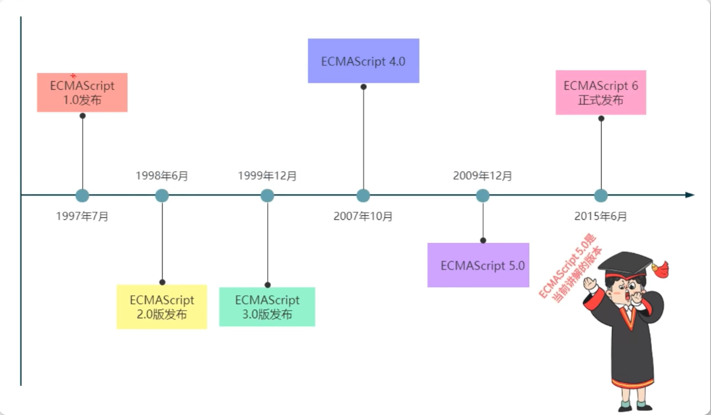

### 1.2 js代码引入方式

js代码使用的方式有三种与CSS引入很类似：

* **行内式js**,就是js代码直接写到html标签中，不常用。

  ```html
  <input type="button" value="aaa" onclick="alert('hello js')">
  ```

* **内嵌式js**，就是直接写到HTML文件body标签的`script`标签中

  ```html
  <body>
      <script>
         // js代码
         var age = 10;
      </script>
  </body>
  ```

* **外部式js**，其中外部也分为两种，一是**引入本地独立js文件**，其中最关键的就是type文件类型必须为**text/javascript**，src指定**文件存放路径**。js文件的后缀名为.js。

  ```html
  <body>
   <script type="text/javascript" src="./本地文件.js"></script>
  </body>
  ```

* 二是**引入网络来源文件**，核心是src指定**网络文件网址**。

  ```html
  <body>
    <script src="https://cdn.bootcdn.net/ajax/libs/jquery/3.6.0/jquery.min.js"></script>
  </body>
  ```

> 注意:外部式的两种方法既可以写在body中引入，也可以在head中引入，一般推荐body中引入。

## 二、JavaScript语法

js代码是从上到下依次执行的，每一行代码就是一个**语句**，语句以**分号**结尾，一个分号就表示一个语句结束。案例如下

```js
var num = 10;
```

### 2.1 注释

所谓**注释**，就是不被引擎所解释的内容。它的作用就是对代码进行标注解释。

**js注释**(有两种)

```js
// 单行注释

/*
多行
注释
*/
```

**css注释**

```css
h3{
    /* color: red；*/
    font-size: 30px；
}
```

**html注释**

```html
<!-- 注释 -->
```

注释会让**代码变灰色**也就是表明该代码不可用。VScode软件中注释的快捷键为：`Ctrl+/`

### 2.2 JS的输入输出方式

js常用输入方式`prompt`

```js
//这是一个输入弹窗
var age = prompt("请输入年龄");

//这是输出弹窗,输出输入的内容
alert(age);
```

js常用的输出方式有三种:

```js
//1.对话框输出
alert("输出内容");
//2.控制台文本输出
console.log("输出内容");
// 3. html页面文本输出,这是其中document是DOM的知识，这里只了解即可
document.write("输出内容");
```

### 2.3 变量

**变量(variable)**指的是动态变化的值，因为值要动态变化，所以变量实际上是用于**存放数据的容器**。通过**变量名**可获取变量的数据，也可对数据进行修改。

> 变量的本质是程序在内存中申请的一块用来存放数据的空间。

变量的使用主要分为两步:

1. **声明变量**，也就是给变量命名，声明变量后计算机就会自动为变量分配内存空间，其名称就是你的变量名。

   > var是js声明变量的关键字，它就是variable的简写。

   ```js
   var age; //声明变量age
   ```

2. **赋值变量**，在变量中存储数据。

   ```js
   age = 10; //age赋值10
   ```

变量声明与赋值可同时编写，这种写法就叫做**变量的初始化**。

```js
//变量初始化
var num = 10;
console.log(num); //打印变量
//变量更新
num = 30; //num变量重新赋值为30，原来的值就会被覆盖

// 同时声明多个变量,然后赋值
var a, b, c;
a = 10;
b = 20;
c = 30;

//同时初始化多个变量
var d = 20,e = 30;

//声明变量的特殊情况
//1. 只声明不赋值
var aaa;
console.log(aaa); //undefined

//2. 只赋值不声明，不会报错但不推荐这样写
sex = "男";
console.log(sex); //男

//3.不声明不赋值，会报错
console.log(user); //报错

//4.不声明不赋值，但变量名为name,不会报错,且打印为空
console.log(name);//空数据
```

**变量提升**:JavaScript引擎的工作方式是先解析代码，获取所有被声明的变量，然后再一行行从上到下依次执行代码。这造成的结果就是不管变量声明在何处，最终都会被提升到**代码头部**。

```js
console.log(num);
var num = 10;
```

该代码运行结果并不是报错 而是打印了**undefined**。其原因就是变量提升，将代码变为了:

```js
var num;
console.log(num); //undefined
num = 10;
```

**变量的命名规范**:

1. 由字母(A_Za_z)、数字(0-9)、下划线(_)以及美元符号($)组成;
2. 严格区分大小写，app与App是两个变量;
3. 不能以数字开头;18age是错误的;
4. 不能是**关键字**、**保留字**。例如var、for等，name也不要用，对于有些浏览器它是有含义的;
5. 变量名必须有意义。常用英文单词，用age不用nianling;
6. 使用驼峰命名法。也就是首字母小写，后面每个单词首字母大写。例如myFirstName;

**标识（zhi）符**指的是用来识别各种值的合法名称，例如**变量名**、**属性名**、**函数名**以及**参数名**等。规范的变量命名就是合法的标识符。

> 中文是合法的标识符，但不推荐使用。

标识符不能是**关键字**和**保留字**。

**关键字**指的是JS本身已经使用的名字，不能再用它们充当变量名与方法名。

> 包括：break、case、catch、continue、default、delete、do、else、finally、for、function、if、in、instanceof、new、return、switch、this、throw、try、typeof、var、void、while、with等

**保留字**指的是JS预留的"关键字",就是现在没使用但未来可能成为关键字的名字。

>包括：boolean、byte、char、class、const、debugger、double、enum、export、extends、final、float、goto、implements、import、int、interface、long、mative、package、private、protected、public、short、static、super、synchronized、throws、transient、volatile等

关键字与保留字不用专门记忆，用多了就自然就熟悉了。

案例:交换两个变量值

```js
var a = 10,b = 20;
console.log(a, b); //10 20
//临时变量
var temp;
temp = a;
a = b;
b = temp;
console.log(a, b); //20 10
```

### 2.4 数据类型

#### 2.4.1 数据类型定义

在计算机中，不同的数据所占用的存储空间大小是不同的，为了便于把数据分成所需内存大小不同的数据，充分利用存储空间，于是就产生了**数据类型**。

js是一种**弱类型**或者**动态类型**的语言。这意味着js代码不用提前声明变量类型，**在程序运行过程中，类型会根据赋值的数据来自动确定**。

```js
//Java语言
int num = 10; //num在变量声明阶段就确定是int数字类型

//js语言
var num2; //不确定num2的数据类型
num2 = 10; //num2是数字类型
num2 = "aa"; //num2又变为字符串类型，说明类型是动态的
```

#### 2.4.2 数据类型分类

在ES5的规范中，js中数据类型有六种。主要被分为两大类:

+ **简单数据类型(基本/原始数据类型)**，分别是`数值(数字)`、`布尔值`、`字符串`、`null`、`undefined`。
+ **引用数据类型(复合/合成数据类型)**，只有一个`对象(object)类型`，它往往是由多个简单数据类型组合而成的。

> 在ES6中又新增了两种**Symbol**类型与**Bigint**类型。

##### 2.4.2.1 数字型（number）

```js
var num1 = 10; //整数
var num2 = 3.14; //小数,浮点数

//1. 八进制 0~7 八进制以0o开始 老版本是0开始
var num3 = 0o011;
console.log(num3); //9,console输出默认会转化为十进制

//2. 十六进制 0~9 a~f 以0x开始
var num4 = 0x01a;
console.log(num4); //26

//3. 二进制 只有01,以0b开始
var num5 = 0b00001100;
console.log(num5); //12

//十进制与其他进制的相互转化
console.log(parseInt("1010", 2)); //二进制变十进制,其他进制修改第二个参数即可
console.log((10).toString(2)); //十进制变二进制
console.log((10).toString(8)); //十进制变八进制
console.log((10).toString(16)); //十进制变十六进制

//4. 数字型最大值与最小值
console.log(Number.MAX_VALUE); //1.7976931348623157e+308
console.log(Number.MIN_VALUE); //5e-324

//5.数字型的特殊值
console.log(Infinity); //正无穷大
console.log(Number.MAX_VALUE * 2); //正无穷大 Infinity
console.log(-Number.MAX_VALUE * 2); //负无穷大 -Infinity
console.log("aaa" - 100); //NAN，非数字 not a number

console.log(typeof Infinity); //number数字类型
console.log(typeof NAN); //undefined类型
```

验证是否为非数字类型的方法`isNAN`，如果是数字返回false，不是数字返回true。

```js
console.log(isNaN(12)); //false
console.log(isNaN(-Infinity)); //false
console.log(isNaN("aa")); //true
```

##### 2.4.2.2 字符串型（string）

字符串就是零个或多个排在一起的字符，放在**单引号**或**双引号**中。HTML中使用的双引号，JS中更推荐使用单引号。

```js
//2. 字符串类型，被双引号或单引号包裹大类型
var name = '张三';
var name = "李四";
```

字符串是可以嵌套的。也就是单引号内部可使用双引号，双引号内部可使用单引号。如果双引号(单引号)中要使用双引号(单引号)就需要转义字符`\`进行转义。
字符串默认只写一行，如果要**换行编写字符串**，也需要使用转义字符才行。

```js
//1. 单双引号嵌套
var c = 'ABC"双引号"';
var d = "哈哈哈'单引号'dd";

//2. 双引号嵌套
var e = 'adn"大喊大叫"对的axcs';

//3. 字符串换行编写
var g =
  "换行\
对对对\
ddd\
大";

//4. 字符串换行
var h = "你好 \n 未来";
console.log(c); //ABC"双引号"
console.log(e); //adn"大喊大叫"对的axcs
console.log(g); //换行对对对ddd大
console.log(h); //你好 (换行)未来
```

JS中常用的转义符

| 转义符 | 解释说明                 |
| ------ | ------------------------ |
| \n     | 换行符，n是newline的意思 |
| \\\    | 斜杠\                    |
| \\\'   | 单引号                   |
| \\"    | 双引号                   |
| \t     | tab缩进                  |
| \b     | 空格，b是blank的意思     |

>**温馨提示:**
>字符串通常都使用**单引号**，单双引号嵌套一般不要写会引发字符串混乱。

`length`属性用于检测字符串长度，可返回**字符串的长度值**，该属性是无法改变**只读的**。

```js
var str = "zhangshang";
console.log(str.length); //10
```

字符串拼接，使用`+`号,口诀为**数值相加，字符相连**。

```js
console.log("沙漠" + "骆驼"); //沙漠骆驼
console.log("我的年龄" + 18); //我的年龄18
console.log("我的年龄" + true); //我的年龄true
console.log(18 + 18); //36
console.log("18" + 18); //1818
//拼接变量,交互小案例
var age = prompt("请输入你的年龄:");
var str = "我的年龄" + age + "岁!";
alert(str);
```

##### 2.4.2.3 布尔型（boolean）

布尔类型，值只有`true`与`false`，true表示1，false表示0。

```js
console.log(true); //true
console.log(false); //false
console.log(true + 1); //2
console.log(false + 1); //1
```

##### 2.4.2.4 undefined与null

一个变量被声明时默认值为undefined。`undefined`表示数值为空。

```js
var age;
console.log(age); //undefined
var a = undefined;
console.log(a + "AA"); //undefinedAA
console.log(a + 1); //NAN
console.log(a + true); //NAN
```

`null`是空值或空对象。一般用于赋值对象为空。也就是变量本打算存储对象，但暂时没想好因此用null先代替。

```js
var space = null;
console.log(space + "AA"); //nullAA
console.log(space + 1); //1
console.log(space + true); //1
```

##### 2.4.2.5 数据类型检测 typeof

js中有专门的**运算符**用于帮助我们判断数据类型，它就是`typeof`。

```js
var age = 10;
var name = "张三";
var sex = true;
var person = {};
console.log(typeof age); //结果为number 也就是数字类型
console.log(typeof name); //结果为string 也就是字符串类型
console.log(typeof sex); //结果为 boolean 也就是布尔类型
console.log(typeof undefined); //undefined

//typeof判断复合类型不一定准确，多种情况都是object
console.log(typeof person); //object
console.log(typeof []); //object
console.log(typeof null); //object

//prompt输入数字时的变量类型
var ss = prompt("请输入年龄:");
console.log(ss);
console.log(typeof ss); //string
```

数据类型也可以通过浏览器控制台打印内容的颜色判断，黑色为字符串类型，蓝色是数值型，浅蓝色是布尔型，灰色是undefined与null。

> **字面量**就是在源代码中固定值的表示法。通俗来说就是字面量就是表示如何表达这个值。
>
> 数字字面量：8，9，10
>
> 字符串字面量：'aaa',"张三"
>
> 布尔字面量：true,false

* 未写**引用数据类型**，又叫复合/合成数据类型，其往往是由多个原始数据类型组合而成的**对象（object）**。
  ```js
  // {}包裹对象，赋值用冒号，每个原始数据用逗号分隔开
  var user = {
      name: "张三",
      age: 10,
      learned: true,
      //可嵌套
      add: {
            name2: "gg"
      },
      //数组
      array: [1, 2, 3]
  };
  //打印属性
  console.log(user.name);//张三
  console.log(user.add.name2);//gg
  console.log(user.array[1]);//2
  ```

##### 2.4.2.6 数据类型转换

数据类型转换就是把一种数据类型的变量转换成另外一种数据类型。

**数字转换字符串**

```js
var num = 10;
//1. toString方法转换
console.log(num.toString()); 
//2. String方法强制转换
console.log(String(num));
//3. 隐式转换，利用字符串+拼接的原理
console.log(num + ""); 
```

**字符串类型转换数字型**

```js
//1. parseInt方法转换为整数
console.log(parseInt("18")); //18
console.log(parseInt("3.98")); //3
console.log(parseInt("120px")); //120,会去掉单位，该效果必须数字开头才行，遇到字母就结束
console.log(parseInt("aa120px")); //NAN

//2. parseFloat方法转换为小数
console.log(parseFloat("18")); //18
console.log(parseFloat("3.98")); //3.98
console.log(parseFloat("120px")); //120,会去掉单位，该效果必须数字开头才行，遇到字母就结束
console.log(parseFloat("aa120px")); //NAN

//3. 强制转换，Number方法
console.log(Number("123")); //123

//4. 隐式转换,利用算术运算 - * /号码
console.log("10" - 1); //9
console.log("10" - "0"); //10
console.log("10" * "2"); //20
console.log("10" / "5"); //2
```

案例:简单字符串数字相加求和

```js
var num1 = prompt("输入1号数字:");
var num2 = prompt("输入2号数字:");
var result = parseFloat(num1) + parseFloat(num2);
console.log(result);
//简便写法
var result2 = num1 - -num2;
console.log(result2);
```

**转换为布尔型**

```js
//转换布尔型使用Boolean方法，除了下面五个特殊值为false，其他值转换都为true
console.log(Boolean("")); //false
console.log(Boolean(0)); //false
console.log(Boolean(NaN)); //false
console.log(Boolean(undefined)); //false
console.log(Boolean(null)); //false

console.log(Boolean("aa")); //true
console.log(Boolean(12)); //true
console.log(Boolean(" ")); //空格也为true
```


### 2.5 运算符

**运算符(operator)**也被称为操作符，是用于实现赋值、比较和执行算术运算等功能的**符号**。

**表达式**：是由数字、运算符、变量等以能求得数值的有意义的排列方法所得的组合，简单来讲就是由数字、运算符、变量组成的式子。

**返回值**：所有的表达式都会有一个结果返回，返回的值就称为返回值。例如：1+1就是表达式，结果为2就是返回值。

```js
//将表达式的返回值赋值给变量
var num = 1 + 2;
```

#### 2.5.1 算术运算符

算术运算符主要用于两个变量或值的算术运算。常用的有**加减乘除取余运算符**。

```js
var num1 = 15;
var num2 = 10;
//加法运算符
console.log(num1 + num2); //25
//减法运算符
console.log(num1 - num2); //5
//乘法运算符
console.log(num1 * num2); //150
//除法运算符
console.log(num1 / num2); //1.5
//取余运算符，它可以用于判断数字是否能被整除，只要结果为0就表示能被整除
console.log(num1 % num2); //5
console.log(3 % 5); //3
```

**浮点数算术运算**有不精确的问题，因为所有运算其实都是先将十进制数字转换的二进制，运算完成后再转换为十进制的。所有浮点数的运算精度远远不如整数。浮点数最高精度是**17位小数**。

```js
console.log(0.1 + 0.2); //0.30000000000000004
console.log(0.07 * 100); //7.000000000000001

//不能直接使用浮点数进行相等比较
var num = 0.1 + 0.2;
console.log(num == 0.3); //false
```

**自增自减运算符**，想要变量自己加一或减一，传统的表达式太麻烦，这时就可以考虑自增自减运算符。**该运算符必须和变量一起使用，普通数字不能使用。**

```js
//前置自增与后置自增的区别练习
//原始的变量加一的写法
var num = 1;
num = num + 1;
console.log(num);

//自增加一写法
//前置递增运算符
console.log(++num); //3
//前置递减运算符
console.log(--num); //2
//后置递增运算符
console.log(num++); //2
//后置递减运算符
console.log(num--); //3
```

自增自减运算符根据运算符放在**变量的前后**位置不同，可以分为**前置自增运算符**和**后置自增运算符**。前置与后置的区别：**前置递增是先变量加一然后再返回变量值；后置递增是先返回变量值然后再变量加一。**

```js
//前置自增与后置自增的区别练习
//该案例要考虑算术优先级，++优先级高于+,因此会先执行完成自增自减然后再进行+
var a = 10;
++a;
var b = ++a + 2;
console.log(b); //12+2=14

var c = 10;
c++;
var d = c++ + 2;
console.log(d); //11+2=13

var e = 10;
var f = e++ + ++e; //10+12，e++执行完成e会变为11
console.log(f); //22

var e1 = 10;
var f1 = ++e1 + e1++; //11+11
console.log(f1); //22
```

自增自减运算符还拥有**转换字符串为数字类型**的效果

```js
var num = "11";
console.log(num++ + 2); //数字13
```

#### 2.5.2 赋值运算符

**赋值运算符（=）**，主要用于将等号右边的值赋值给等号左边。

```js
var x = 10; //就是将10赋值给x
var y = x; //y的值等于10

//赋值运算符结合算术运算符
x += 10; //x=20,相当于x=x+10
y -= 5; //y=5,相当于y=y-5
x /= y; //x=4,相当于x=x/y
y *= y; //y=25
y %= x; //y=1
```

#### 2.5.3 比较运算符

比较运算符又叫关系运算符主要用于**比较两个数据的大小或是否相等**，返回的值为**布尔值**。

```js
var x = 10;
var y = 20;
console.log(x > y); //false
console.log(x < y); //true
console.log(x >= y); //false
console.log(x <= y); //true

//相等运算符，只要值相等就返回true，==会转换字符型为数值型
var num1 = 10;
var num2 = "10";
console.log(num1 == num2); //true
//严格相等运算符，值与类型都必须相同才返回true
console.log(num1 === num2); //false

//不等运算符，只要值不相等就返回true
var num1 = 10;
var num2 = "10";
console.log(num1 != num2); //false
//严格不等运算符，值与类型都必须不相同才行，一个不等都返回true
console.log(num1 !== num2); //true
```

#### 2.5.4 布尔运算符

布尔运算符是**逻辑运算符**，它主要用于**进行布尔值运算**，经常用于多个条件判断。它的返回结果也是**布尔值**。

| 逻辑运算符 | 说明              |
| ---------- | ----------------- |
| **&&**     | 逻辑与，and的意思 |
| **\|\|**   | 逻辑或，or的意思  |
| **！**     | 逻辑非，not的意思 |

**取反运算符（!）**，逻辑非。true变false，false变true。它也有转换类型的效果。

```js
//布尔值取反
console.log(!true); //false
console.log(!false); //true

//非布尔值取反，一般会把取反的内容先转化为布尔值，然后再取反。除了下面六个的内容其他为true，其他都为false。
console.log(!undefined); //true
console.log(!null);
console.log(!false);
console.log(!0);
console.log(!NaN);
console.log(!""); //空字符串 true

console.log(!100); //false
```

**且运算符（&&）**，表示多个条件必须同时为true才返回true，否则返回false。

```js
console.log(10 < 20 && false); //false
console.log(10 < 20 && true); //true
```

**或运算符（||）**，表示多个条件只要有一个为true就返回true。同时为false才返回false。

```js
console.log(10 < 20 || false); //true
console.log(10 > 20 || false); //false
```

#### 2.5.5 逻辑中断(重要)

逻辑中断又叫做**短路运算**，其原理是当有多个表达式(数值)时，左边的表达式的值可以确定结果时，就不再继续运算右边的表达式的值。

```js
//1. 逻辑与的短路运算,如果表达1为真，则直接返回表达式2的值。如果表达1为假则直接返回表达式1。
console.log(123 && 456); //456
console.log(0 && 456); //0
console.log(0 && 1 + 2 && 456 * 5678); //0，只要开始为false，后面再多表达式都无效
console.log("" && 1 + 2 && 456 * 5678); //''，只要开始为false，后面再多表达式都无效

//2. 逻辑或的短路运算,如果表达1为真，则直接返回表达式1的值。如果表达1为假则直接返回表达式2。
console.log(123 || 456); //123
console.log(0 || 456); //456
console.log(123 || (1 + 2 && 456 * 5678)); //123，只要开始为true，后面再多表达式都无效
console.log(0 || 456 || (1 + 2 && 456 * 5678)); //456，只要开始为true，后面再多表达式都无效

//逻辑中断会影响代码的执行结果
var num = 0;
console.log(123 || num++); //123
console.log(num); //num结果还是0，num++被中断无法执行
```

#### 2.5.6 运算符优先级

运算符的执行顺序与其优先级有关。

| 优先级 | 运算符     | 顺序                    |
| ------ | ---------- | ----------------------- |
| 1      | 小括号     | ()                      |
| 2      | 一元运算符 | ++，--，！              |
| 3      | 算术运算符 | 先乘*除/取余%，后加+减- |
| 4      | 关系运算符 | >,>=,<=,<               |
| 5      | 相等运算符 | ==,!=,===,!==           |
| 6      | 逻辑运算符 | 先与**&&**后或**\|\|**  |
| 7      | 赋值运算符 | =                       |
| 8      | 逗号运算符 | ,                       |

```js
//因为&&与||的优先级最低,因此执行顺序先将&&与||两边的4个表达式，,四个表达式算出结果为false || true && true && true,然后先算与再算或结果为true
console.log(4 >= 6 || "a" != "aa" && !(12 * 2 == 144) && true); //true,

//下面两个也是同理,赋值运算最后
var num = 10;
console.log(5 == num / 2 && (2 + 2 * num).toString() === "22"); //true

var d = !(3 > 5) || (2 === "2" && true);
console.log(d); //true
```

#### 2.5.7 三元运算符

所谓三元运算符，就是需要的运子(运算元素)有三个。不同运算符区分:

+ 取反运算符是**一元运算符**，因为它只要一个元素，**!true**，true就是元素。
+ 比较运算符是**二元运算符**，因为它需要两个元素，**a>b**，a与b就是元素。
+ 三元运算符，它主要用于逻辑判断。其格式为`(条件a)？表达式b:表达式c`，其中a，b，c就是三个元素。**其执行效果为:条件a如果为true，返回表达式b，为false返回表达式c。**
  ```js
  var x = 1;
  var y = 2;
  console.log(x > y ? "x>y" : "x<=y"); //结果为x<=y
  ```

> 三元运算符可以视为if...else条件语句的简写形式。可用于多种场合。

```js
var num = 12;
//判断奇数还是偶数
if (num % 2 === 0) {
 console.log("偶数");
} else {
 console.log("奇数");
}
//使用三元运算符替换写法
var result = num % 2 === 0 ? "偶数" : "奇数";
console.log(result);//运行结果都是偶数

//数字补零案例，用户输入0-59的数字用于倒计时。
var time = prompt("请你输入一个0-59的数字:");
var reuslt = time < 10 ? "0" + time : time;
alert(reuslt);
```

### 2.6 流程控制-条件语句

流程控制就是控制代码按照什么结构顺序执行。js中有三种流程控制结构：

+ **顺序结构**：默认代码的执行顺序，就是按照代码编写的顺序从上到下执行；
+ **分支结构**：根据不同的条件，执行不同的路径代码，从而得到不同的结果（多选一）。选择条件为真的语句执行；
+ **循环结构**：根据条件重复多次执行同样的代码，直到条件不满足时结束循环。

#### 2.6.1 if语句

if语句是根据单个条件判断是否执行代码的语句。条件成立，执行大括号内的代码，否则什么也不做。

```js
var flag = false;
if (flag) {
  //flag条件为true执行{内部内容}
  console.log("条件为true就执行");
}
```

if语句只执行满足条件的内容，如果想要执行不满足条件的内容，则用`if...else...`语句

```js
var m = 3;
if (m === 3) {
  console.log("满足条件时执行");
} else {
  console.log("不满足条件时执行");
}
```

案例：判断闰年

```js
//闰年条件,能被4整除且不能被100整除为闰年或者能被400整除的为闰年
var year = prompt("请你输入年份：");
if ((year % 4 === 0 && year % 100 !== 0) || year % 400 === 0) {
  alert("闰年");
} else {
  alert("平年");
}
```

如果要进行多个条件判断，则可通过连接多个if...else完成。

```js
var score = prompt("请输入成绩：");
if (score >= 90) {
  //满足score大于等于90执行
  alert("成绩A");
} else if (score >= 80) {
  //满足score大于等于80小于90执行
  alert("成绩B");
} else if (score >= 70) {
  //满足score大于等于70小于80执行
  alert("成绩C");
} else if (score >= 60) {
  //满足score大于等于60小于70执行
  alert("成绩D");
} else {
  alert("成绩不及格");
}
```

if...else可嵌套使用。嵌套if就是多层次逻辑判断。

```js
var m = 13;
if (m > 10) {
  if (m >= 20) {
    console.log("m大于等于20");
  } else {
    console.log("m大于10小于20");
  }
} else {
  console.log("m小于等于10");
}
```

> **温馨提示:**
> if总是找离它最近的同级else进行匹配。

#### 2.6.2 switch条件语句

多个if...else一起使用代码过多，可使用更简洁的switch语句代替。

switch与if的条件一般不同，switch的条件是**特定值**。特定值就是固定值，例如1，"张三"等，if的条件大部分是范围值，例如大于50。

switch与if执行效果也不一样，它会**直接跳到条件满足的语句执行**，而不会像if那样依次判断条件执行，因此**有时switch效率高于if**。

```js
var day = 3;
switch (day) {
 case 0:
   //day === 0时才满足条件
   console.log("星期一");
   break;
 case 1:
   console.log("星期二");
   break;
 case 2:
   console.log("星期三");
   break;
 case 3:
   console.log("星期四");
   break;
 case 4:
   console.log("星期五");
   break;
 defalut: 
   console.log("周末");
}
```

> **温馨提示:**
> **case**语句用于判断条件，条件满足则进入内部执行，**break**语句用于**跳出switch结构**，没有break语句只要满足一个条件，后面所有的逻辑语句都会执行，**default**表示其他条件，与else效果一致。

**缺少break的案例**

```js
var x = 2;
switch (x - 1) {
  case 0:
    console.log("x=1");
  case 1:
    console.log("x=2");
  case 2:
    console.log("x=3");
  default:
    console.log("其他");
}  //执行结果为"x=2，x=3，其他"都会打印
```

### 2.7 流程控制-循环语句

循环语句就是用于**重复执行某些的语句**。被重复执行的语句叫做**循环体**。

#### 2.7.1 for循环语句

for语句是循环命令，可指定循环的**起点**、**终点**和**终止条件**。

```js
for(初始化表达式；条件；迭代因子){
    //循环体
}
```

> **for执行顺序流程为**:
>
> 先执行初始化表达式，然后执行条件判断，条件成立执行循环体，然后执行迭代因子，这时第一次循环完成，
>
> 接下来就用变化的迭代因子再次执行条件判断，条件成立执行循环体，然后执行迭代因子，后续循环以此类推，
>
> 直到条件不满足时，结束循环。

for循环的括号中有三个表达式:

1. **初始化表达式(initialize)**，确定循环变量的初始值，只在循环中执行一次，用于**计数**。
2. **条件表达式(test)**，每次循环开始时，都要执行的条件，只有条件为真，才能继续循环。
3. **迭代因子(increment)**，每次循环最后执行的操作，通常用来**更新循环变量**。

```js
//从1打印到100
for (var i = 1; i <= 100; i++) {
   console.log(i);
}
```

**浏览器的断点调试(重要)**，打断点主要用于我们观察程序的执行过程，也是找出**程序bug**的方法。

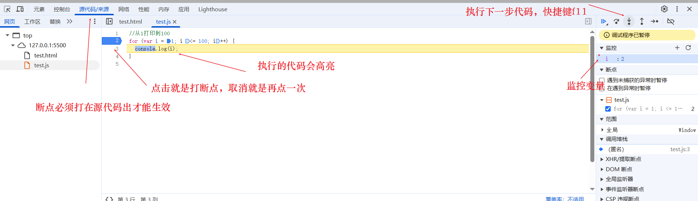

for循环的三个表达式，可以省略任何一个，也可全省略，全部省略就是无限循环(死循环)。死循环会让浏览器卡死。

```js
//注意分号不能省略
for (;;) {
   console.log("死循环");
}
```

逻辑比较复杂时，就会使用**双重for循环**也叫循环嵌套。外层循环执行一次，里层循环执行全部。

```js
//打印五行五列星星
var str = "";
for (var i = 1; i <= 5; i++) {
  for (var j = 1; j <= 5; j++) {
    str += "★";
  }
  //换行
  str = str + "\n";
}
console.log(str);
```

案例:九九乘法表

```js
for (var i = 1; i <= 9; i++) {
  //换行
  document.write("<br/>");
  for (var j = 1; j <= i; j++) {
     sum = i * j;
     document.write("|", j, "*", i, "=", sum, "|", " ");
  }
}
```

#### 2.7.2 while循环

while（当...的时候）循环包含一个循环条件和一段代码块，只要条件为真，就不断循环执行代码。直到条件为假才结束循环。

```js
while(条件){
  //循环体
}
```

while可以看作是一种特殊的for循环。for需要的结构它其实都有。

```js
//打印1到100
//可以看出for是可以改为while循环的
var i = 1;  //相当于for循环的初始化表达式
while (i <= 100) { //相当于for循环的条件表达式
  console.log(i);
  i++; //相当于for循环的迭代因子
}
```

如果条件一直为true，则会无限循环，也就是死循环。

```js
while(true){
  console.log("无限循环");
}
```

while循环与for循环不同之处在于while可以做**比较复杂的条件判断**，for循环的条件一般只是数字，用于计数。

```js
var message = prompt("请输入你的名字：");
//while的判断条件为字符串
while (message !== "张三") {
  message = prompt("名字错误，请重新输入你的名字：");
}
alert("名字正确！");
```

#### 2.7.3 do while循环

do...while语句其实是while语句的一个变体。该循环会**先执行一次代码块**，然后对条件表达式进行判断，如果条件为真，就会重复执行循环体，否则退出循环。while不同之处是一开始就先对条件进行判断再执行代码块。

> do while的代码块至少会执行一次，while的代码块可能一次都不执行。

```js
//打印1到100，执行结果与while是一样的
//do while循环的
var i = 1;  //相当于for循环的初始化表达式
do { 
  console.log(i);
  i++; //相当于for循环的迭代因子
}while (i <= 100)  //条件表达式
```

do...while与while的不同,修改前面while的复杂条件案例就可看出区别。

```js
//do while的判断条件为字符串
do {
  var message = prompt("请输入你的名字："); //默认执行一次因此可省略前面的内容
} while (message !== "张三");
alert("名字正确！");
```

#### 2.7.4 break语句和continue语句

break语句和continue语句都具有**跳转作用**，可以让代码不按既有顺序执行。
break语句用于**跳出代码块**或**循环结束**，switch语句和for循环中都可使用。

```js
//如果i等于5，就直接结束循环
for (var i = 0; i < 10; i++) {
  if (i === 5) {
    //跳出循环
    break;
  }
  console.log(i);
} //运行结果 1，2，3，4
```

continue是**跳出单次循环**，它是立即终止本轮循环然后开始下一轮循环。

```js
//如果i等于5，就跳出单次循环，不结束循环,注意跳出的只是循环体内容，迭代因子i++还是会执行
for (var i = 0; i < 10; i++) {
  if (i === 5) {
    //跳出单次循环
    continue;
  }
  console.log(i);
} //运行结果 1，2，3，4，6，7，8，9

//求1-100之间，除了能被7整除之外的整数和
var sum = 0;
for (var i = 1; i <= 100; i++) {
  if (i % 7 == 0) {
    continue;
  }
  sum += i;
}
console.log(sum);//4315
```

综合案例：**简易ATM机**(该案例不考虑输入负数金额的问题)

```js
//简易ATM
var atmChoose = prompt(
  "请输入你要的操作：\n 1.存钱  \n 2.取钱 \n 3.显示余额 \n 4.退出"
);
var money = 0;

while (atmChoose != 4) {
  if (atmChoose == 1) {
    //存钱
    var saveMoney = prompt("请输入你要存入的金额：");
    money += parseFloat(saveMoney);
    alert("你当前的总金额是：" + money);
  } else if (atmChoose == 2) {
    //取钱
    var getMoney = prompt("请输入你要取出的金额：");
    while (getMoney > money) {
      getMoney = prompt("你的余额不足,请重新输入取钱金额:");
    }
    money -= parseFloat(getMoney);
    alert("你当前的总金额是：" + money);
  } else if (atmChoose == 3) {
    //显示余额
    alert("你当前的余额是：" + money);
  } else {
    atmChoose = prompt(
      "请输入你要的操作：\n 1.存钱  \n 2.取钱 \n 3.显示余额 \n 4.退出"
    );
    continue;
  }
  atmChoose = prompt(
    "请输入你要的操作：\n 1.存钱  \n 2.取钱 \n 3.显示余额 \n 4.退出"
  );
}
alert("你已退出ATM");
```

### 2.8 数组

**数组(Array)**是一组数据的**集合**，其中每个数据被称为**元素**。数组是**按次序排列**的一组值。每个值的位置(又被称为**下标**)都有编号(从0开始)，数组用方括号`[]`表示。

创建数组的方式有两种：

1. 使用new关键字创建数组；
2. 使用字面量创建数组。

```js
//new创建数组对象
var arr1 = new Array();

//字面量创建数组,[]就表示一个数组
var arr2 = []; //空数组
//数组的初始化
var arr3 = [1, 2, "ss", true]; //js数组数据类型可以为任意类型,每个数据由逗号分隔
```

#### 2.8.1 数组的元素访问

数组主要是利用**数组索引(下标)**来访问数组元素的，它是从0开始的。获取格式为`数组名[索引号]`。

```js
//创建数组直接赋值
var arr1 = ["张", "三", "aaa"];

//也可利用下标对空数组赋值
var arr2 = [];
arr2[0] = "张";
arr2[1] = "三";
arr2[2] = "aaa";

console.log(arr1); //['张', '三', 'aaa'],直接打印数组所有数据
console.log(arr2); //arr1与arr2内容一样

console.log(arr1[0]); //"张"

console.log(arr1[5]); //数组越界，值为undefined
```

数组内部可以放任何数据类型，包括数组本身，如果多个数组嵌套也被称为**多维数组**。

```js
var arr = [1, true, "张", [0, "三"]];

console.log(arr[3][1]); //打印结果为"三"
```

数组有**length属性**，它表示数组的长度。

```js
var arr = [1, "44", [4, true]];

console.log(arr.length); //3
//打印二维数组长度
console.log(arr[2].length); //2
```

**数组新增元素**

```js
//新增元素
//方法1:直接修改数组长度
var arr = ["a", "b", "b"];
arr.length = 5;
console.log(arr); //['a', 'b', 'b', 空属性 × 2],这种新增的元素为两个空数据，都为undefined

//方法2:通过修改数组的索引新增元素
var arr1 = ["a", "b", "b"];
arr1[3] = "c";
console.log(arr1); //追加元素在数组末尾 ['a', 'b', 'b', 'c']
arr1[2] = "d"; //如果索引号被占用，则会变成数组元素修改,新元素覆盖原本的元素
console.log(arr1); //['a', 'b', 'd', 'c']
```

案例：筛选数组元素

```js
//筛选数组元素,选出数组中大于10的元素
var arr = [2, 0, 6, 7, 3, 4, 0, 23, 0, 88, 0, 19];
var newArr = [];
for (var i = 0; i < arr.length; i++) {
  if (arr[i] > 10) {
    //利用新数组的长度作为索引，可直接追加元素
    newArr[newArr.length] = arr[i];
  }
}
console.log(newArr);
```

#### 2.8.2 数组遍历

数组的遍历，就是依次访问一遍数组所有数据，一般使用for循环或者while循环。

```js
var username = ["id", "IME", "ddak", "Frank"];
//for循环遍历,数组索引从0开始
for (var i = 0; i < username.length; i++) {
  console.log(username[i]);
}

//while循环遍历
var k = 0;
while (k < username.length) {
  console.log(username[k]);
  k++;
}
```

数组遍历案例

```js
//1.求数组的和与平均值
var arr1 = [2, 6, 1, 7, 4];
var sum = 0;
var average = 0;
for (var i = 0; i < arr1.length; i++) {
  sum += arr1[i];
}
average = sum / arr1.length;
console.log(sum, average); //20 4

//2.求数组中的最大值
var arr2 = [2, 5, 22, 42, 78, 23, 4, 8, 12, 4];
//最大值开始为数组的第一个元素,这样for就可以从数组索引1开始
var max = arr2[0];
for (var i = 1; i < arr2.length; i++) {
  if (arr2[i] > max) {
    max = arr2[i];
  }
}
console.log(max); //78

//3.数组转换为字符串
var arr3 = ["red", "blue", "green", "pink"];
//分隔符
var sep = "|";
var str = "";
for (var i = 0; i < arr3.length; i++) {
  str += arr3[i] + sep;
}
console.log(str);

//4.数组翻转元素
var arr4 = ["red", "blue", "green", "pink", "yellow"];
var newArr = [];
for (var i = arr4.length - 1; i >= 0; i--) {
  newArr[newArr.length] = arr4[i];
}
console.log(newArr);
```

**冒泡排序算法**，是把一系列数据按照一定顺序排列显示的算法。简单来说就是对数组元素进行从大到小或从小到大排序。

冒泡排序的原理是通过两层for循环，分别遍历数组所有元素**两两比较**，如果遇到顺序错误，就交换两个元素的位置。外层循环就是需要比较数组元素的个数，内层循环每个元素要与其他元素比较的次数，该次数是会慢慢减少的。

```js
//冒泡排序 从小到大
var arr = [5, 3, 4, 2, 1, 6];
//arr.length长度减一是因为最后只剩一个元素时不用比较，因为之前已经比较完成了
for (var i = 0; i <= arr.length - 1; i++) {
  //arr.length - i - 1是因为随着交换的元素越多，后续需要比较的元素次数会逐渐减少
  for (var j = 0; j <= arr.length - i - 1; j++) {
    //交换变量
    if (arr[j] > arr[j + 1]) {
      var temp = arr[j];
      arr[j] = arr[j + 1];
      arr[j + 1] = temp;
    }
  }
}

console.log(arr);//[1, 2, 3, 4, 5, 6]
```

扩展：**for...in遍历数组**，看上去与for循环类似，但实际上是一种特殊的循环。

```js
var arr = ["zhan", "jjs", "adk", "Frank"];

for (var i in arr) {
  console.log(arr[i]);
}
```

### 2.9 函数

**函数**就是封装一段可以被反复调用执行的**代码块**。通过此代码块可以实现大量**代码的复用**。

#### 2.9.1 函数的声明与调用

`function`命令声明的代码区域就是**函数**。最简单的函数声明与调用如下:

```js
//1.function声明函数的关键字，add是函数名，一般为动词。函数不调用自己是不执行的。
function add() {
  console.log("函数内部");
}
//2.函数调用，就是通过"函数名+()"进行调用，调用一次函数就执行一次
add(); //"函数内部"
add(); //"函数内部"
```

函数名也有**函数名提升**。js引擎将函数名视同为**变量名**，所以function声明函数时，整个函数声明也会像变量声明一样被提升到代码头部。

```js
add(); //"函数名提升"
function add() {
  console.log("函数名提升");
}
```

**函数的封装**是把一个或多个功能通过函数的方式封装起来，对外只提供一个简单的函数接口用于调用。

```js
//函数封装
//封装一个功能为计算1-100之间的累加和的函数
//1.声明函数
function getSum() {
  var sum = 0;
  for (var i = 1; i <= 100; i++) {
    sum += i;
  }
  console.log(sum);
}

//2.调用函数
getSum();
getSum();
```

其实函数还有一种声明方式，我们称之为函数表达式的方式，该方式声明的函数是**匿名函数**。

```js
//1.利用函数关键字自定义函数(命名函数)
function getSum() {
  console.log("函数有名称，是命名函数");
}
getSum();

//2.函数表达式，它是直接赋值给变量，没有名称因此被称为匿名函数
var fun = function () {
  console.log("函数表达式");
};
fun(); //调用方式跟命名函数一样,fun是变量名
```

> 通过函数表达式可以看出，js中的变量范围很广泛，**函数也是一种变量**。

#### 2.9.2 函数参数

之前的函数只能重复相同的代码，每次函数执行结果都相同，如果想要函数实现函数重复不同代码就需要传递**函数参数**。

函数参数相当于函数的外部数据，通过不同外部数据得到不同结果，这种外部数据就是**参数**。

**函数声明**部分的参数被称为**形参**，也就是形式上的参数，没有具体的值。**函数调用**时传递的参数被称为**实参**。也就是实际的参数。

形参与实参是一一对应的关系。形参是接受实参的。相当于一个不用声明的变量。

```js
function add(a, b) {
  //a与b是形参
  console.log(a + b);
}

add(1, 2); //1,2是实参，在函数调用时，程序会把实参传递给形参,类似a=1,b=2，然后再执行函数体内容。
```

参数的作用：在函数内部某些值不能固定，我们可以通过参数在调用函数时传递不同的值进去。

```js
//求任何两个数之间的和
function getSums(start, end) {
  var sum = 0;
  for (var i = start; i <= end; i++) {
    sum += i;
  }
  console.log(sum);
}

getSums(1, 100); //5050
getSums(1, 10); //55
```

**形参与实参个数匹配规则**

```js
function getSums(num1, num2) {
  console.log(num1 + num2);
}

//1.形参与实参个数一致，则正常输出结果
getSums(1, 100); //101

//2.实参个数大于形参的个数，正常输出结果。会取到形参的个数,多出的参数会无效。
getSums(1, 100, 2); //101

//3.形参个数大于实参的个数，输出结果错误，没有实参的形参会默认赋值为undefined
getSums(1); //NaN
```

#### 2.9.3 函数的返回值

有时如果需要将**函数内部数据或函数的结果返回给调用者**，则需要使用`return`语句返回值。

其运行原理就是当函数遇到return,就会把后面的结果返回给函数的调用者，相当于`函数名()=return的结果`。

```js
//求任意两个数的最大值的函数
function getMax(num1, num2) {
  return num1 > num2 ? num1 : num2;
}

//两种接受函数结果的方式
console.log(getMax(23, 70)); //70
var max = getMax(33, 88);
console.log(max); //88
```

return后面不要添加任何代码，因为return就表示**函数结束**，后面的代码都不会执行，是无效的。return只能返回一个值，写多个值也只会返回最后写的值。没有return默认返回**undefined**。

```js
//1. return会终止函数
function add(num1, num2) {
  return num1 + num2;
  alert("aa"); //不会被执行
}
console.log(add(1, 2)); //3

//2. return一次只返回一个值
function fn(num1, num2) {
  return num1, num2;
}
console.log(fn(10, 20)); //20

//要返回多个值，则可返回数组或对象
function fn2(num1, num2) {
  return [num1, num2];
}
console.log(fn2(10, 20)); //[10, 20]

//3. 函数如果没有return，默认会返回一个undefined
function fn3(num1, num2) {
  num1 + num2;
}
console.log(fn3(10, 20)); //undeifed
```

#### 2.9.4 动态参数—arguments对象

当我们不确定有多少参数需要传递时，可使用`arguments`来获取实参。arguments实际上是当前函数的一个**内置对象**。所有函数都内置了该对象，arguments对象中存储了**传递过来的所有实参**。所谓**内置对象**，就是js内部编写好的对象，直接使用就行。

arguments是一种**伪数组**，它并不是真正意义上的数组，只是拥有部分数组特性。arguments拥有数组长度**length变量**，也可使用**索引号**访问内部数据，但它**不具有数组内置方法**，例如pop，push等。

```js
//argumens使用
function fn() {
  console.log(arguments);
  console.log(arguments.length); //3,5
  console.log(arguments[2]); //4,6
  //遍历所有参数
  for (var i = 0; i < arguments.length; i++) {
    console.log(arguments[i]);
  }
}

fn(1, 2, 4); //Arguments(3) [1, 2, 4, callee: ƒ, Symbol(Symbol.iterator): ƒ]
fn(1, 2, 3, 5, 6);
```

案例：**求任意个数的最大值**

```js
function getMax() {
  var max = arguments[0];
  for (var i = 1; i <= arguments.length; i++) {
    if (arguments[i] > max) {
      max = arguments[i];
    }
  }
  return max;
}

console.log(getMax(1, 2, 3)); //3
console.log(getMax(1, 22, 45, 8)); //45
console.log(getMax(11, 23, 23, 99, 108, 2, 3)); //108
```

除了使用arguments外，也可通过传递**数组参数**，从而实现传递**数据数量动态**。

案例：**翻转任意数组**

```js
//翻转任意数组
function reverse(arr) {
  var newArr = [];
  for (var i = arr.length - 1; i >= 0; i--) {
    newArr[newArr.length] = arr[i];
  }
  return newArr;
}

var arr1 = reverse([1, 2, 3, 6, 9]);
var arr2 = reverse(["red", "yellow", "green"]);
console.log(arr1); // [9, 6, 3, 2, 1]
console.log(arr2); //['green', 'yellow', 'red']
```

因为每个函数都是独立的代码块，如果需要完成复杂的功能，就需要**函数相互调用**的情况。也就是一个函数调用另外一个函数。

```js
//输入年份，判断2月份的天数
function backDay() {
  var year = prompt("请输入年份：");
  if (isRunYear(year)) {
    alert("是闰年，2月份有29天");
  } else {
    alert("是平年，2月份有28天");
  }
}

backDay(); //函数可以运行是因为下面的函数声明被提升了
//判断闰年的函数
function isRunYear(year) {
  var flag = false;
  if ((year % 4 == 0 && year % 100 != 0) || year % 400 == 0) {
    flag = true; //是闰年返回true
  }
  return flag;
}
```

除了上变自定义函数外，js也有一些**内置函数**，可提供给我们直接调用,一般内置函数都会在内置对象或构造函数中，后续会说明。

#### 2.9.5 立即执行函数(重要)

所谓立即执行函数，不需要调用的，函数立马就能直接执行函数。

立即执行函数最大的作用就是**独立创建了一个作用域**，里面所有的变量都是局部变量（函数作用域）。**避免命名冲突**的情况。这种写法最常见的就是写在外部js文件最开始，这样就能保证每个js引入都不会有命名冲突。

```js
//普通函数
function fn() {
  console.log("普通函数");
}

fn(); //需要调用才能执行

//1.立即执行函数的两种写法，本质是编写好函数后直接使用()调用,立即执行函数必须以;结尾
//推荐第一种
(function () {
  console.log("立即执行函数1");
})();

(function () {
  console.log("立即执行函数2");
}());

//2.立即执行函数也可以传递参数
(function (a, b) {
  console.log(a + b);
  var num = 10; //局部变量,不会影响
})(1, 2);

//3.立即执行函数也可命名，但其不能单独调用，因为不在其作用域中
(function fn2(a, b) {
  console.log(a + b);
  var num = 20; //局部变量,不会影响
})(3, 4);
//不能调用
// fn2(5, 6);
```

### 2.10 作用域

#### 2.10.1 作用域的定义

**作用域**指的是限定代码名称(例如变量名)**可用性的代码范围**。作用域作用是可以提高程序逻辑的局部性，增强程序的可靠性，**减少命名冲突**。

**命名冲突**指的是在同一作用域下命名**同名的变量或函数**就会发生冲突，后面的会覆盖前面的命名。

JS中作用域**在ES6之前**主要有两种：

+ **全局作用域**：Html中的**整个script标签范围**或者是**一个单独的js文件**。
+ **局部作用域（函数作用域）**：在函数内部就是局部作用域，该名称只在函数内部起效果和作用。

```js
//全局作用域
var num = 10;
var num = 100; //命名冲突，后命名的num会覆盖前面的num

function fn() {
  //局部作用域,命名同名num不会有冲突
  var num = 20;
  console.log(num); //20
}
fn();
//局部作用域的变量不生效
console.log(num); //100
```

> **注意：**
>
> js在ES6后会新增**块级作用域**的。所谓块级作用域，就是{}包含的代码就是块级作用域。例如在java中：
>
> if(x){ 
>
>   int num = 10;//该num变量就是在块级作用域定义的，外面是不能使用的
>
> }
>
> print(num); //会报错，num是块级作用域内部的

#### 2.10.2 变量的作用域

在js中，根据作用域的不同，变量也可以分为两种：

+ **全局变量**：在全局作用域下声明的变量或在**函数内部没有声明直接赋值的变量**，在全局作用域中都可使用。
+ **局部变量**：在局部作用域下声明的变量或**函数的形参**，**只能在声明的函数内部**中使用

```js
//全局变量
var num = 10;

function fn() {
  console.log(num); //可在局部作用域中打印全局变量
}

//形参aru也只能在函数内部使用，也是局部变量
function fn1(aru) {
  var num1 = 20;
  console.log(num1); //20
  //在函数内部没有声明直接赋值的变量也是全局变量，不建议使用
  num2 = 30;
}

fn();
fn1();
//局部变量失效
console.log(num2); //30
console.log(aru); //报错，局部变量没声明
```

从执行效率上看，全局变量只有在浏览器关闭时才会销毁，比较占内存。反之局部变量则是**当其所在的代码被执行时才初始化，代码执行完成后就会被销毁**，因此更节省内存空间。

#### 2.10.3 作用域链

我们知道只要是代码就有其作用域。函数内部就是局部作用域。如果**函数中嵌套函数**，那么在该局部作用域中会有新的局部作用域，又根据内部函数能够访问外部函数变量的原则，**用链式查找决定哪些数据能被内部函数访问**就被称为**作用域链**。

简单来说，就是**内部函数访问外部数据**，采用**就近原则**一层层往外查找。

```js
var num = 10;

function fn() {
  var num = 20;
  function fn2() {
    console.log(num); //20,链式查找就是就近查找，一层层往外查找
  }
  fn2();
}
fn();
```

作用域链案例

```js
var a = 1;
function fn1() {
  var a = 2;
  var b = "22";
  fn2();
  function fn2() {
    var a = 3;
    //这里函数先使用后声明，涉及了预解析，函数提升的内容
    fn3();
    function fn3() {
      var a = 4;
      console.log(a); //4
      console.log(b); //'22'
    }
  }
}
fn1();
```

### 2.11 预解析

JS代码是由浏览器中的JavaScript解析器(js引擎)来执行的。JavaScript解析器在运行js代码的时候主要分为两步：

1. **预解析**：js引擎会把js里面所有的**var变量声明**和**function函数声明**提升到**当前作用域的最前面**，该过程就叫**变量提升**和**函数提升**。
2. **代码执行**：按照代码书写地的顺序从上往下执行。

预解析分为变量提升和函数提升：

+ **变量提升**就是把所有的变量声明提升到当前作用域最前面，只提升变量声明不提升赋值。

  ```js
  console.log(a); //undefined
  var a = 10;
  
  fun(); //会报错，函数表达式也是一种变量
  var fun = function () {
    console.log(22);
  };
  ```

  预解析**变量提升**后代码如下：

  ```js
  var a;
  console.log(a); //undefined
  a = 10;
  
  var fun;
  fun(); //会报错
  fun = function () {
    console.log(22);
  };
  ```

+ **函数提升**就是把所有的函数声明提升到当前作用域最前面，只提升函数声明不提升函数调用。

  ```js
  fun(); //不会报错
  function fun() {
    console.log(22);
  }
  ```

  预解析**函数提升**后代码如下：

  ```js
  function fun() {
    console.log(22);
  }
  fun(); //不会报错
  ```

预解析案例

```js
var num = 10;
fun();
function fun() {
  console.log(num); //undefined,预解析＋作用域就近原则
  var num = 20;
}

fn1();

console.log(c);//9
console.log(b);//9
console.log(a);//报错
function fn1() {
  //注意是a=b=c=9不是var a=9,b=9,c=9;
  //它相当于 var a=9;b=9;c=9; //注意每个都是分号
  var a = (b = c = 9);
  console.log(a); //9
  console.log(b); //9
  console.log(c); //9
}
```

预解析后的真正的代码

```js
var num;
function fun() {
  var num;
  console.log(num); //undefined,预解析＋作用域就近原则
  num = 20;
}
num = 10;
fun();

function fn1() {
  var a;
  a = 9;
  b = 9;//b,c为全局变量
  c = 9;
  console.log(a);
  console.log(b);
  console.log(c);
}
fn1();
console.log(c);
console.log(b);
console.log(a); //报错
```

### 2.12 对象(重要)

#### 2.12.1 对象的概念

`对象(object)`是js语言的核心概念，也是**最重要的数据类型**。 对象就是一组`"键值对"(key-value)`的集合，是一种**无序的相关属性与方法的集合**。所有**复杂数据类型**都是对象，例如之前的字符串、数组等都是**对象类型**。在现实生活中对象就是一个**具体的事物**。

对象由属性和方法组成：

+ **属性**：描述对象的特征，在对象中用属性（也就是**变量**）来表示（常用名词）；
+ **方法**：描述对象的行为，在对象中用方法（也就是**函数**）来表示（常用动词）。

属性、变量、函数、方法的区别：

+ 变量：单独声明赋值，单独存在；
+ 属性：对象里面的变量，不用声明，用来描述对象的特征，必须使用`对象.属性名`才能使用；
+ 函数：单独存在，通过函数名就可直接使用；
+ 方法：对象里面的函数，不需要声明。使用`对象.方法名（）`方式调用，方法用于描述对象的行为与功能。

> **思考：**
>
> 为什么要使用对象？
>
> 在js中保存一个值，使用**变量**就可以。保存多个值，使用**数组**就可以。但如果要保存一个人的完整信息，是否可以使用变量或数组？
>
> 首先一个人有很多信息，也就是多个值，变量就不行。而如果使用数组保存，效果如下
>
> var person =['张三'，'男'，128，154]，我们会发现很多信息表达很不清晰，我们无法区分128与154哪个是身高与体重。
>
> 而使用对象就能完美解决上述问题，让结构更清晰。
>
> var person ={
>
>   name:'张三'，
>
>   sex:'男'，
>
>   体重:128，
>
>   身高：154；
>
> }

最简单的对象如下：

```js
var user = {
  //name就是键名,"zhang"就是对应的值
  name: "zhang"
};
```

如果属性的值还是一个**对象**，也就是对象嵌套，这种就会形成**链式引用**。

```js
var user = {
  name: "aa",
  age: 12,
  pp: [1, 5],
  container: {
    flag: true,
    front: "前端"
  },
  add: function () {
    console.log("aa");
  }
};
//链式调用
console.log(user.container.front); //"前端"
```

#### 2.12.2 对象的创建

对象的创建主要有三种方式:

一、**字面量创建对象**，也就是`{}`创建,属性使用**键值对**方式，用`：`分开，多个属性间用`，`分开。对象的每一个键名又被称为**属性(property)**，它的键值就是属性值可以是**任何数据类型**。
如果一个属性的值为**函数**，通常把该属性称为**方法**，它可以像函数那样被调用。

```js
var obj = {}; //空对象
var user = {
  //name就是键名,"zhang"就是对应的值
  name: "zhang",
  age: 19,
  sayHi: function () {
    console.log("hi");
  },
  //方法
  getName: function (name) {
    return name;
  }
};
//属性的调用两种方式,使用.和[]
console.log(user.name); //"zhang"
console.log(user["age"]); //19,属性名必须有引号
//方法的调用
user.sayHi(); //"hi"
//方法调用
console.log(user.getName("张三")); //"张三"
```

二、**使用`new Object`创建对象**，跟之前的`new Array`很类似。使用`=`赋值方法添加对象属性与方法，用每个属性与方法`；`分隔开。

```js
var obj = new Object(); //创建一个空对象
//对象属性赋值
obj.uname = "李四";
obj.age = 24;
obj.sex = "男";
obj.sayHi = function () {
  console.log("hello");
};

//调用
console.log(obj.uname);
console.log(obj["age"]);
obj.sayHi();
```

三、**使用构造函数的方法创建对象**。下面具体说明。

#### 2.12.3 构造函数（重要）

**使用构造函数的方法创建对象**，因为我们一次只能创建一个对象，里面很多的属性与方法都是大量相同的。如果要创建多个，就可以利用函数的方式封装这些重复的代码，我们就把这个函数称为**构造函数**。

构造函数中封装的不是普通代码，而是对象中抽取出来的属性与方法。因此它是一种特殊的函数，主要就是**用于初始化对象**。它总是和`new运算符`一起使用。它的本质很**java中的类**很像。

```js
//构造函数名的首字母必须大写
function Star(uname, age, sex) {
  //构造函数中属性前面必须使用this，代表当前对象
  this.name = uname;
  this.age = age;
  this.sex = sex;
  //构造函数不需要return就能返回结果
  //封装方法
  this.sing = function (sang) {
    console.log("唱的歌曲为" + sang);
  };
}

//使用构造函数实例化对象
var ldh = new Star("刘德华", 18, "男");
console.log(typeof ldh); //object,返回的是对象
console.log(ldh.name); //'刘德华'
console.log(ldh["age"]); //18
ldh.sing("冰雨"); //唱的歌曲为冰雨

//再次创建对象
var zxy = new Star("张学友", 19, "男");
console.log(zxy);
zxy.sing("hhh");
```

**构造函数与创建对象的关系**：

+ 构造函数，抽取的对象的公共部分，封装到函数里，它泛指某一大类对象（class）。例如Star()；
+ 创建对象，特指某一个对象，通过new关键字创建对象的过程我们称为对象实例化。例如new Star();

**new关键字的执行过程**：

1. 构造函数遇到new后，首先会在内存中创建一个空对象；
2. this关键字都会指向该空对象；
3. 执行构造函数中的代码，给空对象添加属性与方法；
4. 返回这个对象(所有不需要return)。

#### 2.12.4 遍历对象

因为对象中的**属性是无序的**，传统的for循环无法遍历，这时就需要使用`for...in`语句来遍历对象。它是专门用于遍历对象的。

```js
var obj = {
  name: "aaa",
  age: 18,
  sex: "男",
  sayHi: function () {
    console.log("hi");
  }
};

//for in遍历对象，key就是存放遍历的属性变量，通常写为key或k方便理解
for (key in obj) {
  console.log(key); //属性名name、age、sex,方法名为sayHi
  console.log(obj[key]); //属性值aaa、18、男，
  //一般不用来遍历方法，遍历方法的属性值就是该方法的内容ƒ () {console.log("hi");}
}
```

### 2.13 内置对象

js中对象主要分为3种，**自定义对象**、**内置对象**以及**浏览器对象**。其中自定义对象就是**自己创建的对象**，内置对象是**JS内部自带的对象**。前两个对象都是JS的内容，属于ECMAScript；第三个浏览器对象属于浏览器的，是JS独有的，后续会在JS API中讲解。

内置对象就是JS内部定义的对象，这些对象供开发者使用，并提供了一些**常用的**或是最基本属性与方法。它最大的优点就是帮助我们快速开发。

JS中常用的内置对象：Math、Date、Array、String等。

#### 2.13.1 查阅文档

内置对象有很多，其中包含的属性方法更多，因此完全记住是不现实的。因此学会查阅文档方法，才能帮助我们更好的学习内置对象。

通常我们查阅的文档主要是**MDN**[https://developer.mozilla.org/zh-CN/]网站和**W3C**[https://www.w3school.com.cn/]网站的文档。下面我们以MDN网站为例，其主要步骤为：

1. 先搜索要查阅的对象，例如以Math对象为例，现在搜索栏搜索Math对象就行；
2. 搜索到方法页面后，如果是其他语言就先选择中文；

如果要查阅学习对象中的属性其步骤为以`Math.PI`为例：

1. 先查阅该属性的主要功能：**`Math.PI`**为静态数据属性表示圆的周长与直径的比例；
2. 再查阅该属性的值以及特性：其值约为 3.14159；
3. 最后编写demo进行测试，也可查看学习文档的demo。

如果要查阅学习对象中的方法其步骤为以`Math.max()`为例：

1. 先查阅该方法的主要功能：该函数返回一组数中的最大值；
2. 再查阅参数的意义与类型：0个或多个数字，将在其中选择，并返回最大的值。
3. 然后查阅函数的返回值：返回给定数值中最大的数。如果任一参数不能转换为数值，则返回NaN。如果没有提供参数，返回-Infinity。
4. 最后编写demo进行测试，也可查看学习文档的demo。

#### 2.13.2 Math对象

Math对象是数学对象，它提供了各种**数学功能**。它是一个**内置静态对象**而不是一个函数对象，也就是不是构造函数不用使用new。

属性**PI**,圆周率值

```js
//圆周率
console.log(Math.PI); //3.141592653589793
```

**max与min函数**，max返回参数最大值，min返回参数最小值，如果参数为空，min返回`infinity`，max返回`-infinity`

```js
console.log(Math.max(2, -1, 5)); //5
console.log(Math.min(2, -1, 5)); //-1
//没有参数返回值
console.log(Math.max()); //-infinity，负无穷大
console.log(Math.min()); //infinity 正无穷

//有字符串时返回值,数字字符串正常返回，非数字则为NaN
console.log(Math.max(2, -1, "5")); //5
console.log(Math.min(2, -1, "5")); //-1

console.log(Math.max(2, "hi", "5")); //NaN
console.log(Math.min(2, "hi", "5")); //NaN
```

案例:**封装自己的Math对象**，理解Math对象的原理

```js
var myMath = {
  PI: 3.141592653,
  max: function () {
    if (arguments.length === 0) {
      return -Infinity;
    }
    var max = arguments[0];
    for (var i = 1; i < arguments.length; i++) {
      if (!parseFloat(arguments[i]) || !parseFloat(max)) {
        return NaN;
      }
      if (arguments[i] > max) {
        max = arguments[i];
      }
    }
    return max;
  },
  min: function () {
    if (arguments.length === 0) {
      return -Infinity;
    }
    var min = arguments[0];
    for (var i = 1; i < arguments.length; i++) {
      if (!parseFloat(arguments[i]) || !parseFloat(min)) {
        return NaN;
      }
      if (arguments[i] < min) {
        min = arguments[i];
      }
    }
    return min;
  }
};

//对象属性方法调用
console.log(myMath.PI);
console.log(myMath.max("aa", 1, 2));
console.log(myMath.max(1, 1, "aa"));
console.log(myMath.max(12, -1, "2"));
console.log(myMath.max());

console.log(myMath.min(12, -1, "2")); //-1
```

**abs函数**，返回参数绝对值，也就是负数变正数

```js
console.log(Math.abs(1)); //1
console.log(Math.abs(-1)); //1
//特殊情况
console.log(Math.abs("-1")); //1
console.log(Math.abs("hi")); //NaN
console.log(Math.abs()); //NaN
```

**取整函数**：

+ **floor函数**：返回**小于**参数值的**最大整数**，也就是**向下取整**；
+ **ceil函数**：返回**大于**参数值的**最小整数**。也就是**向上取整**；
+ **round函数**：四舍五入版，就近取整，主要1.5与-1.5。

```js
//向下取整，往最小值取 floor是地板的意思
console.log(Math.floor(3.2)); //3
console.log(Math.floor(-3.2)); //-4

//向下取整，往最大值取 ceil是天花板的意思
console.log(Math.ceil(3.2)); //4
console.log(Math.ceil(-3.2)); //-3

//四舍五入，.5很特殊，它往大的取，1.5取2，-1.5取-1
console.log(Math.round(1.2)); //1
console.log(Math.round(2.5)); //3
console.log(Math.round(-1.1)); //-1
console.log(Math.round(-1.5)); //-1,特殊情况
console.log(Math.round(-1.51)); //-2

console.log(Math.round("-1.51")); //-2
console.log(Math.round()); //NaN
console.log(Math.floor("aaa")); //NaN
```

**random函数（重要）**，返回0到1之间的一个**伪随机数**，返回随机的浮点数，**范围为[0，1)**，可等于0，但一定小于1。该函数特别常用。

```js
console.log(Math.random()); //0.3334699
```

生成任意范围的随机数函数

```js
//1. 获得两个数之间的随机整数，不包含两个数
function getRandomArbitrary(min, max) {
  //(最大值-最小值)*随机数=0～最小值之间的随机数+最小值=最小值～最大值之间的数
  var r = Math.random() * (max - min) + min;
  //向下取整，怕超过最大值
  r = Math.floor(r);
  return r;
}
//2 获得两个数之间的随机整数，并且包含两个数
function getRandom(min, max) {
  //(最大值-最小值+1)*随机数=1～最小值之间的随机数+最小值=最小值～最大值之间的数(包含最大值)
  var r = Math.random() * (max - min + 1) + min;
  r = Math.floor(r);
  return r;
}

//生产[1，20）范围的随机整数
console.log(getRandomArbitrary(1, 20)); //16，可以得到1但得不到20
console.log(getRandom(1, 20)); //16，1和20都可以得到

//随机点名
var arr = ["张三", "aa", "lady", "李四", "安安"];
console.log(arr[getRandom(0, arr.length - 1)]);
```

案例：猜数字游戏

```js
function getRandom(min, max) {
  return Math.floor(Math.random() * (max - min + 1) + min);
}

var random = getRandom(1, 10);
while (true) {
  var num = prompt("你猜数字，请输入1-10范围的数字：");
  console.log(num);
  if (num > random) {
    alert("数字大了");
  } else if (num < random) {
    alert("数字小了");
  } else {
    alert("bingo");
    break; //退出循环
  }
}
```

#### 2.13.3 Date对象

Date对象是**专门处理日期与时间的对象**。它是一个**构造函数**，因此必须使用new来创建日期对象实例。

```js
//1. 没有参数就是返回系统当前时间的date对象
var date = new Date();
console.log(date); //Sat Jun 27 2026 23:05:19 GMT+0800 (中国标准时间)

//2.有参数，参数有两种写法，
// 一是数字型，注意数字型的月份默认比实际小一个月
var date1 = new Date(2019, 5, 7); //是2019年6月7日00：00：00
console.log(date1); //Fri Jun 07 2019 00:00:00 GMT+0800 (中国标准时间)

var date2 = new Date(2019, 5, 7, 12, 34, 24); //是2019年6月7日12：34：24
console.log(date2); //Fri Jun 07 2019 12:34:24 GMT+0800 (中国标准时间)
// 二是字符串型,常用，这种月份不会出错
var date3 = new Date("2019-5-7 12:34:24"); //是2019年5月7日12：34：24
console.log(date3); //Tue May 07 2019 12:34:24 GMT+0800 (中国标准时间)

var date4 = new Date("2019/5/7 8:8:8"); //是2019年5月7日12：34：24
console.log(date4); //Tue May 07 2019 08:08:08 GMT+0800 (中国标准时间)
```

**日期对象的方法**,Date常用的获取时间的方法如下：

```js
var d = new Date(); //当前实际对象

//获取年份
d.getFullYear(); //2020
//获取月份，0表示1月，11表示12月 这就是为什么之前输入数字参数月份少1的原因
d.getMonth(); //4
//获取日期，从1号开始
d.getDate(); //6
//获取星期，星期一是1...星期六是6但星期天是0
d.getDay(); //3

//获取小时，0-23
d.getHours(); //15
//获取分钟
d.getMinutes(); //20
//获取秒
d.getSeconds(); //21

//特殊的方法
//获取毫秒，不常用
d.getMilliseconds();

//返回距离1900年的年数
d.getYear(); //120年
```

案例：利用日期对象方法对日期进行格式化

```js
var date = new Date();

//格式化日期
function myFormatDate(date) {
  //必须星期日开始
  var arr = ["星期日", "星期一", "星期二", "星期三", "星期四", "星期五", "星期六"]
  var year = date.getFullYear();
  var month = date.getMonth() + 1; //月份必须加1
  var dates = date.getDate();
  var day = date.getDay();
  return year + "年" + month + "月" + dates + "日" + " " + arr[day];
}


//格式化时间
function myFormatTime(date) {
  var h = date.getHours();
  //补零
  h = h > 10 ? h : "0" + h;
  var m = date.getMinutes();
  m = m > 10 ? m : "0" + m;
  var s = date.getSeconds();
  s = s > 10 ? s : "0" + s;
  return h + ":" + m + ":" + s;
}

console.log(myFormatDate(date)); //2026年6月27日 星期六
console.log(myFormatTime(date)); //23:30:02
```

**时间戳**是指以格林威治时间**1970年1月1日00:00:00**(北京时间**1970年1月1日08:00:00**)起到某个时间点间隔的**总毫秒数**。

它以**1970年1月1日00:00:00**作为时间的零点，可以表示的时间范围是**前后各1亿天**。(单位为毫秒)

> 格林威治时间的来历，其实就是在20世纪70年代初出现了Unix操作系统，Unix设置1970年1月1日0点为时间纪元。js语言也遵循了这一规则。北京时间不同的原因是有时区不同。

```js
//时间戳，总的毫秒数,该值具有唯一性
//方式一，利用时间对象转化为时间戳
var date = new Date();
console.log(date.valueOf()); //1782574419474
console.log(date.getTime()); //1782574419474

//方式二，简单写法，比较常用，new之前加+号
var date1 = +new Date();
console.log(date1); //1782574419474

//方式三，H5新增的方法
console.log(Date.now()); //1782574419474

//时间戳转化为日期对象
var d = new Date(date1); //根据时间戳创建时间对象
console.log(d); //Sat Jun 27 2026 23:37:51 GMT+0800 (中国标准时间)
```

由于拥有时差，因此在北京的系统正确初始时间为`1970-1-1 08:00:00`。

```js
//格林时间
var time1 = +new Date("1970-1-1 00:00:00");
//北京时间
var time2 = +new Date("1970-1-1 08:00:00");
//当前时间
var time3 = Date.now();

console.log(time1); //-28800000
console.log(time2); //0
console.log(time3); //1782575863007
console.log(time3 - time2); //1782575863007，正确的时间戳应该减去北京时间
```

**案例:倒计时**，需要使用时间戳计算时间差

```js
//倒计时
function countDown(time) {
  var nowTime = +new Date(); //当前时间毫秒数
  var inputTime = +new Date(time); //用户输入时间毫秒数
  var times = (inputTime - nowTime) / 1000; //剩余时间总秒数(1秒=1000毫秒)

  var d = parseInt(times / 60 / 60 / 24); //天
  d = d > 10 ? d : "0" + d;
  var h = parseInt((times / 60 / 60) % 24); //小时
  h = h > 10 ? h : "0" + h;
  var m = parseInt((times / 60) % 60); //分钟
  m = m > 10 ? m : "0" + m;
  var s = parseInt(times % 60); //秒
  s = s > 10 ? s : "0" + s;
  return d + "天" + h + "时" + m + "分" + s + "秒";
}

console.log(countDown("2026/6/29 12:30:30"));
```

**案例:计算获得本年度剩余天数**

```js
function leftDays() {
  var today = new Date();
  //结束时间是12月31号23:59:59:999ms
  var endYear = new Date(today.getFullYear(), 11, 31, 23, 59, 59, 999);
  //转化参数
  var msPerDay = 24 * 60 * 60 * 1000;
  var result = Math.round((endYear.getTime() - today.getTime()) / msPerDay);
  return result;
}

console.log(leftDays());
```

#### 2.13.4 字符串对象 String

字符串对象里的**所有方法都不会修改字符串本身**（字符串的不可变性），操作完成会返回一个新字符串。

##### 2.13.4.1 基本包装类型

```js
var str = "pink";
console.log(str.length); //4
```

上述案例中，str是字符串类型，它是一个简单数据类型，按照正常逻辑，简单数据类型不是对象，它不应该会有**length属性或方法**。但结果却是它拥有。其实它就是一种**基本包装类型**。

所谓基本包装类型，就是**把简单数据类型包装为一个复杂数据类型（对象）**，让其拥有属性与方法。相当于js内部帮我们做了下列操作：

```js
//创建一个临时对象String类型，内容是简单数据的内容
var temp = new String("pink"); 
//赋值替换
str = temp;
//销毁临时变量
temp = null;
```

> 除了String外，其实还有两个引用类型分别是Number与Boolean。
>
> String对象是构造函数。另外两个也是。

##### 2.13.4.2 字符串的不可变性

该特性指的是在JS中用户创建的字符串值一般是不改变的，有时虽然看上去是改变的内容，实际上只是地址变了，在内存中新开辟了一个内容空间。下边的案例看着像是字符串内容修改了，**实际上andy与tom都有单独的内存空间**，变量的赋值操作只是把**内存空间的地址**改变了。

> 简单来说，js中的string类型实际是引用类型，也就是变量存储空间地址而不是值。
>
> 注意：只有string类型有该特性，数字与Boolean类型是直接替换值内容。

```js
//字符串不可变性
var str = "andy";
console.log(str); //andy
str = "tom";
console.log(str); //tom
```

根据该特性，我们一般不要大量的进行字符串赋值或拼接，否则内存空间很容易爆满卡顿。

```js
//卡顿案例
var str = "a";
for (var i = 1; i < 1000000; i++) {
  str += i;
}
console.log(str)
```

##### 2.13.4.3 charAt方法（根据位置返回字符）

根据位置获取字符的方法有三种：

1. `charAt`方法返回指定位置的字符，参数索引是从**0**开始编号;
2. `chatCodeAt`方法返回指定位置的字符的ASCII码，参数索引是从**0**开始编号;
3. `str[index]`获取指定位置初字符，H5后新增的。

```js
var s = new String("zhangshang");
console.log(s.charAt(5)); //s
console.log(s.charCodeAt(5)); //115,ASCII码常用于判断用户按了哪一个按键
console.log(s[5]); //s
//打印最后一个字符
console.log(s.charAt(s.length - 1)); //g

//查询负数位置或者超过字符串长度都会返回空字符串。
console.log(s.charAt(-2)); //""
console.log(s.charAt(12)); // ""

//遍历所有字符
for (var i = 0; i < s.length; i++) {
  console.log(s.charAt(i));
}
```

思路：**判断一个对象是否拥有某个属性的方法**

```js
var o = {
  age: 0
};

//该方法不能判断属性为0或者字符串为空的情况,必须为undefined才是没有该属性
if (o["age"]) {
  console.log("o拥有age属性");
} else {
  console.log("o没有age属性");
}

//优化,该方法依然无法判断属性值为undefined的情况，但其他情况都已解决
if (o["age"] !== undefined) {
  console.log("o拥有age属性");
} else {
  console.log("o没有age属性");
}
```

经典案例，返回一个字符串中出现最多的字符并统计其次数

```js
var str = "abcoefoxyozpppzzzopp";
//1.空对象保存查询出的字符
var o = {};

for (var i = 0; i < str.length; i++) {
  var chars = str.charAt(i);
  //判断对象中是否存在查询出的字符
  if (o[chars] !== undefined) {
    //存在就加一次
    o[chars]++;
  } else {
    o[chars] = 1;
  }
}
console.log(o);

//2.遍历对象
var max = 0;
//保存属性,使用数组保存多个同数最大值
var char = [];
for (var k in o) {
  if (o[k] >= max) {
    //最大数相同
    if (o[k] === max) {
      char.push(k);
    } else {
      //重置数组
      char = [];
      char[0] = k;
      max = o[k];
    }
  }
}
console.log("最多的字符是：" + char + "出现次数为：" + max);
```

##### 2.13.4.4 concat方法

concat方法主要用于多个字符串拼接，它会返回一个新字符串，不会改变原字符串。

```js
var s1 = "hello";
var s2 = "world";
var s3 = "!";
var num = 100;
var result1 = s1.concat(s2);
console.log(result1); //helloworld
//多个字符串拼接，遇到数字会先转化为字符串再拼接
var result2 = s1.concat(s2, s3, num);
console.log(result2); //hellowrold!100
```

要实现字符串拼接，还有更简单的方式,就是使用`+`符号进行拼接。(常用)

```js
var s1 = "hello";
console.log(s1 + "world" + "!" + 100); //hellowrold!100
```

> **concat与+的区别:**
>
> concat不管是什么类型都是先转化为字符串再拼接;
>
> 而+符号是重载了数字加法原本的运算，因此两个数字相加会直接求和，数字(字符)与字符相加会先把数字转化为字符串然后再进行拼接。

```js
var one = 1;
var two = 2;
var three = "3";

console.log("".concat(one, two, three)); //123
console.log(one + two + three); //33
```

##### 2.13.4.5 substring方法与slice方法

`substring`方法用于**从原字符串中截取子字符串并返回**，不改变原字符串。它的第一个参数表示子字符串的**开始截取位置**，第二个参数表示**结束位置(返回结果不包含该位置)**。不接受负数。

`slice`方法用于**从原字符串中截取子字符串并返回**，不改变原字符串。它的第一个参数表示子字符串的**开始截取位置**，第二个参数表示**结束位置(返回结果不包含该位置)**。接受负数，表示从反方向开始，具体值为`index+ array.length`。

```js
var str = "zhangshang";
console.log(str.substring(0, 2)); //zh，注意不包含a

//省略第二个参数，会直接从开始位置截取到结束
console.log(str.substring(2)); //angshang

//如果第一个参数大于第二个参数，substring会自动更换两个参数位置
console.log(str.substring(9, 2) === str.substring(2, 9)); //true

//如果参数为负数，substring会自动将负数变为0
console.log(str.substring(-3)); //zhangshang

console.log(str.substring(2, -3)); //zh

//slice，接受负数，负数表示从反方向开始，也就是start + array.length=7
console.log(str.slice(-3)); //ang
//第二次参数为负数，表示结束位置从反方向开始，也就是end + array.length=7
console.log(str.slice(2, -3)); //angsh
```

##### 2.13.4.6 substr方法

`substr`方法也用于**从原字符串中取出字符串并返回**，不改变原字符串，这点跟substring一样。
两者不同之处为substr第一个参数是**子字符串的开始位置(从0开始)**，第二个参数是**子字符串的长度**。新版js已经弃用。

```js
var str = "zhangshang";
console.log(str.substr(2, 7)); //angshan

//省略第二个参数，效果跟substring一样
console.log(str.substr(2)); //angshang

//第一个参数为负数，则表示倒数(反方向)计算(从1开始)初始字符位置。如果第二个参数是负数，则自动转为0，因此会返回空字符串。

console.log(str.substr(-7)); //ngshang
console.log(str.substr(4, -2)); //""
```

##### 2.13.4.7 indexOf方法(根据字符返回位置)

`indexOf`方法用于确定一个字符串在另一个字符串中**第一次出现的位置(查询功能)**，返回结果是第一次匹配的位置。如果返回`-1`表示不匹配。

`lastIndexOf`方法用于确定一个字符串在另一个字符串中**最后出现的位置(从后往前)**，返回结果也是第一次匹配的位置。如果返回`-1`表示不匹配。

```js
var str = "helloworld!";
//查询的内容可以是单个字符也可以是多个
console.log(str.indexOf("l")); //2
console.log(str.lastIndexOf("l")); //8
console.log(str.indexOf("esl")); //-1

//indexOf方法还有第二个参数，表示从该位置开始向后匹配,包含该位置
console.log(str.indexOf("l", 9)); //-1
console.log(str.indexOf("l", 8)); //8

//indexOf主要还是用于查询，使用结果进行判断
var name = "张三、李四、王五";
if (name.indexOf("李") > -1) {
  console.log("有姓李的");
} else {
  console.log("没有姓李的");
}

//案例：返回所有o出现的位置以及次数
var str1 = "abcoefoxyozozopp";
var index = "";
var num = 0;
index = str1.indexOf("o");
while (index !== -1) {
  console.log(index);
  num++;
  //查询完第一次，就可以根据位置依次查询后续的
  index = str1.indexOf("o", index + 1);
}
console.log("o出现的次数:" + num);
```

##### 2.13.4.8 trim方法

trim方法用于**去除字符串两端的空格**，返回一个新的字符串，不改变原本字符串。
该方法去除的不仅仅是空格，还包括**制符表(\t，\v)、换行符(\n)和回车符(\r)**。

```js
var str1 = "  hello world ";
console.log(str1.trim()); //hello world

var str2 = "\r\n 你好， world \t";
console.log(str2.trim()); //你好， world
```

ES6扩展了字符串trim方法，多了`trimEnd()`和`trimStart()`。

```js
var str = " hello world ";
//去除结尾的空格
console.log(str.trimEnd()); // hello world
//去除开头的空格
console.log(str.trimStart()); //hello world 
```

##### 2.13.4.9 split方法

split方法按照给定的规则**分割字符串**，返回一个由分割出来的**字符串组成的数组**。

```js
var str = "hello|world|你好|a|!";
console.log(str.split("|")); //["hello"，"world"，你好，a，!]
//如果分割字符串使用空字符串，则返回每个字符的数组
console.log("a|b|c".split("")); //["a"，"|"，"b"，"|"，"c"]
//如果省略参数，则返回原字符串的数组
console.log("ABC".split()); //["ABC"]
```

split方法还有第二个参数，用于**限定返回数组的最大成员数**。超出最大长度则只返回最大长度的内容

```js
var str = "hello|world|!";
console.log(str.split("|", 0)); //[]，返回空数组
console.log(str.split("|", 1)); //["hello"]，
console.log(str.split("|", 2)); //["hello"，"world"]
```

##### 2.13.4.10 repalce方法，替换字符串

replace方法返回一个新字符串，其中有两个参数的`pattern`被替换为`replacement`。pattern是被替换的字符串，replacement是替换后的字符串。

```js
//一次只能替换第一个重复字符串
var str = "tomo";
console.log(str.replace("o", "b")); //tbmo
console.log(str.replace("om", "b")); //tbo

//全部替换则需要使用循环,常用于过滤敏感词
while (str.indexOf("o") !== -1) {
  str = str.replace("o", "*");
}
console.log(str);
```

##### 2.13.4.11 toUpperCase与toLowerCase方法，转化字符大小写

```js
var str = "aabbCC";
//转化小写
console.log(str.toLowerCase());//aabbcc
//转化大写
console.log(str.toUpperCase());//AABBCC
```

#### 2.13.5 数组对象

之前学习过创建数组的方式有两种：**字面量方式**与**new Array()**。

```js
//1.字面量创建数组
var arr = [1, 2, 3];
console.log(arr[1]); //2

//2.利用new Array方式创建数组，该方式是构造函数的方式
var arr1 = new Array(); //创建一个空数组
console.log(arr1); //[]
console.log(arr1[0]); //undefined

var arr2 = new Array(2); //一个参数,依然创建一个空数组，2表示数组的长度，里面有两个空元素
console.log(arr2); //[空属性 × 2]
console.log(arr2[0]); //undefined

var arr3 = new Array(2, 3, "aa"); //多个元素，传入的参数就会作为数组的元素，等价于字面量创建
console.log(arr3); //[2, 3, 'aa']
console.log(arr3[0]); //2
```

##### 2.13.5.1 Array.isArray 检测是否为数组 

检测是否为数组有两种方式：

1. 使用运算符`instanceof`检测；
2. 使用数组方法`Array.isArray`检测(H5新增的方法）。Array.isArray方法返回一个布尔值，用于**验证是否为数组类型**，它弥补了`typeof`运算符不能验证数组的不足。

```js
//typeof无法检测数组类型
var arr = ["as", "44", 2];
var num = 2;
console.log(typeof arr); //结果为object并非array

//使用运算符检测
console.log(arr instanceof Array); //true,表示为数组
console.log(num instanceof Array); //false,表示不为数组
//使用方法检测
console.log(Array.isArray(arr)); //true，表示为数组
console.log(Array.isArray(num)); //false,表示不为数组
```

> 当检测Array实例时，Array.isArray优于instanceof,因为Array.isArray能检测iframes。iframes是DOM中的元素对象，后续会学习到，现在只需要知道它也是一种数组即可。

```js
var iframe = document.createElement("iframe");
document.body.appendChild(iframe);
xArray = window.frames[window.frames.length - 1].Array;
var arr = new xArray(1, 2, 3);

//Array.isArray优于instanceof
console.log(Array.isArray(arr)); //true
console.log(arr instanceof Array); //false
```

##### 2.13.5.2 push与pop方法（添加删除）

**push(推）**方法用于**在数组的末端(尾部)添加一个或多个元素**，并返回**添加新元素后的数组长度**。注意，该方法会改变原数组。

**pop（拿出）**方法用于**删除数组的最后一个元素**，并**返回删除是元素**。注意，该方法会改变原数组。

```js
//push添加元素
var arr = [];
arr.push("aaa"); //1
console.log(arr.push(true, "bbb")); //3，返回新数组的长度
console.log(arr); //["aaa"，true，"bbb"]

//pop删除元素
console.log(arr.pop()); //"bbb"，返回删除的元素
console.log(arr); //["aaa"，true]
```

案例：筛选数组

```js
//筛选出数组中大于2000的工资
var arr = [1500, 1200, 2000, 2100, 1800];
var newArr = [];
var newArr1 = [];

//不用数组方法的写法
for (var i = 0; i < arr.length; i++) {
  if (arr[i] < 2000) {
    newArr[newArr.length] = arr[i];
  }
}
console.log(newArr);

//使用数组方法的写法,写法更简单
for (var i = 0; i < arr.length; i++) {
  if (arr[i] < 2000) {
    newArr1.push(arr[i]);
  }
}
console.log(newArr1);
```

##### 2.13.5.3 shift与unshift方法（添加删除）

shift方法用于**删除数组的第一个元素**，并**返回该元素**。会改变原数组。

unshift方法用于**在数组的第一个位置(首部)添加元素**，并返回**添加元素后的数组长度**。会改变原数组。

```js
var arr = [];
arr.unshift("zhang"); //1
console.log(arr.unshift(true, "干活")); //3
console.log(arr); //[true，"干活"，"zhang"]

console.log(arr.shift()); //true
console.log(arr); //["干活"，"zhang"]
```

shift如果删除空数组，返回值为**undefined**，利用该特性可以很方便清空一个数组

```js
var list = [1, 2, 3, 4];
var item;
while ((item = list.shift())) {
  console.log(item);
}

console.log(list); //[]
```

##### 2.13.5.4 join方法(数组转化字符串)

简单方式`toString`方法直接转化,该方法只能转化为逗号分隔

```js
var arr = [1, 2, 3, 4];
console.log(arr.toString()); //1,2,3,4
console.log(arr.toString("|")); //1,2,3,4
```

`join`方法是以指定参数作为**分隔符**，将所有数组成员连接为一个字符串并返回(本质就是**将数组转化为字符串的方法**)。如果不提供参数，默认以**逗号**分隔。

```js
var arr = [1, 2, 3, 4];
console.log(arr.join(" ")); // "1 2 3 4"
console.log(arr.join("|")); //"1|2|3|4"
console.log(arr.join(",")); //"1，2，3，4"
console.log(arr.join("")); //"1234"
console.log(arr.join()); //默认，"1,2,3,4"
```

如果数组成员为`undefined`或`null`或`空位`，则都会被转化成**空字符串**。

```js
var arr = [1, 2, undefined, null, ,];
console.log(arr.join("|")); //"1|2|||"
console.log(arr.join("")); //"12"
```

数组的join函数配合字符串的split函数可以**实现数组与字符串的互换**。

```js
var arr = ["hello", "world"];
//使用空格字符串切割
var result1 = arr.join(" ");
console.log(result1); //"hello world"
var arr1 = result1.split(" ");
console.log(arr1); //["hello"，"world"]

//如果使用空字符串进行切割
var result2 = arr.join("");
console.log(result2); //"helloworld"
var arr2 = result2.split("");
console.log(arr2); //["h"，"e"，"l"，"l"，"o"，"w"，"o"，"r"，"l"，"d"]
```

##### 2.13.5.5 concat方法

数组的concat方法**用于多个数组的合并**。它将新数组成员添加到原数组成员的后部，然后返回一个新数组。原数组内容不变。

```js
var a = ["hello"];
var b = ["world"];
var c = ["!"];

console.log(a.concat(b)); //["hello"，"world"]
console.log(a.concat(c, "啊啊")); //["hello"，"!"，"啊啊"]

//数组之间不能使用+进行合并，合并结果会变成一个字符串
console.log(a + b + c); //helloworld!
```

除了数组作为参数，concat也接受**其他类型的值**作为参数，默认会添加到目标数组的尾部。

```js
var arr = [10];
console.log(arr.concat(2, 3, "aa")); //[10,2,3,"aa"]

console.log(arr.concat(11, 12, [13, 14])); //[10,11,12,13,14]
```

> 数组合并最常用的场景就是**上拉加载**与**合并数据**。

##### 2.13.5.6 reverse方法与sort方法

`reverse`方法用于**颠倒排列数组元素**（翻转数组），返回改变后的数组。会改变原数组。

```js
var a = [1, 2, 3, 4];
a.reverse();
console.log(a); //[4,3,2,1]
```

利用该方法可实现**字符串反转**。

```js
var str = "hello";
var arr = str.split("");
arr.reverse();
console.log(arr.join("")); //"olleh"

//简写形式
console.log("hello".split("").reverse().join("")); //"olleh"
```

`sort`方法用于实现数组元素排序，返回改变后的数组。会改变原数组。

```js
//没有参数只适合单数排序
var arr = [3, 4, 7, 1];
arr.sort();
console.log(arr); //[1, 3, 4, 7]

var arr1 = [3, 14, 227, 1];
arr1.sort();
console.log(arr1); //[1, 14, 227, 3]，结果不正确，因为默认排序是比较首字母。227是2开头因此为第三位

//使用参数，配置一个函数解决,数字排序就使用下面的函数
var arr2 = [3, 14, 227, 1];
arr2.sort(function (a, b) {
  return a - b; //a-b表示升序排序,b-a表示降序
});
console.log(arr2);//[1, 3, 14, 227]
```


##### 2.13.5.7 indexOf方法和lastIndexOf方法

数组的`indexOf`方法**返回给定元素在数组中第一次出现的位置**，如果没出现则返回`-1`。效果跟字符串的一样。indexOf也有第二个参数，表示**搜索开始的位置**。

数组的`lastIndexOf`方法**返回给定元素在数组中最后一次出现的位置**，如果没出现则返回`-1`。效果跟字符串的一样。

```js
//1.indexOf的使用
var arr = [10, 20, 30, 40, 30];
console.log(arr.indexOf(30)); //2
console.log(arr.indexOf(60)); //-1

//常用于判断是否存在元素
if (arr.indexOf(30) > -1) {
  console.log("存在元素30");
} else {
  console.log("不存在元素30");
}
//指定开始位置,包含开始位置，参数设为2结果就是2
console.log(arr.indexOf(30, 3)); //4

//2.lastIndexOf的使用
var arr1 = ["red", "blue", "green", "pink", "blue"];
console.log(arr1.lastIndexOf("blue")); //4
console.log(arr1.lastIndexOf("blue1")); //-1
//指定结束位置,包含结束位置，参数设为3结果就是找3，2，1，0
console.log(arr1.lastIndexOf("blue", 3)); //1
```

案例：**数组去除重复的元素(重要)**

```js
//去重函数
function unique(arr) {
  var newArr = [];

  for (var i = 0; i < arr.length; i++) {
    //利用新数组元素查询旧数组内容，没有才添加，有就跳过
    if (newArr.indexOf(arr[i]) === -1) {
      newArr.push(arr[i]);
    }
  }
  return newArr;
}

var arr = ["c", "a", "z", "a", "x", "a", "x", "c", "b"];
var arr1 = ["blue", "yellow", "blue", "green"];
console.log(unique(arr)); //['c', 'a', 'z', 'x', 'b']
console.log(unique(arr1)); //['blue', 'yellow', 'green']
```

##### 2.13.5.8 slice方法与splice方法

**`slice()`**方法是一个**复制数组的方法**，它返回一个新的数组对象，这一对象是一个由 `start` 和 `end` 决定的原数组的**浅拷贝**（包括`start`，不包括`end`），其中`start`和`end`代表了数组元素的索引。**原始数组不会被改变**。

> 对象的**浅拷贝**是属性与拷贝的源对象属性共享相同的**引用**指向相同的底层值的副本。因此，当你更改源对象或副本时，也可能导致另一个对象发生更改。与之相比，在**深拷贝**中，源对象和副本是完全独立的。

```js
const animals = ["ant", "bison", "camel", "duck", "elephant"];
//一个参数表示从索引号为2开始拷贝数组
console.log(animals.slice(2)); //['camel', 'duck', 'elephant']
//两个参数表示从索引号为2开始在4的地方结束拷贝数组，不包括4
console.log(animals.slice(2, 4)); //["camel", "duck"]
//如果开始索引是负数，则从数组末尾开始计算——如果 start < 0，则使用 start + array.length。
console.log(animals.slice(-2)); //["duck", "elephant"] ,-2+5=3，表示从3开始
//如果结束索引是负数，则从数组末尾开始计算——如果 end < 0，则使用 end + array.length。
console.log(animals.slice(2, -1)); //["camel", "duck"],-1+5=4,表示2到4
//没有参数就表示全部拷贝
console.log(animals.slice()); //['ant', 'bison', 'camel', 'duck', 'elephant']
```

**`splice()`**方法要创建一个**删除**和/或**替换部分内容**。**它会改变原数组内容**。该方法比slice更强大，它在**裁剪数组的同时还可以新增元素到数组中**。如果要不改变原数组内容直接创建新数组请使用`toSpliced()`。

它主要有三大参数：

1. **start**，表示从0开始计算的索引，表示要开始改变数组的位置，负数效果跟slice一样；
2. **deleteCount**，一个整数，表示数组中要从`start`开始删除的元素数量；
3. 后续参数`item1...itemN`,从`start`开始要加入到数组中的元素。该参数可以是任意多个。

它的返回值：一个包含了删除的元素的数组。，如果只移除一个元素，则返回一个元素的数组。如果没有删除任何元素，则返回一个空数组。

```js
const months = ["Jan", "March", "April", "June"];

//从1开始删除0个元素，也就是插入一个元素
var r1 = months.splice(1, 0, "Feb");
console.log(months); //["Jan", "Feb", "March", "April", "June"]
console.log(r1); //[]

//表示从4开始，删除一个元素，然后添加一个元素
var r2 = months.splice(4, 1, "May");
console.log(months); //['Jan', 'Feb', 'March', 'April', 'May']
console.log(r2); //['June']

//删除两个元素，并追加两个
var r3 = months.splice(-2, 2, "ddd", "aaa");
console.log(months); //['Jan', 'Feb', 'March', 'ddd', 'aaa']
console.log(r3); //['April', 'May']
```

### 2.14 数据存储原理

#### 2.14.1 简单与复杂数据类型存储

我们已经知道js中数据类型主要分为**简单数据类型**与**复合数据类型**。

简单数据类型又叫值类型，因为它的变量在内存中存储的是**值本身**。

复合数据类型又叫引用数据类型，因为它的变量在内存中存储的是**值所在内存的地址**，主要是十六进制数，相当于java中的指针引用。它是用new关键字创建的。

> 要理解上边的概念，我们先理解**堆**与**栈**的概念。
>
> 栈是由操作系统自动分配释放存放函数的参数值、局部变量的值等。其操作方式类似于数据结构中的栈，**简单数据类型的值就是存放在栈里**。
>
> 堆是存储复杂类型（对象）。一般由程序员分配释放，若程序员不释放，则由垃圾回收机制回收。**复合数据类型的值就是存放在堆里**。

其实在JS中是没有堆栈的概念，我们只是通过堆栈的方式来理解JS代码的执行方式，便于学习。

```js
//简单数据类型创建流程，当变量创建时，系统就会在栈中创建一块空间，名称为age，将数据的值放到这块创建的空间中
var age = 18;

//复合数据类型创建流程，当变量创建时，系统就先会在堆中创建一块空间，将数据的值放到这块创建的空间中
//然后再在栈中创建一块空间，其名称为arr，最后将堆中存放数据空间的地址放到该arr中,该地址为十六进制,例如:0X11aacc
var arr = [1, 2, 3];
```

#### 2.14.2 简单与复杂数据类型传参

由于简单与复杂数据类型存放方式不同，因此在函数传参时也会出现不同的效果。

```js
//简单数据类型传参,传参相当于将数据的值复制一份赋值给形参，不会改变源数据的值
function fn(a) {
  a++;
  console.log(a); //11
}
var x = 10;
fn(x);
console.log(x); //10

//复合数据类型传参,传参相当于将数据的值引用（也就是数据地址）赋值给形参，会改变源数据的值
function Person(name) {
  this.name = name;
}

function f1(x) {
  console.log(x.name); //张三
  x.name = "李四";
  console.log(x.name); //李四
}

var p = new Person("张三");
console.log(p.name); //张三
f1(p);
console.log(p.name); //李四
```

## 三、Web APIS

**API(Application Programming Interface)应用程序编程接口**是一些预先定义的函数，目的是提供应用程序与开发人员基于某软件或者硬件得以访问一组例程的能力，它无需访问源码或理解内部工作机制细节就可使用。简单来说API就是**一个或多个功能函数的接口**，程序员调用接口就可直接实现功能，跟之前的内置对象函数很像。

**Web API**是**浏览器提供**的一套**操作浏览器功能和页面元素的API**。之前的`alert函数`其实就是一个Web API函数，它的全写是`window.alert("内容")`,window对象就是Web API中的窗口对象。

Web API一般都是有输入与输出的，它就类似于函数的**参数传参**与**返回值**。学习API的方法可以参考之前**官网学习内置对象的流程**。

官方MDN网站[https://developer.mozilla.org/zh-CN/docs/Web/API]

其他MDN网站[https://mdn.org.cn/en-US/docs/Web/API]

**Web APIS**就是一系列Web API的集合(也就是DOM与BOM)。**Web APIS**是W3C组织定义的标准，它是独立于JS的接口，也就是离开JS其他语言也能实现，只是现在大部分网页都是使用JS实现的接口，它主要用于帮助我们完成页面的交互功能。

之前就知道JS主要由三大块组成:

1. **ECMAScript语法**也就是之前学习的内容，它是**JS的基础语法**，但如果只学习基本语法，是做不了常用的网页交互效果的;
2. **DOM**（页面文档对象模型）,它属于Web APIS一部分，是JS的扩展内容,主要用于操作**网页元素**；
3. **BOM**（浏览器对象模型），它也属于Web APIS一部分，也是JS的扩展内容，主要用于**操作浏览器对象**。

> **总结：**
>
> JS基础语法是为后续学习作铺垫，类似于建筑地基；
>
> Web APIS是JS的扩展应用接口，帮助我们完成各种页面交互效果，类似于在地基上修房屋。

### 3.1 DOM的概述

DOM是W3C组织推荐的处理可扩展标记语言（HTML或XML)的标准编程**API接口**，全称为**文档对象模型(Document Object Model)**。它的作用是将**网页内容转化为一个JavaScript对象**，从而通过js脚本进行各种网页元素操作(例如元素增删改内容)。

> **DOM操作网页的原理:**
>
> * 首先浏览器会根据DOM模型，将结构化文档HTML的内容解析成一系列的**节点**，所有节点在DOM中都是**对象**，
> * 然后再由这些节点组成一个树状结构(DOM Tree)，该树是倒立的。
> * 最后DOM树与其所有的节点都生成规范的对外接口。

DOM本身只是一种**接口规范**，它可使用任意语言实现。不一定使用js语言，**只是js是最常用操作DOM的语言而已**。离开的DOM，js也能工作只是不能再操作控制网页。

#### 3.1.1 节点

DOM中的最小组成单位就是**节点(node)**。一个html网页中的所有内容都是节点,不管是标签、属性、文本或注释。

DOM的节点类型主要有七种:

* **Document**:文档节点，表示整个文档，它位于整个DOM树的顶层，也代表就是DOM树本身；
* **DocumentType**:html开头的**doctype标签**的节点。唯一特殊的节点。
* **Element**:**元素节点(重要)**，由网页各种**HTML标签**转化的节点，例如div->div节点；
* **Attribute**:**元素属性节点(重要）**，对应各网页标签内部属性内容节点。例如"class=right"属性就是一个class节点，值为right
* **Text**:**文本节点**，**标签之间的换行**或**标签包含的文本元素**转化的节点。
* **Comment**:注释内容的节点。
* **DocumentFragment**:文档的片段节点。截取文档片段内容的节点。

> **DOM中所有的节点都是对象，element节点又称为element元素对象。**
>
> 我们操作最频繁的就是由Html标签转化而成的element节点与document根节点。
>
> 本质上document也是一种特殊的element节点，只是它表示的是根节点。

**nodeType属性**:可通过该属性判断节点的类型，不同类型对应不同的常量。

> 文档节点(document):值为9，对应常量Node.DOCUMENT_NODE
> **元素节点(element):值为1**，对应常量Node.ELEMENT_NODE
> **属性节点(attr):值为2**，对应常量Node.ATTRIBUTE_NODE
> **文本节点(text):值为3**，对应常量Node.TEXT_NODE
> 文档片段节点(DocumentFragment):值为11，对应常量Node.DOCUMENT_FRAGMENT_NODE

案例:nodeType属性的使用

```js
console.log(document.nodeType); //打印值为9
if (document.nodeType === Node.DOCUMENT_NODE) {
  console.log("节点为文档类型");
}
```

**nodeName属性**表示节点类型名，例如div标签转化的节点就是DIV。

**nodeValue属性**表示节点值，该属性大部分时值为null,注意节点值并不是元素内部的文本值。

#### 3.1.2 节点树(DOM树)

DOM树就是由各种不同类型的节点组成。每个节点都可看作是DOM树的一片叶子。一个文档的所有节点，按照所在层级，可抽象成一种树状结构。这种树状结构就是**DOM树**。它由一个顶层节点开始，下一层是顶层节点的子节点，然后字节点又有自己的子节点，这样层层衍生出一个金字塔结构，它倒过来就像一棵树。

浏览器提供了**原生的`document`节点**，代表整个html文档，也就DOM树最顶层的节点也叫**根节点**。js中可直接使用。

```js
console.log(document); //整个文档树
```

除了根节点，其他节点都有**三种层级关系**:

1. **父节点关系(parentNode)**:直接找到该节点的上级节点
2. **子节点关系(childNode)**:直接找到该节点的下级节点
3. **同级兄弟关系(sibling)**:直接找到拥有同一个父节点的节点

这三种关系对应了三种查询节点的方式，可通过该方式找到相关节点（后面会详细说明）。

### 3.2 Element对象操作

对应网页的元素，我们一般的操作都是围绕**增删改查**来进行的。首先要查询到对应元素，也就是获取元素。

> 该部分案例中会**简单使用事件绑定**，这里只需要会使用即可。先不具体说明，后续会详细讲解事件内容。

#### 3.2.1 获取元素（document查询）

因为所有的页面元素都在文档对象中，因此可通过document对象去查询。通过**document对象**，就可以不同的方式搜索元素对象，其方式主要有以下几种(可参考CSS获取元素的方法类比学习)：

##### 3.2.1.1 html标签id属性值获取元素

由于html中id属性值是唯一的，因此获取不再是数组而是单个元素对象。成功直接返回元素对象，失败返回null对象。其实方法名`getElementById`是驼峰命名法命名的,传递参数id值是**大小写敏感的字符串**，稍微不同结果就不一样。

```html
<!DOCTYPE html>
<html lang="en">
  <head>
    <meta charset="UTF-8" />
    <meta name="viewport" content="width=device-width, initial-scale=1.0" />
    <title>Document</title>
  </head>
  <body>
    <div id="root"></div>
    <!-- 因为文档页面是从上往下加载，所有必须先有标签才能用js获取，所以目前script要写在标签下面。 -->
    <script>
      //id属性查询
      var id = document.getElementById("root");
      //大小写敏感
      var id2 = document.getElementById("Root");
      console.log(id); //<div id="root"></div>
      console.log(id2); //null
      console.log(typeof id); //object
      //log方法无法查看元素对象具体属性，可使用dir方法查看具体的属性与方法
      console.dir(id);
    </script>
  </body>
</html>
```

还可以直接**使用id名获取元素**，但该方式容易被变量覆盖，一般测试用，正规代码不推荐使用。

```html
<!DOCTYPE html>
<html lang="en">
  <head>
    <meta charset="UTF-8" />
    <meta name="viewport" content="width=device-width, initial-scale=1.0" />
    <title>Document</title>
  </head>
  <body>
    <div id="aaaa">sdfsss</div>
    <script>
      // 正规写法
      var div = document.getElementById("aaaa");
      console.log(div, div.innerHTML); //<div id="aaaa">sdfsss</div>  sdfsss
      //直接使用id名获取,结果和上边一致
      console.log(aaaa, aaaa.innerHTML); //<div id="aaaa">sdfsss</div>  sdfsss
    </script>
  </body>
</html>
```

##### 3.2.1.2 html标签名(TagName)获取元素

成功返回**伪数组的对象**(`HtmlColletion`实例)，其可**实时反映html文档的变化**。失败表示没有匹配任何元素，返回一个**空集**。

```html
<!DOCTYPE html>
<html lang="en">
  <head>
    <meta charset="UTF-8" />
    <meta name="viewport" content="width=device-width, initial-scale=1.0" />
    <title>Document</title>
  </head>
  <body>
    <ul>
      <li>html的li标签1</li>
      <li>html的li标签2</li>
      <li>html的li标签3</li>
      <li>html的li标签4</li>
      <li>html的li标签5</li>
    </ul>

    <ol>
      <li>ol中的li标签1</li>
      <li>ol中的li标签2</li>
      <li>ol中的li标签3</li>
      <li>ol中的li标签4</li>
      <li>ol中的li标签5</li>
    </ol>

    <p>html的p标签</p>

    <script>
      //1. 返回li标签的所有元素
      var lis = document.getElementsByTagName("li");
      console.log(lis); //HTMLCollection(10)集合

      //返回首个li标签的元素
      var li = document.getElementsByTagName("li")[0];
      //其作用就是可通过该元素修改html内容
      li.innerHTML = "aaa";

      //2. 即使只有一个元素依然返回伪数组集合
      var p = document.getElementsByTagName("p");
      console.log(p); //HTMLCollection [p]

      //3. 返回空集合,查询失败依然返回集合，只是里面的元素是undefined
      var aaa = document.getElementsByTagName("lis");
      console.log(aaa); //HTMLCollection []
      console.log(aaa[0]); //undefined

      //4. 只返回ol中的li对象，也就是特定标签内部元素(重要)
      var ol = document.getElementsByTagName("ol"); //先获取父元素
      var ols = ol[0].getElementsByTagName("li"); //利用父元素获取其子元素的内容
      console.log(ols); //HTMLCollection(5) [li, li, li, li, li]

      //5. 传入*就表示匹配所有标签
      var allparas = document.getElementsByTagName("*");
      console.log(allparas);
    </script>
  </body>
</html>
```

##### 3.2.1.3 html标签class属性值获取元素

其返回结果跟标签名查询一样。

```html
<!DOCTYPE html>
<html lang="en">
  <head>
    <meta charset="UTF-8" />
    <meta name="viewport" content="width=device-width, initial-scale=1.0" />
    <title>Document</title>
  </head>
  <body>
    <p class="ttt">hello</p>

    <script>
      var p = document.getElementsByClassName("ttt")[0];
      p.innerHTML = "hhh";

      //class参数可以是多个，用空格进行分隔
      var es = document.getElementsByClassName("food aaa");
      console.log(es);
    </script>
  </body>
</html>
```

> js中为什么使用className而不是class直接表示？
> 因为js中class是**保留字**表示类。而html与css中没有保留字，因此使用className。

##### 3.2.1.4 html标签name属性值获取元素(使用率低)

```html
<!DOCTYPE html>
<html lang="en">
  <head>
    <meta charset="UTF-8" />
    <meta name="viewport" content="width=device-width, initial-scale=1.0" />
    <title>Document</title>
  </head>
  <body>
    <form name="aaa"></form>

    <script>
      //name属性查询
      var forms = document.getElementsByName("aaa");
      console.log(forms);
    </script>
  </body>
</html>
```

##### 3.2.1.5 通用选择器方式获取元素

在Html5版本后又新增的两个类似于CSS选择器的方法：
①`querySelector`方法,通过匹配一个**css选择器**，返回匹配该选择器的元素节点。如果有多个节点满足条件，也只返回第一个匹配的节点。不匹配则返回null。

> css选择器，如果是id属性，用#号开始，如果是class属性，使用.开始。

```html
<!DOCTYPE html>
<html lang="en">
  <head>
    <meta charset="UTF-8" />
    <meta name="viewport" content="width=device-width, initial-scale=1.0" />
    <title>Document</title>
  </head>
  <body>
    <div id="root" class="aaa"></div>

    <script>
      //类名
      var el1 = document.querySelector(".aaa");
      console.log(el1); //<div id="root" class="aaa"></div>

      //id
      var el2 = document.querySelector("#root");
      console.log(el2); //<div id="root" class="aaa"></div>

      //标签名
      var el3 = document.querySelector("div");
      console.log(el3); //<div id="root" class="aaa"></div>
    </script>
  </body>
</html>
```

②`querySelectorAll`方法,使用与querySelector类似，区别是返回一个**nodeList对象**，包含匹配的所有选择器的元素。

```html
<!DOCTYPE html>
<html lang="en">
  <head>
    <meta charset="UTF-8" />
    <meta name="viewport" content="width=device-width, initial-scale=1.0" />
    <title>Document</title>
  </head>
  <body>
    <div id="root" class="aaa"></div>

    <script>
      var elList = document.querySelectorAll(".aaa");
      console.log(elList[0]); //<div id="root" class="aaa"></div>
    </script>
  </body>
</html>
```

##### 3.2.1.6 HTML元素与Body元素获取

通过前面的方法，我们基本可以获取页面的全部元素，但有些比较特殊的元素例如**body**或**html**它们在页面中都是唯一的，就可以直接获取并不需要上边的方式查询。

```html
<!DOCTYPE html>
<html lang="en">
  <head>
    <meta charset="UTF-8" />
    <meta name="viewport" content="width=device-width, initial-scale=1.0" />
    <title>Document</title>
  </head>
  <body>
    <div id="root" class="aaa"></div>

    <script>
      //获取body元素对象
      var body = document.body;
      console.log(body);

      //获取html元素对象
      var html = document.documentElement;
      console.log(html);
    </script>
  </body>
</html>
```

#### 3.2.2 获取元素(节点方式)

之前document方式已经可以获取所有的页面的元素节点，但它有个缺点，就是编写很繁琐，且逻辑性不强。因此有时我们会利用**节点的层级关系来获取元素**。利用**父子兄节点关系**获取元素，该方式逻辑性强，但兼容性稍微差一点。

##### 3.2.2.1 父级节点 parentNode

通过子节点获取它上一级的父级节点。得到的是离元素最近的父节点。如果找不到父节点就返回null。

```html
<!DOCTYPE html>
<html lang="en">
  <head>
    <meta charset="UTF-8" />
    <meta name="viewport" content="width=device-width, initial-scale=1.0" />
    <title>Document</title>
  </head>
  <body>
    <div class="demo">
      <div class="father">
        <span class="son">x</span>
      </div>
    </div>

    <div class="cc"></div>
    <script>
      //以前获取上边两个节点的方式
      // var father = document.querySelector(".father");
      // var son = document.querySelector(".son");

      //通过子节点获取父节点的方式
      var son = document.querySelector(".son");
      var father = son.parentNode;
      console.log(father);

      var demo = son.parentNode.parentNode; //获取爷爷的节点
      console.log(demo);

      var cc = document.querySelector(".cc");
      console.log(cc.parentNode); //body

      console.log(document.body.parentNode); //body父亲是html
      console.log(document.documentElement.parentNode); //html的父亲是document
      console.log(document.parentNode); //null
    </script>
  </body>
</html>
```

##### 3.2.2.2 子级节点 

与获取父节点相反，获取子节点就是由它的父级节点来获得，但由于一个父级会有很多子节点，因此获取子节点元素返回的是一个集合。

有两种获取方式，官方是`childNodes`它会获取所有子节点，不好用，推荐使用`children`获取所有子元素节点。

```html
<!DOCTYPE html>
<html lang="en">
  <head>
    <meta charset="UTF-8" />
    <meta name="viewport" content="width=device-width, initial-scale=1.0" />
    <title>Document</title>
  </head>
  <body>
    <ul>
      <li>1</li>
      <li>2</li>
      <li>3</li>
      <li>4</li>
    </ul>
    <div class="demo">
      <div class="father">
        <span class="son">x</span>
      </div>
    </div>

    <script>
      var ul = document.querySelector("ul");
      //官方标准写法，childNodes获取所有节点，不仅包含元素节点也包含文本节点
      var lis = ul.childNodes;
      console.log(lis); //得到的结果是9个元素，这是因为换行文本也算节点，因此4个离前后都有一个空文本节点

      //要只获得元素节点，需要排除文本节点,通过nodeType判断
      for (var i = 0; i < ul.childNodes.length; i++) {
        if (ul.childNodes[i].nodeType === 1) {
          //打印出全部元素节点
          console.log(ul.childNodes[i]);
        }
      }

      //children,推荐使用
      console.log(ul.children);

      //子节点的获取也是只获取最近一层的子节点，子节点的子节点需要链式嵌套
      var demo = document.querySelector(".demo");
      console.log(demo.childNodes[1].childNodes);
      console.log(demo.children[0].children);
    </script>
  </body>
</html>
```

**获取第一个子节点与最后一个子节点**

```html
<!DOCTYPE html>
<html lang="en">
  <head>
    <meta charset="UTF-8" />
    <meta name="viewport" content="width=device-width, initial-scale=1.0" />
    <title>Document</title>
  </head>
  <body>
    <ol>
      <li>1</li>
      <li>2</li>
      <li>3</li>
      <li>4</li>
    </ol>

    <script>
      var ol = document.querySelector("ol");
      //1. firstChild 获取的是第一个子节点，文本节点也包含在内
      console.log(ol.firstChild); //text
      //lastChild 获取的是最后一个子节点，文本节点也包含在内
      console.log(ol.lastChild); //text

      //2. firstElementChild 获取的是第一个元素子节点 ,IE9以上才可使用
      console.log(ol.firstElementChild); //li
      //lastElementChild 获取的是最后一个子节点，文本节点也包含在内
      console.log(ol.lastElementChild); //li

      //3.下标获取
      console.log(ol.children[0]); //li
      console.log(ol.children[ol.children.length - 1]); //li
    </script>
  </body>
</html>
```

案例，新浪下拉菜单

```html
<!DOCTYPE html>
<html lang="en">
  <head>
    <meta charset="UTF-8" />
    <meta name="viewport" content="width=device-width, initial-scale=1.0" />
    <title>Document</title>
    <style>
      * {
        margin: 0;
        padding: 0;
      }

      li {
        list-style-type: none;
      }

      a {
        text-decoration: none;
        font-size: 14px;
      }

      .nav {
        margin: 100px;
      }

      .nav > li {
        position: relative;
        float: left;
        width: 80px;
        height: 41px;
        text-align: center;
      }

      .nav li a {
        display: block;
        width: 100%;
        height: 100%;
        line-height: 41px;
        color: #333;
      }

      .nav > li > a:hover {
        background-color: #eee;
      }

      .nav ul {
        display: none;
        position: absolute;
        top: 41px;
        left: 0;
        width: 100%;
        border-left: 1px solid #fecc5b;
        border-right: 1px solid #fecc5b;
      }

      .nav ul li {
        border-bottom: 1px solid #fecc5b;
      }

      .nav ul li a:hover {
        background-color: #fff5da;
      }
    </style>
  </head>
  <body>
    <ul class="nav">
      <li>
        <a href="#">微博</a>
        <ul>
          <li>
            <a href="">私信</a>
          </li>
          <li>
            <a href="">评论</a>
          </li>
          <li>
            <a href="">@我</a>
          </li>
        </ul>
      </li>
      <li>
        <a href="#">微博</a>
        <ul>
          <li>
            <a href="">私信</a>
          </li>
          <li>
            <a href="">评论</a>
          </li>
          <li>
            <a href="">@我</a>
          </li>
        </ul>
      </li>
      <li>
        <a href="#">微博</a>
        <ul>
          <li>
            <a href="">私信</a>
          </li>
          <li>
            <a href="">评论</a>
          </li>
          <li>
            <a href="">@我</a>
          </li>
        </ul>
      </li>
      <li>
        <a href="#">微博</a>
        <ul>
          <li>
            <a href="">私信</a>
          </li>
          <li>
            <a href="">评论</a>
          </li>
          <li>
            <a href="">@我</a>
          </li>
        </ul>
      </li>
    </ul>

    <script>
      var nav = document.querySelector(".nav");
      var lis = nav.children; //得到4个标签节点
      for (var i = 0; i < lis.length; i++) {
        //鼠标经过
        lis[i].onmouseover = function () {
          //第二个孩子ul显示
          this.children[1].style.display = "block";
        };

        //鼠标离开
        lis[i].onmouseout = function () {
          //第二个孩子ul隐藏
          this.children[1].style.display = "none";
        };
      }
    </script>
  </body>
</html>
```

##### 3.2.2.3 兄弟级节点

所谓兄弟节点，也就是对应元素**相邻的同级元素**。获取兄弟节点，一般只会寻找该节点元素的上一个同级元素或者下一个同级元素。它的放回的也是一个元素对象而不是集合。如果找不到就返回null。

```html
<!DOCTYPE html>
<html lang="en">
  <head>
    <meta charset="UTF-8" />
    <meta name="viewport" content="width=device-width, initial-scale=1.0" />
    <title>Document</title>
  </head>
  <body>
    <div>111</div>
    <span>span</span>
    <script>
      var div = document.querySelector("div");
      //获取div下一个兄弟节点，也包含元素节点和文本节点
      console.log(div.nextSibling); //依然是换行的文本节点

      //获取div上一个兄弟节点，也包含元素节点和文本节点
      console.log(div.previousSibling); //依然是换行的文本节点
      console.log(div.previousSibling.previousSibling); //null

      //获得下一个兄弟元素节点,依然需要IE9以上才支持
      console.log(div.nextElementSibling); //span
      //获得上一个兄弟元素节点
      console.log(div.previousElementSibling); //null
    </script>
  </body>
</html>
```

如果要解决IE版本问题，只能自己封装函数

```html
<!DOCTYPE html>
<html lang="en">
  <head>
    <meta charset="UTF-8" />
    <meta name="viewport" content="width=device-width, initial-scale=1.0" />
    <title>Document</title>
  </head>
  <body>
    <div>111</div>
    <span>span</span>
    <script>
      var div = document.querySelector("div");

      //解决兼容性封装的函数
      function getNextElementSibling(element) {
        var el = element;
        //使用while循环不停查找下一个子节点直到其类型为元素节点
        while ((el = el.nextSibling)) {
          if (el.nodeType === 1) {
            //return也能跳出循环
            return el;
          }
        }
        //没有下一个元素
        return null;
      }
      console.log(getNextElementSibling(div)); //span
    </script>
  </body>
</html>
```

#### 3.2.3 修改元素

获取到元素后，我们就可以利用DOM操作元素来改变元素里面的内容、属性的等。

##### 3.2.3.1 修改元素文本内容

可通过属性`innerText`或`innerHTML`修改。两者功能大部分类似但也有不同之处：

+ `innerText`,该属性是可读写的，写入方面是完全修改元素的文本全部内容，但它不会识别新文本中的html标签。读取数据方面是不会读取html标签内容，且同时会移除文本中的空格和换行；
+ `innerHTML`,该属性是可读写的，写入方面是完全修改元素的文本全部内容，但它会识别新文本中的html标签。读取数据方面是会读取html标签内容，且**不会移除文本中的空格和换行**；

```html
<!DOCTYPE html>
<html lang="en">
  <head>
    <meta charset="UTF-8" />
    <meta name="viewport" content="width=device-width, initial-scale=1.0" />
    <title>Document</title>
  </head>
  <body>
    <div id="root">div默认内容</div>
    <div id="root1">div默认内容</div>
    <div id="root2">div默认内容</div>
    <p>
      我是文章
      <span>123</span>
    </p>
    <script>
      var div = document.getElementById("root");
      div.innerText = "新内容"; //默认页面开始加载就会执行，修改div的内容

      //innerText与innerHTML区别
      //innerText不识别html标签，非官方标准
      var div1 = document.querySelector("#root1");
      div1.innerText = "<strong>今天是：</strong>        2019";

      //innerHTML识别html标签，W3C官方标准 推荐使用
      var div2 = document.querySelector("#root2");
      div2.innerHTML = "<strong>今天是：</strong>        2019";

      //这两属性也可获得元素内容
      var p1 = document.querySelector("p");
      console.log(p1.innerText); //获取的数据会移除html标签，并同时移除空格换行
      console.log(p1.innerHTML); //获取原有结构的所有内容
    </script>
  </body>
</html>
```

##### 3.2.3.2 修改元素属性

元素除了文本内容外，修改标签中的属性也是很常见的。例如image标签中的`src`、`alt`、`title`属性等。

**获取元素属性的方式**是先获取元素，然后使用`元素.属性名`方式获取属性并修改。

案例：不同时间显示不同图片内容

```html
<!DOCTYPE html>
<html lang="en">
  <head>
    <meta charset="UTF-8" />
    <meta name="viewport" content="width=device-width, initial-scale=1.0" />
    <title>Document</title>
    <style>
      img {
        width: 200px;
        height: 100px;
      }
    </style>
  </head>
  <body>
    
    <div>上午图片</div>
    <script>
      var img = document.querySelector("img");
      var div = document.querySelector("div");

      //根据时间小时数判断当前是什么时候,并改变元素内容
      var date = new Date();
      var h = date.getHours();
      if (h < 12) {
        img.src = "images/001.jpg";
        img.alt = "上午";
        img.title = "上午图";
        div.innerHTML = "上午好";
      } else if (h < 18) {
        img.src = "images/002.jpg";
        img.alt = "下午";
        img.title = "下午图";
        div.innerHTML = "下午好";
      } else {
        img.src = "images/003.jpg";
        img.alt = "晚上";
        img.title = "晚上图";
        div.innerHTML = "晚上好";
      }
    </script>
  </body>
</html>
```

注意：**修改class属性**内容使用的属性名是`className`而并非class。

```html
<!DOCTYPE html>
<html lang="en">
  <head>
    <meta charset="UTF-8" />
    <meta name="viewport" content="width=device-width, initial-scale=1.0" />
    <title>Document</title>
  </head>
  <body>
    <!-- myId就是自定义属性 -->
    <div class="box">hello</div>
    <script>
      //获取div元素
      var root = document.getElementById("root");
      //操作class属性，可直接读取打印，该属性比较特殊使用属性名是className，因为class是关键字
      root.className = "box box2";

    </script>
  </body>
</html>
```

##### 3.2.3.3 修改表单元素内容

在html中表单属性与其他标签不同，要想修改表单的文本内容，则要修改`value`属性的值，innerText是无效的。除了value外表单中其他属性`type`、`checked`、`selected`、`disabled`等也经常被修改。

```html
<!DOCTYPE html>
<html lang="en">
  <head>
    <meta charset="UTF-8" />
    <meta name="viewport" content="width=device-width, initial-scale=1.0" />
    <title>Document</title>
  </head>
  <body>
    <input type="text" value="输入内容" />
    <button>禁用按钮</button>
    <input type="text" value="123456" id="pwd" />
    <script>
      //修改表单文本内容
      var input = document.querySelector("input");
      input.value = "表单文本内容修改";

      //禁用表单内容
      var button = document.querySelector("button");
      button.disabled = true;

      //修改表单文本类型
      var pwd = document.querySelector("#pwd");
      pwd.type = "password";
    </script>
  </body>
</html>
```

综合小案例:**仿造京东显示隐藏密码明文**(图片就是网上的眼睛图标)

```html
<!DOCTYPE html>
<html lang="en">
  <head>
    <meta charset="UTF-8" />
    <meta name="viewport" content="width=device-width, initial-scale=1.0" />
    <title>Document</title>
    <style>
      .box {
        position: relative;
        width: 400px;
        border-bottom: 1px solid #ccc;
        margin: 100px auto;
      }

      .box input {
        width: 370px;
        height: 30px;
        border: 0;
        /* 去掉默认边框 */
        outline: none;
      }

      .box img {
        /* 子元素绝对定位 */
        position: absolute;
        top: 6px;
        right: 0px;
        width: 24px;
      }
    </style>
  </head>
  <body>
    <div class="box">
      <!-- label与input经常搭配使用 -->
      <label for="">
        
      </label>
      <input type="password" name="" id="pwd" />
    </div>
    <script>
      var eye = document.getElementById("eye");
      var pwd = document.getElementById("pwd");
      //记录点击状态,眼睛闭上是0,睁开是1
      var flag = 0;
      eye.onclick = function () {
        if (flag === 0) {
          this.src = "images/open.png"; //修改按钮图片
          pwd.type = "text"; //修改密码文本框类型
          flag = 1;
        } else {
          this.src = "images/close.png"; //修改按钮图片
          pwd.type = "password"; //修改密码文本框类型
          flag = 0;
        }
      };
    </script>
  </body>
</html>
```

##### 3.2.3.4 修改自定义属性

自定义属性是程序员自己添加的属性，不能直接通过之前的方式`元素.属性`获取，只能通过第二种方式`getAttribute`获取。

之前的方式主要是获取html**元素的内置属性**也就是**元素自带的属性**。`getAttribute`则是获取自定义属性，它也能获取内置属性。

既然能获取，当然也能**修改属性**，使用`setAttribute`方法进行修改。该方法修改的属性如果不存在，则会**创建属性**。

**移除属性**则使用`removeAttribute`方法。

```html
<!DOCTYPE html>
<html lang="en">
  <head>
    <meta charset="UTF-8" />
    <meta name="viewport" content="width=device-width, initial-scale=1.0" />
    <title>Document</title>
  </head>
  <body>
    <div id="demo" myId="aaa" class="ddd"></div>

    <script>
      var div = document.querySelector("div");

      //1.获取属性值
      console.log(div.id); //demo
      console.log(div.getAttribute("id")); //demo
      console.log(div.myId); //undefined
      console.log(div.getAttribute("myId")); //aaa
	  //class属性比较特殊
      console.log(div.className); //ddd
      console.log(div.getAttribute("class")); //ddd

      //2.修改属性值
      div.myId = "111"; //无效的
      div.setAttribute("myId", 222);

      div.setAttribute("class", "xxx"); //修改class属性

      //3. 添加属性,只要修改的属性不存在就会默认添加
      div.setAttribute("class1", "xxx");

      //4.移除属性
      div.removeAttribute("class1");
    </script>
  </body>
</html>
```

**重点案例：tab栏切换**

```html
<!DOCTYPE html>
<html lang="en">
  <head>
    <meta charset="UTF-8" />
    <meta name="viewport" content="width=device-width, initial-scale=1.0" />
    <title>Document</title>
    <style>
      * {
        margin: 0;
        padding: 0;
      }

      li {
        list-style-type: none;
      }

      .tab {
        width: 978px;
        margin: 100px auto;
      }

      .tab_list {
        height: 39px;
        border: 1px solid #ccc;
        background-color: #f1f1f1;
      }

      .tab_list li {
        float: left;
        height: 39px;
        line-height: 39px;
        padding: 0 20px;
        text-align: center;
        cursor: pointer;
      }

      .tab_list .current {
        background-color: #c81623;
        color: #fff;
      }

      .item_info {
        padding: 20px 0 0 20px;
      }

      .item {
        /* 隐藏内容 */
        display: none;
      }
    </style>
  </head>
  <body>
    <div class="tab">
      <div class="tab_list">
        <ul>
          <li class="current">商品介绍</li>
          <li>规格与包装</li>
          <li>售后保障</li>
          <li>商品评价（50000）</li>
          <li>手机社区</li>
        </ul>
      </div>
      <div class="tab_con">
        <!-- display: block显示隐藏内容 -->
        <div class="item" style="display: block">商品介绍模块内容</div>
        <div class="item">规格与包装模块内容</div>
        <div class="item">售后保障模块内容</div>
        <div class="item">商品评价（50000）模块内容</div>
        <div class="item">手机社区模块内容</div>
      </div>
    </div>

    <script>
      //1.选项卡模块
      var tab_list = document.querySelector(".tab_list");
      var lis = tab_list.querySelectorAll("li");
      var items = document.querySelectorAll(".item");
      //for循环绑定点击事件
      for (var i = 0; i < lis.length; i++) {
        //设置索引
        lis[i].setAttribute("index", i);

        lis[i].onclick = function () {
          //排它思想
          for (var i = 0; i < lis.length; i++) {
            //该操作还有一个效果，就是给所有li都会添加class属性，内容为空
            lis[i].className = "";
          }
          //必须使用this,i的作用域范围。
          this.className = "current";

          //2. 显示内容模块,通过给上述li设置自定义属性索引号，获得点击的索引
          //排它思想
          for (var i = 0; i < items.length; i++) {
            items[i].style.display = "none";
          }
          items[this.getAttribute("index")].style.display = "block";
        };
      }
    </script>
  </body>
</html>
```

##### 3.2.3.5 H5自定义属性

自定义属性目的大部分是为了在**页面保存并使用数据**。但如果自定义属性命名不规范，很容易引发歧义，让用户无法判断是**内部属性**还是**自定义属性**。因此在最新H5中就统一规定自定义属性必须以`data-`开头作为属性名并赋值。

> H5自定义属性要在IE11版本后才支持，之前的版本不支持。

`dataset`是所有以data开头的自定义属性对象的集合。

```html
<!DOCTYPE html>
<html lang="en">
  <head>
    <meta charset="UTF-8" />
    <meta name="viewport" content="width=device-width, initial-scale=1.0" />
    <title>Document</title>
  </head>
  <body>
    <!-- 直接设置H5自定义属性,ie要在ie11以上版本才支持 -->
    <div getTime="20" data-index="2" data-index-name="zhang"></div>

    <script>
      var div = document.querySelector("div");
      //新增自定义属性
      div.setAttribute("data-time", "aa");
      //获取自定义属性
      console.log(div.getAttribute("data-time")); //aa

      //H5提供新的方法获取自定义属性,dataset对象表示自定义属性对象的集合
      console.log(div.dataset.index); //2
      console.log(div.dataset["time"]); //aa

      //获取长名自定义属性,长名的-以驼峰命名替代
      console.log(div.dataset.indexName); //zhang
      console.log(div.dataset["indexName"]); //zhang
    </script>
  </body>
</html>
```

##### 3.2.3.6 修改元素样式（CSS样式)

css操作是指通过js设置css样式的方式。主要有两种方法：

+ **style**修改样式，该方式有三种写法，核心都是操作**style**属性；
+ **className**，类名操作样式，该方法主要通过操作样式类名来操作样式，主要有两种写法:
  1. 通过`className`对象属性来修改样式;
  2. 使用`classList`对象方法修改样式。

```html
<!DOCTYPE html>
<html lang="en">
  <head>
    <meta charset="UTF-8" />
    <meta name="viewport" content="width=device-width, initial-scale=1.0" />
    <title>Document</title>
  </head>
  <body>
    <div id="box"></div>
    <script>
      //box就是一个空div
      var box = document.getElementById("box");
      
      //方式1，设置元素属性的style属性，css如果太复杂就不适用
      box.setAttribute("style", "width:200px;height:200px;background:red;");

      //方式2，设置元素节点的style属性，该方式比较常用
      box.style.width = "300px";
      box.style.height = "300px";
      box.style.backgroundColor = "green";

      //方式3，使用cssText属性，也就是把css样式变成单独的字符串，该方式适合直接读取外部css文件内容
      box.style.cssText = "width:200px;height:200px;background:blue";
    </script>
  </body>
</html>
```

使用style样式操作的样式，不管使用什么方式，最终产生的都是**行内样式**。它的权限比较高，会覆盖**内嵌样式**。

案例：循环精灵图，该案例中主要使用精灵图中的元素上下距离始终相差44px完成

```html
<!DOCTYPE html>
<html lang="en">
  <head>
    <meta charset="UTF-8" />
    <meta name="viewport" content="width=device-width, initial-scale=1.0" />
    <title>Document</title>
    <style>
      * {
        margin: 0;
        padding: 0;
      }

      li {
        list-style-type: none;
      }

      .box {
        width: 250px;
        margin: 100px auto;
      }

      .box li {
        float: left;
        width: 24px;
        height: 24px;
        background-color: pink;
        margin: 15px;
        /* 背景图使用一个精灵图 */
        background: url(images/sprite.png) no-repeat;
      }
    </style>
  </head>
  <body>
    <div class="box">
      <ul>
        <li></li>
        <li></li>
        <li></li>
        <li></li>
        <li></li>
        <li></li>
        <li></li>
        <li></li>
        <li></li>
        <li></li>
        <li></li>
        <li></li>
      </ul>
    </div>
    <script>
      var lis = document.querySelectorAll("li");
      for (var i = 0; i < lis.length; i++) {
        //index的负数就是精灵图的y左边
        var index = -i * 44;
        lis[i].style.backgroundPosition = "0 " + index + "px";
      }
    </script>
  </body>
</html>
```

上边的修改元素的样式都是通过**style属性**完成的。

在实际开发中，如果修改的样式比较多，功能比较复杂，就不建议使用style修改样式，而是通过`className`对象属性来修改样式或使用`classList`对象方法修改样式。

classList对象是HTML5新增的，返回元素类名的列表清单**DOMTokenList**。IE10以上版本才支持。

```html
<!DOCTYPE html>
<html lang="en">
  <head>
    <meta charset="UTF-8" />
    <meta name="viewport" content="width=device-width, initial-scale=1.0" />
    <title>Document</title>
    <style>
      /* 样式一 */
      .box {
        width: 200px;
        height: 200px;
      }
      /* 样式2通过js追加 */
      .box2 {
        background: red;
      }
    </style>
  </head>
  <body>
    <div class="box" id="root">hello</div>
    <script>
      //获取div元素
      var root = document.getElementById("root");

      //1.直接操作class属性，可直接读取打印
      console.log(root.className); // box
      //也可修改class属性值，这里的修改方式是追加一个class属性，该方式最常用，多一个class属性就可以让网页样式改变，这里的效果就是让div背景变为红色
      root.className = "box2"; //如果直接赋值新样式，这样会默认覆盖原本的样式，是错误的追加方式
      root.className = "box box2";
      root.className += " box2"; //必须有空格

      //2.通过classList操作class属性
      //添加属性
      root.classList.add("box3");
      console.log(root.className); // box box2 box3
      //同时添加多个属性
      root.classList.add("box4", "box5");
      console.log(root.className); //box box2 box3 box4 box5
      //删除属性
      root.classList.remove("box3");
      console.log(root.className); //box box2 box4 box5
      //属性有就删除，没有就添加
      root.classList.toggle("box2");
      console.log(root.className); //box  box4 box5
      //contains检查是否包含某个class
      if (root.classList.contains("box3")) {
        console.log("有box3属性");
      } else {
        console.log("没有box3属性");
      }
    </script>
  </body>
</html>
```

案例：开关灯

```html
<!DOCTYPE html>
<html lang="en">
  <head>
    <meta charset="UTF-8" />
    <meta name="viewport" content="width=device-width, initial-scale=1.0" />
    <meta http-equiv="X-UA-Compatible" content="ie=edge" />
    <title>Document</title>
    <style>
      .bg {
        background-color: black;
      }
    </style>
  </head>

  <body>
    <div class="one two"></div>
    <button>开关灯</button>
    <script>
      //classList返回元素类名
      var div = document.querySelector("div");
      console.log(div.classList); //DOMTokenList(2) ['one', 'two', value: 'one two']
      //添加的类名没有.
      div.classList.add("three");
      //删除
      div.classList.remove("one");
      //切换类名，开关灯
      var btn = document.querySelector("button");
      btn.addEventListener("click", function () {
        document.body.classList.toggle("bg");
      });
    </script>
  </body>
</html>
```

#### 3.2.4 创建元素

根据创建内容的不同，js中创建元素的方法主要有三种:

1. 创建**元素节点**(html标签)，`createElement`，创建节点默认是无效的，必须把节点添加到父元素上`appenChild`才可生效。
2. 创建**文本内容**，`createTextNode`,同样也需要`appenChild`添加到元素节点上才生效;
3. 创建**节点属性**，`createAttribute`,需要`setAttributeNode`才能把节点属性添加到元素节点上。

案例:在html文件中的div标签中添加一个p标签

```html
<!DOCTYPE html>
<html lang="en">
  <head>
    <meta charset="UTF-8" />
    <meta name="viewport" content="width=device-width, initial-scale=1.0" />
    <title>Document</title>
  </head>
  <body>
    <div id="contain">
      aaa
      <!-- 在此处添加p标签 -->
    </div>
    <script>
      //创建元素节点
      var text = document.createElement("p");
      //创建文本内容
      var content = document.createTextNode("文本内容");
      //将文本内容作为子元素添加到元素节点上
      text.appendChild(content);
      //创建属性内容，属性名与属性值
      var id = document.createAttribute("id");
      id.value = "root";
      //将属性内容添加到元素节点上
      text.setAttributeNode(id);
      console.log(text); //<p id="root">文本内容</p>

      //将创建的元素添加到html中
      //先查询出父元素节点
      var container = document.getElementById("contain");
      container.appendChild(text);
    </script>
  </body>
</html>
```

创建节点元素有两种追加方式，一个是`appendChild`在末尾添加，也可使用`insertBefore`在指定子元素的前面添加。

```html
<!DOCTYPE html>
<html lang="en">
  <head>
    <meta charset="UTF-8" />
    <meta name="viewport" content="width=device-width, initial-scale=1.0" />
    <title>Document</title>
  </head>
  <body>
    <ul>
      <li>123</li>
    </ul>
    <script>
      var ul = document.querySelector("ul");
      //创建元素节点
      var li = document.createElement("li");
      //1.在末尾添加
      ul.appendChild(li);
      //2.在指定子元素的前面添加
      var lili = document.createElement("li");
      //直接赋值也可插入元素文本内容
      lili.innerHTML = "张三";
      //参数1为插入元素，参数2为参考的子元素
      ul.insertBefore(lili, ul.children[0]);
    </script>
  </body>
</html>
```

案例：发布留言案例

```html
<!DOCTYPE html>
<html lang="en">
  <head>
    <meta charset="UTF-8" />
    <meta name="viewport" content="width=device-width, initial-scale=1.0" />
    <title>Document</title>
    <style>
      * {
        margin: 0;
        padding: 0;
      }

      body {
        padding: 100px;
      }

      textarea {
        width: 200px;
        height: 100px;
        border: 1px solid pink;
        outline: none;
        resize: none;
      }

      ul {
        margin-top: 50px;
      }

      li {
        width: 300px;
        padding: 5px;
        background-color: rgb(245, 209, 243);
        color: red;
        font-size: 14px;
        margin: 15px 0;
      }
    </style>
  </head>
  <body>
    <textarea name="" id=""></textarea>
    <button>发布</button>
    <ul></ul>
    <script>
      var btn = document.querySelector("button");
      var textarea = document.querySelector("textarea");
      var ul = document.querySelector("ul");

      //创建元素节点
      btn.onclick = function () {
        //创建元素,也就是新增留言
        var li = document.createElement("li");
        if (textarea.value === "") {
          alert("请在文本域输入内容");
          return false;
        }
        li.innerHTML = textarea.value;
        textarea.value = ""; //清空文本内容
        //因为新发布的在上边，因此使用insertBefore
        ul.insertBefore(li, ul.children[0]);
      };
    </script>
  </body>
</html>
```

创建**元素节点**也有三种方式，但这三种方式对应的效果又有所不同：

1. `document.write()`,该方式是直接在文档中写入标签内容，但如果你的文档流执行完成，它会导致**页面全部重绘**；

   > 所谓页面重绘本质就是**write方法是覆写页面全部**，如果在页面绘制完毕后使用，就会覆盖原本页面的全部内容。html原本的标签head配置的内容也会消失，重新生成一个简单的html

2. `element.innerHTML`，该方式相当于是write的扩展版，但它**不会有页面重绘的问题**。但该方式使用+拼接字符串创建元素效率特别慢；

3. `document.createElement`,该方式创建最正规，代码结构最清晰，它**也不会有页面重绘的问题**，只是编写代码步骤比较麻烦一些。

```html
<!DOCTYPE html>
<html lang="en">
  <head>
    <meta charset="UTF-8" />
    <meta name="viewport" content="width=device-width, initial-scale=1.0" />
    <meta http-equiv="X-UA-Compatible" content="ie=edge" />
    <title>Document</title>
  </head>

  <body>
    <button>点击</button>
    <p>abc</p>
    <div class="inner"></div>
    <div class="create"></div>
    <script>
      // 1.document.write创建元素,直接在文档中写入标签内容，但如果你的文档流执行完成，它会导致页面全部重绘
      //页面重绘问题使用按钮点击创建元素最容易发现
      var btn = document.querySelector("button");
      btn.onclick = function () {
        document.write("<div>123</div>"); //效果为点击按钮后，原本页面的内容消失，只有新编写的div。
      };
      //除了使用按钮点击外，也可以使用window.onload()方法展示页面重绘的效果,该方法也是页面加载完时调用的
      // window.onload = function () {
      //   document.write("<div>123</div>");
      // };

      //2. innerHTML创建元素 它也是直接写入标签
      var inner = document.querySelector(".inner");
      inner.innerHTML += "<a href='#'>百度</a>";

      //3. createElement创建元素
      var create = document.querySelector(".create");
      var a = document.createComment("a"); //没有内容的a标签默认会被注释掉
      create.appendChild(a);
    </script>
  </body>
</html>
```

对比innerHTML与createElement效率。发现实际上innerHTML比createElement效率高，但由于使用+会导致效率变低，因此一般使用数组存储然后在一次性放入innerHTML中就可解决问题。

```html
<!DOCTYPE html>
<html lang="en">
  <head>
    <meta charset="UTF-8" />
    <meta name="viewport" content="width=device-width, initial-scale=1.0" />
    <title>Document</title>
  </head>
  <body>
    <script>
      //1.记录innerHTML运行时间的函数
      function fn1() {
        var d1 = +new Date(); //记录开始时间戳

        var str = "";
        for (var i = 0; i < 1000; i++) {
          document.body.innerHTML +=
            "<div style='width:100px;height:2px;border:1px solid blue;'>aa</div>";
        }

        var d2 = +new Date(); //记录结束时间
        console.log(d2 - d1);
      }

      //2.记录createElemrnt运行时间的函数
      function fn2() {
        var d1 = +new Date(); //记录开始时间戳

        for (var i = 0; i < 1000; i++) {
          var div = document.createElement("div");
          div.style.width = "100px";
          div.style.height = "2px";
          div.style.border = "1px solid red";
          div.innerHTML = "aa";
          document.body.appendChild(div);
        }

        var d2 = +new Date(); //记录结束时间
        console.log(d2 - d1);
      }

      //3.采取数组的形式解决拼接字符串的问题
      function fn3() {
        var d1 = +new Date(); //记录开始时间戳

        var arr = [];
        for (var i = 0; i < 1000; i++) {
          arr.push(
            "<div style='width:100px;height:2px;border:1px solid blue;'>aa</div>"
          );
        }

        document.body.innerHTML = arr.join("");
        var d2 = +new Date(); //记录结束时间
        console.log(d2 - d1);
      }

      fn1(); //运行时间：1800ms
      fn2(); //运行时间：5ms
      fn3(); //运行时间: 2ms 效率最高
    </script>
  </body>
</html>
```

#### 3.2.5 删除元素

`node.removeChild(child)`方法是从DOM中删除一个子节点，返回删除的节点。node一般为删除节点的父节点。

```html
<!DOCTYPE html>
<html lang="en">
  <head>
    <meta charset="UTF-8" />
    <meta name="viewport" content="width=device-width, initial-scale=1.0" />
    <title>Document</title>
  </head>
  <body>
    <ul>
      <li>1</li>
      <li>2</li>
      <li>3</li>
    </ul>
    <script>
      //获取父节点
      var ul = document.querySelector("ul");
      //删除父元素下的第一个节点
      var clild = ul.removeChild(ul.children[0]);
      console.log(clild); //返回删除的节点<li>1</li>
    </script>
  </body>
</html>
```

案例：删除留言的案例,是之前的留言案例中扩展。

```html
<!DOCTYPE html>
<html lang="en">
  <head>
    <meta charset="UTF-8" />
    <meta name="viewport" content="width=device-width, initial-scale=1.0" />
    <title>Document</title>
    <style>
      * {
        margin: 0;
        padding: 0;
      }

      body {
        padding: 100px;
      }

      textarea {
        width: 200px;
        height: 100px;
        border: 1px solid pink;
        outline: none;
        resize: none;
      }

      ul {
        margin-top: 50px;
      }

      li {
        width: 300px;
        padding: 5px;
        background-color: rgb(245, 209, 243);
        color: red;
        font-size: 14px;
        margin: 15px 0;
      }
      /* 删除按钮样式,让其浮动右边对齐 */
      li a {
        float: right;
      }
    </style>
  </head>
  <body>
    <textarea name="" id=""></textarea>
    <button>发布</button>
    <ul></ul>
    <script>
      var btn = document.querySelector("button");
      var textarea = document.querySelector("textarea");
      var ul = document.querySelector("ul");

      //创建元素节点
      btn.onclick = function () {
        //创建元素,也就是新增留言
        var li = document.createElement("li");
        if (textarea.value === "") {
          alert("请在文本域输入内容");
          return false;
        }
        //1.添加文本内容同时添加删除按钮节点，阻止链接跳转，一般添加javascript:void(0)或javascript:;。使用#号依然会跳转链接并在新链接后产生#号
        li.innerHTML = textarea.value + "<a href='javascript:;'>删除</a>";
        textarea.value = ""; //清空文本内容

        //因为新发布的在上边，因此使用insertBefore
        ul.insertBefore(li, ul.children[0]);

        //2.删除元素,给所有的删除链接都添加删除功能
        var as = document.querySelectorAll("a");
        for (var i = 0; i < as.length; i++) {
          as[i].onclick = function () {
            //爷爷节点删除父级节点,内部必须用this，因为i的作用域范围不允许
            ul.removeChild(this.parentNode);
          };
        }
      };
    </script>
  </body>
</html>
```

#### 3.2.6 复制元素

`node.cloneNode()`方法调用返回复制节点的一个副本。称为**复制元素节点**或者叫做**克隆元素节点**。

克隆有两种方式：

1. **浅层拷贝**，就是只克隆节点本身，不克隆里面的内容与子节点，可通过设置cloneNode()方法参数为**空**或**false**实现；
2. **深层拷贝**，就是不仅克隆节点本身，还会克隆里面的内容与子节点，可通过设置cloneNode()方法参数为**true**实现；

```html
<!DOCTYPE html>
<html lang="en">
  <head>
    <meta charset="UTF-8" />
    <meta name="viewport" content="width=device-width, initial-scale=1.0" />
    <title>Document</title>
  </head>
  <body>
    <ul>
      <li>1</li>
      <li>2</li>
      <li>3</li>
      <li><button>按钮</button></li>
    </ul>
    <script>
      var ul = document.querySelector("ul");
      //复制元素，如果函数参数为空或false,复制的元素没有元素内容，是浅层复制，只克隆元素本身，不克隆里面的子节点
      var lili = ul.children[0].cloneNode();
      //在父元素上添加复制/克隆的元素
      ul.appendChild(lili);
      //复制元素，如果函数参数true,复制的元素就包含元素内容，是深层复制，不仅克隆元素本身，还克隆里面的子节点元素
      var lili2 = ul.children[0].cloneNode(true);
      ul.appendChild(lili2);

      var lili3 = ul.children[3].cloneNode(true);
      ul.appendChild(lili3);
    </script>
  </body>
</html>
```

**综合案例：动态生成表格(重要)**

```html
<!DOCTYPE html>
<html lang="en">
  <head>
    <meta charset="UTF-8" />
    <meta name="viewport" content="width=device-width, initial-scale=1.0" />
    <meta http-equiv="X-UA-Compatible" content="ie=edge" />
    <title>Document</title>
    <style>
      table {
        width: 500px;
        margin: 100px auto;
        border-collapse: collapse;
        text-align: center;
      }

      td,
      th {
        border: 1px solid #333;
      }

      thead tr {
        height: 40px;
        background-color: #ccc;
      }
    </style>
  </head>

  <body>
    <table cellspacing="0">
      <!--表格头部内容固定 -->
      <thead>
        <tr>
          <th>姓名</th>
          <th>科目</th>
          <th>成绩</th>
          <th>操作</th>
        </tr>
      </thead>
      <tbody></tbody>
    </table>
    <script>
      // 1.先准备好表格的数据，采取对象形式存储
      var datas = [
        {
          name: "魏璎珞",
          subject: "JavaScript",
          score: 100
        },
        {
          name: "弘历",
          subject: "JavaScript",
          score: 98
        },
        {
          name: "傅恒",
          subject: "JavaScript",
          score: 99
        },
        {
          name: "明玉",
          subject: "JavaScript",
          score: 88
        },
        {
          name: "大猪蹄子",
          subject: "JavaScript",
          score: 0
        }
      ];
      var tbody = document.querySelector("tbody");
      //2. 创建行，根据对象数据数量确定行数
      for (var i = 0; i < datas.length; i++) {
        //创建tr行
        var tr = document.createElement("tr");
        tbody.appendChild(tr);
        //3.添加行元素,也就是创建单元格，单元格数由数据内容数决定
        for (var key in datas[i]) {
          var td = document.createElement("td");
          //设置td内容
          td.innerHTML = datas[i][key];
          tr.appendChild(td);
        }

        //4. 创建删除单元格，删除为一个链接
        var tds = document.createElement("td");
        tds.innerHTML = "<a href='javascript:;'>删除</a>";
        tr.appendChild(tds);
        //5.绑定删除事件,删除一行数据
        tds.onclick = function () {
          tbody.removeChild(this.parentNode);
        };
      }
      //删除按钮第二种写法,写法的不同注意在于绑定的时间不同
      // var as = document.querySelectorAll("a");
      // for (var i = 0; i < as.length; i++) {
      //   as[i].onclick = function () {
      //     tbody.removeChild(this.parentNode.parentNode);
      //   };
      // }
    </script>
  </body>
</html>
```

#### 3.2.7 获取元素位置

js操作元素除了查询元素，创建元素，修改元素内容外，还需要获得**元素在页面中的位置**。

其重要分为三大系列：offset系列、client系列以及scroll系列。

##### 3.2.7.1 offset

offset翻译过来就是偏移量的意思。使用offset属性可以**动态的**得到元素的位置(偏移)、大小等。

+ 获取元素距离**带有定位父元素**的位置
+ 获取元素自身的大小(宽度高度)

> **温馨提示：**
>
> offset返回的数值是不带单位的。
>
> offset获得的数值是动态的，也就是页面中CSS中数值发生改变，获得的数值就会改变。
>
> offset为什么要求父集元素有定位，是根据css浮动的规则，**没有定位的父级它是实际是没有位置的**

| 属性         | 描述                                                         |
| ------------ | ------------------------------------------------------------ |
| offsetHeight | 元素的CSS垂直高度(单位像素)，包括元素本身的高度、padding和border的高度 |
| offsetWidth  | 元素的CSS水平宽度(单位像素)，包括元素本身的宽度、padding和border的宽度 |
| offsetLeft   | 到定位父级左边界的间距                                       |
| offsetTop    | 到定位父级上边界的间距                                       |
| offsetParent | 返回作为该元素带有定位的父级元素，如果父级元素没有定位，则会继续向上查找直到body对象 |

```html
<!DOCTYPE html>
<html lang="en">
  <head>
    <meta charset="UTF-8" />
    <meta name="viewport" content="width=device-width, initial-scale=1.0" />
    <title>Document</title>
    <style>
      * {
        padding: 0;
        margin: 0;
      }
      .father {
        width: 200px;
        height: 200px;
        background-color: pink;
        margin: 100px;
      }
      .son {
        width: 100px;
        height: 100px;
        background-color: red;
        margin: 40px;
      }

      .father1 {
        /* 带有定位 */
        position: relative;
        width: 200px;
        height: 200px;
        background-color: pink;
        margin: 100px;
      }
      .son1 {
        width: 100px;
        height: 100px;
        background-color: red;
        margin: 40px;
      }
      .w {
        width: 200px;
        height: 200px;
        background-color: blue;
        margin: 0 auto 200px;
        padding: 20px;
        border: 10px solid red;
      }
    </style>
  </head>
  <body>
    <div class="father">
      <div class="son"></div>
    </div>

    <div class="father1">
      <div class="son1">
        <div class="test"></div>
      </div>
    </div>

    <div class="w"></div>
    <script>
      var father = document.querySelector(".father");
      var son = document.querySelector(".son");
      var son1 = document.querySelector(".son1");
      var father1 = document.querySelector(".father1");
      //1.没有父元素就直接获取距离body的偏移量
      console.log(father.offsetTop); //100,没有单位
      console.log(father.offsetLeft); //100

      //2.有父元素但父元素没有定位，也是直接获取距离body的偏移量
      console.log(son.offsetTop); //100,由于边距塌陷因此值为100
      console.log(son.offsetLeft); //140

      //3.有父元素但父元素有定位，也是直接获取距离父元素的偏移量
      console.log(son1.offsetTop); //0
      console.log(son1.offsetLeft); //40

      //4.当页面有滚动条时,offset的偏移量是实际元素距离页面顶部的偏移量,而不是距离页面上边界的位置.
      console.log(father1.offsetTop); //400,视图中没有100,实际为400
      console.log(father1.offsetLeft); //100

      //5.获取元素宽高,是实际元素宽高+padding+border的总宽高
      var w = document.querySelector(".w");
      console.log(w.offsetWidth); //200+20+20+10+10=260,但因为有误差,实际只有259.2,因此最终为259
      console.log(w.offsetHeight); //259

      //6.获取父元素,对比offsetParent与parentNode的区别
      console.log(son.offsetParent); //body
      console.log(son1.offsetParent); //father1
      console.log(son1.parentNode); //father1,返回最近父级,不管有没有定位

      var test = document.querySelector(".test");
      console.log(test.offsetParent); //father1
      console.log(test.parentNode); //son1
    </script>
  </body>
</html>
```

offset获取元素样式与style获取元素样式的区别：

1. offset可以获取**任意样式表**中的样式，style只能获取**行内样式表**中的样式；
2. offset获取的数值没有单位，style获取的样式有单位；
3. offsetWidth获取包含padding+border+width的值,style.width获取的是包含padding与border的值；
4. offsetWidth获取的属性说**只读属性**，只能获得值不能修改，style.width是**可读写属性**，即可读取也可修改值；

**总结：想要获取元素大小与位置，使用offset属性，而想要给元素赋值修改样式，则必须使用style属性。**

```html
<!DOCTYPE html>
<html lang="en">
  <head>
    <meta charset="UTF-8" />
    <meta name="viewport" content="width=device-width, initial-scale=1.0" />
    <title>Document</title>
    <style>
      .box {
        width: 200px;
        height: 200px;
        padding: 10px;
        border: 10px red solid;
        background-color: red;
      }
    </style>
  </head>
  <body>
    <div class="box" style="width: 100px"></div>
    <script>
      var box = document.querySelector(".box");

      console.log(box.offsetWidth); //139,包含padding+bordor的值
      console.log(box.offsetHeight); //239
      console.log(box.style.width); //100px 只能获取行内样式
      console.log(box.style.height); //空值

      box.offsetWidth = "350px"; //无效,无法赋值
      box.style.height = "100px";
    </script>
  </body>
</html>
```

案例：获取鼠标在盒子内的坐标,公式：鼠标在页面中的位置-盒子在页面中的位置=鼠标在盒子中的位置

```html
<!DOCTYPE html>
<html lang="en">
  <head>
    <meta charset="UTF-8" />
    <meta name="viewport" content="width=device-width, initial-scale=1.0" />
    <title>Document</title>
    <style>
      .box {
        width: 200px;
        height: 200px;
        padding: 10px;
        border: 10px red solid;
        background-color: red;
         /* 要设置margin,盒子在边缘会有问题 */
        margin: 0 auto 100px;
      }
    </style>
  </head>
  <body>
    <div class="box"></div>
    <script>
      var box = document.querySelector(".box");

      //鼠标移动事件mousemove
      box.addEventListener("mousemove", function (e) {
        //pageX是鼠标在页面中位置
        var x = e.pageX - box.offsetLeft;
        var y = e.pageY - box.offsetTop;
        box.innerHTML = "x坐标:" + x + "px\n" + "y坐标:" + y + "px";
      });
    </script>
  </body>
</html>
```

##### 3.2.7.2 高级综合案例（建议最后看，因为包含后续知识）

**高级案例：模态框的拖拽功能**,拖拽功能对应三个事件，鼠标按下+鼠标移动+鼠标弹起

**核心公式：盒子的位置=鼠标位置（变化的）-鼠标在盒子内的坐标（不变的）**

```html
<!DOCTYPE html>
<html>
  <head lang="en">
    <meta charset="UTF-8" />
    <title></title>
    <style>
      .login-header {
        width: 100%;
        text-align: center;
        height: 30px;
        font-size: 24px;
        line-height: 30px;
      }

      ul,
      li,
      ol,
      dl,
      dt,
      dd,
      div,
      p,
      span,
      h1,
      h2,
      h3,
      h4,
      h5,
      h6,
      a {
        padding: 0px;
        margin: 0px;
      }

      .login {
        display: none;
        width: 512px;
        height: 280px;
        position: fixed;
        border: #ebebeb solid 1px;
        left: 50%;
        top: 50%;
        background: #ffffff;
        box-shadow: 0px 0px 20px #ddd;
        z-index: 9999;
        /* 让固定定位水平居中 */
        transform: translate(-50%, -50%);
      }

      .login-title {
        width: 100%;
        margin: 10px 0px 0px 0px;
        text-align: center;
        line-height: 40px;
        height: 40px;
        font-size: 18px;
        position: relative;
        /* 改变鼠标样式 */
        cursor: move;
      }

      .login-input-content {
        margin-top: 20px;
      }

      .login-button {
        width: 50%;
        margin: 30px auto 0px auto;
        line-height: 40px;
        font-size: 14px;
        border: #ebebeb 1px solid;
        text-align: center;
      }

      .login-bg {
        display: none;
        width: 100%;
        height: 100%;
        position: fixed;
        top: 0px;
        left: 0px;
        background: rgba(0, 0, 0, 0.3);
      }

      a {
        text-decoration: none;
        color: #000000;
      }

      .login-button a {
        display: block;
      }

      .login-input input.list-input {
        float: left;
        line-height: 35px;
        height: 35px;
        width: 350px;
        border: #ebebeb 1px solid;
        text-indent: 5px;
      }

      .login-input {
        overflow: hidden;
        margin: 0px 0px 20px 0px;
      }

      .login-input label {
        float: left;
        width: 90px;
        padding-right: 10px;
        text-align: right;
        line-height: 35px;
        height: 35px;
        font-size: 14px;
      }

      .login-title span {
        position: absolute;
        font-size: 12px;
        right: -20px;
        top: -30px;
        background: #ffffff;
        border: #ebebeb solid 1px;
        width: 40px;
        height: 40px;
        border-radius: 20px;
      }
    </style>
  </head>

  <body>
    <div class="login-header">
      <a id="link" href="javascript:;">点击，弹出登录框</a>
    </div>
    <!-- 模态框 -->
    <div id="login" class="login">
      <div id="title" class="login-title">
        登录会员
        <span
          ><a id="closeBtn" href="javascript:void(0);" class="close-login"
            >关闭</a
          ></span
        >
      </div>
      <div class="login-input-content">
        <div class="login-input">
          <label>用户名：</label>
          <input
            type="text"
            placeholder="请输入用户名"
            name="info[username]"
            id="username"
            class="list-input"
          />
        </div>
        <div class="login-input">
          <label>登录密码：</label>
          <input
            type="password"
            placeholder="请输入登录密码"
            name="info[password]"
            id="password"
            class="list-input"
          />
        </div>
      </div>
      <div id="loginBtn" class="login-button">
        <a href="javascript:void(0);" id="login-button-submit">登录会员</a>
      </div>
    </div>
    <!-- 遮盖层 -->
    <div id="bg" class="login-bg"></div>
    <script>
      // 1. 获取元素
      var login = document.querySelector(".login");
      var mask = document.querySelector(".login-bg");
      var link = document.querySelector("#link");
      var closeBtn = document.querySelector("#closeBtn");
      var title = document.querySelector("#title");
      // 2. 点击弹出层这个链接 link  让mask 和login 显示出来
      link.addEventListener("click", function () {
        mask.style.display = "block";
        login.style.display = "block";
      });
      // 3. 点击 closeBtn 就隐藏 mask 和 login
      closeBtn.addEventListener("click", function () {
        mask.style.display = "none";
        login.style.display = "none";
      });
      // 4. 开始拖拽,只有title部分才能进行拖拽
      // (1) 当我们鼠标按下， 就获得鼠标在盒子内的坐标
      title.addEventListener("mousedown", function (e) {
        //获得鼠标在盒子内的位置
        var x = e.pageX - login.offsetLeft;
        var y = e.pageY - login.offsetTop;
        // (2) 鼠标移动的时候，把鼠标在页面中的坐标，减去 鼠标在盒子内的坐标就是模态框的left和top值
        //鼠标移动必须在鼠标按下事件中。
        document.addEventListener("mousemove", move);

        function move(e) {
          //不能直接使用offsetLeft,它只有初始值,鼠标移动后offsetLeft值的不确定的,必须计算才能得到
          // login.style.left = login.offsetLeft + "px"; //错误
          //盒子的位置=鼠标位置-鼠标在盒子内的距离
          login.style.left = e.pageX - x + "px";
          login.style.top = e.pageY - y + "px";
        }
        // (3) 鼠标弹起，就让鼠标移动事件移除
        document.addEventListener("mouseup", function () {
          document.removeEventListener("mousemove", move);
        });
      });
    </script>
  </body>
</html>
```

**高级案例：仿京东放大镜效果**，html与CSS样式页面，js操作的核心是mask与大图片显示的样式

```html
<!DOCTYPE html>
<html lang="en">
  <head>
    <meta charset="UTF-8" />
    <meta name="viewport" content="width=device-width, initial-scale=1.0" />
    <title>京东放大图片</title>
    <style>
      /* base.css */
      /*清除元素默认的内外边距  */
      * {
        margin: 0;
        padding: 0;
      }

      /*取消链接的下划线*/
      a {
        color: #666;
        text-decoration: none;
      }

      a:hover {
        color: #e33333;
      }

      body {
        background-color: #fff;
        font: 12px/1.5 "Microsoft YaHei", "Heiti SC", tahoma, arial,
          "Hiragino Sans GB", \\5B8B\4F53, sans-serif;
        color: #666;
      }

      /*清除浮动*/
      .clearfix:after {
        visibility: hidden;
        clear: both;
        display: block;
        content: ".";
        height: 0;
      }

      /* css common */
      .fl {
        float: left;
      }
      .fr {
        float: right;
      }
      @font-face {
        font-family: "icomoon";
        src: url("../fonts/icomoon.eot?7kkyc2");
        src: url("../fonts/icomoon.eot?7kkyc2#iefix")
            format("embedded-opentype"),
          url("../fonts/icomoon.ttf?7kkyc2") format("truetype"),
          url("../fonts/icomoon.woff?7kkyc2") format("woff"),
          url("../fonts/icomoon.svg?7kkyc2#icomoon") format("svg");
        font-weight: normal;
        font-style: normal;
      }
      .fr .icomoon {
        font-family: "icomoon";
        font-size: 16px;
        line-height: 26px;
      }
      /*版心*/
      .w {
        width: 1200px;
        margin: auto;
      }

      .de_container {
        margin-top: 20px;
      }

      .crumb_wrap {
        height: 25px;
      }

      .crumb_wrap a {
        margin-right: 10px;
      }

      .preview_wrap {
        width: 400px;
        height: 590px;
      }

      /* 图片 */
      .preview_img {
        position: relative;
        height: 398px;
        border: 1px solid #ccc;
      }
      /* 遮罩层，使用绝对定位 */
      .mask {
        display: none;
        position: absolute;
        top: 0;
        left: 0;
        width: 300px;
        height: 300px;
        background: #fede4f;
        opacity: 0.5;
        border: 1px solid #ccc;
        cursor: move;
      }
      /* 放大的大图片div，也是使用绝对定位 */
      .big {
        display: none;
        position: absolute;
        left: 410px;
        top: 0;
        width: 500px;
        height: 500px;
        background-color: pink;
        z-index: 999;
        border: 1px solid #ccc;
        overflow: hidden;
      }
      /* 大图片的img */
      .big img {
        position: absolute;
        top: 0;
        left: 0;
      }

      .preview_list {
        position: relative;
        height: 60px;
        margin-top: 60px;
      }

      .list_item {
        width: 320px;
        height: 60px;
        margin: 0 auto;
      }

      .list_item li {
        float: left;
        width: 56px;
        height: 56px;
        border: 2px solid transparent;
        margin: 0 2px;
      }

      .list_item li.current {
        border-color: #c81623;
      }

      .arrow_prev,
      .arrow_next {
        position: absolute;
        top: 15px;
        width: 22px;
        height: 32px;
        background-color: purple;
      }

      .arrow_prev {
        left: 0;
        background: url(../img/arrow-prev.png) no-repeat;
      }

      .arrow_next {
        right: 0;
        background: url(../img/arrow-next.png) no-repeat;
      }

      /*  */
      .itemInfo_wrap {
        width: 718px;
      }

      .sku_name {
        height: 30px;
        font-size: 16px;
        font-weight: 700;
      }

      .news {
        height: 32px;
        color: #e12228;
      }

      .summary dl {
        overflow: hidden;
      }

      .summary dt,
      .summary dd {
        float: left;
      }

      .summary dt {
        width: 60px;
        padding-left: 10px;
        line-height: 36px;
      }

      .summary_price,
      .summary_promotion {
        position: relative;
        padding: 10px 0;
        background-color: #fee9eb;
      }

      .price {
        font-size: 24px;
        color: #e12228;
      }

      .summary_price a {
        color: #c81623;
      }

      .remark {
        position: absolute;
        right: 10px;
        top: 20px;
      }

      .summary_promotion {
        padding-top: 0;
      }

      .summary_promotion dd {
        width: 450px;
        line-height: 36px;
      }

      .summary_promotion em {
        display: inline-block;
        width: 40px;
        height: 22px;
        background-color: #c81623;
        text-align: center;
        line-height: 22px;
        color: #fff;
      }

      .summary_support dd {
        line-height: 36px;
      }

      .choose_color a {
        display: inline-block;
        width: 80px;
        height: 41px;
        background-color: #f7f7f7;
        border: 1px solid #ededed;
        text-align: center;
        line-height: 41px;
      }

      .summary a.current {
        border-color: #c81623;
      }

      .choose_version {
        margin: 10px 0;
      }

      .choose_version a,
      .choose_type a {
        display: inline-block;
        height: 32px;
        padding: 0 12px;
        background-color: #f7f7f7;
        border: 1px solid #ededed;
        text-align: center;
        line-height: 32px;
      }

      .choose_btns {
        margin-top: 20px;
      }

      .choose_amount {
        position: relative;
        float: left;
        width: 50px;
        height: 46px;
        background-color: pink;
      }

      .choose_amount input {
        width: 33px;
        height: 44px;
        border: 1px solid #ccc;
        text-align: center;
      }

      .add,
      .reduce {
        position: absolute;
        right: 0;
        width: 15px;
        height: 22px;
        border: 1px solid #ccc;
        background-color: #f1f1f1;
        text-align: center;
        line-height: 22px;
      }

      .add {
        top: 0;
      }

      .reduce {
        bottom: 0;
        /*禁止鼠标样式*/
        cursor: not-allowed;
        /* pointer  小手  move  移动  */
      }

      .addcar {
        float: left;
        width: 142px;
        height: 46px;
        background-color: #c81623;
        text-align: center;
        line-height: 46px;
        font-size: 18px;
        color: #fff;
        margin-left: 10px;
        font-weight: 700;
      }

      .product_detail {
        margin-bottom: 50px;
      }
    </style>
    <!-- 引入我们的js文件 -->
    <script src="detail.js"></script>
  </head>
  <body>
    <div class="de_container w">
      <!-- 面包屑导航 -->
      <div class="crumb_wrap">
        <a href="#">手机、数码、通讯</a> 〉 <a href="#">手机 </a> 〉
        <a href="#">Apple苹果 </a> 〉 <a href="#">iphone 6S Plus系类</a>
      </div>

      <div class="product_intro clearfix">
        <!-- 预览区域 -->
        <div class="preview_wrap fl">
          <div class="preview_img">
            
            <div class="mask"></div>
            <div class="big">
              
            </div>
          </div>

          <div class="preview_list">
            <a href="#" class="arrow_prev"></a>
            <a href="#" class="arrow_next"></a>
            <ul class="list_item">
              <li>
                
              </li>
              <li class="current">
                
              </li>
              <li>
                
              </li>
              <li>
                
              </li>
              <li>
                
              </li>
            </ul>
          </div>
        </div>

        <div class="itemInfo_wrap fr">
          <div class="sku_name">
            Apple iPhone 6s（A1700）64G玫瑰金色 移动通信电信4G手机
          </div>
          <div class="news">
            推荐选择下方[移动优惠购],手机套餐齐搞定,不用换号,每月还有花费返
          </div>
          <div class="summary">
            <dl class="summary_price">
              <dt>价格</dt>
              <dd>
                <i class="price">￥5299.00 </i>

                <a href="#">降价通知</a>

                <div class="remark">累计评价612188</div>
              </dd>
            </dl>
            <dl class="summary_promotion">
              <dt>促销</dt>
              <dd>
                <em>加购价</em>
                满999.00另加20.00元，或满1999.00另加30.00元，或满2999.00另加40.00元，即可在购物车换
                购热销商品 详情 》
              </dd>
            </dl>
            <dl class="summary_support">
              <dt>支持</dt>
              <dd>以旧换新，闲置手机回收 4G套餐超值抢 礼品购</dd>
            </dl>
            <dl class="choose_color">
              <dt>选择颜色</dt>
              <dd>
                <a href="javascript:;" class="current">玫瑰金</a>
                <a href="javascript:;">金色</a>
                <a href="javascript:;">白色</a>
                <a href="javascript:;">土豪色</a>
              </dd>
            </dl>
            <dl class="choose_version">
              <dt>选择版本</dt>
              <dd>
                <a href="javascript:;" class="current">公开版</a>
                <a href="javascript:;">移动4G</a>
              </dd>
            </dl>
            <dl class="choose_type">
              <dt>购买方式</dt>
              <dd>
                <a href="javascript:;" class="current">官方标配</a>
                <a href="javascript:;">移动优惠购</a>
                <a href="javascript:;">电信优惠购</a>
              </dd>
            </dl>
            <div class="choose_btns">
              <div class="choose_amount">
                <input type="text" value="1" />
                <a href="javascript:;" class="add">+</a>
                <a href="javascript:;" class="reduce">-</a>
              </div>
              <a href="#" class="addcar">加入购物车</a>
            </div>
          </div>
        </div>
      </div>
    </div>
  </body>
</html>
```

核心js代码`detail.js`，鼠标放到图片上，会出现遮罩层与大图片，遮罩层会跟着鼠标在图片范围内移动，大图片也会随之展示部分内容。

```js
window.addEventListener("load", function () {
  // js文件要执行必须等页面元素加载完成后
  var preview_img = this.document.querySelector(".preview_img");
  var mask = this.document.querySelector(".mask");
  var big = this.document.querySelector(".big");

  //1.当鼠标经过preview_img就显示与隐藏mask遮罩层和big图片大盒子
  preview_img.addEventListener("mouseover", function () {
    mask.style.display = "block";
    big.style.display = "block";
  });

  preview_img.addEventListener("mouseout", function () {
    mask.style.display = "none";
    big.style.display = "none";
  });

  //2.把鼠标坐标给遮罩层是不合适的，而是把鼠标在盒子内的坐标给遮罩层才正确
  preview_img.addEventListener("mousemove", function (e) {
    //计算鼠标在盒子内的坐标,img的父对象都没有定位，因此它的offset就是到body的距离
    var x = e.pageX - this.offsetLeft;
    var y = e.pageY - this.offsetTop;
    //鼠标居中，因此需要减去盒子高度的一半
    var maskX = x - mask.offsetWidth / 2;
    var maskY = y - mask.offsetHeight / 2;
    //防止盒子超出图片范围,最小就是大于0，最大移动距离就是img大盒子减mask小盒子的距离，因为是正方形，因此实际maskMaxX=maskMaxY
    var maskMaxX = preview_img.offsetWidth - mask.offsetWidth;
    var maskMaxY = preview_img.offsetHeight - mask.offsetHeight;
    if (maskX <= 0) {
      maskX = 0;
    } else if (maskX >= maskMaxX) {
      maskX = maskMaxX;
    }
    if (maskY <= 0) {
      maskY = 0;
    } else if (maskY >= maskMaxY) {
      maskY = maskMaxY;
    }
    mask.style.left = maskX + "px";
    mask.style.top = maskY + "px";

    //3.大图片展示内容是根据比例展示的，公式为遮挡层移动距离/遮挡层最大移动距离=大图片移动距离/大图片最大移动距离
    var bigImg = document.querySelector(".bigImg");
    //大图最大移动距离
    var bigMaxX = bigImg.offsetWidth - big.offsetWidth;
    var bigMaxY = bigImg.offsetHeight - big.offsetHeight;
    var bigX = (maskX * bigMaxX) / maskMaxX;
    var bigY = (maskY * bigMaxY) / maskMaxY;
    //大图与遮罩层是反方向走的
    bigImg.style.left = -bigX + "px";
    bigImg.style.top = -bigY + "px";
  });
});
```

##### 3.2.7.3 client

client翻译过来就是客户端，使用client系列相关属性是用来获取**元素可视区的相关信息**。通过client属性可动态获取**元素的边框大小**与**元素大小**等。也是只返回数值没有单位。

| 属性属性 |                                                              |
| --- | --- |
| **clientHeight** | 获取**元素高度**，包括`padding`部分，不包括`border`与`margin`部分，如果有垂直滚动条还要减去滚动条的高度|
| **clientWidth** | 获取**元素宽度**，包括`padding`部分，不包括`border`与`margin`部分，如果有水平滚动条还要减去滚动条的宽度|
| clientTop        | 返回元素上边框的大小                                         |
| clientLeft       | 返回元素左边框的大小                                         |

```html
<!DOCTYPE html>
<html lang="en">
  <head>
    <meta charset="UTF-8" />
    <meta name="viewport" content="width=device-width, initial-scale=1.0" />
    <title>Document</title>
    <style>
      div {
        width: 200px;
        height: 200px;
        padding: 10px;
        border: 10px solid pink;
        background-color: red;
      }
    </style>
  </head>
  <body>
    <div></div>
    <script>
      var div = document.querySelector("div");
      console.log(div.clientWidth); //220=200+10+10，不包含边框border的长度，但包含padding长度
      console.log(div.clientHeight); //220

      //返回元素边框
      console.log(div.clientTop); //10
      console.log(div.clientLeft); //10
    </script>
  </body>
</html>
```

案例：**淘宝flexible源码解读**

> **pageshow事件与load事件**
>
> 下面三种情况都会刷新页面触发load事件：
>
> 1. a标签的超链接
> 2. F5或者刷新按钮（强制刷新）
> 3. 前进后退按钮
>
> 但是火狐浏览器有个特点就是有个"往返缓存"，这个缓存中不仅保存页面数据，还保存DOM和JavaScript的状态；实际就是将整个页面都保存在内存里了。所以此时后退按钮是不能刷新页面的。
>
> 如果要后退触发事件，就要使用`pageshow`事件来触发。这个事件是只要页面显示就会触发，无论页面是否来自缓存。
>
> **在重新加载页面流程中，pageshow事件会在load事件后触发**。根据事件对象中的`persisted`来判断是否是缓存中的页面触发的pageshow事件。
>
> 注意该事件是的添加对象是window对象。

```js
(function flexible(window, document) {
  //获取html元素对象
  var docEl = document.documentElement;
  //dpr是物理像素比，pc端一般为1，移动端为2
  var dpr = window.devicePixelRatio || 1;

  // adjust body font size，设置页面body的字体大小
  function setBodyFontSize() {
    //先查看是否有body对象
    if (document.body) {
      //有设置字体大小12px，移动端是24px
      document.body.style.fontSize = 12 * dpr + "px";
    } else {
      //没有body对象，就等页面DOM元素加载完DOMContentLoaded再调用该函数
      document.addEventListener("DOMContentLoaded", setBodyFontSize);
    }
  }
  setBodyFontSize();

  // set 1rem = viewWidth / 10 ,设置html元素的文字大小，rem是该文件最核心的设置
  function setRemUnit() {
    //html的宽度/10,也就是将屏幕设置10等分，使用clienWidth获取宽度
    var rem = docEl.clientWidth / 10;
    docEl.style.fontSize = rem + "px";
  }

  setRemUnit();

  // reset rem unit on page resize
  //当页面尺寸大小发生变化时，要重新设置rem
  window.addEventListener("resize", setRemUnit);
  //pageShow事件是页面重新加载时触发的事件，它与load事件不同在于即使有缓存也会调用。
  window.addEventListener("pageshow", function (e) {
    //e.persisted是true时，页面来自缓存也会调用setRemUnit重新设置rem
    if (e.persisted) {
      setRemUnit();
    }
  });

  // detect 0.5px supports 有些移动端浏览器不支持0.5像素的写法，该函数就是让其支持
  if (dpr >= 2) {
    var fakeBody = document.createElement("body");
    var testElement = document.createElement("div");
    testElement.style.border = ".5px solid transparent";
    fakeBody.appendChild(testElement);
    docEl.appendChild(fakeBody);
    if (testElement.offsetHeight === 1) {
      docEl.classList.add("hairlines");
    }
    docEl.removeChild(fakeBody);
  }
})(window, document);
```

##### 3.2.7.4 scroll

scroll翻译过来就是滚动的意思。使用scroll系列相关的属性可以动态的得到该元素的大小、滚动距离等内容。

| 属性           | 属性                                                         |
| -------------- | ------------------------------------------------------------ |
| scrollHeight   | 元素总高度，它包括`padding`部分与**包括溢出不可见的内容**，但不包括`border`与`margin`部分 |
| scrollWidth    | 元素总宽度，它包括`padding`部分与**包括溢出不可见的内容**，但不包括`border`与`margin`部分 |
| **scrollLeft** | 元素的水平滚动条向右滚动的像素数量，也相当于元素被卷去的左部的宽度 |
| **scrollTop**  | 元素的垂直滚动条向下滚动的像素数量，也相当于元素被卷去的头部的高度 |

```html
<!DOCTYPE html>
<html lang="en">
  <head>
    <meta charset="UTF-8" />
    <meta name="viewport" content="width=device-width, initial-scale=1.0" />
    <title>Document</title>
    <style>
      div {
        width: 200px;
        height: 200px;
        padding: 10px;
        border: 10px solid pink;
        background-color: red;
        /* 添加滚动条 */
        overflow: auto;
      }
    </style>
  </head>
  <body>
    <div>
      我是内容 我是内容 我是内容 我是内容 我是内容 我是内容我是内容 我是内容
      我是内容 我是内容 我是内容 我是内容我是内容 我是内容 我是内容 我是内容
      我是内容 我是内容我是内容 我是内容 我是内容 我是内容 我是内容 我是内容
      我是内容 我是内容 我是内容 我是内容 我是内容 我是内容 我是内容 我是内容
      我是内容 我是内容 我是内容 我是内容我是内容 我是内容 我是内容 我是内容
      我是内容 我是内容 我是内容 我是内容 我是内容 我是内容 我是内容 我是内容
      我是内容 我是内容 我是内容 我是内容 我是内容 我是内容
    </div>
    <script>
      var div = document.querySelector("div");
      //元素宽高，不包含border但依然包含padding的元素宽高，但如果元素内容溢出，它是包含溢出内容的宽高的
      console.log(div.scrollWidth); //220
      console.log(div.scrollHeight); //507

      //拖到滚动条事件scroll
      div.addEventListener("scroll", function () {
        console.log(div.scrollTop); //滚动条拖动就会跟随变化
        console.log(div.scrollLeft); //0
      });
    </script>
  </body>
</html>
```

案例：**仿淘宝固定右边侧边栏**。侧边栏本身是绝对定位，随着页面滚动到一定位置会变为固定定位，页面继续滚动，会让**返回顶部**显示出来

页面被卷去的头部使用`window.pageYoffset`获得，元素被卷去的头部使用`元素.scrollTop`。两者效果是一样的只是写法不同。

```html
<!DOCTYPE html>
<html lang="en">
  <head>
    <meta charset="UTF-8" />
    <meta name="viewport" content="width=device-width, initial-scale=1.0" />
    <meta http-equiv="X-UA-Compatible" content="ie=edge" />
    <title>Document</title>
    <style>
      .slider-bar {
        position: absolute;
        left: 50%;
        top: 300px;
        margin-left: 600px;
        width: 45px;
        height: 130px;
        background-color: pink;
      }

      .w {
        width: 1200px;
        margin: 10px auto;
      }

      .header {
        height: 150px;
        background-color: purple;
      }

      .banner {
        height: 250px;
        background-color: skyblue;
      }

      .main {
        height: 1000px;
        background-color: yellowgreen;
      }

      span {
        display: none;
        position: absolute;
        bottom: 0;
      }
    </style>
  </head>

  <body>
    <div class="slider-bar">
      <!-- 返回顶部开始是隐藏的 -->
      <span class="goBack">返回顶部</span>
    </div>
    <div class="header w">头部区域</div>
    <div class="banner w">banner区域</div>
    <div class="main w">主体部分</div>
    <script>
      var sliderbar = document.querySelector(".slider-bar");
      var banner = document.querySelector(".banner");
      // 获取main 主体元素
      var main = document.querySelector(".main");
      var goBack = document.querySelector(".goBack");
      //1. 获取数值,一定要写在滚动事件外部，防止值会随着页面滚动发生变化
      // banner.offestTop就是banner距离页面头部的距离，main.offsetTop就是mian距离页面头部的距离
      var bannerTop = banner.offsetTop;
      var mainTop = main.offsetTop;
      // 当我们侧边栏固定定位之后应该变化的数值
      var sliderbarTop = sliderbar.offsetTop - bannerTop;

      // 2. 页面滚动事件scroll
      document.addEventListener("scroll", function () {
        // window.pageYOffset 页面被卷去的头部
        // 3 .当我们页面被卷去的头部大于等于banner元素距离页面头部距离时，此时侧边栏就要改为固定定位
        if (window.pageYOffset >= bannerTop) {
          sliderbar.style.position = "fixed";
          //防止距离跳动，因为绝对定位原先本身有top值300，变为固定定位时要重新设置值才会不跳动
          sliderbar.style.top = sliderbarTop + "px";
        } else {
          sliderbar.style.position = "absolute";
          sliderbar.style.top = "300px";
        }
        // 4. 当我们页面滚动到main盒子，就显示goback模块
        if (window.pageYOffset >= mainTop) {
          goBack.style.display = "block";
        } else {
          goBack.style.display = "none";
        }
      });
      //5.当我们点击了返回顶部的模块按钮，就让窗口滚动到页面的最上边,也就是将window的scrollx与y都变为0
      goBack.addEventListener("click", function () {
        //方式1：直接跳转，没有动画，x,y不要单位
        // window.scroll(0, 0);
        //方式2：如果需要带有滚动的缓动动画,滚动了多少距离可通过window.pageYoffset得到
        animate(window, 0);
      });
        
      //动画函数,因为是上下滚动，使用pageYOffset
      function animate(obj, target, callback) {
        clearInterval(obj.timer);
        obj.timer = setInterval(function () {
          //步长值，优化步长值为整数，8.1就要取9，因为不能后退，向上取整。同理-8.1就要取-9，向下取整
          var step = (target - window.pageYOffset) / 10;
          step = step > 0 ? Math.ceil(step) : Math.floor(step);
          //超过400距离就结束
          if (window.pageYOffset == target) {
            //停止定时器
            clearInterval(obj.timer);
            //回调函数有才执行，说明该函数可写可不写
            if (callback) {
              callback();
            }
          }
          //替换步长值
          // obj.style.top = obj.offsetTop + step + "px"; //一定注意加单位px
          window.scroll(0, window.pageYOffset + step);
        }, 15);
      }
    </script>
  </body>
</html>
```

>**pageXoffset与pageYoffset有兼容性问题**，必须在IE9以后才被支持。在这之前的版本有两种写法：
>
>1. document.documentElement.scrollTop,这个是声明了DTD的写法
>2. document.body.scrollTop，这个是未声明DTD的写法
>
>DTD就是页面开始的<!DOCTYPE html>，也就是页面是否是HTML5。
>
>兼容的函数
>
>```js
>function getScroll() {
>  return {
>    left:window.pageXOffset ||document.documentElement.scrollLeft ||document.body.scrollLeft ||0,
>    top:
>      window.pageYOffset ||document.documentElement.scrollTop ||document.body.scrollTop ||0
>  };
>}
>//获取被卷去左边的距离的调用
>getScroll().left;
>```

三大系列总结对比：

+ offset返回宽高，是包含border的，client与scroll都不包含border，scroll系列又比client多了溢出内容的部分；
+ offset常用offsetLeft与offsetTop获取元素位置；
+ client常用于获取元素大小clientWidth、clientHeight；
+ scroll常用于获取滚动距离scrollTop、scrollLeft;
+ **页面的滚动距离**使用window.pageXOffset、window.pageYOffset获得。

```html
<!DOCTYPE html>
<html lang="en">
  <head>
    <meta charset="UTF-8" />
    <meta name="viewport" content="width=device-width, initial-scale=1.0" />
    <title>Document</title>
    <style>
      /* 编写div样式 */
      .box {
        width: 200px;
        height: 200px;
        border: 5px solid red;
        padding: 10px;
        margin: 20px;
        background: green;
      }
    </style>
  </head>
  <body>
    <div class="box" id="bb"></div>
    <script>
      var box = document.getElementById("bb");
      //1.使用client，获取元素宽高
      console.log(box.clientWidth); //220，不是200是还要加上左右padding的宽度
      console.log(box.clientHeight); //220
      //获取视口高度，也就是当前页面的窗口大小，屏幕高度，documentElement
      console.log(document.documentElement.clientHeight); //844
      //获取网页总高度，是页面所有元素的总高度，没有元素的空白部分不算，body
      console.log(document.body.clientHeight); //230
      console.log("-----------------------------------");
      //2.使用scroll，通常情况下效果与client一样，因为很少让内容隐藏不可见
      console.log(box.scrollWidth); //220
      console.log(box.scrollHeight); //220
      console.log(document.documentElement.scrollHeight); //844
      console.log(document.body.scrollHeight); //230
      console.log("-----------------------------------");
      //3.当页面有滚动条时，就可获得滚动高度与宽度，常见的用法是一边滚动一边用事件获取滚动距离。
      console.log(document.documentElement.scrollLeft); //0
      console.log(document.documentElement.scrollTop); //0
      console.log(window.pageYOffset); //0
      console.log("-----------------------------------");
      //4.offset，包含border的宽度
      console.log(box.offsetWidth); //230
      console.log(box.offsetHeight); //230
      console.log("-----------------------------------");
      //5. 定位距离父集元素的距离，没有父集元素默认找其上级直到body
      console.log(box.offsetLeft); //28，为28是因为默认浏览器自带8px的margin宽度
      console.log(box.offsetTop); //20，距离顶部20
    </script>
  </body>
</html>
```

### 3.3 事件

所谓事件，就是页面有一个按钮，你点击按钮页面就有相应的响应。而完成该事件的全部代码就叫做**事件处理程序**。前面的案例中也有简单使用。

事件主要由三部分（也称为**事件三要素**）组成：**事件源(大部分是按钮)**、**事件类型(按钮点击)**、**事件处理程序(点击按钮后调用的函数)**。

事件一般的执行步骤：

1. 获取事件源；
2. 注册事件，又称绑定事件；
3. 添加事件处理程序，也就是编写具体的函数内容。

#### 3.3.1 绑定事件

绑定事件又叫做注册事件，其主要有三种方式:

1. **HTML事件处理**，该方式缺点是js代码与html高度绑定，无法分割，不推荐。传统方式，事件名一般以`on`开头。
2. **DOM0级事件处理**，该方式优势是html与js分离，其缺点是**无法同时添加多个事件**，后续事件会覆盖前面的事件。**传统方式**，事件名一般以`on`开头。
3. **DOM2级事件处理**，该方式优点是一个按钮可以同时绑定多个事件，但写法相比DOM0要稍微复杂一点。**监听注册方式**，主要使用`addEventListener`函数绑定事件,是W3C推荐使用的。IE9之前不支持，使用`attachEvent`函数代替该方法。
4. `attachEvent`事件监听，该方法非标准，**不推荐使用,只在IE9之前的浏览器能使用**，使用方法与addEventListener类似，注意绑定事件类型也要以on开头。

```html
<!DOCTYPE html>
<html lang="en">
  <head>
    <meta charset="UTF-8" />
    <meta name="viewport" content="width=device-width, initial-scale=1.0" />
    <title>Document</title>
  </head>
  <body>
    <!-- onClick属性绑定事件函数名 -->
    <button onClick="clickHandle()">按钮1</button>
    <button id="btn1">按钮2</button>
    <button id="btn2">按钮3</button>
    <button id="btn3">按钮4</button>

    <script>
      //1.html绑定
      function clickHandle() {
        console.log("html处理事件函数");
      }

      //获取元素
      var btn1 = document.getElementById("btn1");
      //2.DOM0绑定
      btn1.onclick = function () {
        console.log("DOM0级处理事件函数");
      };
      //会覆盖前面的事件
      btn1.onclick = function () {
        console.log("DOM0级处理事件函数2");
      };

      //3.DOM2绑定
      var btn2 = document.getElementById("btn2");

      //函数会按照注册顺序依次执行
      btn2.addEventListener("click", function () {
        console.log("DOM2级处理事件函数");
      });
      btn2.addEventListener("click", function () {
        console.log("DOM2级处理事件函数2");
      });

      //4.attachEvent，IE独有的方法
      var btn3 = document.getElementById("btn3");

      //函数会按照注册顺序依次执行
      btn3.attachEvent("onclick", function () {
        console.log("attachEvent处理事件函数");
      });
      btn3.attachEvent("onclick", function () {
        console.log("attachEvent处理事件函数2");
      });
    </script>
  </body>
</html>
```

解决IE浏览器兼容性问题函数，兼容性解决原则是先支持大多数浏览器再解决特殊浏览器

```js
function addEventListener(element, eventName, fn) {
  //判断当前浏览器是否支持addEventListener方法
  if (element.addEventListener) {
    element.addEventListener(eventName, fn); //第三个参数默认是false
  } else if (element.attachEvent) {
    element.attachEvent("on" + eventName, fn);
  } else {
    //相当于使用element.onclick=fn，传统方式
    element["on" + eventName] = fn;
  }
}
```

#### 3.3.2 删除事件

删除事件又叫解绑事件。主要也有两种方式：

1. HTML事件处理，由于跟html高度绑定，基本无法解绑，必须修改html内容才行，这里不讨论；
2. DOM0级事件处理，也就是传统方式解绑，直接**赋值null**即可；
3. DOM2级事件处理，也就是监听注册方式解绑，使用`事件源.removeEventListener`解绑,函数有两个参数，一个是事件类型，一个是绑定的函数名，因此该方式解绑不能解绑匿名函数。

```html
<!DOCTYPE html>
<html lang="en">
  <head>
    <meta charset="UTF-8" />
    <meta name="viewport" content="width=device-width, initial-scale=1.0" />
    <title>Document</title>
    <style>
      div {
        width: 100px;
        height: 100px;
        background-color: red;
      }
    </style>
  </head>
  <body>
    <div>1</div>
    <div>2</div>
    <div>3</div>

    <script>
      var divs = document.querySelectorAll("div");
      //1.传统方式解绑
      divs[0].onclick = function () {
        alert(11);
        divs[0].onclick = null;
      };

      //2.监听方式解绑,不能解绑匿名函数
      //fn就不是匿名函数
      divs[1].addEventListener("click", fn);
      function fn() {
        alert(22);
        divs[1].removeEventListener("click", fn);
      }

      //3.attachEvent，使用detachEvent移除
      divs[2].attachEvent("onclick", fn1);
      function fn1() {
        alert(33);
        divs[2].detachEvent("onclick", fn1);
      }
    </script>
  </body>
</html>
```

解决兼容性问题

```js
function removeEventListener(element, eventName, fn) {
  //判断当前浏览器是否支持removeEventListener方法
  if (element.removeEventListener) {
    element.addEventListener(eventName, fn); //第三个参数默认是false
  } else if (element.detachEvent) {
    element.detachEvent("on" + eventName, fn);
  } else {
    //相当于使用element.onclick=null，传统方式
    element["on" + eventName] = null;
  }
}
```

#### 3.3.3 鼠标事件

鼠标事件是指与鼠标相关的事件，具体的事件有:

| 事件函数名     | 触发条件                                                   |
| -------------- | ---------------------------------------------------------- |
| click          | 按下鼠标时触发                                             |
| dblclick       | 在同一元素上双击鼠标时触发(dbl就是double简写)              |
| mousedown      | 按下鼠标时触发                                             |
| mouseup        | 释放按下的鼠标时触发，也就是抬起鼠标                       |
| mousemove      | 当鼠标在节点内部移动时触发。鼠标持续移动该事件就会持续触发 |
| **mouseenter** | **鼠标进入一个节点时触发，进入子节点不会触发事件**         |
| mouseleave     | 鼠标离开一个节点时触发，离开父节点不会触发事件             |
| **mouseover**  | **鼠标进入一个父节点时触发，进入子节点会再次触发事件**     |
| mouseout       | 鼠标离开一个节点时触发，离开父节点会再次触发事件           |
| wheel          | 鼠标滚轮滚动时触发事件                                     |

```html
<!DOCTYPE html>
<html lang="en">
  <head>
    <meta charset="UTF-8" />
    <meta name="viewport" content="width=device-width, initial-scale=1.0" />
    <title>Document</title>
    <style>
      .box {
        width: 100px;
        height: 100px;
        background: red;
      }
    </style>
  </head>
  <body>
    <button id="btn1">单击</button>
    <button id="btn2">双击</button>
    <button id="btn3">鼠标按下</button>
    <button id="btn4">鼠标抬起</button>
    <div id="btn5" class="box">鼠标移动</div>

    <div id="btn6" class="box">鼠标进入</div>
    <div id="btn7" class="box">鼠标离开</div>
    <div id="btn8" class="box">鼠标进入子节点</div>
    <div id="btn9" class="box">鼠标离开父节点</div>

    <button id="btn10">鼠标滚轮滚动</button>

    <script>
      var btn1 = document.getElementById("btn1");
      var btn2 = document.getElementById("btn2");
      var btn3 = document.getElementById("btn3");
      var btn4 = document.getElementById("btn4");
      var btn5 = document.getElementById("btn5");
      var btn6 = document.getElementById("btn6");
      var btn7 = document.getElementById("btn7");
      var btn8 = document.getElementById("btn8");
      var btn9 = document.getElementById("btn9");
      var btn10 = document.getElementById("btn10");

      //使用DOM0方式绑定事件，事件名前一般都会添加on
      btn1.onclick = function () {
        console.log("点击事件");
      };

      btn2.ondblclick = function () {
        console.log("双击事件");
      };

      btn3.onmousedown = function () {
        console.log("鼠标按下事件");
      };
      btn4.onmouseup = function () {
        console.log("鼠标抬起事件");
      };

      btn5.onmousemove = function () {
        console.log("鼠标移动事件");
      };

      btn6.onmouseenter = function () {
        console.log("鼠标进入事件");
      };

      btn7.onmouseleave = function () {
        console.log("鼠标离开事件");
      };

      btn8.onmouseover = function () {
        console.log("鼠标进入子节点");
      };

      btn9.onmouseout = function () {
        console.log("鼠标离开父节点");
      };

      btn10.onwheel = function () {
        console.log("鼠标滚轮滚动事件");
      };
    </script>
  </body>
</html>
```

**对比`mouseenter/mouseleave`与`mouseover/mouseout`的区别**，产生区别的原因就是mouseenter与mouseleave函数**不会冒泡**。

mouseover与mouseout会冒泡,给父元素绑定事件，进入父元素会触发一次，当进入子元素时，会再次调用父元素事件再触发一次。

```html
<!DOCTYPE html>
<html lang="en">
  <head>
    <meta charset="UTF-8" />
    <meta name="viewport" content="width=device-width, initial-scale=1.0" />
    <title>Document</title>
    <style>
      .root {
        width: 300px;
        height: 300px;
        background: #999;
      }
      .box {
        width: 100px;
        height: 100px;
        background: red;
      }
    </style>
  </head>
  <body>
    <div id="root1" class="root">
      <div id="box1" class="box"></div>
    </div>
    <br />
    <div id="root2" class="root">
      <div id="box2" class="box"></div>
    </div>

    <script>
      var root1 = document.getElementById("root1");
      var root2 = document.getElementById("root2");

      root1.onmouseenter = function () {
        console.log("鼠标1进入(父)");
      }; //触发一次

      root1.onmouseleave = function () {
        console.log("鼠标1离开(子)");
      }; //触发一次

      root2.onmouseover = function () {
        console.log("鼠标2进入(父子)");
      }; // 触发两次

      root2.onmouseout = function () {
        console.log("鼠标2离开(父子)");
      }; // 触发两次
    </script>
  </body>
</html>
```

#### 3.3.4 DOM事件流（事件冒泡-重要）

事件发生时会在元素节点之间按照特定的顺序传播，这个传播过程就是**DOM事件流**。简单来说事件流就是描述事件在页面中的**传播过程**。**事件流**分为三个阶段：

1. **事件捕获阶段**：事件从**document**向下传递到目标元素，依次检查沿途节点是否有捕获监听器，是网景提出的。
2. **目标阶段**：事件到达目标元素并触发其监听器。
3. **事件冒泡阶段**：事件从目标元素向上传递到**document**，依次触发沿途节点的冒泡监听器，是IE最早提出的。

以注册一个div点击事件为例子,其流程如下：

1. 当点击事件触发时，是先从document从上往下找是否有点击事件绑定(事件捕获)；
2. 在div处找到，也就是找到目标，触发监听函数；
3. 然后从下往上依次执行找到的点击事件的函数（冒泡阶段），因为在找到div点击事件前，可能也会有其他点击事件。

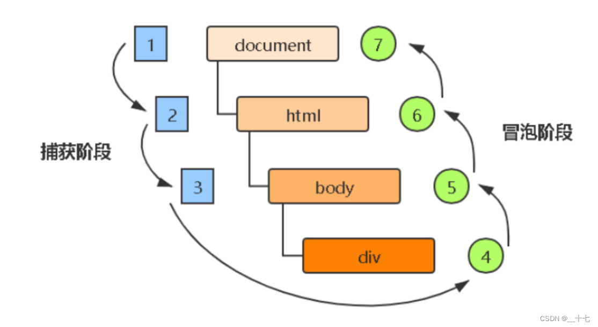

> **注意：**
>
> js事件本身是要执行两个阶段，但js代码中只能执行捕获或者冒泡其中的一个阶段。
>
> `onclick`与`attachEvent`方式只能得到冒泡阶段。

`addEventListener`可以通过设置第三个参数为true得到事件**捕获阶段**调用的事件处理程序。设为false或不写默认,表示执行**冒泡阶段**调用的事件处理程序。

JS事件流运行流程案例，同时给父子节点都绑定点击事件，捕获阶段与冒泡阶段都绑定

```html
<!DOCTYPE html>
<html lang="en">
  <head>
    <meta charset="UTF-8" />
    <meta name="viewport" content="width=device-width, initial-scale=1.0" />
    <title>Document</title>
    <style>
      .father {
        overflow: hidden;
        width: 300px;
        height: 300px;
        margin: 100px auto;
        background-color: pink;
        text-align: center;
      }

      .son {
        width: 200px;
        height: 200px;
        margin: 50px;
        background-color: purple;
        line-height: 200px;
        color: #fff;
      }
    </style>
  </head>
  <body>
    <div class="father">
      <div class="son">son</div>
    </div>

    <script>
      var son = document.querySelector(".son");
      var father = document.querySelector(".father");
      //捕获阶段，先父后子
      son.addEventListener(
        "click",
        function () {
          alert("捕获阶段son");
        },
        true
      );

      father.addEventListener(
        "click",
        function () {
          alert("捕获阶段father");
        },
        true
      );

      //冒泡阶段，先子后父最后document
      son.addEventListener(
        "click",
        function () {
          alert("冒泡阶段son");
        },
        false
      );

      father.addEventListener(
        "click",
        function () {
          alert("冒泡阶段father");
        },
        false
      );
        
      document.addEventListener("click", function () {
        alert("冒泡阶段document");
      });
    </script>
  </body>
</html>
```

**事件流的原理其实就说明了一个问题，就是有时只点击了子元素，父元素的点击函数也会被执行的原因。**事件冒泡就是基于此的。

> **注意:**
>
> 事件捕获我们很少在代码中使用，大部分都是使用事件冒泡。
>
> 有些事件是没有冒泡的，例如：onblur、onfocus、onmouseenter、onmouseleave。

#### 3.3.5  Event事件对象（重要）

事件发生以后，会产生一个事件对象，它会作为**参数**传给事件的监听函数。也就是给事件绑定的函数的默认参数。事件对象必须有了事件后才存在，它是**系统自动创建**的，不需要我们传递参数。

事件对象中包含了一系列跟事件相关数据的集合。比如：鼠标点击事件对应鼠标对象`MouseEvent`其中就包含了鼠标相关信息，比如**鼠标点击的坐标**。如果是键盘事件对应键盘对象`KeyboardEvent `里面则包含了**键盘的信息**，判断用户按下的是哪个按键。

> IE678不支持`event`对象，它是通过`window.event`来获取事件对象的。
>
> 解决该问题代码使用逻辑或短路来解决，`event = event || window.event;`表示，支持event直接返回event，不支持则返回window.event。

```html
<!DOCTYPE html>
<html lang="en">
  <head>
    <meta charset="UTF-8" />
    <meta name="viewport" content="width=device-width, initial-scale=1.0" />
    <title>Document</title>
  </head>
  <body>
    <button id="btn">点击</button>

    <script>
      var btn = document.getElementById("btn");

      //event就是事件对象
      btn.onclick = function (event) {
        console.log(event);
      };
    </script>
  </body>
</html>
```

事件对象内容既有属性也有方法。其中常用的属性与方法有(通常只用加粗的)：

| 事件对象属性与方法      | 说明                                                         |
| ----------------------- | ------------------------------------------------------------ |
| **e.target**            | 返回触发事件的对象，this是绑定事件的对象，两者有时相同有时不同 |
| e.srcElement            | 返回触发事件的对象，非标准，ie678才使用                      |
| **e.type**              | 返回绑定的事件类型，比如click或者mouseover，没有on           |
| e.cancelBubble          | 该属性用于阻止事件冒泡，非标准，ie678才使用                  |
| e.returnVlaue           | 该属性阻止默认事件行为，非标准，ie678才使用                  |
| **e.preventDefault()**  | 方法阻止默认行为，让**a链接不跳转**或**表单按钮不提交**，标准 |
| **e.stopPropagation()** | 该方法阻止事件冒泡，标准                                     |

```html
<!DOCTYPE html>
<html lang="en">
  <head>
    <meta charset="UTF-8" />
    <meta name="viewport" content="width=device-width, initial-scale=1.0" />
    <title>Document</title>
  </head>
  <body>
    <button id="btn">点击</button>

    <script>
      var btn = document.getElementById("btn");

      btn.onclick = function (event) {
        //target返回的当前事件所在的节点
        console.log(event.target); //返回按钮对象
        //可直接修改节点属性
        event.target.style.color = "red";
        event.target.innerHTML = "点击之后";

        //type属性返回内容是只读的,返回当前事件类型名
        console.log(event.type); //click
      };
    </script>
  </body>
</html>
```

**区分target与this的案例**

```html
<!DOCTYPE html>
<html lang="en">
  <head>
    <meta charset="UTF-8" />
    <meta name="viewport" content="width=device-width, initial-scale=1.0" />
    <title>Document</title>
    <style>
      .father {
        overflow: hidden;
        width: 300px;
        height: 300px;
        margin: 100px auto;
        background-color: pink;
        text-align: center;
      }

      .son {
        width: 200px;
        height: 200px;
        margin: 50px;
        background-color: purple;
        line-height: 200px;
        color: #fff;
      }
    </style>
  </head>
  <body>
    <div>123</div>

    <ul>
      <li>a</li>
      <li>b</li>
      <li>c</li>
    </ul>

    <script>
      //this是target指向相同对象时
      var div = document.querySelector("div");
      div.addEventListener("click", function (e) {
        console.log(e.target);
        console.log(this);
        console.log(e.target === this); //true
      });

      //this是target指向不同对象时,点击ul中子元素li
      var ul = document.querySelector("ul");
      ul.addEventListener("click", function (e) {
        console.log(e.target); //返回的是li对象
        console.log(this); //返回的是ul对象
        console.log(e.currentTarget); //返回的是ul对象,跟this效果一样，返回绑定的事件对象
        console.log(e.target === this); //false
      });
    </script>
  </body>
</html>
```

`preventDefault`方法用于取消浏览器对当前事件的**默认行为**。比如点击a链接标签后就不会跳转链接了，form表单跳转也能阻止。

```html
<!DOCTYPE html>
<html lang="en">
  <head>
    <meta charset="UTF-8" />
    <meta name="viewport" content="width=device-width, initial-scale=1.0" />
    <title>Document</title>
  </head>
  <body>
    <a href="https://www.baidu.com" id="a">a标签链接</a>
    <a href="https://www.baidu.com" id="b">b标签链接</a>
    <a href="https://www.baidu.com" id="c">c标签链接</a>

    <script>
      //会跳转也会打印
      var a = document.getElementById("a");
      a.onclick = function () {
        console.log("点击了a链接");
      };

      //不会跳转只会打印
      var b = document.getElementById("b");
      b.addEventListener("click", function (event) {
        event.preventDefault(); //DOM标准写法
        console.log("点击了b链接");
      });

      //传统注册方式阻止默认行为的三种方法
      var c = document.getElementById("c");
      c.onclick = function () {
        //1.普通浏览器，依然可使用preventDefault
        // e.preventDefault();
        //2. 低版本浏览器IE678
        // e.returnValue = true;
        //3. 使用return false也可阻止默认行为，但return后面的代码会不再执行，只有在传统方式中才有效
        return false;
        console.log("点击了c链接"); //不会执行
      };
    </script>
  </body>
</html>
```

案例：鼠标**禁用右键菜单**与禁止选选中文字

```html
<!DOCTYPE html>
<html lang="en">
  <head>
    <meta charset="UTF-8" />
    <meta name="viewport" content="width=device-width, initial-scale=1.0" />
    <title>Document</title>
  </head>
  <body>
    一段默认的文字
    <script>
      //禁用右键菜单，使用contextmenu事件，并阻止其默认行为
      document.addEventListener("contextmenu", function (e) {
        e.preventDefault();
      });

      //禁止选中文字，使用selectstart事件，并阻止其默认行为
      document.addEventListener("selectstart", function (e) {
        e.preventDefault();
      });
    </script>
  </body>
</html>
```

`stopPropagation`方法作用是阻止事件在DOM中继续传播，防止再触发定义在别的节点的监听函数。也就是**防止事件冒泡**，点击子元素不会再触发父集元素的事件。Propagation单词是传播的意思，该函数效果就是停止事件传播。

```html
<!DOCTYPE html>
<html lang="en">
  <head>
    <meta charset="UTF-8" />
    <meta name="viewport" content="width=device-width, initial-scale=1.0" />
    <title>Document</title>
    <style>
      .root {
        width: 200px;
        height: 200px;
        background: red;
      }

      .box {
        width: 100px;
        height: 100px;
        background: green;
      }
    </style>
  </head>
  <body>
    <div id="root" class="root">
      <div id="box" class="box"></div>
    </div>

    <script>
      var root = document.getElementById("root");
      var box = document.getElementById("box");

      root.onclick = function () {
        console.log("root事件");
      };
      //默认运行的效果是点击box事件,root事件也会触发。
      box.onclick = function () {
        console.log("box事件");
      };

      //要想只触发box事件不触发root事件的写法如下
      box.onclick = function (e) {
        e.stopPropagation();
        console.log("box事件");
      };
    </script>
  </body>
</html>
```

阻止冒泡IE浏览器中的兼容性写法

```js
if (e && e.stopPropagation) {
  e.stopPropagation();
} else {
  //IE
  window.event.cancelBubble = true;
}
```

#### 3.3.6 事件代理(事件委托)

由于事件会在冒泡阶段向上传播到父节点,这种虽然会带来一些坏处，让多余的父级事件被触发。但也可以利用该特性，**把子节点的监听函数定义在父节点上**，由父节点的监听函数统一处理多个子元素的事件。这种方法就叫做**事件代理**(delegation)。

事件代理的好处就是只操作一次父级DOM就完成了子元素多个DOM的事件绑定，大大提高的程序性能。

案例:事件向上冒泡

```html
<!DOCTYPE html>
<html lang="en">
  <head>
    <meta charset="UTF-8" />
    <meta name="viewport" content="width=device-width, initial-scale=1.0" />
    <title>Document</title>
  </head>
  <body>
    <ul id="list">
      <li>列表1</li>
      <li>列表2</li>
      <li>列表3</li>
      <p id="pp">aaa</p>
    </ul>

    <script>
      var list = document.getElementById("list");
      var pp = document.getElementById("pp");
      
      //点击了子元素会同时触发父元素的点击事件
      list.onclick = function () {
        console.log("点击了父元素");
      };

      pp.onclick = function () {
        console.log("点击了子元素");
      };
    </script>
  </body>
</html>
```

事件代理实际应用，只点击li标签生效，p标签无效。

```html
<!DOCTYPE html>
<html lang="en">
  <head>
    <meta charset="UTF-8" />
    <meta name="viewport" content="width=device-width, initial-scale=1.0" />
    <title>Document</title>
  </head>
  <body>
    <ul id="list">
      <li>列表1</li>
      <li>列表2</li>
      <li>列表3</li>
      <p>aaa</p>
    </ul>

    <script>
      var list = document.getElementById("list");

      list.addEventListener("click", function (e) {
        //利用target获取点击的子元素
        if (event.target.tagName.toLowerCase() === "li") {
          //打印子标签文本内容
          console.log(event.target.innerHTML);
        }
      });
    </script>
  </body>
</html>
```

#### 3.3.7 鼠标事件对象位置属性 

常用的鼠标事件对象的属性在页面中位置的属性

| 鼠标事件对象属性 | 说明                                    |
| ---------------- | --------------------------------------- |
| e.clientX        | 返回鼠标相对于浏览器窗口可视区的X坐标   |
| e.clientY        | 返回鼠标相对于浏览器窗口可视区的Y坐标   |
| e.pageX          | 返回鼠标相对于文档页面的X坐标,IE9+支持  |
| e.pageY          | 返回鼠标相对于文档页面的Y坐标，IE9+支持 |
| e.screenX        | 返回鼠标相对于电脑屏幕的X坐标           |
| e.screenY        | 返回鼠标相对于电脑屏幕的Y坐标           |

可视区指的就是浏览器窗口展示的页面内容的区域。

文档页面指的是整个html页面全部内容，页面有滚动时，距离就与浏览器窗口的距离不同。

电脑屏幕指的是整个电脑屏幕的大小。

```html
<!DOCTYPE html>
<html lang="en">
  <head>
    <meta charset="UTF-8" />
    <meta name="viewport" content="width=device-width, initial-scale=1.0" />
    <title>Document</title>
    <style>
      body {
        height: 3000px;
      }
    </style>
  </head>
  <body>
    <script>
      document.addEventListener("click", function (e) {
        console.log(e.clientX); //相对于浏览器窗口左上角X轴的距离，值会随着浏览器窗口大小变化，页面滚动时,不管页面滚动的距离
        console.log(e.clientY); //相对于浏览器窗口左上角Y轴的距离，值会随着浏览器窗口大小变化，页面滚动时,不管页面滚动的距离
        console.log("------------------");
        console.log(e.pageX); //相对于浏览器窗口左上角X轴的距离，页面有滚动时，会加上原本滚动的距离
        console.log(e.pageY); //相对于浏览器窗口左上角Y轴的距离，页面有滚动时，会加上原本滚动的距离
        console.log("------------------");
        console.log(e.screenX); //相对于电脑屏幕左上角X轴的距离，值永远固定，跟浏览器无关
        console.log(e.screenY); //相对于电脑屏幕左上角Y轴的距离，值永远固定，跟浏览器无关
      });
    </script>
  </body>
</html>
```

案例：图片跟随鼠标移动

```html
<!DOCTYPE html>
<html lang="en">
  <head>
    <meta charset="UTF-8" />
    <meta name="viewport" content="width=device-width, initial-scale=1.0" />
    <title>Document</title>
    <style>
      img {
        /* 图片不占用位置,使用绝对定位 */
        position: absolute;
      }
    </style>
  </head>
  <body>
    
    <script>
      var pic = document.querySelector("img");
      document.addEventListener("mousemove", function (e) {
        //每次鼠标移动1px都会触发事件,要获取到移动鼠标的位置,使用page坐标,因为图是相对网页页面的位置
        //设置位置必须添加单位px,如果要图片在鼠标中心,还需要减去图片长宽偏移量
        pic.style.left = e.pageX - 50 + "px";
        pic.style.top = e.pageY - 40 + "px";
      });
    </script>
  </body>
</html>
```

#### 3.3.8 键盘事件与键盘事件对象

键盘事件由用户敲击键盘触发 主要有keydown(键盘按下)、keypress(键盘按住)、keyup(键盘松开)三个事件。

| 事件函数名 | 触发条件                                                     |
| ---------- | ------------------------------------------------------------ |
| keydown    | 按下键盘时触发，按着不松开会一直触发。                       |
| keypress   | 按下有值的键时触发，按下**功能键**Ctrl、Alt、Shift、Meta，左右箭头等无值的键不会触发，对于有值的键是先触发keydown事件，再触发该事件，按着不松开也会一直触发。 |
| keyup      | 松开键盘时触发该事件。                                       |

三个事件的执行顺序为：keydown->keypress->keyup。

键盘事件对象`KeyboardEvent`有两个获取按下按键值的属性：

1. `keyCode`属性可以唯一标识按下的键ASCII值，keyup与keydown方法不区分大小写，也就是a与A的值都是65，keypress会区分大小写，也就是a是97，A是65。
2. `key`属性可返回按下键的字符值，区分大小写。

```html
<!DOCTYPE html>
<html lang="en">
  <head>
    <meta charset="UTF-8" />
    <meta name="viewport" content="width=device-width, initial-scale=1.0" />
    <title>Document</title>
  </head>
  <body>
    <script>
      document.addEventListener("keyup", function (e) {
        console.log(e.key);
        console.log(e.keyCode);
      });

      document.addEventListener("keydown", function (e) {
        console.log(e.key);
        console.log(e.keyCode);
      });

      document.addEventListener("keypress", function (e) {
        console.log(e.key);
        console.log(e.keyCode);
      });
    </script>
  </body>
</html>
```

案例：京东按键输入s键自动光标定位搜索框

```html
<!DOCTYPE html>
<html lang="en">
  <head>
    <meta charset="UTF-8" />
    <meta name="viewport" content="width=device-width, initial-scale=1.0" />
    <title>Document</title>
  </head>
  <body>
    <input type="text" />

    <script>
      var search = document.querySelector("input");

      //只能使用keyup,使用keydown因为会多次触发,会导致按下s时会先聚焦,然后把s值输入到文本框中
      document.addEventListener("keyup", function (e) {
        //s键的ASCII码是83
        if (e.keyCode === 83) {
          search.focus(); //搜索框获得焦点
        }
      });
    </script>
  </body>
</html>
```

键盘事件在文本框中输入的效果，**keypress与keydown会有文本值输入延迟**，其原因是keydown与keypress是在**按键按下时**立马就会触发事件调用函数，这时文字还没落入文本框中，因此会有文本延迟。而keyup事件是**按键松开时**触发，这时文本已经文字已经落入文本框中了。

```html
<!DOCTYPE html>
<html lang="en">
  <head>
    <meta charset="UTF-8" />
    <meta name="viewport" content="width=device-width, initial-scale=1.0" />
    <title>Document</title>
  </head>
  <body>
    <input type="text" id="username" />

    <script>
      var username = document.getElementById("username");
      username.onkeydown = function (e) {
        console.log(e.target.value); //输出输入框文本值,结果会延迟,因为按下时当前按键的值没有输入
      };

      username.onkeypress = function () {
        console.log("keypress");
      };

      username.onkeyup = function (e) {
        console.log(e.target.value); //结果没有延迟
      };

    </script>
  </body>
</html>
```

案例：模拟京东快递单号查询

```html
<!DOCTYPE html>
<html lang="en">
  <head>
    <meta charset="UTF-8" />
    <meta name="viewport" content="width=device-width, initial-scale=1.0" />
    <title>Document</title>
    <style>
      * {
        margin: 0;
        padding: 0;
      }

      .search {
        position: relative;
        width: 178px;
        margin: 100px;
      }

      .con {
        display: none;
        position: absolute;
        top: -40px;
        width: 171px;
        border: 1px solid rgba(0, 0, 0, 0.2);
        box-shadow: 0 2px 4px rgba(0, 0, 0, 0.2);
        padding: 5px 0;
        font-size: 18px;
        line-height: 20px;
        color: #333;
      }

      /* css小三角形 */
      .con::before {
        content: "";
        width: 0;
        height: 0;
        position: absolute;
        top: 28px;
        left: 18px;
        border: 8px solid #000;
        border-style: solid dashed dashed;
        border-color: #fff transparent transparent;
      }
    </style>
  </head>
  <body>
    <div class="search">
      <div class="con">123</div>
      <input type="text" placeholder="请输入您的快递单号" class="jd" />
    </div>

    <script>
      var con = document.querySelector(".con");
      var jd_input = document.querySelector(".jd");

      //检测表单用户输入值,只能使用keyup,不能使用keydown与keypress
      jd_input.addEventListener("keyup", function () {
        //当文本框中没有值时,就隐藏放大框
        if (this.value == "") {
          con.style.display = "none";
        } else {
          //修改放大框的内容,并显示放大框
          con.innerText = this.value;
          con.style.display = "block";
        }
      });

      //文本框失去焦点,隐藏放大框
      jd_input.addEventListener("blur", function () {
        con.style.display = "none";
      });

      //文本框获得焦点,隐藏放大框
      jd_input.addEventListener("focus", function () {
        //文本内容为空获得焦点也不显示放大框
        if (this.value !== "") {
          con.style.display = "block";
        }
      });
    </script>
  </body>
</html>
```

#### 3.3.9 表单事件

表单事件是指在使用表单元素与输入框元素可以监听的一系列事件。

| 事件函数名 | 触发条件                                                     |
| ---------- | ------------------------------------------------------------ |
| input      | 当input、select、textarea的值发生变化时触发。对于复选框或单选框改变选项时，也会触发，其特点是会连续触发，input框每按下一次按键都会触发 |
| select     | 在input与textarea里选中文本时触发                            |
| change     | 当input、select、textarea的值发生变化时触发。它与input事件最大的不同就是不会连续触发，只有当全部修改完成时(点击回车或者失去焦点时)才会触发 |
| reset      | form表单事件，当表单重置时触发                               |
| submit     | form表单事件，当表单向服务器提交数据时触发。注意submit事件的对象是表单form对象并不是提交按钮。 |

```html
<!DOCTYPE html>
<html lang="en">
  <head>
    <meta charset="UTF-8" />
    <meta name="viewport" content="width=device-width, initial-scale=1.0" />
    <title>Document</title>
  </head>
  <body>
    <input id="username" type="text" />
    <input id="password" type="text" />

    <script>
      var username = document.getElementById("username");
      var password = document.getElementById("password");

      username.oninput = function (e) {
        console.log(e.target.value); //输入什么打印什么
      };

      username.onselect = function () {
        console.log("选中了");
      };

      //失去焦点和回车时
      password.onchange = function (e) {
        console.log(e.target.value);
      };
    </script>
  </body>
</html>
```

表单对象的reset与submit方法。

```js
<!DOCTYPE html>
<html lang="en">
  <head>
    <meta charset="UTF-8" />
    <meta name="viewport" content="width=device-width, initial-scale=1.0" />
    <title>Document</title>
  </head>
  <body>
    <form action="服务器地址" id="myForm" onsubmit="submitHandle">
      <!-- input必须有name属性才能提交数据 -->
      <input type="text" name="username" />
      <button id="resetBtn" type="button">重置</button>
      <!-- 该按钮默认绑定onsubmit方法 -->
      <button type="submit">提交表单</button>
    </form>

    <script>
      var resetBtn = document.getElementById("resetBtn");
      var myForm = document.getElementById("myForm");

      resetBtn.onclick = function () {
        myForm.reset(); //清空表单
      };

      function submitHandle() {
        console.log("提交数据");
      }
    </script>
  </body>
</html>
```

#### 3.3.10 表单光标事件

表单获得焦点事件时触发的事件是`onfocus`,失去焦点事件时触发的事件是`onblur`。

```html
<!DOCTYPE html>
<html lang="en">
  <head>
    <meta charset="UTF-8" />
    <meta name="viewport" content="width=device-width, initial-scale=1.0" />
    <title>Document</title>
  </head>
  <body>
    <input type="text" value="手机" />
    <script>
      var text = document.querySelector("input");
      text.onfocus = function () {
        console.log("得到了焦点");
      };

      text.onblur = function () {
        console.log("失去了焦点");
      };
    </script>
  </body>
</html>

```

案例：模仿京东搜索框，通过光标判断显示或隐藏文本框内容

```html
<!DOCTYPE html>
<html lang="en">
  <head>
    <meta charset="UTF-8" />
    <meta name="viewport" content="width=device-width, initial-scale=1.0" />
    <title>Document</title>
    <style>
      input {
        color: #999;
      }
    </style>
  </head>
  <body>
    <input type="text" value="手机" />
    <script>
      var text = document.querySelector("input");
      //1.记录默认文本数据
      var oldData = text.value;
      text.onfocus = function () {
        //2.首次默认获得焦点就清空数据
        if (this.value === oldData) {
          this.value = "";
        }
        //4.获得焦点时，需要把文本框中的文字变黑
        this.style.color = "#333";
      };

      text.onblur = function () {
        //3.没有输入任何内容,或者只输入空格，就还原默认数据
        if (this.value.trim() === "") {
          this.value = oldData;
        }

        //5.失去焦点时，把文本框中的文字变浅
        this.style.color = "#999";
      };
    </script>
  </body>
</html>
```

案例：密码框验证信息

```html
<!DOCTYPE html>
<html lang="en">
  <head>
    <meta charset="UTF-8" />
    <meta name="viewport" content="width=device-width, initial-scale=1.0" />
    <title>Document</title>
    <style>
      div {
        width: 600px;
        margin: 100px auto;
      }
      .message {
        display: inline-block;
        font-size: 12px;
        color: #999;
        background: url(images/mess.png) no-repeat left center;
        padding-left: 20px;
      }

      .wrong {
        color: red;
        background-image: url(images/wrong.png);
      }
      .right {
        color: green;
        background-image: url(images/right.png);
      }
    </style>
  </head>
  <body>
    <div>
      <input type="password" class="ipt" />
      <p class="message">请输入6-16位密码</p>
    </div>
    <script>
      //获取元素
      var ipt = document.querySelector(".ipt");
      var message = document.querySelector(".message");

      ipt.onblur = function () {
        //根据表单值长度判断
        if (ipt.value.length === 0) {
          console.log("aaa");
          message.className = "message";
          message.innerHTML = "请输入6-16位密码";
        } else if (ipt.value.length < 6 || ipt.value.length > 16) {
          message.className = "message wrong";
          message.innerHTML = "输入长度不正确";
        } else {
          message.className = "message right";
          message.innerHTML = "密码长度正确";
        }
      };
    </script>
  </body>
</html>
```

#### 3.3.11 排它思想(算法)

排它思想主要用于有同组元素，想要某一个元素实现特殊样式的场景。其实现流程是

1. 先把所有元素全部清除样式；
2. 然后给当前元素设置样式；
3. 注意顺序是不能颠倒的。

案例，给五个按钮添加点击后高亮变色的效果，但只有一个高亮，一个高亮前面高度的就会还原，使用js完成。

```html
<!DOCTYPE html>
<html lang="en">
  <head>
    <meta charset="UTF-8" />
    <meta name="viewport" content="width=device-width, initial-scale=1.0" />
    <title>Document</title>
  </head>
  <body>
    <div>
      <button>按钮1</button>
      <button>按钮2</button>
      <button>按钮3</button>
      <button>按钮4</button>
      <button>按钮5</button>
    </div>
    <script>
      //获取元素
      var btns = document.getElementsByTagName("button");

      //使用for循环给全部按钮绑定事件
      for (var i = 0; i < btns.length; i++) {
        btns[i].onclick = function () {
          //因为不知道之前点击的按钮，就在赋值新值前把之前的全部还原，这就是排他思想
          for (var j = 0; j < btns.length; j++) {
            btns[j].style.backgroundColor = "";
          }
          this.style.backgroundColor = "yellow";
        };
      }
    </script>
  </body>
</html>
```

**重点案例：表单全选与取消全选**

```html
<!DOCTYPE html>
<html lang="en">
  <head>
    <meta charset="UTF-8" />
    <meta name="viewport" content="width=device-width, initial-scale=1.0" />
    <title>Document</title>
    <style>
      * {
        padding: 0;
        margin: 0;
      }

      .wrap {
        width: 300px;
        margin: 100px auto 0;
      }

      table {
        border-collapse: collapse;
        border-spacing: 0;
        border: 1px solid #c0c0c0;
        width: 300px;
      }

      th,
      td {
        border: 1px solid #d0d0d0;
        color: #404060;
        padding: 10px;
      }

      th {
        background-color: #09c;
        font: bold 16px "微软雅黑";
        color: #fff;
      }

      td {
        font: 14px "微软雅黑";
      }

      tbody tr {
        background-color: #f0f0f0;
      }

      tbody tr:hover {
        cursor: pointer;
        background-color: #fafafa;
      }
    </style>
  </head>
  <body>
    <div class="wrap">
      <table>
        <thead>
          <tr>
            <th>
              <input type="checkbox" id="j_cbAll" />
            </th>
            <th>商品</th>
            <th>价钱</th>
          </tr>
        </thead>
        <tbody id="j_tb">
          <tr>
            <td>
              <input type="checkbox" />
            </td>
            <td>iPhone8</td>
            <td>8000</td>
          </tr>
          <tr>
            <td>
              <input type="checkbox" />
            </td>
            <td>iPad Pro</td>
            <td>5000</td>
          </tr>
          <tr>
            <td>
              <input type="checkbox" />
            </td>
            <td>iPad Air</td>
            <td>2000</td>
          </tr>
          <tr>
            <td>
              <input type="checkbox" />
            </td>
            <td>Apple Watch</td>
            <td>2000</td>
          </tr>
        </tbody>
      </table>
    </div>
    <script>
      //获取全选按钮框
      var j_cbAll = document.getElementById("j_cbAll");

      //获取下面所有的复选框
      var j_tbs = document.getElementById("j_tb").querySelectorAll("input");

      //1.注册全选框事件,下面的复选框状态跟着全选框一起变化
      j_cbAll.onclick = function () {
        //2. checked属性可以获得当前复选框的选中状态，选中为true,没选中为false
        for (var i = 0; i < j_tbs.length; i++) {
          j_tbs[i].checked = j_cbAll.checked;
        }
      };

      //3.给所有下面的复选框都绑定事件
      for (var i = 0; i < j_tbs.length; i++) {
        j_tbs[i].onclick = function () {
          //控制全选按钮是否被选中的变量,默认为选中状态，不直接修改状态是防止按钮状态修改过于频繁
          var flag = true;
          //4.每次点击都要循环检查下面所有的小按钮
          for (var i = 0; i < j_tbs.length; i++) {
            if (!j_tbs[i].checked) {
              //5.只要有一个按钮没被选中，上边的全选按钮都不选中
              flag = false;
              break; //退出for循环
            }
          }
          j_cbAll.checked = flag;
        };
      }
    </script>
  </body>
</html>
```

案例：表格隔行变色，表头不变色。

```html
<!DOCTYPE html>
<html lang="en">
  <head>
    <meta charset="UTF-8" />
    <meta name="viewport" content="width=device-width, initial-scale=1.0" />
    <title>Document</title>
    <style>
      table {
        width: 800px;
        margin: 100px auto;
        text-align: center;
        border-collapse: collapse;
        font-size: 14px;
      }

      thead tr {
        height: 30px;
        background-color: skyblue;
      }

      tbody tr {
        height: 30px;
      }

      tbody td {
        border-bottom: 1px solid #d7d7d7;
        font-size: 12px;
        color: blue;
      }

      .bg {
        background-color: pink;
      }
    </style>
  </head>
  <body>
    <div>
      <table>
        <thead>
          <tr>
            <th>代码</th>
            <th>名称</th>
            <th>最新公布净值</th>
            <th>累计净值</th>
            <th>前单位净值</th>
            <th>净值增长率</th>
          </tr>
        </thead>
        <tbody>
          <tr>
            <td>003526</td>
            <td>农银金穗3个月定期开放债券</td>
            <td>1.075</td>
            <td>1.079</td>
            <td>1.074</td>
            <td>+0.047%</td>
          </tr>
          <tr>
            <td>003526</td>
            <td>农银金穗3个月定期开放债券</td>
            <td>1.075</td>
            <td>1.079</td>
            <td>1.074</td>
            <td>+0.047%</td>
          </tr>
          <tr>
            <td>003526</td>
            <td>农银金穗3个月定期开放债券</td>
            <td>1.075</td>
            <td>1.079</td>
            <td>1.074</td>
            <td>+0.047%</td>
          </tr>
          <tr>
            <td>003526</td>
            <td>农银金穗3个月定期开放债券</td>
            <td>1.075</td>
            <td>1.079</td>
            <td>1.074</td>
            <td>+0.047%</td>
          </tr>
          <tr>
            <td>003526</td>
            <td>农银金穗3个月定期开放债券</td>
            <td>1.075</td>
            <td>1.079</td>
            <td>1.074</td>
            <td>+0.047%</td>
          </tr>
          <tr>
            <td>003526</td>
            <td>农银金穗3个月定期开放债券</td>
            <td>1.075</td>
            <td>1.079</td>
            <td>1.074</td>
            <td>+0.047%</td>
          </tr>
        </tbody>
      </table>
    </div>
    <script>
      //获取tbody里的所有tr元素，thead中不用
      var trs = document.querySelector("tbody").querySelectorAll("tr");

      //使用for循环绑定事件
      for (var i = 0; i < trs.length; i++) {
        //绑定鼠标经过事件
        trs[i].onmouseover = function () {
          this.className = "bg";
        };
        //绑定鼠标离开事件
        trs[i].onmouseout = function () {
          this.className = "";
        };
      }
    </script>
  </body>
</html>
```

案例：百度网页换皮肤

```html
<!DOCTYPE html>
<html lang="en">
  <head>
    <meta charset="UTF-8" />
    <meta name="viewport" content="width=device-width, initial-scale=1.0" />
    <title>Document</title>
    <style>
      * {
        margin: 0;
        padding: 0;
      }

      body {
        background: url("images/1.jpg") no-repeat center top;
      }

      li {
        list-style: none;
      }
      .baidu {
        overflow: hidden;
        margin: 100px auto;
        background-color: #fff;
        width: 410px;
        padding-top: 3px;
      }

      .baidu li {
        float: left;
        margin: 0 1px;
        cursor: pointer;
      }

      .baidu img {
        width: 100px;
      }
    </style>
  </head>
  <body>
    <div>
      <ul class="baidu">
        <li></li>
        <li></li>
        <li></li>
        <li></li>
      </ul>
    </div>
    <script>
      //获取元素
      var imgs = document.querySelector(".baidu").querySelectorAll("img");

      //使用for循环绑定事件
      for (var i = 0; i < imgs.length; i++) {
        imgs[i].onclick = function () {
          //给背景图片样式赋值,注意要用url包含
          document.body.style.backgroundImage = "url(" + this.src + ")";
        };
      }
    </script>
  </body>
</html>
```

### 3.4 BOM

#### 3.4.1 BOM的概述

BOM(Browser Object Model)即**浏览器对象模型**。它提供了独立于内容用于**与浏览器窗口进行交互的对象**。比如完成页面的前进后退、刷新以及滚动等功能。BOM是把浏览器看作一个对象，其顶级对象是`window`，主要用于做浏览器页面的交互。

BOM由一系列相关对象构成，并且每个对象都提供了很多方法与属性。但BOM缺乏标准，因此其兼容性不强。

BOM比DOM更大，document对象其实相当于window的子对象。其完整写法为`window.document`。

window对象是浏览器的顶级对象，它具有双重角色：

1. 它既是js访问浏览器的一个**接口**，
2. 它还是一个**全局对象**。定义在**全局作用域中的变量、函数**都会变成window对象的属性与方法。

```js
//全局变量
var num = 10;
console.log(num); //简写
console.log(window.num); //完整写法

//全局函数
function fn() {
    console.log('11');
}

fn(); //简写
window.fn(); //完整写法
```

前面学习`alert`以及`prompt`方法，其实都是window对象下的方法，只是省略了window。

window对象下，默认有个特殊属性`window.name`,因此声明变量名时一般不要使用name。

#### 3.4.2 页面加载事件 load

之前我们要求js代码必须写在html标签之后，是因为必须要有标签后才能绑定事件。但可以通过页面加载事件控制代码执行流程，从而实现js代码写在任意地方。

`window.onload`函数是指页面（窗口）加载事件，当文档内容完全加载完毕时（包括图像、脚本文件、CSS、文件等内容）才会触发该事件调用处理函数。

```html
<!DOCTYPE html>
<html lang="en">
  <head>
    <meta charset="UTF-8" />
    <meta name="viewport" content="width=device-width, initial-scale=1.0" />
    <title>Document</title>
  </head>
  <body>
    <script>
      //传统方式
      //js代码写在html标签之前也能正常执行,这种是传统事件绑定,因此只能绑定一次
      window.onload = function () {
        var btn = document.querySelector("button");
        btn.addEventListener("click", function () {
          alert("点击了");
        });
      };

      //第二次绑定会覆盖原有的内容
      window.onload = function () {
        alert(22);
      };
    </script>

    <button>按钮</button>
  </body>
</html>
```

使用传统方式绑定函数只能绑定一次，因此推荐使用监听函数的方式可不限次数绑定。

```html
<!DOCTYPE html>
<html lang="en">
  <head>
    <meta charset="UTF-8" />
    <meta name="viewport" content="width=device-width, initial-scale=1.0" />
    <title>Document</title>
  </head>
  <body>
    <script>
      //监听函数方式,可以绑定多次
      window.addEventListener("load", function () {
        var btn = document.querySelector("button");
        btn.addEventListener("click", function () {
          alert("点击了");
        });
      });

      //监听函数方式,可以绑定多次
      window.addEventListener("load", function () {
        alert(22);
      });
    </script>

    <button>按钮</button>
  </body>
</html>
```

`DOMContentLoaded`事件触发时，仅当DOM加载完毕就调用，不包括CSS、图片、flash等内容。它的优势在于网页有很多图片时，不需要等等图片加载完成就可以拥有js交互。它加载更早，因此会先于`onload`函数执行。

```html
<!DOCTYPE html>
<html lang="en">
  <head>
    <meta charset="UTF-8" />
    <meta name="viewport" content="width=device-width, initial-scale=1.0" />
    <title>Document</title>
  </head>
  <body>
    <script>
      //监听函数方式,可以绑定多次
      window.addEventListener("load", function () {
        alert(22); //后执行
      });

      //注意:DOMContentLoaded是属于document对象的事件
      document.addEventListener("DOMContentLoaded", function () {
        alert(33); //先执行
      });
    </script>
  </body>
</html>

```

#### 3.4.3 调整窗口大小事件 reszie

当浏览器窗口大小发生像素变化时触发的事件就是`resize`事件。该事件常用于完成**响应式布局**。`window.innerWidth`获取当前屏幕宽度。

```html
<!DOCTYPE html>
<html lang="en">
  <head>
    <meta charset="UTF-8" />
    <meta name="viewport" content="width=device-width, initial-scale=1.0" />
    <title>Document</title>
    <style>
      div {
        width: 200px;
        height: 200px;
        background-color: red;
      }
    </style>
  </head>
  <body>
    <script>
      window.addEventListener("load", function () {
        var div = document.querySelector("div");
        window.addEventListener("resize", function () {
          //当窗口宽度小于800,就隐藏div
          if (window.innerWidth <= 800) {
            div.style.display = "none";
          } else {
            div.style.display = "block";
          }
        });
      });
    </script>
    <div>div内容</div>
  </body>
</html>
```

#### 3.4.4 定时器

js提供**定时执行代码的功能**，就是**定时器(timer)**，window对象主要提供了`setTimeout`与`setInterval`这两个函数。它们向任务队列添加定时任务。

定时器中设置的函数我们称为**回调函数(callback)**,它并不是按照代码顺序执行的，而是需要等待一段时间后**再回头去调用的函数**。之前DOM中学习的绑定事件中的函数也是回调函数。

##### 3.4.4.1 setTimeout函数

setTimeout函数用来指定某个函数或某段代码，在多少**毫秒**之后执行。它返回一个整数，表示**定时器的id编号**，可用来取消该定时器。

setTimeout函数接受两个参数，第一个参数设置**要推迟执行的函数名或一段代码**(funcjcode)，第二个参数设置要**推迟执行的毫秒数**(delay)，如果省略默认为0ms。

```js
//最简单的定时器，给定时赋值是为了标识区分不同定时器，也方便取消定时器
var timer = setTimeout(function () {
  console.log("3秒后打印");
}, 3000);

//取消定时器
clearTimeout(timer);

//不使用匿名函数的写法
function callback() {
  console.log("aaa");
}

setTimeout(callback, 3000);
setTimeout("callback()", 3000); //这种写法不推荐
```

如果定时器中设置**回调函数是对象的方法**，那么其内部的`this`关键字指向**全局环境**而并不是定义时所在的那个对象

```js
var name = "张三";
var user = {
  name: "李四",
  getName: function () {
    //this永远指向当前调用对象
    console.log(this.name); //李四
  }
};

var user2 = {
  name: "王五",
  getName: function () {
    var temp = this; //临时保存注册时的this对象
    setTimeout(function () {
      console.log(this.name); //张三，这时代码以及执行完，this为全局对象
      console.log(temp.name); //王五
    }, 1000);
  }
};

user.getName(); 
user2.getName(); 
```

案例：5秒后自动关闭广告

```html
<!DOCTYPE html>
<html lang="en">
  <head>
    <meta charset="UTF-8" />
    <meta name="viewport" content="width=device-width, initial-scale=1.0" />
    <title>Document</title>
  </head>
  <body>
    
    <script>
      var ad = document.querySelector(".ad");
      setTimeout(() => {
        ad.style.display = "none";
      }, 5000);
    </script>
  </body>
</html>
```

##### 3.4.4.2 setInterval函数

该函数的用法与setTimeout完全一致，区别仅仅在于setInterval是**指定某个任务每隔一段时间执行一次**，也就是无数次的定时执行。

```js
//每间隔一秒打印一次
var i = 0;
setInterval(function () {
  i++;
  console.log(i);
}, 1000);
```

案例:实现网页动画，div背景颜色逐渐变透明

```html
<!DOCTYPE html>
<html lang="en">
  <head>
    <meta charset="UTF-8" />
    <meta name="viewport" content="width=device-width, initial-scale=1.0" />
    <title>Document</title>
    <style>
      #someDiv {
        width: 100px;
        height: 100px;
        background: red;
        opacity: 1;
      }
    </style>
  </head>
  <body>
    <div id="someDiv"></div>

    <script>
      var div = document.getElementById("someDiv");
      //透明度 opacity:取值范围0-1
      var opacity = 1;
      var fade = setInterval(function () {
        if (opacity > 0) {
          opacity -= 0.05;
          div.style.opacity = opacity;
        } else {
          //取消定时器
          clearInterval(fade);
        }
      }, 60);
    </script>
  </body>
</html>
```

案例：京东倒计时案例

```html
<!DOCTYPE html>
<html lang="en">
<head>
    <meta charset="UTF-8">
    <meta name="viewport" content="width=device-width, initial-scale=1.0">
    <meta http-equiv="X-UA-Compatible" content="ie=edge">
    <title>Document</title>
    <style>
        div {
            margin: 200px;
        }
        
        span {
            display: inline-block;
            width: 40px;
            height: 40px;
            background-color: #333;
            font-size: 20px;
            color: #fff;
            text-align: center;
            line-height: 40px;
        }
    </style>
</head>
<body>
    <div>
        <span class="hour">1</span>
        <span class="minute">2</span>
        <span class="second">3</span>
    </div>
    <script>
        // 1. 获取元素 
        var hour = document.querySelector('.hour'); // 小时的黑色盒子
        var minute = document.querySelector('.minute'); // 分钟的黑色盒子
        var second = document.querySelector('.second'); // 秒数的黑色盒子
        var inputTime = +new Date('2026-7-20 18:00:00'); // 返回的是用户输入时间总的毫秒数,倒计时的结束时间
        countDown(); // 我们先调用一次这个函数，防止第一次刷新页面有空白 
        // 2. 开启定时器
        setInterval(countDown, 1000);

        function countDown() {
            var nowTime = +new Date(); // 返回的是当前时间总的毫秒数
            var times = (inputTime - nowTime) / 1000; // times是剩余时间总的秒数 
            var h = parseInt(times / 60 / 60 % 24); //时
            h = h < 10 ? '0' + h : h;
            hour.innerHTML = h; // 把剩余的小时给 小时黑色盒子
            var m = parseInt(times / 60 % 60); // 分
            m = m < 10 ? '0' + m : m;
            minute.innerHTML = m;
            var s = parseInt(times % 60); // 当前的秒
            s = s < 10 ? '0' + s : s;
            second.innerHTML = s;
        }
    </script>
</body>
</html>
```

案例：清除定时器

```html
<!DOCTYPE html>
<html lang="en">
  <head>
    <meta charset="UTF-8" />
    <meta name="viewport" content="width=device-width, initial-scale=1.0" />
    <meta http-equiv="X-UA-Compatible" content="ie=edge" />
    <title>Document</title>
  </head>

  <body>
    <button class="begin">开启定时器</button>
    <button class="stop">停止定时器</button>
    <script>
      var begin = document.querySelector(".begin");
      var stop = document.querySelector(".stop");
      var timer = null; // 全局变量  null是一个空对象
      begin.addEventListener("click", function () {
        timer = setInterval(function () {
          console.log("ni hao ma");
        }, 1000);
      });
      stop.addEventListener("click", function () {
        clearInterval(timer);
      });
    </script>
  </body>
</html>
```

案例：短信倒计时按钮

```html
<!DOCTYPE html>
<html lang="en">
  <head>
    <meta charset="UTF-8" />
    <meta name="viewport" content="width=device-width, initial-scale=1.0" />
    <meta http-equiv="X-UA-Compatible" content="ie=edge" />
    <title>Document</title>
  </head>

  <body>
    手机号码： <input type="number" /> <button>发送</button>
    <script>
      var btn = document.querySelector("button");
      var time = 10; // 定义剩下的秒数
      btn.addEventListener("click", function () {
        btn.disabled = true;
        //先执行一次防止等待1秒
        btn.innerHTML = "还剩下" + time + "秒";
        time--;

        var timer = setInterval(function () {
          if (time == 0) {
            // 清除定时器和复原按钮
            clearInterval(timer);
            btn.disabled = false;
            btn.innerHTML = "发送";
            time = 10;
          } else {
            //修改button内容使用innerHTML
            btn.innerHTML = "还剩下" + time + "秒";
            time--;
          }
        }, 1000);
      });
    </script>
  </body>
</html>
```

##### 3.4.4.3 防抖(debounce)

防抖严格算起来是属于性能优化的知识，但实际上遇到的频率相当高，处理不当或者放任不管就容易引起浏览器卡死。

以滚动条监听为案例，在运行时会发现一个问题，就是监听函数执行频率太高。鼠标稍微滚动一下函数就会执行十多次。

```html
<!DOCTYPE html>
<html lang="en">
  <head>
    <meta charset="UTF-8" />
    <meta name="viewport" content="width=device-width, initial-scale=1.0" />
    <title>Document</title>
    <style>
      h3 {
        height: 500px;
      }
    </style>
  </head>
  <body>
    <h3>啊啊</h3>
    <h3>啊啊</h3>
    <h3>啊啊</h3>
    <h3>啊啊</h3>
    <h3>啊啊</h3>
    <h3>啊啊</h3>
    <h3>啊啊</h3>
    <h3>啊啊</h3>

    <script>
      //页面滚动监听事件
      window.onscroll = scrollHandle;
      function scrollHandle() {
        //打印滚动距离
        var scrollTop = document.documentElement.scrollTop;
        console.log(scrollTop);
      }
    </script>
  </body>
</html>
```

在实际需求中我们并不需要如此高频的反馈。因此我们采用的优化思路为:

1. 在第一次触发事件时，不立即执行函数而是给出一个期限值比如200ms；
2. 如果在200ms内没有再次触发滚动事件，就执行函数；
3. 如果在200ms内再次触发滚动事件，就取消当前计时，重新开始计时。

> 防抖作用就是对于短时间内连续高频触发的事件，防抖让其在某个时间期限内事件处理函数只执行一次。

```html
<!DOCTYPE html>
<html lang="en">
  <head>
    <meta charset="UTF-8" />
    <meta name="viewport" content="width=device-width, initial-scale=1.0" />
    <title>Document</title>
    <style>
      h3 {
        height: 500px;
      }
    </style>
  </head>
  <body>
    <h3>啊啊</h3>
    <h3>啊啊</h3>
    <h3>啊啊</h3>
    <h3>啊啊</h3>
    <h3>啊啊</h3>
    <h3>啊啊</h3>
    <h3>啊啊</h3>
    <h3>啊啊</h3>

    <script>
      //防抖函数
      function debounce(fn, delay) {
        var timer = null;
        //闭包写法
        return function () {
          //存在就清空定时器
          if (timer) {
            clearTimeout(timer);
          }
          //不存在就开启定时器
          timer = setTimeout(fn, delay);
        };
      }
      //页面滚动监听事件，防抖动调用
      window.onscroll = debounce(scrollHandle, 200);

      function scrollHandle() {
        //打印滚动距离
        var scrollTop = document.documentElement.scrollTop;
        console.log(scrollTop);
      }
    </script>
  </body>
</html>
```

> 防抖实际应用场景
> 页面resize事件。做页面适配的时候，需要根据**最终呈现的页面情况**进行渲染，这种就使用防抖，因为只需要判断最后一次的变化情况即可。

##### 3.4.4.4 节流(throttle)

节流也属于性能优化的知识。遇到的频率也很高，放任不管也会让浏览器卡死。
以上述的防抖案例来说，如果在限定时间200ms内，不断的触发滚动事件(就是一直拖动滚动条)，这样就会出现只要不停止就永远不会触发打印滚动距离函数的情况，但实际我们还是需要在一定时间间隔后给用户反馈。
解决该问题的实现思路就是:设计一个类似控制阀门的定期开放的函数，也就是让函数执行一次后，在某段时间内暂时失效，过段时间又重新激活。

```html
<!DOCTYPE html>
<html lang="en">
  <head>
    <meta charset="UTF-8" />
    <meta name="viewport" content="width=device-width, initial-scale=1.0" />
    <title>Document</title>
    <style>
      h3 {
        height: 500px;
      }
    </style>
  </head>
  <body>
    <h3>啊啊</h3>
    <h3>啊啊</h3>
    <h3>啊啊</h3>
    <h3>啊啊</h3>
    <h3>啊啊</h3>
    <h3>啊啊</h3>
    <h3>啊啊</h3>
    <h3>啊啊</h3>

    <script>
      //节流函数
      function throttle(fn, delay) {
        //valid就是验证开关
        var valid = true;
        return function () {
          //valid为false就表示定时器已经打开，就不做任何事直接返回
          if (!valid) {
            return false;
          }
          //valid为true表示定时器没打开，先设置为false表示打开定时器
          valid = false;
          setTimeout(function () {
            fn();
            //函数执行完成时，定时器就完成，valid变为true，表示定时器关闭
            valid = true;
          }, delay);
        };
      }

      //页面滚动监听事件
      window.onscroll = throttle(scrollHandle, 200);
      function scrollHandle() {
        //打印滚动距离
        var scrollTop = document.documentElement.scrollTop;
        console.log(scrollTop);
      }
    </script>
  </body>
</html>
```

> 节流实际应用场景
> 搜索框input事件，例如要支持**输入实时搜索**就使用节流方案，或者实现输入间隔大于某个时间就当做用户输入完成，然后开始搜索。

#### 3.4.5 this指向问题

this的指向在函数定义时是确定不了的，只有在执行函数时才能确定this指向谁。一般情况下，this始终指向**最终调用它的对象**。

```html
<!DOCTYPE html>
<html lang="en">
  <head>
    <meta charset="UTF-8" />
    <meta name="viewport" content="width=device-width, initial-scale=1.0" />
    <meta http-equiv="X-UA-Compatible" content="ie=edge" />
    <title>Document</title>
  </head>

  <body>
    <button>按钮</button>
    <script>
      //1.在全局作用域下或者普通函数中this指向全局对象window
      console.log(this); //window
      function fn() {
        console.log(this); //window
      }
      fn(); //相当于window.fn(),调用的对象是window

      setTimeout(function () {
        console.log(this); //定时器一般调用的对象window，因此this是window
      });

      //2.在对象方法中，this指向调用的对象。
      var o = {
        sayHi: function () {
          console.log(this); //this指向对象o
        }
      };
      o.sayHi();

      //3.在回调函数中，this指向调用回调函数的对象
      var btn = document.querySelector("button");
      btn.addEventListener("click", function () {
        console.log(this); //这里是按钮调用回调函数，this指向btn对象
      });

      //4.在构造函数中
      function Fun() {
        console.log(this); //this指向fun对象
      }
      var fun = new Fun(); //构造函数实例化会开辟新空间，fun对象指向该空间

      //5.当对象方法中使用定时器，this指向的
      var name = "张三"; //全局对象
      var user2 = {
        name: "王五",
        getName: function () {
          var temp = this; //定时器外，this指向调用的对象user2，临时保存注册时的this对象
          setTimeout(function () {
            console.log(this.name); //张三，这时代码以及执行完，this为全局对象，window.name
            console.log(temp.name); //王五
          }, 1000);
        }
      };
      user2.getName();

      //6.同理，在回调函数中使用定时器，this指向是window对象
      btn.addEventListener("click", function () {
        console.log(this); //定时器外，指向btn对象
        setTimeout(function () {
          console.log(this); //指向window对象
        }, 1000);
      });
    </script>
  </body>
</html>
```

#### 3.4.6 JS执行机制（重要）

##### 3.4.6.1 单线程

JS语言是**单线程语言**。也就是**同一时间只能做一件事**，无法并发执行程序。其产生的原因主要是JS语言是为处理页面中用户的交互以及操作DOM而诞生的。比如我们要进行DOM元素的添加与删除操作，这是不能同时执行的，必须先添加后删除，因此只能使用单线程。

单线程就意味着**所有的任务都需要排队**，前一个任务完成才能执行后一个任务。这样会导致如果一个任务执行时间过长，就会让后面的任务无法执行，从而产生页面渲染不连贯，出现页面阻塞的感觉。

JS为了解决该问题，利用多核CPU的计算能力，HTML5提出了Web Worker标准，允许JS脚本创建多个线程。于是，JS中就出现**同步**与**异步**。

+ **同步**：前一个任务执行完成后才执行下一个任务，程序执行顺序与其编写顺序是一致的，出现花时间的任务也会等待执行完后才执行后面。
+ **异步**：在出现花费时间多的任务或需要等待的任务时，同时做其他的任务，两者同时执行的。JS中采用的策略是会先保存等待任务，然后执行同步任务，等条件满足时在执行保存的任务。这种执行方式因为**CPU执行速度过快**，会看起来像两者是同时执行的。

> **温馨提示**
>
> 虽然JS可以创建多线程，但它依然是单线程执行程序，也就是说即使有多个线程，它一次也只会执行一个线程。未执行的线程会保存到**消息（任务）队列**中。
>
> 同步与异步本质上区别只是执行顺序不同而已。它们执行的所有任务其实是一样的。

##### 3.4.6.2 同步与异步任务

JS为了防止任务排队等待时间过长，将任务分为两类：

+ **同步任务**：所有的同步任务都在主线程上执行。形成一个**执行栈**。
+ **异步任务**：JS的异步任务大部分是通过**回调函数**实现的，异步任务相关的回调函数是添加到**任务队列**中处理。一般而言异步任务三种类型：
  1. **普通事件**，例如：click，resize等；
  2. **资源加载**，例如：load,error等；
  3. **定时器**，包括setInterval、setTimeout等。

##### 3.4.6.3 JS任务执行流程

JS中把任务区分好后，就按照下面流程执行：

1. 先将**所有任务**按照代码顺序依次放入**执行栈**中执行；
2. 遇到同步任务直接执行；
3. 当遇到异步任务时，先交给**异步进程处理程序**判断，判断是否满足执行异步任务条件，满足就会将异步任务的**回调函数**放入**任务队列**中进入**等待执行状态**，不满足就一直放在异步处理程序中等待条件满足；
4. 一旦执行栈中的所有同步任务执行完毕，js主线程就会去查询任务队列，按次序（**先进先出**）读取任务队列中的回调函数，这时回调函数的等待状态就会结束，进入执行栈中执行，执行完成就将回调函数从任务队列中移除；
5. 主线程查询任务队列的过程会一直循环，直到所有代码都执行完成。这个循环的过程我们称为**事件循环**。

> **事件循环（event loop)**是指主线程不断重复获得任务、执行任务、再次获取任务、再执行的机制。
>
> 事件循环能保证所有异步任务都会被执行。

执行流程图

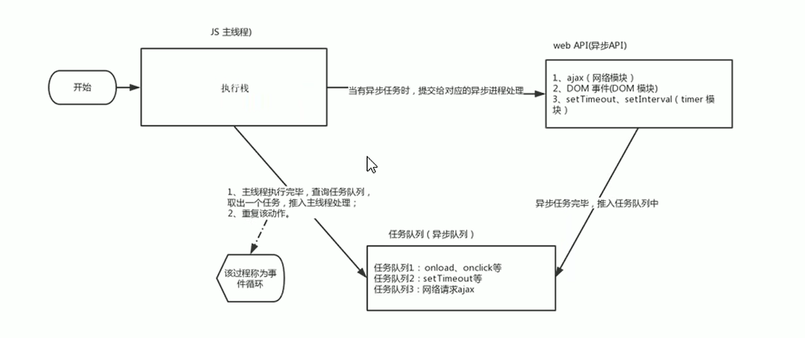

案例：单个异步任务,执行结果都是先完成所有同步任务，再执行异步任务，即使异步任务不需要等待时间。

```html
<!DOCTYPE html>
<html lang="en">
  <head>
    <meta charset="UTF-8" />
    <meta name="viewport" content="width=device-width, initial-scale=1.0" />
    <meta http-equiv="X-UA-Compatible" content="ie=edge" />
    <title>Document</title>
  </head>

  <body>
    <script>
      //打印顺序为1 2 3,这里JS就是异步执行的，出现等待的任务先执行后面的再执行等待任务
      console.log(1);
      setTimeout(function () {
        console.log(3);
      }, 1000);
      console.log(2);

      //打印顺序为11 22 33，异步执行的，出现等待的任务虽然是0秒，但JS依然会保存执行后面的
      console.log(11);
      setTimeout(function () {
        console.log(33);
      }, 0); //定时器为0秒
      console.log(22);
    </script>
  </body>
</html
```

案例：多个异步任务

```html
<!DOCTYPE html>
<html lang="en">
  <head>
    <meta charset="UTF-8" />
    <meta name="viewport" content="width=device-width, initial-scale=1.0" />
    <meta http-equiv="X-UA-Compatible" content="ie=edge" />
    <title>Document</title>
  </head>

  <body>
    <script>
      //打印顺序为1 2 3 click或者3秒内点击，1 2 click 3
      console.log(1);
      document.onclick = function () {
        console.log("click");
      };
      console.log(2);
      setTimeout(function () {
        console.log(3);
      }, 3000);
    </script>
  </body>
</html>
```

上述任务执行流程图如下：

1. 同步任务打印1，2必然先执行完成；
2. 遇到异步任务先放入异步处理程序，点击条件不满足或者三秒不到时，异步任务都不处理；
3. 当3秒到时，异步任务会把定时器的回调函数放入消息队列中；
4. 这时主执行栈已经执行完所有任务，开始**事件循环**询问消息队列，发现有回调函数就会执行打印3；
5. 之后如果点击鼠标，那异步任务会把点击事件的回调函数放入消息队列中；
6. 事件循环发现回调函数会执行打印click，该循环会无限循环下去直到程序结束。

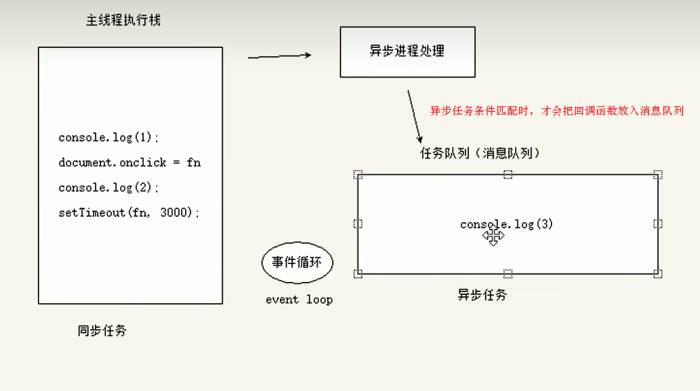

#### 3.4.7 location对象

location对象是window对象下的一个**location属性**，其主要用于**获取或设置浏览器窗体的URL**，并且可以**解析URL**。因为该属性返回的是一个对象，因此我们也称其为**location对象**。

URL又叫**统一资源定位符**(Uniform Resource Locator，URL),是互联网上标准资源地址，也就是网址，它是在浏览器中地址栏中显示的。

URL的组成,以百度为例：http://www.baidu.com/index.html?name=andy&age=18#link

| 组成             | 说明                                                         |
| ---------------- | ------------------------------------------------------------ |
| protocol(协议名) | 通信协议，常用的有http、https、ftp、maito等。案例中是**http**。 |
| host             | 主机域名，也就是服务器电脑的地址。案例中是www.baidu.com      |
| prot             | 端口号,指的具体主机中的哪个程序，一个程序一个端口号。上述案例中没写默认是80端口。 |
| path             | **路径**，由零个或多个/分隔开的字符串，一般用来表示主机端口号对应程序中一个目录或文件地址。案例中是**index.html** |
| query            | **参数**，又叫查询字符串，通常以？开头&分隔。案例中是**?name=andy&age=18** |
| fragment         | 片段 #后面的内容 常用于链接或者锚点指定文件的特定位置。案例中是**#link** |

location对象**常见属性**，与URL组成是相互对应的。

| location属性        | 返回值                               |
| ------------------- | ------------------------------------ |
| **location.href**   | 获取或设置整个URL值                  |
| location.host       | 返回主机域名                         |
| location.port       | 返回主机端口号，如果未写返回空字符串 |
| location.pathname   | 返回路径                             |
| **location.search** | 返回参数                             |
| location.hash       | 返回片段，返回带#的字符串            |

```html
<!DOCTYPE html>
<html lang="en">
  <head>
    <meta charset="UTF-8" />
    <meta name="viewport" content="width=device-width, initial-scale=1.0" />
    <meta http-equiv="X-UA-Compatible" content="ie=edge" />
    <title>Document</title>
  </head>

  <body>
    <script>
      console.log(window.location);
      //可省略window对象直接获取location对象
      //获取location对象具体的属性值，以http://127.0.0.1:5500/index.html?uname=aaa&age=11#hash为例
      console.log(location.href); //http://127.0.0.1:5500/index.html?uname=aaa&age=11#hash
      console.log(location.protocol); //http:
      console.log(location.host); //127.0.0.1:5500
      console.log(location.port); //5500
      console.log(location.pathname); ///index.html
      console.log(location.search); //index.html?uname=aaa&age=11:20
      console.log(location.hash); //#hash
    </script>
  </body>
</html>
```

href属性不仅可以获取完整url值，还可以**直接设置链接用于跳转页面**。

案例一：五秒后跳转页面

```html
<!DOCTYPE html>
<html lang="en">
  <head>
    <meta charset="UTF-8" />
    <meta name="viewport" content="width=device-width, initial-scale=1.0" />
    <meta http-equiv="X-UA-Compatible" content="ie=edge" />
    <title>Document</title>
  </head>

  <body>
    <button>点击跳转页面</button>
    <div></div>
    <script>
      var btn = document.querySelector("button");
      var div = document.querySelector("div");

      btn.addEventListener("click", function () {
        location.href = "http://www.baidu.com";
        //重置时间，防止跳转后返回失效
        number = 5;
      });
      //定时参数，默认有1秒延迟，因此计时器初始值设置为4
      var timer;
      var number = 4;
      div.innerHTML = "你将在" + (number + 1) + "秒中后跳转页面";
      timer = setInterval(() => {
        if (number == 0) {
          location.href = "http://www.baidu.com"; //5秒后跳转到百度页面
          clearInterval(timer);
        } else {
          div.innerHTML = "你将在" + number + "秒中后跳转页面";
          number--;
        }
      }, 1000);
    </script>
  </body>
</html>
```

案例二：获取URL参数数据，也就是不同页面url传参,因此有两个html页面

login.html页面

```html
<!DOCTYPE html>
<html lang="en">
  <head>
    <meta charset="UTF-8" />
    <meta name="viewport" content="width=device-width, initial-scale=1.0" />
    <title>登录页面</title>
  </head>
  <body>
    <!-- login页面与index.html位于同一目录下，action才能生效,method必须设置为get-->
    <form action="index.html" method="get">
      用户名：<input type="text" name="uname" />
      <input type="submit" value="登录" />
    </form>
  </body>
</html>
```

index.html响应页面

```html
<!DOCTYPE html>
<html lang="en">
  <head>
    <meta charset="UTF-8" />
    <meta name="viewport" content="width=device-width, initial-scale=1.0" />
    <meta http-equiv="X-UA-Compatible" content="ie=edge" />
    <title>index页面</title>
  </head>

  <body>
    <div></div>
    <script>
      var div = document.querySelector("div");
      //获取url中search参数,substr去除?号，split分割字符串
      var querys = location.search.substr(1).split("=");

      //url默认会使用encodeURIComponent()函数对中文参数进行编码
      //针对中文需要进行解码
      var result = decodeURIComponent(querys[1]); //
      div.innerHTML = result + " 欢迎您！";
    </script>
  </body>
</html>
```

location对象**常用方法**

| location方法          | 返回值                                                       |
| --------------------- | ------------------------------------------------------------ |
| **location.assign()** | 跟href一样，可以跳转页面(也称为重定向页面),**记录了浏览历史**，**可回退**。 |
| location.replace()    | 替换当前页面，因为**不记录历史**，所以**不能后退**。         |
| location.reload()     | 重新加载页面，相当于点击了**刷新页面**的按钮或f5,如果参数为true，表示**强制刷新**ctrl+f5 |

```html
<!DOCTYPE html>
<html lang="en">
  <head>
    <meta charset="UTF-8" />
    <meta name="viewport" content="width=device-width, initial-scale=1.0" />
    <meta http-equiv="X-UA-Compatible" content="ie=edge" />
    <title>index页面</title>
  </head>

  <body>
    <button>点击1</button>
    <button>点击2</button>
    <button>点击3</button>
    <script>
      var btns = document.querySelectorAll("button");
      btns[0].addEventListener("click", function () {
        //记录了浏览历史，可回退
        location.assign("http://www.baidu.com");
      });

      btns[1].addEventListener("click", function () {
        //不记录浏览历史，不可回退
        location.replace("http://www.baidu.com");
      });

      btns[2].addEventListener("click", function () {
        //刷新页面，默认为false
        location.reload();
        //强制刷新页面，强制刷新是不会读取页面缓存数据的
        // location.reload(true);
      });
    </script>
  </body>
</html>
```

#### 3.4.8 navigator对象

同一个网址，是否可以实现根据打开网址的终端不同显示不同页面的效果。例如：京东网址如果使用PC端打开，就是显示PC端页面，如果手机端打开就显示手机端页面。答案是肯定的，使用winodow对象中的**navigator对象**就可完成。

navigator对象中包含了有关浏览器的信息，它有很多属性，其中最常用的就是`userAgent`，该属性就可以返回由客户端发送给服务器的user-agent头部的值。也就是使用什么浏览器打开的页面。

```html
<!DOCTYPE html>
<html lang="en">
  <head>
    <meta charset="UTF-8" />
    <meta name="viewport" content="width=device-width, initial-scale=1.0" />
    <title>Document</title>
  </head>
  <body>
    <script>
      console.log(navigator.userAgent);
      //判断是否为移动端的正则表达式
      if (navigator.userAgent.match(/(phone|pad|pod|iPhone|iPod|
          ios|iPad|Android|Mobile|BlackBerry|
          IEMobile|MQQBrowser|JUC|Fennec|wOSBorwser|BrowserNG|
          WebOS|Symbian|Windows Phone)/i)) {
        // window.location.href = ""; //手机端
        console.log("手机端");
      } else {
        // window.location.href = ""; //电脑端
        console.log("电脑端");
      }
    </script>
  </body>
</html>
```

#### 3.4.9 history对象

window对象中的history对象，它主要与浏览器的实力记录进行交互。该对象包含用户(在浏览器窗口中)访问过的URL。

| history对象方法   | 返回值                                                       |
| ----------------- | ------------------------------------------------------------ |
| history.back()    | 后退功能，就是点击浏览器中后退按钮的效果                     |
| history.forward() | 前进功能，就是点击浏览器中前进按钮的效果                     |
| **history.go()**  | **前进后退功能**，参数为1就是前进一个1页面，2就是2个页面，-1就是后退一个页面 |

```html
<!DOCTYPE html>
<html lang="en">
  <head>
    <meta charset="UTF-8" />
    <meta name="viewport" content="width=device-width, initial-scale=1.0" />
    <title>Document</title>
  </head>
  <body>
    <a href="https://www.baidu.com">页面</a>
    <button>后退</button>
    <button>前进</button>
    <button>后退2页</button>
    <script>
      var btns = document.querySelectorAll("button");
      btns[0].addEventListener("click", function () {
        window.history.back();
      });
      btns[1].addEventListener("click", function () {
        window.history.forward();
      });
      btns[2].addEventListener("click", function () {
        window.history.go(-2);
      });
    </script>
  </body>
</html>
```

history对象一般在实际开发中使用比较少，但在一些OA办公系统中会见到。

### 3.5 动画

#### 3.5.1 动画基本原理

js中也可以实现元素的动画效果，其核心原理就是**通过定时器setInterval不断移动盒子的位置**。其实现步骤：

1. 获得盒子当前的位置；
2. 让盒子的当前位置加上1个移动距离,注意要移动**元素必须有定位**，才能使用`element.style.left`移动；
3. 利用定时器不断重复移动操作;
4. 最后加上结束定时器的条件。

```html
<!DOCTYPE html>
<html lang="en">
  <head>
    <meta charset="UTF-8" />
    <meta name="viewport" content="width=device-width, initial-scale=1.0" />
    <title>Document</title>
    <style>
      div {
        position: absolute;
        left: 0;
        width: 100px;
        height: 100px;
        background: red;
      }
    </style>
  </head>
  <body>
    <div></div>

    <script>
      var div = document.querySelector("div");
      var timer = setInterval(function () {
        //超过400距离就结束
        if (div.offsetLeft >= 400) {
          //停止定时器
          clearInterval(timer);
        }
        div.style.left = div.offsetLeft + 1 + "px"; //一定注意加单位px
      }, 15);
    </script>
  </body>
</html>
```

#### 3.5.2 动画函数封装

根据原理我们实现的动画，但如果不止一个元素要动画，这时就把动画效果封装为一个函数，其需要传入2个参数，**动画对象**和**移动到的距离**。动画对象就是要移动的对象，移动的距离就是移动到什么位置结束。

```html
<!DOCTYPE html>
<html lang="en">
  <head>
    <meta charset="UTF-8" />
    <meta name="viewport" content="width=device-width, initial-scale=1.0" />
    <title>Document</title>
    <style>
      div {
        position: absolute;
        left: 0;
        width: 100px;
        height: 100px;
        background: red;
      }
      span {
        position: absolute;
        left: 0;
        top: 200px;
        width: 200px;
        height: 200px;
        background: blue;
      }
    </style>
  </head>
  <body>
    <div></div>
    <span></span>

    <script>
      function animate(obj, target) {
        var timer = setInterval(function () {
          //超过400距离就结束
          if (obj.offsetLeft >= target) {
            //停止定时器
            clearInterval(timer);
          }
          obj.style.left = obj.offsetLeft + 1 + "px"; //一定注意加单位px
        }, 15);
      }
      var div = document.querySelector("div");
      var span = document.querySelector("span");
      animate(div, 400);
      animate(span, 300);
    </script>
  </body>
</html>
```

上边封装的动画函数虽然可以运行，但还不够完美，性能浪费比较多。它有几个问题需要解决：

1. **定时器timer**，每次调用都会开辟空间从而浪费，还有就是每个定时器都叫timer有歧义，可以将其赋值为obj的属性解决问题；
2. 如果使用按钮点击触发定时器，则会出现**定时器无限叠加**的问题，可使用每次触发新定时器就移除原定时器来解决；

```html
<!DOCTYPE html>
<html lang="en">
  <head>
    <meta charset="UTF-8" />
    <meta name="viewport" content="width=device-width, initial-scale=1.0" />
    <title>Document</title>
    <style>
      div {
        position: absolute;
        left: 0;
        width: 100px;
        height: 100px;
        background: red;
      }
      span {
        position: absolute;
        left: 0;
        top: 200px;
        width: 200px;
        height: 200px;
        background: blue;
      }
    </style>
  </head>
  <body>
    <div></div>
    <span></span>
    <button>点击</button>

    <script>
      //匀速函数
      function animate(obj, target) {
        //优化2：每次触发新定时器就移除原来的
        clearInterval(obj.timer);
        //优化1
        obj.timer = setInterval(function () {
          //超过400距离就结束
          if (obj.offsetLeft >= target) {
            //停止定时器
            clearInterval(obj.timer);
          }
          obj.style.left = obj.offsetLeft + 1 + "px"; //一定注意加单位px
        }, 15);
      }
      var div = document.querySelector("div");
      var span = document.querySelector("span");
      var button = document.querySelector("button");
      animate(div, 400);
      button.addEventListener("click", function () {
        animate(span, 300);
      });
    </script>
  </body>
</html>
```

#### 3.5.3 缓动动画原理

上边写的动画是匀速移动的，如果要求动画是**运动速度不断变化的缓动运动**。最常见的就是速度由快变慢：

1. 让移动距离距离慢慢变小，这样速度就是慢慢落下来。其核心算法为`(目标距离-元素现在的位置)/10`的值作为每次移动的距离步长**step**,其中10是可以根据需求修改。
2. 其停止条件就是盒子位置等于目标位置时就停止定时器

```html
<!DOCTYPE html>
<html lang="en">
  <head>
    <meta charset="UTF-8" />
    <meta name="viewport" content="width=device-width, initial-scale=1.0" />
    <title>Document</title>
    <style>
      div {
        position: absolute;
        left: 0;
        width: 100px;
        height: 100px;
        background: red;
      }
      span {
        position: absolute;
        left: 0;
        top: 200px;
        width: 200px;
        height: 200px;
        background: blue;
      }
    </style>
  </head>
  <body>
    <div></div>
    <span></span>
    <button>点击</button>

    <script>
      //缓动函数
      function animate(obj, target) {
        clearInterval(obj.timer);
        obj.timer = setInterval(function () {
          //步长值
          var step = (target - obj.offsetLeft) / 10;
          //超过400距离就结束
          if (obj.offsetLeft >= target) {
            //停止定时器
            clearInterval(obj.timer);
          }
          //替换步长值
          obj.style.left = obj.offsetLeft + step + "px"; //一定注意加单位px
        }, 15);
      }
      var div = document.querySelector("div");
      var span = document.querySelector("span");
      var button = document.querySelector("button");
      animate(div, 400);
      button.addEventListener("click", function () {
        animate(span, 300);
      });
    </script>
  </body>
</html>
```

上述函数依然有个小问题，就是停止的位置不是整数，而是小数。要解决该问题，就要使用取整函数优化步长值。

```html
<!DOCTYPE html>
<html lang="en">
  <head>
    <meta charset="UTF-8" />
    <meta name="viewport" content="width=device-width, initial-scale=1.0" />
    <title>Document</title>
    <style>
      div {
        position: absolute;
        left: 0;
        top: 100px;
        width: 100px;
        height: 100px;
        background: red;
      }
    </style>
  </head>
  <body>
    <div></div>
    <!-- 注意class名称数字不能在前面 -->
    <button class="btn500">点击到500位置</button>
    <button class="btn800">点击800位置</button>

    <script>
      function animate(obj, target) {
        clearInterval(obj.timer);
        obj.timer = setInterval(function () {
          //步长值，优化步长值为整数，8.1就要取9，因为不能后退，向上取整。同理-8.1就要取-9，向下取整
          var step = (target - obj.offsetLeft) / 10;
          step = step > 0 ? Math.ceil(step) : Math.floor(step);
          //超过400距离就结束
          if (obj.offsetLeft == target) {
            //停止定时器
            clearInterval(obj.timer);
          }
          //替换步长值
          obj.style.left = obj.offsetLeft + step + "px"; //一定注意加单位px
        }, 15);
      }

      var button500 = document.querySelector(".btn500");
      var button800 = document.querySelector(".btn800");
      var div = document.querySelector("div");
      button500.addEventListener("click", function () {
        animate(div, 500);
      });

      button800.addEventListener("click", function () {
        animate(div, 800);
      });
    </script>
  </body>
</html>
```

#### 3.5.4 动画函数中添加回调函数

回调函数的原理：有时我们需要在函数执行完成时，执行某个函数，这时就可以通过**该函数作为参数传入执行函数中**，让其在执行函数执行完成时调用。这个过程就叫做回调。

为了不再复制代码，完成的动画函数我们可直接写到一个单独的`animate.js`文件中，后续要使用直接引入该文件即可。

```js
//callback是回调函数
function animate(obj, target, callback) {
  clearInterval(obj.timer);
  obj.timer = setInterval(function () {
    //步长值，优化步长值为整数，8.1就要取9，因为不能后退，向上取整。同理-8.1就要取-9，向下取整
    var step = (target - obj.offsetLeft) / 10;
    step = step > 0 ? Math.ceil(step) : Math.floor(step);
    //超过400距离就结束
    if (obj.offsetLeft == target) {
      //停止定时器
      clearInterval(obj.timer);
      //回调函数有才执行，说明该函数可写可不写
      if (callback) {
        callback();
      }
      //写法2
      // callback && callback();
    }
    //替换步长值
    obj.style.left = obj.offsetLeft + step + "px"; //一定注意加单位px
  }, 15);
}
```

案例:简单使用外部动画函数

```html
<!DOCTYPE html>
<html lang="en">
  <head>
    <meta charset="UTF-8" />
    <meta name="viewport" content="width=device-width, initial-scale=1.0" />
    <title>Document</title>
    <style>
      div {
        position: absolute;
        left: 0;
        top: 100px;
        width: 100px;
        height: 100px;
        background: red;
      }
    </style>
    <!-- 引入js文件 -->
    <script src="animate.js"></script>
  </head>
  <body>
    <div></div>
    <!-- 注意class名称数字不能在前面 -->
    <button class="btn500">点击到500位置</button>
    <button class="btn800">点击800位置</button>

    <script>
      var button500 = document.querySelector(".btn500");
      var button800 = document.querySelector(".btn800");
      var div = document.querySelector("div");
      button500.addEventListener("click", function () {
        animate(div, 500);
      });

      button800.addEventListener("click", function () {
        animate(div, 800, function () {
          //动画执行完成后改变颜色
          div.style.background = "yellow";
        });
      });
    </script>
  </body>
</html>
```

案例：使用动画函数实现滑块移动效果

```html
<!DOCTYPE html>
<html lang="en">
  <head>
    <meta charset="UTF-8" />
    <meta name="viewport" content="width=device-width, initial-scale=1.0" />
    <title>Document</title>
    <style>
      .sliderbar {
        position: fixed;
        right: 0;
        bottom: 100px;
        width: 40px;
        height: 40px;
        text-align: center;
        line-height: 40px;
        cursor: pointer;
        color: #fff;
      }

      .con {
        position: absolute;
        left: 0;
        top: 0;
        width: 200px;
        height: 40px;
        background-color: purple;
        z-index: -1;
      }
    </style>
    <!-- 引入js文件 -->
    <script src="animate.js"></script>
  </head>
  <body>
    <div class="sliderbar">
      <span>←</span>
      <div class="con">问题反馈</div>
    </div>

    <script>
      var sliderbar = document.querySelector(".sliderbar");
      var con = document.querySelector(".con");
      //移动距离160=con盒子的宽度200px-sliderbar盒子的宽度40px
      var move = con.clientWidth - sliderbar.clientWidth;
      //鼠标进入时sliderbar会让盒子con滑动到左侧
      sliderbar.addEventListener("mouseenter", function () {
        //动画执行完毕，就使用回调函数修改箭头方向
        animate(con, -move, function () {
          sliderbar.children[0].innerHTML = "→";
        });
      });
      //鼠标离开时sliderbar会让盒子con滑动到右侧
      sliderbar.addEventListener("mouseleave", function () {
        animate(con, 0, function () {
          sliderbar.children[0].innerHTML = "←";
        });
      });
    </script>
  </body>
</html>
```

案例:筋斗云

```html
<!DOCTYPE html>
<html>
  <head lang="en">
    <meta charset="UTF-8" />
    <title></title>
    <style>
      * {
        margin: 0;
        padding: 0;
      }

      ul {
        list-style: none;
      }

      body {
        background-color: black;
      }

      .c-nav {
        width: 900px;
        height: 42px;
        background: #fff url(images/rss.png) no-repeat right center;
        margin: 100px auto;
        border-radius: 5px;
        position: relative;
      }

      .c-nav ul {
        position: absolute;
      }

      .c-nav li {
        float: left;
        width: 83px;
        text-align: center;
        line-height: 42px;
      }

      .c-nav li a {
        color: #333;
        text-decoration: none;
        display: inline-block;
        height: 42px;
      }

      .c-nav li a:hover {
        color: white;
      }

      .cloud {
        position: absolute;
        left: 0;
        top: 0;
        width: 83px;
        height: 42px;
        background: url(images/cloud.gif) no-repeat;
      }
    </style>
    <!-- 必须在js代码之前引入 -->
    <script src="animate.js"></script>
    <script>
      window.addEventListener("load", function () {
        // 1. 获取云彩元素与所有li元素
        var cloud = document.querySelector(".cloud");
        var c_nav = document.querySelector(".c-nav");
        var lis = c_nav.querySelectorAll("li");
        // 2. 给所有的小li绑定事件
        // 这个current 做为筋斗云的起始位置
        var current = 0;
        for (var i = 0; i < lis.length; i++) {
          // (1) 鼠标经过把当前小li 的位置做为目标值
          lis[i].addEventListener("mouseenter", function () {
            animate(cloud, this.offsetLeft);
          });
          // (2) 鼠标离开就回到起始的位置
          lis[i].addEventListener("mouseleave", function () {
            animate(cloud, current);
          });
          // (3) 当我们鼠标点击，就把当前位置做为目标值
          lis[i].addEventListener("click", function () {
            current = this.offsetLeft;
          });
        }
      });
    </script>
  </head>

  <body>
    <div id="c_nav" class="c-nav">
      <span class="cloud"></span>
      <ul>
        <li><a href="#">首页新闻</a></li>
        <li><a href="#">师资力量</a></li>
        <li><a href="#">活动策划</a></li>
        <li><a href="#">企业文化</a></li>
        <li><a href="#">招聘信息</a></li>
        <li><a href="#">公司简介</a></li>
        <li><a href="#">我是佩奇</a></li>
        <li><a href="#">啥是佩奇</a></li>
      </ul>
    </div>
  </body>
</html>
```

### 3.6 轮播图(重要)

轮播图又称为焦点图，是网页中比较常见的网页特效。

轮播图通常的结构为：

+ 父元素盒子，包裹所有轮播图子结构的元素；
+ **左右侧按钮**，点击轮播图会进行左右滑动；
+ **页签圆点**，表示切换到第几个轮播图；
+ **核心滚动区域**，li元素包含所有图片img元素，要加浮动这样元素在一行上，还有一个父盒子ul，方便实现滚动；

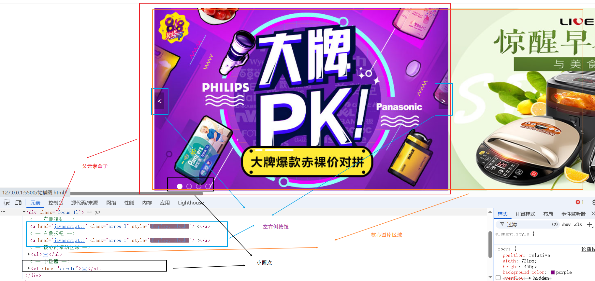

轮播图主要功能：

1. 鼠标进入轮播图时，左右按钮显示，鼠标离开轮播图时，左右按钮隐藏；
2. 点击页面圆点也能切换到对应的轮播图图片；
   1. 先引入`animate.js`然后再引入`轮播图.js`；
   2. 使用动画函数前提是该元素必须定位；
   3. 注意是**ul父盒子移动**而并非img父元素小li移动；
   4. 滚动图片的核心算法是点击某个小圆圈，让图片以**小圆圈的索引号×图片宽度**的距离作为ul的移动距离。注意是**负值**。
3. 点击左右侧按钮，轮播图依次切换上一张(左播)或者下一张(右播)图片；
   1. 点击右侧按钮一次，就让图片滚动一张；
   2. 声明一个**变量num**记录位置，点击右侧按钮一次，num加1，这**个变量num*图片宽度**就是ul的移动距离。也是负值。
   3. **图片无缝滚动原理**，先**复制第一张图片到最后一张图片后面**，当图片滚动到克隆的最后一张图片时，再次点击时，这时直接切换到第一张图片，**没有动画**，然后再执行点击函数的内容，因为直接切换速度很快，人眼无法识别，因此看着就像是第一张到第二张，从而实现了无缝滚动。
   4. **无缝滚动的具体步骤**：使用克隆函数**cloneNode**，参数为**true**时是**深度克隆**，复制ul的第一个li，然后使用**appendChild**放到ul的最后面。当图片滚动到克隆的最后一张图片时，也就是**num==图片总个数-1**时，让ul快速的、不做动画的跳转到最左侧：`left=0`，同时`num=0`,从而重新开始滚动图片。
   5. 再声明一个**变量circle**，**用来控制页面圆点移动**，每次点击右侧按钮一次，circle加1。注意，因为左侧按钮也需要该变量，所以直接声明为全局变量；当圆点移动到最后一个圆点，再次点击时（也就是**circle==ol.children.length**），复原circle=0。
   6. 添加点击页面圆点切换图片时，会修改`num=index`以及`circle=index`值，这样就确保点击左右按钮时圆点位置正确。
   7. 左侧按钮，做法与右侧一致，至少方向相反，因此num与circle每次点击都是减1；num==0时，num值变为`ul.children.length-1`，left也跳转到`（ul.children.length-1） * focusWidth`的位置。当circle<0,circle值改为`ol.children.length - 1`。
   8. 优化，圆圈的函数切换的代码是一样的，可提取成公共的函数**circleChange**。
4. 切换轮播图时，页面圆点会跟随变化；
5. 鼠标不在轮播图上时，轮播图会自动播放下一张图片，鼠标在轮播图上时，自动播放停止。
   1. 鼠标不在轮播图上时，就自动播放轮播图，可通过定时器完成；
   2. 因为自动播放功能跟点击右侧按钮效果完全一致，因此可通过**代码触发右侧按钮点击事件**`arrow_r.click()`就可完成功能；
   3. 当鼠标移动到轮播图上时就移除定时器。
6. **节流阀功能**，防止轮播图按钮点击过快造成动画播放过快的问题。目的是让上一个动画执行完毕，再去执行下一个动画函数，让点击事件无法连续触发。实现使用**动画的回调函数**。可通过添加一个**变量flag**来**锁住函数**和**解锁函数**。默认flag为true,当开始播放动画时，flag为false,这时点击按钮无效;当动画播放完毕时，flag变为true，这时按钮点击才会生效。

为了更好理解轮播图代码，我们把它单独写到`轮播图.js`文件中，把页面结构单独放在`轮播图.html`中，引入外部的`animate.js`与`轮播图.js`。因为轮播图要用动画函数，必须先引入`animate.js`然后再引入`轮播图.js`。

`轮播图.html`代码

```html
<!DOCTYPE html>
<html lang="en">
  <head>
    <meta charset="UTF-8" />
    <meta name="viewport" content="width=device-width, initial-scale=1.0" />
    <title>Document</title>
    <style>
      /* base.css */
      /*清除元素默认的内外边距  */
      * {
        margin: 0;
        padding: 0;
      }

      /*取消链接的下划线*/
      a {
        color: #666;
        text-decoration: none;
      }

      a:hover {
        color: #e33333;
      }

      /*让所有斜体 不倾斜*/
      em,
      i {
        font-style: normal;
      }
      /*去掉列表前面的小点*/
      li {
        list-style: none;
      }
      /*图片没有边框   去掉图片底侧的空白缝隙*/
      img {
        border: 0; /*ie6*/
        vertical-align: middle;
      }
      body {
        background-color: #fff;
        font: 12px/1.5 "Microsoft YaHei", "Heiti SC", tahoma, arial,
          "Hiragino Sans GB", \\5B8B\4F53, sans-serif;
        color: #666;
      }

      /*清除浮动*/
      .clearfix:after {
        visibility: hidden;
        clear: both;
        display: block;
        content: ".";
        height: 0;
      }

      /*版心*/
      .w {
        width: 1200px;
        margin: auto;
      }

      .fl {
        float: left;
      }
      .fr {
        float: right;
      }
      .main {
        width: 980px;
        height: 455px;
        margin-left: 219px;
        margin-top: 10px;
      }

      .focus {
        position: relative;
        width: 721px;
        height: 455px;
        background-color: purple;
        /* overflow: hidden; */
      }

      .focus ul {
        /* ul要有动画，必须有定位 */
        position: absolute;
        top: 0;
        left: 0;
        /* ul大于父元素，这样浮动才有效果 */
        width: 600%;
      }

      .focus ul li {
        /* 图片在一行必须加浮动 */
        float: left;
      }

      .arrow-l,
      .arrow-r {
        display: none;
        position: absolute;
        top: 50%;
        margin-top: -20px;
        width: 24px;
        height: 40px;
        background: rgba(0, 0, 0, 0.3);
        text-align: center;
        line-height: 40px;
        color: #fff;
        /* font-family: "icomoon"; */
        font-size: 18px;
        z-index: 2;
      }

      .arrow-r {
        right: 0;
      }

      .circle {
        position: absolute;
        bottom: 10px;
        left: 50px;
      }

      .circle li {
        float: left;
        width: 10px;
        height: 10px;
        /*background-color: #fff;*/
        border: 2px solid rgba(255, 255, 255, 0.5);
        margin: 0 5px;
        border-radius: 50%;
        /*鼠标经过显示小手*/
        cursor: pointer;
      }

      .current {
        background-color: #fff;
      }
    </style>
    <!-- 引入js animate.js必须先引入-->
    <script src="animate.js"></script>
    <script src="轮播图.js"></script>
  </head>
  <body>
    <div class="w">
      <div class="main">
        <div class="focus fl">
          <!-- 左侧按钮 使用javascript:;代替#,防止页面跳转到顶部-->
          <a href="javascript:;" class="arrow-l"> &lt;</a>
          <!-- 右侧按钮 -->
          <a href="javascript:;" class="arrow-r"> &gt;</a>
          <!-- 核心的滚动区域 -->
          <ul>
            <li>
              <a href="#"></a>
            </li>
            <li>
              <a href="#"></a>
            </li>
            <li>
              <a href="#"></a>
            </li>
            <li>
              <a href="#"></a>
            </li>
          </ul>
          <!-- 小圆圈 -->
          <ol class="circle"></ol>
        </div>
      </div>
    </div>
  </body>
</html>
```

`轮播图.js`代码

```js
//页面加载完，才加载轮播图js文件内容
window.addEventListener("load", function () {
  //1.左右按钮显示隐藏
  var arrow_l = document.querySelector(".arrow-l");
  var arrow_r = document.querySelector(".arrow-r");
  var focus = document.querySelector(".focus");

  //图片宽度
  var focusWidth = focus.offsetWidth;
  //鼠标进入显示
  focus.addEventListener("mouseenter", function () {
    arrow_l.style.display = "block";
    arrow_r.style.display = "block";
    //10. 鼠标移动到轮播图上时，停止定时器
    clearInterval(timer);
    //清除timer变量
    timer = null;
  });
  //鼠标进入离开隐藏
  focus.addEventListener("mouseleave", function () {
    arrow_l.style.display = "none";
    arrow_r.style.display = "none";
    //11.鼠标离开轮播图时,开启定时器
    timer = setInterval(function () {
      //触发右侧按钮点击事件
      arrow_r.click();
    }, 2000);
  });

  //2.根据图片数量动态生成圆点标签,必须查询foucs中的ul
  var ul = focus.querySelector("ul");
  var ol = focus.querySelector(".circle");
  for (var i = 0; i < ul.children.length; i++) {
    //创建元素标签
    var li = document.createElement("li");
    //通过设置自定义属性记录当前圆点的索引号
    li.setAttribute("index", i);
    //把li插入到ol中
    ol.appendChild(li);

    //3.小圆圈的点击事件，生成小圆圈时生成点击事件,该事件用排他思想
    li.addEventListener("click", function () {
      for (var i = 0; i < ol.children.length; i++) {
        ol.children[i].className = "";
      }
      this.className = "current";
      //4. 点击小圆圈移动图片，移动ul,移动距离是小圆点索引号*图片宽度，注意是负值
      //圆点索引号
      var index = this.getAttribute("index");
      animate(ul, -index * focusWidth);
      //同步图片数据，防止点击左右按钮出来问题
      num = index;
      //同步圆点数据，防止点击左右按钮出来问题
      circle = index;
    });
  }
  //把ol第一个li设置类名为current
  ol.children[0].className = "current";
  //6.克隆第一张图片放到ul最后面，必须写在小圆点生成事件后，这样前面的圆点数量就不会被影响
  var firstLi = ul.children[0].cloneNode(true);
  ul.appendChild(firstLi);
  //5.点击右侧按钮，图片滚动一张
  //num记录点击按钮后图片的位置索引
  var num = 0;
  //circle控制小圆圈的播放移动
  var circle = 0;
  //10.节流阀
  var flag = true;
  //7.右侧点击按钮
  arrow_r.addEventListener("click", function () {
    if (flag) {
      flag = false;
      //如果走到最后复制的一张图片
      if (num == ul.children.length - 1) {
        ul.style.left = 0;
        num = 0;
      }
      num++;
      animate(ul, -num * focusWidth, function () {
        //打开节流阀
        flag = true;
      });
      //点击右侧按钮一次，小圆点就会跟随变化，circle++
      circle++;
      //当图片移动到克隆图片时，圆点位置清零也就是移动到第一张
      if (circle == ol.children.length) {
        circle = 0;
      }
      circleChange();
    }
  });

  //8.左侧点击按钮，代码基本跟右侧一致，num与circle都变为减一,至少最后一张图变为第一张图
  arrow_l.addEventListener("click", function () {
    if (flag) {
      flag = false;
      //如果走到第一张图片
      if (num == 0) {
        //切换到复制的最后一张图，必须加单位px
        ul.style.left = (ul.children.length - 1) * focusWidth + "px";
        num = ul.children.length - 1;
      }
      num--;
      animate(ul, -num * focusWidth, function () {
        //打开节流阀
        flag = true;
      });
      //点击左侧按钮一次，小圆点就会跟随变化，circle--
      circle--;
      //当图片移动到第一张图片时，圆点位置移动到最后
      if (circle < 0) {
        circle = ol.children.length - 1;
      }
      circleChange();
    }
  });

  //圆圈切换公共函数
  function circleChange() {
    //先清除所以圆点样式，然后再复制当前圆点
    for (var i = 0; i < ol.children.length; i++) {
      ol.children[i].className = "";
    }
    //利用circle获取到当前圆点,设置current类名
    ol.children[circle].className = "current";
  }

  //9. 自动播放轮播图,2s切换一次
  var timer = setInterval(function () {
    //触发右侧按钮点击事件
    arrow_r.click();
  }, 2000);
});
```

### 3.7 移动端网页特效

#### 3.7.1 触屏事件touch

移动端浏览器兼容性很好，不再需要考虑js的兼容问题，可放心使用原生JS。移动端没有鼠标，因此没有鼠标点击事件，但其拥有**触屏事件(又叫触摸事件)touch**，表示手指或笔接触屏幕时触发的事件，Android与IOS端都有。

**touch对象**就代表一个触摸点，触屏事件可响应用户手指对屏幕或者触控板的操作。

常见的触屏事件如下：

| 触屏事件   | 说明                                                         |
| ---------- | ------------------------------------------------------------ |
| touchstart | 手指触摸到一个DOM元素触发，效果类似鼠标按下事件`mousedown`   |
| touchmove  | 手指在一个DOM元素上滑动时触发，效果类似鼠标移动事件`mousemove` |
| touchend   | 手指从一个DOM元素上移开时触发，效果类似鼠标抬起释放事件`mouseup` |

```html
<!DOCTYPE html>
<html lang="en">
  <head>
    <meta charset="UTF-8" />
    <meta name="viewport" content="width=device-width, initial-scale=1.0" />
    <title>Document</title>
    <style>
      div {
        width: 100px;
        height: 100px;
        background-color: red;
      }
    </style>
  </head>
  <body>
    <div></div>
    <script>
      var div = document.querySelector("div");
      //1.手指触摸元素事件
      div.addEventListener("touchstart", function () {
        console.log("手指触摸元素");
      });
      //2.手指在元素移动事件
      div.addEventListener("touchmove", function () {
        console.log("手指在元素上移动");
      });
      //3.手指离开元素事件
      div.addEventListener("touchend", function () {
        console.log("手指离开元素");
      });
    </script>
  </body>
</html>
```

要测试移动端案例，需要将浏览器切换为手机模式。否则直接鼠标点击是看不到效果的。

#### 3.7.2 触屏事件对象 TouchEvent

触摸事件产生的对象就是**触摸事件对象TouchEvent**。TouchEvent是一类描述**手指触摸平面状态变化**的事件对象。这类事件用于描述一个或多个触点，使开发者可以检测到触点的移动（手指移动），触点的增加或减少（三根手指变为2根手指）等内容。

触摸事件对象有三个常用的**触摸对象列表TouchList**：

| 触屏列表          | 说明                                                         |
| ----------------- | ------------------------------------------------------------ |
| touches           | 正在触摸**屏幕**的所有手指的对象列表，不在DOM上的也包括      |
| **targetTouches** | 正在触摸**当前DOM元素上**的所有手指的对象列表(最常用)        |
| changedTouches    | 手指状态发生改变的列表，从无到有，从有到无变化。手指必须有变化，没有则为空。 |

```html
<!DOCTYPE html>
<html lang="en">
  <head>
    <meta charset="UTF-8" />
    <meta name="viewport" content="width=device-width, initial-scale=1.0" />
    <title>Document</title>
    <style>
      div {
        width: 100px;
        height: 100px;
        background-color: red;
      }
    </style>
  </head>
  <body>
    <div></div>
    <script>
      var div = document.querySelector("div");
      //1.手指触摸元素事件
      div.addEventListener("touchstart", function (e) {
        //打印触摸事件对象
        console.log(e);
        console.log("手指触摸事件");
        //如果所有手指触摸同一元素，下面三个TouchList是一样的
        console.log(e.touches); //TouchList {length: 1}
        console.log(e.targetTouches); //TouchList {length: 1}
        console.log(e.changedTouches); //TouchList {length: 1}

        //手指列表中具体Touch对象，这里0表示第一个手指对象信息
        //每个手指对象都可获得手指的坐标PageX,PageY或者target手指点击对象等内容
        console.log(e.targetTouches[0]);
      });
      //2.手指在元素移动事件
      div.addEventListener("touchmove", function (e) {
        console.log("手指移动事件");
        //如果所有手指都在同一元素中移动，下面三个TouchList是一样的
        console.log(e.touches); // TouchList {length: 1}
        console.log(e.targetTouches); // TouchList {length: 1}
        console.log(e.changedTouches); // TouchList {length: 1}
      });
      //3.手指离开元素事件
      div.addEventListener("touchend", function (e) {
        //手指离开，只有changedTouches有对象，其他两个都为空对象
        console.log("手指离开事件");
        console.log(e.touches); //TouchList {length: 0}
        console.log(e.targetTouches); //TouchList {length: 0}
        console.log(e.changedTouches); //TouchList {length: 1}
      });
    </script>
  </body>
</html>
```

> 大多数情况我们都是给元素注册触摸事件，因此使用targetTouches对象列表最多。

案例：**手指拖动元素移动**

```html
<!DOCTYPE html>
<html lang="en">
  <head>
    <meta charset="UTF-8" />
    <meta name="viewport" content="width=device-width, initial-scale=1.0" />
    <title>Document</title>
    <style>
      div {
        /* 元素必须有定位 */
        position: absolute;
        left: 0;
        width: 100px;
        height: 100px;
        background-color: red;
      }
    </style>
  </head>
  <body>
    <div></div>
    <script>
      var div = document.querySelector("div");
      //手指初始位置变量
      var startX = 0;
      var startY = 0;
      //盒子元素初始位置变量
      var x = 0;
      var y = 0;
      div.addEventListener("touchstart", function (e) {
        //设置初始值
        startX = e.targetTouches[0].pageX;
        startY = e.targetTouches[0].pageY;
        x = this.offsetLeft;
        y = this.offsetTop;
      });

      div.addEventListener("touchmove", function (e) {
        //计算手指移动距离=手指新位置-手指老位置
        var moveX = e.targetTouches[0].pageX - startX;
        var moveY = e.targetTouches[0].pageY - startY;
        //盒子元素新位置=盒子老位置+手指移动距离,一定要加单位
        this.style.left = x + moveX + "px";
        this.style.top = y + moveY + "px";
        //手指移动也会触发滚动屏幕，为了防止该问题，就要阻止默认滚动行为，本质就是只能拖动元素不触发屏幕滚轮滚动
        e.preventDefault();
      });

      //不需要写end，因为手指离开默认move的事件就会停止，不像鼠标点击需要手动停止move
    </script>
  </body>
</html>
```

> 手指拖动元素与鼠标拖动模态框原理本质是一样的，上边的写法也与之前写法本质是一样的，只是参考依据不同。
>
> 假设鼠标(手指)初始位置为a,移动中鼠标(手指)位置为b,拖动元素的初始位置为c。
>
> 以**手指在移动中计算手指移动的距离**为参考，元素位置公式如下：
>
> 手指移动的距离=b-a;
>
> 元素新位置=c+手指移动的距离=**c+b-a**。
>
> 以**在元素内部的距离不变**为参考，元素位置公式如下：
>
> 在元素内部的距离=a-c；
>
> 元素新位置=b-在元素内部的距离=b-(a-c)=**b-a+c**。

#### 3.7.3 移动端轮播图

移动端的轮播图与PC端轮播图功能很相似都有**自动播放图片**功能或者点击圆点切换，不同的是移动端可以用**手指左右拖动轮播图**。

移动端轮播图要实现无缝滚动，不仅需要在最后复制第一张图，还要在第一张前面复制最后一张图。

页面结构`移动端轮播图.html`(案例中轮播图片数量固定为3,直接在结构中复制前后图)。

```html
<!DOCTYPE html>
<html lang="en">
  <head>
    <meta charset="UTF-8" />
    <meta name="viewport" content="width=device-width, initial-scale=1.0,user-scalable=no"/>
    <meta http-equiv="X-UA-Compatible" content="ie=edge" />
    <title>aa</title>
    <style>
      body {
        max-width: 540px;
        min-width: 320px;
        margin: 0 auto;
        font: normal 14px/1.5 Tahoma, "Lucida Grande", Verdana,
          "Microsoft Yahei", STXihei, hei;
        color: #000;
        background: #f2f2f2;
        overflow-x: hidden;
        -webkit-tap-highlight-color: transparent;
      }

      ul {
        list-style: none;
        margin: 0;
        padding: 0;
      }

      /* focus */
      .focus {
        position: relative;
        padding-top: 44px;
        /* 溢出隐藏 */
        overflow: hidden;
      }

      .focus img {
        width: 100%;
      }

      .focus ul {
        /* 清除浮动 */
        overflow: hidden;
        /* ul设置5倍父亲宽度 */
        width: 500%;
        /* 默认向右移动一张图片，防止复制的图位于第一位 */
        margin-left: -100%;
      }

      .focus ul li {
        float: left;
        /* li每次只占ul的5分之一宽，不设置会导致图片放大 */
        width: 20%;
      }

      /* 小圆点，子绝父相 */
      .focus ol {
        position: absolute;
        bottom: 5px;
        right: 5px;
        /* 清除默认边距 */
        margin: 0;
      }

      .focus ol li {
        /* 一行显示 */
        display: inline-block;
        width: 5px;
        height: 5px;
        background-color: #fff;
        list-style: none;
        /* 圆角 */
        border-radius: 2px;
        /* 小圆点的过渡动画 */
        transition: all 0.3s;
      }

      /* 选中圆点宽度更宽 */
      .focus ol li.current {
        width: 15px;
      }
    </style>
    <script src="移动端轮播图.js"></script>
  </head>

  <body>
    <!-- 焦点图模块 -->
    <div class="focus">
      <!-- 轮播图片结构一般为ul>li>img -->
      <ul>
        <!-- 复制最后一张图，防止第一张图向右滚动时露出白底，该图索引为-1 -->
        <li></li>
        <!-- 默认显示第一张图，索引为1 -->
        <li></li>
        <li></li>
        <li></li>
        <!-- 复制第一张图，用于完成轮播图无缝滚动 -->
        <li></li>
      </ul>
      <!-- 小圆点，选中的圆点更宽 -->
      <ol>
        <li class="current"></li>
        <li></li>
        <li></li>
      </ol>
    </div>
  </body>
</html>
```

`移动端轮播图.js`,因为移动端没有兼容性问题，因此轮播图滚动效果可**直接使用CSS3的`translate`函数移动**，该方式不需要元素添加定位。

如果需要动画，就添加使用`transiton`过渡效果。

```js
window.addEventListener("load", function () {
  var focus = document.querySelector(".focus");
  var ul = focus.children[0];
  // 获得focus的宽度，也就是一张图片的宽度
  var w = focus.offsetWidth;
  var ol = focus.children[1];
  // 1. 利用定时器自动轮播图图片
  //index记录当前图片的索引
  var index = 0;
  var timer = setInterval(function () {
    index++;
    var translatex = -index * w;
    //设置过渡效果，0.3s完成
    ul.style.transition = "all .3s";
    //只移动X轴，距离根据图片索引计算
    ul.style.transform = "translateX(" + translatex + "px)";
  }, 2000);
  //2.无缝滚动,需等着我们过渡完成之后，再去判断,监听过渡完成的事件 transitionend
  ul.addEventListener("transitionend", function () {
    //当滚动到最后一张图时,不要直接==3,index有可能大于3出现从而出现bug
    if (index >= 3) {
      //重置索引
      index = 0;
      // 去掉过渡效果 这样让我们的ul快速的跳到目标位置
      ul.style.transition = "none";
      var translatex = -index * w;
      ul.style.transform = "translateX(" + translatex + "px)";
    } else if (index < 0) {
      //倒着走到最开始图片时,索引设置到最后一张图,依然无动画跳转
      index = 2;
      ul.style.transition = "none";
      var translatex = -index * w;
      ul.style.transform = "translateX(" + translatex + "px)";
    }
    //3.小圆点跟随变化，不使用for循环，而是把ol里面li带有current类名的选出来去掉类名 remove
    ol.querySelector(".current").classList.remove("current");
    // 让当前索引号的小li加上current   add
    ol.children[index].classList.add("current");
  });

  // 4. 手指拖动轮播图
  // 触摸元素 touchstart： 获取手指初始坐标，只需要X轴的
  var startX = 0;
  // 后面我们会使用这个移动距离所以要定义一个全局变量
  var moveX = 0;
  //判断手指是否移动的标签，true表示移动，false表示未移动
  var flag = false;
  //5.当手指触摸轮播图时
  ul.addEventListener("touchstart", function (e) {
    //获取手指开始位置
    startX = e.targetTouches[0].pageX;
    //清除定时器，停止自动播放功能
    clearInterval(timer);
  });
  //6.当手指在轮播图上滑动时 touchmove： 计算手指的滑动距离，并且移动盒子
  ul.addEventListener("touchmove", function (e) {
    //计算手指移动距离
    moveX = e.targetTouches[0].pageX - startX;
    //移动盒子距离=原盒子位置+手指移动距离，原盒子位置就是-当前索引号*图片宽度，因为默认位置是0
    var translatex = -index * w + moveX;
    //手指拖动的时候，不需要动画效果所以要取消过渡效果
    ul.style.transition = "none";
    ul.style.transform = "translateX(" + translatex + "px)";
    //手指移动设置标签
    flag = true;
    //阻止滚动屏幕的行为
    e.preventDefault();
  });

  //7.当手指离开时,根据移动距离去判断是回弹还是播放上一张下一张
  ul.addEventListener("touchend", function (e) {
    //如果手指没移动，就不需要进行操作
    if (flag) {
      // (1) 如果移动距离大于50像素我们就播放上一张或者下一张
      if (Math.abs(moveX) > 50) {
        // 如果是右滑就是播放上一张,moveX是正值
        if (moveX > 0) {
          index--;
        } else {
          //如果是左滑就是播放下一张,moveX是负值
          index++;
        }
        //移动动画
        var translatex = -index * w;
        ul.style.transition = "all .3s";
        ul.style.transform = "translateX(" + translatex + "px)";
      } else {
        // (2)如果移动距离小于50像素我们就回弹,index不变
        var translatex = -index * w;
        //回弹动画跟快
        ul.style.transition = "all .1s";
        ul.style.transform = "translateX(" + translatex + "px)";
      }
      //重置flag的值
      flag = false;
    }
    //手指离开时就要重新定时器
    clearInterval(timer);
    timer = setInterval(function () {
      index++;
      var translatex = -index * w;
      ul.style.transition = "all .3s";
      ul.style.transform = "translateX(" + translatex + "px)";
    }, 2000);
  });
});
```

案例：**返回顶部**。当页面滚动到一定位置，就显示返回顶部按钮，点击按钮就返回顶部。跟之前PC的返回顶部功能一样。

```html
<!DOCTYPE html>
<html lang="en">
  <head>
    <meta charset="UTF-8" />
    <meta
      name="viewport"
      content="width=device-width, initial-scale=1.0,user-scalable=no"
    />
    <meta http-equiv="X-UA-Compatible" content="ie=edge" />
    <title>aa</title>
    <style>
      body {
        max-width: 540px;
        min-width: 320px;
        margin: 0 auto;
        font: normal 14px/1.5 Tahoma, "Lucida Grande", Verdana,
          "Microsoft Yahei", STXihei, hei;
        color: #000;
        background: #f2f2f2;
        overflow-x: hidden;
        -webkit-tap-highlight-color: transparent;
      }

      ul {
        list-style: none;
        margin: 0;
        padding: 0;
      }

      /* 搜索模块 */

      .search-index {
        display: flex;
        /* 固定定位跟父级没有关系 它以屏幕为准 */
        position: fixed;
        top: 0;
        left: 50%;
        z-index: 999;
        /* 固定的盒子应该有宽度 */
        -webkit-transform: translateX(-50%);
        transform: translateX(-50%);
        width: 100%;
        min-width: 320px;
        max-width: 540px;
        height: 44px;
        /* background-color: pink; */
        background-color: #f6f6f6;
        border-top: 1px solid #ccc;
        border-bottom: 1px solid #ccc;
      }

      .search {
        position: relative;
        height: 26px;
        line-height: 24px;
        border: 1px solid #ccc;
        flex: 1;
        font-size: 12px;
        color: #666;
        margin: 7px 10px;
        padding-left: 25px;
        border-radius: 5px;
        box-shadow: 0 2px 4px rgba(0, 0, 0, 0.2);
      }

      .search::before {
        content: "";
        position: absolute;
        top: 5px;
        left: 5px;
        width: 15px;
        height: 15px;
        background: url(../images/sprite2.png) no-repeat -59px -279px;
        background-size: 104px auto;
      }

      .user {
        width: 44px;
        height: 44px;
        /* background-color: purple; */
        font-size: 12px;
        text-align: center;
        color: #2eaae0;
      }

      .user::before {
        content: "";
        display: block;
        width: 23px;
        height: 23px;
        background: url(../images/sprite2.png) no-repeat -59px -194px;
        background-size: 104px auto;
        margin: 4px auto -2px;
      }

      /* goBack */

      .goBack {
        display: none;
        position: fixed;
        bottom: 50px;
        right: 20px;
        width: 38px;
        height: 38px;
        background: url(../images/back.png) no-repeat;
        background-size: 38px 38px;
      }

      /* focus */
      .focus {
        position: relative;
        padding-top: 44px;
        /* 溢出隐藏 */
        overflow: hidden;
      }

      .focus img {
        width: 100%;
      }

      .focus ul {
        /* 清除浮动 */
        overflow: hidden;
        /* ul设置5倍父亲宽度 */
        width: 500%;
        /* 默认向右移动一张图片，防止复制的图位于第一位 */
        margin-left: -100%;
      }

      .focus ul li {
        float: left;
        /* li每次只占ul的5分之一宽，不设置会导致图片放大 */
        width: 20%;
      }

      /* 小圆点，子绝父相 */
      .focus ol {
        position: absolute;
        bottom: 5px;
        right: 5px;
        /* 清除默认边距 */
        margin: 0;
      }

      .focus ol li {
        /* 一行显示 */
        display: inline-block;
        width: 5px;
        height: 5px;
        background-color: #fff;
        list-style: none;
        /* 圆角 */
        border-radius: 2px;
        transition: all 0.3s;
      }

      /* 选中圆点宽度更宽 */
      .focus ol li.current {
        width: 15px;
      }

      /* nav */
      nav {
        overflow: hidden;
        border-radius: 8px;
        margin: 0 4px 3px;
        height: 3000px;
      }
    </style>
  </head>

  <body>
    <!-- 返回顶部模块 -->
    <div class="goBack"></div>
    <!-- 顶部搜索 -->
    <div class="search-index">
      <div class="search">搜索:目的地/酒店/景点/航班号</div>
      <a href="#" class="user">我 的</a>
    </div>
    <!-- 焦点图模块 -->
    <div class="focus">
      <!-- 轮播图片结构一般为ul>li>img -->
      <ul>
        <!-- 复制最后一张图，防止第一张图向右滚动时露出白底，该图索引为-1 -->
        <li></li>
        <!-- 默认显示第一张图，索引为1 -->
        <li></li>
        <li></li>
        <li></li>
        <!-- 复制第一张图，用于完成轮播图无缝滚动 -->
        <li></li>
      </ul>
      <!-- 小圆点，选中的圆点更宽 -->
      <ol>
        <li class="current"></li>
        <li></li>
        <li></li>
      </ol>
    </div>
    <!-- 主导航栏 -->
    <nav>主体内容</nav>
      
    <script src="返回顶部.js"></script>
  </body>
</html>
```

js代码**返回顶部.js**

```js
//返回顶部功能
var goBack = document.querySelector(".goBack");
var nav = document.querySelector("nav");
//给窗口window绑定滚动事件
window.addEventListener("scroll", function () {
  //滚动到nav处就显示goBack按钮
  if (window.pageYOffset >= nav.offsetTop) {
    goBack.style.display = "block";
  } else {
    goBack.style.display = "none";
  }
});
//点击返回顶部
goBack.addEventListener("click", function () {
  window.scroll(0, 0);
});
```

js部分的代码跟之前PC端的一模一样。**说明大部分pc端的js代码在移动端都是通用的**。

#### 3.7.4 click延时解决方案

移动端click事件是会有300ms的延时问题，其产生的原因是移动端**屏幕双击**(double tap to zoom)会有缩放页面效果。为了确认该点击是否为双击，移动端出现一次点击后会等300ms，如果在300ms内有再次点击，说明是双击，否则为单击事件。

解决该问题的方案有三种：

1. 禁用缩放功能。浏览器禁用默认双击缩放行为并且会去掉300ms的点击延迟,配置视口为禁用缩放；

   ```html
   <meta name="viewport" content="user-scalable=no" /> 
   ```

2. 自己利用touch事件封装解决300ms延迟的**tap点击函数**,其原理是当手指触摸屏幕，记录触摸时间。当手指离开屏幕，用**离开时间减去触摸时间**，时间小于150ms，并且没有滑动屏幕，就是单击。

   ```js
   //封装tap函数解决click事件的300ms延时
   function tap(obj, callback) {
     var isMove = false;
     var startTime = 0;
     obj.addEventListener("touchstart", function (e) {
       startTime = Date.now(); //记录触摸时间
     });
     obj.addEventListener("touchmove", function (e) {
       isMove = true; //记录是否有滑动，滑动算拖拽不算点击
     });
     obj.addEventListener("touchend", function (e) {
       var time = Date.now() - startTime;
       console.log(time);
       if (!isMove && time < 150) {
         //时间小于150ms，有回调函数就调用回调函数
         callback && callback();
       }
       isMove = false;
       startTime = 0;
     });
   }
   ```

   自定义点击函数的调用，可以看出一次只能解决一个元素的点击问题，不能全解决。

   ```js
   //函数调用，回调函数就是点击触发的内容
   tap(div, function () {
     console.log("点击函数");
   });
   ```

3. 使用插件。**fastclick插件**直接引入就可解决300ms延迟的问题。

   fastclick的git官网：https://github.com/ftlabs/fastclick

   其源码如下：(开头的分号是为了区分多个立即执行函数),源码在**fastclick.js**文件中，内容太多就不说明了，直接引入使用便可：

   ```html
   <!DOCTYPE html>
   <html lang="en">
     <head>
       <meta charset="UTF-8" />
       <meta name="viewport" content="width=device-width, initial-scale=1.0" />
       <title>Document</title>
       <style>
         div {
           width: 100px;
           height: 100px;
           background-color: red;
         }
       </style>
       <!-- 引入插件 -->
       <script src="fastclick.js"></script>
     </head>
     <body>
       <div></div>
       <script>
         var div = document.querySelector("div");
         //判断元素有监听函数,页面所有元素都解决问题
         if ("addEventListener" in document) {
           document.addEventListener("DOMContentLoaded",function () {
               FastClick.attach(document.body);
           },false);
         }
         //点击事件不再有延时
         div.addEventListener("click", function () {
           alert(1);
         });
       </script>
     </body>
   </html>
   ```

上述三种方式，根据情况使用便可，一般使用1、3种方式解决点击延迟的问题。

### 3.8 插件

**JS插件本质就是js文件**，它遵循一定规范编写，方便程序展示效果，拥有特定功能且方便调用。例如：之前我们自己写的**animate.js**文件就是插件，或者别人写的**fastclick.js**文件，也是插件。

插件一般是为了解决某个问题而专门存在的，其功能单一，且文件很小。

#### 3.8.1 Swiper插件

官网地址：https://swiper.com.cn/

插件下载地址：https://swiper.com.cn/download/index.html#file1

swiper插件是一款开源、免费、强大的触摸滑动插件，主要用于解决手机端轮播图滑动功能。

其使用流程如下：

1. 先去官网下载swiper插件，默认是个压缩包，包含插件以及使用案例的demo代码；

2. 找出其最核心文件为`swiper.js`，它是插件的核心源码,`swiper.min.js`则是压缩过的代码；

3. 接着在官网上查看需要的样式，**查找demo**，例如想要使用`分页器(030)`案例，就在案例demo中找到编号030的html文件；

4. 参照demo**引入的必须文件**，例如：`swiper.min.css`就是压缩后的样式文件，`swiper.min.js`是核心代码，这两个都是必须引入的；之后再引入自己编写的js文件，注意要放到`swiper.min.js`之后;

   ```html
   <!DOCTYPE html>
   <html lang="en">
   <head>
     <meta charset="utf-8">
     <title>Swiper demo</title>
     <meta name="viewport" content="width=device-width, initial-scale=1, minimum-scale=1, maximum-scale=1">
     <!--引入Swiper's CSS -->
     <link rel="stylesheet" href="/css/swiper.min.css">
     <!--引入Swiper's JS文件 -->
     <script src="/js/swiper.min.js"></script>
     <!--引入自己的文件 -->
     <script src="/js/my.js"></script>
   </head>
   <body>
     <!--未编写-->
   </body>
   </html>
   ```

5. 按照规范也就是参照demo，**复制HTML的结构内容**，编写body中的元素结构，整体结构不要修改，局部可修改。

   ```html
   <body>
     <!-- Swiper结构，不要更改整体结构与类名，内容是可以修改 -->
       <div class="swiper-container">
         <!-- 轮播图主体 -->
         <div class="swiper-wrapper">
           <div class="swiper-slide">
             <!-- 内容修改为图片 -->
             
           </div>
           <div class="swiper-slide"></div>
           <div class="swiper-slide"></div>
           <div class="swiper-slide">Slide 4</div>
           <div class="swiper-slide">Slide 5</div>
           <div class="swiper-slide">Slide 6</div>
           <div class="swiper-slide">Slide 7</div>
           <div class="swiper-slide">Slide 8</div>
           <div class="swiper-slide">Slide 9</div>
           <div class="swiper-slide">Slide 10</div>
         </div>
         <!-- Add Pagination 小圆点-->
         <div class="swiper-pagination"></div>
    </body>
   ```

6. **复制CSS样式内容**到我们自己style样式中

   ```css
   <!-- Demo styles -->
     <style>
       html, body {
         position: relative;
         height: 100%;
       }
       body {
         background: #eee;
         font-family: Helvetica Neue, Helvetica, Arial, sans-serif;
         font-size: 14px;
         color:#000;
         margin: 0;
         padding: 0;
       }
       .swiper-container {
         width: 100%;
         height: 100%;
       }
       .swiper-slide {
         text-align: center;
         font-size: 18px;
         background: #fff;
   
         /* Center slide text vertically */
         display: -webkit-box;
         display: -ms-flexbox;
         display: -webkit-flex;
         display: flex;
         -webkit-box-pack: center;
         -ms-flex-pack: center;
         -webkit-justify-content: center;
         justify-content: center;
         -webkit-box-align: center;
         -ms-flex-align: center;
         -webkit-align-items: center;
         align-items: center;
       }
     </style>
   ```

7. 最后，**复制控制轮播图的js代码**，也是参考demo的内容。

   ```js
   window.addEventListener('load', function() {
       //new就是新建一个swiper，利用class类名找到容器的div
       var swiper = new Swiper('.swiper-container', {
           spaceBetween: 30,
           centeredSlides: true,
           autoplay: {
               delay: 2500,
               disableOnInteraction: false,
           },
           pagination: {
               el: '.swiper-pagination',
               clickable: true,
           },
           navigation: {
               nextEl: '.swiper-button-next',
               prevEl: '.swiper-button-prev',
           },
       });
   })
   ```
   

swiper官方使用流程：https://swiper.com.cn/usage/index.html

整体轮播图效果出来后，后续就行进行个性化修改：

1. **修改JS**,可以**参考官方API**修改JS代码中的参数，例如，修改delay为5000,也就是修改自动播放时间变为5s一次。 `clickable: true`就是可点击圆点切换图，如果不需要就设置为false。
2. **修改CSS样式**，可以先在浏览器中找到要修改样式的元素，复制其class类名，然后在自己的CSS中覆写该类名的样式。

#### 3.8.2 视频插件 zy.media.js

H5的video标签虽然能播放视频文件，但每个浏览器的支持情况是不同的，展示的窗口样式以及暂停、全屏等功能按钮的样式都不同。

要支持不同格式的视频可通过source来解决，但样式就只能自己编写代码，为了简单这里就使用**视频插件**统一样式。其步骤为

1. 引入`zy.media.min.css`和`zy.media.min.js`文件；
2. 引入demo中的html结构以及css样式；
3. 编写js代码，也可直接使用demo中的js代码测试；
4. 根据个人需求修改样式或js代码。

该案例使用插件完成了视频样式统一化。

```html
<!DOCTYPE html>
<html lang="en">
  <head>
    <meta charset="UTF-8" />
    <meta name="viewport" content="width=device-width, initial-scale=1.0" />
    <meta http-equiv="X-UA-Compatible" content="ie=edge" />
    <title>Document</title>
    <link rel="stylesheet" href="zy.media.min.css" />
    <script src="zy.media.min.js"></script>
    <style type="text/css">
      #modelView {
        background-color: #dddddd;
        z-index: 0;
        opacity: 0.7;
        height: 100%;
        width: 100%;
        position: relative;
      }

      .playvideo {
        padding-top: auto;
        z-index: 9999;
        position: relative;
        width: 300px;
        height: 200px;
      }

      .zy_media {
        z-index: 999999999;
      }
    </style>
  </head>

  <body>
    <div class="playvideo">
      <div class="zy_media">
        <video data-config='{"mediaTitle": "视频标题"}'>
          <source src="mov.mp4" type="video/mp4" />
          您的浏览器不支持HTML5视频
        </video>
      </div>
      <div id="modelView">&nbsp;杀杀杀</div>
    </div>
    <script>
      zymedia("video", {
        // 不自动播放
        autoplay: false
      });
    </script>
  </body>
</html>
```

#### 3.8.3 框架 

所谓**框架**，就是一套架构，它会基于自身特点向用户提供**一套较为完善的解决方案**。使用框架就要按照框架的规范进行开发。

> **插件与框架对比：**
>
> 插件是为了解决某个单一功能存在的，小而专一。
>
> 框架是一整套解决方案，大而全。
>
> **一套框架可以看作一系列插件组合而成的。**

前端常见的框架有Bootstrap、Vue、Angular、React等。它们既能开发PC端也能开发移动端。

前端常见的插件有swiper、superslide、iscroll等。

Bootstrap官方网址：https://v5.bootcss.com/

Bootstrap官方文档网址：https://v5.bootcss.com/docs/getting-started/introduction/

案例：Bootstrap实现轮播图效果,其步骤为：

1. 创建一个div作为轮播图的盒子，并设置样式focus；
2. 引入bootstrap框架css样式与js文件；bootstrap框架是基于jQuery开发的，因此在引入`bootstrap.min.js`文件前必须先引入`jquery.min.js`；
3. 引入完成后，就在官网上查询**轮播图Carousel**的demo案例，复制html案例结构到div盒子中,css样式与js代码；
4. 如果出现文字或者左右箭头不对，则需要复制字体文件夹`fonts`到项目根目录下**或者直接将整个bootstrap文件都放入根目录下**；
5. 修改html：根据需求修改html中结构，也就是将轮播图片路径设置为自己的，原来的是`...`,图下面字也可自己修改；
6. 修改css：css样式可能不匹配，编写自己的css样式覆盖原本的，为防止没效果可使用`!important`；
7. 最后修改js：添加自动播放或其他功能，可参考官网写法。

```html
<!DOCTYPE html>
<html lang="en">
  <head>
    <meta charset="UTF-8" />
    <meta name="viewport" content="width=device-width, initial-scale=1.0" />
    <meta http-equiv="X-UA-Compatible" content="ie=edge" />
    <title>Document</title>
    <link rel="stylesheet" href="bootstrap.min.css" />
    <!-- 必须在bootstrap之前引入-->
    <script src="jquery.min.js"></script>
    <script src="bootstrap.min.js"></script>
    <style type="text/css">
      .focus{
        width: 800px;
        height: 300px;
        background-color: red;
        margin:  100px auto;
      }
      /* 修改样式 */
      .carousel,
        .carousel img {
            width: 100%;
            height: 300px!important;
        }
    </style>
  </head>

  <body>
    <!-- 轮播图的外部盒子 -->
    <div class="focus">
      <div id="carousel-example-generic" class="carousel slide" data-ride="carousel">
            <!-- Indicators 小圆点 -->
            <ol class="carousel-indicators">
                <li data-target="#carousel-example-generic" data-slide-to="0" class="active"></li>
                <li data-target="#carousel-example-generic" data-slide-to="1"></li>
                <li data-target="#carousel-example-generic" data-slide-to="2"></li>
            </ol>

            <!-- Wrapper for slides 轮播图片 -->
            <div class="carousel-inner" role="listbox">
                <div class="item active">
                    
                    <div class="carousel-caption">
                        这是我的图片1
                    </div>
                </div>
                <div class="item">
                    
                    <div class="carousel-caption">
                        这是我的图片2
                    </div>
                </div>
                <div class="item">
                    
                    <div class="carousel-caption">
                        这是我的图片3
                    </div>
                </div>
                ...
            </div>

            <!-- Controls 左右箭头 -->
            <a class="left carousel-control" href="#carousel-example-generic" role="button" data-slide="prev">
                <span class="glyphicon glyphicon-chevron-left" aria-hidden="true"></span>
                <span class="sr-only">Previous</span>
            </a>
            <a class="right carousel-control" href="#carousel-example-generic" role="button" data-slide="next">
                <span class="glyphicon glyphicon-chevron-right" aria-hidden="true"></span>
                <span class="sr-only">Next</span>
            </a>
        </div>
    <script>
      // 添加自动播放功能
      // $('.carousel').carousel({
      //       interval: 2000
      //   })
    </script>
  </body>
</html>
```

案例：使用bootstrap给阿里百秀css案例中添加轮播图，流程跟上边的一样,先引入，在修改html,css与js。

html代码,阿里百秀.html

```html
<!DOCTYPE html>
<html lang="en">
  <head>
    <meta charset="UTF-8" />
    <meta name="viewport" content="width=device-width, initial-scale=1.0" />
    <meta http-equiv="X-UA-Compatible" content="ie=edge" />
    <!--[if lt IE 9]>
      <script src="https://oss.maxcdn.com/html5shiv/3.7.2/html5shiv.min.js"></script>
      <script src="https://oss.maxcdn.com/respond/1.4.2/respond.min.js"></script>
    <![endif]-->
    <!-- 引入bootstrap 样式文件 -->
    <link rel="stylesheet" href="bootstrap.min.css" />
    <!-- 引入我们自己的首页样式文件 -->
    <link rel="stylesheet" href="index.css" />
    <!-- 先引入jquery js文件 -->
    <script src="jquery.min.js"></script>
    <script src="bootstrap.min.js"></script>
    <title>Document</title>
  </head>

  <body>
    <div class="container">
      <div class="row">
        <header class="col-md-2">
          <div class="logo">
            <a href="#">
              
              <span class="visible-xs">阿里百秀</span>
            </a>
          </div>
          <div class="nav">
            <ul>
              <li><a href="#" class="glyphicon glyphicon-camera">生活馆</a></li>
              <li>
                <a href="#" class="glyphicon glyphicon-picture">自然汇</a>
              </li>
              <li><a href="#" class="glyphicon glyphicon-phone">科技湖</a></li>
              <li><a href="#" class="glyphicon glyphicon-gift">奇趣事</a></li>
              <li><a href="#" class="glyphicon glyphicon-glass">美食杰</a></li>
            </ul>
          </div>
        </header>
        <article class="col-md-7">
          <!-- 新闻 -->
          <div class="news clearfix">
            <ul>
              <li>
                <!--复制bootstrap轮播图结构 -->
                <div
                  id="carousel-example-generic"
                  class="carousel slide"
                  data-ride="carousel"
                >
                  <!-- Wrapper for slides -->
                  <div class="carousel-inner" role="listbox">
                    <div class="item active">
                      
                      <div class="carousel-caption">阿里百秀1</div>
                    </div>
                    <div class="item">
                      
                      <div class="carousel-caption">阿里百秀2</div>
                    </div>
                    <div class="item">
                      
                      <div class="carousel-caption">阿里百秀3</div>
                    </div>
                  </div>

                  <!-- Controls -->
                  <a
                    class="left carousel-control"
                    href="#carousel-example-generic"
                    role="button"
                    data-slide="prev"
                  >
                    <span
                      class="glyphicon glyphicon-chevron-left"
                      aria-hidden="true"
                    ></span>
                    <span class="sr-only">Previous</span>
                  </a>
                  <a
                    class="right carousel-control"
                    href="#carousel-example-generic"
                    role="button"
                    data-slide="next"
                  >
                    <span
                      class="glyphicon glyphicon-chevron-right"
                      aria-hidden="true"
                    ></span>
                    <span class="sr-only">Next</span>
                  </a>
                </div>
              </li>
              <li>
                <a href="#">
                  
                  <p>奇了 成都一小区护卫长得像马云 市民纷纷求合影</p>
                </a>
              </li>

              <li>
                <a href="#">
                  
                  <p>奇了 成都一小区护卫长得像马云 市民纷纷求合影</p>
                </a>
              </li>

              <li>
                <a href="#">
                  
                  <p>奇了 成都一小区护卫长得像马云 市民纷纷求合影</p>
                </a>
              </li>

              <li>
                <a href="#">
                  
                  <p>奇了 成都一小区护卫长得像马云 市民纷纷求合影</p>
                </a>
              </li>
            </ul>
          </div>
          <!-- 发表 -->
          <div class="publish">
            <div class="row">
              <div class="col-sm-9">
                <h3>生活馆 关于指甲的10个健康知识 你知道几个？</h3>
                <p class="text-muted hidden-xs">alibaixiu 发布于 2015-11-23</p>
                <p class="hidden-xs">
                  指甲是经常容易被人们忽略的身体部位，
                  事实上从指甲的健康状况可以看出一个人的身体健康状况，
                  快来看看10个暗藏在指甲里知识吧！
                </p>
                <p class="text-muted">
                  阅读(2417)评论(1)赞 (18)
                  <span class="hidden-xs"
                    >标签：健康 / 感染 / 指甲 / 疾病 / 皮肤 / 营养 /
                    趣味生活</span
                  >
                </p>
              </div>
              <div class="col-sm-3 pic hidden-xs">
                
              </div>
            </div>
            <div class="row">
              <div class="col-sm-9">
                <h3>生活馆 关于指甲的10个健康知识 你知道几个？</h3>
                <p class="text-muted hidden-xs">alibaixiu 发布于 2015-11-23</p>
                <p class="hidden-xs">
                  指甲是经常容易被人们忽略的身体部位，
                  事实上从指甲的健康状况可以看出一个人的身体健康状况，
                  快来看看10个暗藏在指甲里知识吧！
                </p>
                <p class="text-muted">
                  阅读(2417)评论(1)赞 (18)
                  <span class="hidden-xs"
                    >标签：健康 / 感染 / 指甲 / 疾病 / 皮肤 / 营养 /
                    趣味生活</span
                  >
                </p>
              </div>
              <div class="col-sm-3 pic hidden-xs">
                
              </div>
            </div>
            <div class="row">
              <div class="col-sm-9">
                <h3>生活馆 关于指甲的10个健康知识 你知道几个？</h3>
                <p class="text-muted hidden-xs">alibaixiu 发布于 2015-11-23</p>
                <p class="hidden-xs">
                  指甲是经常容易被人们忽略的身体部位，
                  事实上从指甲的健康状况可以看出一个人的身体健康状况，
                  快来看看10个暗藏在指甲里知识吧！
                </p>
                <p class="text-muted">
                  阅读(2417)评论(1)赞 (18)
                  <span class="hidden-xs"
                    >标签：健康 / 感染 / 指甲 / 疾病 / 皮肤 / 营养 /
                    趣味生活</span
                  >
                </p>
              </div>
              <div class="col-sm-3 pic hidden-xs">
                
              </div>
            </div>
            <div class="row">
              <div class="col-sm-9">
                <h3>生活馆 关于指甲的10个健康知识 你知道几个？</h3>
                <p class="text-muted hidden-xs">alibaixiu 发布于 2015-11-23</p>
                <p class="hidden-xs">
                  指甲是经常容易被人们忽略的身体部位，
                  事实上从指甲的健康状况可以看出一个人的身体健康状况，
                  快来看看10个暗藏在指甲里知识吧！
                </p>
                <p class="text-muted">
                  阅读(2417)评论(1)赞 (18)
                  <span class="hidden-xs"
                    >标签：健康 / 感染 / 指甲 / 疾病 / 皮肤 / 营养 /
                    趣味生活</span
                  >
                </p>
              </div>
              <div class="col-sm-3 pic hidden-xs">
                
              </div>
            </div>
            <div class="row">
              <div class="col-sm-9">
                <h3>生活馆 关于指甲的10个健康知识 你知道几个？</h3>
                <p class="text-muted hidden-xs">alibaixiu 发布于 2015-11-23</p>
                <p class="hidden-xs">
                  指甲是经常容易被人们忽略的身体部位，
                  事实上从指甲的健康状况可以看出一个人的身体健康状况，
                  快来看看10个暗藏在指甲里知识吧！
                </p>
                <p class="text-muted">
                  阅读(2417)评论(1)赞 (18)
                  <span class="hidden-xs"
                    >标签：健康 / 感染 / 指甲 / 疾病 / 皮肤 / 营养 /
                    趣味生活</span
                  >
                </p>
              </div>
              <div class="col-sm-3 pic hidden-xs">
                
              </div>
            </div>
          </div>
        </article>
        <aside class="col-md-3">
          <a href="#" class="banner">
            
          </a>
          <a href="#" class="hot">
            <span class="btn btn-primary">热搜</span>
            <h4 class="text-primary">欢迎加入中国博客联盟</h4>
            <p>
              这里收录国内各个领域的优秀博客，是一个全人工编辑的开放式博客联盟交流和展示平台......
            </p>
          </a>
        </aside>
      </div>
    </div>
    <script>
      $(".carousel").carousel({
        interval: 2000
      });
    </script>
  </body>
</html>
```

css代码，index.css

```css
ul {
    list-style-type: none;
    margin: 0;
    padding: 0;
}

a {
    color: #666;
    text-decoration: none;
}

a:hover {
    text-decoration: none;
}

body {
    background-color: #f5f5f5;
}

.container {
    background-color: #fff;
}


/* 修改container的最大宽度为 1280 根据设计稿来走的 */

@media screen and (min-width: 1280px) {
    .container {
        width: 1280px;
    }
}


/* header */

header {
    padding-left: 0!important;
}

.logo {
    background-color: #429ad9;
}

.logo img {
    display: block;
    /* width: 100%; */
    /* logo图片不需要缩放 */
    max-width: 100%;
    margin: 0 auto;
}


/* 1.我们如果进入了超小屏幕下  logo里面的图片就隐藏起来 */


/* 2. 我们事先准备好一个盒子 在logo里面，它平时是隐藏起来的，只有在超小屏幕下显示 */

.logo span {
    display: block;
    height: 50px;
    line-height: 50px;
    color: #fff;
    font-size: 18px;
    text-align: center;
}

.nav {
    background-color: #eee;
    border-bottom: 1px solid #ccc;
}

.nav a {
    display: block;
    height: 50px;
    line-height: 50px;
    padding-left: 30px;
    font-size: 16px;
}

.nav a:hover {
    background-color: #fff;
    color: #333;
}

.nav a::before {
    vertical-align: middle;
    padding-right: 5px;
}


/* 当我们进入 小屏幕 还有 超小屏幕的时候 我们 nav 里面的li 浮动起来 并且宽度为 20%  */

@media screen and (max-width: 991px) {
    .nav li {
        float: left;
        width: 20%;
    }
    article {
        margin-top: 10px;
    }
}


/* 当我们进入 超小屏幕的时候 我们 nav 文字会变成14px  */

@media screen and (max-width: 767px) {
    .nav li a {
        font-size: 14px;
        padding-left: 3px;
    }
    /* 当我们处于超小屏幕 news 第一个li 宽度为 100%  剩下的小li  各 50% */
    .news li:nth-child(1) {
        width: 100%!important;
    }
    .news li {
        width: 50%!important;
    }
    .publish h3 {
        font-size: 14px;
    }
}

.news li>a {
    position: relative;
    display: block;
    width: 100%;
    height: 100%;
}

.news li {
    float: left;
    width: 25%;
    height: 128px;
    padding-right: 10px;
    margin-bottom: 10px;
}

.news li:nth-child(1) {
    width: 50%;
    height: 266px;
}

.carousel,
.carousel img {
    width: 100%;
    height: 266px!important;
}

.news li:nth-child(1) p {
    line-height: 41px;
    font-size: 20px;
    padding: 0 10px;
}

.news li a img {
    width: 100%;
    height: 100%;
}

.carousel-caption {
    line-height: 41px;
    font-size: 16px!important;
    padding: 0!important;
}

.news li a p,
.carousel-caption {
    position: absolute;
    bottom: 0;
    left: 0;
    width: 100%;
    height: 41px;
    padding: 5px 10px;
    margin-bottom: 0;
    background: rgba(0, 0, 0, .5);
    font-size: 12px;
    color: #fff;
}

.publish {
    border-top: 1px solid #ccc;
}

.publish .row {
    border-bottom: 1px solid #ccc;
    padding: 10px 0;
}

.pic {
    margin-top: 10px;
}

.pic img {
    width: 100%;
}

.banner img {
    width: 100%;
}

.hot {
    display: block;
    margin-top: 20px;
    padding: 0 20px 20px;
    border: 1px solid #ccc;
}

.hot span {
    border-radius: 0;
    margin-bottom: 20px;
}

.hot p {
    font-size: 12px;
}
```

#### 3.8.4 插件使用总结

移动端还有两个比较好用的插件

+ superslide:http://www.superslide2.com/
+ iscroll:https://github.com/cubiq/iscroll

插件与框架使用流程总结：

1. 确认插件实现的功能；
2. 去官网查看使用说明；
3. 下载插件；
4. 打开demo实例文件。查看需要引入的相关文件并引入；
5. 复制demo实例文件的html结构,css样式以及js代码；
6. 根据需求修改html,css以及js的内容。

### 3.9 本地存储

随着网页应用越来越复杂，为满足各种需求，会经常需要在**浏览器**本地存储大量的数据。

本地存储主要分为两个：`sessionStorage`与`localStorage`。

本地存储的特性：

1. 数据存储在**用户浏览器**中；
2. 设置、读取方便，甚至页面刷新也不会丢失数据；
3. 容量较大，sessionStorage约5M的空间，localStorage约20M的空间;
4. **只能存储字符串**，可以将对象转化为字符串,用`JSON.stringify()`函数编码后再存储。

浏览器中查看本地存储数据的位置：

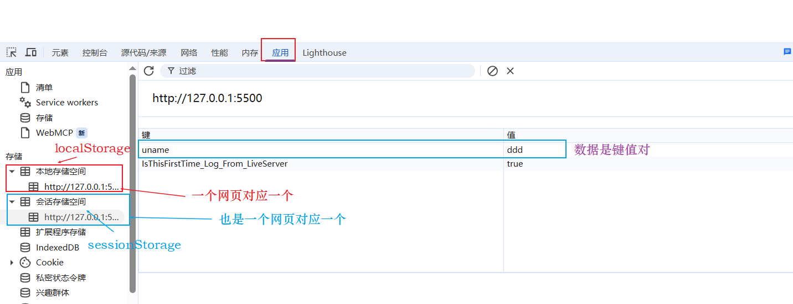

#### 3.9.1 sessionStorage

sessionStorage存储(又称**会话存储**)的特点：

1. 生命周期为关闭浏览器窗口，也就是**关闭浏览器窗口数据就自动清除**,**刷新页面是不会清除的**；
2. 数据是单页面共享的,不同页面数据是分开的，也就是**一个session对应一个页面窗口**；
3. 以**键值对**的形式进行存储的。

```html
<!DOCTYPE html>
<html lang="en">
  <head>
    <meta charset="UTF-8" />
    <meta name="viewport" content="width=device-width, initial-scale=1.0" />
    <title>Document</title>
  </head>
  <body>
    <!-- 用户输入框 -->
    <input type="text" />
    <button class="set">存储数据</button>
    <button class="get">获取数据</button>
    <button class="remove">删除数据</button>
    <button class="del">清空数据</button>
    <script>
      var ipt = document.querySelector("input");
      var set = document.querySelector(".set");
      var get = document.querySelector(".get");
      var remove = document.querySelector(".remove");
      var del = document.querySelector(".del");

      set.addEventListener("click", function () {
        var val = ipt.value;
        //存储数据名固定为uname,值为input输入的值,window可省略
        window.sessionStorage.setItem("uname", val);
      });

      get.addEventListener("click", function () {
        //获取
        var val = sessionStorage.getItem("uname");
        console.log(val);
      });

      remove.addEventListener("click", function () {
        //删除
        sessionStorage.removeItem("uname");
      });

      del.addEventListener("click", function () {
        //清空
        sessionStorage.clear();
      });
    </script>
  </body>
</html>
```

#### 3.9.2 localStorage

localStorage存储（又叫本地存储）的特点：

1. 生命周期永久生效，**即使关闭页面或浏览器也会继续存在**，只能手动删除；
2. 同一浏览器可以**多个页面共享**，只要在同一浏览器中，不同页面窗口都可共用数据；
3. 以键值对的形式进行存储。

使用方式跟sessionStorage基本一样。

```html
<!DOCTYPE html>
<html lang="en">
  <head>
    <meta charset="UTF-8" />
    <meta name="viewport" content="width=device-width, initial-scale=1.0" />
    <title>Document</title>
  </head>
  <body>
    <!-- 用户输入框 -->
    <input type="text" />
    <button class="set">存储数据</button>
    <button class="get">获取数据</button>
    <button class="remove">删除数据</button>
    <button class="del">清空数据</button>
    <script>
      var ipt = document.querySelector("input");
      var set = document.querySelector(".set");
      var get = document.querySelector(".get");
      var remove = document.querySelector(".remove");
      var del = document.querySelector(".del");

      set.addEventListener("click", function () {
        var val = ipt.value;
        //存储数据名固定为uname,值为input输入的值,window可省略
        window.localStorage.setItem("uname", val);
      });

      get.addEventListener("click", function () {
        //获取
        var val = localStorage.getItem("uname");
        console.log(val);
      });

      remove.addEventListener("click", function () {
        //删除
        localStorage.removeItem("uname");
      });

      del.addEventListener("click", function () {
        //清空
        localStorage.clear();
      });
    </script>
  </body>
</html>
```

案例：**记录用户名**，使用localStorage存储才行

```html
<!DOCTYPE html>
<html lang="en">
  <head>
    <meta charset="UTF-8" />
    <meta name="viewport" content="width=device-width, initial-scale=1.0" />
    <title>Document</title>
  </head>
  <body>
    <!-- 用户输入框，如果存储有数据就显示，没有就显示 -->
    <input type="text" id="username" />
    <!-- 勾选框，勾选就存储文本数据到localStorage,不勾选就删除 -->
    <input type="checkbox" name="" id="remember" /> 记住用户名

    <script>
      var username = document.querySelector("#username");
      var remember = document.querySelector("#remember");

      //有数据直接赋值input，并勾选
      if (localStorage.getItem("username")) {
        username.value = localStorage.getItem("username");
        remember.checked = true;
      }

      //监听复选框改变事件
      remember.addEventListener("change", function () {
        //username不能为空
        if (this.checked && username.value) {
          localStorage.setItem("username", username.value);
        } else {
          localStorage.removeItem("username");
        }
      });
    </script>
  </body>
</html>
```

## 四、jQuery

### 4.1 jQuery的概述

**JavaScript库**，即library,是一个**封装好的特定方法与函数的合集**。这个库中封装了很多预先定义好的函数，例如动画animate函数、hide函数、show函数、兼容性问题解决函数以及获取元素函数等，要使用时不用再编写函数内容直接调用即可。

JavaScript库也是一个js文件，里面对**原生的js代码进行了函数封装**，存放到里面，这样就可高效快速的使用封装好的功能函数。其**内部都是用js代码实现的**。

JavaScript库、插件、框架本质都是js文件，只是功能目的不同：

1. JavaScript库主要封装js源码方便快速使；
2. 插件是解决特定功能的js代码，小而功能单一；
3. 框架是一整套解决方案，大而全。

**jQuery**就是为了**快速方便的操作DOM**而封装的JavaScript库，里面基本都是函数。除了jQuery外，常见的JavaScript库有：Prototype、YUI、Dojo、Ext JS、移动端的zepto（也是快速操作DOM）等。

jQuery是一个快速、简洁的JavaScript库，其提倡写更少代码做更多事。j是JavaScript，Query是查询的意思。它对js中的DOM操作进行的封装，让我们可以快速的查询使用里面的功能。

jQuery封装的内容优化了DOM操作、事件处理、动画设计和Ajax交互。学习jQuery的本质就是**学习调用里面的函数**。

jQuery的优点：

1. 轻量级。核心文件只有几十kb,不会影响页面加载速度；
2. 跨浏览器兼容。基本兼容了主流的浏览器；
3. 支持**链式编程**、**隐式迭代**；
4. **对事件、样式、动画支持，大大简化了DOM操作**；
5. **支持插件扩展开发**。有丰富的第三方插件，例如:树形菜单、日期控件、轮播图等；
6. 免费开源。

jQuery官方网址：https://jquery.com/

jQuery官方文档：https://api.jquery.com/

> jQuery版本说明
>
> 1.0x:兼容IE678等低版本浏览器，官网不再更新；
>
> 2.0x:不兼容IE678等低版本浏览器，官网不再更新；
>
> 3.0x:不兼容IE678等低版本浏览器，官网不再更新；
>
> 4.0x:不兼容IE678等低版本浏览器，官网最后更新维护的版本；

jQuery下载地址：https://jquery.com/download/

其版本分为：`jquery-4.0.0.min.js`压缩版本，也就是develop版本，和源码版本`jquery-4.0.0.js`。下载方法就是打开网页直接全选代码复制到js文件中即可。还有一种`jquery-4.0.0.min.map`文件，它是js文件再压缩的版本，一般不使用。

### 4.2 jQuery的基本使用与入口函数

有了jQuery文件，其使用方式就是直接引入js，然后在自己的js中调用jQuery函数。下面是调用hide函数的效果。

```html
<!DOCTYPE html>
<html lang="en">
  <head>
    <meta charset="UTF-8" />
    <meta name="viewport" content="width=device-width, initial-scale=1.0" />
    <title>Document</title>
    <!-- 引入jQuery文件 -->
    <script src="jquery.min.js"></script>
    <style>
      div {
        width: 100px;
        height: 100px;
        background-color: red;
      }
    </style>
  </head>
  <body>
    <div></div>
    <script>
      // jQuery隐藏div元素，相当于div.style.dispaly='none'
      $("div").hide();
    </script>
  </body>
</html>
```

上述js代码要**写在div元素之后**才能生效，否则会因查询不到元素而无效。

js中我们采用监听`load`或者`DOMContentLoaded`事件来实现等待页面元素加载完再执行代码。这就是JS的入口函数。

jQuery中也有其对应的入口函数，其效果是等待DOM结构渲染完成就执行，相当于`DOMContentLoaded`事件，写法有两种：

```js
//写法一 传统写法
$(document).ready(function () {
   //内部代码，此处是页面DOM加载完成后的入口
});

//写法二 简洁写法
$(function () {
    //内部代码，此处是页面DOM加载完成后的入口
});
```

简单案例，js代码放到元素前依然生效。

```html
<!DOCTYPE html>
<html lang="en">
  <head>
    <meta charset="UTF-8" />
    <meta name="viewport" content="width=device-width, initial-scale=1.0" />
    <title>Document</title>
    <!-- 引入jQuery文件 -->
    <script src="jquery.min.js"></script>
    <style>
      div {
        width: 100px;
        height: 100px;
        background-color: red;
      }
    </style>
  </head>
  <body>
    <!-- js代码有效 -->
    <script>
      $(function () {
        $("div").hide();
      });
    </script>
    <div></div>
  </body>
</html>
```

### 4.3 jQuery的顶级对象 $(重点)

**$其实是jQuery对象的别名**，在代码中可以使用jQuery获取顶级对象，为了简便，就直接使用$代替jQuery。

jQuery的顶级对象，其相当于原生JavaScript中的window对象。

之前案例中的代码可替换为下面代码，效果完全一样

```html
<!DOCTYPE html>
<html lang="en">
  <head>
    <meta charset="UTF-8" />
    <meta name="viewport" content="width=device-width, initial-scale=1.0" />
    <title>Document</title>
    <!-- 引入jQuery文件 -->
    <script src="jquery.min.js"></script>
    <style>
      div {
        width: 100px;
        height: 100px;
        background-color: red;
      }
    </style>
  </head>
  <body>
    <!-- $==jQuery -->
    <script>
      jQuery(function () {
        jQuery("div").hide();
      });
    </script>
    <div></div>
  </body>
</html>
```

### 4.4 jQuery对象和DOM对象(重点)

DOM对象，就是使用原生js获取过来的元素对象就是DOM对象。

jQuery对象，就是用jQuery方式获取过来的元素对象就是jQuery对象。本质是利用$把DOM元素对象包装后产生的对象，是以**伪数组形式存储**的。jQuery对象只能使用jQuery方法，DOM对象只能使用原生js方法，两者不能混用。

DOM对象比jQuery对象更大。因为jQuery只是封装了常用的方法，不常用的只有原生DOM对象才有。因此要使用这些方法，就需要**在DOM对象与jQuery对象之间进行相互转换**。

```html
<!DOCTYPE html>
<html lang="en">
  <head>
    <meta charset="UTF-8" />
    <meta name="viewport" content="width=device-width, initial-scale=1.0" />
    <title>Document</title>
    <!-- 引入jQuery文件 -->
    <script src="jquery.min.js"></script>
    <style>
      div {
        width: 100px;
        height: 100px;
        background-color: red;
      }
    </style>
  </head>
  <body>
    <div></div>
    <script>
      //DOM对象
      var div = document.querySelector("div");
      console.log(div); //div元素对象
      //1. jQuery对象
      var div2 = $("div");
      console.log(div2); //w.fn.init {0: div, length: 1, prevObject: w.fn.init}
      console.log(div2[0]); //div元素对象
        
      //2.jQuery对象只能使用jQuery方法，DOM对象只能使用原生js方法，两者不能混用。
      //DOM方法
      div.style.display = "none";
      //jQuery方法
      div2.hide();
        
      //3.jQuery对象变为DOM对象，就是使用索引号获取,方式有两种
      div2[0].style.display = "block";
      div2.get(0).style.display = "block";
      //DOM对象转换为jQuery对象
      $(div).hide();
    </script>
  </body>
</html>
```

### 4.5 jQuery元素操作

结合之前DOM学习经验，jQuery学习流程跟其是类似对应的。

#### 4.5.1 元素获取

原生js获取元素方式很多很杂，且兼容性不一致，因此jQuery给我们做了疯子，使用统一的方式获取元素。

`$("选择器")` ,里面的选择器直接写CSS选择器即可。

| 名称       | 用法               | 描述                                                         |
| ---------- | ------------------ | ------------------------------------------------------------ |
| ID选择器   | `$('#id')`         | 根据id获取元素                                               |
| 标签选择器 | `$('div')`         | 根据标签名div获取元素                                        |
| 类选择器   | `$('.class')`      | 根据类名获取元素                                             |
| 全选选择器 | `$('*')`           | 匹配所有元素                                                 |
| 并集选择器 | `$('div,p,li')`    | 使用`，`符号，同时获取多个元素                               |
| 交集选择器 | `$('div.current')` | 使用`.`符号，获取div中类名为current的元素                    |
| 子代选择器 | `$('div>li')`      | 使用`>`符号，获取div下的亲儿子li元素                         |
| 后代选择器 | `$('div li')`      | 使用`空格`，获取div下的所有li元素，不仅包括亲儿子，孙子这些也包含 |

```html
<!DOCTYPE html>
<html lang="en">
<head>
    <meta charset="UTF-8">
    <meta name="viewport" content="width=device-width, initial-scale=1.0">
    <meta http-equiv="X-UA-Compatible" content="ie=edge">
    <title>Document</title>
    <script src="jquery.min.js"></script>
</head>
<body>
    <div>我是div</div>
    <div class="nav">我是nav div</div>
    <p>我是p</p>
    <ol>
        <li>我是ol 的</li>
        <li>我是ol 的</li>
        <li>我是ol 的</li>
        <li>我是ol 的</li>
    </ol>
    <ul>
        <li>我是ul 的</li>
        <li>我是ul 的</li>
        <li>我是ul 的</li>
        <li>我是ul 的</li>
    </ul>
    <script>
        $(function() {
            console.log($(".nav"));
            console.log($("ul li"));
        })
    </script>
</body>
</html>
```

**筛选选择器**，从多个元素中选择其中某一个

| 名称       | 用法                    | 描述                                                 |
| ---------- | ----------------------- | ---------------------------------------------------- |
| :first     | `$('li:first')`         | 获取第一个元素                                       |
| :last      | `$('li:last')`          | 获取最后一个元素                                     |
| :eq(index) | `$('li:eq(2)')`         | 获取索引号为2的元素，索引号从0开始，也就是第三个元素 |
| :odd       | `$('li:odd')`           | 获取索引号为奇数的所有元素                           |
| :even      | `$('li:even')`          | 获取索引号为偶数的所有元素                           |
| :checked   | `$('checkbox:checked')` | 获取复选框被选中的所有元素                           |

```html
<!DOCTYPE html>
<html lang="en">
  <head>
    <meta charset="UTF-8" />
    <meta name="viewport" content="width=device-width, initial-scale=1.0" />
    <meta http-equiv="X-UA-Compatible" content="ie=edge" />
    <title>Document</title>
    <script src="jquery.min.js"></script>
  </head>
  <body>
    <ul>
      <li>多个里面筛选几个</li>
      <li>多个里面筛选几个</li>
      <li>多个里面筛选几个</li>
      <li>多个里面筛选几个</li>
      <li>多个里面筛选几个</li>
      <li>多个里面筛选几个</li>
    </ul>
    <ol>
      <li>多个里面筛选几个</li>
      <li>多个里面筛选几个</li>
      <li>多个里面筛选几个</li>
      <li>多个里面筛选几个</li>
      <li>多个里面筛选几个</li>
      <li>多个里面筛选几个</li>
    </ol>

    男：<input type="checkbox" checked /> 女：<input type="checkbox" />
    中性：<input type="checkbox" />
    <script>
      $(function () {
        $("ul li:first").css("color", "red");
        $("ul li:eq(2)").css("color", "blue");
        $("ol li:odd").css("color", "skyblue");
        $("ol li:even").css("color", "pink");
        console.log($("input:checked").length); //1
      });
    </script>
  </body>
</html>
```

**筛选方法**获取元素

| 名称                   | 用法                              | 描述                                                         |
| ---------------------- | --------------------------------- | ------------------------------------------------------------ |
| **parent()**           | `$('li').parent()`                | 获取li元素的父级元素                                         |
| **parents()**          | `$('li').parents('多级父元素')`   | 获取li元素的多级父级元素，无参数就是所有父亲(body,html也是)，有参数就是特定的父亲 |
| **children(selector)** | `$('ul').children("li")`          | 相当于`ul>li`的效果，找亲儿子                                |
| **find(selector)**     | `$('ul').find("li")`              | 相当于`ul li`的效果，找所有后代                              |
| **siblings(selector)** | `$('.first').siblings("li")`      | 查找**兄弟节点**，不包括自己本身                             |
| nextAll([expr])        | `$('.first').nextAll()`           | 查找**当前元素之后**的所有同级元素                           |
| prevtAll([expr])       | `$('.last').preAll()`             | 查找**当前元素之前**的所有同级元素                           |
| hasClass(class)        | `$('.div').hasClass("protected")` | 检查当前元素是否包含某个特定类，如果有返回true               |
| **eq(index)**          | `$('li').eq(2)`                   | 相当于`li:eq(2)`,index从0开始                                |

父子选择器方法

```html
<!DOCTYPE html>
<html lang="en">
  <head>
    <meta charset="UTF-8" />
    <meta name="viewport" content="width=device-width, initial-scale=1.0" />
    <meta http-equiv="X-UA-Compatible" content="ie=edge" />
    <title>Document</title>
    <script src="jquery.min.js"></script>
  </head>
  <body>
    <div class="yeye">
      <div class="father">
        <div class="son">儿子</div>
      </div>
    </div>
    <div class="nav">
      <p>我是儿子p</p>
      <div>
        <p>我是孙子p</p>
      </div>
    </div>
    <script>
      // 注意一下都是方法带括号
      $(function () {
        // 1. 查找父级parent()返回的是最近一级的父级元素 亲爸爸
        console.log($(".son").parent());
        onsole.log($(".son").parents()); //找出所有父亲
        console.log($(".son").parents(".yeye")); //找出特定父亲，相当于$(".son").parent().parent()
        // 2. 子
        // (1) 亲儿子 children()  类似子代选择器  ul>li
        $(".nav").children("p").css("color", "blue");
        // (2) 可以选里面所有的孩子 包括儿子和孙子 find() 类似于后代选择器
        $(".nav").find("p").css("color", "red");
      });
    </script>
  </body>
</html>
```

兄弟选择器方法

```html
<!DOCTYPE html>
<html lang="en">
  <head>
    <meta charset="UTF-8" />
    <meta name="viewport" content="width=device-width, initial-scale=1.0" />
    <meta http-equiv="X-UA-Compatible" content="ie=edge" />
    <title>Document</title>
    <script src="jquery.min.js"></script>
  </head>

  <body>
    <ol>
      <li>我是ol 的li</li>
      <li>我是ol 的li</li>
      <li class="item">我是ol 的li</li>
      <li>我是ol 的li</li>
      <li>我是ol 的li</li>
      <li>我是ol 的li</li>
    </ol>
    <ul>
      <li>我是ol 的li</li>
      <li>我是ol 的li</li>
      <li>我是ol 的li</li>
      <li>我是ol 的li</li>
      <li>我是ol 的li</li>
      <li>我是ol 的li</li>
    </ul>
    <div class="current">俺有current</div>
    <div>俺木有current</div>
    <script>
      // 注意一下都是方法 带括号
      $(function () {
        // 1. 兄弟元素siblings 除了自身元素之外的所有亲兄弟
        $("ol .item").siblings("li").css("color", "red");
        //查找后面所有兄弟
        $("ol .item").nextAll().css("color", "blue");
        //查找前面所有兄弟
        $("ol .item").prevAll().css("color", "pink");
        // 2. 第n个元素
        var index = 2;
        // (1) 我们可以利用选择器的方式选择
        $("ul li:eq(2)").css("color", "blue");
        $("ul li:eq(" + index + ")").css("color", "blue");
        // (2) 我们可以利用选择方法的方式选择 更推荐这种写法
        $("ul li").eq(2).css("color", "blue");
        $("ul li").eq(index).css("color", "blue");
        // 3. 判断是否有某个类名
        console.log($("div:first").hasClass("current")); //true
        console.log($("div:last").hasClass("current")); //false
      });
    </script>
  </body>
</html>
```

案例：新浪下拉菜单

```html
<!DOCTYPE html>
<html lang="en">
  <head>
    <meta charset="UTF-8" />
    <meta name="viewport" content="width=device-width, initial-scale=1.0" />
    <meta http-equiv="X-UA-Compatible" content="ie=edge" />
    <title>Document</title>
    <style>
      * {
        margin: 0;
        padding: 0;
      }

      li {
        list-style-type: none;
      }

      a {
        text-decoration: none;
        font-size: 14px;
      }

      .nav {
        margin: 100px;
      }

      .nav > li {
        position: relative;
        float: left;
        width: 80px;
        height: 41px;
        text-align: center;
      }

      .nav li a {
        display: block;
        width: 100%;
        height: 100%;
        line-height: 41px;
        color: #333;
      }

      .nav > li > a:hover {
        background-color: #eee;
      }

      .nav ul {
        display: none;
        position: absolute;
        top: 41px;
        left: 0;
        width: 100%;
        border-left: 1px solid #fecc5b;
        border-right: 1px solid #fecc5b;
      }

      .nav ul li {
        border-bottom: 1px solid #fecc5b;
      }

      .nav ul li a:hover {
        background-color: #fff5da;
      }
    </style>
    <script src="jquery.min.js"></script>
  </head>

  <body>
    <ul class="nav">
      <li>
        <a href="#">微博</a>
        <ul>
          <li>
            <a href="">私信</a>
          </li>
          <li>
            <a href="">评论</a>
          </li>
          <li>
            <a href="">@我</a>
          </li>
        </ul>
      </li>
      <li>
        <a href="#">微博</a>
        <ul>
          <li>
            <a href="">私信</a>
          </li>
          <li>
            <a href="">评论</a>
          </li>
          <li>
            <a href="">@我</a>
          </li>
        </ul>
      </li>
      <li>
        <a href="#">微博</a>
        <ul>
          <li>
            <a href="">私信</a>
          </li>
          <li>
            <a href="">评论</a>
          </li>
          <li>
            <a href="">@我</a>
          </li>
        </ul>
      </li>
      <li>
        <a href="#">微博</a>
        <ul>
          <li>
            <a href="">私信</a>
          </li>
          <li>
            <a href="">评论</a>
          </li>
          <li>
            <a href="">@我</a>
          </li>
        </ul>
      </li>
    </ul>
    <script>
      $(function () {
        // 鼠标经过事件 mouseover 有隐式迭代
        $(".nav>li").mouseover(function () {
          // $(this) jQuery当前元素 this是DOM元素  this不要加引号
          // show() 显示元素  hide() 隐藏元素
          $(this).children("ul").show();
        });
        // 鼠标离开事件 mouseout
        $(".nav>li").mouseout(function () {
          $(this).children("ul").hide();
        });
      });
    </script>
  </body>
</html>
```

#### 4.5.2 隐式迭代、排它思想与当前索引index()

遍历内部DOM元素(伪数组形式存储)的过程就叫做**隐式迭代**。

简单理解：给匹配到的所有元素进行循环遍历，执行相同的方法，而不用我们再进行for循环，简化了操作方便我们调用。

```html
<!DOCTYPE html>
<html lang="en">
  <head>
    <meta charset="UTF-8" />
    <meta name="viewport" content="width=device-width, initial-scale=1.0" />
    <meta http-equiv="X-UA-Compatible" content="ie=edge" />
    <title>Document</title>
    <script src="jquery.min.js"></script>
  </head>

  <body>
    <div>惊喜不，意外不</div>
    <div>惊喜不，意外不</div>
    <div>惊喜不，意外不</div>
    <div>惊喜不，意外不</div>
    <ul>
      <li>相同的操作</li>
      <li>相同的操作</li>
      <li>相同的操作</li>
    </ul>
    <script>
      // 1. 获取四个div元素
      console.log($("div"));
      // 2. 给四个div设置背景颜色为粉色 jquery对象不能使用style
      $("div").css("background", "pink");
      // 3. 隐式迭代就是把匹配的所有元素内部进行遍历循环，给每一个元素添加css这个方法,
      //相当于jQuery内部使用for循环执行三次css的代码
      $("ul li").css("color", "red");
    </script>
  </body>
</html>
```

jQuery的**排它思想**很简单，利用隐式迭代+兄弟选择器只需要两句话就能完成。

```html
<!DOCTYPE html>
<html lang="en">
  <head>
    <meta charset="UTF-8" />
    <meta name="viewport" content="width=device-width, initial-scale=1.0" />
    <meta http-equiv="X-UA-Compatible" content="ie=edge" />
    <title>Document</title>
    <script src="jquery.min.js"></script>
  </head>

  <body>
    <button>快速</button>
    <button>快速</button>
    <button>快速</button>
    <button>快速</button>
    <button>快速</button>
    <button>快速</button>
    <button>快速</button>
    <script>
      $(function () {
        // 1. 隐式迭代 给所有的按钮都绑定了点击事件
        $("button").click(function () {
          // 2. 当前的元素变化背景颜色
          $(this).css("background", "pink");
          // 3. 其余的兄弟去掉背景颜色 隐式迭代
          $(this).siblings("button").css("background", "");
        });
      });
    </script>
  </body>
</html>
```

获取当前元素索引号的方法`$(this).index()`。该方法只能**获取连续相邻相同元素**的索引，不相邻则无效。

```html
<!DOCTYPE html>
<html lang="en">
  <head>
    <meta charset="UTF-8" />
    <meta name="viewport" content="width=device-width, initial-scale=1.0" />
    <meta http-equiv="X-UA-Compatible" content="ie=edge" />
    <title>Document</title>
    <script src="jquery.min.js"></script>
  </head>

  <body>
    <div>
      <a href="#">1</a>
      <a href="#">2</a>
      <a href="#">3</a>
    </div>
    <ul>
      <li><a href="#">a</a></li>
      <li><a href="#">b</a></li>
      <li><a href="#">c</a></li>
    </ul>
    <script>
      //能获取成功
      $("div a").click(function () {
        console.log($(this).index()); //0,1,2
      });
      //获取失败
      $("ul a").click(function () {
        console.log($(this).index()); //0 0 0 都是0就是因为所有a都不相邻，因此获取的都是第一个
      });
    </script>
  </body>
</html>
```

案例：淘宝精品服饰案例，鼠标移动到哪个左边文字就切换到对应图片

```html
<!DOCTYPE html>
<html>
  <head lang="en">
    <meta charset="UTF-8" />
    <title></title>
    <style type="text/css">
      * {
        margin: 0;
        padding: 0;
        font-size: 12px;
      }
      ul {
        list-style: none;
      }
      a {
        text-decoration: none;
      }
      .wrapper {
        width: 250px;
        height: 248px;
        margin: 100px auto 0;
        border: 1px solid pink;
        border-right: 0;
        overflow: hidden;
      }
      #left,
      #content {
        float: left;
      }
      #left li {
        background: url(images/lili.jpg) repeat-x;
      }
      #left li a {
        display: block;
        width: 48px;
        height: 27px;
        border-bottom: 1px solid pink;
        line-height: 27px;
        text-align: center;
        color: black;
      }
      #left li a:hover {
        background-image: url(images/abg.gif);
      }
      #content {
        border-left: 1px solid pink;
        border-right: 1px solid pink;
      }
    </style>
    <script src="jquery.min.js"></script>
    <script>
      $(function () {
        // 1. 鼠标经过左侧的小li
        $("#left li").mouseover(function () {
          // 2. 得到当前小li 的索引号
          var index = $(this).index();
          // 3. 让我们右侧的盒子相应索引号的图片显示出来就好了
          $("#content div").eq(index).show();
          // 4. 让其余的图片（就是其他的兄弟）隐藏起来
          $("#content div").eq(index).siblings().hide();
          // 链式编程
          // $("#content div").eq(index).show().siblings().hide();
        });
      });
    </script>
  </head>

  <body>
    <div class="wrapper">
      <ul id="left">
        <li><a href="#">女靴</a></li>
        <li><a href="#">雪地靴</a></li>
        <li><a href="#">冬裙</a></li>
        <li><a href="#">呢大衣</a></li>
        <li><a href="#">毛衣</a></li>
        <li><a href="#">棉服</a></li>
        <li><a href="#">女裤</a></li>
        <li><a href="#">羽绒服</a></li>
        <li><a href="#">牛仔裤</a></li>
      </ul>
      <div id="content">
        <div>
          <a href="#"></a>
        </div>
        <div>
          <a href="#"></a>
        </div>
        <div>
          <a href="#"></a>
        </div>
        <div>
          <a href="#"></a>
        </div>
        <div>
          <a href="#"></a>
        </div>
        <div>
          <a href="#"></a>
        </div>
        <div>
          <a href="#"></a>
        </div>
        <div>
          <a href="#"></a>
        </div>
        <div>
          <a href="#"></a>
        </div>
      </div>
    </div>
  </body>
</html>
```

#### 4.5.3 链式编程

链式编程是为了节约代码量，让代码看起来更优雅。

```html
<!DOCTYPE html>
<html lang="en">
  <head>
    <meta charset="UTF-8" />
    <meta name="viewport" content="width=device-width, initial-scale=1.0" />
    <meta http-equiv="X-UA-Compatible" content="ie=edge" />
    <title>Document</title>
    <script src="jquery.min.js"></script>
  </head>

  <body>
    woshi body 的文字
    <button>快速</button>
    <button>快速</button>
    <button>快速</button>
    <button>快速</button>
    <button>快速</button>
    <button>快速</button>
    <button>快速</button>
    <script>
      $(function () {
        // 1. 隐式迭代 给所有的按钮都绑定了点击事件
        $("button").click(function () {
          // 2. 让当前元素颜色变为红色
          // $(this).css("color", "red");
          // 3. 让其余的兄弟元素不变色
          // $(this).siblings().css("color", "");
          // // 上述代码的链式编程 // 我的颜色为红色, 我的兄弟的颜色为空
          // $(this).css("color", "red").siblings().css("color", "");

          //更明确的写法,明确操作对象
          $(this).css("color", "yellow")
                 .siblings().css("color", "");
          // 我的兄弟变为红色 ,我本身不变颜色
          // $(this).siblings().css('color', 'red');

          // 最后是给我的兄弟的爸爸 body 变化颜色
          $(this).siblings().parent().css("color", "blue");
        });
      });
    </script>
  </body>
</html>
```

#### 4.5.4 元素样式修改

jQuery使用`css方法`来修改简单元素样式，也可以使用对象同时修改多个样式。还可以操作类样式(操作类名不加点)，类似之前classList。

**参数只写属性名**,属性名必须带引号，则返回属性值，带单位。

```js
$("div").css("width"))
```

参数是属性名、属性值、逗号分隔，是设置一组样式，属性名必须加引号，属性值如果是数字可以不用跟单位和引号。

```js
$("div").css("width", 300);
$("div").css("width", "300px");
```

参数可以是**对象形式**，可设置多组样式。属性名和属性值用：分开，属性名可以不用引号。

```js
$("div").css({
         width: 400,
         height: "400px",
        // 如果是复合属性则必须采取驼峰命名法，如果值不是数字，则需要加引号
         backgroundColor:"red"
})
```

简单案例

```html
<!DOCTYPE html>
<html lang="en">
  <head>
    <meta charset="UTF-8" />
    <meta name="viewport" content="width=device-width, initial-scale=1.0" />
    <meta http-equiv="X-UA-Compatible" content="ie=edge" />
    <title>Document</title>
    <script src="jquery.min.js"></script>
    <style>
      div {
        width: 200px;
        height: 200px;
        background-color: pink;
      }
    </style>
  </head>

  <body>
    <div></div>
    <script>
      // 操作样式之css方法
      $(function () {
        console.log($("div").css("width"));
        $("div").css("width", "300px");
        // $("div").css("width", 300);
        // $("div").css(height, "300px"); //属性名一定要加引号,否则会报错
        $("div").css({
          width: 400,
          height: 400,
          // 如果是复合属性则必须采取驼峰命名法，如果值不是数字，则需要加引号
          backgroundColor: "red"
        });
      });
    </script>
  </body>
</html>
```

类样式操作，注意类名不用加点。

**添加类**

```js
$('div').addClass("current");
```

**移除类**

```js
$('div').removeClass("current");
```

**切换类**,有就加没有就删除

```js
$('div').toggleClass("current");
```

> **jQuery、className以及classList区别**
>
> 原生的className属性是直接操作所有类名，会覆盖原先的类名。
>
> 原生的classList操作是类名的修改，不会覆盖原先类名。
>
> jQuery里面的操作也是类名的修改，不会覆盖原先类名。

简单案例

```html
<!DOCTYPE html>
<html lang="en">
  <head>
    <meta charset="UTF-8" />
    <meta name="viewport" content="width=device-width, initial-scale=1.0" />
    <meta http-equiv="X-UA-Compatible" content="ie=edge" />
    <title>Document</title>
    <script src="jquery.min.js"></script>
    <style>
      div {
        width: 200px;
        height: 200px;
        background-color: pink;
        margin: 100px auto;
      }
      .current {
        background-color: red;
      }

      .current2 {
        background-color: red;
        transition: all 0.5s;
        transform: rotate(360deg);
      }
    </style>
  </head>

  <body>
    <div></div>
    <script>
      $(function () {
        //添加类 addClass
        $("div").click(function () {
          $(this).addClass("current");
        });

        //删除类 removeClass
        $("div").mouseout(function () {
          $(this).removeClass("current");
        });

        //切换类 toggleClass
        $("div").mouseenter(function () {
          $(this).toggleClass("current2");
        });
      });
    </script>
  </body>
</html>
```

案例优化：tab栏切换

```html
<!DOCTYPE html>
<html lang="en">
  <head>
    <meta charset="UTF-8" />
    <meta name="viewport" content="width=device-width, initial-scale=1.0" />
    <meta http-equiv="X-UA-Compatible" content="ie=edge" />
    <title>Document</title>
    <style>
      * {
        margin: 0;
        padding: 0;
      }

      li {
        list-style-type: none;
      }

      .tab {
        width: 978px;
        margin: 100px auto;
      }

      .tab_list {
        height: 39px;
        border: 1px solid #ccc;
        background-color: #f1f1f1;
      }

      .tab_list li {
        float: left;
        height: 39px;
        line-height: 39px;
        padding: 0 20px;
        text-align: center;
        cursor: pointer;
      }

      .tab_list .current {
        background-color: #c81623;
        color: #fff;
      }

      .item_info {
        padding: 20px 0 0 20px;
      }

      .item {
        display: none;
      }
    </style>
    <script src="jquery.min.js"></script>
  </head>

  <body>
    <div class="tab">
      <div class="tab_list">
        <ul>
          <li class="current">商品介绍</li>
          <li>规格与包装</li>
          <li>售后保障</li>
          <li>商品评价（50000）</li>
          <li>手机社区</li>
        </ul>
      </div>
      <div class="tab_con">
        <div class="item" style="display: block">商品介绍模块内容</div>
        <div class="item">规格与包装模块内容</div>
        <div class="item">售后保障模块内容</div>
        <div class="item">商品评价（50000）模块内容</div>
        <div class="item">手机社区模块内容</div>
      </div>
    </div>
    <script>
      $(function () {
        // 1.点击上部的li，当前li 添加current类，其余兄弟移除类
        $(".tab_list li").click(function () {
          // 链式编程操作
          $(this).addClass("current").siblings().removeClass("current");
          // 2.点击的同时，得到当前li 的索引号
          var index = $(this).index();
          // 3.让下部里面相应索引号的item显示，其余的item隐藏
          $(".tab_con .item").eq(index).show().siblings().hide();
        });
      });
    </script>
  </body>
</html>
```

#### 4.5.5 jQuery的动画效果

jQuery给我们封装了很多动画效果，最常见的如下：

1. 元素显示与隐藏：show()、hide()、toggle();
2. 滑动效果：slideDown()、slideUp()、slideToggle();
3. 淡入淡出效果：fadeIn()、fadeOut()、fadeToggle()、fadeTo();
4. 自定义动画：animate()，该函数中有个**scrollTop**属性，可设置位置，做出类似返回顶部的效果。

大部分的动画函数参数都类似，我们先把统一的参数函数列出，防止后面重复罗列。**中括号`[]`表示参数可省略**。

| 参数名     | 参数效果                                                     |
| ---------- | ------------------------------------------------------------ |
| **speed**  | 动画速度参数，可使用三种预定速度：(`slow`,`normal`,`fast`)或设置动画时长`1000`表示1000ms |
| **easing** | 用来指定切换效果，默认是`swing`,表示开始慢然后变快再变慢的效果，还是设置`linear`,表示匀速 |
| **fn**     | 回调函数，在动画完成时执行函数，每个元素执行一次             |

<strong style="color:red;font-size:18px">显示与隐藏</strong>

**显示函数show()**：

```js
//参数都省略就无动画效果直接显示
show([speed,[easing],[fn]])
```

**隐藏函数hide()**:

```js
hide([speed,[easing],[fn]])
```

**切换函数toggle()**:

```js
toggle([speed,[easing],[fn]])
```

```html
<!DOCTYPE html>
<html lang="en">
  <head>
    <meta charset="UTF-8" />
    <meta name="viewport" content="width=device-width, initial-scale=1.0" />
    <meta http-equiv="X-UA-Compatible" content="ie=edge" />
    <title>Document</title>
    <style>
      div {
        width: 150px;
        height: 300px;
        background-color: pink;
      }
    </style>
    <script src="jquery.min.js"></script>
  </head>

  <body>
    <button>显示</button>
    <button>隐藏</button>
    <button>切换</button>
    <div></div>
    <script>
      // 一般情况下，我们都不加参数直接显示隐藏就可以了,这种动画不好看
      $(function () {
        $("button").eq(0).click(function () {
            $("div").show(1000, function () {
              alert("show");
            });
          });
        $("button")
          .eq(1)
          .click(function () {
            $("div").hide(1000, "linear", function () {
              alert("hide");
            });
          });
        $("button")
          .eq(2)
          .click(function () {
            $("div").toggle(1000);
          });
      });
    </script>
  </body>
</html>
```

<strong style="color:red;font-size:18px">滑动</strong>

**下拉滑动slideDown()**:

```js
slideDown([speed,[easing],[fn]])
```

**上拉滑动slideUp()**:

```js
slideUp([speed,[easing],[fn]])
```

**滑动切换slideToggle()**:

```js
slideToggle([speed,[easing],[fn]])
```

```html
<!DOCTYPE html>
<html lang="en">
  <head>
    <meta charset="UTF-8" />
    <meta name="viewport" content="width=device-width, initial-scale=1.0" />
    <meta http-equiv="X-UA-Compatible" content="ie=edge" />
    <title>Document</title>
    <style>
      div {
        width: 150px;
        height: 300px;
        background-color: pink;
        display: none;
      }
    </style>
    <script src="jquery.min.js"></script>
  </head>

  <body>
    <button>下拉滑动</button>
    <button>上拉滑动</button>
    <button>切换滑动</button>
    <div></div>
    <script>
      $(function () {
        $("button")
          .eq(0)
          .click(function () {
            // 下滑动 slideDown()
            $("div").slideDown();
          });
        $("button")
          .eq(1)
          .click(function () {
            // 上滑动 slideUp()
            $("div").slideUp(500, "linear");
          });
        $("button")
          .eq(2)
          .click(function () {
            // 滑动切换 slideToggle()
            $("div").slideToggle(500);
          });
      });
    </script>
  </body>
</html>
```

<strong style="color:red;font-size:18px">事件切换与动画停止</strong>

jQuery为了使代码跟简洁，提供了一个事件切换函数`hover()`,它用一个函数表示**鼠标经过**与**离开**两个函数。

+ 参数over表示`鼠标进入mouseover()`的回调函数；
+ 参数out表示`鼠标离开mouseout()`的回调函数；
+ 可只写一个函数，鼠标进入与离开都会触发一次。

```js
hover([over,]out)
```

jQuery中的动画有排队队列，一旦触发就会执行，如果动画切换过快多次触发，就会出现一个一个动画排队执行的效果。为了防止同时触发多个动画，一般会在动画函数前添加`stop()`函数。

stop()函数表示停止所有在指定元素上正在运行的动画。如果队列中有等待执行的动画(并且clearQueue没有设为true)，他们将被马上执行。

+ **queue**:用来停止动画的队列名称
+ **clearQueue**:如果设置成true，则清空队列。可以立即结束动画。
+ **jumpToEnd**:如果设置成true，则完成队列。可以立即完成动画

```js
//一般很少使用参数
stop([queue],[clearQueue],[jumpToEnd])
```

案例优化：新浪下拉菜单

```html
<!DOCTYPE html>
<html lang="en">
  <head>
    <meta charset="UTF-8" />
    <meta name="viewport" content="width=device-width, initial-scale=1.0" />
    <meta http-equiv="X-UA-Compatible" content="ie=edge" />
    <title>Document</title>
    <style>
      * {
        margin: 0;
        padding: 0;
      }

      li {
        list-style-type: none;
      }

      a {
        text-decoration: none;
        font-size: 14px;
      }

      .nav {
        margin: 100px;
      }

      .nav > li {
        position: relative;
        float: left;
        width: 80px;
        height: 41px;
        text-align: center;
      }

      .nav li a {
        display: block;
        width: 100%;
        height: 100%;
        line-height: 41px;
        color: #333;
      }

      .nav > li > a:hover {
        background-color: #eee;
      }

      .nav ul {
        display: none;
        position: absolute;
        top: 41px;
        left: 0;
        width: 100%;
        border-left: 1px solid #fecc5b;
        border-right: 1px solid #fecc5b;
      }

      .nav ul li {
        border-bottom: 1px solid #fecc5b;
      }

      .nav ul li a:hover {
        background-color: #fff5da;
      }
    </style>
    <script src="jquery.min.js"></script>
  </head>

  <body>
    <ul class="nav">
      <li>
        <a href="#">微博</a>
        <ul>
          <li>
            <a href="">私信</a>
          </li>
          <li>
            <a href="">评论</a>
          </li>
          <li>
            <a href="">@我</a>
          </li>
        </ul>
      </li>
      <li>
        <a href="#">微博</a>
        <ul>
          <li>
            <a href="">私信</a>
          </li>
          <li>
            <a href="">评论</a>
          </li>
          <li>
            <a href="">@我</a>
          </li>
        </ul>
      </li>
      <li>
        <a href="#">微博</a>
        <ul>
          <li>
            <a href="">私信</a>
          </li>
          <li>
            <a href="">评论</a>
          </li>
          <li>
            <a href="">@我</a>
          </li>
        </ul>
      </li>
      <li>
        <a href="#">微博</a>
        <ul>
          <li>
            <a href="">私信</a>
          </li>
          <li>
            <a href="">评论</a>
          </li>
          <li>
            <a href="">@我</a>
          </li>
        </ul>
      </li>
    </ul>
    <script>
      //1.优化方案一
      // $(".nav>li").hover(
      //   //鼠标进入
      //   function () {
      //     $(this).children("ul").slideDown(200);
      //   },
      //   function () {
      //     //鼠标离开
      //     $(this).children("ul").slideUp(200);
      //   }
      // );
      //2. 优化方案二,并添加stop()函数
      $(".nav>li").hover(function () {
        //stop必须写在slideToggle动画函数前才会生效
        $(this).children("ul").stop().slideToggle();
      });
    </script>
  </body>
</html>
```

<strong style="color:red;font-size:18px">淡入淡出效果</strong>

**淡入fadeIn()**:

```js
fadeIn([speed,[easing],[fn]])
```

**淡出fadeOut()**:

```js
fadeOut([speed,[easing],[fn]])
```

**淡入淡出切换fadeToggle()**:

```js
fadeToggle([speed,[easing],[fn]])
```

**修改透明度fadeTo()**:

+ 该函数的speed参数与opacity参数是必写的；
+ speed参数依然是速度跟之前一样；
+ opacity表示要修改为透明度值，取值范围在0~1之间。

```js
fadeTo([[speed],opacity,[easing],[fn]])
```

```html
<!DOCTYPE html>
<html lang="en">
  <head>
    <meta charset="UTF-8" />
    <meta name="viewport" content="width=device-width, initial-scale=1.0" />
    <meta http-equiv="X-UA-Compatible" content="ie=edge" />
    <title>Document</title>
    <style>
      div {
        width: 150px;
        height: 300px;
        background-color: red;
        display: none;
      }
    </style>
    <script src="jquery.min.js"></script>
  </head>

  <body>
    <button>淡入效果</button>
    <button>淡出效果</button>
    <button>淡入淡出切换</button>
    <button>修改透明度</button>
    <div></div>
    <script>
      $(function () {
        $("button")
          .eq(0)
          .click(function () {
            // 淡入 fadeIn()
            $("div").fadeIn(1000);
          });
        $("button")
          .eq(1)
          .click(function () {
            // 淡出 fadeOut()
            $("div").fadeOut(1000);
          });
        $("button")
          .eq(2)
          .click(function () {
            // 淡入淡出切换 fadeToggle()
            $("div").fadeToggle(1000);
          });
        $("button")
          .eq(3)
          .click(function () {
            //  修改透明度 fadeTo() 这个速度和透明度要必须写
            $("div").fadeTo(1000, 0.5);
          });
      });
    </script>
  </body>
</html>
```

案例：高亮突出显示

1. 当鼠标进入的时候,其他的li标签透明度:0.5
2. 当鼠标离开的时候，其他的lili标签透明度:1

```html
<!DOCTYPE html>
<html>
  <head lang="en">
    <meta charset="UTF-8" />
    <title></title>
    <style type="text/css">
      * {
        margin: 0;
        padding: 0;
      }
      ul {
        list-style: none;
      }
      body {
        background: #000;
      }
      .wrap {
        margin: 100px auto 0;
        width: 630px;
        height: 394px;
        padding: 10px 0 0 10px;
        background: #000;
        overflow: hidden;
        border: 1px solid #fff;
      }
      .wrap li {
        float: left;
        margin: 0 10px 10px 0;
      }
      .wrap img {
        display: block;
        border: 0;
      }
    </style>
    <script src="jquery.min.js"></script>
    <script>
      $(function () {
        //鼠标进入的时候,其他的li标签透明度：0.5
        $(".wrap li").hover(
          function () {
            $(this).siblings().stop().fadeTo(400, 0.5);
          },
          function () {
            // 鼠标离开，其他li 透明度改为 1
            $(this).siblings().stop().fadeTo(400, 1);
          }
        );
      });
    </script>
  </head>

  <body>
    <div class="wrap">
      <ul>
        <li>
          <a href="#"></a>
        </li>
        <li>
          <a href="#"></a>
        </li>
        <li>
          <a href="#"></a>
        </li>
        <li>
          <a href="#"></a>
        </li>
        <li>
          <a href="#"></a>
        </li>
        <li>
          <a href="#"></a>
        </li>
      </ul>
    </div>
  </body>
</html>
```

案例：如果不使用鼠标，而是让亮度一个个亮度轮回切换，这样就形成了**老虎机效果**。(还可优化)

```html
<!DOCTYPE html>
<html>
  <head lang="en">
    <meta charset="UTF-8" />
    <title></title>
    <style type="text/css">
      * {
        margin: 0;
        padding: 0;
      }

      ul {
        list-style: none;
      }

      body {
        background: #000;
      }

      .wrap {
        margin: 100px auto 0;
        width: 630px;
        height: 394px;
        padding: 10px 0 0 10px;
        background: #000;
        overflow: hidden;
        border: 1px solid #fff;
      }

      .wrap li {
        float: left;
        margin: 0 10px 10px 0;
      }

      .wrap img {
        display: block;
        border: 0;
      }
    </style>
    <script src="jquery.min.js"></script>
    <script>
      $(function () {
        var index = 0;
        var timer = null;

        //点击就启动老虎机，再次点击就等待1秒停止老虎机
        var flag = false;
        var valid = true; //节流
        $(".wrap ul").click(function () {
          if (flag) {
            if (!valid) {
              return false;
            }
            valid = false;
            setTimeout(function () {
              clearInterval(timer);
              timer = null;
              flag = false;
              //开启定时器，将不再重复开启
              valid = true;
            }, 1000);
          } else {
            tiggerFn();
            flag = true;
          }
        });

        //老虎机函数
        function tiggerFn() {
          timer = setInterval(function () {
            index = index > 5 ? 0 : index;
            if (3 <= index) {
              var a = 0;
              if (index == 3) {
                a = index + 2;
                $(".wrap li").eq(a).siblings().stop().fadeTo(400, 0.5);
                $(".wrap li").eq(a).stop().fadeTo(400, 1);
              } else if (index == 4) {
                $(".wrap li").eq(index).siblings().stop().fadeTo(400, 0.5);
                $(".wrap li").eq(index).stop().fadeTo(400, 1);
              } else if (index == 5) {
                a = index - 2;
                $(".wrap li").eq(a).siblings().stop().fadeTo(400, 0.5);
                $(".wrap li").eq(a).stop().fadeTo(400, 1);
              }
              index++;
            } else if (0 <= index) {
              $(".wrap li").eq(index).siblings().stop().fadeTo(400, 0.5);
              $(".wrap li").eq(index).stop().fadeTo(400, 1);
              index++;
            }
          }, 300);
        }
      });
    </script>
  </head>

  <body>
    <div class="wrap">
      <ul>
        <li>
          <a href="#"></a>
        </li>
        <li>
          <a href="#"></a>
        </li>
        <li>
          <a href="#"></a>
        </li>
        <li>
          <a href="#"></a>
        </li>
        <li>
          <a href="#"></a>
        </li>
        <li>
          <a href="#"></a>
        </li>
      </ul>
    </div>
  </body>
</html>
```

<strong style="color:red;font-size:18px">自定义动画效果</strong>

**动画animate()**:

+ 参数params,想要更改的样式属性，是以**对象的形式传递**，必填。属性名可不带引号，复合属性采用驼峰命名法；
+ 其余参数跟之前的一样，都可省略。

```js
animate(params,[speed],[easing],[fn]])
```

```html
<!DOCTYPE html>
<html lang="en">
  <head>
    <meta charset="UTF-8" />
    <meta name="viewport" content="width=device-width, initial-scale=1.0" />
    <meta http-equiv="X-UA-Compatible" content="ie=edge" />
    <title>Document</title>
    <script src="jquery.min.js"></script>
    <style>
      div {
        position: absolute;
        width: 200px;
        height: 200px;
        background-color: pink;
      }
    </style>
  </head>

  <body>
    <button>动起来</button>
    <div></div>
    <script>
      $(function () {
        $("button").click(function () {
          //向左下移动到[500,300]点，透明度变为0.4,宽度变为500
          $("div").animate(
            {
              left: 500,
              top: 300,
              opacity: 0.4,
              width: "500px"
            },
            500
          );
        });
      });
    </script>
  </body>
</html>
```

**重要案例：王者荣耀的手风琴,或者叫折叠卡片**

+ 结构布局，首先有个大盒子king，包含了一个ul，每个ul下的li标签中是a标签（有点击效果），a标签包含两个图片，big图片`width: 224px`和small图片`width: 69px`；
+ 默认只先显示每个图片的小图片，有个特殊的current图片会显示大图片隐藏小图片；
+ 当鼠标移动到新图片，当前小li宽度变为224px，同时里面的小图片淡出，大图片淡入；
+ 同时其余兄弟小li宽度变为69px，小图片淡入，大图片淡出

```html
<!DOCTYPE html>
<html>
  <head>
    <meta charset="utf-8" />
    <title>手风琴案例</title>

    <style type="text/css">
      * {
        margin: 0;
        padding: 0;
      }

      img {
        display: block;
      }

      ul {
        list-style: none;
      }

      .king {
        width: 752px;
        margin: 100px auto;
        background: url(images/bg.png) no-repeat;
        overflow: hidden;
        padding: 10px;
      }

      .king ul {
        overflow: hidden;
      }

      .king li {
        position: relative;
        float: left;
        width: 69px;
        height: 69px;
        margin-right: 10px;
      }

      .king li.current {
        width: 224px;
      }

      .king li.current .big {
        display: block;
      }

      .king li.current .small {
        display: none;
      }

      .big {
        width: 224px;
        display: none;
      }

      .small {
        position: absolute;
        top: 0;
        left: 0;
        width: 69px;
        height: 69px;
        border-radius: 5px;
      }
    </style>
  </head>

  <body>
    <script src="jquery.min.js"></script>
    <script type="text/javascript">
      $(function () {
        // 鼠标经过某个小li 有两步操作：
        $(".king li").mouseenter(function () {
          // 1.当前小li 宽度变为 224px， 同时里面的小图片淡出，大图片淡入
          $(this).stop().animate({
              width: 224
          }).find(".small").stop().fadeOut()
            .siblings(".big").stop().fadeIn();
          // 2.其余兄弟小li宽度变为69px， 小图片淡入， 大图片淡出
          $(this).siblings("li").stop().animate({
              width: 69
            }).find(".small").stop().fadeIn()
            .siblings(".big").stop().fadeOut();
        });
      });
    </script>
    <div class="king">
      <ul>
        <li class="current">
          <a href="#">
            
            
          </a>
        </li>
        <li>
          <a href="#">
            
            
          </a>
        </li>
        <li>
          <a href="#">
            
            
          </a>
        </li>
        <li>
          <a href="#">
            
            
          </a>
        </li>
        <li>
          <a href="#">
            
            
          </a>
        </li>
        <li>
          <a href="#">
            
            
          </a>
        </li>
        <li>
          <a href="#">
            
            
          </a>
        </li>
      </ul>
    </div>
  </body>
</html>
```

#### 4.5.6 元素属性操作

所谓元素固有属性就是元素本身自带的属性，比如a标签的href属性。获取元素固有属性的方法`prop()`。

所谓元素自定义属性就是元素本身没有的我们自己编写的属性。获取元素自定义属性的方法`attr()`。

**获取属性值**

```js
prop('属性名')
```

**设置属性值**

```js
prop('属性名','属性值')
```

**获取自定义属性**,类似原生的`getAttribute()`

```js
attr('属性名')
```

**设置自定义属性值**,类似原生的`setAttribute()`

```js
attr('属性名','属性值')
```

**获取H5自定义属性**

```js
attr('H5属性名')
```

**数据缓存**,`data()`方法可以在指定的元素上存取数据，但并不会修改DOM元素结构(**html上没有改变**)，**一旦页面刷新，之前存放的数据就会被移除**。相当于把元素当成一个对象，data方法就是在对象上添加属性与属性值。

**设置缓存**

```js
data("数据名"，"数据值")
```

**获取缓存**

```js
data("数据名")
```

**获取H5属性**，返回值的类型是数字型

```js
data("去除data开头的属性名")
```

```html
<!DOCTYPE html>
<html lang="en">
  <head>
    <meta charset="UTF-8" />
    <meta name="viewport" content="width=device-width, initial-scale=1.0" />
    <title>Document</title>
    <script src="jquery.min.js"></script>
  </head>
  <body>
    <a href="https://www.baidu.com" title="百度">baidu</a>
    <input type="checkbox" name="" checked />
    <!-- index是普通自定义属性,data-index是H5的自定义属性 -->
    <div index="1" data-index="3">我的div</div>
    <span>123</span>
    <script>
      $(function () {
        //1.获取属性值
        console.log($("a").prop("href")); //https://www.baidu.com
        
        //2.设置属性值,返回值是修改元素的jQuery对象
        console.log($("a").prop("title", "新百度")[0]);
        //复选框状态改变获取属性值
        $("input").change(function () {
          console.log($(this).prop("checked"));
        });

        //3.获取自定义属性
        console.log($("div").attr("index")); //1

        //4.设置自定义属性
        console.log($("div").attr("index", 11)[0]);

        //5.获取H5自定义属性
        console.log($("div").attr("data-index")); //3

        //6.数据缓存,这个数据是存放在元素缓存中的,不会修改DOM元素本身结构，也就是html文档中是看不到的
        //设置缓存
        $("span").data("uname", "andy");
        //获取缓存数据
        console.log($("span").data("uname"));
        //获取H5属性
        console.log($("div").data("index"));
        //无法设置H5属性
        //console.log($("div").data("index", 8)[0]);
      });
    </script>
  </body>
</html>
```

#### 4.5.7 元素内容文本值操作

**获取普通元素内容**(相当于原生的innerHTML)

```js
html()
```

**设置普通元素内容**

```js
html('修改的内容')
```

**获取普通元素文本内容**(相当于原生的innerText)

```js
text()
```

**设置普通元素文本内容**

```js
text('修改的内容')
```

**获取表单元素文本内容**(相当于原生的value)

```js
val()
```

**设置表单元素文本内容**

```js
val('修改的内容')
```

```html
<!DOCTYPE html>
<html lang="en">
  <head>
    <meta charset="UTF-8" />
    <meta name="viewport" content="width=device-width, initial-scale=1.0" />
    <meta http-equiv="X-UA-Compatible" content="ie=edge" />
    <title>Document</title>
    <script src="jquery.min.js"></script>
  </head>
  <body>
    <div>
      <span>内容</span>
    </div>
    <input type="text" value="input内容" />
    <script>
      //1.获取普通元素内容 相当于innerHTML
      console.log($("div").html()); //<span>内容</span>
      //设置普通元素内容
      console.log($("div").html("<span>新内容</span>")[0]); //<div><span>新内容</span></div>

      //2.获取/设置普通元素文本内容 相当于innerText
      console.log($("div").text()); //新内容
      console.log($("div").text("新新内容")[0]); //<div>新新内容</div> 这里即使加了span也会变为字符串而不是标签

      //3.获取/设置表单元素文本内容 相当于value
      console.log($("input").val()); //input内容
      console.log($("input").val("aaa")[0]); //<input type="text" value="input内容"> 值修改了的但返回的是修改前的对象
    </script>
  </body>
</html>
```

#### 4.5.8 遍历元素 each

jQuery的隐式迭代是**对同一类元素做同样的操作**。但如果想**给同一类元素做不同操作**，就需要使用遍历。不用使用for循环，jQuery封装了一个强大的each方法可直接遍历元素。

`each()`方法的参数是回调函数，它的参数index表示元素的索引号，domEle表示当前DOM元素对象,不是jQuery对象。

```js
$('div').each(function(index,domEle){函数内容;})
```

`$.each()`方法可用于遍历任何对象。不仅是元素对象，数组、对象等都可以遍历。它主要用于数据处理。

它的第一参数为遍历对象，第二个参数为回调函数，其参数跟上边一样。

```js
$.each($('div'),function(index,domEle){函数内容;})
```

```html
<!DOCTYPE html>
<html lang="en">
  <head>
    <meta charset="UTF-8" />
    <meta name="viewport" content="width=device-width, initial-scale=1.0" />
    <meta http-equiv="X-UA-Compatible" content="ie=edge" />
    <title>Document</title>
    <script src="jquery.min.js"></script>
  </head>
  <body>
    <div>1</div>
    <div>2</div>
    <div>3</div>
    <script>
      $(function () {
        //隐式迭代,所有div文字都变为红色
        $("div").css("color", "rad");

        var sum = 0;
        //1.each()方法遍历元素,回调函数第一个参数一定为索引号，名字随意
        var arr = ["red", "yellow", "blue"];
        $("div").each(function (i, domEle) {
          //DOM对象转换为jQuery对象,每个元素一个颜色,使用数组完成
          $(domEle).css("color", arr[i]);
          //计算总数量
          sum += parseInt($(domEle).text());
        });
        console.log(sum); //6

        //2.$.each()遍历所有对象
        $.each($("div"), function (index, domEle) {
          console.log(index); //元素索引号
          console.log(domEle); //元素对象值
        });
        //遍历数组
        $.each(arr, function (index, domEle) {
          console.log(index); //数组索引号
          console.log(domEle); //数组值
        });
        //遍历对象 类似for in
        $.each({ name: "zhangsan", age: 20 }, function (index, domEle) {
          console.log(index); //对象属性名
          console.log(domEle); //对象属性值
        });
      });
    </script>
  </body>
</html>
```

#### 4.5.9 元素的创建、添加、删除操作

**创建元素**,效果等同于createElement

```js
$('<li></li>'); //动态创建一个li元素
```

**添加元素**，分为两种：

1. **内部添加**，就是把创建的元素添加到**指定元素内部**，创建的元素只能添加一次，多次添加以最后一次为主。最终为**父子关系**。

   ```js
   $('ul').append(li);//将创建的li添加到ul内部最后，跟之前的appendChild效果一样
   $('ul').prepend(li);//将创建的li添加到ul内部最前面
   ```

2. **外部添加**，就是把创建的元素添加到**指定元素外部**。创建的元素只能添加一次，多次添加以最后一次为主。最终为**兄弟关系**。

   ```js
   $(".test").after(div); //添加到指定元素后面
   $(".test").before(div); //添加到指定元素前面
   ```

**删除元素**

```js
element.remove(); //删除匹配元素本身
element.empty(); //删除匹配元素集合中所有的子节点，不删除元素本身
element.html("");//修改匹配元素的内容为空，跟empty效果类似，必须有参数否则为读取内容数据
```

```html
<!DOCTYPE html>
<html lang="en">
  <head>
    <meta charset="UTF-8" />
    <meta name="viewport" content="width=device-width, initial-scale=1.0" />
    <meta http-equiv="X-UA-Compatible" content="ie=edge" />
    <title>Document</title>
    <script src="jquery.min.js"></script>
  </head>
  <body>
    <ul>
      <li>原来的li</li>
    </ul>
    <ol>
      <li>原来的li2</li>
    </ol>
    <div class="test">原来的div</div>
    <script>
      $(function () {
        //1.创建元素
        var li = $("<li>后面创建的li</li>");
        var li2 = $("<li>后面创建的li2</li>");

        //2.添加元素
        // 内部添加元素,注意一个元素只能添加一次,如果重复添加会以最后一次添加为主
        $("ul").append(li); //将li添加到ul元素内部最后
        $("ul").prepend(li2); //将li添加到ul元素内部最前
        // 外部添加元素，就是添加到元素外部，也就是元素兄弟
        var div = $("<div>后面添加的div1</div>");
        var div2 = $("<div>后面添加的div2</div>");
        $(".test").after(div); //添加到指定元素后面
        $(".test").before(div2); //添加到指定元素前面

        //3.删除元素
        $("ul").remove(); //删除匹配元素本身,自删
        $("ol").empty(); //删除匹配元素集合中所有的子节点，不删除元素本身
        $(".test").html(""); //必须有参数，没有参数表示获取内容，有""相当于赋值内容为""，也起到的类似empty的效果
      });
    </script>
  </body>
</html>
```

上述


#### 4.5.10 购物车案例

该案例是一个综合案例，由许多功能模块组成：

1. **全选功能模块**，点击全选勾选所有复选框，再次点击就取消。小复选框点击时，判断勾选的选择的数量是否等于全部小复选框数量，如果是全部就勾选全选按钮，其他则不勾选；
2. **增减商品数量模块**，有点击按钮增减，数量改变的同时，小计也会随着数量改变。注意：1.增减商品的数量是本商品的，不会影响其他商品，小计也一样。2.增减变量变化初始值必须是当前文本框的值；
3. **修改商品小计模块**，该模块内容是根据商品数量*商品价格计算出结果的。注意：1.只能修改当前商品的小计，2.要进行数量计算首先要移除单位￥，最终结果要保留两位小数。如果数量文本框直接输入数字，小计也需要重新计算改变。3.要判断输入的值是否为负值或者小数，是就改变为旧值。保存旧值的方法可使用**focus函数**监听保存。
4. **购物车总件数与总额模块**，把所有文本框的值相加就是总件数，总额就是所有小计值相加。注意：因为文本框中值不同，需使用each遍历。当数量发送变化时，总件数与总额都会改变。
5. **清理购物车模块**，核心是使用remove删除元素，主要分为点击删除按钮删除，删除复选框勾选的元素，全部一次删除三种删除。注意不管是什么删除，都会影响总件数与总额的内容。
6. **选中商品添加背景模块**，就是复选框勾选商品后，其背景变浅粉红色。小复选框勾选会变，全选按钮点击也会变化。购物车.css先添加一个样式`.check-cart-item{background: #fff4e8;}`。

**购物车.html**

```html
<!DOCTYPE html>
<html lang="zh-CN">
  <head>
    <meta charset="UTF-8" />
    <title>我的购物车-品优购</title>
    <meta
      name="description"
      content="品优购JD.COM-专业的综合网上购物商城,销售家电、数码通讯、电脑、家居百货、服装服饰、母婴、图书、食品等数万个品牌优质商品.便捷、诚信的服务，为您提供愉悦的网上购物体验!"
    />
    <meta
      name="Keywords"
      content="网上购物,网上商城,手机,笔记本,电脑,MP3,CD,VCD,DV,相机,数码,配件,手表,存储卡,品优购"
    />
    <!-- 引入facicon.ico网页图标 -->
    <link rel="shortcut icon" href="favicon.ico" type="image/x-icon" />

    <!-- 引入car css -->
    <link rel="stylesheet" href="购物车.css" />
    <!-- 先引入jquery  -->
    <script src="jquery.min.js"></script>
    <!-- 在引入我们自己的js文件 -->
    <script src="购物车.js"></script>
    <style>
      /* base.csss */
      /*清除元素默认的内外边距  */
      * {
        margin: 0;
        padding: 0;
      }
      /*让所有斜体 不倾斜*/
      em,
      i {
        font-style: normal;
      }
      /*去掉列表前面的小点*/
      li {
        list-style: none;
      }
      /*图片没有边框   去掉图片底侧的空白缝隙*/
      img {
        border: 0; /*ie6*/
        vertical-align: middle;
      }
      /*让button 按钮 变成小手*/
      button {
        cursor: pointer;
      }
      /*取消链接的下划线*/
      a {
        color: #666;
        text-decoration: none;
      }

      a:hover {
        color: #e33333;
      }

      button,
      input {
        font-family: "Microsoft YaHei", "Heiti SC", tahoma, arial,
          "Hiragino Sans GB", \\5B8B\4F53, sans-serif;
        /*取消轮廓线 蓝色的*/
        outline: none;
      }

      body {
        background-color: #fff;
        font: 12px/1.5 "Microsoft YaHei", "Heiti SC", tahoma, arial,
          "Hiragino Sans GB", \\5B8B\4F53, sans-serif;
        color: #666;
      }

      .hide,
      .none {
        display: none;
      }
      /*清除浮动*/
      .clearfix:after {
        visibility: hidden;
        clear: both;
        display: block;
        content: ".";
        height: 0;
      }

      /* common.css */
      /*公共样式*/
      .fl {
        float: left;
      }

      .fr {
        float: right;
      }

      @font-face {
        font-family: "icomoon";
        src: url("../fonts/icomoon.eot?7kkyc2");
        src: url("../fonts/icomoon.eot?7kkyc2#iefix")
            format("embedded-opentype"),
          url("../fonts/icomoon.ttf?7kkyc2") format("truetype"),
          url("../fonts/icomoon.woff?7kkyc2") format("woff"),
          url("../fonts/icomoon.svg?7kkyc2#icomoon") format("svg");
        font-weight: normal;
        font-style: normal;
      }

      .fr .icomoon {
        font-family: "icomoon";
        font-size: 16px;
        line-height: 26px;
      }

      /*版心*/

      .w {
        width: 1200px;
        margin: 0 auto;
      }

      .style-red {
        color: #c81623;
      }

      .spacer {
        width: 1px;
        height: 12px;
        background-color: #666;
        margin: 9px 12px 0;
      }

      /*顶部快捷导航*/

      .shortcut {
        height: 31px;
        background-color: #f1f1f1;
        line-height: 31px;
      }

      .shortcut li {
        float: left;
      }

      /*header区域*/

      .header {
        position: relative;
        height: 105px;
      }

      .logo {
        position: absolute;
        top: 25px;
        left: 0;
        width: 175px;
        height: 56px;
      }

      .logo a {
        display: block;
        /*overflow: hidden;*/
        width: 175px;
        height: 56px;
        background: url(../images/logo.png) no-repeat;
        /*text-indent: -999px;*/
        font-size: 0;
      }

      .search {
        position: absolute;
        top: 25px;
        left: 348px;
      }

      .text {
        float: left;
        width: 445px;
        height: 32px;
        border: 2px solid #b1191a;
        padding-left: 10px;
        color: #ccc;
      }

      .btn {
        float: left;
        width: 82px;
        height: 36px;
        background-color: #b1191a;
        border: 0;
        font-size: 16px;
        color: #fff;
      }

      .hotwrods {
        position: absolute;
        top: 65px;
        left: 348px;
      }

      .hotwrods a {
        margin: 0 10px;
      }

      .shopcar {
        position: absolute;
        top: 25px;
        right: 64px;
        width: 138px;
        height: 34px;
        border: 1px solid #dfdfdf;
        background-color: #f7f7f7;
        line-height: 34px;
        text-align: center;
      }

      .car {
        font-family: "icomoon";
        color: #da5555;
      }

      .arrow {
        font-family: "icomoon";
        margin-left: 5px;
      }

      .count {
        position: absolute;
        top: -5px;
        /*应该是左侧对齐 文字才能往右走显示*/
        left: 100px;
        background-color: #e60012;
        height: 14px;
        padding: 0 3px;
        line-height: 14px;
        color: #fff;
        /*border-radius: 左上角 右上角  右下角  左下角;*/
        border-radius: 7px 7px 7px 0;
      }

      /*nav start*/

      .nav {
        height: 45px;
        border-bottom: 2px solid #b1191a;
      }

      .dropdown {
        width: 209px;
        height: 45px;
      }

      .dropdown .dt {
        height: 100%;
        background-color: #b1191a;
        font-size: 16px;
        color: #fff;
        text-align: center;
        line-height: 45px;
      }

      .dropdown .dd {
        height: 465px;
        background-color: #c81623;
        margin-top: 2px;
      }

      .menu_item:hover {
        background-color: #fff;
      }

      /*鼠标经过li 里面的 a变颜色*/

      .menu_item:hover a {
        color: #c81623;
      }

      .menu_item {
        height: 31px;
        line-height: 31px;
        margin-left: 1px;
        padding: 0 10px;
        transition: all 0.5s;
      }

      .menu_item:hover {
        padding-left: 20px;
      }

      .menu_item a {
        font-size: 14px;
        color: #fff;
      }

      .menu_item i {
        float: right;
        font-family: "icomoon";
        font-size: 18px;
        color: #fff;
      }

      .navitems {
        margin-left: 10px;
      }

      .navitems li {
        float: left;
      }

      .navitems li a {
        display: block;
        height: 45px;
        padding: 0 25px;
        line-height: 45px;
        font-size: 16px;
      }

      /*footer 部分*/

      .footer {
        height: 386px;
        background-color: #f5f5f5;
        padding-top: 30px;
      }

      .mod_service {
        height: 79px;
        border-bottom: 1px solid #ccc;
      }

      .mod_service li {
        float: left;
        width: 240px;
        height: 79px;
      }

      .mod-service-icon {
        /*浮动的盒子 可以直接给大小的 不需要转换*/
        float: left;
        width: 50px;
        height: 50px;
        margin-left: 35px;
        background: url(../images/icons.png) no-repeat;
      }

      .mod_service_zheng {
        background-position: -253px -3px;
      }

      .mod_service_tit {
        float: left;
        margin-left: 5px;
      }

      .mod_service_tit h5 {
        margin: 5px 0;
      }

      .mod_service_kuai {
        background-position: -255px -54px;
      }

      .mod_service_bao {
        background-position: -257px -105px;
      }

      .mod_help {
        height: 187px;
        border-bottom: 1px solid #ccc;
      }

      .mod_help_item {
        float: left;
        width: 150px;
        padding: 20px 0 0 50px;
      }

      .mod_help_item dt {
        height: 25px;
        font-size: 16px;
      }

      .mod_help_item dd {
        height: 22px;
      }

      .mod_help_app dt,
      .mod_help_app p {
        padding-left: 15px;
      }

      .mod_help_app img {
        margin: 7px 0;
      }

      .mod_copyright {
        text-align: center;
      }

      .mod_copyright_links {
        margin: 20px 0 15px 0;
      }

      .mod_copyright_info {
        line-height: 18px;
      }
    </style>
  </head>

  <body>
    <!-- 顶部快捷导航start -->
    <div class="shortcut">
      <div class="w">
        <div class="fl">
          <ul>
            <li>品优购欢迎您！</li>
            <li>
              <a href="#">请登录</a>
              <a href="#" class="style-red">免费注册</a>
            </li>
          </ul>
        </div>
        <div class="fr">
          <ul>
            <li><a href="#">我的订单</a></li>
            <li class="spacer"></li>
            <li>
              <a href="#">我的品优购</a>
              <i class="icomoon"></i>
            </li>
            <li class="spacer"></li>
            <li><a href="#">品优购会员</a></li>
            <li class="spacer"></li>
            <li><a href="#">企业采购</a></li>
            <li class="spacer"></li>
            <li><a href="#">关注品优购</a> <i class="icomoon"></i></li>
            <li class="spacer"></li>
            <li><a href="#">客户服务</a> <i class="icomoon"></i></li>
            <li class="spacer"></li>
            <li><a href="#">网站导航</a> <i class="icomoon"></i></li>
          </ul>
        </div>
      </div>
    </div>
    <!-- 顶部快捷导航end  -->

    <div class="car-header">
      <div class="w">
        <div class="car-logo">
           <b>购物车</b>
        </div>
      </div>
    </div>

    <div class="c-container">
      <div class="w">
        <div class="cart-filter-bar">
          <em>全部商品</em>
        </div>
        <!-- 购物车主要核心区域 -->
        <div class="cart-warp">
          <!-- 头部全选模块 -->
          <div class="cart-thead">
            <div class="t-checkbox">
              <input type="checkbox" name="" id="" class="checkall" /> 全选
            </div>
            <div class="t-goods">商品</div>
            <div class="t-price">单价</div>
            <div class="t-num">数量</div>
            <div class="t-sum">小计</div>
            <div class="t-action">操作</div>
          </div>
          <!-- 商品详细模块 -->
          <div class="cart-item-list">
            <div class="cart-item check-cart-item">
              <div class="p-checkbox">
                <input
                  type="checkbox"
                  name=""
                  id=""
                  checked
                  class="j-checkbox"
                />
              </div>
              <div class="p-goods">
                <div class="p-img">
                  
                </div>
                <div class="p-msg">
                  【5本26.8元】经典儿童文学彩图青少版八十天环游地球中学生语文教学大纲
                </div>
              </div>
              <div class="p-price">￥12.60</div>
              <div class="p-num">
                <div class="quantity-form">
                  <a href="javascript:;" class="decrement">-</a>
                  <input type="text" class="itxt" value="1" />
                  <a href="javascript:;" class="increment">+</a>
                </div>
              </div>
              <div class="p-sum">￥12.60</div>
              <div class="p-action"><a href="javascript:;">删除</a></div>
            </div>
            <div class="cart-item">
              <div class="p-checkbox">
                <input type="checkbox" name="" id="" class="j-checkbox" />
              </div>
              <div class="p-goods">
                <div class="p-img">
                  
                </div>
                <div class="p-msg">
                  【2000张贴纸】贴纸书 3-6岁 贴画儿童 贴画书全套12册 贴画
                  贴纸儿童 汽
                </div>
              </div>
              <div class="p-price">￥24.80</div>
              <div class="p-num">
                <div class="quantity-form">
                  <a href="javascript:;" class="decrement">-</a>
                  <input type="text" class="itxt" value="1" />
                  <a href="javascript:;" class="increment">+</a>
                </div>
              </div>
              <div class="p-sum">￥24.80</div>
              <div class="p-action"><a href="javascript:;">删除</a></div>
            </div>
            <div class="cart-item">
              <div class="p-checkbox">
                <input type="checkbox" name="" id="" class="j-checkbox" />
              </div>
              <div class="p-goods">
                <div class="p-img">
                  
                </div>
                <div class="p-msg">
                  唐诗三百首+成语故事全2册 一年级课外书 精装注音儿童版
                  小学生二三年级课外阅读书籍
                </div>
              </div>
              <div class="p-price">￥29.80</div>
              <div class="p-num">
                <div class="quantity-form">
                  <a href="javascript:;" class="decrement">-</a>
                  <input type="text" class="itxt" value="1" />
                  <a href="javascript:;" class="increment">+</a>
                </div>
              </div>
              <div class="p-sum">￥29.80</div>
              <div class="p-action"><a href="javascript:;">删除</a></div>
            </div>
          </div>

          <!-- 结算模块 -->
          <div class="cart-floatbar">
            <div class="select-all">
              <input type="checkbox" name="" id="" class="checkall" />全选
            </div>
            <div class="operation">
              <a href="javascript:;" class="remove-batch"> 删除选中的商品</a>
              <a href="javascript:;" class="clear-all">清理购物车</a>
            </div>
            <div class="toolbar-right">
              <div class="amount-sum">已经选<em>1</em>件商品</div>
              <div class="price-sum">总价： <em>￥12.60</em></div>
              <div class="btn-area">去结算</div>
            </div>
          </div>
        </div>
      </div>
    </div>

    <!-- footer start -->
    <div class="footer">
      <div class="w">
        <!-- mod_service -->
        <div class="mod_service">
          <ul>
            <li>
              <i class="mod-service-icon mod_service_zheng"></i>
              <div class="mod_service_tit">
                <h5>正品保障</h5>
                <p>正品保障，提供发票</p>
              </div>
            </li>
            <li>
              <i class="mod-service-icon mod_service_kuai"></i>
              <div class="mod_service_tit">
                <h5>正品保障</h5>
                <p>正品保障，提供发票</p>
              </div>
            </li>
            <li>
              <i class="mod-service-icon mod_service_bao"></i>
              <div class="mod_service_tit">
                <h5>正品保障</h5>
                <p>正品保障，提供发票</p>
              </div>
            </li>
            <li>
              <i class="mod-service-icon mod_service_bao"></i>
              <div class="mod_service_tit">
                <h5>正品保障</h5>
                <p>正品保障，提供发票</p>
              </div>
            </li>
            <li>
              <i class="mod-service-icon mod_service_bao"></i>
              <div class="mod_service_tit">
                <h5>正品保障</h5>
                <p>正品保障，提供发票</p>
              </div>
            </li>
          </ul>
        </div>
        <!-- mod_help -->
        <div class="mod_help">
          <dl class="mod_help_item">
            <dt>购物指南</dt>
            <dd><a href="#">购物流程 </a></dd>
            <dd><a href="#">会员介绍 </a></dd>
            <dd><a href="#">生活旅行/团购 </a></dd>
            <dd><a href="#">常见问题 </a></dd>
            <dd><a href="#">大家电 </a></dd>
            <dd><a href="#">联系客服 </a></dd>
          </dl>
          <dl class="mod_help_item">
            <dt>购物指南</dt>
            <dd><a href="#">购物流程 </a></dd>
            <dd><a href="#">会员介绍 </a></dd>
            <dd><a href="#">生活旅行/团购 </a></dd>
            <dd><a href="#">常见问题 </a></dd>
            <dd><a href="#">大家电 </a></dd>
            <dd><a href="#">联系客服 </a></dd>
          </dl>
          <dl class="mod_help_item">
            <dt>购物指南</dt>
            <dd><a href="#">购物流程 </a></dd>
            <dd><a href="#">会员介绍 </a></dd>
            <dd><a href="#">生活旅行/团购 </a></dd>
            <dd><a href="#">常见问题 </a></dd>
            <dd><a href="#">大家电 </a></dd>
            <dd><a href="#">联系客服 </a></dd>
          </dl>
          <dl class="mod_help_item">
            <dt>购物指南</dt>
            <dd><a href="#">购物流程 </a></dd>
            <dd><a href="#">会员介绍 </a></dd>
            <dd><a href="#">生活旅行/团购 </a></dd>
            <dd><a href="#">常见问题 </a></dd>
            <dd><a href="#">大家电 </a></dd>
            <dd><a href="#">联系客服 </a></dd>
          </dl>
          <dl class="mod_help_item">
            <dt>购物指南</dt>
            <dd><a href="#">购物流程 </a></dd>
            <dd><a href="#">会员介绍 </a></dd>
            <dd><a href="#">生活旅行/团购 </a></dd>
            <dd><a href="#">常见问题 </a></dd>
            <dd><a href="#">大家电 </a></dd>
            <dd><a href="#">联系客服 </a></dd>
          </dl>
          <dl class="mod_help_item mod_help_app">
            <dt>帮助中心</dt>
            <dd>
              
              <p>品优购客户端</p>
            </dd>
          </dl>
        </div>

        <!-- mod_copyright  -->
        <div class="mod_copyright">
          <p class="mod_copyright_links">
            关于我们 | 联系我们 | 联系客服 | 商家入驻 | 营销中心 | 手机品优购 |
            友情链接 | 销售联盟 | 品优购社区 | 品优购公益 | English Site |
            Contact U
          </p>
          <p class="mod_copyright_info">
            地址：北京市昌平区建材城西路金燕龙办公楼一层 邮编：100096
            电话：400-618-4000 传真：010-82935100 邮箱: zhanghj+itcast.cn <br />
            京ICP备08001421号京公网安备110108007702
          </p>
        </div>
      </div>
    </div>
    <!-- footer end -->
  </body>
</html>
```

**购物车.css**

```css
.car-header {
    padding: 20px 0;
}

.car-logo img {
    vertical-align: middle;
}

.car-logo b {
    font-size: 20px;
    margin-top: 20px;
    margin-left: 10px;
}

.cart-filter-bar {
    font-size: 16px;
    color: #E2231A;
    font-weight: 700;
}

.cart-filter-bar em {
    padding: 5px;
    border-bottom: 1px solid #E2231A;
}

.cart-thead {
    height: 32px;
    line-height: 32px;
    margin: 5px 0 10px;
    padding: 5px 0;
    background: #f3f3f3;
    border: 1px solid #e9e9e9;
    border-top: 0;
    position: relative;
}

.cart-thead>div,
.cart-item>div {
    float: left;
}

.t-checkbox,
.p-checkbox {
    height: 18px;
    line-height: 18px;
    padding-top: 7px;
    width: 122px;
    padding-left: 11px;
}

.t-goods {
    width: 400px;
}

.t-price {
    width: 120px;
    padding-right: 40px;
    text-align: right;
}

.t-num {
    width: 150px;
    text-align: center;
}

.t-sum {
    width: 100px;
    text-align: right;
}

.t-action {
    width: 130px;
    text-align: right;
}

.cart-item {
    height: 160px;
    border-style: solid;
    border-width: 2px 1px 1px;
    border-color: #aaa #f1f1f1 #f1f1f1;
    background: #fff;
    padding-top: 14px;
    margin: 15px 0;
}

.check-cart-item {
    background: #fff4e8;
}

.p-checkbox {
    width: 50px;
}

.p-goods {
    margin-top: 8px;
    width: 565px;
}

.p-img {
    float: left;
    border: 1px solid #ccc;
    padding: 5px;
}

.p-msg {
    float: left;
    width: 210px;
    margin: 0 10px;
}

.p-price {
    width: 110px;
}

.quantity-form {
    width: 80px;
    height: 22px;
}

.p-num {
    width: 170px;
}

.decrement,
.increment {
    float: left;
    border: 1px solid #cacbcb;
    height: 18px;
    line-height: 18px;
    padding: 1px 0;
    width: 16px;
    text-align: center;
    color: #666;
    margin: 0;
    background: #fff;
    margin-left: -1px;
}

.itxt {
    float: left;
    border: 1px solid #cacbcb;
    width: 42px;
    height: 18px;
    line-height: 18px;
    text-align: center;
    padding: 1px;
    margin: 0;
    margin-left: -1px;
    font-size: 12px;
    font-family: verdana;
    color: #333;
    /* -webkit-appearance: none; */
}

.p-sum {
    font-weight: 700;
    width: 145px;
}


/* 结算模块 */

.cart-floatbar {
    height: 50px;
    border: 1px solid #f0f0f0;
    background: #fff;
    position: relative;
    margin-bottom: 50px;
    line-height: 50px;
}

.select-all {
    float: left;
    height: 18px;
    line-height: 18px;
    padding: 16px 0 16px 9px;
    white-space: nowrap;
}

.select-all input {
    vertical-align: middle;
    display: inline-block;
    margin-right: 5px;
}

.operation {
    float: left;
    width: 200px;
    margin-left: 40px;
}

.clear-all {
    font-weight: 700;
    margin: 0 20px;
}

.toolbar-right {
    float: right;
}

.amount-sum {
    float: left;
}

.amount-sum em {
    font-weight: 700;
    color: #E2231A;
    padding: 0 3px;
}

.price-sum {
    float: left;
    margin: 0 15px;
}

.price-sum em {
    font-size: 16px;
    color: #E2231A;
    font-weight: 700;
}

.btn-area {
    font-weight: 700;
    width: 94px;
    height: 52px;
    line-height: 52px;
    color: #fff;
    text-align: center;
    font-size: 18px;
    font-family: "Microsoft YaHei";
    background: #e54346;
    overflow: hidden;
}
```

**购物车.js**

```js
$(function () {
  //1.全选全不选功能模块,事件使用change事件,有两个checkall全选
  $(".checkall").change(function () {
    //获取全选状态
    var checked = $(this).prop("checked");
    //并集选择器，小的box与另外一个全选都要改变
    $(".j-checkbox,.checkall").prop("checked", checked);

    //6 选中商品添加背景，通过添加类,删除类来增减CSS样式
    //先判断是否为选中状态，如果是就全部添加check-cart-item类名
    if ($(this).prop("checked")) {
      $(".cart-item").addClass("check-cart-item");
    } else {
      //没有就移除样式
      $(".cart-item").removeClass("check-cart-item");
    }
  });
  //小复选框box改变时，全选按钮也会跟随变化
  $(".j-checkbox").change(function () {
    //选中复选框的数量 :checked可获取选中复选框的数量
    var num = $(".j-checkbox:checked").length;
    //当一个都没有选中，全选变为全不选
    if (num == $(".j-checkbox").length) {
      $(".checkall").prop("checked", true);
    } else {
      $(".checkall").prop("checked", false);
    }

    if ($(this).prop("checked")) {
      //让当前商品添加样式
      $(this).parents(".cart-item").addClass("check-cart-item");
    } else {
      //没有就移除当前商品样式
      $(this).parents(".cart-item").removeClass("check-cart-item");
    }
  });

  //2.增减商品数量模块
  //增加按钮点击事件
  $(".increment").click(function () {
    //获取当前文本框的值
    var n = $(this).siblings(".itxt").val();
    n++;
    $(this).siblings(".itxt").val(n);
    priceChange($(this), n);
    getSum();
  });
  //减少按钮点击事件
  $(".decrement").click(function () {
    //获取当前文本框的值
    var n = $(this).siblings(".itxt").val();
    //减少到1就不能再减
    if (n == 1) {
      this.disabled = true; //按钮禁用
      return false;
    }
    n--;
    $(this).siblings(".itxt").val(n);
    priceChange($(this), n);
    getSum();
  });

  //直接修改数量文本框值
  // 获取焦点时保存旧值
  var oldValue = 0;
  $(".itxt").on("focus", function () {
    oldValue = $(this).val();
  });
  $(".itxt").change(function () {
    //先得到当前文本框的值
    var n = $(this).val();
    //n值不能为小数或者负数
    if (n < 0 || n % 1 !== 0) {
      //直接修改会旧值
      $(this).val(oldValue);
      return false;
    }
    priceChange($(this), n);
    getSum();
  });

  //3.计算小计模块 根据文本框值*商品价格得到，提取为公共函数，去除重复代码
  function priceChange(currentObj, n) {
    //获得当前商品价格
    var price = currentObj.parent().parent().siblings(".p-price").html();
    //移除单位
    price = price.substr(1);
    //计算结果保留2位小数
    price = "￥" + (price * n).toFixed(2);
    currentObj.parents(".p-num").siblings(".p-sum").html(price);
  }

  //4. 购物车总件数与总额模块,也封装为一个公共函数，去除重复代码
  //当页面第一次打开或刷新就先计算一下总额
  getSum();
  function getSum() {
    //计算总件数
    var count = 0;
    //计算总金额
    var money = 0;
    $(".itxt").each(function (index, domEle) {
      //累积数量值
      count += parseInt($(domEle).val());
    });
    //修改总件数
    $(".amount-sum em").text(count);
    //计算总金额
    $(".p-sum").each(function (index, domEle) {
      money += parseFloat($(domEle).text().substr(1));
    });
    $(".price-sum em").text("￥" + money.toFixed(2));
  }

  //5. 删除商品模块
  //通过删除按钮点击删除商品
  $(".p-action a").click(function () {
    //删除包括自身
    $(this).parents(".cart-item").remove();
    //删除后都要重新计算总额
    getSum();
  });
  //删除选中的商品
  $(".remove-batch").click(function () {
    //删除复选框选中的商品 有隐式迭代
    $(".j-checkbox:checked").parents(".cart-item").remove();
    getSum();
  });
  //清理购物车，删除所有
  $(".clear-all").click(function () {
    $(".cart-item").remove();
    getSum();
  });
});
```

#### 4.5.11 获取元素尺寸

获取元素的尺寸,类似与之前**clientWidth**与**clientHeight**获取元素宽高。

| 语法                                   | 用法                                                         |
| -------------------------------------- | ------------------------------------------------------------ |
| **width()/height()**                   | 获得与设置匹配元素的宽度与高度值，只有width/height           |
| **innerWidth()/innerHeight()**         | 获得与设置匹配元素的宽度与高度值，包括**padding值**          |
| **outerWidth()/outerHeight()**         | 获得与设置匹配元素的宽度与高度值，包括**padding值**、**border值** |
| **outerWidth(true)/outerHeight(true)** | 参数为true,获得与设置匹配元素的宽度与高度值，包括**padding值**、**border值**和**margin值** |

以上参数为空时就表示**获取相应的值**，返回的是数字型。如果参数有数字，则是修改相应的值。参数没有单位。

> 隐藏公式规则：
>
> padding值=（innerWidth()-width()）/2
>
> border值=（outerWidth()-innerWidth()）/2
>
> margin值=（outerWidth(true)-outerWidth()）/2

```html
<!DOCTYPE html>
<html lang="en">
  <head>
    <meta charset="UTF-8" />
    <meta name="viewport" content="width=device-width, initial-scale=1.0" />
    <meta http-equiv="X-UA-Compatible" content="ie=edge" />
    <title>Document</title>
    <script src="jquery.min.js"></script>
    <style>
      div {
        width: 200px;
        height: 200px;
        background-color: red;
        padding: 10px;
        border: 15px solid blue;
        margin: 20px;
      }
    </style>
  </head>
  <body>
    <div></div>
    <script>
      $(function () {
        //1. 获取与设置元素width与height大小
        console.log($("div").width()); //获取宽度值 200无单位
        console.log($("div").width(300)[0]); //设置宽度为300,返回修改后的元素对象
        //宽高写法基本一致
        console.log($("div").height()); //获取高度值 200无单位
        console.log($("div").height(300)[0]); //设置高度为300,返回修改后的元素对象

        //2.包含padding
        console.log($("div").innerWidth()); //320,就是300+10+10
        console.log($("div").innerWidth(400)[0]); //修改宽度为380,也就是减去padding值400-10-10=380

        //3. 包含padding与border
        console.log($("div").outerWidth()); //430,就是400+15+15,如果有偏差是浏览器精度问题
        console.log($("div").outerWidth(500)[0]); //修改宽度为450,也就是减去padding与border值500-10-10-15-15=450

        //4. 包含padding、border以及margin值
        console.log($("div").outerWidth(true)); //540,就是500+20+20,如果有偏差是浏览器精度问题
        //注意数字在true参数之前写才有效
        console.log($("div").outerWidth(600, true)[0]); //修改宽度为450,也就是减去padding与border值600-10-10-15-15-20-20=510
      });
    </script>
  </body>
</html>
```

#### 4.5.12 获取元素位置

`offset()`方法是**获取被选元素**相对于**文档的偏移坐标**，跟父级没有关系，返回值的是一个对象，包含top与left两个偏移量。

```js
element.offset(); //位置对象
element.offset().top; //距离顶部位置
element.offset().left; //距离左侧位置
```

它跟之前offsetTop是有区别的，之前offsetTop是距离**有定位的父元素偏移量**，offset是即使父元素有定位也只会获取距离文档的偏移量。

**设置元素坐标**,参数为对象。

```js
element.offset({
     top: 200,
     left: 200
});
```

`position()`方法是获取被选元素相对于**带有定位的父级元素偏移坐标**，如果父级没有定位，则继续向上找，直到文档为止。该方法只能获取值，不能设置值。和之前的offsetTop效果一致。

```js
element.position();
```

```html
<!DOCTYPE html>
<html lang="en">
  <head>
    <meta charset="UTF-8" />
    <meta name="viewport" content="width=device-width, initial-scale=1.0" />
    <meta http-equiv="X-UA-Compatible" content="ie=edge" />
    <title>Document</title>
    <style>
      * {
        margin: 0;
        padding: 0;
      }

      .father {
        width: 400px;
        height: 400px;
        background-color: pink;
        margin: 100px;
        overflow: hidden;
        position: relative;
      }

      .son {
        width: 150px;
        height: 150px;
        background-color: purple;
        position: absolute;
        left: 10px;
        top: 10px;
      }
    </style>
    <script src="jquery.min.js"></script>
  </head>

  <body>
    <div class="father">
      <div class="son"></div>
    </div>

    <script>
      $(function () {
        // 1. 获取设置距离文档的位置（偏移） offset
        console.log($(".son").offset()); //返回对象{top: 110, left: 110}
        console.log($(".son").offset().top);
        //设置偏移量
        $(".son").offset({
          top: 200,
          left: 200
        });
        $(".son").offset({ top: 100 });
        // $(".son").offset.top = 300; 该方式错误,不能设置偏移量

        // 2. 获取距离带有定位父级位置（偏移） position   如果没有带有定位的父级，则以文档为准
        // 这个方法只能获取不能设置偏移
        console.log($(".son").position()); //返回对象{top: 0, left: 100}
        //设置无效
        // $(".son").position({
        //   top: 200,
        //   left: 200
        // });
      });
    </script>
  </body>
</html>
```

`scrollTop()/scrollLeft()`方法设置或返回被选元素被卷去的头部/左侧。

```js
element.scrollTop(); //被卷去头部距离
element.scrollLeft(); //被卷去左部距离

//有参数就是直接设置值，直接跳转到该位置
element.scrollTop(距离)
```

案例：返回顶部按钮，按钮先隐藏，滚动到某个距离才显示，**点击返回时有动画**，不使用`$(document).scrollTop(0)`返回,这样没动画。

```html
<!DOCTYPE html>
<html lang="en">
  <head>
    <meta charset="UTF-8" />
    <meta name="viewport" content="width=device-width, initial-scale=1.0" />
    <meta http-equiv="X-UA-Compatible" content="ie=edge" />
    <title>Document</title>
    <style>
      body {
        height: 2000px;
      }

      .back {
        position: fixed;
        width: 50px;
        height: 50px;
        background-color: pink;
        right: 30px;
        bottom: 100px;
        display: none;
      }

      .container {
        width: 900px;
        height: 500px;
        background-color: skyblue;
        margin: 400px auto;
      }
    </style>
    <script src="jquery.min.js"></script>
  </head>

  <body>
    <div class="back">返回顶部</div>

    <div class="container"></div>
    <script>
      $(function () {
        //页面打开或刷新直接跳转到滚动距离100px的位置
        $(document).scrollTop(100);

        //被卷去的头部
        //1. 页面滚动事件监听滚动
        var boxTop = $(".container").offset().top; //获取容器距离顶部的距离
        $(window).scroll(function () {
          console.log($(document).scrollTop());
          //滚动到容器位置，让back显示,这里的$(document).scrollTop()相当于之前的window.pageYoffset值
          if ($(document).scrollTop() >= boxTop) {
            $(".back").fadeIn();
          } else {
            $(".back").fadeOut();
          }
        });

        //2.返回顶部
        $(".back").click(function () {
          // $(document).scrollTop(0);
          //不能使用$(document),因为animate是元素做动画而不是文档对象，因此要修改为$("body,html")
          $("body,html").stop().animate({
            scrollTop: 0
          });
        });
      });
    </script>
  </body>
</html>
```

#### 4.5.13 品优购电梯导航案例

所谓电梯导航效果，点击左侧导航栏不同模块，就跳转到对于模块的位置。看着像竖向的轮播图。

案例功能：

1. 当滚动到今日模块时，才显示电梯导航栏；该方法不仅在滚动时要调用，页面刷新也要调用，因此封装为函数更好；
2. **点击电梯导航，页面就滚动到相应的区域**。其核心算法为：因为电梯导航模块与内容区模块是一一对应的，根据**导航索引**找到**内容索引**。当点击了电梯导航的某个模块，就可拿到当前模块的索引号，就可通过animate+要**移动的距离(当前模块的offset().top值)**实现。
3. 点击当前li添加current类，其他的兄弟移除current类；
4. 滚动页面，到达内容区域的某个模块，电梯导航栏也会选中相应的导航模块。也就是添加current类与移除current类。需要使用each，遍历内容区域大模块。each中能拿到内容区域每个模块元素与索引号。判断**被卷去的头部是否大于内容区域每个模块的offset().top**。大于就表示到达该模块，**这时的索引号就是导航的索引号**。
5. 解决bug3与4功能冲突,点击导航会导致页面滚动，页面滚动就会根据距离切换导航，这样就出现导航来回切换的问题。这时就需要使用**互斥锁又叫节流阀**来解决，解决方法就是**点击切换时就锁住页面滚动事件中添加current的功能**。为了防止动画结束时启动节流阀太快，导致回弹问题，使用定时器延时30ms解锁，这样动画必然执行完成，消除回弹问题。

电梯导航.html

```html
<!DOCTYPE html>
<html lang="zh-CN">
  <head>
    <meta charset="UTF-8" />
    <title>品优购-综合网购首选-正品低价、品质保障、配送及时、轻松购物！</title>
    <meta
      name="description"
      content="品优购JD.COM-专业的综合网上购物商城,销售家电、数码通讯、电脑、家居百货、服装服饰、母婴、图书、食品等数万个品牌优质商品.便捷、诚信的服务，为您提供愉悦的网上购物体验!"
    />
    <meta
      name="Keywords"
      content="网上购物,网上商城,手机,笔记本,电脑,MP3,CD,VCD,DV,相机,数码,配件,手表,存储卡,品优购"
    />
    <!-- 引入facicon.ico网页图标 -->
    <link rel="shortcut icon" href="favicon.ico" type="image/x-icon" />
    <style>
      /* base样式 */
      /*清除元素默认的内外边距  */
      * {
        margin: 0;
        padding: 0;
      }
      /*让所有斜体 不倾斜*/
      em,
      i {
        font-style: normal;
      }
      /*去掉列表前面的小点*/
      li {
        list-style: none;
      }
      /*图片没有边框   去掉图片底侧的空白缝隙*/
      img {
        border: 0; /*ie6*/
        vertical-align: middle;
      }
      /*让button 按钮 变成小手*/
      button {
        cursor: pointer;
      }
      /*取消链接的下划线*/
      a {
        color: #666;
        text-decoration: none;
      }

      a:hover {
        color: #e33333;
      }

      button,
      input {
        font-family: "Microsoft YaHei", "Heiti SC", tahoma, arial,
          "Hiragino Sans GB", \\5B8B\4F53, sans-serif;
        /*取消轮廓线 蓝色的*/
        outline: none;
      }

      body {
        background-color: #fff;
        font: 12px/1.5 "Microsoft YaHei", "Heiti SC", tahoma, arial,
          "Hiragino Sans GB", \\5B8B\4F53, sans-serif;
        color: #666;
      }

      .hide,
      .none {
        display: none;
      }
      /*清除浮动*/
      .clearfix:after {
        visibility: hidden;
        clear: both;
        display: block;
        content: ".";
        height: 0;
      }

      /* common */
      /*公共样式*/
      .fl {
        float: left;
      }
      .fr {
        float: right;
      }
      @font-face {
        font-family: "icomoon";
        src: url("../fonts/icomoon.eot?7kkyc2");
        src: url("../fonts/icomoon.eot?7kkyc2#iefix")
            format("embedded-opentype"),
          url("../fonts/icomoon.ttf?7kkyc2") format("truetype"),
          url("../fonts/icomoon.woff?7kkyc2") format("woff"),
          url("../fonts/icomoon.svg?7kkyc2#icomoon") format("svg");
        font-weight: normal;
        font-style: normal;
      }
      .fr .icomoon {
        font-family: "icomoon";
        font-size: 16px;
        line-height: 26px;
      }
      /*版心*/
      .w {
        width: 1200px;
        margin: 0 auto;
      }
      .style-red {
        color: #c81623;
      }
      .spacer {
        width: 1px;
        height: 12px;
        background-color: #666;
        margin: 9px 12px 0;
      }
      /*顶部快捷导航*/
      .shortcut {
        height: 31px;
        background-color: #f1f1f1;
        line-height: 31px;
      }
      .shortcut li {
        float: left;
      }
      /*header区域*/
      .header {
        position: relative;
        height: 105px;
      }
      .logo {
        position: absolute;
        top: 25px;
        left: 0;
        width: 175px;
        height: 56px;
      }
      .logo a {
        display: block;
        /*overflow: hidden;*/
        width: 175px;
        height: 56px;
        background: url(../images/logo.png) no-repeat;
        /*text-indent: -999px;*/
        font-size: 0;
      }
      .search {
        position: absolute;
        top: 25px;
        left: 348px;
      }
      .text {
        float: left;
        width: 445px;
        height: 32px;
        border: 2px solid #b1191a;
        padding-left: 10px;
        color: #ccc;
      }
      .btn {
        float: left;
        width: 82px;
        height: 36px;
        background-color: #b1191a;
        border: 0;
        font-size: 16px;
        color: #fff;
      }
      .hotwrods {
        position: absolute;
        top: 65px;
        left: 348px;
      }
      .hotwrods a {
        margin: 0 10px;
      }
      .shopcar {
        position: absolute;
        top: 25px;
        right: 64px;
        width: 138px;
        height: 34px;
        border: 1px solid #dfdfdf;
        background-color: #f7f7f7;
        line-height: 34px;
        text-align: center;
      }
      .car {
        font-family: "icomoon";
        color: #da5555;
      }
      .arrow {
        font-family: "icomoon";
        margin-left: 5px;
      }
      .count {
        position: absolute;
        top: -5px;
        /*应该是左侧对齐 文字才能往右走显示*/
        left: 100px;
        background-color: #e60012;
        height: 14px;
        padding: 0 3px;
        line-height: 14px;
        color: #fff;
        /*border-radius: 左上角 右上角  右下角  左下角;*/
        border-radius: 7px 7px 7px 0;
      }
      /*nav start*/
      .nav {
        height: 45px;
        border-bottom: 2px solid #b1191a;
      }
      .dropdown {
        width: 209px;
        height: 45px;
      }
      .dropdown .dt {
        height: 100%;
        background-color: #b1191a;
        font-size: 16px;
        color: #fff;
        text-align: center;
        line-height: 45px;
      }
      .dropdown .dd {
        height: 465px;
        background-color: #c81623;
        margin-top: 2px;
      }

      .menu_item:hover {
        background-color: #fff;
      }
      /*鼠标经过li 里面的 a变颜色*/
      .menu_item:hover a {
        color: #c81623;
      }

      .menu_item {
        height: 31px;
        line-height: 31px;
        margin-left: 1px;
        padding: 0 10px;
        transition: all 0.5s;
      }
      .menu_item:hover {
        padding-left: 20px;
      }
      .menu_item a {
        font-size: 14px;
        color: #fff;
      }
      .menu_item i {
        float: right;
        font-family: "icomoon";
        font-size: 18px;
        color: #fff;
      }
      .navitems {
        margin-left: 10px;
      }
      .navitems li {
        float: left;
      }
      .navitems li a {
        display: block;
        height: 45px;
        padding: 0 25px;
        line-height: 45px;
        font-size: 16px;
      }
      /*footer 部分*/
      .footer {
        height: 386px;
        background-color: #f5f5f5;
        padding-top: 30px;
      }
      .mod_service {
        height: 79px;
        border-bottom: 1px solid #ccc;
      }

      .mod_service li {
        float: left;
        width: 240px;
        height: 79px;
      }
      .mod-service-icon {
        /*浮动的盒子 可以直接给大小的 不需要转换*/
        float: left;
        width: 50px;
        height: 50px;
        margin-left: 35px;
        background: url(../images/icons.png) no-repeat;
      }
      .mod_service_zheng {
        background-position: -253px -3px;
      }
      .mod_service_tit {
        float: left;
        margin-left: 5px;
      }
      .mod_service_tit h5 {
        margin: 5px 0;
      }
      .mod_service_kuai {
        background-position: -255px -54px;
      }
      .mod_service_bao {
        background-position: -257px -105px;
      }
      .mod_help {
        height: 187px;
        border-bottom: 1px solid #ccc;
      }
      .mod_help_item {
        float: left;
        width: 150px;
        padding: 20px 0 0 50px;
      }
      .mod_help_item dt {
        height: 25px;
        font-size: 16px;
      }
      .mod_help_item dd {
        height: 22px;
      }
      .mod_help_app dt,
      .mod_help_app p {
        padding-left: 15px;
      }
      .mod_help_app img {
        margin: 7px 0;
      }
      .mod_copyright {
        text-align: center;
      }
      .mod_copyright_links {
        margin: 20px 0 15px 0;
      }
      .mod_copyright_info {
        line-height: 18px;
      }
    </style>

    <!-- 引入 首页的css文件 -->
    <link rel="stylesheet" href="电梯导航.css" />
    <script src="jquery.min.js"></script>
    <script src="电梯导航.js"></script>
  </head>

  <body>
    <!-- 顶部快捷导航start -->
    <div class="shortcut">
      <div class="w">
        <div class="fl">
          <ul>
            <li>品优购欢迎您！</li>
            <li>
              <a href="#">请登录</a>
              <a href="#" class="style-red">免费注册</a>
            </li>
          </ul>
        </div>
        <div class="fr">
          <ul>
            <li><a href="#">我的订单</a></li>
            <li class="spacer"></li>
            <li>
              <a href="#">我的品优购</a>
              <i class="icomoon"></i>
            </li>
            <li class="spacer"></li>
            <li><a href="#">品优购会员</a></li>
            <li class="spacer"></li>
            <li><a href="#">企业采购</a></li>
            <li class="spacer"></li>
            <li><a href="#">关注品优购</a> <i class="icomoon"></i></li>
            <li class="spacer"></li>
            <li><a href="#">客户服务</a> <i class="icomoon"></i></li>
            <li class="spacer"></li>
            <li><a href="#">网站导航</a> <i class="icomoon"></i></li>
          </ul>
        </div>
      </div>
    </div>
    <!-- 顶部快捷导航end  -->
    <!-- header制作 -->
    <div class="header w">
      <!-- logo -->
      <div class="logo">
        <h1>
          <a href="index.html" title="品优购">品优购</a>
        </h1>
      </div>
      <!-- search -->
      <div class="search">
        <input type="text" class="text" value="请搜索内容..." />
        <button class="btn">搜索</button>
      </div>
      <!-- hotwrods -->
      <div class="hotwrods">
        <a href="#" class="style-red">优惠购首发</a>
        <a href="#">亿元优惠</a>
        <a href="#">9.9元团购</a>
        <a href="#">美满99减30</a>
        <a href="#">办公用品</a>
        <a href="#">电脑</a>
        <a href="#">通信</a>
      </div>
      <div class="shopcar">
        <i class="car"> </i>我的购物车 <i class="arrow">  </i>
        <i class="count">80</i>
      </div>
    </div>
    <!-- header 结束 -->
    <!-- nav start -->
    <div class="nav">
      <div class="w">
        <div class="dropdown fl">
          <div class="dt">全部商品分类</div>
          <div class="dd">
            <ul>
              <li class="menu_item"><a href="#">家用电器</a> <i>  </i></li>
              <li class="menu_item">
                <a href="list.html">手机</a> 、 <a href="#">数码</a> 、
                <a href="#">通信</a>
                <i>  </i>
              </li>
              <li class="menu_item"><a href="#">电脑、办公</a> <i>  </i></li>
              <li class="menu_item">
                <a href="#">家居、家具、家装、厨具</a> <i>  </i>
              </li>
              <li class="menu_item">
                <a href="#">男装、女装、童装、内衣</a> <i>  </i>
              </li>
              <li class="menu_item">
                <a href="#">个户化妆、清洁用品、宠物</a> <i>  </i>
              </li>
              <li class="menu_item">
                <a href="#">鞋靴、箱包、珠宝、奢侈品</a> <i>  </i>
              </li>
              <li class="menu_item">
                <a href="#">运动户外、钟表</a> <i>  </i>
              </li>
              <li class="menu_item">
                <a href="#">汽车、汽车用品</a> <i>  </i>
              </li>
              <li class="menu_item">
                <a href="#">母婴、玩具乐器</a> <i>  </i>
              </li>
              <li class="menu_item">
                <a href="#">食品、酒类、生鲜、特产</a> <i>  </i>
              </li>
              <li class="menu_item"><a href="#">医药保健</a> <i>  </i></li>
              <li class="menu_item">
                <a href="#">图书、音像、电子书</a> <i> </i>
              </li>
              <li class="menu_item">
                <a href="#">彩票、旅行、充值、票务</a> <i> </i>
              </li>
              <li class="menu_item">
                <a href="#">理财、众筹、白条、保险</a> <i>  </i>
              </li>
            </ul>
          </div>
        </div>
        <!-- 右侧导航 -->
        <div class="navitems fl">
          <ul>
            <li><a href="#">服装城</a></li>
            <li><a href="#">美妆馆</a></li>
            <li><a href="#">传智超市</a></li>
            <li><a href="#">全球购</a></li>
            <li><a href="#">闪购</a></li>
            <li><a href="#">团购</a></li>
            <li><a href="#">拍卖</a></li>
            <li><a href="#">有趣</a></li>
          </ul>
        </div>
      </div>
    </div>
    <!-- nav end  -->
    <!-- main 模块 -->
    <div class="w">
      <div class="main">
        <div class="focus fl">
          <!-- 左侧按钮 -->
          <a href="javascript:;" class="arrow-l"> &lt; </a>
          <!-- 右侧按钮 -->
          <a href="javascript:;" class="arrow-r">  </a>
          <!-- 核心的滚动区域 -->
          <ul>
            <li>
              <a href="#"></a>
            </li>
            <li>
              <a href="#"></a>
            </li>
            <li>
              <a href="#"></a>
            </li>
            <li>
              <a href="#"></a>
            </li>
          </ul>
          <!-- 小圆圈 -->
          <ol class="circle"></ol>
        </div>
        <div class="newsflash fr">
          <div class="news">
            <div class="news-hd">
              品优购快报
              <a href="#">更多</a>
            </div>
            <div class="news-bd">
              <ul>
                <li><a href="#">【特惠】爆款耳机5折秒！</a></li>
                <li><a href="#">【特惠】母亲节，健康好礼低至5折！</a></li>
                <li><a href="#">【特惠】爆款耳机5折秒！</a></li>
                <li><a href="#">【特惠】9.9元洗100张照片！</a></li>
                <li><a href="#">【特惠】长虹智能空调立省1000</a></li>
              </ul>
            </div>
          </div>
          <div class="lifeservice">
            <ul>
              <li>
                <a href="#">
                  <i class="service_ico service_ico_huafei"></i>
                  <p>话费</p>
                </a>
              </li>
              <li>
                <a href="#">
                  <i class="service_ico service_ico_feiji"></i>
                  <p>机票</p>
                </a>
                <span class="hot"></span>
              </li>
              <li>
                <a href="#">
                  <i class="service_ico service_ico_feiji"></i>
                  <p>机票</p>
                </a>
              </li>
              <li>
                <a href="#">
                  <i class="service_ico service_ico_feiji"></i>
                  <p>机票</p>
                </a>
              </li>
              <li>
                <a href="#">
                  <i class="service_ico service_ico_feiji"></i>
                  <p>机票</p>
                </a>
              </li>
              <li>
                <a href="#">
                  <i class="service_ico service_ico_feiji"></i>
                  <p>机票</p>
                </a>
              </li>
              <li>
                <a href="#">
                  <i class="service_ico service_ico_feiji"></i>
                  <p>机票</p>
                </a>
              </li>
              <li>
                <a href="#">
                  <i class="service_ico service_ico_feiji"></i>
                  <p>机票</p>
                </a>
              </li>
              <li>
                <a href="#">
                  <i class="service_ico service_ico_feiji"></i>
                  <p>机票</p>
                </a>
              </li>
              <li>
                <a href="#">
                  <i class="service_ico service_ico_feiji"></i>
                  <p>机票</p>
                </a>
              </li>
              <li>
                <a href="#">
                  <i class="service_ico service_ico_feiji"></i>
                  <p>机票</p>
                </a>
              </li>
              <li>
                <a href="#">
                  <i class="service_ico service_ico_feiji"></i>
                  <p>机票</p>
                </a>
              </li>
            </ul>
          </div>
          <div class="bargain">
            
          </div>
        </div>
      </div>
    </div>

    <!-- 推荐服务模块 start -->
    <div class="recommend w">
      <div class="recom-hd fl">
        
        <h3>今日推荐</h3>
      </div>
      <div class="recom-bd fl">
        <ul>
          <li>
            <a href="#">
              
            </a>
          </li>
          <li>
            <a href="#">
              
            </a>
          </li>
          <li>
            <a href="#">
              
            </a>
          </li>
          <li class="last">
            <a href="#">
              
            </a>
          </li>
        </ul>
      </div>
    </div>
    <!-- 推荐服务模块 end -->

    <!-- 楼层区 start -->
    <div class="floor">
      <div class="jiadian w">
        <div class="box-hd">
          <h3>家用电器</h3>
          <div class="tab-list">
            <ul>
              <li><a href="#" class="style-red">热门</a>|</li>
              <li><a href="#">大家电</a>|</li>
              <li><a href="#">生活电器</a>|</li>
              <li><a href="#">厨房电器</a>|</li>
              <li><a href="#">个护健康</a>|</li>
              <li><a href="#">应季电器</a>|</li>
              <li><a href="#">空气/净水</a>|</li>
              <li><a href="#">新奇特</a>|</li>
              <li><a href="#">高端电器</a></li>
            </ul>
          </div>
        </div>
        <div class="box-bd">
          <ul class="tab-con">
            <li class="w209">
              <ul class="tab-con-list">
                <li>
                  <a href="#">节能补贴</a>
                </li>
                <li>
                  <a href="#">4K电视</a>
                </li>
                <li>
                  <a href="#">空气净化器</a>
                </li>
                <li>
                  <a href="#">IH电饭煲</a>
                </li>
                <li>
                  <a href="#">滚筒洗衣机</a>
                </li>
                <li>
                  <a href="#">电热水器</a>
                </li>
              </ul>
              
            </li>
            <li class="w329">
              
            </li>
            <li class="w219">
              <div class="tab-con-item">
                <a href="#">
                  
                </a>
              </div>
              <div class="tab-con-item">
                <a href="#">
                  
                </a>
              </div>
            </li>
            <li class="w220">
              <div class="tab-con-item">
                <a href="#">
                  
                </a>
              </div>
            </li>
            <li class="w220">
              <div class="tab-con-item">
                <a href="#">
                  
                </a>
              </div>
              <div class="tab-con-item">
                <a href="#">
                  
                </a>
              </div>
            </li>
          </ul>
          <!-- <ul class="tab-con">
					<li>1</li>
					<li>2</li>
					<li>3</li>
					<li>4</li>
					<li>5</li>
				</ul> -->
        </div>
      </div>
      <div class="shouji w">
        <div class="box-hd">
          <h3>手机通讯</h3>
          <div class="tab-list">
            <ul>
              <li><a href="#" class="style-red">热门</a>|</li>
              <li><a href="#">大家电</a>|</li>
              <li><a href="#">生活电器</a>|</li>
              <li><a href="#">厨房电器</a>|</li>
              <li><a href="#">个护健康</a>|</li>
              <li><a href="#">应季电器</a>|</li>
              <li><a href="#">空气/净水</a>|</li>
              <li><a href="#">新奇特</a>|</li>
              <li><a href="#">高端电器</a></li>
            </ul>
          </div>
        </div>
        <div class="box-bd">
          <ul class="tab-con">
            <li class="w209">
              <ul class="tab-con-list">
                <li>
                  <a href="#">节能补贴</a>
                </li>
                <li>
                  <a href="#">4K电视</a>
                </li>
                <li>
                  <a href="#">空气净化器</a>
                </li>
                <li>
                  <a href="#">IH电饭煲</a>
                </li>
                <li>
                  <a href="#">滚筒洗衣机</a>
                </li>
                <li>
                  <a href="#">电热水器</a>
                </li>
              </ul>
              
            </li>
            <li class="w329">
              
            </li>
            <li class="w219">
              <div class="tab-con-item">
                <a href="#">
                  
                </a>
              </div>
              <div class="tab-con-item">
                <a href="#">
                  
                </a>
              </div>
            </li>
            <li class="w220">
              <div class="tab-con-item">
                <a href="#">
                  
                </a>
              </div>
            </li>
            <li class="w220">
              <div class="tab-con-item">
                <a href="#">
                  
                </a>
              </div>
              <div class="tab-con-item">
                <a href="#">
                  
                </a>
              </div>
            </li>
          </ul>
          <!-- <ul class="tab-con">
					<li>1</li>
					<li>2</li>
					<li>3</li>
					<li>4</li>
					<li>5</li>
				</ul> -->
        </div>
      </div>
      <div class="diannao w">
        <div class="box-hd">
          <h3>电脑办公</h3>
          <div class="tab-list">
            <ul>
              <li><a href="#" class="style-red">热门</a>|</li>
              <li><a href="#">大家电</a>|</li>
              <li><a href="#">生活电器</a>|</li>
              <li><a href="#">厨房电器</a>|</li>
              <li><a href="#">个护健康</a>|</li>
              <li><a href="#">应季电器</a>|</li>
              <li><a href="#">空气/净水</a>|</li>
              <li><a href="#">新奇特</a>|</li>
              <li><a href="#">高端电器</a></li>
            </ul>
          </div>
        </div>
        <div class="box-bd">
          <ul class="tab-con">
            <li class="w209">
              <ul class="tab-con-list">
                <li>
                  <a href="#">节能补贴</a>
                </li>
                <li>
                  <a href="#">4K电视</a>
                </li>
                <li>
                  <a href="#">空气净化器</a>
                </li>
                <li>
                  <a href="#">IH电饭煲</a>
                </li>
                <li>
                  <a href="#">滚筒洗衣机</a>
                </li>
                <li>
                  <a href="#">电热水器</a>
                </li>
              </ul>
              
            </li>
            <li class="w329">
              
            </li>
            <li class="w219">
              <div class="tab-con-item">
                <a href="#">
                  
                </a>
              </div>
              <div class="tab-con-item">
                <a href="#">
                  
                </a>
              </div>
            </li>
            <li class="w220">
              <div class="tab-con-item">
                <a href="#">
                  
                </a>
              </div>
            </li>
            <li class="w220">
              <div class="tab-con-item">
                <a href="#">
                  
                </a>
              </div>
              <div class="tab-con-item">
                <a href="#">
                  
                </a>
              </div>
            </li>
          </ul>
          <!-- <ul class="tab-con">
                        <li>1</li>
                        <li>2</li>
                        <li>3</li>
                        <li>4</li>
                        <li>5</li>
                    </ul> -->
        </div>
      </div>
      <div class="jiaju w">
        <div class="box-hd">
          <h3>精品家具</h3>
          <div class="tab-list">
            <ul>
              <li><a href="#" class="style-red">热门</a>|</li>
              <li><a href="#">大家电</a>|</li>
              <li><a href="#">生活电器</a>|</li>
              <li><a href="#">厨房电器</a>|</li>
              <li><a href="#">个护健康</a>|</li>
              <li><a href="#">应季电器</a>|</li>
              <li><a href="#">空气/净水</a>|</li>
              <li><a href="#">新奇特</a>|</li>
              <li><a href="#">高端电器</a></li>
            </ul>
          </div>
        </div>
        <div class="box-bd">
          <ul class="tab-con">
            <li class="w209">
              <ul class="tab-con-list">
                <li>
                  <a href="#">节能补贴</a>
                </li>
                <li>
                  <a href="#">4K电视</a>
                </li>
                <li>
                  <a href="#">空气净化器</a>
                </li>
                <li>
                  <a href="#">IH电饭煲</a>
                </li>
                <li>
                  <a href="#">滚筒洗衣机</a>
                </li>
                <li>
                  <a href="#">电热水器</a>
                </li>
              </ul>
              
            </li>
            <li class="w329">
              
            </li>
            <li class="w219">
              <div class="tab-con-item">
                <a href="#">
                  
                </a>
              </div>
              <div class="tab-con-item">
                <a href="#">
                  
                </a>
              </div>
            </li>
            <li class="w220">
              <div class="tab-con-item">
                <a href="#">
                  
                </a>
              </div>
            </li>
            <li class="w220">
              <div class="tab-con-item">
                <a href="#">
                  
                </a>
              </div>
              <div class="tab-con-item">
                <a href="#">
                  
                </a>
              </div>
            </li>
          </ul>
          <!-- <ul class="tab-con">
                            <li>1</li>
                            <li>2</li>
                            <li>3</li>
                            <li>4</li>
                            <li>5</li>
                        </ul> -->
        </div>
      </div>
    </div>
    <!-- 楼层区 end -->
    <!-- 固定电梯导航 -->
    <div class="fixedtool">
      <ul>
        <li class="current">家用电器</li>
        <li>手机通讯</li>
        <li>电脑办公</li>
        <li>精品家具</li>
      </ul>
    </div>
    <!-- footer start -->
    <div class="footer">
      <div class="w">
        <!-- mod_service -->
        <div class="mod_service">
          <ul>
            <li>
              <i class="mod-service-icon mod_service_zheng"></i>
              <div class="mod_service_tit">
                <h5>正品保障</h5>
                <p>正品保障，提供发票</p>
              </div>
            </li>
            <li>
              <i class="mod-service-icon mod_service_kuai"></i>
              <div class="mod_service_tit">
                <h5>正品保障</h5>
                <p>正品保障，提供发票</p>
              </div>
            </li>
            <li>
              <i class="mod-service-icon mod_service_bao"></i>
              <div class="mod_service_tit">
                <h5>正品保障</h5>
                <p>正品保障，提供发票</p>
              </div>
            </li>
            <li>
              <i class="mod-service-icon mod_service_bao"></i>
              <div class="mod_service_tit">
                <h5>正品保障</h5>
                <p>正品保障，提供发票</p>
              </div>
            </li>
            <li>
              <i class="mod-service-icon mod_service_bao"></i>
              <div class="mod_service_tit">
                <h5>正品保障</h5>
                <p>正品保障，提供发票</p>
              </div>
            </li>
          </ul>
        </div>
        <!-- mod_help -->
        <div class="mod_help">
          <dl class="mod_help_item">
            <dt>购物指南</dt>
            <dd><a href="#">购物流程 </a></dd>
            <dd><a href="#">会员介绍 </a></dd>
            <dd><a href="#">生活旅行/团购 </a></dd>
            <dd><a href="#">常见问题 </a></dd>
            <dd><a href="#">大家电 </a></dd>
            <dd><a href="#">联系客服 </a></dd>
          </dl>
          <dl class="mod_help_item">
            <dt>购物指南</dt>
            <dd><a href="#">购物流程 </a></dd>
            <dd><a href="#">会员介绍 </a></dd>
            <dd><a href="#">生活旅行/团购 </a></dd>
            <dd><a href="#">常见问题 </a></dd>
            <dd><a href="#">大家电 </a></dd>
            <dd><a href="#">联系客服 </a></dd>
          </dl>
          <dl class="mod_help_item">
            <dt>购物指南</dt>
            <dd><a href="#">购物流程 </a></dd>
            <dd><a href="#">会员介绍 </a></dd>
            <dd><a href="#">生活旅行/团购 </a></dd>
            <dd><a href="#">常见问题 </a></dd>
            <dd><a href="#">大家电 </a></dd>
            <dd><a href="#">联系客服 </a></dd>
          </dl>
          <dl class="mod_help_item">
            <dt>购物指南</dt>
            <dd><a href="#">购物流程 </a></dd>
            <dd><a href="#">会员介绍 </a></dd>
            <dd><a href="#">生活旅行/团购 </a></dd>
            <dd><a href="#">常见问题 </a></dd>
            <dd><a href="#">大家电 </a></dd>
            <dd><a href="#">联系客服 </a></dd>
          </dl>
          <dl class="mod_help_item">
            <dt>购物指南</dt>
            <dd><a href="#">购物流程 </a></dd>
            <dd><a href="#">会员介绍 </a></dd>
            <dd><a href="#">生活旅行/团购 </a></dd>
            <dd><a href="#">常见问题 </a></dd>
            <dd><a href="#">大家电 </a></dd>
            <dd><a href="#">联系客服 </a></dd>
          </dl>
          <dl class="mod_help_item mod_help_app">
            <dt>帮助中心</dt>
            <dd>
              
              <p>品优购客户端</p>
            </dd>
          </dl>
        </div>

        <!-- mod_copyright  -->
        <div class="mod_copyright">
          <p class="mod_copyright_links">
            关于我们 | 联系我们 | 联系客服 | 商家入驻 | 营销中心 | 手机品优购 |
            友情链接 | 销售联盟 | 品优购社区 | 品优购公益 | English Site |
            Contact U
          </p>
          <p class="mod_copyright_info">
            地址：北京市昌平区建材城西路金燕龙办公楼一层 邮编：100096
            电话：400-618-4000 传真：010-82935100 邮箱: zhanghj+itcast.cn <br />
            京ICP备08001421号京公网安备110108007702
          </p>
        </div>
      </div>
    </div>
    <!-- footer end -->
  </body>
</html>      
```

电梯导航.css

```css
/*这个文件里面放的是 首页的样式*/

.main {
    width: 980px;
    height: 455px;
    margin-left: 219px;
    margin-top: 10px;
}

.focus {
    position: relative;
    width: 721px;
    height: 455px;
    background-color: purple;
    overflow: hidden;
}

.focus ul {
    position: absolute;
    top: 0;
    left: 0;
    width: 600%;
}

.focus ul li {
    float: left;
}

.arrow-l,
.arrow-r {
    display: none;
    position: absolute;
    top: 50%;
    margin-top: -20px;
    width: 24px;
    height: 40px;
    background: rgba(0, 0, 0, .3);
    text-align: center;
    line-height: 40px;
    color: #fff;
    font-family: 'icomoon';
    font-size: 18px;
    z-index: 2;
}

.arrow-r {
    right: 0;
}

.circle {
    position: absolute;
    bottom: 10px;
    left: 50px;
}

.circle li {
    float: left;
    width: 8px;
    height: 8px;
    /*background-color: #fff;*/
    border: 2px solid rgba(255, 255, 255, 0.5);
    margin: 0 3px;
    border-radius: 50%;
    /*鼠标经过显示小手*/
    cursor: pointer;
}

.current {
    background-color: #fff;
}

.newsflash {
    width: 250px;
    height: 455px;
}

.news {
    height: 163px;
    border: 1px solid #ccc;
}

.news-hd {
    height: 32px;
    /*dotted 点线  dashed  虚线*/
    border-bottom: 1px dotted #ccc;
    padding: 0 15px;
    font-size: 14px;
    line-height: 32px;
}

.news-hd a {
    float: right;
    font-size: 12px;
    font-family: 'icomoon';
}

.news-bd {
    padding: 10px 0 0 15px;
}

.news-bd li {
    height: 23px;
}

.lifeservice {
    overflow: hidden;
    height: 208px;
    border: 1px solid #ccc;
    border-top: none;
}

.lifeservice ul {
    width: 252px;
}

.lifeservice li {
    position: relative;
    float: left;
    width: 62px;
    height: 70px;
    border-right: 1px solid #ccc;
    border-bottom: 1px solid #ccc;
}

.lifeservice li a {
    display: block;
    /* overflow: hidden; 解决i 引起的 外边距塌陷合并的问题*/
    overflow: hidden;
    height: 100%;
}

.lifeservice li p {
    text-align: center;
}

.hot {
    position: absolute;
    right: 0;
    top: 0;
    width: 12px;
    height: 15px;
    background: url(../images/jian.jpg) no-repeat;
}

.service_ico {
    display: block;
    width: 24px;
    height: 24px;
    background: url(../images/icons.png) no-repeat;
    margin: 10px auto;
}

.service_ico_huafei {
    background-position: -17px -16px;
}

.service_ico_feiji {
    width: 26px;
    background-position: -78px -16px;
}

.bargain {
    height: 75px;
    margin-top: 5px;
}


/*推荐模块*/

.recommend {
    height: 163px;
    margin-top: 10px;
}

.recom-hd {
    width: 200px;
    height: 163px;
    background-color: #5c5251;
    text-align: center;
}

.recom-hd img {
    margin: 30px 0 10px 0;
}

.recom-hd h3 {
    font-size: 18px;
    color: #fff;
    font-weight: normal;
}

.recom-bd {
    width: 1000px;
    height: 163px;
    background-color: #ebebeb;
}

.recom-bd li {
    float: left;
    width: 249px;
    height: 145px;
    border-right: 1px solid #ccc;
    margin-top: 10px;
}

.recom-bd .last {
    border-right: 0;
}


/*floor 楼层区*/

.box-hd {
    height: 30px;
    border-bottom: 2px solid #c81623;
    margin-top: 25px;
}

.box-hd h3 {
    float: left;
    font-size: 18px;
    color: #c81623;
}

.tab-list {
    float: right;
    line-height: 30px;
}

.tab-list li {
    float: left;
}

.tab-list li a {
    margin: 0 15px;
}

.box-bd {
    height: 360px;
}

.w209 {
    width: 209px;
    background-color: #f9f9f9;
}

.w329 {
    width: 329px;
}

.w219 {
    width: 219px;
    border-right: 1px solid #ccc;
}

.w220 {
    width: 220px;
    border-right: 1px solid #ccc;
}

.tab-con li {
    float: left;
    height: 360px;
}

.tab-con-item {
    border-bottom: 1px solid #ccc;
}

.tab-con-list {
    overflow: hidden;
    margin-bottom: 15px;
}

.tab-con-list li {
    width: 86px;
    height: 32px;
    line-height: 32px;
    border-bottom: 1px solid #ccc;
    margin-left: 10px;
    text-align: center;
}

.box-bd li {
    overflow: hidden;
}

.box-bd img {
    /*过渡写到本身上， 谁做动画，给谁加*/
    transition: all .2s;
}


/*我们鼠标经过图片 往右走 8px*/

.box-bd img:hover {
    margin-left: 8px;
}


/*电梯导航*/

.fixedtool {
    position: fixed;
    top: 100px;
    left: 50%;
    margin-left: -676px;
    width: 66px;
    background-color: #fff;
    display: none;
}

.fixedtool li {
    height: 32px;
    line-height: 32px;
    text-align: center;
    font-size: 12px;
    border-bottom: 1px solid #ccc;
    cursor: pointer;
}

.fixedtool .current {
    background-color: #c81623;
    color: #fff;
}
```

电梯导航.js

```js
$(function () {
  //1. 滚动到今日推荐显示电梯导航栏
  var toolTop = $(".recommend").offset().top; //今日推荐距离顶部的距离

  //2. 互斥锁
  var flag = true;
  toggleTool(); //刷新页面也要调用显示与隐藏的函数
  //电梯显示与隐藏的函数
  function toggleTool() {
    if ($(document).scrollTop() >= toolTop) {
      $(".fixedtool").fadeIn();
    } else {
      $(".fixedtool").fadeOut();
    }
  }

  $(window).scroll(function () {
    toggleTool();
    if (flag) {
      //4.滚动页面,左侧电梯导航相应的模块也会添加current类兄弟移除。
      $(".floor .w").each(function (i, ele) {
        //被卷去的头部是否大于内容区域每个模块的offset().top获取对应索引
        if ($(document).scrollTop() >= $(ele).offset().top) {
          $(".fixedtool li").eq(i).addClass("current").siblings().removeClass();
        }
      });
    }
  });

  //2.点击电梯导航，页面就滚动到相应的区域
  $(".fixedtool li").click(function () {
    //点击时，就锁住
    flag = false;
    var index = $(this).index(); //获取当前点击模块的索引号
    // console.log(index);
    //根据索引获取内容区域，再获取它距离顶部的位置,.floor是父元素类名，.w是四个元素共同的类名
    var current = $(".floor .w").eq(index).offset().top;

    //动画移动到位置
    $("body,html")
      .stop()
      .animate(
        {
          scrollTop: current
        },
        function () {
          //动画执行完，打开锁,防止回弹，使用定时器延时执行
          setTimeout(function () {
            flag = true;
          }, 30);
        }
      );

    //3.点击之后，让当前li添加current类，其他移除该类，removeClass()移除时可以不写current类名，因为都只有一个类，不写也能移除
    $(this).addClass("current").siblings().removeClass();
  });
});
```

###  4.6 jQuery事件

#### 4.6.1 事件注册

之前写的事件注册都是**单事件注册**。所谓单事件注册，就是一次事件只能注册一件。

```js
element.事件名(function(){});
//案例
$('div').click(function(){//事件处理程序})；
```

除了点击事件外，其他事件名也跟js原生事件名差不多。例如：`mouseover、mouseout、blur(失去焦点)、focus、change、keydown、keyup、resize、scroll`等。

如果想要一次绑定多个事件，可使用`on()`方法在匹配元素上绑定一个或多个事件的事件处理函数。参数说明：

1. **events**:一个或多个**用空格分隔**的事件类型，例如："click keydown";
2. selector:元素的子元素选择器；
3. fn：回调函数。

```js
element.on(events,[selector],fn);
```

`on()`方法有三大优势：

1. **同时绑定多个事件**,写法有两种：
   1. 如果多个不同事件处理程序,绑定多个事件写法，使用对象**事件类型：fn**的结构；
   2. 如果事件处理程序相同，使用第二种写法，事件类型使用空格分隔。
2. **事件委托**，绑定父元素让子元素触发；
3. **动态绑定事件**，也就是给动态创建的元素绑定事件。

```html
<!DOCTYPE html>
<html lang="en">
  <head>
    <meta charset="UTF-8" />
    <meta name="viewport" content="width=device-width, initial-scale=1.0" />
    <meta http-equiv="X-UA-Compatible" content="ie=edge" />
    <title>Document</title>
    <style>
      div {
        width: 100px;
        height: 100px;
        background-color: pink;
      }
      .current {
        background-color: purple;
      }
    </style>
    <script src="jquery.min.js"></script>
  </head>

  <body>
    <div class="div1"></div>
    <div class="div2"></div>
    <div class="div3"></div>
    <script>
      $(function () {
        //1. 单事件注册,点击颜色变为紫色
        $(".div1").click(function () {
          $(this).css("background", "purple");
        });
        //鼠标进入变成蓝色
        $(".div1").mouseenter(function () {
          $(this).css("background", "blue");
        });

        //鼠标离开变成红色
        $(".div1").mouseleave(function () {
          $(this).css("background", "red");
        });

        //2. 多事件注册，使用on()方法绑定事件，效果跟上边一样
        $(".div2").on({
          //鼠标进入事件
          mouseenter: function () {
            $(this).css("background", "blue");
          },
          //鼠标点击事件
          click: function () {
            $(this).css("background", "purple");
          },
          //鼠标离开事件
          mouseleave: function () {
            $(this).css("background", "red");
          }
        });

        //3.多事件注册，注册事件一致时，有简单写法,开关的效果
        $(".div3").on("mouseenter mouseleave", function () {
          $(this).toggleClass("current");
        });
      });
    </script>
  </body>
</html>
```

#### 4.6.2 事件委托

`on()`方法可以完成事件委托。事件委托就是把原本定义在子元素上的事件绑定到父元素上，利用**冒泡原理**点击子元素时触发父元素上的事件。

在之前的jQuery版本，还有`live()`、`bind()`、`delegate()`等方法来处理事件绑定或者事件委托，最新版都使用on替代。

```html
<!DOCTYPE html>
<html lang="en">
  <head>
    <meta charset="UTF-8" />
    <meta name="viewport" content="width=device-width, initial-scale=1.0" />
    <meta http-equiv="X-UA-Compatible" content="ie=edge" />
    <title>Document</title>
    <style>
      .current {
        background-color: purple;
      }
    </style>
    <script src="jquery.min.js"></script>
  </head>

  <body>
    <ul>
      <li>1</li>
      <li>2</li>
      <li>3</li>
      <li>4</li>
      <li>5</li>
    </ul>

    <script>
      $(function () {
        //原本的写法，利用隐式迭代，会给每个li都绑定一个click事件,效率不高
        // $("ul li").click(function () {});
          
        //事件委托的写法,事件是绑定在ul上的，子选择器选择li元素，这样触发对象就是li
        $("ul").on("click", "li", function () {
          alert(11);
          console.log(this); //this对象是点击的小li <li>2</li>
        });
      });
    </script>
  </body>
</html>
```

#### 4.6.3 动态事件绑定(重要)

动态创建的元素，直接使用click()老方法是无法绑定事件的，**因为不能保障创建元素的代码在绑定之前执行**。这时就可使用`on()`方法给动态生成的元素绑定事件。

```html
<!DOCTYPE html>
<html lang="en">
  <head>
    <meta charset="UTF-8" />
    <meta name="viewport" content="width=device-width, initial-scale=1.0" />
    <meta http-equiv="X-UA-Compatible" content="ie=edge" />
    <title>Document</title>
    <style>
      .current {
        background-color: purple;
      }
    </style>
    <script src="jquery.min.js"></script>
  </head>

  <body>
    <ol></ol>
    <script>
      $(function () {
        //老版写法，绑定代码写在创建后面是有效的，但写在元素创建之前，是无效的
        // $("ol li").click(function () {
        //   alert(11);
        // });
          
        //on写法，不管是在前面还是后面绑定都有效,并且还有委托效果
        $("ol").on("click", "li", function () {
          alert(11);
        });
        //动态创建li
        var li = $("<li>后面创建的li</li>");
        $("ol").append(li);
      });
    </script>
  </body>
</html>
```

案例：**发布微博**,点击发布按钮，动态创建li放入文本框中内容和删除按钮，添加到ul中。点击删除按钮删除当前li。

```html
<!DOCTYPE html>
<html lang="en">
  <head>
    <meta charset="UTF-8" />
    <meta name="viewport" content="width=device-width, initial-scale=1.0" />
    <meta http-equiv="X-UA-Compatible" content="ie=edge" />
    <title>Document</title>
    <style>
      .current {
        background-color: purple;
      }
    </style>
    <script src="jquery.min.js"></script>
    <style>
      * {
        margin: 0;
        padding: 0;
      }

      ul {
        list-style: none;
      }

      .box {
        width: 600px;
        margin: 100px auto;
        border: 1px solid #000;
        padding: 20px;
      }

      textarea {
        width: 450px;
        height: 160px;
        outline: none;
        resize: none;
      }

      ul {
        width: 450px;
        padding-left: 80px;
      }

      ul li {
        line-height: 25px;
        border-bottom: 1px dashed #cccccc;
        display: none;
      }

      input {
        float: right;
      }

      ul li a {
        float: right;
      }
    </style>
    <script>
      $(function () {
        //1.点击发布按钮，动态创建li
        $(".btn").on("click", function () {
          //获取文本值
          var text = $(".txt").val();
          //文本不为空
          if (text.trim()) {
            var li = $("<li></li>");
            //给li添加新内容，使用html,添加内容为文本框中的内容+删除按钮a标签
            li.html(text + "<a href='javascript:;'>删除</a>");
            //ul追加
            $("ul").prepend(li);
            //ul的li默认是隐藏的，为了有滑动出来的动画效果
            li.slideDown();
            //清除文本框
            $(".txt").val("");
          }
        });

        //2.点击删除按钮，可以删除当前留言 动态绑定
        $("ul").on("click", "a", function () {
          //先隐藏后删除,删除放在动画执行完成后
          $(this).parent().slideUp(function () {
              $(this).remove();
            });
        });
      });
    </script>
  </head>

  <body>
    <div class="box" id="weibo">
      <span>微博发布</span>
      <textarea name="" id="" class="txt" cols="30" rows="10"></textarea>
      <button class="btn">发布</button>
      <!-- 发布信息显示在ul中 -->
      <ul></ul>
    </div>
  </body>
</html>
```

#### 4.6.4 事件解绑 off

`off()`方法可以移除**通过on()方法**添加的事件处理程序。

```js
//事件解绑 off
element.off("click"); //只解除点击事件
element.off(); //参数为空时，就会把元素上的所有事件都解除绑定
element.off("click", "li"); //解除事件委托的绑定
```

如果事件只触发一次，可以使用`one()`注册绑定事件，该事件只执行一次并且不需要使用off解绑。

```html
<!DOCTYPE html>
<html lang="en">
  <head>
    <meta charset="UTF-8" />
    <meta name="viewport" content="width=device-width, initial-scale=1.0" />
    <title>Document</title>
    <style>
      div {
        width: 100px;
        height: 100px;
        background-color: red;
      }
    </style>
    <script src="jquery.min.js"></script>
    <script>
      $(function () {
        $("div").on({
          click: function () {
            console.log("点击事件");
          },
          mouseover: function () {
            console.log("鼠标经过");
          }
        });

        //事件委托
        $("ul").on("click", "li", function () {
          alert(11);
        });

        //事件解绑 off
        $("div").off("click"); //只解除点击事件
        $("div").off(); //参数为空时，就会把元素上的所有事件都解除绑定
        $("ul").off("click", "li"); //解除事件委托的绑定

        //one绑定事件，只触发一次事件
        $("p").one("click", function () {
          alert(11);
        });
      });
    </script>
  </head>
  <body>
    <div></div>
    <ul>
      <li>1</li>
      <li>2</li>
      <li>3</li>
    </ul>
    <p>我是p</p>
  </body>
</html>
```

#### 4.6.5 自动触发事件 trigger

有些事件是不需要手动操作，自动就能触发的，例如：轮播图自动播放就是自动触发点击右侧按钮的事件。自动触发三种写法：

```js
element.click();//这是一种简写
element.trigger("click");//效果跟第一种类似
element.triggerHandler("click");//它不会触发元素的默认行为
```

```html
<!DOCTYPE html>
<html lang="en">
  <head>
    <meta charset="UTF-8" />
    <meta name="viewport" content="width=device-width, initial-scale=1.0" />
    <title>Document</title>
    <style>
      div {
        width: 100px;
        height: 100px;
        background-color: red;
      }
    </style>
    <script src="jquery.min.js"></script>
    <script>
      $(function () {
        $("div").on("click", function () {
          alert(11);
        });

        //自动触发事件
        //1. 元素.事件，这时一种简写的形式
        $("div").click();
        //2. 元素.trigger触发
        $("div").trigger("click");
        //3. 元素.triggerHandler触发,与上边两个区别就是不会触发元素的默认行为
        $("div").triggerHandler("click");

        $("input").on("focus", function () {
          $(this).val("你好");
        });

        $("input").triggerHandler("focus"); //没有光标闪烁，也就是没有触发元素默认行为
        $("input").trigger("focus"); //有光标闪烁
        $("input").focus(); //有光标闪烁
      });
    </script>
  </head>
  <body>
    <div></div>
    <input type="text" />
  </body>
</html>
```

#### 4.6.6 事件对象

只要事件被触发，就会有事件对象的产生。它的使用跟js原生的事件对象基本一样。例如：target、PageX等属性都是一样的。

利用事件对象，可以阻止元素默认行为 `event.preventDefault()`或者直接`return false`;阻止冒泡`event.stopPropagation()`;

```html
<!DOCTYPE html>
<html lang="en">
  <head>
    <meta charset="UTF-8" />
    <meta name="viewport" content="width=device-width, initial-scale=1.0" />
    <title>Document</title>
    <style>
      div {
        width: 100px;
        height: 100px;
        background-color: red;
      }
    </style>
    <script src="jquery.min.js"></script>
    <script>
      $(function () {
        $(document).on("click", function () {
          console.log("点击了文档");
        });
        $("div").on("click", function (e) {
          console.log(e);
          //阻止冒泡
          e.stopPropagation();
        });
      });
    </script>
  </head>
  <body>
    <div></div>
  </body>
</html>
```

#### 4.6.7 对象复制

对象复制又叫**对象拷贝**。如果需要把某个对象复制(合并)给另外一个对象使用，此时可以使用`$.extend()`方法来复制。

1. deep参数为布尔值，默认为**false表示浅层拷贝**，设置为**true就是深层拷贝**；
2. target表示内容要复制到的对象；
3. 其他的object对象表示待复制对象，可以有多个。

```js
$.extend([deep],target,object1,[objectN])
```

```html
<!DOCTYPE html>
<html lang="en">
  <head>
    <meta charset="UTF-8" />
    <meta name="viewport" content="width=device-width, initial-scale=1.0" />
    <title>Document</title>
    <script src="jquery.min.js"></script>
    <script>
      $(function () {
        //情况1 目标对象为空时
        var targetObject = {};
        var obj = {
          id: 1,
          name: "andy"
        };

        //把obj复制给targetObject
        $.extend(targetObject, obj); //最简单的复制，类似于直接对象赋值
        console.log(targetObject); //{id: 1, name: 'andy'}

        //情况2 目标对象中有属性，既有同名也有不同名
        var targetObject2 = { id: 2, age: 30 };
        //把obj复制给targetObject
        $.extend(targetObject2, obj);
        console.log(targetObject2); //{id: 1, age: 30, name: 'andy'} 相同的会被覆盖，不同的会添加，原来的保持不变

        //情况3 同时复制多个对象
        var obj2 = { id: 3, sex: "男" };
        var obj3 = { id: 4, sex: "女", msg: { name: "aa" } }; //复合对象
        //其效果就类似于多次拷贝，先把obj复制给target，在把obj2复制该上一次结果，最后把obj3复制给上一次结果
        $.extend(targetObject2, obj, obj2, obj3);
        console.log(targetObject2); //id: 4, age: 30, name: 'andy', sex: '女', msg: {…}}
      });
    </script>
  </head>
  <body></body>
</html>
```

浅拷贝与深拷贝区别：(它们的区别主要针对复杂数据类型，比如对象中包含数组、对象等数据。简单数据两者是一样的)

+ **浅拷贝**是把对象的**复杂数据类型的地址**拷贝给目标对象，修改目标对象会直接影响被拷贝的对象；
+ **深拷贝**是把对象的**复杂数据类型的内容**完全复制一份给目标对象，目标对象会**单独开辟空间保存数据**，里面有不冲突的属性会合并到一起。

```html
<!DOCTYPE html>
<html lang="en">
  <head>
    <meta charset="UTF-8" />
    <meta name="viewport" content="width=device-width, initial-scale=1.0" />
    <title>Document</title>
    <script src="jquery.min.js"></script>
    <script>
      $(function () {
        //浅拷贝与深拷贝区分
        var targetObject = {
          id: 0,
          msg: { sex: "男" }
        };
        var targetObject1 = {
          id: 0,
          msg: { sex: "男" }
        };

        var obj = {
          id: 1,
          name: "andy",
          //msg就是复杂数据类型
          msg: {
            age: 10
          }
        };

        //1.使用浅层拷贝,把obj复制给targetObject，注意两者有相同的复杂数据类型msg，复制的是地址
        $.extend(targetObject, obj);
        console.log(targetObject); //{id: 1, name: 'andy',msg:{age:10}}
        //修改target会影响obj
        targetObject.msg.age = 35;
        console.log(targetObject); //{id: 1, name: 'andy', msg: {age:35}}
        console.log(obj); //{id: 1, name: 'andy', msg: {age:35}}

        //2.使用深层拷贝true,把obj复制给targetObject1，复制是数据
        $.extend(true, targetObject1, obj);
        console.log(targetObject1); //{id: 1, msg: {sex: '男', age: 35}}, name: 'andy'} 注意数据位置顺序变化了
        //修改target不会影响obj
        targetObject1.msg.age = 60;
        console.log(targetObject1); //{id: 1, msg: {sex: '男', age: 60}}, name: 'andy'}
        console.log(obj); //{id: 1, name: 'andy', msg: {age:35}}
      });
    </script>
  </head>
  <body></body>
</html>
```

#### 4.6.8 多库共存

jQuery中使用了`$`作为了标识符，但随着jQuery的流行，其他的js库中也可能会出现`$`作为标识符的情况，这样两者一起使用就会发送冲突。

```html
<!DOCTYPE html>
<html lang="en">
  <head>
    <meta charset="UTF-8" />
    <meta name="viewport" content="width=device-width, initial-scale=1.0" />
    <title>Document</title>
    <style>
      div {
        width: 100px;
        height: 100px;
        background-color: red;
      }
    </style>
    <script src="jquery.min.js"></script>
    <script>
      $(function () {
        //模拟冲突，自己封装函数，函数名为$
        function $(ele) {
          return document.querySelector(ele);
        }

        console.log($("div")); //<div>111</div> 执行会成功，但使用的是我们自定义的$而没使用jQuery，因为被覆盖了
        // $.each(); //会报错，也就是跟jQuery发生了冲突
      });
    </script>
  </head>
  <body>
    <div>111</div>
  </body>
</html>
```

能要让jQuery与其他js库不存在冲突，可以同时存在的方法，就叫做**多库共存**。

jQuery的解决方案有两种：

1. 把里面的$符号统一修改为jQuery。例如：`$('div')`变为`jQuery('div')`；
2. jQuery变量规定新的名称：也就是自定义别名,使用`noConflict()`方法。例如`var xxx=$.noConflict()`。

```html
<!DOCTYPE html>
<html lang="en">
  <head>
    <meta charset="UTF-8" />
    <meta name="viewport" content="width=device-width, initial-scale=1.0" />
    <title>Document</title>
    <script src="jquery.min.js"></script>
    <script>
      $(function () {
        //模拟冲突，自己封装函数，函数名为$
        function $(ele) {
          return document.querySelector(ele);
        }

        console.log($("div")); //<div>111</div> 执行会成功，但使用的是我们自定义的$而没使用jQuery，因为被覆盖了
        // $.each(); //会报错，也就是跟jQuery发生了冲突
        //1. 解决办法1使用jQuery
        jQuery.each(); //不会报错

        //2. 解决办法2使用jQuery
        var xxx = jQuery.noConflict(); //不要使用$,因为它已经被覆盖了，会报错
        xxx.each(); //不会报错
        console.log(xxx("div")[0]); //<div>111</div> xxx("div")相当于$("div")
      });
    </script>
  </head>
  <body>
    <div>111</div>
  </body>
</html>
```

#### 4.6.9 综合案例 toDoList

案例需求：

1. 文本框里面输入内容，按下回车，就可以生成待办事项；
2. 点击待办事项的复选框，就可以把当前数据添加到已完成的事项里；
3. 点击已完成事项的复选框，就可以把当前数据添加到待办事项里；
4. 页面刷新或浏览器关闭都不会丢失数据，这里保存数据就需要保存到本地存储`localStorage`。由于localStorage中只能保存字符串不能保存对象，因此需要使用`JSON.stringify(todolist)`将**数组对象**数据转化为**字符串**, 之后读取数据需使用`JSON.parse(data)`将字符串数据还原为数组对象数据；
5. 案例的核心是每次刷新、改变页面或者点击复选框，都**不是直接修改页面内容，而是修改localStorage中保存的数据**，修改后再用新数据重新生成页面内容，这样才能保证关闭页面不会丢失数据；
6. 存储的数据格式：var todolist=[{title:'xxx,done:false}]，done就标识是否为待办事项；
7. todolist的删除操作，不是删除的li，而是删除本地存档对应的数据,数组删除使用`splice()`，保存给本地存储，然后重新渲染页面。为了方便获取对应数据的索引，就给a标签设置自定义属性myIndex，记录其对应数据的索引号，不能使用`$(this).index()`获取，因为元素不相邻；
8. 点击复选框，修改本地数据，再重新渲染页面。先获取本地存储，修改done属性为当前checked状态。保存本地，重新渲染。done为true就渲染到ul列表中。
9. todolist统计正在进行的个数和已经完成的个数。再load函数中设置两个变量保存个数。

todoList.html

```html
<!DOCTYPE html>
<html>
  <head>
    <meta http-equiv="Content-Type" content="text/html; charset=utf-8" />
    <meta
      name="viewport"
      content="width=device-width, initial-scale=1.0, maximum-scale=1.0, user-scalable=no"
    />
    <title>ToDoList—最简单的待办事项列表</title>
    <style>
      body {
        margin: 0;
        padding: 0;
        font-size: 16px;
        background: #cdcdcd;
      }

      header {
        height: 50px;
        background: #333;
        background: rgba(47, 47, 47, 0.98);
      }

      section {
        margin: 0 auto;
      }

      label {
        float: left;
        width: 100px;
        line-height: 50px;
        color: #ddd;
        font-size: 24px;
        cursor: pointer;
        font-family: "Helvetica Neue", Helvetica, Arial, sans-serif;
      }

      header input {
        float: right;
        width: 60%;
        height: 24px;
        margin-top: 12px;
        text-indent: 10px;
        border-radius: 5px;
        box-shadow: 0 1px 0 rgba(255, 255, 255, 0.24),
          0 1px 6px rgba(0, 0, 0, 0.45) inset;
        border: none;
      }

      input:focus {
        outline-width: 0;
      }

      h2 {
        position: relative;
      }

      span {
        position: absolute;
        top: 2px;
        right: 5px;
        display: inline-block;
        padding: 0 5px;
        height: 20px;
        border-radius: 20px;
        background: #e6e6fa;
        line-height: 22px;
        text-align: center;
        color: #666;
        font-size: 14px;
      }

      ol,
      ul {
        padding: 0;
        list-style: none;
      }

      li input {
        position: absolute;
        top: 2px;
        left: 10px;
        width: 22px;
        height: 22px;
        cursor: pointer;
      }

      p {
        margin: 0;
      }

      li p input {
        top: 3px;
        left: 40px;
        width: 70%;
        height: 20px;
        line-height: 14px;
        text-indent: 5px;
        font-size: 14px;
      }

      li {
        height: 32px;
        line-height: 32px;
        background: #fff;
        position: relative;
        margin-bottom: 10px;
        padding: 0 45px;
        border-radius: 3px;
        border-left: 5px solid #629a9c;
        box-shadow: 0 1px 2px rgba(0, 0, 0, 0.07);
      }

      ol li {
        cursor: move;
      }

      ul li {
        border-left: 5px solid #999;
        opacity: 0.5;
      }

      li a {
        position: absolute;
        top: 2px;
        right: 5px;
        display: inline-block;
        width: 14px;
        height: 12px;
        border-radius: 14px;
        border: 6px double #fff;
        background: #ccc;
        line-height: 14px;
        text-align: center;
        color: #fff;
        font-weight: bold;
        font-size: 14px;
        cursor: pointer;
      }

      footer {
        color: #666;
        font-size: 14px;
        text-align: center;
      }

      footer a {
        color: #666;
        text-decoration: none;
        color: #999;
      }

      @media screen and (max-device-width: 620px) {
        section {
          width: 96%;
          padding: 0 2%;
        }
      }

      @media screen and (min-width: 620px) {
        section {
          width: 600px;
          padding: 0 10px;
        }
      }
    </style>
    <script src="jquery.min.js"></script>
    <script src="todoList.js"></script>
  </head>

  <body>
    <header>
      <section>
        <label for="title">ToDoList</label>
        <input
          type="text"
          id="title"
          name="title"
          placeholder="添加ToDo"
          required="required"
          autocomplete="off"
        />
      </section>
    </header>
    <section>
      <h2>正在进行 <span id="todocount"></span></h2>
      <!-- ol保存待办事项的li -->
      <ol id="todolist" class="demo-box"></ol>
      <h2>已经完成 <span id="donecount"></span></h2>
      <!-- ul保存已办事项的li -->
      <ul id="donelist"></ul>
    </section>
    <footer>Copyright &copy; 2014 todolist.cn</footer>
  </body>
</html>
```

todoList.js

```js
$(function () {
  //每次页面刷新加载都调用一次加载函数
  load();
  //1. 按下回车，把完整的数据存储到本地存储中 回车AscII是13
  $("#title").on("keydown", function (event) {
    if (event.keyCode === 13) {
      if ($(this).val().trim() === "") {
        alert("数据不能为空");
      } else {
        //先读取本地存储原来的数据
        var local = getDate();
        //把最新的数据追加到local数组中,数据来自文本，done默认为false
        local.push({ title: $(this).val(), done: false });
        saveDate(local);
        load();
        //清空文本数据
        $(this).val("");
      }
    }
  });

  //5.toDoList删除操作,用on因为是动态元素绑定
  $("ol,ul").on("click", "a", function () {
    //先获取本地数据
    var data = getDate();
    //修改数据，先获取自定义属性数据，再利用索引进行数组删除
    var index = $(this).attr("myIndex");
    //从索引号开始删，删除1个
    data.splice(index, 1);
    //保存到本地存储
    saveDate(data);
    //重新渲染页面
    load();
  });

  //6. 正在进行与已完成选项操作,同时选择ol与ul
  $("ol,ul").on("click", "input", function () {
    //先获取本地数据
    var data = getDate();
    //修改数据，可利用a中的自定义属性myIndex作为复选框的index
    var index = $(this).siblings("a").attr("myIndex");
    //prop获取固有属性
    data[index].done = $(this).prop("checked");
    //保存到本地存储
    saveDate(data);
    //重新渲染页面
    load();
  });
  //2. 读取本地存储数据，声明为一个函数，方便多次调用
  function getDate() {
    var data = localStorage.getItem("todolist");
    if (data !== null && data !== "undefined") {
      //本地存储里的数据为字符串，需转化为数组对象格式
      return JSON.parse(data);
    } else {
      return []; //返回空数组
    }
  }

  //3. 保存本地存储数据，声明为一个函数，方便多次调用
  function saveDate(data) {
    //保存到本地数组中,注意要先转化为字符串
    localStorage.setItem("todolist", JSON.stringify(data));
  }

  //4. 把本地存储的数据渲染加载到页面中，也为一个函数，方便多次调用
  function load() {
    //先读取本地存储数据
    var data = getDate();
    //追加数据前先清空ol与ul的内容
    $("ol,ul").empty();
    //8.记录个数
    var todoCount = 0; //正在进行的个数
    var doneCount = 0; //已经完成的个数
    //遍历数据
    $.each(data, function (i, n) {
      //7. 根据done属性决定li是添加到ul还是ol中，为true就是ul中注意ul是checked状态
      if (n.done) {
          $("ul").prepend("<li><input type='checkbox' checked='checked'> <p>" + n.title
              + "</p> <a href='javascript:;' myIndex=" + i +"></a></li>"
        );
        doneCount++;
      } else {
        //创建元素追加，直接在li中编写各种元素,内容通过data获取，索引号也保存到自定义属性myIndex中
        $("ol").prepend(
            "<li><input type='checkbox'> <p>" + n.title
            + "</p> <a href='javascript:;' myIndex=" + i +"></a></li>"
        );
        todoCount++;
      }
    });

    //修改正在进行的个数
    $("#todocount").text(todoCount);
    //修改正在进行的个数
    $("#donecount").text(doneCount);
  }
});
```

### 4.7 jQuery插件

jQuery功能主要还是**聚焦于DOM操作**，如果想要更复杂的特效效果，可以借助于jQuery插件完成。

**jQuery插件**是依赖于jQuery来开发完成的，所以要先引入jQuery文件后再引入插件，这样插件才能正常运行。

jQuery插件常用网址：

+ jQuery插件库(非免费)：https://www.jq22.com/
+ jQuery之家(免费)：https://www.htmleaf.com/

jQuery插件的使用步骤跟之前使用js插件差不多：

1. 下载插件包，查看官网代码演示或在插件包中打开demo的index.html代码，查看案例的使用代码；
2. 复制需要的js与css文件到相应目录；
3. 编写自己的网页文件，引入需要的css与js外部文件。如果有内嵌css样式或js，也要引入；
4. 复制html结构，选择必须的结构就可，多于的案例结构根据自己需求引入；
5. 修改html、css或者js内容，根据自己需求修改即可。

简化流程可概括为引入相关文件(js,css)，复制demo代码，修改。

#### 4.7.1 瀑布流插件

用于呈现瀑布状网格显示的插件。其核心代码是`pinterest_grid.js`文件，css文件有两个`normalize.css`与`default.css`。

```html
<!DOCTYPE html>
<html lang="en">
  <head>
    <meta charset="UTF-8" />
    <meta name="viewport" content="width=device-width, initial-scale=1.0" />
    <title>Document</title>
    <link rel="stylesheet" href="css/normalize.css" />
    <link rel="stylesheet" type="text/css" href="css/default.css" />
    <style type="text/css">
      #gallery-wrapper {
        position: relative;
        max-width: 75%;
        width: 75%;
        margin: 50px auto;
      }

      img.thumb {
        width: 100%;
        max-width: 100%;
        height: auto;
      }

      .white-panel {
        position: absolute;
        background: white;
        border-radius: 5px;
        box-shadow: 0px 1px 2px rgba(0, 0, 0, 0.3);
        padding: 10px;
      }

      .white-panel h1 {
        font-size: 1em;
      }

      .white-panel h1 a {
        color: #a92733;
      }

      .white-panel:hover {
        box-shadow: 1px 1px 10px rgba(0, 0, 0, 0.5);
        margin-top: -5px;
        -webkit-transition: all 0.3s ease-in-out;
        -moz-transition: all 0.3s ease-in-out;
        -o-transition: all 0.3s ease-in-out;
        transition: all 0.3s ease-in-out;
      }
    </style>
  </head>
  <body>
    <section id="gallery-wrapper">
      <article class="white-panel">
        
        <h1><a href="#">我是轮播图片1</a></h1>
        <p>里面很精彩哦</p>
      </article>
      <article class="white-panel">
        
        <h1><a href="#">Title 1</a></h1>
        <p>Description 1</p>
      </article>
      <article class="white-panel">
        
        <h1><a href="#">Title 1</a></h1>
        <p>Description 1</p>
      </article>
      <article class="white-panel">
        
        <h1><a href="#">Title 1</a></h1>
        <p>Description 1</p>
      </article>
      <article class="white-panel">
        
        <h1><a href="#">Title 1</a></h1>
        <p>Description 1</p>
      </article>
      <article class="white-panel">
        
        <h1><a href="#">我是轮播图片1</a></h1>
        <p>里面很精彩哦</p>
      </article>
      <article class="white-panel">
        
        <h1><a href="#">我是轮播图片1</a></h1>
        <p>里面很精彩哦</p>
      </article>
      <article class="white-panel">
        
        <h1><a href="#">我是轮播图片1</a></h1>
        <p>里面很精彩哦</p>
      </article>
    </section>

    <script src="js/jquery-1.11.0.min.js"></script>
    <script src="js/pinterest_grid.js"></script>
    <script type="text/javascript">
      $(function () {
        $("#gallery-wrapper").pinterest_grid({
          no_columns: 5, //网格布局一行的列数 一行5个
          padding_x: 15, //网格在x轴方向的padding内边距值 也就是图与图左右距离
          padding_y: 10, //网格在y轴方向的padding内边距值 也就是图与图上下距离
          margin_bottom: 50, //网格底部margin值
          single_column_breakpoint: 700 //指定视口到达多大时一行只显示一个网格
        });
      });
    </script>
  </body>
</html>
```

运行效果

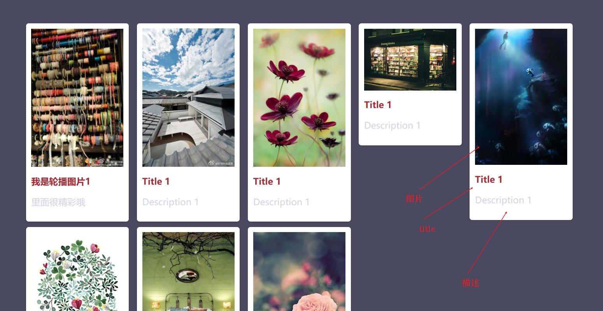

#### 4.7.2 图片懒加载技术插件

所谓**图片懒加载**，先只加载当前可视区的图片，只有当我们页面滑动到其他可视区域时，再加载显示对应图片。

图片懒加载技术使图片延迟加载，这样不仅可以提高网页的下载速度，减少服务器负载压力。还可以防止用户只看当前内容图片，不看其他内容导致如果加载其他内容就形成资源浪费。

该技术核心文件就一个`EasyLazyload.min.js`,没有css样式文件。使用特别简单，就2步，引入文件，修改img的src。

注意：该插件引入js的文件和js调用代码**必须写在DOM元素(图片)的后面**，否则会无效。

```html
<!DOCTYPE html>
<html lang="en">
  <head>
    <meta charset="UTF-8" />
    <meta name="viewport" content="width=device-width, initial-scale=1.0" />
    <title>Document</title>
    <style>
      img {
        display: block;
        margin: 0 auto;
        margin-top: 100px;
        width: 400px;
        height: 200px;
      }
    </style>
  </head>
  <body>
    <!-- 修改img标签，src属性变为data-lazy-src，这样图片就有懒加载的效果 -->
    
    
    
    

    <script src="jquery.min.js"></script>
    <!-- 引入懒加载的核心js，必须写在img元素之后 -->
    <script src="EasyLazyload.min.js"></script>
    <script>
      lazyLoadInit({
        coverColor: "white", //图片即将显示时覆盖层的颜色
        coverDiv: "<h1>test</h1>", //图片即将显示时覆盖层可显示的自定义组件
        offsetBottom: 0, //图片距离底部出现时间点的距离差值。也就是距离底部多少距离时图片提前出现
        offsetTopm: 0, //同上，只是变为距离顶部
        showTime: 1100, //图片显示动画时间
        onLoadBackEnd: function (i, e) {
          //图片完全显示后的回调函数，参数为index 图片的下标和event 图片DOM对象
          console.log("onLoadBackEnd:" + i);
        },
        onLoadBackStart: function (i, e) {
          //图片已经下载完，即将开始显示时的回调函数
          console.log("onLoadBackStart:" + i);
        }
      });
    </script>
  </body>
</html>
```

#### 4.7.3 全屏滚动插件

全屏滚动插件 fullpage.js。下载地址：https://github.com/alvarotrigo/fullPage.js/

案例演示中文翻译网址：https://www.dowebok.com/demo/2014/77/

全屏滚动功能就是实现网页没有滚动条的情况下，实现一页一页的切换的效果。

插件的核心文件是`fullpage.min.js`与`fullpage.min.css`。

```html
<!DOCTYPE html>
<html lang="en">
  <head>
    <meta charset="UTF-8" />
    <meta name="viewport" content="width=device-width, initial-scale=1.0" />
    <meta http-equiv="X-UA-Compatible" content="ie=edge" />
    <title>Document</title>
    <link rel="stylesheet" href="fullpage.min.css" />
    <style>
      /* 设置导航样式 */
      #fp-nav ul li a.active span,
      #fp-nav ul li a span {
        background-color: red !important;
      }
      /* 设置背景图 */
      .section1 {
        background: url(http://idowebok.u.qiniudn.com/77/1.jpg) 50%;
      }

      .section2 {
        background: url(http://idowebok.u.qiniudn.com/77/2.jpg) 50%;
      }

      .section4 {
        background: url(http://idowebok.u.qiniudn.com/77/4.jpg) 50%;
      }
    </style>
    <script src="jquery.min.js"></script>
    <script src="fullpage.min.js"></script>
    <script>
      $(function () {
        $("#dowebok").fullpage({
          // 设置背景颜色
          sectionsColor: ["pink", "#4BBFC3", "#7BAABE", "#f90"],
          //navigation就是显示项目右侧导航
          navigation: true
        });
      });
    </script>
  </head>

  <body>
    <div id="dowebok">
      <div class="section section1">
        <h3>第一屏里面的内容</h3>
      </div>
      <div class="section section2">
        <h3>第二屏</h3>
      </div>
      <div class="section section3">
        <!-- 可嵌套 -->
        <div class="slide">第三屏的第一页</div>
        <div class="slide">第三屏的第二页</div>
        <div class="slide">第三屏的第三页</div>
        <div class="slide">第三屏的第四页</div>
      </div>
      <div class="section section4">
        <h3>第四屏</h3>
      </div>
    </div>
  </body>
</html>
```

## 五、bootstrap

**bootstrap**是专门用于**开发响应式布局、移动设备优先的WEB项目**的框架。早期bootstrap框架是依赖于jQuery开发的，因此里面的js插件使用也必须先引入jQuery文件。不同版本的bootstrap需要不同版本的jQuery搭配，例如经典搭配：

- **Bootstrap 3.3.5 + jQuery 3.x** ➡ 存在兼容风险，不建议生产使用
- **Bootstrap 3.4.1 + jQuery 3.x** ➡ 可用，但仍需测试第三方插件兼容性
- **Bootstrap 4**以上，原生支持jQuery 3.x但需要适配 HTML/CSS 结构变化）。
- **Bootstrap 5**不再依赖jQuery,它有自己的插件。

bootstrap官网：https://getbootstrap.com/

bootstrap3官网：https://v3.bootcss.com/getting-started/#download

bootstrap3的核心文件`bootstrap.min.css`，`bootstrap.min.js`，有时需要主题`bootstrap-theme.min.css`。

bootstrap3核心的内容主要有三块，看官方网页就可知，其中三者中最重要的就是**组件**，它相当于css样式+js插件的组合。

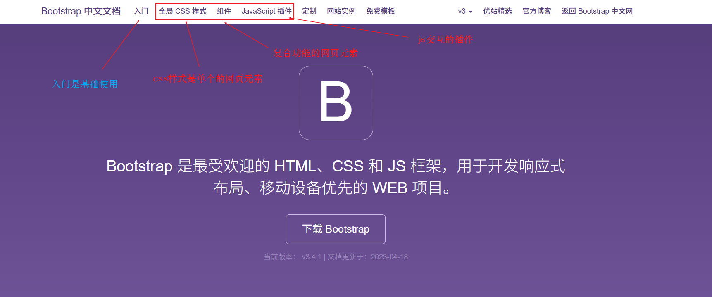

bootstrap中不管是组件，插件还是css样式，使用方式跟之前js插件一样，基本都是**先引入文件，复制demo，自定义修改**。

### 5.1 bootstrap CSS样式

css样式就是可以应用到按钮、工具条中的按钮组、导航或输入框等地方。让基本的样式bootstrap化更好看。

它主要针对简单控件，如果复制功能的控件就需要在组件中寻找。

```html
<!DOCTYPE html>
<html lang="en">
  <head>
    <meta charset="UTF-8" />
    <meta name="viewport" content="width=device-width, initial-scale=1.0" />
    <meta http-equiv="X-UA-Compatible" content="ie=edge" />
    <title>Document</title>
    <!-- bootstrap基本引入 -->
    <link rel="stylesheet" href="bootstrap.min.css" />
    <script src="jquery.min.js"></script>
    <!-- 有了js,bootstrap的样式就有交互效果 -->
    <script src="bootstrap.min.js"></script>
  </head>

  <body>
    <!-- 代码都放入container盒子中 -->
    <div class="container">
      <!-- 1. 按钮样式修改 -->
      <button type="button" class="btn btn-default" aria-label="Left Align">
        <span class="glyphicon glyphicon-align-left" aria-hidden="true"></span>
      </button>

      <button type="button" class="btn btn-default btn-lg">
        <span class="glyphicon glyphicon-star" aria-hidden="true"></span> Star
      </button>

      <!-- 2. 输入框样式修改 -->
      <div class="input-group">
        <span class="input-group-addon" id="basic-addon1">@</span>
        <input
          type="text"
          class="form-control"
          placeholder="Username"
          aria-describedby="basic-addon1"
        />
      </div>

      <!-- 3.下拉菜单 -->

      <div class="dropdown">
        <button
          class="btn btn-default dropdown-toggle"
          type="button"
          id="dropdownMenu1"
          data-toggle="dropdown"
          aria-haspopup="true"
          aria-expanded="true"
        >
          Dropdown
          <span class="caret"></span>
        </button>
        <ul class="dropdown-menu" aria-labelledby="dropdownMenu1">
          <li><a href="#">Action</a></li>
          <li><a href="#">Another action</a></li>
          <li><a href="#">Something else here</a></li>
          <li role="separator" class="divider"></li>
          <li><a href="#">Separated link</a></li>
        </ul>
      </div>
    </div>
  </body>
</html>
```

### 5.2 bootstrap 组件

所谓组件，它就是把网页中常用的功能组合在一起。例如：**按钮式下拉菜单**，**导航条**等功能。有了组件，可以让我们非常迅速的开发网页。

案例：组件的简单使用

```html
<!DOCTYPE html>
<html lang="en">
  <head>
    <meta charset="UTF-8" />
    <meta name="viewport" content="width=device-width, initial-scale=1.0" />
    <meta http-equiv="X-UA-Compatible" content="ie=edge" />
    <title>Document</title>
    <!-- bootstrap基本引入 -->
    <link rel="stylesheet" href="bootstrap.min.css" />
    <script src="jquery.min.js"></script>
    <!-- 有了js,bootstrap的样式就有交互效果 -->
    <script src="bootstrap.min.js"></script>
  </head>

  <body>
    <div class="container">
      <!-- Single button -->
      <div class="btn-group">
        <button
          type="button"
          class="btn btn-default dropdown-toggle"
          data-toggle="dropdown"
          aria-haspopup="true"
          aria-expanded="false"
        >
          Action <span class="caret"></span>
        </button>
        <ul class="dropdown-menu">
          <li><a href="#">Action</a></li>
          <li><a href="#">Another action</a></li>
          <li><a href="#">Something else here</a></li>
          <li role="separator" class="divider"></li>
          <li><a href="#">Separated link</a></li>
        </ul>
      </div>

      <!-- 导航条组件 -->
      <nav class="navbar navbar-default">
        <div class="container-fluid">
          <!-- Brand and toggle get grouped for better mobile display -->
          <div class="navbar-header">
            <button
              type="button"
              class="navbar-toggle collapsed"
              data-toggle="collapse"
              data-target="#bs-example-navbar-collapse-1"
              aria-expanded="false"
            >
              <span class="sr-only">Toggle navigation</span>
              <span class="icon-bar"></span>
              <span class="icon-bar"></span>
              <span class="icon-bar"></span>
            </button>
            <a class="navbar-brand" href="#">Brand</a>
          </div>

          <!-- Collect the nav links, forms, and other content for toggling -->
          <div
            class="collapse navbar-collapse"
            id="bs-example-navbar-collapse-1"
          >
            <ul class="nav navbar-nav">
              <li class="active">
                <a href="#">首页 <span class="sr-only">(current)</span></a>
              </li>
              <li><a href="#">公司简介</a></li>
              <li class="dropdown">
                <a
                  href="#"
                  class="dropdown-toggle"
                  data-toggle="dropdown"
                  role="button"
                  aria-haspopup="true"
                  aria-expanded="false"
                  >Dropdown <span class="caret"></span
                ></a>
                <ul class="dropdown-menu">
                  <li><a href="#">Action</a></li>
                  <li><a href="#">Another action</a></li>
                  <li><a href="#">Something else here</a></li>
                  <li role="separator" class="divider"></li>
                  <li><a href="#">Separated link</a></li>
                  <li role="separator" class="divider"></li>
                  <li><a href="#">One more separated link</a></li>
                </ul>
              </li>
            </ul>
            <form class="navbar-form navbar-left">
              <div class="form-group">
                <input type="text" class="form-control" placeholder="Search" />
              </div>
              <button type="submit" class="btn btn-default">Submit</button>
            </form>
            <ul class="nav navbar-nav navbar-right">
              <li><a href="#">Link</a></li>
              <li class="dropdown">
                <a
                  href="#"
                  class="dropdown-toggle"
                  data-toggle="dropdown"
                  role="button"
                  aria-haspopup="true"
                  aria-expanded="false"
                  >Dropdown <span class="caret"></span
                ></a>
                <ul class="dropdown-menu">
                  <li><a href="#">Action</a></li>
                  <li><a href="#">Another action</a></li>
                  <li><a href="#">Something else here</a></li>
                  <li role="separator" class="divider"></li>
                  <li><a href="#">Separated link</a></li>
                </ul>
              </li>
            </ul>
          </div>
        </div>
      </nav>
    </div>
  </body>
</html>
```

### 5.3 bootstrap js插件

`bootstrap.js`和`bootstrap.min.js`都包含了所有插件，你在使用时，只需选择一个引入页面就可以了。

bootstrap插件的使用方式主要分为两种：

+ **data属性**API就能使用所有的Bootstrap插件；
+ **js代码调用**。

某些时候可能需要将 Bootstrap 插件与其他UI框架共同使用。在这种情况下，**命名空间冲突随时可能发生**。如果不幸发生了这种情况，你可以通过调用插件的 `.noConflict` 方法恢复其原始值。

模态框案例：

```html
<!DOCTYPE html>
<html lang="en">
  <head>
    <meta charset="UTF-8" />
    <meta name="viewport" content="width=device-width, initial-scale=1.0" />
    <meta http-equiv="X-UA-Compatible" content="ie=edge" />
    <title>Document</title>
    <!-- bootstrap基本引入 -->
    <link rel="stylesheet" href="bootstrap.min.css" />
    <script src="jquery.min.js"></script>
    <!-- 有了js,bootstrap的样式就有交互效果 -->
    <script src="bootstrap.min.js"></script>
  </head>

  <body>
    <div class="container">
      <!-- 模态框 -->
      <!-- 1.按钮绑定模态框，使用data属性绑定 核心是data-toggle是切换方式，data-target绑定的模态框类名-->
      <button
        type="button"
        class="btn btn-primary"
        data-toggle="modal"
        data-target=".bs-example-modal-lg"
      >
        Large modal
      </button>

      <div
        class="modal fade bs-example-modal-lg"
        tabindex="-1"
        role="dialog"
        aria-labelledby="myLargeModalLabel"
      >
        <div class="modal-dialog modal-lg" role="document">
          <div class="modal-content">里面就是模态框</div>
        </div>
      </div>

      <!-- 自己定义模态框 -->
      <!-- <button data-toggle="modal" data-target="#btn">点击显示模态框</button> -->
      <button class="myBtn">点击显示模态框</button>

      <div class="modal fade" tabindex="-1" role="dialog" id="btn">
        <div class="modal-dialog" role="document">
          <div class="modal-content">
            <div class="modal-header">
              <button
                type="button"
                class="close"
                data-dismiss="modal"
                aria-label="Close"
              >
                <span aria-hidden="true">&times;</span>
              </button>
              <h4 class="modal-title">Modal title</h4>
            </div>
            <div class="modal-body">
              <p>One fine body&hellip;</p>
            </div>
            <div class="modal-footer">
              <button
                type="button"
                class="btn btn-default"
                data-dismiss="modal"
              >
                Close
              </button>
              <button type="button" class="btn btn-primary">
                Save changes
              </button>
            </div>
          </div>
        </div>
      </div>

      <!-- 3.tab栏切换  -->
      <div>
        <!-- 导航栏 -->
        <ul class="nav nav-tabs" role="tablist">
          <li role="presentation" class="active">
            <a href="#home" aria-controls="home" role="tab" data-toggle="tab">手机</a>
          </li>
          <li role="presentation">
            <a href="#profile" aria-controls="profile" role="tab" data-toggle="tab">电视</a>
          </li>
        </ul>

        <!-- 内容栏 -->
        <div class="tab-content">
          <div role="tabpanel" class="tab-pane active" id="home">
            手机相关的内容
          </div>
          <div role="tabpanel" class="tab-pane" id="profile">
            电视相关的内容
          </div>
        </div>
      </div>
    </div>
    <script>
      // 2.js代码绑定模态框
      // 当我们点击了自己定义的按钮，就弹出模态框
      $(".myBtn").on("click", function () {
        $("#btn").modal();
      });
    </script>
  </body>
</html>
```

## 六、数据可视化

所谓数据可视化，就是把**数据从冰冷的数字转换成图形**，更清晰的展示数据。其主要目的就是借助图形化手段，清晰有效地传达与沟通信息。

互联网公司中通常有下面几大类可视化需求：**通用报表**（柱状图等）、移动端图表分析、大屏可视化、图编辑&图分析、地理可视化等。

常见的数据可视化库：

+ D3.js,目前web端评价最高的js可视化工具库(入手难)；
+ **ECharts.js**,百度出品的一个开源js数据可视化库；
+ Highcharts.js,国外的前端数据可视化库，非商用免费，被许多大公司使用；
+ AntV,蚂蚁金服全新一代数据可视化解决方案等；

> Highcharts和Echarts就类似Office和WPS的关系。

### 6.1 ECharts简介

ECharts是一个使用JS开发的开源可视化库，也就是js插件。它可以流畅的运行在PC和移动设备上，兼容大部分浏览器，底层依赖**矢量图形库ZRender**，提供直观，交互丰富，可高度个性化定制的数据可视化图表。

ECharts的优点有开源免费，遵循Apache-2.0开源协议；功能丰富，涵盖各行业图表；社团活跃高，代码更新迭代很快。

ECharts官网有2个：https://www.echartsjs.com/ 和https://echarts.apache.org/zh/index.html

ECharts官方文档也有2个：https://www.echartsjs.com/en/coding-standard.html和 https://echarts.apache.org/examples/zh/index.html

推荐使用后面那个，apache ECharts已经替代老网址了。

下载网址：https://github.com/apache/echarts/tree/6.0.0

其核心文件就是`echarts.js`文件，压缩版是`echarts.min.js`。下面的案例使用的是4.5.0版本的。文件在下载包的**dist文件夹**中。

### 6.2 ECharts基本使用

ECharts使用非常简单，跟直接使用js插件很像。

1. 先下载好`echarts.min.js`文件，创建一个index.html文件，在其中引入该文件；
2. 创建一个**具备大小**的DOM元素容器，生成的图表会放入该容器中；
3. 初始化echarts实例对象，也就是实例化echarts对象，让每个对象都对应唯一一个图表；
4. 指定配置项和数据(option),不同的option会导致图表展示不同，根据自己需求修改即可；
5. 将配置项设置给echarts实例对象，让echarts对象根据配置生成对应图表，该步类似绑定。

```html
<!DOCTYPE html>
<html lang="en">
  <head>
    <meta charset="UTF-8" />
    <meta name="viewport" content="width=device-width, initial-scale=1.0" />
    <title>Document</title>
    <!--1.引入echarts -->
    <script src="js/echarts.min.js"></script>
    <style>
      .box {
        width: 400px;
        height: 400px;
        background-color: aquamarine;
      }
    </style>
  </head>
  <body>
    <!-- 2.准备具备大小的容器 -->
    <div class="box">sdfsss</div>
    <script>
      //3. 实例化echarts对象
      var myChart = echarts.init(document.querySelector(".box"));
      //4.指定图表的配置项和数据，直接复制官网的配置案例即可
      var option = {
        title: {
          text: "ECharts 入门示例"
        },
        tooltip: {},
        legend: {
          data: ["销量"]
        },
        xAxis: {
          data: ["衬衫", "羊毛衫", "雪纺衫", "裤子", "高跟鞋", "袜子"]
        },
        yAxis: {},
        series: [
          {
            name: "销量",
            type: "bar",
            data: [5, 20, 36, 10, 10, 20]
          }
        ]
      };

      // 5. echarts对象绑定刚指定的配置项和数据显示图表
      myChart.setOption(option);
    </script>
  </body>
</html>
```

运行结果

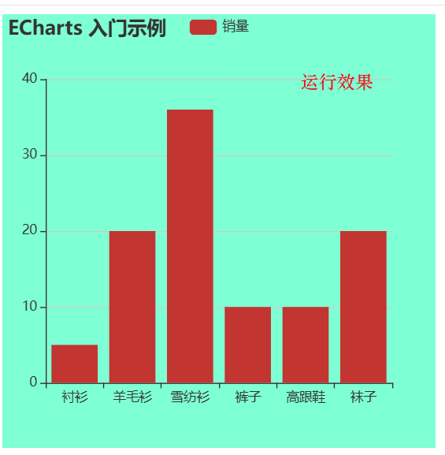

**创建不同类型图表**，可以在**官网——示例**中寻找，选择需要的图表，比如饼图。

找到option配置内容，替换上边的option就可直接看到效果。

```html
<!DOCTYPE html>
<html lang="en">
  <head>
    <meta charset="UTF-8" />
    <meta name="viewport" content="width=device-width, initial-scale=1.0" />
    <title>Document</title>
    <!--1.引入echarts -->
    <script src="js/echarts.min.js"></script>
    <style>
      .box {
        width: 450px;
        height: 450px;
        background-color: aquamarine;
      }
    </style>
  </head>
  <body>
    <!-- 2.准备具备大小的容器 -->
    <div class="box">sdfsss</div>
    <script>
      //3. 实例化echarts对象
      var myChart = echarts.init(document.querySelector(".box"));
      //4.指定图表的配置项和数据，直接复制官网的配置案例即可
      option = {
        title: {
          text: "Referer of a Website",
          subtext: "Fake Data",
          left: "center"
        },
        tooltip: {
          trigger: "item"
        },
        legend: {
          orient: "vertical",
          left: "left"
        },
        series: [
          {
            name: "Access From",
            type: "pie",
            radius: "50%",
            data: [
              { value: 1048, name: "Search Engine" },
              { value: 735, name: "Direct" },
              { value: 580, name: "Email" },
              { value: 484, name: "Union Ads" },
              { value: 300, name: "Video Ads" }
            ],
            emphasis: {
              itemStyle: {
                shadowBlur: 10,
                shadowOffsetX: 0,
                shadowColor: "rgba(0, 0, 0, 0.5)"
              }
            }
          }
        ]
      };

      // 5. echarts对象绑定刚指定的配置项和数据显示图表
      myChart.setOption(option);
    </script>
  </body>
</html>
```

运行效果

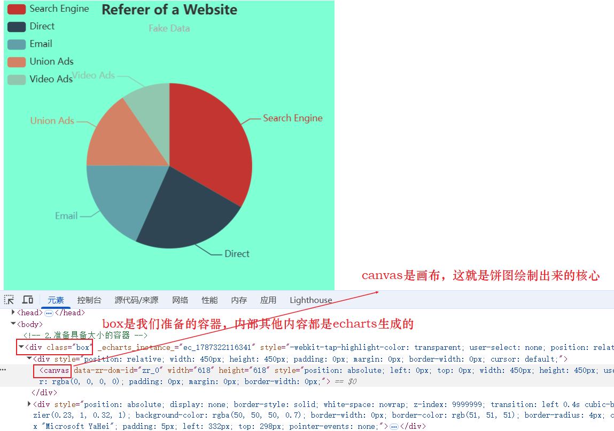

### 6.3 ECharts相关配置 Option

#### 6.3.1 折线图

Options中的配置相当多，其都可在官网中查阅**文档菜单-配置项手册**中查看，其中常用的有(以折线图为例)：

+ title:标题组件，包含主标题和副标题；

+ tooltip:提示框组件，满足某种条件就会有内容提示；`trigger: "axis"`表示触发类型**鼠标经过坐标轴**就触发提示,提示内容数据由series中name和data决定；

+ legend:图例组件，其数据设置在data中，data是数组，其内容与series中name属性一一对应；

+ toolbox:工具栏组件，saveAsImage就是保存图片功能；

+ **grid**：直角坐标系内绘制网格,网格的区域大小由left、rigit、bottom、top设置，它设置的是距离**外部容器盒子**的距离。例如：`left：3%`就是距离左边3%的盒子宽度的距离，`containLabel：true`就是显示刻度的设置。

+ **xAxis**:直角坐标系grid中的x轴,`type:'catagroy'`表示x坐标轴类型为类目轴，它的数据必须通过**data中设置类目的数据**来决定。`boundaryGap: false`设置坐标轴的留白策略，对应类名轴，false表示刻度与类目数据对齐，true表示刻度只作为分割线，会在两个类目数据中间位置；

+ **yAxis**:直角坐标系grid中的y轴，`type：value`表示y坐标轴类型为值类型，它的显示由具体的数据决定；

+ color:调色盘颜色列表，它是一个数组，折线图中更改折线颜色，有几条线就设置数组几个数据；

+ **series**:系列列表。它是一个数组，数据有几个数据对象，就表示有几条线。

  + **type来决定图表类型**。line就是线性图，bar是柱状图，pie就是饼状图；
  + name是系列的名称。用于tooltip的显示，legend的图例筛选变化，其中legend的data数组内容与name是一一对应的；
  + **stack**：数据堆叠，同个类目轴上系列配置**相同的stack值，就是名称相同**，第二个数据=第一个数据+第二个数据，第三个据=第s三个数据+第二个数据+第一个数据。如果不用数据堆叠，可以通过设置**不同stack值**或者**删除stack属性**即可。
  + data代表每条线上的具体的数据值。一个数据就是一个节点；


```html
<!DOCTYPE html>
<html lang="en">
  <head>
    <meta charset="UTF-8" />
    <meta name="viewport" content="width=device-width, initial-scale=1.0" />
    <title>Document</title>
    <!--1.引入echarts -->
    <script src="js/echarts.min.js"></script>
    <style>
      .box {
        width: 800px;
        height: 600px;
        background-color: aquamarine;
      }
    </style>
  </head>
  <body>
    <!-- 2.准备具备大小的容器 -->
    <div class="box">sdfsss</div>
    <script>
      //3. 实例化echarts对象
      var myChart = echarts.init(document.querySelector(".box"));
      //4.指定图表的配置项和数据，直接复制官网的配置案例即可
      option = {
        title: {
          text: "我的折线图"
        },
        color: ["red", "pink", "blue", "green"],
        tooltip: {
          trigger: "axis"
        },
        legend: {
          data: ["Email", "Union Ads", "Video Ads", "Direct"]
        },
        grid: {
          left: "3%",
          right: "4%",
          bottom: "3%",
          containLabel: true
        },
        toolbox: {
          feature: {
            saveAsImage: {}
          }
        },
        xAxis: {
          type: "category",
          boundaryGap: false,
          data: ["星期一", "Tue", "Wed", "Thu", "Fri", "Sat", "Sun"]
        },
        yAxis: {
          type: "value"
        },
        series: [
          {
            name: "Email",
            type: "line",
            stack: "Total",
            data: [120, 132, 101, 134, 90, 230, 210]
          },
          {
            name: "Union Ads",
            type: "line",
            stack: "Total",
            data: [220, 182, 191, 234, 290, 330, 310]
          },
          {
            name: "Video Ads",
            type: "line",
            stack: "Total",
            data: [150, 232, 201, 154, 190, 330, 410]
          },
          {
            name: "Direct",
            type: "line",
            stack: "Total",
            data: [320, 332, 301, 334, 390, 330, 320]
          }
        ]
      };
      // 5. echarts对象绑定刚指定的配置项和数据显示图表
      myChart.setOption(option);
    </script>
  </body>
</html>
```

具体组件对应效果展示

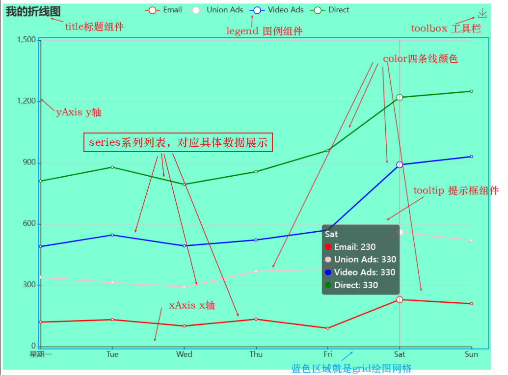

#### 6.3.2 饼型图

其options的值大部分与折线图相似,案例中省略了title、legend内容,添加了color内容。

```html
<!DOCTYPE html>
<html lang="en">
  <head>
    <meta charset="UTF-8" />
    <meta name="viewport" content="width=device-width, initial-scale=1.0" />
    <title>边框图片</title>
    <script src="js/echarts.min.js"></script>
    <style>
      .div1 {
        width: 400px;
        height: 400px;
        background-color: pink;
      }
    </style>
  </head>
  <body>
    <div class="div1">div内容1</div>
    <script>
      // 实例化echarts对象
      var myChart = echarts.init(document.querySelector(".div1"));
      //指定图表的配置项和数据，直接复制官网的饼形图-南丁格尔玫瑰图配置案例即可
      //把不用的title、legend、xAxis、yAxis都删除，添加color属性
      var option = {
        //提示框组件，
        //trigger触发方式:非轴型图，使用item表示放到对应数据图形上触发显示
        //formatter格式化提示内容：
        //a.代表series系列图表名称 series的name属性
        //b.代表series系列数据名称data里的name
        //c.代表series系列数据名称data里的value
        //d.代表当前数据/总数据的比例
        tooltip: {
          trigger: "item",
          formatter: "{a} <br/>{b} : {c} ({d}%)"
        },
        // 自定义颜色,注意颜色与series同级
        color: [
          "#006cff",
          "#60cda0",
          "#ed8884",
          "#ff9f7f",
          "#0096ff",
          "#9fe6b8",
          "#32c5e9",
          "#1d9dff"
        ],
        series: [
          {
            //图表名称
            name: "点位统计",
            //图表类型 pie就是饼状图
            type: "pie",
            //南丁格尔玫瑰图有两个圆，内圆半径10% 外缘半径70%，控制饼形图大小
            //半径既可以是像素也可以是百分比(基于DOM容器大小)，百分比要加引号，第一项是内半径，第二项是外半径
            radius: ["10%", "70%"],
            //图表中心位置，left 50% top 50%,也就是居中 距离图表DOM容器，控制饼形图位置
            center: ["50%", "50%"],
            //radius 半径模式，另一种是area 面积模式 就是展示以半径值还是面积值为依据
            roseType: "radius",
            //数据集，value是数据值，name是数据名
            data: [
              { value: 20, name: "云南" },
              { value: 26, name: "北京" },
              { value: 24, name: "山东" },
              { value: 25, name: "河北" },
              { value: 20, name: "江苏" },
              { value: 25, name: "浙江" },
              { value: 30, name: "四川" },
              { value: 42, name: "湖北" }
            ],
            //定制配置，
            //只有是修饰饼型图文字样式，都是在label对象中设置
            label: {
              fontSize: 10
            },
            //为了防止缩放时引导线过长，让引导线短一些(series对象里的labelLine对象进行设置)
            labelLine: {
              //两条线
              //连接扇形图线长，是第一条线长度
              length: 6,
              //连接文字线长，是第二条线长度
              length2: 8
            }
          }
        ]
      };
      // echarts对象绑定刚指定的配置项和数据显示图表
      myChart.setOption(option);
    </script>
  </body>
</html>
```

效果

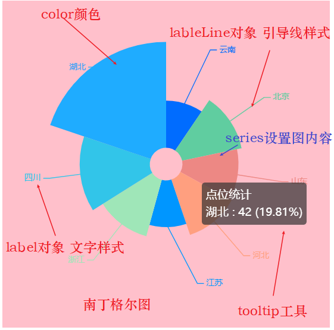


### 6.4 综合案例 智能看板

项目最终效果展示

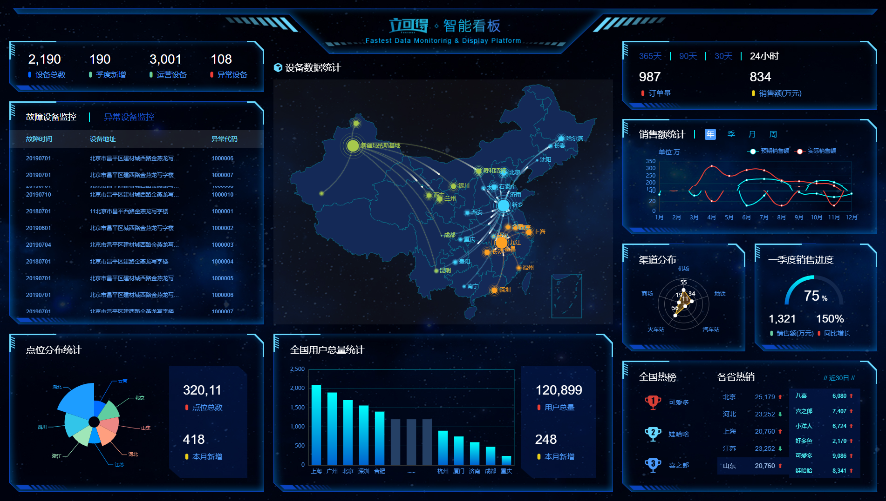

#### 6.4.1 项目准备

项目需求：页面是1920px,只需要在PC端适配就行，宽度在**1024~1920**之间页面**元素宽高自适应**（就是动态变化）。

适配方案(flexible.js+rem+flex布局)：

1. 使用`flexible.js`检测浏览器宽度，并且修改html文字大小；
2. 页面元素根据`rem`适配大小，配合vscode的**插件cssrem**可自动将px转换为rem；
3. 使用`flex布局`，页面可以快速布局。跟之前的移动端的苏宁案例类似。

因为1920px比较大，flexible.js就把屏幕分为**24等份**，cssrem插件的基准值就是1920/24=80px，也就是**1rem=80px**。

flexible.js代码修改24等份就行

```js
(function flexible(window, document) {
  //获取html元素对象
  var docEl = document.documentElement;
  //dpr是物理像素比，pc端一般为1，移动端为2
  var dpr = window.devicePixelRatio || 1;

  // adjust body font size，设置页面body的字体大小
  function setBodyFontSize() {
    //先查看是否有body对象
    if (document.body) {
      //有设置字体大小12px，移动端是24px
      document.body.style.fontSize = 12 * dpr + "px";
    } else {
      //没有body对象，就等页面DOM元素加载完DOMContentLoaded再调用该函数
      document.addEventListener("DOMContentLoaded", setBodyFontSize);
    }
  }
  setBodyFontSize();

  // set 1rem = viewWidth / 10 ,设置html元素的文字大小，rem是该文件最核心的设置
  function setRemUnit() {
    //html的宽度/24,也就是将屏幕设置24等分，使用clienWidth获取宽度
    var rem = docEl.clientWidth / 24;
    docEl.style.fontSize = rem + "px";
  }

  setRemUnit();

  // reset rem unit on page resize
  //当页面尺寸大小发生变化时，要重新设置rem
  window.addEventListener("resize", setRemUnit);
  //pageShow事件是页面重新加载时触发的事件，它与load事件不同在于即使有缓存也会调用。
  window.addEventListener("pageshow", function (e) {
    //e.persisted是true时，页面来自缓存也会调用setRemUnit重新设置rem
    if (e.persisted) {
      setRemUnit();
    }
  });

  // detect 0.5px supports 有些移动端浏览器不支持0.5像素的写法，该函数就是让其支持
  if (dpr >= 2) {
    var fakeBody = document.createElement("body");
    var testElement = document.createElement("div");
    testElement.style.border = ".5px solid transparent";
    fakeBody.appendChild(testElement);
    docEl.appendChild(fakeBody);
    if (testElement.offsetHeight === 1) {
      docEl.classList.add("hairlines");
    }
    docEl.removeChild(fakeBody);
  }
})(window, document);
```

设置cssrem插件值，设置完成后记得重启vsCode

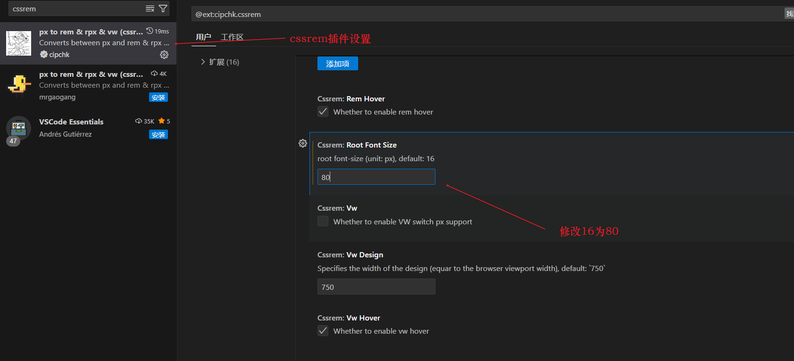

要把屏幕约束在1024~1920之间有适配，可使用媒体查询解决

```css
<style>
   @media screen and(max-width:1024px) {
     html {
       font-size: 42.66px !important;
     }
   
   @media screen and(min-width:1920px) {
     html {
       font-size: 80px !important;
     }
   }
 </style>
```

vscode热更新插件`Preview on Web Server`，html文件修改保存浏览器页面就自动刷新内容。启动使用`右键+vscode-preview-server:launch on browser`即可。

项目结构：

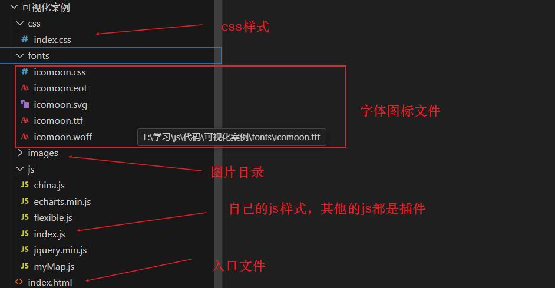

#### 6.4.2 布局搭建

项目核心：就是先确定布局，之后利用ECharts填充图表即可。

先复制**页面初始化的样式**到index.css文件中,该样式是统一的。

```css
/*清除元素默认的内外边距  */
* {
    margin: 0;
    padding: 0;
    box-sizing: border-box;
}

/*让所有斜体 不倾斜*/
em,
i {
    font-style: normal;
}

/*去掉列表前面的小点*/
li {
    list-style: none;
}

/*图片没有边框   去掉图片底侧的空白缝隙*/
img {
    border: 0;
    /*ie6*/
    vertical-align: middle;
}

/*让button 按钮 变成小手*/
button {
    cursor: pointer;
}

/*取消链接的下划线*/
a {
    color: #666;
    text-decoration: none;
}

a:hover {
    color: #e33333;
}
/*h4不加粗*/
h4 {
    font-weight: 400;
}
```

页面基础布局，用大盒子`viewport`（用flex布局）包含三列小盒子`cloumn`,三列小盒子,左右占3份，中间占4份。

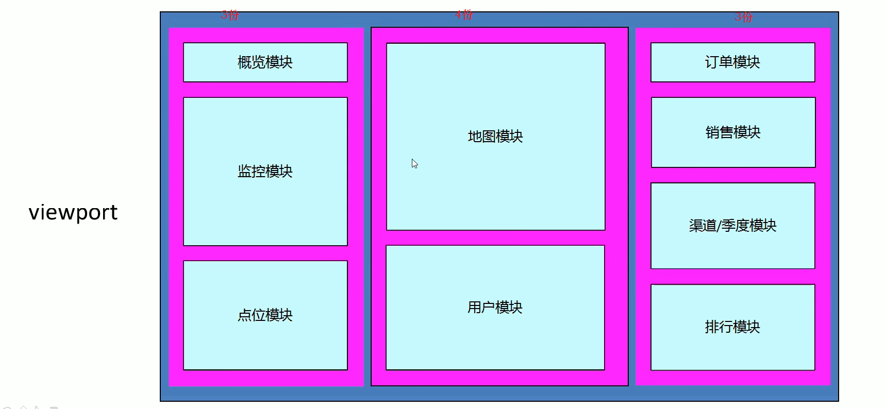

在做模块前，先提取相同的部分内容，比如模块**边框样式**都一样，但**大小不一样**，不能直接使用背景图，但可使用`css3的边框图片`制作，`border-image`属性，这个属性允许指定一张图作为元素的边框。

<strong style="color:red;font-size:20px">边框图片 border-image</strong>

边框图片切图原理：使用代码切四角，也就是九宫格的由来。四个角不变，中间部分可以**铺排**，**拉伸**或者**环绕**。切的顺序是**上右下左**。

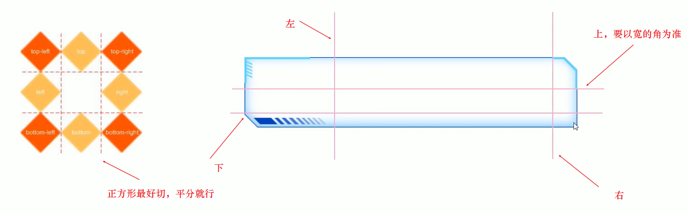

边框图片语法：

| 属性                   | 描述                                                         |
| ---------------------- | ------------------------------------------------------------ |
| border-image-source    | 用在边框图片的路径，也就是设置图片路径                       |
| **border-image-slice** | 边框图片内向偏移。也就是切图，按照上右下左顺序设置距离即可，不加单位 |
| border-image-width     | 边框图片宽度，要加单位，这个不是边框宽度，是图片的宽度，因此设置后不会占空间 |
| border-image-repeat    | 边框图片是否为平铺(repeat)、铺满(round)或拉伸(stretch)，默认拉伸 |

案例代码

```html
<!DOCTYPE html>
<html lang="en">
  <head>
    <meta charset="UTF-8" />
    <meta name="viewport" content="width=device-width, initial-scale=1.0" />
    <title>边框图片</title>
    <style>
      .div1 {
        width: 300px;
        height: 200px;
        border: 15px solid red;
        border-image-source: url(/images/border.png);
        /* 正方形上下左右都一样 */
        border-image-slice: 33 33 33 33;
      }

      .div2 {
        width: 300px;
        height: 200px;
        border: 15px solid red;
        border-image-source: url(/images/border.png);
        /* 正方形上下左右都一样 */
        border-image-slice: 33;
        /* 该属性默认值是border的宽度，如果怕border太宽导致无法写内容，可以设置该属性让内容范围变大 */
        /* 边框图片宽度不会挤压文字 */
        border-image-width: 30px;
        border-image-repeat: round;
      }
    </style>
  </head>
  <body>
    <div class="div1">div内容1</div>
    <div class="div2">div内容2</div>
  </body>
</html>
```

效果

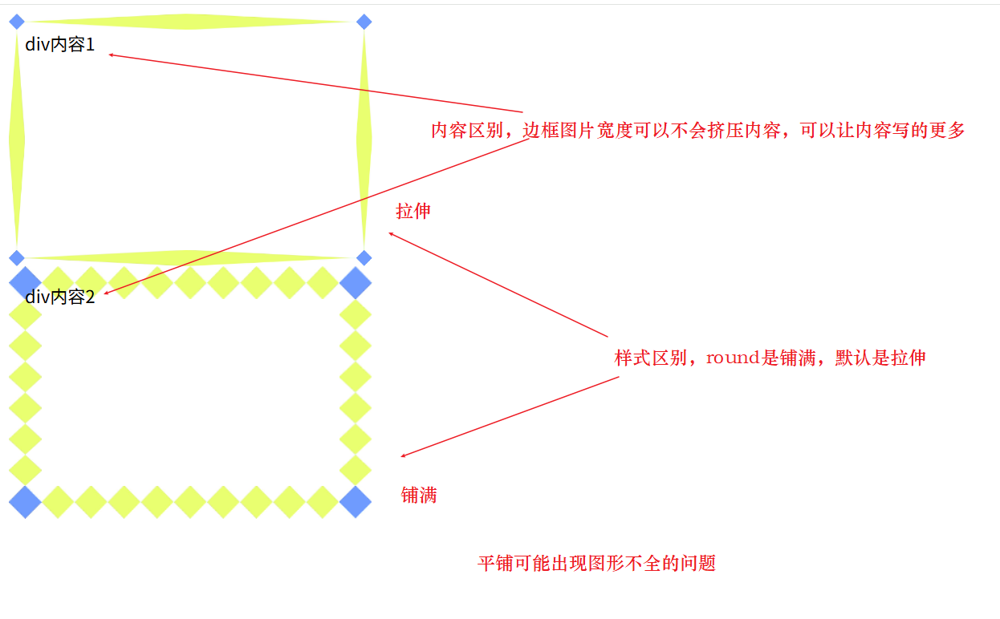

会使用边框图片后，就可以编写公共面板样式`panel`，边框图片也是公共内容。

后面要使用字体图标，这里通过**类名**调用**字体图标**，就是利用`icomoon.css`文件即可。这里我们将该文件放入字体文件中，只需要引入在index.css之前，就可在index.css中使用。

自己创建的index.js文件中，可能会有**大量的变量命名**。特别是Echarts使用中，需要大量初始化Echarts对象。为了防止变量名冲突(变量污染)，可以采用**立即执行函数**策略。每个**模块内容都包含在其自己的立即执行函数**中，这样变量重名也不会出现问题。

> 注意：立即执行函数之间要用分号隔开。将自己的index.js放到body最后，这样就不需要写入口函数等待元素加载完成。
