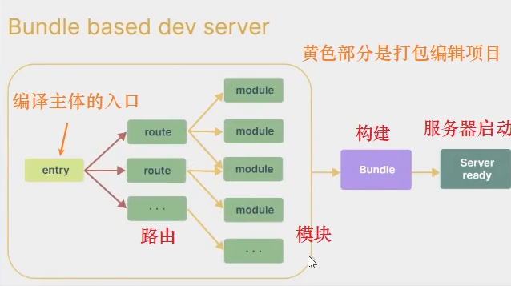
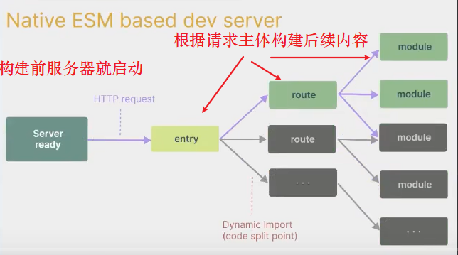
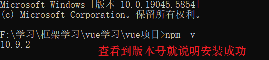
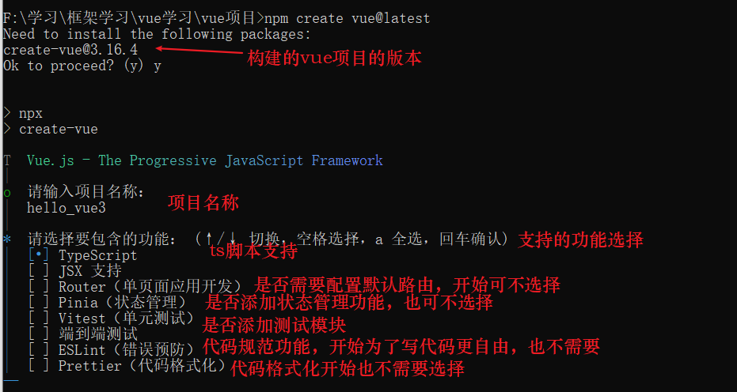
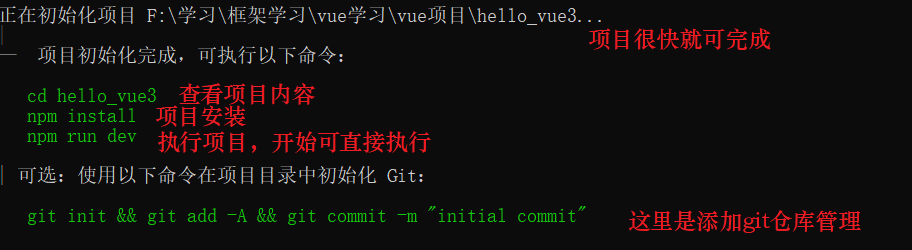
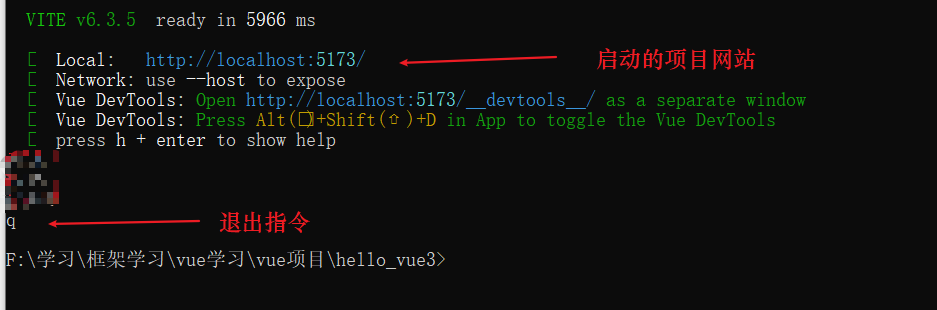

# Vue3

## 一、Vue3简介

vue3.0是2020年9月18号发表的，相比于2.0，不仅性能提升更大，打包也更小加载速度更快。

3.0的源码也得到了升级：

+ 使用`Proxy`代替`defineProperty`实现响应式,
+ 重写`虚拟DOM`的实现和`Tree-Shaking`,
+ 拥抱了**TypeScript**，使得代码功能更强,
+ 新的特性：Composition API(又称组合api),
+ 新内置组件：Fragment、Teleport、Suspense等,
+ 新的生命周期钩子、**data选项应始终被声明为一个函数**以及移除`keyCode`支持作为`v-on`的修饰符

### 1.1 Vue3项目搭建

创建vue3.0的功能，可以使用之前vue2.0的`vue-cli`脚手架搭建项目，也可使用官方推荐的`Vite`创建项目。

### 1.2 Vite简介

vite是**新的前端构建工具**，其官网地址为：https://vitejs.cn，vite对比vue-cli的优势如下：

+ 轻量快速的热重载（HMR），实现极速的服务启动，
+ 对`Typescript`、`jsx`、`css`等都支持直接使用，
+ 真正的按需编译、不用再等待整个应用的编译完成，`vue-cli`是基于**webpack核心**进行编译的，其中webpack构建与vite构建对如下:

**webpack构建**，注意黄色框选部分

**vite构建**

### 1.3 vite构建vue3.0项目

要使用vite构建vue3.0项目，只需要在电脑中安装好node.js工具

安装node.js工具，该工具是开源免费的，直接在其官网下载安装包或压缩包安装即可

官网地址：[Node.js — 在任何地方运行 JavaScript](https://nodejs.org/zh-cn)

安装完nodejs，只需要在cmd中执行`npm -v`

执行一个指令就可创建vue3.0项目 `npm create vue@lastest`

>补充
>
>windows中**在特定文件夹下打开CMD的方法**：
>
>1. 在文件夹空白处单击鼠标右键，选择“在此处打开命令窗口”选项。
>2. 或者在路径栏输入“cmd”并回车

创建会遇到各种选择，创建最简洁的vue3.0项目，只勾选一个即可，其他功能后面会详细说明

项目创建成功，最开始要执行一次npm install指令，它是用于安装项目依赖的内容，跟java中maven管理java依赖差不多。然后执行run指令就可在网页中查看到最基本的页面。

`q`指令就可直接退出项目运行

### 1.4 vue3.0与vscode

