# Node.js

[TOC]


## 一、 初识node.js

学习node.js前需要有一定的`JavaScript`(简称JS)基础，因为node.js本身也是基于JS开发出来的。

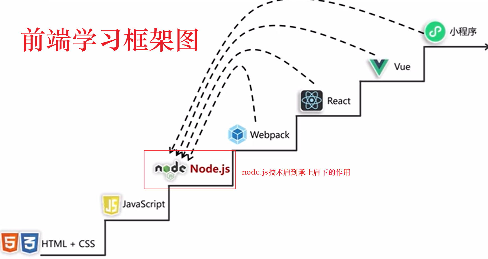

### 1.1 前端js运行原理

JS脚本为什么可以直接在浏览器中被执行？

其原因是浏览器中都自带了**JavaScript解析引擎**，它可以翻译js代码，让浏览器理解并执行。不同的浏览器使用js解析引擎如下:(其中Chrome浏览器的V8解析引擎性能最好)

|   浏览器   |   js解析引擎   |
| :--------: | :------------: |
| **Chrome** |     **V8**     |
|  Firefox   |   OdinMonkey   |
|   Safri    |     JSCore     |
|     IE     | Chakra(查克拉) |

前端js代码中不仅可以写基础的js代码，还可以调用`DOM API`和`BOM API`直接修改页面元素,**DOM、BOM都是浏览器内置的API函数**，js是可以直接调用的。除了内置的API外，还可以**引入第三方的包调用其API**，最常用的就是就**jQuery**与**Ajax**。

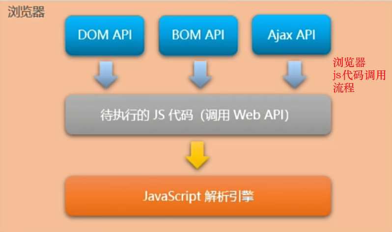

通过上述内容可知：js的运行环境最核心的就是**js解析引擎**与**各种API**。

Chrome浏览器中js运行环境如下：

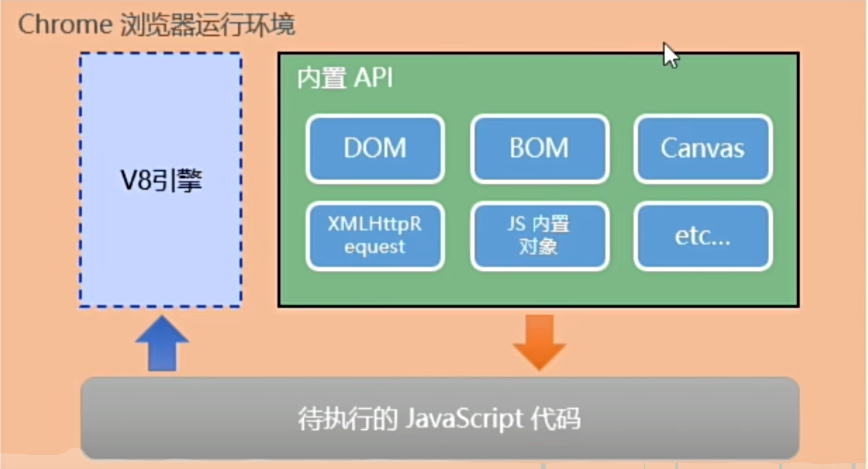

其中V8引擎负责解析和执行js基础代码，内置API是由浏览器提供的特殊接口函数，帮助js代码快速完成特定的功能。

刚开始开发者都是使用js完成**前端的开发**，但随着技术的不断迭代，有人就考虑用js进行**后端的开发**。这时就需要借助`Node.js`。

### 1.2 Node.js简介

Node.js是什么？官方回答为：Node.js是一个**开源的**，**跨平台**的<strong style='color:red'>Javascript运行环境</strong>。本质就是Javascript运行环境，也可把node.js看作一款**软件**，它的作用就是运行JavaScript。

Node.js是基于**Chrome V8引擎**的**JavaScript运行环境**。也就是说js代码除了放在浏览器中去执行外，也可以直接放到node.js中执行。

Node.js的官方网站：https://nodejs.org/zh-cn

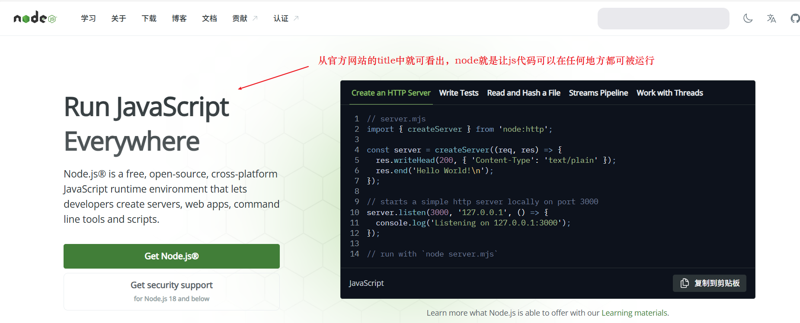

node.js中的js运行环境,其内容与浏览器的大体相同，其核心引擎是差不多的，只是把内置API换成了**后端操作需要的API**。

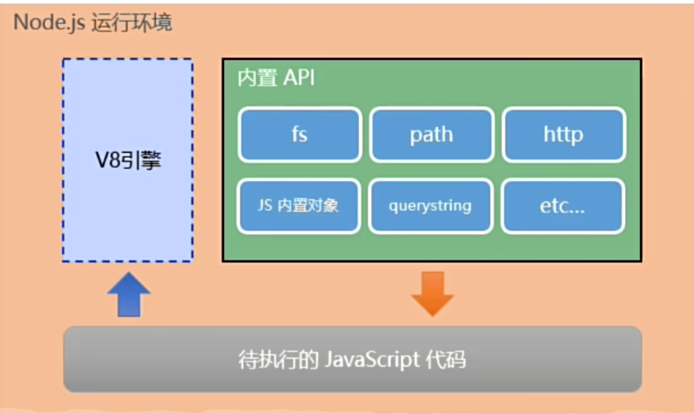

> 总结：
>
> + **浏览器是js的前端运行环境**。
>
> + <strong style='color:red'>node.js是js的后端运行环境。</strong>
>
>   node.js无法调用**DOM**与**BOM**,因为这些API是浏览器内置的API，node.js中并没有。
>   
>   node.js中的**顶级对象**不再是浏览器中的`windows`而是`global`,在ES2020后，新增了`globalThis`对象完全等同于global
>   
>   global的使用方式跟浏览器中的顶级对象windows基本一致

node.js本身只提供了js运行环境和简单基础的API。但由于其**开源特性**,很多程序员可基于基础功能开发出**各种第三方强大的工具与框架包**。常用的框架包有：**Express**框架，**restify**框架，**Electron**框架等。

**node.js的作用**：

1. **开发服务器端应用**，大部分是基于**Express**框架(http://www.expressjs.com.cn/)，可快速构建**Web服务器**；
2. **开发工具类应用**，例如：**Webpack**，**Vite**，**Babel**等工具都是基于node.js开发的**API接口项目**，基于**restify**框架(http://restify.com)，可快速构建API接口项目；
3. **开发桌面端应用**，例如：**VSCode**,**Figma**,**Postman**等软件都是基于node.js开发的**跨平台的桌面(windows)端应用**，基于**Electron**框架(http://electronjs.org)，可快速构建跨平台的桌面(windows)端应用；
4. 读写和操作数据库;
5. 创建实用的命令行工具辅助前端开发等...

学习node.js方法可以参考前端js的学习路径：

1. 先学习js基础语法
2. 然后学习浏览器内置API(DOM与BOM)
3. 最后学习第三方库(jQuery、art-template,ajax等)

node.js学习路径：

1. 先学习js基础语法
2. 然后学习Node.js内置API(fs、path、http等)
3. 最后学习第三方库(express、mysql等)

### 1.3 安装Node.js

安装包可以直接从官方网站下载：https://nodejs.org/zh-cn/download，下载好后直接双击就可直接安装完成。

网速慢可使用中文镜像网站：[下载 | Node.js 中文网](https://nodejs.cn/download/)

要下载比较旧的版本，可使用该链接:[CNPM Binaries Mirror](https://registry.npmmirror.com/binary.html?path=node/)

node.js的安装包分为**稳定版(LTS,long time service)**与**最新版(Current)**，建议下载稳定版本，因此最新版可能会有bug。

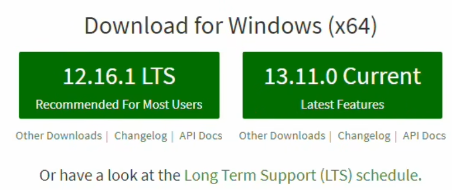

后面的学习我们都以`12.16.1.msi`版本的node.js进行学习，新版本可能内容不同，但大部分是一致的。安装node.js中只需要选择好安装的路径后，就可以一直点下一步就可安装完成。

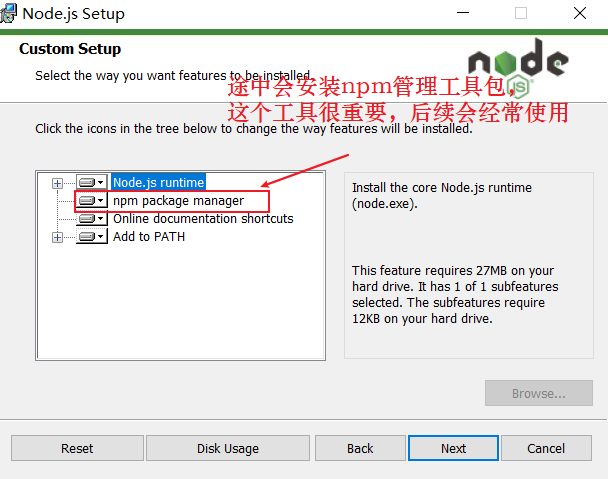

安装完node.js后，在windows的cmd终端输入`node -v`指令,如果查看到node的版本号，就表示node.js安装完成。

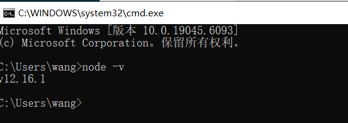

**node.js卸载**，只需要在windows开始菜单栏中找到该内容即可

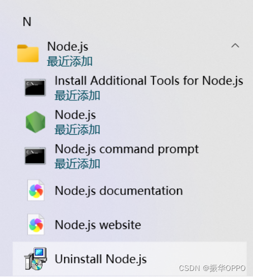

> **版本号含义说明**：
>
> + 第一个数字表示大版本号，表示软件功能有重大更新或者全部重新写时才会增加，大版本更新，后面的数字都会清零
> + 第二数字表示大版本下更新的版本，也就是在大版本下更新各种小功能提交的版本
> + 第三个数字表示修复bug的版本号，也就是版本出现问题，修复bug后提交的版本
>
> 12.16.1的含义就是软件是第12版，更新了16次功能内容，并修复了1次bug。

### 1.4 Node.js编译js代码

编写一个最简单的`hello.js`文件,内容如下：

```console
const name='node.js'；
console.log('hello：'+name);
```

在文件对应的路径下打开cmd，输入指令`node 文件名`,就可编译js文件，并输出结果

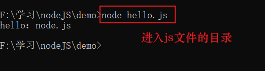

cmd中为什么可直接使用node命令？原因是安装node工具时，默认就配置好了**node工具所处路径的环境变量**。

### 1.5 cmd命令行知识扩展：(了解)

windows下**在对应的文件目录打开终端cmd方式**有三种：

1. 直接**win+r**输入**cmd**打开终端,默认C盘目录下。先切换其他盘 直接输入`D:`就是切换的D盘，然后`cd` 切换文件路径
2. 在对应目录的路径栏上直接**输入cmd**即可，这种方式老版本windows不支持
3. 按住**shfit+鼠标右键**，选择在此处打开powershell，powershell也是window的终端，它相当于cmd的高级版本

windows**终端的快捷操作指令**:

+ ⬆键可以快速切换到上一次执行的指令
+ **tab**键可快速补全路径
+ **esc**键，可快速清空当前已经输入的命令
+ **cls**，清空终端
+ **dir**,展示当前目录下的文件列表

windows在终端启动浏览器chrome,先在电脑的`环境变量Path`中配置软件chrome的安装路径

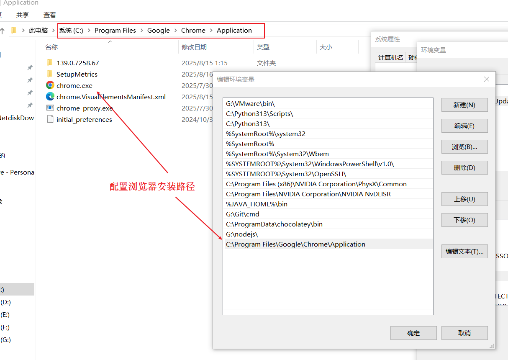

配置好后就可直接输入`chrome`启动浏览器。,也可输入`chrome www.baidu.com www.bilibili.com`打开浏览器同时启动两个网页

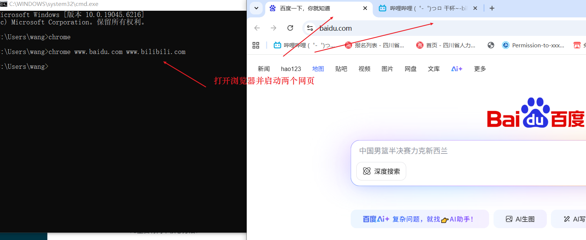

## 二、node.js的内置API模块

node.js常用的内置api模块有**fs文件系统模块**、**path路径模块**以及**http模块**等...

在JavaScript代码中要使用模块，都需要先导入模块，然后再使用模块对象调用模块代码，<strong style='color:red'>node.js中使用的模块引入规范是CommonJS的规范</strong>

```js
const fs = require('fs')  //引入内置的fs模块，接受对象名与模块名一致方便理解
```

> nodeJS官方API网址：https://nodejs.cn/api/

### 2.1 Buffer缓冲区(了解)

buffer是类似与Array的对象，主要用于表示**固定长度的字节(byte)序列**。换句话说，buffer就是**一段固定长度的内存空间**，主要用于处理**二进制数据**。用console打印出的结果默认是16进制的数字。

Buffer的特点是：(了解Buffer,方便后面理解fs模块对文件的流式**Stream**操作原理)

+ 大小固定，创建后就无法改变；
+ 性能好，可以直接对计算机内存进行操作；
+ 每个元素或字母的大小为1字节，**1字节等于8bit**,如果是**汉字则一个汉字占3字节**；
+ **nodeJS中的Buffer模块是系统默认导入的**，因此不需要使用require引入就可直接使用Buffer对象。

创建Buffer对象默认有三种方式：

1. `alloc`方法，alloc是直接获取固定长度的内存，先将内存内容初始化为0后创建buffer；
2. `allocUnsafe`方法,它跟alloc方法基本一致，只是不进行初始化为0的步骤直接使用内容，它的创建速度更快，但会保留原本内存中的内容，初始数据不能确定
3. `from`方法，该方法是利用字符串或数组创建对应内存长度的buffer,并将字符串或数组内容赋值给buffer

```js
//1. 使用alloc方法创建一个10字节的buffer
let buf1 = Buffer.alloc(10);
console.log(buf1);

//2. 使用allocUnsafe方法创建一个10字节的buffer
let buf2 = Buffer.allocUnsafe(20);
console.log(buf2);

//3. 使用from方法将字符串或数组转化为buffer对象
let buf3 = Buffer.from("hello");
console.log(buf3);
let buf4 = Buffer.from([110,111,100,101,106,115]);
console.log(buf4);

//4. 将buffer对象转化为字符串
console.log(buf4.toString());
//buffer对象本身也是一个数组对象，要修改内部元素使用数组索引即可
buf4[0] = 69;
//将数组中一个对象的16进制数转化为2进制
console.log(buf4[0].toString(2));
//最终打印buf4对象
console.log(buf4.toString());

//5. 缓存溢出
buf4[0] = 371;//一个字节的大小最大为255，371大于255，因此超出的最高为会被移除，
console.log(buf4[0]);//因此0001 0111 0011会变为0111 0011 371变为115

//6.中文
let buf5 = Buffer.from("张三");
console.log(buf5);
```

运行结果，其中数字与字母的转化可以查看`Unicode表`，也可查`ASCII表`，Unicode表是ASCII表的超集。

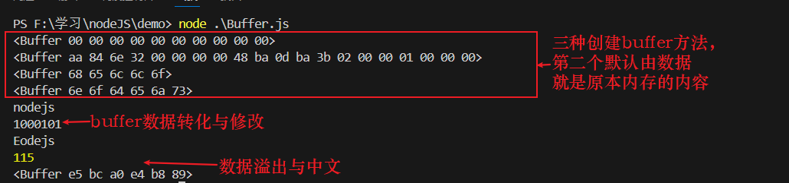

>运行结果的额外说明：
>
>1000101  //该数据是简写 全写是01000101 也就是数字69的二进制  
>
>Eodejs  //修改buffer数组的内容 nodejs修改首位后变为Enodejs
>115   //115是溢出移除高位后剩下的内容
><Buffer e5 bc a0 e4 b8 89>  //中文一个字就占三个字节,默认是**utf-8**的格式

### 2.2 fs文件系统模块

fs模块是Node.js官方**提供的、用来操作文件的模块**。例如文件或文件夹的创建、删除、重命名、移动等操作，它提供了一系列的方法与属性，用于满足用户对文件的操作需求。

fs最核心的操作就是文件内容的**写入**与**读取**，其余操作都是在此基础上实现的。

#### 2.2.1 同步与异步

在学习fs模块前，我们先了解一下同步与异步的概念，方便理解后续fs的函数。

正常情况下，js代码执行流程是**从上往下依次执行的**，但如果遇到类似文件写入或读取的代码时，**在执行过程中可能会去执行文件写入或读取的I/O操作(跟js中的定时器很类似)**，这时代码执行就有两种选择：

1. 等待文件操作执行完成后，再继续往下执行代码，这种情况就是我们常说的**同步(Synchronous)**；
2. 不等待文件的操作执行完成，直接继续往下执行代码，但需要给文件执行操作的函数绑定一个**回调函数**，当文件操作执行完成后就调用回调函数通知用户，这种情况就是**异步(Asynchronous)**;

大多少情况都是选择异步操作，因为**异步相当于多线程工作，效率比同步快**，在不讲究效率时可使用同步。

#### 2.2.2 文件写入

文件写入就是当**数据需要持久化保存**时使用。通俗来讲，就是在硬盘上创建文件保存**内存中的数据**。

**异步写入文件内容**`fs.writeFile(file,data[,options],callback)`参数的含义

+ **file**表示写入文件名，即为文件路径，如果写入的路径中没有同名文件，默认会创建一个文件；
+ **data**表示要写入的内容；
+ **callback**是回调函数，是文件写入执行完成后系统自动调用的函数，有回调函数说明该方法是异步的；
+ options可选参数，可不写，其默认值是**utf8**。

最基础的**文件写入案例**：(如果要模拟失败场景，可在不存在的盘中写入文件)

```js
//导入fs文件系统模块
const fs = require('fs');
//调用fs.writeFile(),写入文件内容
//参数1:写入文件的存放路径
//参数2:写入文件的内容
//参数3:回调函数
fs.writeFile('K:/files/2.txt', '写入的文件内容', function (err) {
    //文件写入成功，err值为null,否则err为错误信息对象
    if (err) {
        return console.log('文件写入失败：' + err.message);
    }
    console.log('文件写入成功');
})
```

同步写入文件内容`fs.writeFileSync(file,data[,options])`,Sync就是同步单词的简写。参数说明

+ **file**表示写入文件的路径，如果写入的路径中没有同名文件，默认会创建一个文件；
+ **data**表示要写入的内容；
+ options可选参数，可不写

对比同步函数与异步函数的区别案例：

```js
//导入fs文件系统模块
const fs = require('fs');
//异步写入
fs.writeFile('./2.txt', '写入的文件内容', function (err) {
    //文件写入成功，err值为null,否则err为错误信息对象
    if (err) {
        return console.log('文件写入失败：' + err.message);
    }
    console.log('文件写入成功');
})
console.log('异步写入结束后');

//同步写入
fs.writeFileSync('./2.txt', '写入的文件内容2')
console.log('同步写入结束后');
```

打印结果,文件写入成功在最后，说明回调函数是最后执行的，并不是按代码的顺序执行的。

```console
异步写入结束后
同步写入结束后
文件写入成功  
```

#### 2.2.3 文件追加写入

**write文件写入的操作是完全覆盖内容，也就是每次写文件，都会把之前的内容完全删除再重新写**。

如果想要在原有的内容上追加内容，可使用方法`fs.appendFile()`,它的参数与使用基本跟wirte一样。

```js
var fs = require('fs');
//回调函数采用箭头函数的写法
fs.appendFile('./2.txt', 'Learn Node FS module', err => {
    if (err) {
        console.log('文件追加内容失败');
        return;
    };
	console.log('文件追加内容成功');
});
```

同理，文件追加函数也有同步函数`fs.appendFileSync()`，使用也跟之前的同步函数一样。

write函数也可实现文件内容追加，需要使用可选参数，a就是append缩写

```js
var fs = require('fs');
//回调函数采用箭头函数的写法,\r\n是实现内容换行的操作
//flag指定文件写入的模式，a表示append,w表示写入模式
fs.writeFile('./2.txt', '\r\n追加内容',{flag:'a'},err => {
    if (err) {
        console.log('文件追加内容失败');
        return;
    };
	console.log('文件追加内容成功');
});
```

#### 2.2.4 文件流式(Stream)写入(重要)

**流式写入又称为管道式写入**,其步骤之前不同：

1. 先**创建管道**与要写入文件建立连接，`fs.createWriteStream(path[,options])`，path为文件路径，options参数配置选项；
2. 然后通过管道对象**执行写入方法**将内容写入文件，`wirte('写入内容')`

```js
const fs = require('fs');
//1.创建流式管道
const ws = fs.createWriteStream('./2.txt');

//2.通过管道多次写入内容,
ws.write('1111111\r\n');
ws.write('2222222\r\n');
ws.write('3333333\r\n');
ws.write('4444444\r\n');

//3.关闭管道，可以使用close或end都行
ws.close();
```

执行结果：流式写入也会创建文件，然后先删除文件原来的内容，然后依次追加后续写入的内容。

`close`方法是可以不写的，因为代码执行完成nodeJS系统默认会关闭管道，但是为了代码规范写入更好。

```console
1111111
2222222
3333333
4444444
```

流式写入的好处是**高效**，遇到需要**频繁写入的文件**，使用流式就可以实现一次连接多次写入，大大节省的效率。之前的write方法相对与一次写入，写入完成就结束与文件的连接。

#### 2.2.5 文件读取

**异步读取文件内容**`fs.readFile(path[,options],callback)`,参数的含义：

+ **path**表示要读取文件的路径，如果没有同名文件会读取失败；
+ **callback**是回调函数，是文件内容读取执行完成后系统自动调用的函数，该函数有两个参数，err是失败对象，读取成功为null，dataStr就是读取成功后获得的字符串；
+ options可选参数，可不写，可设置读取内容的**编码格式**，默认读取出的数据为一个**Buffer对象**

要读取文件，先准备一个1.txt文件内容用于测试，它的路径如下**../files/1.txt**

```js
//导入fs模块，操作文件
const fs = require('fs')
//调用fs.readFile()方法读取文件
//参数1 文件读取路径
//参数2 编码格式,可选
//参数3 回调函数，err表示读取文件失败结果，dataStr表示文件读取成功的内容
fs.readFile('../files/1.txt',  function (err, dataStr) {
    // err为null表示文件读取成功，dataStr有文件内容，
    // err不为null会包含读取文件失败的错误信息，dataStr为undefined
    if (err) {
        return console.log('文件读取失败！'+err.message)
    }
    console.log('文件读取成功，内容是：', dataStr);
})

```

有两种方式可将读取内容Buffer对象转化为字符串

```js
//导入fs模块，操作文件
const fs = require('fs')

//方式1，使用可选参数，使用utf8的编码格式读取文件内容
fs.readFile('../files/1.txt', 'utf8', function (err, dataStr) {
    if (err) {
        return console.log('文件读取失败！'+err.message)
    }
    console.log('使用utf-8编码文件读取成功，内容是：', dataStr);
})


//方式2，使用toString方法转化内容
fs.readFile('../files/1.txt',  function (err, dataStr) {
    if (err) {
        return console.log('文件读取失败！'+err.message)
    }
    console.log('使用tostring方法文件读取成功，内容是：', dataStr.toString());
})
```

执行结果：

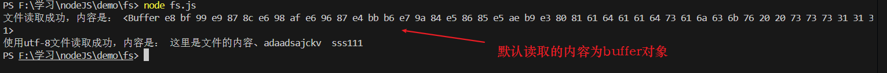

**同步读取文件**,`fs.readFileSync(path[,options])`,同步读取的内容会直接返回，因此需要一个变量进行接收

```js
//导入fs模块，操作文件
const fs = require('fs')

//data接受同步读取的文件内容
let data = fs.readFileSync('../files/1.txt');
//默认的内容也是Buffer对象，需要tostring转化
console.log(data);
console.log(data.toString());
```

还可以使用`open`方法打开文件，open方法用于以指定模式打开文件。如果文件不存在，则会创建一个新文件。

```js
var fs = require('fs');
//w表示以写的方法打开文件
fs.open('newfile_3.txt', 'w', function (err, file) {
	if (err) throw err;
	console.log('File is opened in write mode.');
});
```

#### 2.2.6 文件流式读取(重要)

流式读取的步骤跟写入类似：

1. 先创建**读取的管道**，参数为文件的地址；
2. 然后给管道对象**绑定data事件**，利用data事件的回调函数**分块**读取文件内容。简单来说就是每读取到**一块**文件的内容，就会调用一次回调函数，并将读取的内容传递给回调函数的形参`chunk`；
3. 如果还有后续操作，可在**end事件**中编写，它是文件读取完成时调用其回调函数。

```js
//导入fs模块，操作文件
const fs = require('fs')

//1. 创建流式读取管道,参数为文件地址,准备一个mp4文件用于测试因为他比较大
const rs = fs.createReadStream('./test.mp4');

//2. 绑定data事件,有回调函数，参数为chunk译名为块，用于接受读取的数据
rs.on('data', function (chunk) {
    console.log(chunk.length); //每一块内容的长度为65536 也就是64KB的数据
});

//3. end事件，是可选事件，可不写,它是文件读取完成时调用的事件
rs.on('end', () => {
    console.log('读取完成');
})
```

<strong style='color:red'>案例：文件复制</strong>,对比流式读写文件与普通读写文件的内存区别

```js
//导入fs模块，操作文件
const fs = require('fs');
//导入process模块，查看内存使用
const process = require('process');

//方式1，使用readFile的方式读取,使用writeFile写入，使用同步方便测试与流式的区别
let data = fs.readFileSync('./test.mp4');
fs.writeFileSync('./test2.mp4', data);
const r1 = process.memoryUsage();
console.log(r1);

//方式2，使用流式读取与写入完成
const rs = fs.createReadStream('./test.mp4');
const ws = fs.createWriteStream('./test3.mp4');

//绑定data事件，读一部分内容就是写入一部分
rs.on('data', chunk => {
    ws.write(chunk);
})

//在end函数中使用内存查看
rs.on('end', () => {
    const r2 = process.memoryUsage();
    console.log(r2);
})

//方式3，使用pipe
const rs1 = fs.createReadStream('./test.mp4');
const ws1 = fs.createWriteStream('./test4.mp4');
//该代码的含义就是将rs1读取出的数据直接交给ws1的管道
rs1.pipe(ws1);
```

执行结果，**rss**整个程序占用内容从大小

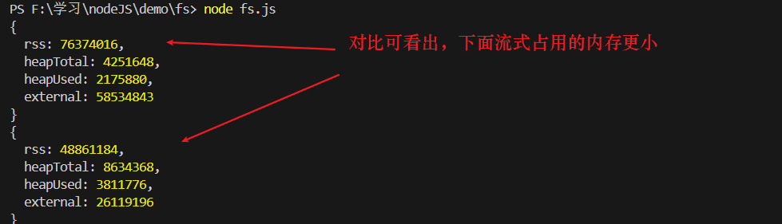

**流式读取**的好处是**节省内存空间**，如果读取大文件，使用流式读取它会**分块**读取文件内容放入内存，每个块所占内存很小，而普通的读取则会将整个文件内容全放入内存中。该效果读取的文件越大节省的空间越大。

#### 2.2.7 文件重命名与移动

在Node.js中，使用`rename（oldPath,newPath,callback）`方法来**移动或重命名文件或文件夹**。其参数含义为

+ **oldPath**:当前文件的路径或旧文件路径
+ **newPath**:新文件路径
+ **callback**:回调函数

重命名函数也有同步的版本`renameSync(oldPath,newPath)`。简单代码案例：

```js
const fs = require('fs');
//文件重命名 将2.txt重命名为张三.txt
fs.renameSync('./2.txt', './张三.txt')
console.log('重命名完成');
//文件的移动，将张三文件移动到test目录下
fs.rename('./张三.txt', './test/张三.txt', err => {
    if (err) {
        console.log('移动失败');
        return;
    }
    console.log('文件移动完成');
})
```

**移动或重命名文件的本质都是更改文件的路径**。因此都可以使用rename函数完成。

#### 2.2.8 文件删除

**文件删除**的方法有两种，老版本的nodeJS使用`unlink(path,callback)`函数，它的同步版本是`unlinkSync(path)`。14.4版本后可用新的函数`rm(path,callback)`，其同步版本是`rmSync(path)`。

```js
const fs = require('fs');
//1.调用unlink方法进行文件删除
fs.unlink('./2.txt', err => {
    if (err) throw err;
    console.log('删除2.txt成功');
})

//2.调用rm方法删除文件，该函数是nodeJS 14.4版本之后新增的
fs.rm('./3.txt', err => {
    if (err) {
        return console.log('删除失败');
    }
    console.log('删除3.txt成功');
})
```

#### 2.2.9 文件夹操作

文件夹的操作也包含多个:

+ **创建文件夹**：`mkdir(path[,options],callback)`，参数函数跟之前的一样，同步版本为`mkdirSync`；

  默认该函数只能创建不存在的文件夹，如果有同名文件夹则会创建失败。

  设置可选参数**recursive**表示是否递归创建父级目录，如果为true就表示递归创建，存在同名文件夹也会创建成功

  ```js
  const fs = require('fs');
  //创建文件夹 mk是make的缩写，dir是文件夹directory单词缩写
  //创建的文件夹如果存在则会创建文件失败
  fs.mkdir('./page', err => {
      if (err) {
          return console.log('创建文件夹失败');
      }
      console.log('创建文件夹失成功');
  });
  
  //创建多级文件夹,又名递归创建文件夹,配置可选参数recursive递归为true即可
  fs.mkdir('./a/b/c', {recursive:true},err => {
      if (err) {
          return console.log('创建多级文件夹失败');
      }
      console.log('创建多级文件夹失成功');
  })
  ```

+ **读取文件夹信息**:`readdir(path,callback)`,其回调函数有两个参数，第一个依然接收错误信息，第二个接受读取到的文件夹信息；

  ```js
  const fs = require('fs');
  //读取文件夹信息
  fs.readdir('./test', (err, data) => {
      if (err) return console.log('读取文件夹失败');
      console.log(data); //读取到信息为文件夹列表名称的数组[ '3.txt', 'fs2.js', '张三.txt' ]
  })
  ```

+ **删除文件夹**:`rmdir(path[,options],callback)`

  ```js
  const fs = require('fs');
  //单个删除，只能删除空文件夹
  fs.rmdir('./page', err => {
      if (err) return console.log('删除失败');
      console.log('删除成功');
  })
  
  //递归删除，文件中中所有文件都会删除，配置recursive参数为true即可
  fs.rmdir('./test', {recursive:true},err => {
      if (err) return console.log('递归删除失败');
      console.log('递归删除成功');
  })
  ```

  递归删除时可能会报警告，**recursive**可能会在新版本中弃用，这时就可以使用`rm()`函数来删除文件夹

  ```js
  const fs = require('fs');
  //rm递归删除，文件中中所有文件都会删除，配置recursive参数为true即可
  fs.rm('./a', {recursive:true},err => {
      if (err) return console.log('递归删除失败');
      console.log('递归删除成功');
  })
  ```

+ **判断文件或文件夹是否存在**`fs.existsSync (文件路径)`，存在返回true，不存在返回false

  ```js
  const fs = require('fs');
  //文件路径
  const filePath = './path.js';
  if (fs.existsSync(filePath)) {
      console.log('文件存在');
  } else {
      console.log('文件不存在');
  }  
  ```

  或使用`access()`方法也可判断文件是否存在

  ```js
  const fs = require('fs');
  //文件或文件夹路径
  const filePath = './example.txt';
  //fs.constants.F_OK: 用于检查文件的存在性 
  //fs.constants.R_OK: 用于检查文件的可读性。
  //fs.constants.W_OK: 用于检查文件的可写性。
  //fs.constants.X_OK: 用于检查文件的可执行性。
  fs.access(filePath, fs.constants.F_OK, (err) => {
      if (err) {
          console.log('文件不存在');
      } else {
          console.log('文件存在');
      }
  });
  ```

#### 2.2.10 查看文件状态信息

使用`stat(path,callback)`方法就**可查看一个文件的详细状态信息**，包括文件的大小，创建实际，修改时间等内容。回调函数也是两个参数，第二个参数就是返回的文件状态信息。

**判断查看的内容是文件还是文件夹**，使用js中`isFile()`方法判断是否是文件，`isDirectory`方法判断是否为文件夹,利用查看的文件状态返回的data数据进行判断。

```js
const fs = require('fs');
//查看文件状态
fs.stat('./fs.js', (err, data) => {
    if (err) return console.log('查看失败');
    console.log(data);
    console.log(data.isFile()); //判断是否为文件
    console.log(data.isDirectory());
})

```

状态信息如下：

```console
Stats {
  dev: 3336059498,
  mode: 33206,
  nlink: 1,
  uid: 0,
  gid: 0,
  rdev: 0,
  blksize: 4096,  
  ino: 5629499534219060,
  size: 990, //文件大小
  blocks: 8,
  atimeMs: 1756043341329.9604,
  mtimeMs: 1755965042679.3132,
  ctimeMs: 1755965042679.3132,
  birthtimeMs: 1755957530382.666,
  atime: 2025-08-24T13:49:01.330Z, //最后的访问时间
  mtime: 2025-08-23T16:04:02.679Z, //最后的修改时间
  ctime: 2025-08-23T16:04:02.679Z, //最后一次修改文件状态的时间
  birthtime: 2025-08-23T13:58:50.383Z  //文件创建时间
}

true  //是文件不是文件夹
false
```

要获取一个文件夹中所有文件完整的信息步骤为：

1. 先用`readdir()`方法获取文件夹中**文件名称列表**，
2. 再使用`stat()`方法获取对应文件详细信息。

其效果跟使用资源管理软件查看的内容是一致的

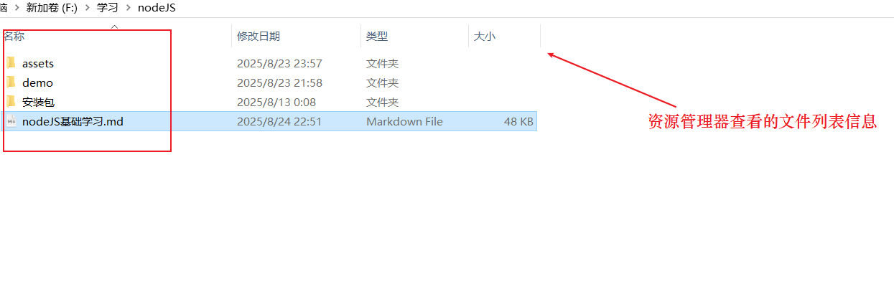

#### 2.2.11 fs简单案例

案例1：**整理文本内容** 

```
小红=89 小白=100 小黄=70 小青=77 小黑=44
```

将上述文件**成绩.txt**中的内容转化为下面内容，并写入新文件**成绩-ok.txt**中

```
小红:89 
小白:100
小黄:70 
小青:77 
小黑:44
```

该案例核心就是读取文件内容，然后转化内容格式，再写入新的文件。

```js
//导入fs模块
const fs = require('fs');

//1.读取文件内容
fs.readFile('./files/成绩.txt', 'utf8', function (err, dataStr) {
    //判断读取是否成功
    if (err) {
        return console.log('读取文件失败!',err.message)
    }
    //2.把读取成功的数据按空格进行分割，结果为一个数组
    const arrold = dataStr.split(' ');
    //3.遍历分割后的数组，对每一项数据进行字符串替换，把=替换的：
    const arrNew = []
    arrold.forEach(element => {
        arrNew.push(element.replace('=',': '))
    });
    //4.把数组的每一项都进行合并，合并前都在末尾添加换行符，最终得到转化好的字符串
    const result = arrNew.join('\r\n');
    //5.最后将数据写入文件
    fs.writeFile('./files/成绩-ok.txt', result, function (err) {
        if (err) {
            return console.log('文件写入失败！' + err.message);
        }
        console.log('文件写入成功！');
    })
})
```

案例2：**批量重命名文件**，将1-文件名称修改为01-文件。

```js
const fs = require('fs');
//读取文件夹中文件列表内容
const files = fs.readdirSync('./test');
//遍历读取文件列表的数组
files.forEach(item => {
    //字符串分割，使用结构赋值获取拆分后的结果
    let [num, data] = item.split('-');
    //判断数字是否小于10，字符串强制类型转化为数字
    if (Number(num) < 10) {
        num = '0' + num;
        //构建新的文件名称
        let newItem = num +'-'+data;
        //重命名文件
        fs.rename(`./test/${item}`, `./test/${newItem}`, err => {
            if (err) return console.log('重命名失败' + err.message);
            console.log('重命名成功');
        })
    }
})
```

运行结果

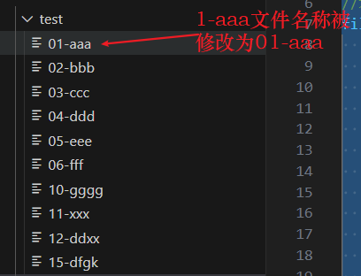

#### 2.2.12 fs模块路径动态拼接的问题

上边的案例中使用的`./`**表示当前文件目录**或`../`**表示上一级目录**来设置的文件路径，这种路径就是**相对路径**。

该路径在使用node指令进行编译时容易出现动态拼接错误。其产生的原因就是代码运行时，会**以执行node命令时所在的路径**作为参考拼接路径。

```js
const fs = require('fs')

fs.readFile('./files/1.txt', 'utf8', function (err, dataStr) {
    if (err) {
        return console.log('文件读取失败！'+err.message)
    }
    console.log('文件读取成功，内容是：', dataStr);
})
```

三次执行编译指令，所在目录不同导致拼接的路径错误

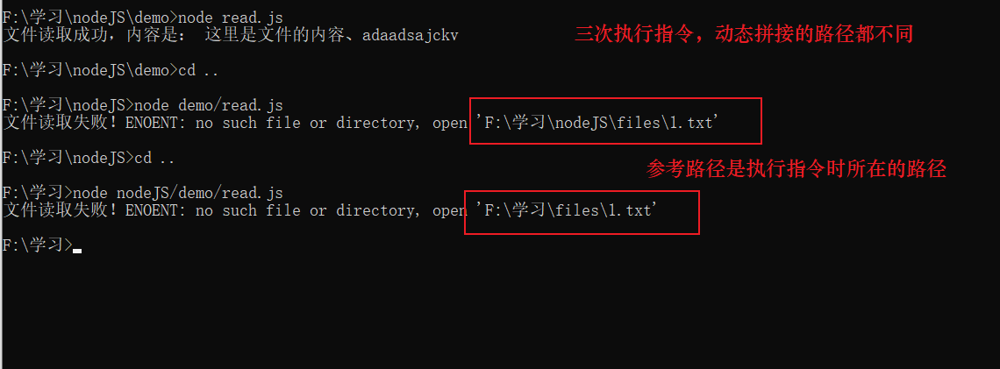

解决该问题方式一：使用完整的**绝对路径**解决。绝对路径写法有两种:

+ 路径全写`F:/学习/nodeJS/demo/files/1.txt`,如果省略为`/1.txt`,则表示在F盘根目录下1.txt等同于`F:/1.txt`
+ 使用转义符\转义\,其路径为`'F:\\学习\\nodeJS\\demo\\files\\1.txt`

```js
const fs = require('fs')
//绝对路径，\\的前一个\是转义用的
fs.readFile('F:\\学习\\nodeJS\\demo\\files\\1.txt', 'utf8', function (err, dataStr) {
    if (err) {
        return console.log('文件读取失败！'+err.message)
    }
    console.log('文件读取成功，内容是：', dataStr);
})
```

**绝对路径**虽然不会出现路径拼接的问题，但其移植性非常差(别人想用你的代码不能直接复制)，而且不利于维护容易拼接错误或不方便修改。

解决该问题方式二：使用`__dirname`解决路径文件，**__dirname**就表示**代码所在文件所处的目录的绝对路径**，这个路径是固定不会改变的。

```js
//导入fs模块，操作文件
const fs = require('fs')

fs.readFile(__dirname+'/files/1.txt', 'utf8', function (err, dataStr) {
    if (err) {
        return console.log('文件读取失败！'+err.message)
    }
    console.log('文件读取成功，内容是：', dataStr);
})
```

### 2.3 path路径模块

**path模块**是Node.js官方提供的、用于**处理路径**的模块。它提供了一系列的方法与属性，用于满足用户对路径的处理需求。

+ `path.join()`方法，可以把多个路径片段拼接为完整的路径字符串。

  ```js
  //引入path模块
  const path = require('path')
  
  //同时拼接多个路径，其中注意../会移除一层路径，./则不会有效果,不写\会自动生成
  const pathStr = path.join('/a', '/b/c', '../', './d', 'e');
  
  console.log(pathStr);  //输出结果  \a\b\d\e
  
  //path.join中也可使用__dirname
  const pathStr2 = path.join(__dirname, './files/1.txt');
  console.log(pathStr2); //输出结果 F:\学习\nodeJS\demo\files\1.txt
  ```

  今后涉及路径拼接操作，都要使用`path.join()`来完成，不要直接使用`+`来进行字符串拼接，这样可防止路径错误。例如：`a+./b/c.txt`的结果是`a./b/c.txt`而使用`path.join('a','./b/c.txt)`的结果是`a/b/c.txt`。显然后者路径正确。

+ `path.resolve()`方法，用于拼接规范的**绝对路径**,它的第一个参数一般为一个绝对路径，之后的参数都为相对路径，如果第二个参数也为绝对路径，那第一个参数则会无效。

  ```js
  //引入path路径
  const path = require('path');
  
  const p1 = path.resolve(__dirname, './aaa/bbb', '../ccc');
  const p2 = path.resolve(__dirname, './aaa/bbb', '/ccc');
  console.log(p1); //打印结果F:\学习\nodeJS\demo\fs\aaa\ccc
  console.log(p2);//F:\ccc
  ```

+ `path.sep`属性，获取操作系统的路径分隔符，window的分割符为`\`,linux的为`/`

+ `path.parse(path)`方法，解析路径并返回一个对象。

+ `path.dirname(path)`方法，获取文件路径的目录名。

+ `path.basename(path)`方法，可获取路径中的最后一部分，经常通过这个方法获取路径中的**文件名**

+ `path.extname(path)`方法，可以获取路径中的**文件扩展名**部分

  ```js
  //引入path模块
  const path = require('path');
  
  //获取系统路径分割符
  console.log(path.sep);
  //解析路径
  const str = 'F:\\学习\\nodeJS\\demo\\files\\1.txt';
  console.log(path.parse(str));
  //获取路径
  console.log(path.dirname(str));
  //获取文件名称
  console.log(path.basename(str));
  //获取没有文件后缀的文件名
  console.log(path.basename(str, '.txt'));
  //获取文件后缀
  console.log(path.extname(str));
  ```

  打印的结果

  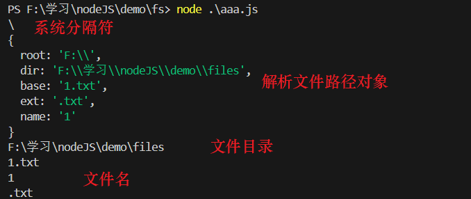

### 2.* 综合案例：时钟案例

需求：编写好一个完整的时钟网页index.html，使用fs模块将index.html文件拆分为index.css,index.js,index.html三个文件

原本的index.html文件内容如下：

```html
<!DOCTYPE html>
<html lang="en">
  <head>
    <meta charset="UTF-8" />
    <meta name="viewport" content="width=device-width, initial-scale=1.0" />
    <meta http-equiv="X-UA-Compatible" content="ie-edge" />
    <title>时钟案例</title>
    <style>
      html,
      body {
        margin: 0;
        padding: 0;
        height: 100%;
        background-image: linear-gradient(to bottom right, red, gold);
      }

      .box {
        width: 400px;
        height: 250px;
        background-color: rgba(255, 255, 255, 0.6);
        border-radius: 6px;
        position: absolute;
        left: 50%;
        top: 40%;
        transform: translate(-50%, -50%);
        box-shadow: 1px 1px 10px #fff;
        text-shadow: 0px 1px 30px white;

        display: flex;
        justify-content: space-around;
        align-items: center;
        font-size: 70px;
        user-select: none;
        padding: 0 20px;

        /* 盒子投影 */
        -webkit-box-reflect: below 0px -webkit-gradient(linear, left top, left
              bottom, from(transparent), color-stop(0%, transparent), to(rgba(250, 250, 250, 0.2)));
      }
    </style>
  </head>
  <body>
    <div class="box">
      <div id="HH">00</div>
      <div>:</div>
      <div id="mm">00</div>
      <div>:</div>
      <div id="ss">00</div>
    </div>

    <script>
      window.onload = function () {
        //定时器，每隔一秒执行1次
        setInterval(() => {
          var dt = new Date()
          var HH = dt.getHours()
          var mm = dt.getMinutes()
          var ss = dt.getSeconds()

          //为页面元素赋值
          document.querySelector("#HH").innerHTML = padZero(HH)
          document.querySelector("#mm").innerHTML = padZero(mm)
          document.querySelector("#ss").innerHTML = padZero(ss)
        }, 1000)
      }

      //补零函数
      function padZero(n) {
        return n > 9 ? n : "0" + n
      }
    </script>
  </body>
</html>
```

**拆分文件的js代码**（注意写入文件的路径是在clock文件夹中，如果没有该文件夹会写入失败，需要自己创建）

```js
//导入模块
const fs = require('fs')
const path = require('path')

//定义正则表达式，分别匹配<style>标签内容与<script>标签内容
const regStyle = /<style>[\s\S]*<\/style>/ // [\s\S]*表示匹配所有内容,\s表示匹配空白字符，\S表示匹配非空白字符,*表示任意多次
const regScript = /<script>[\s\S]*<\/script>/

//调用fs.readFile()读文件
fs.readFile(path.join(__dirname, './index.html'), 'utf8', function (err, dataStr) {
    if (err) return console.log("读取文件失败！" + err.message);
    //读取文件成功，调用三个自定义函数拆分文件
    resolveCSS(dataStr);
    resolveJS(dataStr);
    resolveHTML(dataStr);
})

//处理CSS样式
function resolveCSS(htmlStr) {
    //正则表达式提取<style>样式标签中的内容
    //exec函数是js本身的函数，没匹配到内容返回null，匹配成功返回一数组，数组中索引为0的内容就是匹配的文本
    const r1 = regStyle.exec(htmlStr);
    //读取内容并将<style>的前后标签移除
    const newCSS = r1[0].replace('<style>', '').replace('</style>', '');
    fs.writeFile(path.join(__dirname, './clock/index.css'), newCSS, err => {
        if (err) return console.log("CSS文件写入失败！" + err.message);
        console.log('CSS文件写入成功！');
    })
}


//处理JS文件
function resolveJS(htmlStr) {
    //正则表达式提取<style>样式标签中的内容
    //exec函数是js本身的函数，没匹配到内容返回null，匹配成功返回一数组，数组中索引为0的内容就是匹配的文本
    const r1 = regScript.exec(htmlStr); 
    //读取内容并将<style>的前后标签移除
    const newJS = r1[0].replace('<script>', '').replace('</script>', '');
    fs.writeFile(path.join(__dirname, './clock/index.js'), newJS, err => {
        if (err) return console.log("JS文件写入失败！" + err.message);
        console.log('JS文件写入成功！');
    })
}

//处理HTML文件
function resolveHTML(htmlStr) {
    //通过正则表达式匹配内容替换原本的内容，样式引入与脚本引入
    const newHTML = htmlStr
        .replace(regStyle, '<linK rel="stylesheet" href="./index.css"/>')
        .replace(regScript, '<script src="./index.js"></script>');
    //写入替换后的内容到新的index.html中
    fs.writeFile(path.join(__dirname, './clock/index.html'), newHTML, err => {
        if (err) return console.log("HTML文件写入失败！" + err.message);
        console.log('HTML文件写入成功！');
    })
}
```

### 2.4 http模块

在网络节点中，负责消费资源的电脑就叫**客户端**；负责对外提供网络资源的电脑就叫**服务器**。

**http模块**是Node.js官方提供的**用于创建web服务器的模块**。通过`http.createServer()`方法，就能把一台普通电脑变成一个web服务器用于对外提供Web资源服务。

在了解http模块前，先了解计算机网络中的相关知识，方便理解后续。

#### 2.4.1 http协议

**http**(**Hypertext Transfer Protocol**)协议，译为**超文本传输协议**，其作用就是**对浏览器与服务器之间的通信进行约束**，http协议是互联网上应用最广泛的协议之一。

**协议**的定义是双方必须共同遵从的一组约定，也是一种约束，在网络传输中的协议就是**规范传输内容**，也就是规范浏览器发送请求的**请求报文**与服务器响应请求的**响应报文**的内容。


要抓取网络上的请求，可使用工具**fiddler**进行抓包。安装过程很简单，最关键就是安装好后设置下面几个内容就可使用工具进行请求抓取了

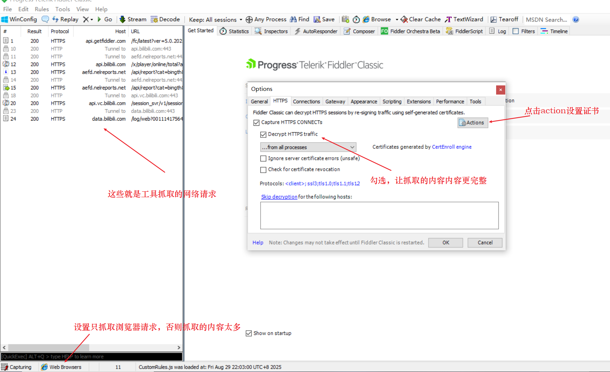

查看百度首页的请求报文与响应报文，要放大缩小内容可按住**ctrl键+鼠标滑轮**就行

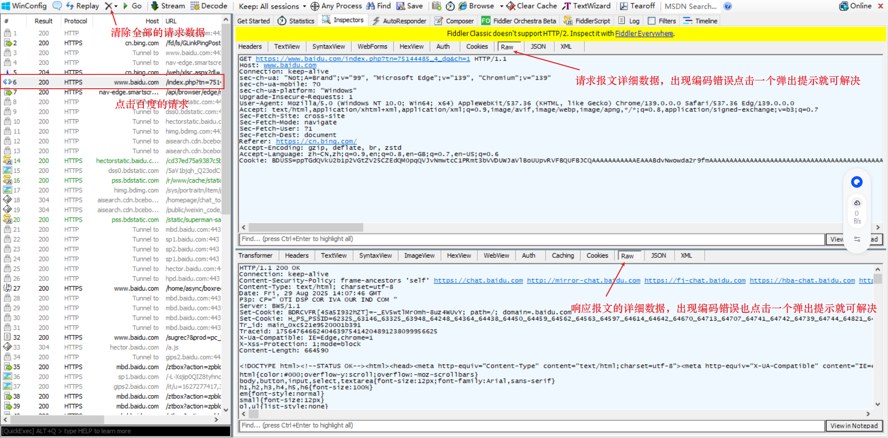

##### 2.4.1.1 请求报文

**请求的详细说明**，报文内容有一定简化，其组成结构可分为：

+ **请求行**，设置**请求类型(方法)**、**URL地址**、**HTTP版本号**
+ **请求头**，记录了浏览器（客户端）的相关信息，以及编译的编码格式等
+ **请求体**，设置参数

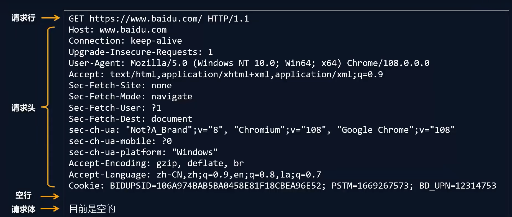

<strong style="color:purple;font-size:20px">请求行</strong>

常见的**请求类型**有：

+ **GET**，用于获取数据(**常用**)
+ **POST**,用于新增数据，也就是表单提交(**常用**)
+ **PUT/PATCH**,用于更新数据
+ **DELETE**,用于删除数据
+ **HEAD/OPTIONS/CONNECT/TRACE**,这些使用相对较少

常见使用GET请求的情况：

1. 在浏览器地址栏直接输入url访问
2. 点击a链接
3. link标签引入css
4. script标签引入js
5. video与audio引入多媒体
6. img标签引入图片
7. form标签中的method为get(不区分大小写)
8. ajax中的get请求

常见使用POST请求的情况：

1. form标签中的method为post(不区分大小写)
2. ajax中的post请求

GET请求与POST请求的区别:

1. **作用不同**。GET请求主要用于获取数据，POST请求用于提交数据，但并不绝对；
2. **参数位置不同**。GET请求的参数是设置到URL中的查询字符串中，POST请求的参数是放在请求体中；
3. **安全性**。POST请求相对GET请求要安全些，因为GET请求会暴露参数在地址栏中；
4. **大小不同**。GET请求有大小限制，一般为2K,而POST请求没有大小限制；

**URL**全称**Uinform Resource Locator**,译为**统一资源定位符**，它就是用来定位服务器资源的位置的，也就是常说的服务器网址。

URL的**组成结构**以京东的为例

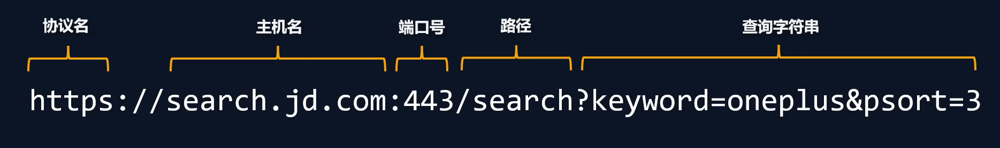

+ `https`是**协议名**，常用的有http协议与https协议，https协议是加密的协议；

+ `search.jd.com`是**主机名**,也就是服务器的IP地址(域名)，用于定位服务器;
+ `443`是**端口号**,用于定位服务器上的具体服务；
+ `/search`是**路径**,用于定位服务上的具体资源；
+ `keyword=oneplus&sort=3`,是**查询字符串**，结构是**键值对形式**，用于给服务器传递额外的参数，也就是**query参数**；
+ 至于`://`、`/`、`?`、`&`则是url的固定格式，没有实际的含义。

**Http版本号**，目前常用的是1.1版本

| 版本号 | 发表时间 |
| :----: | :------: |
|  1.0   |  1996年  |
|  1.1   |  1999年  |
|   2    |  2015年  |
|   3    |  2018年  |

<strong style="color:purple;font-size:20px">请求头</strong>

请求头的格式是键值对，冒号前是**键名**，冒号后是**键值**

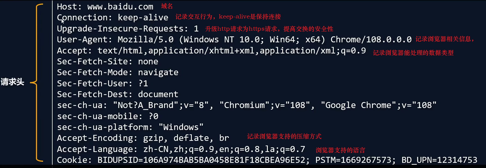

请求头的内容可查询MDN网址：http://developer.mozilla.org/zh-CN/docs/Web/HTTP/Headers，在搜索按钮处收缩请求头名称就可查看对应的内容

<strong style="color:purple;font-size:20px">请求体</strong>

请求体的内容格式是非常灵活的，可以设置任意内容。请求体的内容也是用于给服务器**传递额外参数**的。

一般情况下，**POST请求**的请求体中才有内容，GET请求没请求体，只使用查询字符串传参，但这并不绝对，两种方式都可以有请求体。只是规范写法如此。

请求体常见的格式：

1. 查询字符串的写法，跟URL中的写法一样，例如:`keyword=oneplus&sort=3`
2. **json字符串**(比较多)
3. 数组等

##### 2.4.1.2 响应报文

**响应报文的详细说明**，其结构与请求报文类似

+ **响应行**，设置**http版本号**，**响应的状态码**，**响应状态的描述**，
+ **响应头**，响应头依然是键值对形式，主要记录服务器相关内容以及响应体相关的内容
+ **响应体**，设置返回给浏览器的内容

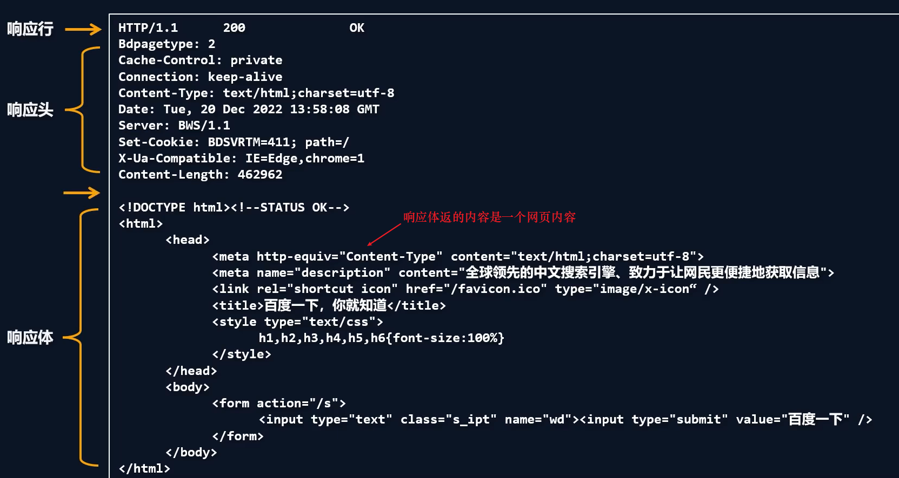

<strong style="color:blue;font-size:20px">响应行</strong>

常见的响应状态码

| 状态码  | 含义                            |
| :-----: | :------------------------------ |
| **200** | 请求成功                        |
| **301** | 找不到资源，重定向(http变https) |
| **403** | 禁止请求                        |
| **404** | 找不到资源                      |
| **500** | 服务器错误                      |

状态码分类

+ **1XX**,表示信息响应
+ **2XX**，表示成功响应
+ **3XX**，表示重定向消息
+ **4XX**，表示客户端错误响应
+ **5XX**，表示服务端错误响应

响应状态的描述，其描述往往与状态码是一一对应的，例如200对应OK,403对应Forbidden等,一般我们不用自己写描述。

查阅状态码的网址：https://developer.mozilla.org/zh-CN/docs/Web/HTTP/Reference/Status/

<strong style="color:blue;font-size:20px">响应头</strong>

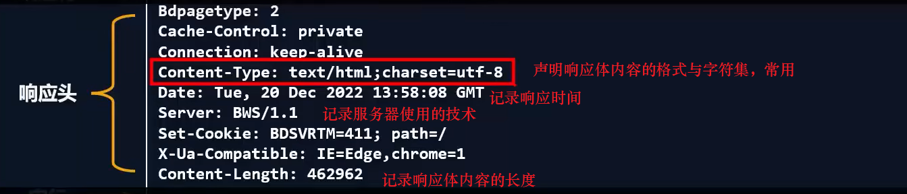

其他响应头的内容，也可到之前的MDN网址去搜索查看即可，如果遇到搜不到的情况，大概率该响应头是**服务器自定义的响应头**。

<strong style="color:blue;font-size:20px">响应体</strong>

响应体的内容格式也是非常灵活的，常见的格式有：

1. HTML
2. CSS
3. JavaScript
4. 图片
5. 视频
6. JSON字符串

##### 2.4.1.3 网络基础概念IP

IP又称为IP地址，其本身是一个**32Bit的二进制数**，例如：**11000000 10101000 00000000 00000001**，但为了好记忆就进行了拆分，8bit为一组，然后转化为十进制数，最后用.进行分开，因此才得到**192.168.0.1**的格式

**IP的作用就是标识网络设备，实现设备间通信。**在互联网中，每台电脑都有它唯一的地址，该地址就是**IP地址**。

IP的32位数字只能标识4294967296台设备，但如今设备太多，它的数量是不够的。这时就需要**共享IP**来解决该问题。

**共享IP**分为**区域共享**与**家庭共享**，在这些范围内，它们共用一段IP地址，这就产生了所谓的**局域网**。


局域网内的IP就是**局域网IP**。在局域网中各个设备都可用局域网IP进行相互通信，出了局域网后，局域网IP则不可用。也就是无法连接互联网(外网)。

要连接互联网，国内的设备需先去联通移动电信公司办理业务，然后师傅上门拉一个网络光纤，然后连接一根线到路由器上，这时路由器就有一个外网IP例如180.91.213.151,该IP就被称为**广域网IP**或**公网IP**。所谓的共享IP就是共享公网IP。

有了公网IP，内部的设备就可先发消息给路由器，然后路由器利用公网外网IP与对应的公网IP进行通信。

共享IP的效果，公司和家庭多个设备只需要一个公网IP就可。这样就大大节约了IP地址。

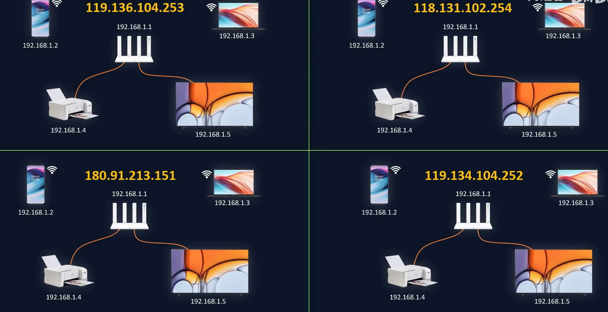

**本机回环IP地址**，其中最特殊的为<strong style="color:red">127.0.0.1</strong>是本机的IP地址，用浏览器访问该地址，其实就是访问本机内容。

IP的分类

|       IP类型       |                              IP                              |           说明           |
| :----------------: | :----------------------------------------------------------: | :----------------------: |
| **本机回环IP地址** |                  127.0.0.1~127.255.255.254                   | 该类地址都是访问本机内容 |
| **局域网IP(私网)** | 192.168.0.0~192.168.255.255 <br />172.16.0.0~172.31.255.255 <br />10.0.0.0~10.255.255.255 |   不同的私网IP作用不同   |
| **广域网IP(公网)** |                         除上述外所有                         |        连接互联网        |

上述分类是非标准的，IP的标准分类去查看相关的网络分章。

##### 2.4.1.4 域名、域名服务器、端口号 

IP地址数字不好记，就考虑使用**域名**来给IP地址取别名。**localhost**就是127.0.0.1的别名。IP地址与域名是一一对应的。

IP与域名内容专门存在一个服务器中，该服务器就是常说的**域名服务器（DNS）**。DNS就是提供IP地址与域名之间的转换服务的服务器。

**端口号**是应用程序的数字标识，一台计算机共有65536个端口号。它的作用是**实现不同主机间应用程序的通信**。

一个应用程序可以使用一个或多个端口，每个应用程序启动都会有其**对应的唯一端口号**。同一个端口号不能同时给多个程序。

一个端口号只对应一个web服务程序，如果端口号为**80端口**，输入URL时可以被省略，**注意是80，不是8080端口**。

#### 2.4.2 web服务器概念

Web服务器与普通电脑的区别就在于服务器上安装了**Web服务器软件**，例如：IIS、**Apache**、**tomcat**等。

安装免费集成软件**phpStudy**，就可轻松启动Apache与MySQL,将个人电脑变成服务器。

要启动服务，先将做好的网页例如之前的clock网页，将其放入软件目录下WWW目录下，然后启动apache就可。

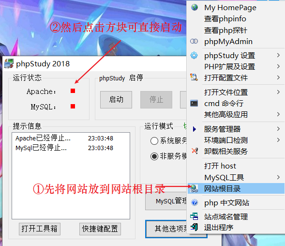

只启动apache不启动mysql服务的方法：

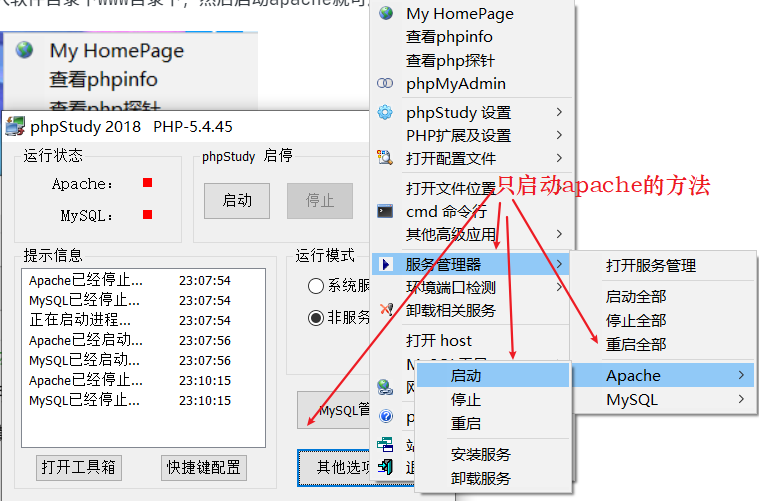

启动好服务后，只需要在浏览器中输入网址http://127.0.0.1/clock/，就会直接看到clock网页内容。

在Node.js中，我们不需要使用apache这些第三方软件，只需要使用http模块，手写几行代码就可提供web服务。

#### 2.4.3 http模块创建基本web服务器

最简单的web服务器代码，写法一、**构建函数中绑定响应回调函数**

```js
//导入http模块
const http = require('http');

//创建服务对象，同时绑定响应回调函数,响应函数的参数是形参，名称可随意，
// request参数 接收实际数据是请求报文封装的对象
// response参数 接收实际数据是响应报文封装的对象
const server = http.createServer((request,response) => {
    console.log('你的服务器被人访问了。');
})

//启动服务器在8080端口
server.listen(8080, function () {
    //服务器启动成功调用的函数
    console.log('服务器启动成功，ip地址为127.0.0.1:8080');
})
```

写法二，**外部绑定响应回调函数**

```js
//导入http模块
const http = require('http')
//创建web服务实例
const server = http.createServer();
//为web服务器实例绑定request事件，用于监听客户请求,其回调函数写的箭头函数
server.on('request', (req, res) => {
    console.log('你的服务器被人访问了。')
})

//启动服务器在8080端口
server.listen(8080, function () {
    //服务器启动成功调用的函数
    console.log('服务器启动成功，ip地址为127.0.0.1:8080')
})
```

要模拟http请求，可直接使用**浏览器**发送请求。比如直接在浏览器的地址栏中使用`127.0.0.1:8080`端口号就发送请求。

发送请求后，被访问网页会卡住，因为服务器只接收了请求，并没有回复。


http服务器注意要点：

1. 回调函数调用的时机是**客户端给服务发送http请求时服务器就会自动调用**；

2. 要强制停止服务器可使用快捷键`Ctrl+C`；

3. 服务器的代码进行了修改，必须重新启动一次服务器修改才能生效，后期可使用插件实现**热更新**；

4. 端口被占用，是无法启动服务的，可以通过windows的**资源监视器**找到占用端口的程序，然后通过pid在任务管理器中关闭程序即可；

   资源监视器的使用方法：

   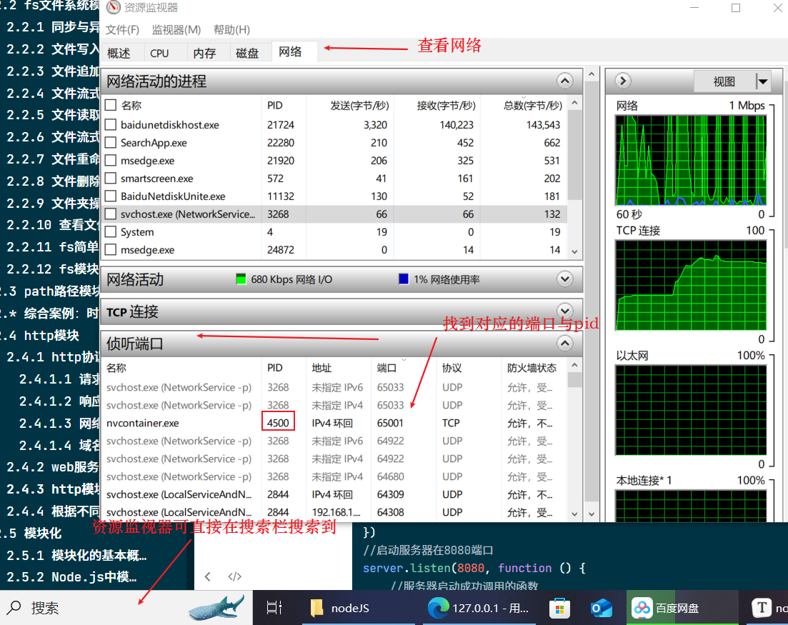

5. http的默认端口为**80**，https的默认端口是**443**，如果是这两个端口启动服务器，发送请求可省略不写端口号。

**完善服务器代码**，使用**request**、**response**两个参数，简写为req与res

在request回调函数中要想访问**客户端请求的数据**，可使用参数`req`，它是请求对象(对应请求报文)，包含客户端相关的属性与数据。

在request回调函数中要想访问**服务器相关的数据或属性**，可使用参数`res`，它是响应对象(对应响应报文)。`res.end(数据)`函数就可给客户端回复数据。

```js
//导入http模块
const http = require('http')
//创建web服务实例
const server = http.createServer();
//为web服务器实例绑定request事件，用于监听客户请求,其回调函数写的箭头函数
server.on('request', (req, res) => {
    //req是客户端请求对象，req.url是客户端请求url地址，req.method是客户端请求类型get或post
    const str=`你的请求地址为${req.url}  以及你的请求方式为${req.method}`
    console.log(str)
    //res是响应对象，它包含与服务器相关的数据与属性
    //res.end()方法可向客户端发送指定的内容，并结束这次请求的处理过程
    //res.end()发送中文内容，会出现中文乱码的问题，需要手动设置内容的编码格式，设置响应头setHeader
    res.setHeader('Content-Type','text/html;charset=utf-8') 
    res.end(str) //将接受的请求数据回复给客户端
})
//启动服务器在8080端口
server.listen(8080, function () {
    //服务器启动成功调用的函数
    console.log('服务器启动成功，ip地址为127.0.0.1:8080')
})
```

使用浏览器地址栏发送的请求都是GET请求，返回的结果如下：

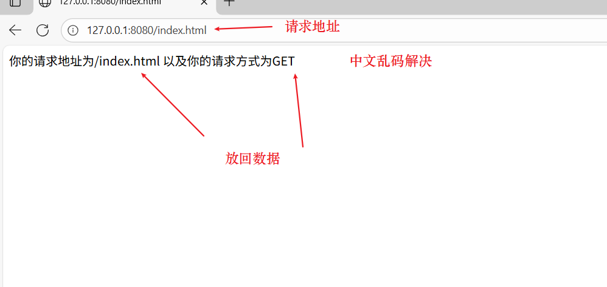


如果要发送POST请求，需写一个网页使用**Form表单**发送。

```html
<!DOCTYPE html>
<html lang="en">
  <head>
    <meta charset="UTF-8" />
    <meta name="viewport" content="width=device-width, initial-scale=1.0" />
    <title>post请求</title>
  </head>
  <body>
    <!-- 使用表达发送post类型请求 -->
    <form action="http://127.0.0.1:8080" method="post">
      <input type="text" name="username" />
      <input type="text" name="password" />
      <input type="submit" value="提交" />
    </form>
  </body>
</html>
```

浏览器打开该网页，点击按钮提交，就可发送一个POST请求，并且带有username与password的参数。其运行效果如下：

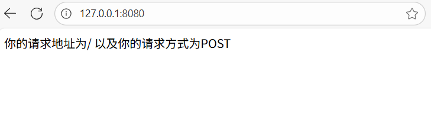

也可使用**postman**软件模拟各种请求，它的功能很强大，postman是所有类型的请求都可模拟。

postman下载后可以不用注册账户，选择免账户就可使用，如果需要更多功能就需要注册。


#### 2.4.4 通过浏览器查看http报文

以谷歌浏览器为案例，先按`F12`打开控制台，然后在地址栏中发送GET请求

<strong style='color:red;font-size:20px'>查看请求报文的内容</strong>

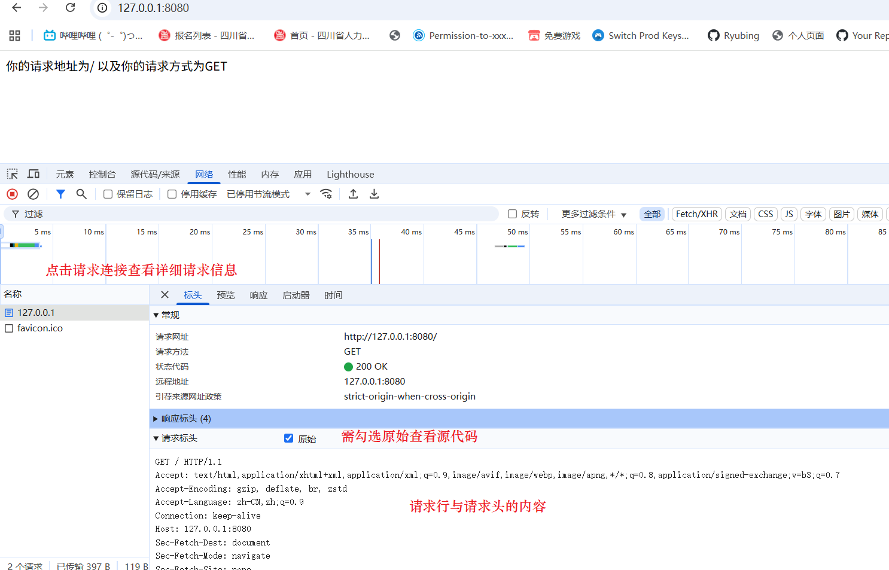

如果要查看**请求体**的内容，需发送**Post请求**，或者发送Get请求中包含的**url查询字符串**

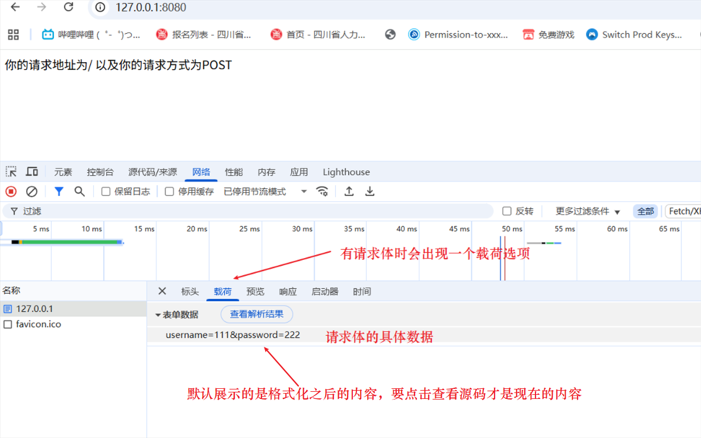

<strong style='color:red;font-size:20px'>查看响应报文的内容</strong>

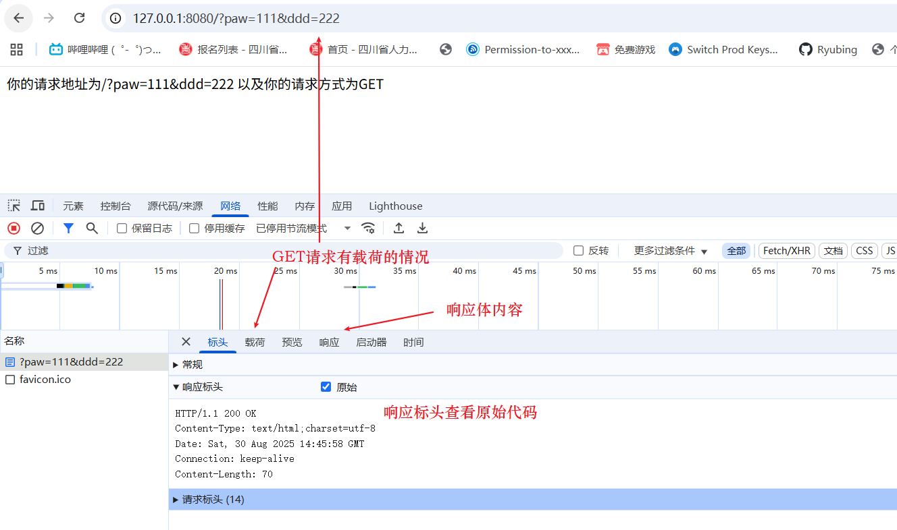


浏览器中就可以查看http所有的报文内容，是不需要其他软件的。

#### 2.4.5 获取http请求报文

通过request对象，可以获取请求报文的相关数据

| 含义                | 语法                                                         |
| :------------------ | :----------------------------------------------------------- |
| 请求方法(常用)      | **request.method**                                           |
| 请求版本            | **request.httpVersion**                                      |
| 请求路径(常用)      | **request.url**                                              |
| URL路径(重要)       | **require('url').parse(request.url).pathname**               |
| URL查询字符串(重要) | **require('url').parse(request.url,true).query**             |
| 请求头(常用)        | **request.headers**                                          |
| 请求体              | **request.on('data',function(chunk){})**<br />**request.on('end',function(){})** |

`request.headers`将请求信息转化为一个对象，并自动将属性名都转化为**小写**。

**获取请求行与请求头的数据**，完整请求行的数据可以通过**host+url**拼接而成

```js
const http = require('http');

const server = http.createServer((request, response) => {
    //1.获取请求方法
    console.log(request.method);
    //2.获取请求的url 查询结果只包含url中的路径与查询字符串
    console.log(request.url);
    //3.获取http协议的版本号 不常用
    console.log(request.httpVersion);
    //4. 获取http请求头,获得到的内容是键值对对象，会将原本键值的大写变成小写，引号则是看内容是否为单个单词，是就没有引号
    console.log(request.headers);
    //获取单个请求头数据
    console.log(request.headers.host);
    
    response.end('sss');//设置响应体
})

server.listen(9000, () => {
    console.log('服务以及启动。。。。');
})
```

运行效果

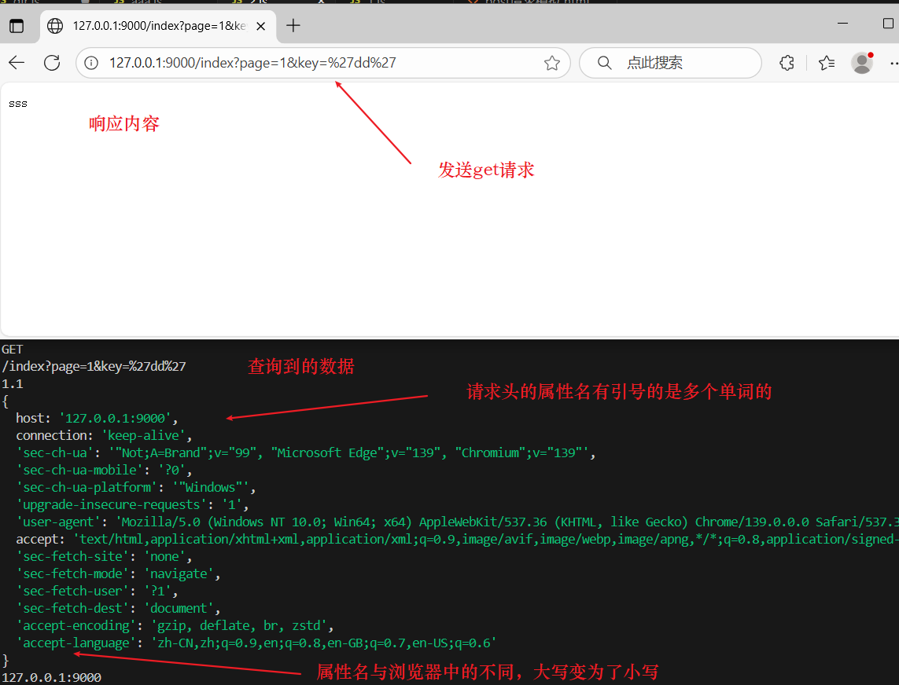

对比浏览器中请求头的属性名

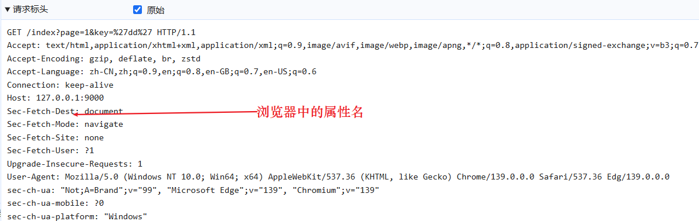

**获取请求体的数据**,核心是绑定data与end事件

```js
const http = require('http');

const server = http.createServer((request, response) => {
    //获取请求体流程
    let body = '';
    //绑定data事件,这里的data事件跟之前文件流式读取的data事件是一样的
    request.on('data', chunk => {
        //chunk本身的buffer对象，使用+符号会自动将其转化为string类型
        // body += chunk;
        //上边的写法跟下面的是一样的效果
        body += chunk.toString();
    })
    //绑定end事件，数据读取完成后处理的内容
    request.on('end', () => {
        response.end(body);//设置响应体
    })
})

server.listen(9000, () => {
    console.log('服务以及启动。。。。');
})
```

需要使用post请求才有数据，get请求没有，使用之前的表单页面提交post请求，注意端口号的不同，结果如下

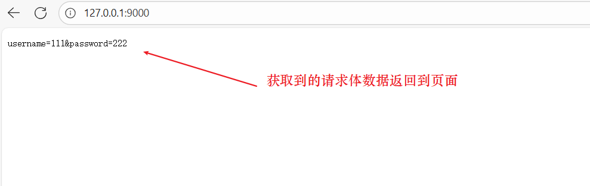

**提取url中的路径与查询字符串(重要)**，这两个参数可以决定页面返回的内容，例如：不同的路径跳转不同页面，百度网页根据不同查询字符串（**wd参数**）返回不同查询结果。

```js
const http = require('http');
//导入url模块，该模块也是内置模块，专门用于处理url数据的
const url = require('url');

const server = http.createServer((request, response) => {
    //解析request.url数据方法一
    let res1 = url.parse(request.url);
    console.log(res1);
    //url路径内容
    console.log(res1.pathname);
    
   //解析request.url数据方法二，设置第二个参数，query属性将会变为对象
    let res2 = url.parse(request.url, true);
    console.log(res2);
    //url查询字符串的query对象
    console.log(res2.query);
    console.log(res2.query.key);

	//响应内容
    response.end('url');
})

server.listen(9000, () => {
    console.log('服务以及启动。。。。');
})
```

运行结果

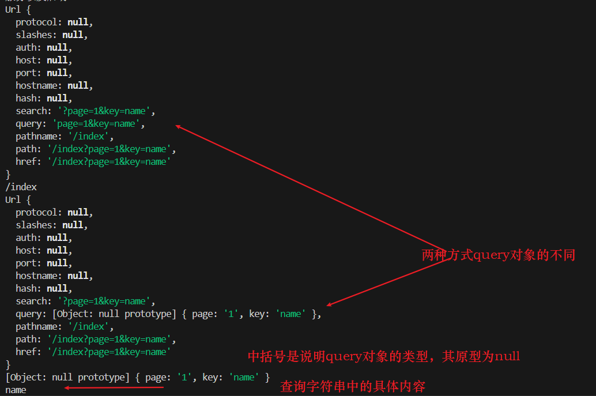

**提取url中的路径与查询字符串(新版本写法)**,使用URL对象

```js
const http = require('http');

const server = http.createServer((request, response) => {
    //实例化URL对象两种方式，必须有完整URL才行
    // let url1 = new URL('http://www.baidu.com/search?wd=123&a=100&b=dd');
    // let url2 = new URL('/search?wd=123&a=100&b=dd','http://127.0.0.1:9000');
    // console.log(url1);
    // console.log(url2);

    let url = new URL(request.url, 'http://' + request.headers.host);
    console.log(url);
    //输出路径
    console.log(url.pathname);
    //输出查询字符串
    console.log(url.searchParams);
    console.log(url.searchParams.get('key'));

    //响应结果
    response.end('url');
})

server.listen(9000, () => {
    console.log('服务以及启动。。。。');
})
```

效果

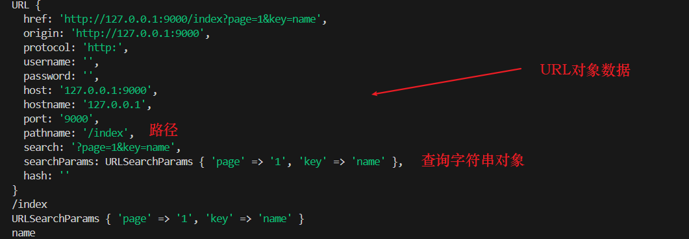

#### 2.4.6 根据不同url响应不同html内容

之前http简单的应用有个问题，就是无论是请求什么url地址，返回的内容都是固定的页面内容。这种效果是不合理的，常见的应该是**不同的url返回不同页面内容**。这也是常说的**页面动态响应**。

**简单的动态响应代码**

```js
const http = require('http')
const server = http.createServer();
server.on('request', function (request, response) {
    //解构赋值获取内容
    let { method } = request
    //获取请求的url地址的路径
    let { pathname } = new URL(request.url, 'http:127.0.0.1');
    console.log(pathname);
    if (method !== 'GET') {
        response.setHeader('Content-Type', 'text/html;charset=utf-8');
        response.end('请求类型错误');
        //end方法执行后必须return,不能再end后再end，end相当于写入内容后就断开连接，后续就不能再写入了
        return;
    }
    //构建不同url返回的内容
    let content = '<h1>Not found</h1>' //构建默认rul返回的页面内容
    if (pathname === '/' || pathname === '/index.html') {
        content = '<h1>首页</h1>'  //url为/或index.html时，返回内容为首页
    } else if (pathname === '/about.html') {
        content = '<h1>关于</h1>'  //url为about.html时，返回内容为关于
    }
    //设置请求头防止中文乱码
    response.setHeader('Content-Type', 'text/html;charset=utf-8')
    response.end(content) //返回内容到客户端
})

//使用80端口可省略端口号
server.listen(80, () => {
    console.log('服务器启动成功，请求地址为127.0.0.1')
})
```

运行效果

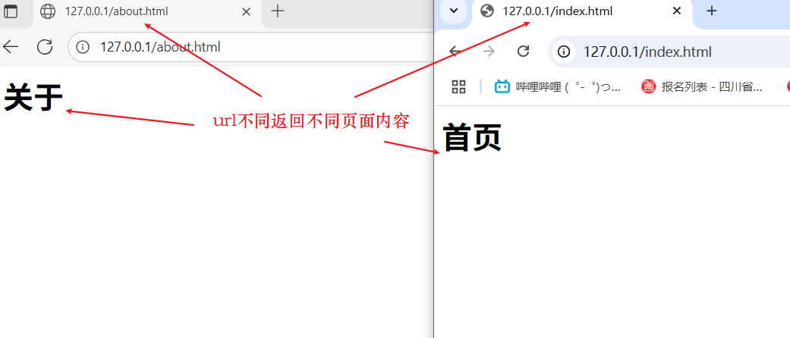

#### 2.4.7 设置HTTP响应报文

```js
const http = require('http');

const server = http.createServer((request, response)=> {
    //1.设置响应状态码
    response.statusCode = 201;
    //2.设置响应描述，一般自己不设置,必须为英文，中文会报错
    response.statusMessage = 'ddd';

    //3.设置响应头,直接解决中文乱码使用的响应头,响应头信息也必须为英文
    response.setHeader('content-type', 'text/html;charset=utf-8');
    //设置服务器信息
    response.setHeader('Server', 'nodejsabc');
    //自定义响应头
    response.setHeader('MyServer', 'aa');
    //多个同名响应头
    response.setHeader('test', ['aa',1,'b']);
    //4.设置响应体，一般使用write多次写入，end结束，end一般不写入内容
    response.write('写入内容');
    response.write('写入内容2');
    //end方法只能有一个，end结束后就不能再调用write与end方法了
    response.end();
})

server.listen(9000, () =>{
    console.log('服务器启动成功。。。。')
})
```

运行效果

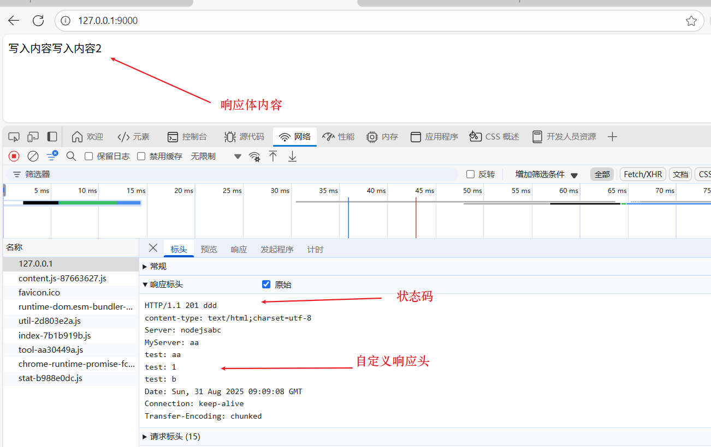

**小案例：html页面响应练习**,http服务响应一个4行3列的表格，并要求表格有隔行换色的效果，点击单元格能改变颜色为黑色

```js
const http = require('http');

const server = http.createServer((request, response) => {
    response.end(`<!DOCTYPE html>
<html lang="en">
<head>
    <meta charset="UTF-8">
    <meta name="viewport" content="width=device-width, initial-scale=1.0">
    <title>Document</title>
    <style>
        td{
            padding:20px 40px;
        }
        table tr:nth-child(odd){
            /* 设置颜色 */
            background:#aef;
        }
        table tr:nth-child(even){
            /* 设置颜色 */
            background:#fcb;
        }
        table,td{
            border-collapse: collapse;
        }
    </style>
</head>
<body>
    <table border="1">
        <tr><td></td><td></td><td></td></tr>
        <tr><td></td><td></td><td></td></tr>
        <tr><td></td><td></td><td></td></tr>
        <tr><td></td><td></td><td></td></tr>
    </table>
    <script>
        //获得所有的td
        let tds=document.querySelectorAll('td');
        //点击单元格将单元格颜色变为黑色
        tds.forEach(item=>{
            item.onclick=function(){
                this.style.background='#222';
            }
        })
    </script>
</body>
</html>`);
});

server.listen(80, () => {
    console.log('服务器启动完成');
})
```

运行效果


上述案例中有个问题就是**在js文件中直接编写html内容在response中没有代码提示与语法高亮**。优化方法就是使用fs模块读取html文件。

将html内容单独写在一个table.html文件中。

```js
const http = require('http');
const fs = require('fs');
const server = http.createServer((request, response) => {
    //读取文件内容
    let html = fs.readFileSync(__dirname + '/table.html');
    response.end(html);
});

server.listen(80, () => {
    console.log('服务器启动完成');
})
```

这样修改html中内容可直接改变页面效果，不用重启服务器，因为每次读取的都是新的html内容。

**网页资源加载流程**，一个html页面中，如果存在css样式、图片或js代码等外部文件引入

```js
<!DOCTYPE html>
<html lang="en">
  <head>
    <meta charset="UTF-8" />
    <meta name="viewport" content="width=device-width, initial-scale=1.0" />
    <title>Document</title>
    <!-- css样式引入 -->
    <link rel="stylesheet" href="./css/index.css" />
  </head>
  <body>
    <h1>网页资源引入</h1>
    <hr />
    <!-- 图片引入 -->
    
    <!-- js脚本引入 -->
    <script src="./js/index.js"></script>
  </body>
</html>
```

这种情况下，上述文件向服务器请求html页面时就不再只是一个请求，而是4个请求。

**其流程是先请求html内容，读取html内容时看到css样式、图片、js都会再发送请求，并且这些请求是并列的。**

再次优化小案例，实现css，js内容文件分离，table.html文件代码如下：

```html
<!DOCTYPE html>
<html lang="en">
  <head>
    <meta charset="UTF-8" />
    <meta name="viewport" content="width=device-width, initial-scale=1.0" />
    <title>Document</title>
    <link rel="stylesheet" href="./index.css" />
  </head>
  <body>
    <table border="1">
      <tr>
        <td></td>
        <td></td>
        <td></td>
      </tr>
      <tr>
        <td></td>
        <td></td>
        <td></td>
      </tr>
      <tr>
        <td></td>
        <td></td>
        <td></td>
      </tr>
      <tr>
        <td></td>
        <td></td>
        <td></td>
      </tr>
    </table>
    <script src="./index.js"></script>
  </body>
</html>

```

**修改读取代码**，让路径决定读取的文件,之前是写死只读取table.html内容

```js
const http = require("http")
const fs = require("fs")
const server = http.createServer((request, response) => {
  //获取url路径
  let { pathname } = new URL(request.url, "http://127.0.0.1")
  //根据路径动态读取内容
  if (pathname === "/" || pathname === "/table.html") {
    let html = fs.readFileSync(__dirname + "/table.html")
    response.end(html)
  } else if (pathname === "/index.css") {
    let css = fs.readFileSync(__dirname + "/index.css")
    response.end(css)
  } else if (pathname === "/index.js") {
    let js = fs.readFileSync(__dirname + "/index.js")
    response.end(js)
  } else {
    response.statusCode = 404
    response.end("Not Found")
  }
})
server.listen(80, () => {
  console.log("服务器启动完成")
})
```

问题：上述案例中只是三个文件就有多个if，代码太繁琐，是否可以根据路径直接读取文件？时钟案例可解决该问题。

<strong style='font-size:20px;color:red'>clock时钟web案例</strong>

案例实现的核心思路如下图，本质就是把**文件实际存放路径**作为每个**资源的请求url地址**，响应内容就是**文件本身的内容**

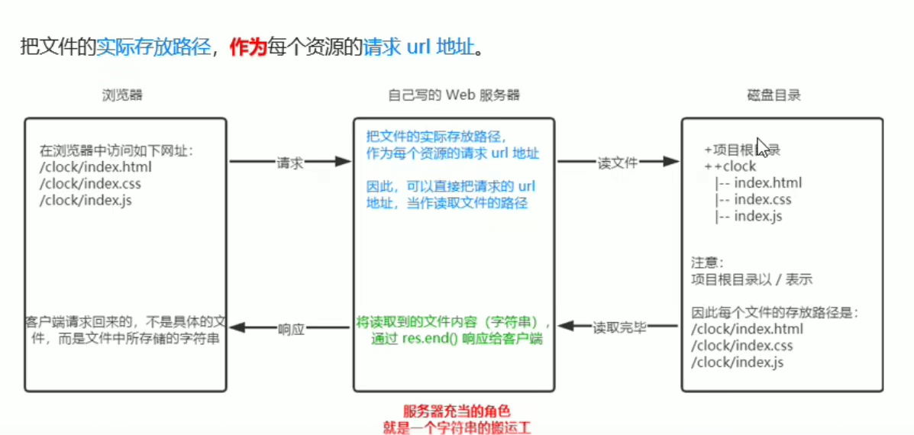

案例实现代码如下

```js
//导入后续需要使用的内置模块
const http = require('http')
const fs = require('fs')
const path = require('path')
//创建web服务器，
const server = http.createServer()
//监听web服务器的request事件
server.on('request', (req,res) => {
    //获取请求的url地址,例如/clock/index.html
    const url = req.url
    //把请求的url地址映射为具体的文件存在路径
    const fpath = path.join(__dirname, req.url)
    
    //根据路径读取文件内容
    fs.readFile(fpath, 'utf8', (err, dataStr) => {
        //文件读取失败，返回消息不能有中文，因为没有设置Header
        if (err) return res.end('404 Not found! '+err.message)
        //文件读取成功，直接返回文件读取的内容
        res.end(dataStr)
    })
})
//启动服务器
server.listen(80, function () {
    console.log('服务器启动成功，服务器地址为127.0.0.1')
})
```

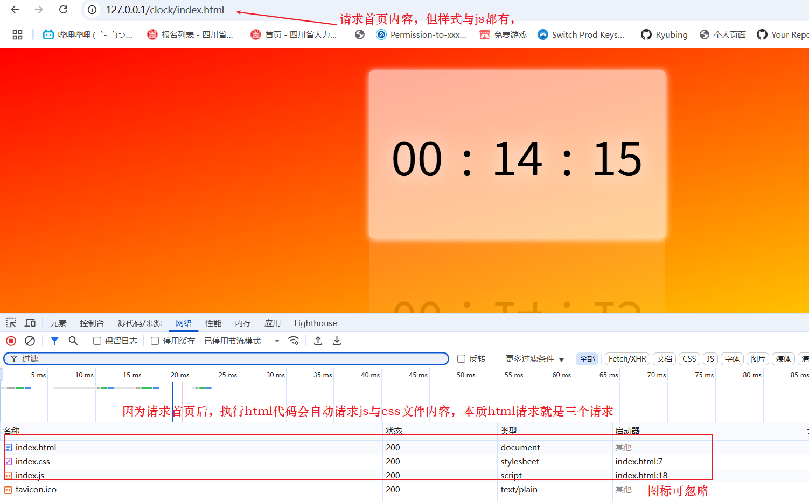

**优化fpath路径的代码**，将资源路径的clock目录隐藏，并将/请求设置为index.html的请求

```js
//导入后续需要使用的内置模块
const http = require('http')
const fs = require('fs')
const path = require('path')
//创建web服务器，
const server = http.createServer()
//监听web服务器的request事件
server.on('request', (req,res) => {
    //获取请求的url地址,例如/clock/index.html
    const url = req.url
    //优化路径的内容，注意fpath是变量，不能使用const了
    let fpath = ''
    //追加默认url为/时加载index.html内容
    if (url === '/') {
        fpath = path.join(__dirname,'/clock/index.html')
    } else {
        //拼接动态路径时,自动添加clock路径
        fpath = path.join(__dirname,'/clock',url)
    }
    
    //根据路径读取文件内容
    fs.readFile(fpath, 'utf8', (err, dataStr) => {
        //文件读取失败，返回消息不能有中文，因为没有设置Header
        if (err) return res.end(',404 Not found! '+err.message)
        //文件读取成功，直接返回文件读取的内容
        res.end(dataStr)
    })
})
//启动服务器
server.listen(80, function () {
    console.log('服务器启动成功，服务器地址为127.0.0.1')
})
```

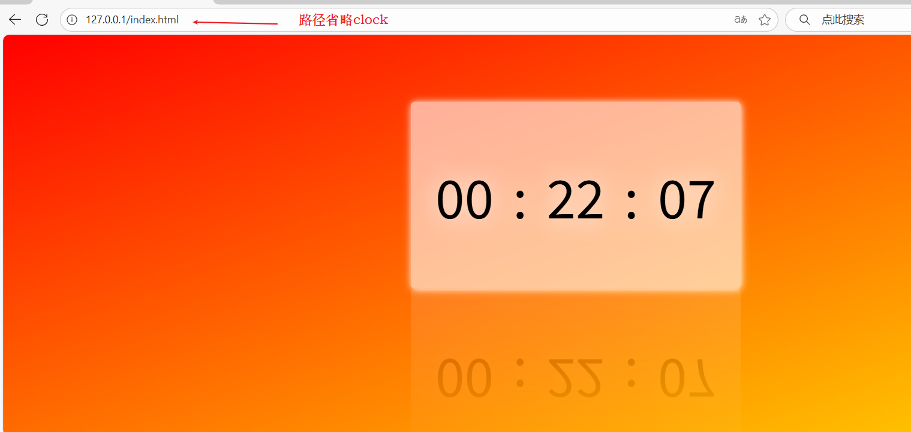

#### 2.4.8 搭建静态资源服务

**静态资源**是指**内容长时间不发生改变的资源**，例如图片、视频、css文件、html文件、js文件、字体文件等，它们的内容上线后基本不会改变；

**动态资源**是指**内容会经常更新的资源**，例如百度首页等，它们的页面数据会实时更新，它们会随着数据库改变而改变的；

优化小案例，**简单静态资源服务**,该服务可随意添加新的文件，不需要修改代码。因为文件路径是直接通过请求的url动态拼接路径获取的。

```js
const http = require("http");
const fs = require("fs");
const server = http.createServer((request, response) => {
  //读取文件内容
  let { pathname } = new URL(request.url, "http://127.0.0.1");
  //配置网址根目录,后续修改根目录也只需修改该变量即可 http文件就是根目录
  //代码的效果为设置当前项目的根目录的上一级目录中的http目录作为静态资源根目录
  let root = __dirname + "/../http/";
  //拼接文件路径
  let filePath = root + pathname;
  //异步方式有错误处理
  fs.readFile(filePath, (err, data) => {
    if (err) {
      response.setHeader("content-type", "text/html;charset=utf-8");
      response.statusCode = 500;
      response.end("文件读取失败");
      return;
    }
    response.end(data);
  });
});
server.listen(80, () => {
  console.log("服务器启动完成");
});
```

vsCode的liveServer插件，打开的html文件也是一个静态web服务，它的网站根目录就是打开文件的上一级目录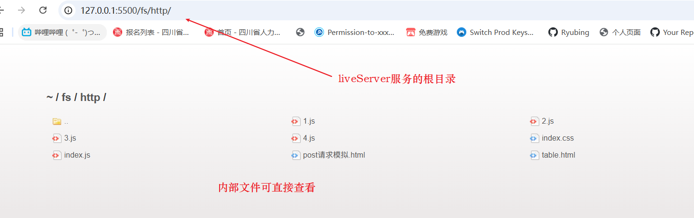

#### 2.4.9 网页中的URL

网页中的URL主要分为两大类：相对路径与绝对路径。(跟之前文件操作路径类似)

**绝对路径**优点是可靠性强，相对容易理解，在项目中使用较多

| 形式                     | 特点                                                         |
| ------------------------ | ------------------------------------------------------------ |
| http://www.baidu.com/web | 直接向目标资源发送请求，容易理解。网址的外部链接会用此形式   |
| //www.baidu.com/web      | 与页面URL的协议拼接形成完整URL后在发请求。大型网站使用较多   |
| /web                     | 与页面URL的协议、主机名、端口拼接形成完整的URL再发送请求。小中型网站常用 |

**完整的绝对路径**不会出错，但如果要移动服务器就需要修改代码，反之**简写的绝对路径**就是移动服务器方便，但拼接的协议必须正确。

**相对路径**在发送请求时，需要与当前页面的URL路径进行拼接计算，得到完整的URL后再发送请求。

相对路径在练习阶段使用较多，但真正项目运行使用很少，因为相对路径不可靠。

例如当前网页为http://www.abc.com/course/h5.html

| 形式               | 最终的URL                             |
| ------------------ | ------------------------------------- |
| ./css/app.css      | http://www.abc.com/course/css/app.css |
| js/app.js          | http://www.abc.com/course/js/app.js   |
| ../img/logo.png    | http://www.abc.com/img/logo.png       |
| ../../mp4/show.mp4 | http://www.abc.com/mp4/show.mp4       |

使用**a标签**测试，使用liveServer工具进行测试

```html
<!DOCTYPE html>
<html lang="en">
  <head>
    <meta charset="UTF-8" />
    <meta name="viewport" content="width=device-width, initial-scale=1.0" />
    <title>Document</title>
  </head>
  <body>
    <!-- 绝对路径 -->
    <a href="http://www.baidu.com">百度</a>
    <a href="//jd.com">京东</a>
    <a href="/search">搜索</a>
    <hr />
    <!-- 相对路径 -->
    <a href="./css/app.css">访问css</a>
    <a href="js/app.js">访问js</a>
    <a href="../img/logo.png">访问png</a>
    <a href="../../img/logo.png">访问图片</a>
  </body>
</html>
```

URL使用场景有**a标签的href**、**link标签的href**、**script标签src**、**img标签src**、**video audio标签src**、**form标签的action**、**AJAX请求中的URL**等

```html
<!DOCTYPE html>
<html lang="en">
  <head>
    <meta charset="UTF-8" />
    <meta name="viewport" content="width=device-width, initial-scale=1.0" />
    <title>Document</title>
      
    <!-- 三种引入同一资源的方式,效果一样,推荐第二种 简写绝对路径的方式-->
    <!-- <link rel="stylesheet" href="./css/app.css" /> -->
    <link rel="stylesheet" href="/css/app.css" />
    <!-- <link rel="stylesheet" href="http://127.0.0.1:9000/css/app.css" /> -->
      
  </head>
  <body></body>
</html>
```

#### 2.4.10 设置资源类型(MIME类型)

mime类型又称**媒体类型**(全名**Multipurpose Internet Mail Extensions**),是一种标准，用来表示文档、文件或字节流的性质和格式。

>mime类型结构：[type]/[subType]  //[主类型]/[子类型]
>
>例如：text/html text/css image/jpeg application/json

Http服务可以设置响应头的**Content-Type**来表明响应体的mime类型，浏览器会根据该类型决定如何处理资源

常见的文件对应的mime类型

```html
html:'text/html'，
css:'text/css'，
js:'text/javascript'，
png:'image/png'，
jpg:'image/jpeg'，
gif:'image/gif'，
mp4:'video/mp4'，
mp3:'audio/mp3'，
json:'application/json'，
```

>对于未知的类型，可以选择**application/octet-stream**类型，浏览器在遇到该类型响应时，会对响应体内容进行独立存储，就是常见的**下载**效果。

**静态资源案例优化类型设置**

```js
const http = require("http");
const fs = require("fs");
const path = require("path");
//声明mime类型的变量
let mime = {
  html: "text/html",
  css: "text/css",
  js: "text/javascript",
  png: "image/png",
  jpg: "image/jpeg",
  gif: "image/gif",
  mp4: "video/mp4",
  mp3: "audio/mp3",
  json: "application/json"
};

const server = http.createServer((request, response) => {
  //读取文件内容
  let { pathname } = new URL(request.url, "http://127.0.0.1");
  //配置网址根目录,后续修改根目录也只需修改该变量即可 http文件就是根目录
  let root = __dirname + "/../http/";
  //拼接文件路径
  let filePath = root + pathname;
  //异步方式有错误处理
  fs.readFile(filePath, (err, data) => {
    if (err) {
      response.setHeader("content-type", "text/html;charset=utf-8");
      response.statusCode = 500;
      response.end("文件读取失败");
      return;
    }
    //获取路径中的文件后缀名,需引入path模块,结果包含.,使用slice移除
    let ext = path.extname(filePath).slice(1);
    //通过文件名称获取mime类型
    let type = mime[ext];
    //类型中没有设置编码格式，文件会出现乱码
    if (type) {
      //匹配到类型,html类型才加编码
      if (ext === "html") {
        response.setHeader("content-type", type + ";charset=utf-8");
      } else {
        //css,js等可以不用加，因为它们的内容在回到html中后，它们会以网页的字符集进行解析
        response.setHeader("content-type", type);
      }
    } else {
      //没匹配到类型
      response.setHeader("content-type", "application/octet-stream");
    }

    response.end(data);
  });
});

server.listen(80, () => {
  console.log("服务器启动完成");
});
```

优化mime类型的代码可能没什么效果，但代码更规范。因为**浏览器本身有mime类型嗅探的功能**，它会根据返回的文件类型自动设置mime类型。

**html编码与响应头编码优先级比较**

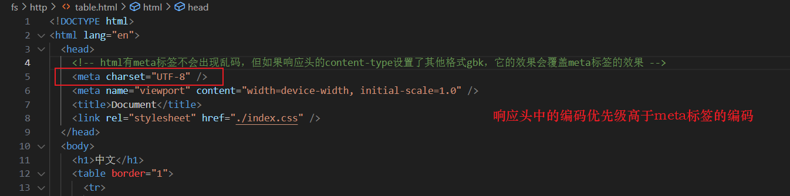

#### 2.4.11 错误处理

之前静态资源案例的错误都是简单的500，实际开发中还是要根据不同错误返回不同结果。

```js
const http = require("http");
const fs = require("fs");
const path = require("path");
//声明mime类型的变量
let mime = {
  html: "text/html",
  css: "text/css",
  js: "text/javascript",
  png: "image/png",
  jpg: "image/jpeg",
  gif: "image/gif",
  mp4: "video/mp4",
  mp3: "audio/mp3",
  json: "application/json"
};

const server = http.createServer((request, response) => {
  //请求类型错误
  if (request.method !== "GET") {
    response.statusCode = 405;
    response.end("<h1>405 METHOD NOT ALLOW</h1>");
    return;
  }

  //读取文件内容
  let { pathname } = new URL(request.url, "http://127.0.0.1");
  //配置网址根目录,后续修改根目录也只需修改该变量即可 http文件就是根目录
  let root = __dirname + "/../http/";
  //拼接文件路径
  let filePath = root + pathname;
  //异步方式有错误处理
  fs.readFile(filePath, (err, data) => {
    if (err) {
      response.setHeader("content-type", "text/html;charset=utf-8");
      //错误类型判断
      switch (err.code) {
        //文件找不到错误
        case "ENOENT":
          response.statusCode = 404;
          response.end("<h1>404 Not Found</h1>");
        //文件无权访问错误
        case "EPERM":
          response.statusCode = 403;
          response.end("<h1>403 文件禁止访问</h1>");
        default:
          //其他错误
          response.statusCode = 500;
          response.end("<h1>500 Internal Server Error </h1>");
      }
      return;
    }
    //获取路径中的文件后缀名,需引入path模块,结果包含.,使用slice移除
    let ext = path.extname(filePath).slice(1);
    //通过文件名称获取mime类型
    let type = mime[ext];
    //类型中没有设置编码格式，文件会出现乱码
    if (type) {
      //匹配到类型,html类型才加编码
      if (ext === "html") {
        response.setHeader("content-type", type + ";charset=utf-8");
      } else {
        //css,js等可以不用加，因为它们的内容在回到html中后，它们会以网页的字符集进行解析
        response.setHeader("content-type", type);
      }
    } else {
      //没匹配到类型
      response.setHeader("content-type", "application/octet-stream");
    }

    response.end(data);
  });
});

server.listen(80, () => {
  console.log("服务器启动完成");
});
```

运行结果

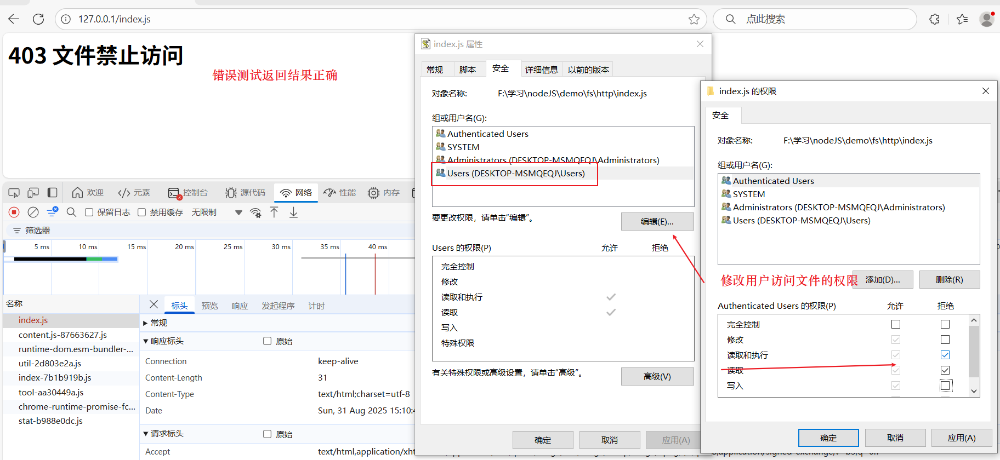

## 三、模块化

### 3.1 模块化的基本概念

**模块化**是指解决一个复杂问题时，自顶向下逐层**把系统划分成若干模块的过程**。对于整个系统来说，**模块是可组合、分解和更换的单元**。通俗来讲模块化就是把复杂问题划分为多个简单问题。

编程领域中的模块化，就是**遵守固定的规则**，把一个**大文件**拆分为`独立并相互依赖`的多个**小模块文件**。

模块化的好处：

+ 防止**命名冲突**；
+ 提高代码的**复用性**，模块可以多次重复使用；
+ 提高代码的**可维护性**；
+ 可以实现**按需加载**。

**模块化规范**是对代码进行模块化的**拆分**与**组合**时需要遵守的规则。规范的好处是代码更好编写，降低沟通成本，方便模块间的相互调用。

**CommonJS模块化规范**规定了**模块的特性**和**各模块之间相互依赖方法**。规范内容为:

+ 每个模块内部都有一个`module`变量，该变量就代表当前模块，记录它的相关信息；
+ 使用`reqiure（）`方法**加载模块**,其本质就是加载该模块的`module.exports`属性；
+ 使用`module.exports`属性向外**暴露成员**，它就是模块**对外的接口**。

**Node.js**的实现就是依据**CommonJS模块化规范**，二者的关系类似**JavaScript**与**ECMAScript**的关系。

### 3.2 Node.js中模块的分类

Node.js根据**模块来源的不同**，可将模块分为3大类，分别是：

1. **内置模块**，内置模块是由Node.js官方提供的模块，例如fs、http等模块；
2. **自定义模块**，用户创建的**每个js文件**都可以作为一个自定义模块；
3. **第三方模块**，由**第三方**开发出来的模块，并非上述两种模块，需要下载后才能使用。通常情况下，第三方模块又被称为**包**。

三种模块的加载都使用`require()`方法完成。

```js
//1. 加载内置模块
const fs = require("fs");

//2. 加载自定义模块
const custom1 = require("./custom.js");
//可省略.js文件后缀名，因为nodejs会自动添加后缀名去寻找文件
const custom2 = require("./custom");

//3. 加载第三方模块，与内置模块差不多
const moment = require("moment");
```

> 注意：**使用require()方法加载其他模块时，会默认执行一次被加载模块中的代码。** 

编写一个1.js文件作为自定义模块：

```js
//自定义模块变量
let name = "aaa";

//自定义模块函数
function a() {
  console.log("函数");
}

//自定义模块中方法调用
console.log("加载了自定义模块");
```

在test.js加载1.js模块

```js
const a = require("./1.js");

运行结果会打印出： 加载了自定义模块
说明执行了模块中console代码，函数与变量也会被定义但没被使用。
```

### 3.3 模块的加载机制

#### 3.3.1 优先从缓存中加载

模块在第一次加载后会被缓存。这意味着多次调用require()不会导致模块内部代码被执行多次。

不论是内置、自定义还是第三方模块，都会优先从缓存中加载，因为从缓存中加载可以提高模块的加载效率。

定义模块1.js

```js
console.log("ok");
```

同时调用三次

```js
require("./1.js");
require("./1.js");
require("./1.js");

执行结果 ok
只打印了一次说明有缓存
```

#### 3.3.2 各类模块的加载机制

1. **内置模块加载机制**：**内置模块加载的优先级是最高的**。如果有一个第三方模块的名称为'fs'，使用`reqiure('fs')`引入的模块始终会是内置的fs模块而不是第三方模块。

2. **自定义模块加载机制**：使用require()加载自定义模块时，必须以`./`或`../`路径标识符开头，是**相对路径**（但不会出现之前fs模块路径问题）。在加载自定义模块时，如果没有指定`./`或`../`路径标识符,nodeJS会把它当作**内置模块**或**第三方模块**进行加载。

   导入自定义模块时如果**省略文件扩展名**，则nodeJS会按顺序分别尝试加载以下文件：

   1. 直接按`文件名`进行加载，如果文件格式不是js，json或node其中一种，默认会当作js文件处理；
   2. 补全`.js`扩展名进行加载；
   3. 补全`.json`扩展名进行加载；
   4. 补全`.node`扩展名进行加载
   5. 如果都没有，则会报错说找不到模块（**Cannot find module**）

   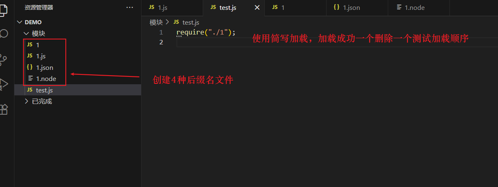

3. **第三方模块加载机制**：如果传递给require()的模块标识符既不是内置模块也不是以`./`或`../`路径标识符开头，则nodeJS会以当前模块的父目录开始，尝试从`node_modules`文件夹中加载模块。如果没找到会移动到**再上一层目录**中寻找，如果没找到就再上移直到根目录，如果都没有就加载失败。

   例如：假设在`C:\Users\mydemo\project\foo.js`文件中调用了`require('tools')`,则nodeJs的查找顺序如下：

   1. `C:\Users\mydemo\project\node_modules`中寻找tools模块;
   2. `C:\Users\mydemo\node_modules`中寻找tools模块;
   3. `C:\Users\node_modules`中寻找tools模块;
   4. `C:\node_modules`中寻找tools模块;
   5. 还没有就加载失败;
   
   这种向上查找的机制好处就是只需要在项目根目录上有`node_modules`文件夹,后续代码开发无论在项目的什么地方都可查找到包。
   
   <strong style='color:red'>第三方模块加载一般加载的是模块目录，因此它除了自己的加载规则外同时也要遵循目录作为模块的加载规则。</strong>

#### 3.3.3 把目录作为模块(重要)

当把**目录**作为模块标识符传递给require()进行加载时，其加载的规则如下：

1. 首先在被加载的目录下查找一个叫做`package.json`的文件，并寻找其中`main属性`的值，将其**对应的文件路径**作为加载的入口文件；
2. 如果没有`package.json`的文件或者main属性对应的入口文件不存在或无法解析，则nodeJS会试图加载该目录下的`index.js或index.json文件`；
3. 如果既没有`package.json`也没有`index.js`或`index.json`文件,nodejs就会打印错误消息：**Error：Cannot find module xxx**。

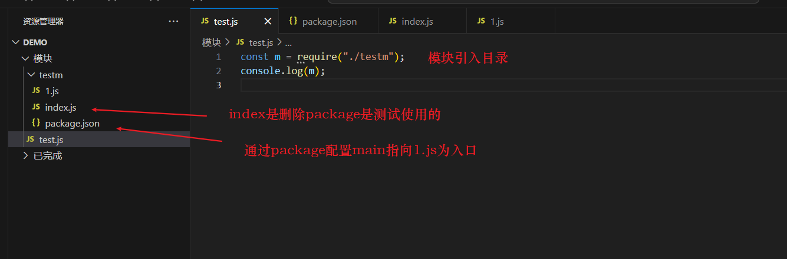

### 3.4 模块作用域

在模块中定义的**变量**、**方法**等成员，**只能在当前模块内被访问**，这种模块级别的访问限制就是**模块作用域**。它的效果与**函数作用域**类似。

模块作用域的好处是可以**防止全局变量污染**的问题，不同模块中**同名变量**只能作用于模块内部，不会影响其他模块的内容。

引入模块1.js并打印引入的模块对象

```js
const a = require("./1.js");
//打印引入的模块对象
console.log(a);  //结果是{}空对象,也就是a不能调用内部的name或a()方法
```

### 3.5 module对象与exports对象

模块作用域限制了模块的内部成员，如果需要**向外共享**模块作用域中的成员，就需要使用**module对象**。

在Node.js中每个.js自定义模块中都有一个`module`对象，它里面存储了当前模块的相关信息，可直接打印。


外界用`require()`方法导入模块时，得到的就是**module.exports所指向的对象**，因此直接给该对象**赋值**就能实现模块内的成员向外共享。

案例：**模块向外共享内容**

```js
//自定义模块变量
let name = "aaa";

//自定义模块函数
function a() {
  console.log("函数");
}

//在自定义模块中默认module.exports对象默认为空
//共享变量与常量，这里为了区分才写name1，通常情况共享名与外部名应该保持一致
module.exports.name1 = name;
module.exports.name2 = "张三";
//共享方法
module.exports.a = a;
module.exports.sayHello = function () {
  console.log("方法");
};
```

导入模块并调用共享的内容

```js
const m = require("./1.js");

console.log(m);

console.log(m.name1);
console.log(m.name2);
m.a();
m.sayHello();
```

运行结果(module.exports对象不再是空对象)


如果直接给module.exports赋值对象，那原本的module.exports对象内容会被新对象覆盖。

```js
let name = "aaa";
function a() {
  console.log("函数");
}
module.exports.name1 = name;
module.exports.name2 = "张三";
module.exports.a = a;
module.exports.sayHello = function () {
  console.log("方法");
};

//直接给exports赋值对象,上述的赋值会全被覆盖
module.exports = {
  b: "李四",
  sayBye: () => {
    console.log("aaaa");
  }
};
```

```js
const m = require("./1.js");
console.log(m);

运行结果:`{ b: '李四', sayBye: [Function: sayBye] }`
```

> 上述结果证明：使用require()导入模块时，导入的结果**永远以module.exports指向的对象为准**

由于`module.exports`单词写起来比较复杂，为了简化向外共享成员的代码，Node提供了`exports`对象来替代。

**默认情况下，exports和module.exports是指向同一个对象**，最终共享结果相同。

<strong style='color:red'>exports只能使用`exports.属性名`的方式暴露属性，不能使用`exports=value`的形式暴露数据，因为这样会让exports与module.exports指向不同的对象。</strong>

如果两者指向不同对象，最终结果以module.exports指向的对象为准。

> 原理：**exports**与**module.exports**之间有个隐式的关系`exports=module.exports={}`,而最终保留的数据以`module.exports`为准

```js
//自定义模块变量
let name = "aaa";

//自定义模块函数
function a() {
  console.log("函数");
}

//在自定义模块中默认module.exports对象默认为空
//共享变量与常量
exports.name1 = name;
exports.name2 = "张三";
exports.a = a;
```

引入结果，exports默认与module.exports结果相同

```js
const m = require("./1.js");
console.log(m);

运行结果：{ name1: 'aaa', name2: '张三', a: [Function: a] }
```

混合使用两者时产生的4种**特殊情况**：


> **为了防止混乱，建议在同一模块中不要同时使用`module.exports`和`exports`。**

### 3.6 导入模块的基本流程（原理）

以`require()`导入**自定义模块**的基本流程为例:

1. 将**相对路径**转化为**绝对路径**，定位目标文件；

2. **缓存检测**，有缓存直接使用缓存内容，返回`module.exports`的值结束；

3. 没有缓存，直接读取文件代码；

4. **包裹文件代码为一个函数并执行(自执行函数)**。通过`argument.callee.toString()`查看自执行函数内容；

   ```js
   const test = {
     name: "张三"
   };
   
   module.exports = test;
   
   //输出函数本身 arguments.callee该属性指向函数
   console.log(arguments.callee.toString());
   ```

   导入该模块，打印的结果为

   

5. 缓存新模块的值；

6. 返回`module.exports`的值；

伪代码如下：

```js
// 模块导入流程伪代码  require('./1.js)
const path = require("path");
const fs = require("fs");

function require(filepath) {
  //1.将相对路径转化为绝对路径，定位目标文件
  let absolutePath = path.resolve(__dirname, filepath);
    
  //2.缓存检测,如果有直接返回缓存
  if (caches[absolutePath]) {
    return caches[absolutePath];
  }
  //3.没有缓存，就读取文件代码
  let code = fs.readFileSync(absolutePath).toString();

  //4.将读取的代码包裹为一个函数并执行(核心)，这里解释为什么模块代码会默认执行一次
  let module = {};
  let exports = (module.exports = {});
  (function (exports, require, module, __filename, __dirname) {
    //模块内容
    const test = {
      name: "张三"
    };

    module.exports = test;

    //输出函数本身 arguments.callee该属性指向函数
    console.log(arguments.callee.toString());
  })(exports, require, module, __filename, __dirname);

  //5.缓存模块对象
  (caches[absolutePath] = 模块对象), 模块对象中包含module.exports;
  //6.最终返回module.exports
  return module.exports;
}
```

### 3.7 包与npm

#### 3.7.1 包的定义

Nodejs的第三方模块又叫做**包(package)**。第三方模块与包指的是同一概念，只是叫法不同而已。

不同于Nodejs的内置模块与自定义模块。包是由**第三方个人或团队开发**出来，免费给所有人使用的。Nodejs中的包都是免费开源的。

Nodejs的内置模块只提供了一些**底层的API**,导致项目的开发效率很低。而**包是基于内置模块封装出来的**，提供了更高级、更方便的API,极大的提高了开发效率。

> **包与内置模块的关系类似于jQuery与浏览器内置API的关系**。

#### 3.7.2 npm

国外有一家IT公司，叫`npm,Inc.`的公司，该公司旗下有一个非常著名的网站**npm官网**：https://www.npmjs.com/,它是全球最大的包共享平台，该网站上可以搜索到任何一个你需要的包。


npm软件的**官方API文档**：https://npm.nodejs.cn/cli/v11/configuring-npm/install。

除了上述网址外，`npm,Inc.`公司还提供了一个**专门下载包的服务器地址**：https://registry.npmjs.org/。注意该服务器地址在浏览器中是无法打开的，需要通过专门的**包管理工具npm**才可在该服务器上下载包。

`npm,Inc.`公司提供的**包管理工具**名称叫做N**ode Package Manager**(简称**npm**，是node的包管理工具)，这个包管理工具是内置在nodejs中的，安装nodejs时其实已经安装了该工具。

>所谓**包管理工具**，就是一个**管理包的应用软件**，它可以对包进行下载、更新、删除、上传等操作。使用包管理工具，可以快速开发项目，提高开发效率。

查看该工具是否安装成功，只需要在命令终端中输入`npm -v`指令，出现npm版本号就说明安装成功

```js
PS F:\学习\nodeJS\demo> npm -v
6.13.4   //个人使用的npm版本为6.13.4
```

npm下载包的正规流程是：

1. 在npm官方网址搜索包；
2. 查看相关包说明；
3. 通过命令行工具执行指令安装包，其中要使用npm指令必须先安装npm工具才行。


#### 3.7.3 npm的基本使用

格式化时间的传统做法(**自定义模块**的方式)：

```js
//自定义时间格式模块 time.js文件
//1.定义格式化时间的方法
function dateFormat(dtStr) {
  const dt = new Date(dtStr);

  //获取年月日时分秒，其中月份是0月开始，要加1
  const y = padZero(dt.getFullYear());
  const m = padZero(dt.getMonth() + 1);
  const d = padZero(dt.getDay());

  const hh = padZero(dt.getHours());
  const mm = padZero(dt.getMinutes());
  const ss = padZero(dt.getSeconds());
  //返回格式化的时间
  return `${y}-${m}-${d} ${hh}:${mm}:${ss}`;
}

//补零函数，在数字小于10的前面补0

function padZero(n) {
  return n > 9 ? n : "0" + n;
}

//暴露格式化时间的函数
module.exports = {
  // dateFormat:dateFormat //原本的写法
  dateFormat //简写形式，要求属性名与值一样
};
```

测试模块

```js
const dt = require("./time");

const time = new Date();
console.log(time); //结果:2025-09-04T12:38:28.463Z
//格式化后的时间
console.log(dt.dateFormat(time)); //结果 2025-09-04 20:38:28
```

**不自己编写格式化时间的代码，使用第三方包的方式。**其步骤如下:

创建一个空的文件夹，以此目录作为工作目录**启动命令行工具**，执行指令(该指令是**交互式**的)

```js
npm init
npm init -y //全使用默认配置的指令
```

`npm init`指令的作用就是创建`package.json`文件，也就是包配置文件。


初始化完成后就安装**moment包**用于**格式化时间**，其步骤为:

1. 安装moment包，指令为`npm i moment `

2. 使用`require()`导入格式化时间的包;

3. 参考moment官方API文档对时间进行格式化,其文档就在npm的官网上。


> 除了`moment`这个包可格式化时间外，还有`dayjs`包也可以格式化时间。

#### 3.7.4 npm包的分类与下载

**生产环境与开发环境**:

+ **开发环境**是程序员专门用来写代码的环境，一般指程序员的电脑，开发环境的项目一般只能**程序员自己访问**。
+ **生产环境**是项目代码正式运行的环境，一般指正式的服务器电脑，生产环境的项目一般**每个客户都可以访问**。

npm中的包**按包的作用范围**可分为两大类：

+ <strong style='color:red'>项目包</strong>，被安装到项目的`node_modules`目录中的包都是项目包。项目包安装成功时，产生的效果：
  
  1. npm工具会自动把**包的名称与版本信息**记录到`package.json`文件中。
  2. 目录中会多出一个文件夹`node_modules`，它的作用就是专门存放包文件，以后我们安装的所有包都会默认存放在该文件下。
  3. 目录中还会多出一个`package-lock.json`配置文件，它的作用是**锁定(固定)**包的版本信息，下载路径等内容，确保这次安装与将来安装版本一致。
  
  >**开发者不要手动修改node_modules文件夹中或package-lock.json文件中的任何代码，npm包管理工具会自动维护它们的。**
  >
  >有时安装包时会发现同时安装不止一个包，这些附加安装的包就是**依赖包**。这种现象就被称为**包依赖**。通俗来说就是安装的A包中同时使用了B包的内容，那安装A包时就必须同时安装B包，否则A包功能将会出错。
  
  根据`package.json`文件记录节点的不同，项目包又可分为：
  
  + **核心依赖包**，又叫**生产依赖包**,记录到**Dependencies节点**中的包，在开发和项目上线后都会使用,指令为：
  
    ```js
    //完整安装包指令 uniq包作用是移除数组中相同的数据
    npm install uniq --save
    //或
    npm install uniq -S
    //简写
    npm i moment 
    ```
    
    `-S`等同于`--save`,`-S`是默认选项，可简写省略。 `npm i`是指令`npm install`的简写形式。
    
  + **开发依赖包**，记录到**devDependencies节点**中的包，其中dev就是develop的简写。只在开发时会使用，部署上线后将不会使用，指令为：
  
    ```js
    //less包的作用是将less文件转化为css文件
    npm install less --save-dev
    或
    npm install less -D
    ```
  
    `--save-dev`等同于`-D`,如何判断包是安装到**Dependencies节点**还是**devDependencies节点**可在其npm包文档中查看到。
  
    
  
+ <strong style='color:red'>全局包</strong>，执行`npm i`指令时提供了`-g`参数，则会把包安装为全局包。

  ```js
  //nodemon包的作用是自动重启node程序，它可以实现热更新，使用方法就是将node指令改为nodemon即可
  npm i nodemon -g //安装全局包
  npm uninstall nodemon -g //卸载全局包
  ```

  **查询全局包位置**的指令

  ```js
  npm root -g
  //查询结果
  //全局包的安装目录为:C:\Users\wang\AppData\Roaming\npm\node_modules
  ```

  不是所有的包都适合全局安装，一般安装到全局的都是**工具性质的包**，因它们提供了好用的终端命令。是否安装全局需查看官方包文档。

  安装全局包有时会**执行命令会报错**

  
  
  其原因就是Windows约束了npm安装的全局脚本，需要修改Windows策略解决问题。其步骤为：
  
  1. 以**管理员**身份打开powershell命令行；
  2. 输入命令`set-ExecutionPolicy remoteSigned`,会弹出是否更改执行策略，选择**Y**或**A**就行。
  
  
  
  `i5ting_toc`工具包，它的功能是可用把md文件转化为html文件
  
  ```js
  npm i -g i5ting_toc //安装
  
  i5ting_toc -f 文件路径 -o  //转化文件 -o表示转化完成后直接打开
  ```
  
  该工具转化速度很快，但对图片处理不强，转化成功后会产生一个preview文件夹存放html文件
  
  

**同时安装多个包**，以空格隔开不同包

```js
npm i moment jquery
```

**安装所有包**，该命令是依据`package.json`和`package-lock.json`中声明所有依赖包的信息安装所有的依赖包

```js
npm install
或
npm i
```

**安装特定版本的包**，默认情况下，使用`npm i 包名`的命令安装的包是最新版本的包，如果需要指定版本，可在包名后加`@符号`+具体版本即可。

```js
npm i moment@2.22.2
```

<strong style='color:red'>注意：安装同一个包不同版本，不需要卸载原有的包，直接安装新版本即可，npm工具会自动删除原版本安装新版本的</strong>


**卸载(删除)包**，卸载包后不仅会删除包的内容，也会移除`package.json`中**dependencies节点**中的包配置内容，使用指令：

```js
//卸载局部包
npm uninstall 包名  //uninstall不能简写，不同于install
//卸载全局包
npm uninstall 包名 -g 
```

除了`uninstall`外,`remove`也可以删除包,它的效果跟uninstall一样

```js
npm remove 包名
//简写
npm r 包名
//删除全局包
npm r -g 包名
```

包的**语义化版本规范**，包的版本号是以`点分十进制`的形式进行定义的，总共有三位数，例如2.24.0。

其中每一位数字所代表的含义如下：

+ 第一位数字：**大版本**号，从底层修改代码后，大版本号加1；
+ 第二位数字：**功能版本**号，每更新一个功能，该版本号加1；
+ 第三位数字：**Bug修复版本**号，功能每更新只是修复了几个bug，该版本号加1。

版本号的提升规则：**只要前面的版本号增长了，后面的版本号就要归零**。例如大版本更新，功能与bug版本都要归零。

**npm搜索包**,可在命令行中输入指令,不常用

```js
npm s math
```


该指令只能搜索英文，且展示内容不友好，不如直接在npm官网上搜索更友好，展示内容反而全面。

#### 3.7.5 package.json文件(重要)

npm规定，在项目的根目录中，必须提供一个叫做`package.json`的**包管理配置文件**，**用于记录与项目有关的一些配置信息**。例如：

+ 项目的名称、版本号、描述等
+ 项目中使用的包的信息
+ 配置包只在**开发期间**使用
+ 配置包在**开发**与**部署**时都需要使用

使用包管理配置文件的好处，可以有效减少项目源代码的大小。可在git的`.gitignore`文件中配置忽略**node_modules文件夹**的内容


`package.json`文件中记录了项目中使用的包信息。即使剔除了**node_modules文件夹**，只需要执行指令`npm i`或`npm install`不加任何包名,npm就会去自动下载package.json中配置**所有包的内容**。

之前说过可使用`npm init`指令交互式的来创建package.json配置文件。还可以通过另外一个快捷指令，在执行命令的目录中**快速创建package.json配置文件，不进行交互，直接采用默认配置**

```js
npm init --yes
//简写为
npm init -y
```

该命令只能在**英文目录**下运行，**中文目录**或**带空格大写字符目录**可能会报错，其原因是：

<strong style='color:red'>package.json的name属性也就是包名，不能使用中文、大写。其默认值是文件夹名，所以一般文件夹名也不能使用中文和大写。如果后续包要发布，该名称还不能在npm官网上有同名</strong>。

> 注意：
>
> 1. 该命令在创建了项目空文件时就可执行，一般一个项目只需要执行一次便可；
> 2. 创建完`package.json`文件后，执行`npm i`安装包时，npm工具会自动把包的名称与版本号记录到该文件中。

初始的`package.json`文件内容如下，该配置安装了一个moment包

```json
{
  "name": "tt", //包目名称，与文件夹同名
  "version": "1.0.0", //包的版本号
  "description": "", //包的描述
  "main": "test.js", //包的入口文件
  "dependencies": {  //开发与部署版本使用的包
    "moment": "^2.22.2"  
  },
  "devDependencies": {}, //只在开发是使用的包
  "scripts": {
     //脚本配置，也就是脚本别名，执行npm run test就是执行"echo \"Error: no test specified\" && exit 1"该指令
    "test": "echo \"Error: no test specified\" && exit 1"
  },
  "keywords": [], //搜索的关键词
  "author": "",  //作者
  "license": "ISC"  //包使用的开源证书
}
```

`scripts`属性是专门用于配置**命令别名**或**脚本别名**的,它可以让我们更简单的执行命令。例如

```json
"scripts": {
    "server": "node server.js",
    "start": "node index.js",
    "test":"node ./03.js --open --entry=./index.js --end "  //带参数的长命令
  },
```

配置完成后，就可以使用别名执行命令

```js
npm run server //等同于输入命令node server.js
npm run start //等同于输入命令node index.js
npm run test  //简化长命令
//其中start比较特殊，它可以省略run
npm start
```

**`npm start`是js项目中常见的一个命令，一般用于启动项目。`npm run`也有自动向上寻找的特性，跟require(目录)类似**。

#### 3.7.6 解决包下载速度问题

在使用npm下包的时候，默认是从国外的https://registry.npmjs.org/服务器进行下载的。网络传输需要经过漫长的海底光缆，因此下载速度会很慢。

要解决下载速度的方法就是使用**淘宝NPM镜像服务器**。


**切换下包镜像源**，也就是切换下包的服务器地址。

**查看当前npm的服务器地址指令**,默认是国外地址https://registry.npmjs.org/

```js
 npm config get registry
```

**切换地址**为**国内淘宝镜像源**，注意老版本的镜像源不是这个地址

```js
npm config set registry=https://registry.npmmirror.com/
```

**查看配置文件详细信息**

```js
npm config list
```

上述切换的方式要求输入地址完全正确才行，如果担心出错，可使用`nrm`工具包实现**快速查看**与**切换**地址,nrm安装指令

```js
npm i nrm -g  //-g是-global的简写，表示把工具安装到全局
nrm ls //查看所有可用的镜像源
nrm use 镜像源名称 //切换镜像源
```

> nrm是一个全局工具包，安装好后可直接在cmd终端中使用nrm指令完成一系列操作。

**nrm**包可能过于古老，新版本使用**yrm**包替代该工具。不过该工具也是几年前的，淘宝镜像有问题，需要手动添加

```js
yrm add taobao https://registry.npmmirror.com/
```

yrm的使用跟nrm是一模一样的。


### 3.8 发布自定义包

开发包之前，先了解**规范的包的组成**，它的组成结构必须符合3点要求：

1. 包必须以**单独的目录**而存在；
2. 包的顶级目录下必须包含`package.json`包管理配置文件；
3. `package.json`中必须包含name,version,main这三个属性，分别代表包的名字、版本号以及包入口文件。

当然还有其他的约束，要了解详情去查看相关官方文档。

**开发包案例**要实现的功能为①格式化日期、②转义HTML中的特殊字符、③还原HTML中的特殊字符。其流程为

1. **初始化包的基本结构**，先新建文件夹`theimm-tools`（全英文最好）,作为包的根目录,然后在该文件夹中新建三个文件：

   + **package.json**(包管理配置文件)，使用`npm init -y`指令生成
   + **index.js**(包入口文件，可修改文件名，但修改后需修改package中的main属性)
   + **README.md**(包功能说明文档)

2. 配置package.json中的内容

   ```json
   {
      //name属性配置：包名称，自动生成的与文件夹同名，包名称不能重复，因此设置前先要在npm官网上查询该名称是否被使用
      //包名最好有意义，不要出现test等关键字，否则会被npm官网认定为垃圾包
     "name": "theimm-tools", 
     "version": "1.0.0", //包的版本号
     "description": "提供了格式化时间，HTMLEscape的功能", //描述，用户在npm网页上搜索时就可看到描述信息
     "main": "index.js", //入口文件
     "keywords": ["theimm","dataFormat","escape"], //搜索的关键字,用户在npm网页上搜索这些关键字就可看到该包
     "author": "whc123",  //作者
     "license": "ISC"  //包使用的开源许可协议
   }
   ```

3. 在**index.js**中编写功能函数

   ```js
   //定义格式化时间的函数
   function dataFormat(dateStr) {
     const dt = new Date(dateStr);
   
     const y = padZero(dt.getFullYear());
     const m = padZero(dt.getMonth() + 1);
     const d = padZero(dt.getDay());
   
     const hh = padZero(dt.getHours());
     const mm = padZero(dt.getMinutes());
     const ss = padZero(dt.getSeconds());
   
     return `${y}-${m}-${d} ${hh}:${mm}:${ss}`;
   }
   
   //定义补零函数
   function padZero(n) {
     return n > 9 ? n : "0" + n;
   }
   
   //定义转义HTML的函数
   function htmlEscape(htmlStr) {
     //使用正则匹配字符>、<、"、&进行替换,g表示所有字符匹配一遍，match是匹配的结果
     return htmlStr.replace(/<|>|"|&/g, (match) => {
       switch (match) {
         case "<":
           return "&lt;";
         case ">":
           return "&gt;";
         case '"':
           return "&quot;";
         case "&":
           return "&amp;";
       }
     });
   }
   
   //还原转义HTML的函数
   function htmlUnEscape(htmlStr) {
     //使用正则匹配字符>、<、"、&进行替换,g表示所有字符匹配一遍，match是匹配的结果
     return htmlStr.replace(/&lt;|&gt;|&quot;|&amp;/g, (match) => {
       switch (match) {
         case "&lt;":
           return "<";
         case "&gt;":
           return ">";
         case "&quot;":
           return '"';
         case "&amp;":
           return "&";
       }
     });
   }
   
   //暴露函数
   module.exports = {
     dataFormat,
     htmlEscape,
     htmlUnEscape
   };
   ```

4. 创建**test.js**文件，编写代码测试包功能

   ```js
   //测试代码功能,只导入文件夹
   const theimm = require("./index.js");
   
   //测试时间格式化功能
   const time = new Date();
   console.log(time);
   console.log(theimm.dataFormat(time));
   
   //测试html格式化代码
   const htmlStr = '<h1 title="abc">这是h1标签<span>113&nbsp;</span></h1>';
   const newstr = theimm.htmlEscape(htmlStr);
   console.log(newstr);
   
   const oldstr = theimm.htmlUnEscape(newstr);
   console.log(oldstr);
   ```

   测试结果正确说明功能开发成功

   ```js
   2025-09-05T13:31:39.141Z
   2025-09-05 21:31:39
   &lt;h1 title=&quot;abc&quot;&gt;这是h1标签&lt;span&gt;113&amp;nbsp;&lt;/span&gt;&lt;/h1&gt;
   <h1 title="abc">这是h1标签<span>113&nbsp;</span></h1>
   ```

5. 将功能进行模块化拆分，这样能防止所有功能都写在index.js文件中

   

6. 再次测试，如果成功就可以**编写READMD.md**文档内容，写好后就可发布包

   ````js
   ## 安装
   ```
   npm install theimm-tools
   ```
   
   ## 导入
   ```js
   const theimm = require("theimm-tools");
   ```
   
   
   ## 格式化时间
   ```js
   //调用dataFormat对时间进行格式化
   const dtStr = theimm.dateFormat(new Date());
   //输入结果
   console.log(dtStr);
   ```
   
   ## 转化html字符串
   ```js
   //测试html格式化代码
   const htmlStr = '<h1 title="abc">这是h1标签<span>113&nbsp;</span></h1>';
   const newstr = theimm.htmlEscape(htmlStr);
   console.log(newstr);
   ```
   
   ## 还原html字符串
   ```js
   //测试已转化的html代码
   const htmlStr = '&lt;h1 title=&quot;abc&quot;&gt;这是h1标签&lt;span&gt;113&amp;nbsp;&lt;/span&gt;&lt;/h1&gt;';
   const newstr = theimm.htmlEscape(htmlStr);
   console.log(newstr);
   ```
   
   ## 开源协议
   ISC
   ````

**发布包**，要发布包首先要拥有自己的**npm账户**，注册该账户很简单就不多说了。


发布包的流程：

1. 发布包前必须切换镜像源到**npm官方服务器**，如果不是就先切换到官方服务器

   ```js
   npm config set registry=https://registry.npmjs.org/
   ```

2. 登录npm账户，使用指令,需依次输入用户名、密码、邮箱、以及邮箱验证码

   ```js
   npm login
   ```

   

   连接可能会超时**ETIMEDOUT**，多尝试几次应该能成功

3. 登录成功后就可发布包，更新包内容也使用该指令

   ```js
   npm publish
   ```

   

4. 在npm官网上查看发布的包

   

5. 删除已发布的包

   ```js
   npm unpublish 包名 --force //--force表示强制，如果不写可能删除会删除失败
   ```

   

   删除的规则：

   1. 删除已发布的包只能在包发布的**72小时**内才有效，且你必须是该包的作者；
   2. 删除的包，在24小时内不允许重复发布；
   3. 发布包要慎重，尽量不要往npm上发布没意义的包。
   4. 更详细的规则查看官网文档：https://docs.npmjs.com/policies/unpublish

### 3.9 cnpm(了解)

cnpm是淘宝自己构建的包管理工具。

安装cnpm工具，注意根据自己的npm版本安装，因为cnpm要匹配npm才能安装，版本不匹配会安装失败。

>cnpm和npm版本对应关系：
>
>- **cnpm 7.1.1** 对应 **npm ^6.13.4**
>- **cnpm 8.6.1** 对应 **npm ^8.12.1**
>- **cnpm 9.2.0** 对应 **npm ^9.6.2**

```js
npm install -g cnpm
```

配置淘宝镜像服务器https://registry.npmmirror.com，该服务器部署在阿里云服务器上的，可提高下载速度。

```js
cnpm --registry=https://registry.npmmirror.com
```

操作命令，它的操作命令大体跟npm一样

```js
cnpm init  //初始化
cnpm i 包名  //安装包
cnpm i -S 包名
cnpm i -D 包名
cnpm i -g 包名
cnpm i  //安装所有包
cnpm r 包名 //删除包
```

cnpm工具只需要了解即可，基本不用，大部分人都是使用**npm+淘宝镜像**。

### 3.10 yarn

yarn是由Fackbook在2016年推出的新的JavaScript包管理工具，官网为https://yarnpkg.com/


yarn官网宣称的优点：

1. 速度超快：yarn会缓存每个下载过的包，所以再次使用时无需重复下载。同时利用**并行下载**以最大化资源利用率，安装包速度超快；
2. 超级安全：在执行代码前，yarn会通过算法校验每个安装包的完整性；
3. 超级可靠：使用详细、简洁的锁文件格式和明确的安装算法，yarn能保证在不同系统上可无差异工作。

但大部分使用yarn还是图其下载安装大量包时，比npm要快。

yarn安装指令

```js
npm i -g yarn
```

yarn的使用指令

```js
yarn init //初始化
yarn init -y
//安装包
yarn add 包名 //生产依赖
yarn add 包名 --dev //开发依赖  注意是两个-
yarn global add 包名 //全局安装
//指定版本
yarn add 包名@版本号
//删除包
yarn remove 包名
yarn global remove 包名 
//安装所有包 没有i参数
yarn
//运行别名指令 不需要再写run
yarn 别名  
```

**查看全局安装包的位置**

```js
yarn global bin
```

如果yarn全局安装的包无法使用，可能是**yarn的全局文件夹没配置到环境变量path中**，只需要配置一次就可解决问题。

yarn配置淘宝镜像

```js
yarn config set registry https://registry.npmmirror.com
```

查看配置是否成功

```js
yarn config list
```

yarn初始化成功后生成的package.json文件内容比npm要少一些

```json
{
  "name": "aa",
  "version": "1.0.0",
  "main": "index.js",
  "license": "MIT"  //yarn的协议是MIT与npm的ISC不同
}
```

yarn安装成功包后，会自动产生一个`yarn.lock`的文件，它的作用也是固定包版本的。

yarn与npm的选择，个人项目，哪个工具都行，公司项目根据已有项目的锁文件来判断，是yarn.lock文件就使用yarn。

**注意：yarn与npm不要混合使用，这样很容易出问题。**

<strong style='color:red;font-size:18px'>扩展内容:包管理工具</strong>

不同开发语言中的包管理工具：

| 语言       | 包管理工具           |
| ---------- | -------------------- |
| PHP        | composer             |
| Python     | pip                  |
| Java       | Maven                |
| Go         | go mod               |
| JavaScript | npm/yarn/cnpm/pnpm等 |
| Ruby       | rubyGems             |

除了编程语言外，操作系统层面存在包管理工具，不过这里的包指的是【软件包】

| 操作系统 | 包管理工具 | 网址                                |
| -------- | ---------- | ----------------------------------- |
| Centos   | yum        | https://packages.debian.org/stable/ |
| Ubuntu   | **apt**    | https://packages.ubuntu.com/        |
| MacOS    | homebrew   | https://brew.sh/                    |
| Windows  | chocolatey | https://chocolatey.org/             |

windows的包管理，在官网上可搜索软件，查询到指令就可安装


### 3.11 nvm

**nvm**全称**Node Version Manager**，顾名思义它是专门用来管理npm版本的工具，使用它就可同时安装多个npm版本，并随时切换。

nvm的下载安装，下载地址：https://github.com/coreybutler/nvm-windows

选择`nvm-setup.exe`下载安装即可。安装过程中如果要求输入个人邮件可不写跳过。

安装完成后可打开cmd输入指令使用nvm。

**查看npm可用版本(网络问题可能查询不到)**

```js
nvm list available
```

**查询个人已安装的npm版本**

```js
nvm list
```

**安装18.12.1版本的npm**

```js
nvm install 18.12.1
```

**安装最新版本的npm**

```js
nvm install latest
```

**卸载npm**

```js
nvm uninstall 18.12.1
```

**切换npm版本**

```js
nvm use 18.12.1
```

**nvm下载内容网络超时问题**的解决方案，给`nvm`配置**npm镜像**。

找到`nvm`文件夹中的 `settings.txt` 设置文件，给其加上npm镜像即可，如下图：

**添加镜像**

原本的settings.txt文件

```text
root: C:\Users\lss13\AppData\Roaming\nvm
path: C:\Program Files\nodejs
```

添加镜像后的settings.txt文件

```text
root: C:\Users\lss13\AppData\Roaming\nvm
path: C:\Program Files\nodejs

node_mirror: https://npmmirror.com/mirrors/node/
npm_mirror: https://npmmirror.com/mirrors/npm/
```

## 四、Express

### 4.1 Express简介

**Express**是基于Node.js平台，快速、开放、极简的**Web开发框架**。简单来说，Express的本质就是一个**基于Node.js内置的Http模块开发**的**第三方工具包**，它是专门用来**创建Web服务器**的。

由于http模块使用起来很复杂，开发效率低，因此才使用Express，它使用更方便，极大地提高了开发效率。

http模块与Express的关系类似于**Web API**与**jQuery**的关系，**后者是基于前者进一步封装出来**的。

Express官方网址:https://www.expressjs.com.cn/

Express可方便、快速的创建两种常见两种服务器：

+ **Web网站服务器**：专门对外提供Web网页资源的服务器，也就是静态资源服务器；
+ **API接口服务器**：专门对外提供API接口的服务器，也就是动态资源服务器。

Express的安装指令，**如果node版本太低，建议使用express版本为4.17.1**。

```js
npm install express --save
//简写
npm i express
```

**创建根据url响应不同内容的Web服务器**，对比之前http的代码就可知道express的强大。

http模块的写法：

```js
const http = require('http')
const server = http.createServer();
server.on('request', function (request, response) {
    //解构赋值获取内容
    let { method } = request
    //获取请求的url地址的路径
    let { pathname } = new URL(request.url, 'http:127.0.0.1');
    console.log(pathname);
    if (method !== 'GET') {
        response.setHeader('Content-Type', 'text/html;charset=utf-8');
        response.end('请求类型错误');
        //end方法执行后必须return,不能再end后再end，end相当于写入内容后就断开连接，后续就不能再写入了
        return;
    }
    //构建不同url返回的内容
    let content = '<h1>Not found</h1>' //构建默认rul返回的页面内容
    if (pathname === '/' || pathname === '/index.html') {
        content = '<h1>首页</h1>'  //url为/或index.html时，返回内容为首页
    } else if (pathname === '/about.html') {
        content = '<h1>关于</h1>'  //url为about.html时，返回内容为关于
    }
    //设置请求头防止中文乱码
    response.setHeader('Content-Type', 'text/html;charset=utf-8')
    response.end(content) //返回内容到客户端
})

//使用80端口可省略端口号
server.listen(80, () => {
    console.log('服务器启动成功，请求地址为127.0.0.1')
})
```

express写法,大体结构跟http写法一样。

```js
//1.导入express
const express = require("express");

//2. 创建Web服务器,这里的app就类似之前的server
const app = express();

//3.绑定响应函数，监听GET请求 ,这其实就是路由
app.get("/index.html", function (req, res) {
  //依然可以使用http模块的end方法，但没设置响应头会出现乱码
  res.end("响应内容");
});

app.get("/about", (req, res) => {
  //send方法会默认给响应头添加utf-8编码中文不会乱码
  res.send("中文的内容");
});

//监听post请求
app.post("/user", (req, res) => {
  res.send({ name: "ss", age: 12 });
});

//4.绑定端口启动服务器，与http.listen效果一致
app.listen(9000, () => {
  console.log("服务器启动成功");
});
```

express明显更简单，不再需要自己写**获取请求路径判断响应内容的代码**，express已经封装好了。

运行结果


### 4.2 Express托管静态资源

之前使用http搭建静态资源模块写法比较复杂,需要自己读写文件并且需要设置响应头，甚至有时要根据返回内容设置响应类型。

```js
const http = require("http");
const fs = require("fs");
const server = http.createServer((request, response) => {
  //读取文件内容
  let { pathname } = new URL(request.url, "http://127.0.0.1");
  //配置网址根目录,后续修改根目录也只需修改该变量即可 http文件就是根目录
  let root = __dirname + "/../http/";
  //拼接文件路径
  let filePath = root + pathname;
  //异步方式有错误处理
  fs.readFile(filePath, (err, data) => {
    if (err) {
      response.setHeader("content-type", "text/html;charset=utf-8");
      response.statusCode = 500;
      response.end("文件读取失败");
      return;
    }
    response.end(data);
  });
});
server.listen(80, () => {
  console.log("服务器启动完成");
});
```

而Express提供了一个非常好用的函数，叫做`express.static(目录)`，通过它只需要一行代码就创建一个**静态资源服务器**。它其实是一个**中间件函数**。

static是在**指定的静态目录**中查找文件，并**对外提供资源的访问路径**。因此，**存放静态文件的目录名不会出现在URL中**。

该函数会根据返回的文件类型，动态地在**响应头中设置对应的文件类型**。例如css文件就会设置`Contype-Type:text/css;charset=UTF-8`

**托管静态资源案例**(**同时托管多目录**与**路径前缀**)

```js
const express = require("express");

const app = express();
//可以同时托管多个文件目录作为静态资源目录，需多次调用express.static函数
//访问静态资源文件的顺序会根据添加目录的顺序进行查找，也就是不同目录中有同名文件，先设置的目录文件优先展示
//两种路径的写法，都可以指定文件目录
//写法1，直接写目录名，目录必须与服务文件同级
app.use(express.static("demo1"));
//写法2，相对路径写法
app.use(express.static("./demo2"));
//写法3，绝对路径写法
app.use(express.static(__dirname+"/demo2"));

//挂载路径前缀，如果希望在托管静态资源路径之前挂在路径前缀，则可添加一个前缀路径参数即可
app.use("/demo3", express.static("aaa"));

app.listen(80, () => {
  console.log("服务器启动");
});
```

创建的资源目录如下图


输入网址：http://127.0.0.1/或者http://127.0.0.1/index.html效果是一样的，都会去找index.html文件作为网址首页。

案例中三个目录都有此文件，express会直接找到demo1中的index.html，因为它是第一个注册的。**本质谁先匹配谁响应结果**。


要访问aaa中的文件，需输入网址http://127.0.0.1/demo3/index.html


该效果也对**路由函数**生效，如果路由函数的路径为`/`或`/index.html`并且在static注册之前，就响应路由函数。**本质谁先匹配谁响应结果**。

路由通常响应**动态资源**，static中间件响应**静态资源**。路由与中间件的概念后面会详细说明。

```js
const express = require("express");
const app = express();

//定义路由，响应的是路由的内容
app.get("/", (req, res) => {
  res.send("前台页面");
});
//静态资源注册在路由之后
app.use(express.static("./public"));


app.listen(80, () => {
  console.log("服务器启动");
});
```

> **项目上线的原理**与托管静态资源类似，前端编写好前端代码后会先进行**打包**，打包好的代码其实就是静态网页资源，该代码会交给后端，它们会把这些资源放到**服务端的网站根目录**下作为静态资源使用。

<strong style='font-size:20px'>nodemon工具包</strong>

为了解决修改代码就频繁重启服务器的问题，可安装第三方工具包`nodemon`。

nodemon可以监听项目代码的变动，当项目代码进行了修改，它就会**自动帮我们重启服务**，极大方便开发与调试，这就是常说的**热更新**。

其安装指令为，是全局安装的

```js
npm i nodemon -g
```

查询版本，有版本号就说明安装成功

```js
nodemon -v
```

修改传统启动项目的命令`node xxx.js`为`nodemon xxx.js`,这样就可以让nodemon帮助我们监听代码。


### 4.3 路由

#### 4.3.1 路由的定义

广义来说，路由就是**映射关系**。在Express中，路由指的是**客户端请求**与**服务器处理函数**之间的**映射关系**。Express中路由的由三部分组成，分别是**请求类型**、**请求的URL地址**、**处理函数**。

之前写的`app.get("/about", (req, res) => {})`其实就是一个get请求类型的路由。当然还有post，delete等类型的路由。

**路由的匹配过程原理**：每当一个请求到达服务器，就需要先经过路由的匹配，只有匹配成功之后才会调用对应的处理函数。在匹配时，**会按照路由的定义顺序进行匹配**，如果**请求类型**与**请求的URL**同时匹配成功，则Express会将此次请求转交给**对应的处理函数**进行处理。


> 注意：即使请求地址相同，如果请求类型不同，也会匹配不成功的。路由的先后顺序其实就是其在app实例上挂载的先后顺序。

最简单的路由案例

```js
//导入express
const express = require("express");
//创建Web服务器,这里的app就类似之前的server
const app = express();

//定义get路由，直接挂载到app
app.get("/", (req, res) => {
  res.send("get返回的内容");
});

//post路由
app.post("/", (req, res) => {
  res.send("post返回的内容");
});

//all表示匹配所有请求类型
app.all("/test", (req, res) => {
  res.send("test");
});

//*表示匹配所有url，该路由匹配所有类型与请求，写在最后，可用于获取所有404响应
app.all("*", (req, res) => {
  res.send("404 无法找到网页");
});

//绑定端口启动服务器，与http.listen效果一致
app.listen(9000, () => {
  console.log("服务器启动成功");
});
```

#### 4.3.2 请求报文获取

express框架不仅支持原生的http模块的获取方式，还封装了自己的api方便获取请求报文中的数据。

<strong style='font-size:20px;color:red'>获取请求行与请求头数据</strong>

```js
const express = require("express");

const app = express();
//获取请求路由参数案例
app.get("/request", (req, res) => {
  //两者相同的写法的内容
  //获取请求类型
  console.log(req.method);
  //获取url
  console.log(req.url);
  //获取http协议版本
  console.log(req.httpVersion);
  //获取请求头,不打印因为内容太多
  // console.log(req.headers);

  //两者不同的写法，http的写法
  //获取请求头特定数据
  console.log(req.headers.host);
  //获取请求参数
  let url = new URL(req.url, "http://" + req.headers.host);
  //输出路径
  console.log(url.pathname);
  //输出查询字符串
  console.log(url.searchParams);

  //express独有的获取方式
  //获取查询字符串对象
  console.log(req.path);
  console.log(req.query);
  //获取请求头
  console.log(req.get("host"));
  //获取ip
  console.log(req.ip);

  res.send("ok");
});
app.listen(80, () => {
  console.log("服务器启动");
});
```

发送get请求`http://127.0.0.1/request?name=张三&age=15`的运行结果：

```js
GET
/request?name=%E5%BC%A0%E4%B8%89&age=15
1.1
127.0.0.1
/request
URLSearchParams { 'name' => '张三', 'age' => '15' }
/request
{ name: '张三', age: '15' }
127.0.0.1
::ffff:127.0.0.1  
```

结果ip地址都是127.0.0.1,是服务器与客户端都是本机，所以ip一样。要不同，可先在cmd中输入`ipconfig`查询**本机局域网ip地址**。


然后通过手机连接上该局域网，发送请求`http://192.168.1.155/request?name=张三&age=12`，得到的ip结果为

```JS
{ name: '张三', age: '12' }
192.168.1.155
::ffff:192.168.1.129 //发送请求的手机的ip地址
```

<strong style='font-size:20px;color:red'>获取请求体数据</strong>

在`express 4.16.0`版本之前,需使用第三方包`body-parser`解析请求体数据。安装指令,最新版有问题就安装1.19.0版本。

```js
npm i body-parser
```

代码案例,搭建HTTP服务，`GET /login`显示登录表单页面,`POST /login`获取登录页面表单中的用户名与密码。

服务器代码：(该案例用了中间件概念，后续会说明这里直接使用即可)

```js
const express = require("express");
//导入body-parser包
const bodyParser = require("body-parser");
const app = express();

//定义中间件函数
//解析json格式的中间件函数
const jsonParser = bodyParser.json();
//解析urlencoded格式的中间件函数
const urlencodedParser = bodyParser.urlencoded({ extended: false });

//定义路由
app.get("/login", (req, res) => {
  res.sendFile(__dirname + "/form.html");
});

//使用局部中间件函数，表单请求的请求体类型是urlencoded格式的，因此使用该中间件函数即可
app.post("/login", urlencodedParser, (req, res) => {
  //获取请求体数据
  const body = req.body;
  //返回body数据,并将请求体数据对象转化为json格式返回
  res.send("登录成功:" + JSON.stringify(body));
});

app.listen(80, () => {
  console.log("服务器启动");
});

```

登录页面

```html
<!DOCTYPE html>
<html lang="en">
  <head>
    <meta charset="UTF-8" />
    <meta name="viewport" content="width=device-width, initial-scale=1.0" />
    <title>登录页面</title>
  </head>
  <body>
    <h2>用户登录</h2>
    <hr />
    <!-- action即可写全路径也可简写，服务器会自动拼接http://127.0.0.1的内容 -->
    <form action="/login" method="post">
      用户名：<input type="text" name="username" />
      <br />
      密码：<input type="password" name="password" />
      <br />
      <button>登录</button>
    </form>
  </body>
</html>
```

运行结果


在express4.16.0之后的版本，express将`body-parser`的内容封装成两个内置中间件函数(使用跟原本一样)：

1. `express.json`,解析**JSON格式**的请求体数据
2. `express.urlencoded`,解析**URL-encoded格式**的请求体数据，需4.16.0版本以上才可用

```js
const express = require("express");
const app = express();

//内置中间件函数
const jsonParser = express.json();
const urlencodedParser = express.urlencoded({ extended: false });

//定义路由
app.get("/login", (req, res) => {
  res.sendFile(__dirname + "/form.html");
});

//使用中间件函数，表单请求的请求体类型是urlencoded格式的，因此使用该中间件函数即可
app.post("/login", urlencodedParser, (req, res) => {
  //获取请求体数据
  const body = req.body;
  //返回body数据,并将请求体数据对象转化为json格式返回
  res.send("登录成功:" + JSON.stringify(body));
});

app.listen(80, () => {
  console.log("服务器启动");
});
```

运行结果跟之前一样，这里就不重复演示了。

#### 4.3.3 路由参数

**查询字符串**的参数，express可直接使用`req.query`对象访问查询字符串中的参数。

除了上边的固定参数外，如果需要参数数据动态改变，则需要在路由的url上使用占位符`:`占位，参数名固定，参数数据动态绑定。这种参数就被称为**路由参数**。

**获取动态参数**，使用`req.params`获取对象。

使用请求`http://127.0.0.1:9000/about?name=张三&age=13`获取请求参数

使用请求`http://127.0.0.1:9000/about2/123/dd`获取动态参数

```js
//导入express
const express = require("express");
//创建Web服务器,这里的app就类似之前的server
const app = express();

//绑定响应函数，监听GET请求
app.get("/about", (req, res) => {
  //默认请求req.query是空对象，必须要使用查询字符串传参?name=zs&age20，才能获取对象
  console.log(req.query); 
  if (req.query) {
    res.send(req.query.name);
    return;
  }
  res.send("中文的内容");
});

//绑定响应函数，监听GET请求  设置动态参数名为myid与myname
//动态参数设置在路径上，则必须写参数否则请求会失败
app.get("/about2/:myid/:myname", (req, res) => {
  //使用req.params获取动态参数数据,req.params默认也是一个空对象
  console.log(req.params); 
  res.send(req.params);
});

//绑定端口启动服务器，与http.listen效果一致
app.listen(9000, () => {
  console.log("服务器启动成功");
});
```

打印结果

```
//打印结果：{ name: '张三', age: '13' } 固定参数
//打印结果：{ myid: '123', myname: 'dd' } 动态绑定参数
```

动态绑定的参数的作用就是根据传递的不同参数响应不同的页面。

**动态参数案例**：编写一个json文件保存歌手数据，就简单就以三个数据作为案例

```json
{
    "singers":[
        {
            "singer_name":"周杰伦",
            "singer_pic":"https://img.xintp.com/c2022/03/17/qu5mwejobem.jpg",
            "other_name":"Jay Chou",
            "singer_id":4558,
            "id":1
        },
        {
            "singer_name":"林俊杰",
            "singer_pic":"https://pic1.zhimg.com/v2-cdca8d0e24f8289a5e277284853b35a5_r.jpg?source=1940ef5c",
            "other_name":"JJ Chou",
            "singer_id":4268,
            "id":2
        },
        {
            "singer_name":"GEM邓紫棋",
            "singer_pic":"https://tse4-mm.cn.bing.net/th/id/OIP-C.yuUYziRSA1RiY_TgaxKaFAHaO1?o=7rm=3&rs=1&pid=ImgDetMain&o=7&rm=3",
            "other_name":"Gloria Tang",
            "singer_id":12346,
            "id":3
        }
    ]
}
```

动态参数路由

```js
const express = require("express");
//读取json文件数据，不使用fs模块可直接使用require模块引入
//这里不使用{}会出现两层singers，因此使用解构赋值,singers是一个数组
const { singers } = require("./singers.json");

const app = express();
//动态参数
app.get("/singer/:id.html", (req, res) => {
  //获取路由参数，两种写法
  //let id = req.params.id;
  let { id } = req.params;
  //通过id查询对应的数据
  let result = singers.find((item) => {
    if (item.id === Number(id)) {
      return true;
    }
  });
  //如果result没查询到,返回404
  if (!result) {
    res.statusCode = 404;
    res.end("<h1>404 not found</h1>");
    return;
  }
  //返回html内容
  res.send(`<!DOCTYPE html>
    <html lang="en">
        <head>
        <meta charset="UTF-8" />
        <meta name="viewport" content="width=device-width, initial-scale=1.0" />
        <title>Document</title>
        </head>
        <body>
            <h2>${result.singer_name}</h2>
            
        </body>
    </html>
`);
});
app.listen(80, () => {
  console.log("服务器启动");
});
```

运行结果


#### 4.3.4 响应报文设置

与请求报文一样，响应内容express也支持原生的http，并封装了自己的API。

**普通的响应设置**

```js
const express = require("express");

const app = express();
//设置响应内容
app.get("/response", (req, res) => {
  //http写法
  res.statusCode = 404;
  res.statusMessage = "aaa";
  res.setHeader("xxx", "bbb");
  res.write("hello");
  res.end("sss");

  //express特定的写法
  //设置状态码
  res.status(404);
  //设置响应头
  res.set("aaa", "bbb");
  //设置响应体，有中文也不会出现乱码，因为send会默认添加响应头Content-Type: text/html; charset=utf-8
  res.send("你好ok");
  //有连续写法
  res.status(500).set("aaa", "bbb").send("你好ok");
});
app.listen(80, () => {
  console.log("服务器启动");
});
```

运行结果


**几种特殊的响应设置**：

**重定向**最常见的情况就是**需要登录的内容查看时没登录就重定向到登录页面**。

```js
const express = require("express");
const app = express();
//设置响应内容
app.get("/other", (req, res) => {
  //重定向
  res.redirect("https://www.baidu.com");
});
app.listen(80, () => {
  console.log("服务器启动");
});

```


**下载响应**常用于下载文件，其中设置的路径必须是**文件的绝对路径**。

```js
const express = require("express");

const app = express();
//设置响应内容
app.get("/other", (req, res) => {
  //下载响应,需要文件的绝对路径
  res.download(__dirname + "/singers.json");
});
app.listen(80, () => {
  console.log("服务器启动");
});

```


**Json响应**，常用于响应json数据内容，常用。

```js
const express = require("express");

const app = express();
//设置响应内容
app.get("/other", (req, res) => {
  //json响应,将js对象设置为json数据返回给客户端，并会自动设置响应头Content-Type: application/json; charset=utf-8
  res.json({
    name: "张三",
    age: 12
  });
});
app.listen(80, () => {
  console.log("服务器启动");
});
```


**直接响应文件内容**,不需要使用fs模块读取，直接就能返回文件内容。

```js
const express = require("express");

const app = express();
//设置响应内容
app.get("/other", (req, res) => {
  //响应文件内容,也使用绝对路径
  res.sendFile(__dirname + "/test.html");
});
app.listen(80, () => {
  console.log("服务器启动");
});

```


#### 4.3.5 路由模块化

为了方便对路由进行模块化管理，Express不建议将路由直接挂载到app上，而是**推荐将路由抽离为单独的模块**。要将路由抽离为单独的模块步骤如下：

1. 创建路由模块的js文件；
2. 调用`express.Router()`创建路由对象；
3. 在路由对象上挂着具体的路由函数，并使用module.exports向外共享对象；
4. 最后引入路由模块，并使用`app.use()`注册路由模块。

模块化路由案例,路由模块代码myRouter.js

```js
const express = require("express");

//创建路由对象
const router = express.Router();

//挂载路由函数
//用户列表
router.get("/user/list", (res, req) => {
  req.send("Get user list");
});
//添加用户
router.post("/user/add", (res, req) => {
  req.send("Add new user");
});

//向外导出路由对象
module.exports = router;
```

使用路由模块的代码

```js
const express = require("express");
//引入路由模块
const router = require("./myRouter");

const app = express();

//挂载路由模块,也叫注册路由模块
app.use(router);

app.listen(80, () => {
  console.log("服务器启动");
});
```

#### 4.3.6 路由模块添加前缀

`app.use()`函数，这个函数最核心的功能就是**注册全局中间件**。之前在托管静态资源时使用了该函数，这里注册路由也使用了该函数。因此说明不管是`router`还是`express.static()`,它们都属于中间件。

托管静态资源我们使用了`app.use("/demo3", express.static("aaa"))`函数可以添加前缀，这里的路由模块也同样可以添加前缀。

```js
const express = require("express");
//引入路由模块
const router = require("./myRouter");

const app = express();

//挂载路由模块
// app.use(router);
//统一添加前缀api
app.use("/api", router);

app.listen(80, () => {
  console.log("服务器启动");
});
```


### 4.4 中间件

#### 4.4.1 中间件概念

**中间件(Middleware)**,特指业务流程的中间处理环节，中间件必须有输入与输出，**上一级中间件的输出可作为下一级中间件的输入**。简单理解，中间件类似拦截器的效果。

Express中**中间件的调用流程**：当一个请求到达Express服务器后，可以连续调用多个中间件对该请求进行**预处理**。


Express中间件，本质上就是一个**回调函数**。它与之前**路由回调函数**唯一不同点就是多了一个**next参数**，该参数是必写的。

```js
function(res,req,next){
    //函数内容
}
```

`next()`函数是实现多个中间件连续调用的关键，它表示**把流转关系转交给下一个中间件或路由**。

> 写完中间件函数的业务代码后，**必须调用next()**函数,否则后续代码将不会执行页面会一直卡住。
>
> 防止代码混乱，**next()函数**后不要再写额外的代码。

**中间件的作用**：多个中间件之间或中间件与路由之间，是**共享同一份req与res**。基于这样的特性，我们可以在上游中间件中给req或res对象**添加自定义属性或方法**供下游的中间件或路由进行使用。也可**封装公共操作**为一个函数，简化代码。

简单的中间件案例

```js
const express = require("express");

const app = express();

//定义全局中间件函数
const mv = function (req, res, next) {
  console.log("中间件函数");
  //在中间件业务处理完后，必须调用next()函数
  //表示把流转关系转交给下一个中间件，写为next就不要再写任何逻辑代码了
  next();
};

//全局注册中间件
app.use(mv);

app.get("/user", function (req, res) {
  console.log("路由函数");
  res.send("返回结果");
});

app.listen(80, () => {
  console.log("服务器启动");
});
```

运行效果,先执行中间件函数，再执行路由函数，因为中间件的注册在路由函数注册之前。

```
中间件函数
路由函数
```

#### 4.4.2 全局中间件

使用`app.use()`函数注册的中间件，就被称为**全局中间件**，一般注册在路由之前，这样任何请求到达服务器，都会触发中间件。

如果出现下面的情况，**中间件注册在路由中间**(一般不这样写)：

```js
const express = require("express");

const app = express();

//定义全局中间件函数
const mv = function (req, res, next) {
  console.log("中间件函数");
  //在中间件业务处理完后，必须调用next()函数
  //表示把流转关系转交给下一个中间件，写为next就不要再写任何逻辑代码了
  next();
};

app.get("/user", function (req, res) {
  console.log("路由函数1");
  res.send("返回结果1");
});
//中间件注册在路由中间
app.use(mv);

app.get("/user2", function (req, res) {
  console.log("路由函数2");
  res.send("返回结果2");
});

app.listen(80, () => {
  console.log("服务器启动");
});
```

运行结果是： **user/的请求不会触发中间件，直接调用路由函数1，user2/的请求会先触发中间件然后再调用路由函数2**

全局中间件的其他写法,有**前缀的中间件**与**简写形式**，多个中间件间可共享**自定义属性**的传递：

```js
const express = require("express");

const app = express();

//定义全局中间件函数
const mv = function (req, res, next) {
  console.log("中间件函数" + req.time);
  //在中间件业务处理完后，必须调用next()函数
  //表示把流转关系转交给下一个中间件，写为next就不要再写任何逻辑代码了
  next();
};

//可同时注册多个中间件，多个中间件与路由共享一份req与res,可设置共享属性
//全局中间件简写形式
app.use(function (req, res, next) {
  //获取请求到达服务器的时间，并保存该属性
  const time = Date.now();
  //为req对象挂载自定义属性
  req.time = time;
  console.log("简写形式" + req.time);
  next();
});
//全局中间件添加路径前缀
app.use("/aaa", mv);

app.get("/user", function (req, res) {
  console.log("路由函数" + req.time);
  res.send("返回结果");
});

app.get("/aaa/user", function (req, res) {
  console.log("路由函数2" + req.time);
  res.send("返回结果2");
});

app.listen(80, () => {
  console.log("服务器启动");
});

```

运行结果

```js
//请求路径为 /user ,则只会调用简写中间件、然后路由1
简写形式1757430932064
路由函数1757430932064

//请求路径为 /aaa/user ,则会先调用简写中间件、然后有前缀的中间件、最后是中间件2
简写形式1757430841399
中间件函数1757430841399
路由函数21757430841399
```

**结论：多个中间件执行顺序是按app注册顺序执行的，与编写函数的位置无关。**

全局中间件案例:**访问日志的功能，记录请求的url与ip地址以及访问时间**

```js
//记录url与IP地址
const express = require("express");
const fs = require("fs");
const path = require("path");

const app = express();

//中间件函数
function recordMiddleware(req, res, next) {
  //获取url和ip
  let { url, ip } = req;
 //获取时间
  let time = dateFormat(new Date());
  //拼接保存的内容
  let data = `${time} ${url}  ${ip}\r\n`;
  //将信息追加到文件access.log中
  fs.appendFileSync(path.resolve(__dirname, "./access.log"), data);
  //next必须写，它相当于拦截放行
  next();
}
//使用全局中间件函数
app.use(recordMiddleware);

//定义路由
app.get("/home", (req, res) => {
  //如果不写在全局中间件中，则该函数需要每个路由中都要调用一次recordMiddleware()函数
  res.send("前台页面");
});

app.get("/admin", (req, res) => {
  res.send("用户页面");
});

app.all("*", (req, res) => {
  res.send("<h1>404 Not Found</h1>");
});

app.listen(80, () => {
  console.log("服务器启动");
});

//格式化时间的方法
function dateFormat(dtStr) {
  const dt = new Date(dtStr);
  //获取年月日时分秒，其中月份是0月开始，要加1
  const y = padZero(dt.getFullYear());
  const m = padZero(dt.getMonth() + 1);
  const d = padZero(dt.getDay());

  const hh = padZero(dt.getHours());
  const mm = padZero(dt.getMinutes());
  const ss = padZero(dt.getSeconds());
  //返回格式化的时间
  return `${y}-${m}-${d} ${hh}:${mm}:${ss}`;
}

function padZero(n) {
  return n > 9 ? n : "0" + n;
}
```

运行结果，access.log中的记录日志

```js
2025-09-06 15:46:29 /home  ::ffff:127.0.0.1
2025-09-06 15:46:34 /admin  ::ffff:127.0.0.1
2025-09-06 15:48:35 /admin  ::ffff:127.0.0.1
2025-09-06 15:48:42 /admin  ::ffff:127.0.0.1
```

#### 4.4.3 局部中间件

局部中间件又称为**路由中间件**。不使用`app.use()`注册，它是注册在路由中的，只对注册的路由生效。

局部中间件的处理流程：请求到**路由匹配成功**后，**先执行路由中间件函数的内容，然后再执行路由函数的内容**。

```js
const express = require("express");

const app = express();

//定义局部中间件函数
const mv1 = function (req, res, next) {
  console.log("局部中间件函数1");
  next();
};

const mv2 = function (req, res, next) {
  console.log("局部中间件函数2");
  next();
};

const mv3 = function (req, res, next) {
  console.log("局部中间件函数3");
  next();
};

//注册局部中间件函数，中间件函数也可使用简写形式
app.get("/user", mv1, function (req, res) {
  console.log("路由函数");
  res.send("返回结果");
});

//同时注册多个局部中间件
app.get("/aaa/user", mv1, mv2, function (req, res) {
  console.log("路由函数2");
  res.send("返回结果2");
});

//同时注册多个局部中间件,写法2
app.get("/aaa/user2", [mv2, mv3], function (req, res) {
  console.log("路由函数3");
  res.send("返回结果3");
});

app.listen(80, () => {
  console.log("服务器启动");
});
```

执行结果

```js
//请求路径为：/user
局部中间件函数1
路由函数
//请求路径为：/aaa/user
局部中间件函数1
局部中间件函数2
路由函数2
//请求路径为：/aaa/user2
局部中间件函数2
局部中间件函数3
路由函数3
```

在路由模块中，使用局部中间件方法也是一样的

```js
const express = require("express");

//创建路由对象
const router = express.Router();
//局部中间件函数
const mv = function (req, res, next) {
  console.log("路由中间件sss");
  next();
};
//路由函数使用局部中间件
router.get("/user/list", mv, (res, req) => {
  req.send("Get user list2");
});
//添加用户
router.post("/user/add", (res, req) => {
  req.send("Add new user");
});

//向外导出路由对象
module.exports = router;
```

局部中间件案例：针对特定请求/admin /setting，要求URL必须携带code=521的参数才展示正确内容，该功能模拟了**校验用户权限**的功能。

```js
//校验参数
const express = require("express");

const app = express();

//中间件函数
let checkCodeMiddleware = function (req, res, next) {
  //判断url中是否code参数等于521,注意参数中的数字都被转化为了字符串的
  if (req.query.code === "521") {
    //正常响应
    next();
  } else {
    res.send("暗号错误");
  }
};

//定义路由
app.get("/home", (req, res) => {
  res.send("前台页面");
});

//声明局部中间件
app.get("/admin", checkCodeMiddleware, (req, res) => {
  res.send("用户页面");
});

app.get("/setting", checkCodeMiddleware, (req, res) => {
  res.send("设置页面");
});

app.all("*", (req, res) => {
  res.send("<h1>404 Not Found</h1>");
});
app.listen(80, () => {
  console.log("服务器启动");
});
```

运行效果


#### 4.4.4 中间件分类

Express官方根据**用法**把常见的中间件分为5大类：

1. **应用级别中间件**，就是使用`app.use()`、`app.get()`或`app.post()`绑定到**app实例**上的中间件。

   它不区分全局或局部，只要通过上述方式绑定的都是应用级别中间件

   ```js
   //全局中间件
   app.use((req,res,next)=>{
       next();
   });
   
   //局部中间件
   app.get("/user", mv1, function (req, res) {
     console.log("路由函数");
     res.send("返回结果");
   });
   ```

2. **路由级别中间件**,绑定到express.Router()实例上的中间件就叫做路由级别中间件，它和应用级中间件基本类似，只是应用级绑定到app实例上，路由级绑定到router实例上而已。**本质上router实例对象可以看作特殊的app实例对象。**

   ```js
   const express = require("express");
   
   //创建路由对象
   const router = express.Router();
   
   const mv1 = function (req, res, next) {
     console.log("路由全局中间件sss");
     next();
   };
   
   //路由级局部中间件
   const mv2 = function (req, res, next) {
     console.log("路由局部中间件sss");
     next();
   };
   
   //挂载路由函数
   router.use(mv1);
   //用户列表
   router.get("/user/list", mv2, (res, req) => {
     req.send("Get user list2");
   });
   //添加用户
   router.post("/user/add", (res, req) => {
     req.send("Add new user");
   });
   
   //向外导出路由对象
   module.exports = router;
   ```

3. **错误级别中间件**,其作用是专门用来捕获整个项目中发生的异常错误，从而防止项目异常崩溃的问题。其格式与其他中间件不同，它有4个参数从前到后分别是`(err,req,res,next)`,其中**err**是错误信息对象。

   ```js
   const express = require("express");
   
   const app = express();
   
   app.get("/", (req, res) => {
     //抛出一个自定义错误，让服务器崩溃
     throw new Error("自定义错误信息1");
     res.send("正常返回");
   });
   
   //错误级别中间件写在单个路由之后，捕获错误后防止服务器崩溃
   app.use(function (err, req, res, next) {
     //打印错误信息
     console.log("发生了错误1" + err.message);
     //向客户端返回错误信息
     res.send("error" + err.message);
     next();
   });
   
   app.get("/index", (req, res) => {
     //抛出一个自定义错误，让服务器崩溃
     throw new Error("自定义错误信息2");
     res.send("正常返回");
   });
   
   //错误级别中间件必须写在所有路由之后，可以不用写next
   app.use(function (err, req, res, next) {
     //打印错误信息
     console.log("发生了错误2" + err.message);
     //向客户端返回错误信息
     res.send("error" + err.message);
   });
   
   app.listen(80, () => {
     console.log("服务器启动");
   });
   ```

   运行结果说明：**上边的错误中间件会拦截在它之上的所有路由错误，下面的路由则由下面的错误中间件拦截。**

   ``` js
   路径为/,
   打印信息为 发生了错误1自定义错误信息1
   路径为/index/,
   打印信息为 发生了错误2自定义错误信息2
   ```

4. **Express内置中间件**,自Express4.16.0版本开始，Express内置了3个常用的中间件，极大提高express开发效率与体验

   1. `express.static`,快速托管静态资源的内置中间件，之前已经介绍过，它是所有版本都兼容
   2. `express.json`,解析**JSON格式**的请求体数据，需4.16.0版本以上才可用
   3. `express.urlencoded`,解析**URL-encoded格式**（**就是form表单提交数据的格式**）的请求体数据，需4.16.0版本以上才可用

   解析json数据案例，使用postman工具发送post带json格式数据的请求

   

   服务器案例代码

   ```js
   const express = require("express");
   
   const app = express();
   
   //它也是全局中间件,用于解析请求体中的json格式数据
   app.use(express.json());
   
   //post路由
   app.post("/index", (req, res) => {
      //使用req.body获取请求体数据
     //打印req对象内容,没使用中间件前是undefined，使用后不传json数据是空对象
     console.log(req.body);
   
     res.send("正常返回");
   });
   
   app.listen(80, () => {
     console.log("服务器启动");
   });
   ```

   结果获取的请求体中json数据为

   ```js
   { name: '张三', age: 20 }
   ```

   同理，另一个中间件的使用方法也是类似的

   

   ```js
   const express = require("express");
   
   const app = express();
   
   //解析请求体中url-encoded格式的数据。它和解析json的中间件可同时使用，因为它们针对的内容是不同的
   app.use(express.urlencoded({ extends: false }));
   //post路由
   app.post("/user", (req, res) => {
     //打印req对象内容,没使用中间件前是undefined，使用后不传url-encodeed数据是空对象
     console.log(req.body);
   
     res.send("正常返回");
   });
   
   app.listen(80, () => {
     console.log("服务器启动");
   });
   ```

   该格式中的所有数据都是字符串，结果获取的请求体中url-encoded数据为：

   ```js
   { name: '李四', age: '222' }
   ```

5. **第三方中间件**,非Express官方内置，由第三方开发的中间件。在项目中是按需进行下载并配置。本质就是第三方包。例如在Express4.16.0之前的版本，我们经常使用`body-parser`这个第三方中间件来解析请求体数据。

   安装指令,使用指定版本1.19.0，最新版本的可能会报错

   ```js
   npm i body-parser@1.19.0
   ```

   服务器代码

   ```js
   const express = require("express");
   
   const app = express();
   
   //1.引入body-parser中间件
   const parser = require("body-parser");
   
   //2.使用app.use注册中间件
   app.use(parser.urlencoded({ extends: false }));
   
   //post路由
   app.post("/user", (req, res) => {
     //也使用req.body获取解析的数据，其使用方式跟内置的urlencoded基本一致，因为内置的urlencoded就是基于body-parser进一步封装出来的
     console.log(req.body);
   
     res.send("正常返回");
   });
   
   app.listen(80, () => {
     console.log("服务器启动");
   });
   ```

   运行结果跟URL-encoded一致,**内置的urlencoded就是基于body-parser进一步封装出来的**

   ```js
   { name: '李四', age: '222' }
   ```

#### 4.4.5 自定义中间件

案例：编写一个类似express.urlencoded的中间件，解析post请求的表单数据。实现步骤：

1. 定义中间件；
2. 监听req的**data**事件，一旦data事件被触发，就证明有数据被提交到服务器。如果数据过大，客户端会分割数据，分批发送到服务器，因此data事件可能会被触发多次；
3. 监听req的**end**事件，一旦end事件被触发，表示服务器已经接收完成表单数据；
4. 使用node内置的`querystring`模块解析请求体数据,该模块提供了parse()函数，可轻松把查询字符串解析为对象格式；
5. 将解析出的数据对象挂载到**req.body**上。
6. 将自定义中间件封装为模块

中间件模块代码`custom-body-parser.js`

```js
//自定义中间件模块
//引入quertstring模块
const qs = require("querystring");

//中间件函数
const bodyParser = function (req, res, next) {
  //定义变量，用于存储客户端发送过来的请求体数据
  let str = "";
  //监听req的data事件,on函数就表示绑定事件，这里的写法跟文件流数据读取类似
  req.on("data", (chunk) => {
    //拼接请求体数据到变量中
    str += chunk;
  });
  //监听req的end事件,跟文件流式读取类似
  req.on("end", () => {
    //打印完整的请求体数据
    console.log(str);
    //TODO:把字符串格式的请求体数据解析成对象格式的数据，TODO表示待做事项
    //使用qs解析请求体字符串，并放到req上
    const body = qs.parse(str);
    //解析出的对象挂载到公共的req上方便路由调用
    req.body = body;
    //执行完逻辑后就调用next函数进入路由
    next();
  });
};

//导出中间件函数
module.exports = bodyParser;
```

使用中间件服务器代码

```js
const express = require("express");
//引入中间件模块
const customBodyParser = require("./custom-body-parser");

const app = express();

//注册全局中间件函数
app.use(customBodyParser);

app.post("/user", (req, res) => {
  //返回解析后的请求体
  res.send(req.body);
});

app.listen(80, function () {
  console.log("服务器启动");
});
```

使用postman发送请求，consle打印的内容是经过编码的内容：**name=%E5%BC%A0%E4%B8%89&age=123&gender=%E7%94%B7**


#### 4.4.6 防盗链

有时我们使用img标签的src属性直接引入外部图片的地址链接，图片不会展示，这就是该图片资源的服务器开启了**防盗链**。它可以限制访问内部资源的域名。

防盗链的核心原理，就是在发送的请求头中添加了`referer`属性设置发送请求的域名。服务器可通过该属性判断是否响应内容。


防盗链简单案例,public目录内容


index.html网页代码

```html
<!DOCTYPE html>
<html lang="en">
  <head>
    <meta charset="UTF-8" />
    <meta name="viewport" content="width=device-width, initial-scale=1.0" />
    <title>Document</title>
  </head>
  <body>
    <h1>静态资源index.html</h1>
    <!-- 访问静态资源public中的图片 -->
    
  </body>
</html>
```

服务器代码

```js
const express = require("express");
const app = express();
//声明全局中间件,必须放在静态资源注册前，否则功能会无效
app.use((req, res, next) => {
  //获取请求头中的referer，判断是否为127.0.0.1
  let referer = req.get("referer");
  //第一次发起请求时，referer属性可能为空
  if (referer) {
    //解析url
    let url = new URL(referer);
    let hostname = url.hostname;
    if (hostname !== "127.0.0.1") {
      //响应404
      res.status(404).send("<h1>404 Not Found</h1>");
      //一定要返回，否则代码会进行往下执行
      return;
    }
  }
  next();
});

//静态资源注册在路由之前，响应的是静态资源的index文件
app.use(express.static("./public"));

app.listen(80, () => {
  console.log("服务器启动");
});
```


### 4.5 模板引擎

**模板引擎**是分离**用户界面**和**业务数据**的一种技术。它是一种通用型技术，不仅仅在js中有，其他语言例如java、pyhton、php都有使用，只是现在使用少了因为**前后端分离**技术的普及。

**EJS**是一个高效的JavaScript的模板引擎。其官网是https://ejs.co 中文网是：https://ejs.bootcss.com。

EJS主要是用于分离**前端html**与**服务器端js**间相互耦合的代码。

**安装EJS**

```js
npm i ejs --save
```

#### 4.5.1 EJS初体验

最容易出现前后端代码耦合就是字符串拼接的情况，案例如下：

```js
//字符串
let china = "中国";
//这一块就出现前后端代码耦合，h1是前端内容，而china字符串是后端数据
let hstr = `<h1>我的祖国是${china}</h1>`;

console.log(hstr);
```

这种代码我们是无法把**前端html标签代码**与**后端js代码数据**分开的，也就出现前后端耦合。

ejs的简单使用解决上述问题。

```js
//导入EJS
const ejs = require("ejs");
//字符串
let china = "中国";
//使用ejs渲染 ，其语法为<%= 变量名 %>
let result = ejs.render("<h1>我的祖国是<%= china1 %></h1>", { china1: china });
console.log(result);
```

> 注意：上边代码中**不再直接拼接字符串**，而是让ejs的render函数去做替换。
>
> render函数替换的原理是先寻找`<%= 变量名 %>`匹配的变量名，然后使用该变量名找到数据拼接入字符串中。类似占位符的效果。

真正的分离,声明前端页面1.html

```html
<!DOCTYPE html>
<html lang="en">
  <head>
    <meta charset="UTF-8" />
    <meta name="viewport" content="width=device-width, initial-scale=1.0" />
    <title>Document</title>
  </head>
  <body>
    <!-- 前端数据 -->
    <h1>我的祖国是<%= china1 %></h1>
    <!-- 新增数据 -->
    <h2><%= weather %></h2>
  </body>
</html>
```

后端代码，注意`render函数`第一个参数为html页面数据，第二个参数为注入变量对象

```js
//导入EJS
const ejs = require("ejs");
const fs = require("fs");
//字符串
let china = "中国";
let weather = "天气很好";
//使用fs模块读取前端文件内容
let hstr = fs.readFileSync(__dirname + "/1.html").toString();

//使用ejs渲染 ，其语法为<%= 变量名 %> ,变量名与变量值同名就可简写为一个
let result = ejs.render(hstr, { china1: china, weather });
console.log(result);
```

运行结果


#### 4.5.2 EJS列表渲染与条件渲染

原始js实现列表渲染

```js
const data = ["张三", "李四", "王麻子"];
//原生js实现,就是字符串拼接
let str = "<ul>";
data.forEach((item) => {
  //出现耦合
  str += `<li>${item}</li>`;
});

str += "</ul>";
console.log(str);
```

使用EJS实现列表渲染,前端页面

```html
<!DOCTYPE html>
<html lang="en">
  <head>
    <meta charset="UTF-8" />
    <meta name="viewport" content="width=device-width, initial-scale=1.0" />
    <title>Document</title>
  </head>
  <body>
    <h2>人物列表</h2>
    <ul>
      <!-- <%不加=号中是可写js语法，但注意开始与结束要分开 -->
      <% data.forEach(item=>{ %>
      <li><%= item %></li>
      <% }) %>
    </ul>
  </body>
</html>
```

后端

```js
const data = ["张三", "李四", "王麻子"];

const ejs = require("ejs");
const fs = require("fs");
let hstr = fs.readFileSync("./2.html").toString();
let result = ejs.render(hstr, { data: data });

console.log(result);
```

运行结果


条件渲染,原生js写法

```js
let isLogin = true;
if (isLogin) {
  console.log("<span>你好</span>");
} else {
  console.log("<button>登录</button> <button>注册</button>");
}
```

前端代码

```html
<!DOCTYPE html>
<html lang="en">
  <head>
    <meta charset="UTF-8" />
    <meta name="viewport" content="width=device-width, initial-scale=1.0" />
    <title>Document</title>
  </head>
  <body>
    <% if(isLogin){ %>
    <span>你好</span>
    <% }else{ %>
    <button>登录</button> <button>注册</button>
    <% } %>
  </body>
</html>
```

后端代码

```js
const ejs = require("ejs");
const fs = require("fs");

let isLogin = true;

let hstr = fs.readFileSync("./3.html").toString();
let result = ejs.render(hstr, { isLogin: isLogin });

console.log(result);
```

运行结果

```js
//isLogin等于true展示  
    <span>你好</span>
//isLogin等于false展示 
    <button>登录</button> <button>注册</button>
```

#### 4.5.3 Express框架中使用EJS

使用流程：

1. 设置express使用的模板引擎为ejs,除了ejs还有pug,twing等模板引擎；
2. 设置模板文件的存放位置(自己创建目录),所谓模板文件就是**具有模板语法内容的文件**；
3. `res.render(模板文件名,数据)`方法响应，该方法是ejs模板封装的，类似先使用`ejs.render(模板文件名,数据)`函数获得模板网页数据，再使用`res.send(模板网页数据)`发送响应数据;
4. 在设置的目录中创建模板文件，后缀名为ejs，其本质是html文件。

案例,模板文件`home.ejs`内容


服务器代码

```js
const express = require("express");
const path = require("path");
const app = express();

//1.设置express使用的模板引擎为ejs,除了ejs还有pug,twing等模板引擎
app.set("view engine", "ejs");
//2.设置模板文件的存放位置,模板文件：是具有模板语法内容的文件
app.set("views", path.resolve(__dirname, "./views"));

app.get("/home", (req, res) => {
  //3.render方法响应，参数为(模板文件名,数据)
  let title = "你好 数据";
    //注意模板数据变量要使用{}包含
  res.render("home", { title });
  //4.创建模板文件，本质是html文件
});

app.listen(80, () => {
  console.log("服务器启动");
});
```

运行效果,后续学习Vue这些框架，它们也使用类似的模板技术进行前后端分离。


### 4.6 Express框架

#### 4.6.1 初识express-generator

express官方提供了一个快速创建应用骨架的工具，也就是应用生成工具`express-generator`。它其实跟Vue的vue-cli脚手架是一个效果。

安装指令,它是个工具包，全局安装

```js
npm i express-generator -g
```

安装成功后输入指令,如果有版本号就说明工具安装成功

```js
express --version
```

**创建骨架**，使用指令-e设置模板引擎为ejs 

```js
express -e 项目名
```

创建成功后就可以看到最基本的项目结构，但该内容中是没有node_modules文件夹的，因此还需安装依赖

```js
cd 项目名  //进入项目文件夹
npm i  //安装依赖
```

这样最基本的项目就创建完成，如下图


启动服务器，使用指令,默认端口是3000

```js
npm start
```


**www入口文件**的核心内容大体我们都能理解，其中还有标准化，错误处理等内容就不多说了


app.js中的内容

```js
var createError = require('http-errors');
var express = require('express');
var path = require('path');
var cookieParser = require('cookie-parser');
var logger = require('morgan');

////配置路由模块
var indexRouter = require('./routes/index');
var usersRouter = require('./routes/users'); 

var app = express();

// 设置模板引擎与文件夹
app.set('views', path.join(__dirname, 'views'));
app.set('view engine', 'ejs');

//使用日志中间件
app.use(logger('dev'));
//解析请求体
app.use(express.json());
app.use(express.urlencoded({ extended: false }));
//处理cookie
app.use(cookieParser());
//静态资源
app.use(express.static(path.join(__dirname, 'public')));

//设置路由，并设置路由前缀
app.use('/', indexRouter);
app.use('/users', usersRouter);

//404错误处理中间件
// catch 404 and forward to error handler  
app.use(function(req, res, next) {
  next(createError(404));
});

//500错误处理中间件
// error handler
app.use(function(err, req, res, next) {
  // set locals, only providing error in development
  res.locals.message = err.message;
  res.locals.error = req.app.get('env') === 'development' ? err : {};

  // render the error page
  res.status(err.status || 500);
  res.render('error');
});

//暴露对象
module.exports = app;
```

添加自己的路由，直接在路由模块中添加路由函数即可


重启服务然后查看效果，如果不想重启，可以修改启动指令为**nodemon**

```json
"scripts": {
    "start": "nodemon ./bin/www"
 },
```


#### 4.6.2 文件上传功能

这里直接在框架中写，当然也可以按照之前的方式自己写。

先编写上传表单模板页面**portrait.ejs**，上传文件`enctype="multipart/form-data"`属性必写

```html
<!DOCTYPE html>
<html lang="en">
  <head>
    <meta charset="UTF-8" />
    <meta name="viewport" content="width=device-width, initial-scale=1.0" />
    <title>文件上传</title>
  </head>
  <body>
    <h2>文件上传</h2>
    <hr />
    <!-- multipart/form-data属性是上传文件必须的写的,表示多部分表单数据 -->
    <form action="/portrait" method="post" enctype="multipart/form-data">
      <!-- 文本数据 -->
      用户名：<input type="text" name="username" /><br />
      <!-- 文件数据 -->
      头像：<input type="file" name="portrait" /><br />
      <hr />
      <button>点击提交</button>
    </form>
  </body>
</html>
```

编写处理文件上传的路由，要处理文件请求可以使用第三方包`formidable`处理。

formidable官网：https://www.npmjs.com/package/formidable

安装包指令，建议使用2.1.1版本，最新版本可能不兼容

```js
npm i formidable
```

**文件上传功能**，服务器处理都是要把上传的文件保存到**public公共资源**中，然后再保存其路径，方便后续直接访问。

```js
var express = require("express");
var router = express.Router();
//导入formidable
const formidable = require("formidable");

/* GET home page. */
router.get("/", function (req, res, next) {
  res.render("index", { title: "Express" });
});

//文件上传功能,表单页面
router.get("/portrait", function (req, res) {
  //使用模板
  res.render("portrait");
});

//处理文件上传，表单请求
router.post("/portrait", function (req, res, next) {
  //创建表单对象
  const form = formidable({
    multiples: true,
    //设置上传文件的保存目录
    uploadDir: __dirname + "/../public/images",
    //保持文件后缀
    keepExtensions: true
  });
  //解析请求报文
  form.parse(req, (err, fields, files) => {
    if (err) {
      next(err);
      return;
    }
    console.log(fields);
    console.log(files);
    //保存图片访问路径URL，路径前面的内容会根据环境动态拼接，内容最后需保存到数据库中
    let url = "/images/" + files.portrait.newFilename;
    console.log(url);
    //直接返回表单数据
    res.json({ fields, files });
  });
});

module.exports = router;

```

查看post表单的请求体，其实被分开许多块。文件上传也是在发送http请求报文。


如果不设置属性`enctype="multipart/form-data"`

上传的请求体内容就变成的**普通的encoded类型**，这样是没有上传文件内容的


打印结果：**fields**只存普通的表单字段（也就是除了文件外的字段），**files**保存文件字段内容。

```js
//普通字段
{ username: '123' }
//文件字段
{
  portrait: PersistentFile {
    _events: [Object: null prototype] { error: [Function] },
    _eventsCount: 1,
    _maxListeners: undefined,
    lastModifiedDate: 2025-09-14T15:17:39.092Z,
    filepath: 'C:\\Users\\wang\\AppData\\Local\\Temp\\e2414930a9eba981e93da1c00',
    newFilename: 'e2414930a9eba981e93da1c00',
    originalFilename: '001.jpg',
    mimetype: 'image/jpeg',
    hashAlgorithm: false,
    size: 1320506,
    _writeStream: WriteStream {
      _writableState: [WritableState],
      writable: false,
      _events: [Object: null prototype],
      _eventsCount: 1,
      _maxListeners: undefined,
      path: 'C:\\Users\\wang\\AppData\\Local\\Temp\\e2414930a9eba981e93da1c00',
      fd: null,
      flags: 'w',
      mode: 438,
      start: undefined,
      autoClose: true,
      pos: undefined,
      bytesWritten: 1320506,
      closed: false,
      [Symbol(kCapture)]: false,
      [Symbol(kIsPerformingIO)]: false
    },
    hash: null,
    [Symbol(kCapture)]: false
  }
}
```

最终文件保存成功位置与路径


**上边的案例文件没做识别代码，因此有无限重复上传的问题**。

#### 4.6.3 综合案例-记账本

##### 4.6.3.1 静态资源准备

准备工作，要先准备两个静态页面，记账列表`list.html`，页面数据都是固定的，样式引入是**网页的bootstrap.css**

```html
<!DOCTYPE html>
<html lang="en">
  <head>
    <meta charset="UTF-8" />
    <meta http-equiv="X-UA-Compatible" content="IE=edge" />
    <meta name="viewport" content="width=device-width, initial-scale=1.0" />
    <title>Document</title>
    <link
      href="https://cdn.bootcdn.net/ajax/libs/twitter-bootstrap/3.3.7/css/bootstrap.css"
      rel="stylesheet"
    />
    <style>
      label {
        font-weight: normal;
      }
      .panel-body .glyphicon-remove {
        display: none;
      }
      .panel-body:hover .glyphicon-remove {
        display: inline-block;
      }
    </style>
  </head>
  <body>
    <div class="container">
      <div class="row">
        <div class="col-xs-12 col-lg-8 col-lg-offset-2">
          <h2>记账本</h2>
          <hr />
          <div class="accounts">
            <div class="panel panel-danger">
              <div class="panel-heading">2023-04-05</div>
              <div class="panel-body">
                <div class="col-xs-6">抽烟只抽煊赫门，一生只爱一个人</div>
                <div class="col-xs-2 text-center">
                  <span class="label label-warning">支出</span>
                </div>
                <div class="col-xs-2 text-right">25 元</div>
                <div class="col-xs-2 text-right">
                  <span
                    class="glyphicon glyphicon-remove"
                    aria-hidden="true"
                  ></span>
                </div>
              </div>
            </div>
            <div class="panel panel-success">
              <div class="panel-heading">2023-04-15</div>
              <div class="panel-body">
                <div class="col-xs-6">3 月份发工资</div>
                <div class="col-xs-2 text-center">
                  <span class="label label-success">收入</span>
                </div>
                <div class="col-xs-2 text-right">4396 元</div>
                <div class="col-xs-2 text-right">
                  <span
                    class="glyphicon glyphicon-remove"
                    aria-hidden="true"
                  ></span>
                </div>
              </div>
            </div>
          </div>
        </div>
      </div>
    </div>
  </body>
</html>
```

新增记录的页面`create.html`,其页面数据都是固定的,样式引入是**本地的bootstrap.css**,注意：**表单数据没有name字段**。

```html
<!DOCTYPE html>
<html lang="en">
  <head>
    <meta charset="UTF-8" />
    <meta http-equiv="X-UA-Compatible" content="IE=edge" />
    <meta name="viewport" content="width=device-width, initial-scale=1.0" />
    <title>添加记录</title>
    <link
      href="./css/bootstrap.css"
      rel="stylesheet"
    />
    <link href="./css/bootstrap-datepicker.css" rel="stylesheet">
  </head>
  <body>
    <div class="container">
      <div class="row">
        <div class="col-xs-12 col-lg-8 col-lg-offset-2">
          <h2>添加记录</h2>
          <hr />
          <form>
            <div class="form-group">
              <label for="item">事项</label>
              <input
                type="text"
                class="form-control"
                id="item"
              />
            </div>
            <div class="form-group">
              <label for="time">发生时间</label>
              <input
                type="text"
                class="form-control"
                id="time"
              />
            </div>
            <div class="form-group">
              <label for="type">类型</label>
              <select class="form-control" id="type">
                <option value="">支出</option>
                <option value="">收入</option>
              </select>
            </div>
            <div class="form-group">
              <label for="account">金额</label>
              <input
                type="text"
                class="form-control"
                id="account"
              />
            </div>
            
            <div class="form-group">
              <label for="remarks">备注</label>
              <textarea class="form-control" id="remarks"></textarea>
            </div>
            <hr>
            <button type="submit" class="btn btn-primary btn-block">添加</button>
          </form>
        </div>
      </div>
    </div>
    <script src="./js/jquery.min.js"></script>
    <script src="./js/bootstrap.min.js"></script>
    <script src="./js/bootstrap-datepicker.min.js"></script>
    <script src="./js/bootstrap-datepicker.zh-CN.min.js"></script>
    <script src="./js/main.js"></script>
  </body>
</html>
```

本地样式就使用`bootstrap.css`


页面的js，除了main外其他的都是第三方库`bootstrap.js`与`jquery.js`


main中只写了日期时间选择器的js代码

```js
$('#time').datepicker({
    format: 'yyyy-mm-dd',
    language: 'zh-CN',
    autoclose: true,
    todayBtn: true,
    todayHighlight: true,
})
```

##### 4.6.3.2 搭建项目框架

使用`express-generator`创建项目**account**

```js
express -e account
```

进入项目按照依赖,同时修改`package.json`中的启动脚本配置

```js
cd account
npm i
```

使用**nodemon**启动

```json
{
  "name": "account",
  "version": "0.0.0",
  "private": true,
  "scripts": {
    "start": "nodemon ./bin/www"
  },
  "dependencies": {
    "cookie-parser": "~1.4.4",
    "debug": "~2.6.9",
    "ejs": "~2.6.1",
    "express": "~4.16.1",
    "http-errors": "~1.6.3",
    "morgan": "~1.9.1"
  }
}
```

**lowdb**是一个使用`本地json文件`实现数据库功能的第三方包。该案例只简单使用，因此不用学习最新版本语法，使用1.0.0版本即可

```js
npm i lowdb@1.0.0
```

**lowdb的简单使用案例**

```js
const low = require("lowdb");

const FileSync = require("lowdb/adapters/FileSync");

//保存数据的文件名，该文件会创建的当前文件的目录
const adapter = new FileSync("db.json");
//获取db对象
const db = low(adapter);

//初始化数据结构,post是数组数据，user是对象数据，名称是可以随意的
db.defaults({ posts: [], user: {} }).write();

//写入数据。只要有写入文件的内容，就必须调用wirte方法
//从底部写入,也就是在数组后边添加数据
db.get("posts").push({ id: 1, title: "很好" }).write();
//从顶部写入，也就是在数组前边添加数据
db.get("posts").unshift({ id: 2, title: "很好2" }).write();

//设置对象内容
db.set("user.name", "张三").write();

//获取数组全部数据
console.log(db.get("posts").value());
//获取单条数据,find方法只会查找一条数据，查找到就立刻结束
console.log(db.get("post").find({ id: 1 }).value());
//获取对象数据
console.log(db.get("user").value());


//删除数据,返回值是删除的数据
const result = db.get("posts").remove({ id: 2 }).write();
console.log(result);

//更新数据
let res = db.get("posts").find({ id: 1 }).assign({ title: "修改数据" }).write();
```

**shortid**是一个生成id的第三方工具，案例中会使用需要安装。其安装指令：

```js
npm i shortid
```

**shortid的简单使用案例**

```js
//导入shortid
const shortid = require("shortid");
//生成id
const id = shortid.generate();
```

将原本的**html静态文件**变成**ejs模板文件**，**展示列表**的`list.ejs`页面与添加记录静态页面`create.ejs`，并将其放入**views**文件夹中。

简单的配置两个路由，将使用render渲染两个静态页面模板用于测试


测试运行会发现展示**list页面**没问题，因为它使用的css样式是网页版的，但**create页面**没有样式，因为它使用的本地样式没导入。


把本地的css与js的静态内容放入`public`公共目录中。

修改原本静态页面中的引入的**相对路径**修改为**绝对路径**。

如果不修改，相对路径会拼接**url请求路径**，也就是会变为`http://127.0.0.1:3000/account/css/bootstrap.css`，该路径是错误的。

修改为绝对路径只拼接协议与端口`http://127.0.0.1:3000/css/bootstrap.css`该路径就能在public中找到对应文件。


修改好后，静态create页面展示正确。


手动初始化lowdb数据库数据结构，**创建的data文件夹**，然后再亲自创建**db.json**文件，这样做为防止lowdb**频繁执行初始化代码**。


至此项目基本框架搭建完毕。

##### 4.6.3.3 编写业务代码

编写功能路由，主要功能有展示list、添加数据、查看单条数据、删除单条数据

```js
var express = require("express");
var router = express.Router();

//引入lowdb
const low = require("lowdb");
const FileSync = require("lowdb/adapters/FileSync");
//保存数据的文件名，这里使用文件的绝对路径
const adapter = new FileSync(__dirname + "/../data/db.json");
//获取db对象
const db = low(adapter);

//导入shortid
const shortid = require("shortid");

//功能路由
/* 记账本列表. */
router.get("/account", function (req, res, next) {
  //从数据库中查询所有信息
  let accounts = db.get("account").value();
  //数据传入模板中
  res.render("list", { accounts, accounts });
});

/* 添加记账本记录页面 */
router.get("/account/create", function (req, res, next) {
  res.render("create");
});

/* 添加记账本记录，post请求提交数据 */
router.post("/account", function (req, res) {
  //生成id
  const id = shortid.generate();
  //为了后续好查询表单数据，还需要单独给表单对象添加一个id属性。
  //写入传入的表单数据,...表示展开对象数据,使用unshift让每次插入的数据都在最上方
  db.get("account")
    .unshift({ id: id, ...req.body })
    .write();
  //保存成功跳转成功页面
  res.render("success", { msg: "添加成功", url: "/account" });
});

/* 展示单独数据的 */
router.get("/account/find/:id", function (req, res) {
  //获取params参数查询数据
  const account = db.get("account").find({ id: req.params.id }).value();
  res.render("create", { account: account });
});

/* 删除记录,使用id传参 */
router.get("/account/:id", function (req, res) {
  //获取params参数
  const result = db.get("account").remove({ id: req.params.id }).write();
  res.render("success", { msg: "删除成功", url: "/account" });
});

module.exports = router;
```

获取添加页面的表单数据，修改`create.ejs`页面表单的内容,**name属性用于传递数据**，**value属性用于展示数据**

```html
<!DOCTYPE html>
<html lang="en">
  <head>
    <meta charset="UTF-8" />
    <meta http-equiv="X-UA-Compatible" content="IE=edge" />
    <meta name="viewport" content="width=device-width, initial-scale=1.0" />
    <title>添加记录</title>
    <!-- 原来的内容 -->
    <!-- <link href="./css/bootstrap.css" rel="stylesheet" /> -->
    <!-- 相对路径修改为绝对路径，这样拼接就会以127.0.0.1:3000/css/bootstrap.css路径查找 -->
    <link href="/css/bootstrap.css" rel="stylesheet" />
    <link href="/css/bootstrap-datepicker.css" rel="stylesheet" />
  </head>
  <body>
    <div class="container">
      <div class="row">
        <div class="col-xs-12 col-lg-8 col-lg-offset-2">
          <h2>添加记录</h2>
          <hr />
          <!-- 添加表单提交路径与类型 -->
          <form method="post" action="/account">
            <div class="form-group">
              <label for="item">事项</label>
              <!-- 表单数据要提交，必须有name属性，否则会提交失败 -->
              <!-- 添加数据名title -->
              <input
                name="title"
                type="text"
                class="form-control"
                id="item"
                value="<%= account.title %>"
              />
            </div>
            <div class="form-group">
              <label for="time">发生时间</label>
              <!-- 添加数据名time -->
              <input
                name="time"
                type="text"
                class="form-control"
                id="time"
                value="<%= account.time %>"
              />
            </div>
            <div class="form-group">
              <label for="type">类型</label>
              <!-- 添加数据名type-->
              <select name="type" class="form-control" id="type">
                <!-- 收入支出的值使用正负1，后期展示更方便 -->
                <option
                  value="1"
                  <% if(account.type==='1'){ %>selected <% } %>
                >
                  支出
                </option>
                <option
                  value="-1"
                  <% if(account.type==='-1'){ %>selected <% } %>
                >
                  收入
                </option>
              </select>
            </div>
            <div class="form-group">
              <label for="account">金额</label>
              <!-- 添加数据名account-->
              <input
                name="account"
                type="text"
                class="form-control"
                id="account"
                value="<%= account.account %>"
              />
            </div>

            <div class="form-group">
              <label for="remarks">备注</label>
              <!-- 添加数据名remarks -->
              <textarea name="remarks" class="form-control" id="remarks">
                    <%= account.remarks %>
              </textarea>
            </div>
            <hr />
            <button type="submit" class="btn btn-primary btn-block">
              添加
            </button>
          </form>
        </div>
      </div>
    </div>
    <script src="/js/jquery.min.js"></script>
    <script src="/js/bootstrap.min.js"></script>
    <script src="/js/bootstrap-datepicker.min.js"></script>
    <script src="/js/bootstrap-datepicker.zh-CN.min.js"></script>
    <script src="/js/main.js"></script>
  </body>
</html>
```

编写添加成功的页面`success.ejs`

```html
<!DOCTYPE html>
<html lang="en">
  <head>
    <meta charset="UTF-8" />
    <meta http-equiv="X-UA-Compatible" content="IE=edge" />
    <meta name="viewport" content="width=device-width, initial-scale=1.0" />
    <title>提醒</title>
    <link
      href="https://cdn.bootcdn.net/ajax/libs/twitter-bootstrap/3.3.7/css/bootstrap.css"
      rel="stylesheet"
    />
    <style>
      .h-50 {
        height: 50px;
      }
    </style>
  </head>
  <body>
    <div class="container">
      <div class="h-50"></div>
      <div class="alert alert-success" role="alert">
        <!-- 页面信息与跳转的url都是动态的 -->
        <h1>:) <%= msg %></h1>
        <p><a href="<%= url %>">点击跳转</a></p>
      </div>
    </div>
  </body>
</html>
```

修改列表页面`list.ejs`

```js
<!DOCTYPE html>
<html lang="en">
  <head>
    <meta charset="UTF-8" />
    <meta http-equiv="X-UA-Compatible" content="IE=edge" />
    <meta name="viewport" content="width=device-width, initial-scale=1.0" />
    <title>Document</title>
    <link
      href="https://cdn.bootcdn.net/ajax/libs/twitter-bootstrap/3.3.7/css/bootstrap.css"
      rel="stylesheet"
    />
    <style>
      label {
        font-weight: normal;
      }
      .panel-body .glyphicon-remove {
        display: none;
      }
      .panel-body:hover .glyphicon-remove {
        display: inline-block;
      }
    </style>
  </head>
  <body>
    <div class="container">
      <div class="row">
        <div class="col-xs-12 col-lg-8 col-lg-offset-2">
          <h2>记账本</h2>
          <hr />
          <div class="accounts">
            <!-- 列表渲染 -->
            <% accounts.forEach(item=>{ %>
            <div
              class="panel <%= item.type==='1'?'panel-danger':'panel-success' %>"
            >
              <!-- 读取列表对象中的数据 -->
              <div class="panel-heading"><%= item.time %></div>
              <div class="panel-body">
                <div class="col-xs-6"><%= item.title %></div>
                <div class="col-xs-2 text-center">
                  <!--样式也使用三元运算符判断 -->
                  <span
                    class="label <%= item.type==='1'?'label-warning':'label-success' %>"
                  >
                    <!-- 收入支出使用三元表达式判断 -->
                    <%= item.type==='1'?'支出':'收入' %>
                  </span>
                </div>
                <div class="col-xs-2 text-right"><%= item.account %></div>
                <div class="col-xs-2 text-right">
                  <!-- 查看详情,传递参数id -->
                  <a href="/account/find/<%= item.id %>">
                    <span
                      class="glyphicon glyphicon-plus"
                      aria-hidden="true"
                    ></span>
                  </a>
                  <!-- 添加删除的链接,传递参数id -->
                  <a href="/account/<%= item.id %>">
                    <span
                      class="glyphicon glyphicon-remove"
                      aria-hidden="true"
                    ></span>
                  </a>
                </div>
              </div>
            </div>
            <%})%>
          </div>
        </div>
      </div>
    </div>
  </body>
</html>
```

运行效果


除了上述功能，当然还有更新数据，或者多条删除等功能，这里就不多写了。

### 4.7 数据库

**数据库(DataBase)**是按照**数据结构**来**组织、存储和管理数据的应用程序**。

数据库的主要作用就是**管理数据**，对数据进行**新增**、**删除**、**修改**、**查找**。

相比于纯文件管理数据。数据库管理数据有如下的优点：

1. **速度**更快,有借助内存对数据进行缓存的功能，因此读取写入数据更快；
2. **扩展性**更强，可创建多个数据库节点，缓解单个数据库数据量太大的压力；
3. **安全性**更强，数据库会对数据进行加密存储、身份校验、权限管理等功能；

常见的数据库分类：

+ **MySQL**数据库(使用最广泛，最流行的开源免费数据库，Community版本是社区免费版，Enterprise是企业收费版)
+ **Oracle**数据库，收费的
+ **SQL Server**数据库，收费的
+ **Mongodb**数据库，也分为Community免费的与Enterprise收费的

MySQL,Oracle，SQL Server是属于**传统型数据库**，又叫做**关系型数据库**或**SQL数据库**。Mongodb数据库属于**新型数据库**，又叫做**非关系型数据库**或**NoSQL数据库**，它在一定程度上弥补了传统型数据库的缺陷。

**传统型数据库**的数据结构分为4大部分：(可类比Excel进行理解)

1. **数据库(database)**，相当于excel的**工作簿**，一个数据库管理许多表；
2. **数据表(table)**，相当于excel的**工作表(sheet)**,一个表管理许多数据行；
3. **数据行(row)**，相当于excel的**行**，一个数据行由多个字段组成
4. **字段(field)**，相当于excel的**列**，每个字段都有对应的数据类型

在实际开发**传统型数据库**的项目中，每个项目都对应**独立的数据库**，不同的数据保存的**不同表**中，每个表具体存储哪些信息由**字段**决定，表中的一行就代表一条具体的数据。

**非关系型数据库数据**结构比较多样，其没有固定的表结构。可能每一个数据其对应的结构都不一样。

### 4.8 MySQL数据库

mysql数据库的官方网址：https://dev.mysql.com/downloads/mysql/

#### 4.8.1 安装MYSQL

官方的mysql安装软件是msi格式，mysql中内容有**附属软件**，其中程序员常用的软件有两个：

+ **Mysql Server**:专门提供mysql数据库**存储和服务的软件**，也就是mysql数据库（核心）；
+ **Mysql Workbench**：**可视化操作MySql**的管理工具，如果没有该工具，操作数据库就只能使用**SQL指令**，有了它就可在页面中操作，是mysql官方的，如果不使用它也可使用其他工具代替，例如：**Navicat**

安装MySQL的具体步骤写在其他文档中，这里就不重复了。核心就是安装**Mysql Server**和**Mysql Workbench**，其他的根据个人需求安装即可。

安装成功后可在cmd中查看mysql的版本

```js
mysql --version
或
mysql -V
```

安装的mysql初始账户设置为**root**，密码为**admin123**。

以**管理员身份运行cmd**,

+ 启动mysql服务的指令：`net start mysql80`,80是mysql的版本
+ 关闭mysql服务的指令：`net stop mysql80`,80是mysql的版本

#### 4.8.2 SQL

**SQL(Structured Query Language)**是一种**结构化查询语言**，主要用于访问、处理和操作数据库，它也是一种**编程语言**，可以让我们以指令的方式操作数据库。

使用sql语言编写出的代码叫做**sql语句**。

+ sql语句只能在**关系型数据库**中使用（例如Mysql,Oracle、Sql Server）。
+ **非关系型数据库**（例如mongodb）是不支持sql语句的，mongodb有**内部指令**操作数据库。

要使用sql语句，先以命令行的方式连接**mysql服务**

+ 方式一、直接在开始栏搜索工具 `MySQL 8.0 Command Line Client`,打开后输入密码即可；

+ 方式二、配置环境变量， 配置路径`G:\MySQL\MySQL Server 8.0\bin`,也就是mysql server的安装位置。

  配置好后输入指令 **-u是用户名 -p是密码**

  ```js
  mysql -u root -p 
  enter后输入密码
  ```


**Schema就是数据库的意思**。**`-- `是sql语句中的注释信息。**具体的sql语句如下：

**创建数据库（指令部分create schema大小写无所谓，名称部分大小写才有意义）**

```sql
-- book_schema是数据库的名称，注意数据库名称不是用的单引号'而是反引号`，结尾必须以；结束
CREATE SCHEMA `books` ;  
```

**查询所有的数据库**

```sql
SHOW SCHEMAS;
```

**删除数据库**

```sql
DROP SCHEMA `books` ;  
```

**进入数据库中**

```sql
USE books；
```

**查询当前数据库中的所有表**

```sql
SHOW TABLES
```

**创建数据表**,最简单写法,只指定表名与字段类型，以及主键**PRIMARY KEY**

```sql
CREATE TABLE `books`.`users1` (`iduser` INT,`name` VARCHAR(45),PRIMARY KEY (`iduser`))
-- 如果进入了具体的数据库可简写数据库名称
CREATE TABLE `users1` (`iduser` INT,`name` VARCHAR(45),PRIMARY KEY (`iduser`))
```

复杂写法：设置字段条件控制以及描述信息，字段的条件限制就是限制插入数据库数据的，不满足条件插入失败

```sql
CREATE TABLE `books`.`users2` (
  `iduser` INT NOT NULL AUTO_INCREMENT COMMENT '用户id',
  `name` VARCHAR(45) NOT NULL DEFAULT '用户名称' COMMENT '用户名称信息',
  `age` INT NOT NULL,
  `gender` TINYINT(1) NOT NULL DEFAULT 1 COMMENT '1表示男，0表示女',
  `picture` LONGTEXT NULL,
  PRIMARY KEY (`iduser`),
  UNIQUE INDEX `name_UNIQUE` (`name` ASC) VISIBLE,
  UNIQUE INDEX `iduser_UNIQUE` (`iduser` ASC) VISIBLE)
COMMENT = '用户信息表';
```

有表后就可以在表中进行**增删查改**的操作了。

**数据查询**，`select`与`from`是sql关键字，它们对**大小写不敏感**，也就是大小写都行。

```sql
-- 查询成功的结果是被存储在一个结果表(结果集)中
-- 查询所有字段的信息,*表示所有字段
SELECT * FROM books.users;
-- 查询特定字段的信息,使用具体字段名称代替*号，标准写法
SELECT `name`, `age` FROM users;
-- 简单写法，可省略反引号
SELECT name,age FROM users;
```

**数据插入**，`values`表示插入的值，列名与值要一一对应

```sql
INSERT INTO `books`.`users` (`iduser`, `name`, `age`) VALUES ('1', 'aa', '1');
```

**数据删除**，`where`表示查询条件

```sql
DELETE FROM `books`.`users` WHERE (`iduser` = '3');
```

**数据修改**，`set`设置修改的内容

```sql
UPDATE `books`.`users` SET `name` = 'aa1111', `age` = '80' WHERE (`iduser` = '1');
```

where子句用于限定选中的标准。在查询，删除，修改的语句中都可使用。where子句中可使用的运算符

| 操作符  | 描述                               |
| ------- | ---------------------------------- |
| =       | 等于                               |
| <>或!=  | 不等于                             |
| >       | 大于                               |
| <       | 小于                               |
| >=      | 大于等于                           |
| <=      | 小于等于                           |
| BETWEEN | 在某个范围内                       |
| LIKE    | 类似，搜索某种模式，也就是模糊查询 |
| AND     | 表示逻辑与                         |
| OR      | 表示逻辑或                         |

**where中运算符的使用**

```sql
 -- 查询id>2的数据
 select * from user where id>=2;
 -- 查询name不等于dsa的数据
 select * from users where name!='dsa';
 -- 查询gender等于0且id小于3的数据
 select * from users where gender=0 AND id<3;
 -- 查询gender等于0或name等于dd的数据
 select * from users where name='dd' or gender=0;
 -- between 表示大于等于20 小于等于80,这只是mysql中，其他数据库可以不是大于等于而是大于
 select * from users where age between 20 and 80;
 -- 表示中间包含a的所有数据 %表示任意0个或多个字符，可匹配任意类型和长度的字符
 SELECT * FROM users WHERE name LIKE '%d%';
 -- 查询第二个字母为d的数据，_表示任意单个字符，常用于限定表达式的字符长度。
 SELECT * FROM users WHERE name LIKE '_d%';
```

**查询结果排序**，使用`order by`语句，它是对**查询的结果集**进行排序的，默认是升序排列`ASC`，使用`DESC`关键字可改为降序

```sql
 -- 以年龄升序排序
 select * from users order by age;
 -- 以年龄降序排序
 select * from users order by age desc;
 -- 多重排序
 -- 先按照age进行降序排序(大范围），同年龄的情况再按照名称的字母进行升序排序（小范围）
 select * from users order by age desc,name asc;
```

**COUNT(*)函数**用于返回查询结果的总数据条数。

```sql
select count(*) from users where gender=1;
```

**AS关键字为查询结果的列名设置别名**

```sql
-- 为统计数据取别名
select count(*) as total from users where gender=1;
-- 为具体的查询字段取别名
select name as username,age as 年龄 from users;
```

#### 4.8.3 Mysql Workbench

使用workBench**连接数据库**，只需要先选择服务，再输入密码就行。

workBench主界面介绍


workBench创建数据库有两种方式：

1. 在**数据库列表**中右键-->**create schema**，
2. 使用工具栏中的创建数据库，也就是带➕的圆柱体。

workBench**创建数据表**，鼠标右键tables选择**create table**,数据表最核心的就是字段设置


插入数据，鼠标右键表选择`select rows`在右上边选择`limit to 1000 rows`表示查询前一千条数据，然后就可在查询出的数据的结果中进行**增删改查**了。


明白插入的操作后，修改其实就是直接修改查询的结果，删除是选中对应行右键删除即可，查询就是select语句。

**在workBench中使用sql语句**，必须先要**选中database**，在代码区**编写sql语句**，执行sql语句点击**闪电按钮**。


sql语句编写好后，是可以保存为一个sql文件，使用ctrl+s就可保存，之后可直接传给其他人，其打开就可直接执行。


#### 4.8.4 nodejs项目中操作数据库

sql语句与workBench操作数据库都是程序员直接操作数据库，不常用，真正软件中都是通过**代码操作数据库**实现自动化读写数据。在**nodejs项目**中使用mysql数据库的步骤：

1. 安装操作mysql数据库的第三方包(模块)**mysql模块**;
2. 通过mysql包连接到MySQL数据库；
3. 通过mysql模块执行SQL语句操作数据库；


mysql模块也是托管在npm上的第三方模块。它提供了在Node.js项目中**连接**与**操作MySQL数据库**的能力。安装指令，版本推荐使用**2.18.1**

```js
npm install mysql
```

**配置mysql模块**，创建db.js文件，实现数据库的连接,并执行查询语句测试是否连接成功

```js
//导入mysql模块
const mysql = require("mysql");
//建立与MySQL数据库的连接,createPool的参数就是一个数据库连接信息的配置对象
const db = mysql.createPool({
  host: "127.0.0.1", //数据库的ip地址与端口号
  user: "root", //登录数据库的账户
  password: "admin123", //登录数据库的密码
  database: "books" //要操作数据库的名称
});

//执行查询sql语句,SELECT 1是非标准的sql语句，其查询结果默认为1，目的是为了检测是否连接数据库成功
db.query("SELECT 1", (err, results) => {
  if (err) return console.log(err.message);

  console.log(results);
});
```

执行结果：`[ RowDataPacket { '1': 1 } ]`,查询结果为1，连接成功。

通过mysql模块，实现增删查改的功能：

```js
//导入mysql模块
const mysql = require("mysql");
//建立与MySQL数据库的连接,createPool的参数就是一个数据库连接信息的配置对象
const db = mysql.createPool({
  host: "127.0.0.1", //数据库的ip地址与端口号
  user: "root", //登录数据库的账户
  password: "admin123", //登录数据库的密码
  database: "books" //要操作数据库的名称
});

//一、查询users表中所有数据，sql语句跟之前学习sql时是一样的，关键字可以大写也可小写
db.query("SELECT * FROM users", (err, results) => {
  //查询失败
  if (err) return console.log(err.message);
  //查询成功，执行select语句查询的结果是一个数组
  console.log(results);
});

//二、新增(插入)数据
//1. 定义要插入的数据对象
const user = { name: "spiderMan11", age: 32 };
//2.待执行的sql语句，其中?表示占位符
const sqlStr = "INSERT INTO users(name,age) VALUES(?,?)";
//3.使用数组的形式，依次为占位符指定具体的值
db.query(sqlStr, [user.name, user.age], (err, results) => {
  //插入失败
  if (err) return console.log(err.message);
  //插入成功,影响的行数只有一行
  if (results.affectedRows === 1) {
    console.log("插入成功");
  }
});

//插入数据的便捷方式，要求数据对象的每个属性名与数据表中的字段是一一对应的，可快速插入
//1. 定义要插入的数据对象，名称一定要与数据表一样才行
const user2 = { name: "spiderWoMan", age: 22 };
//2.待执行的sql语句，其中?表示占位符
const sqlStr2 = "INSERT INTO users SET ?";
//3.直接使用数据对象当作占位符的值
db.query(sqlStr2, user2, (err, results) => {
  //插入失败
  if (err) return console.log(err.message);
  //插入成功,影响的行数只有一行
  if (results.affectedRows === 1) {
    console.log("插入成功");
  }
});

//三、更新数据
//1. 定义要插入的数据对象，名称一定要与数据表一样才行
const user3 = { id: 1, name: "spiderWoMan5", age: 22 };
//2.待执行的sql语句，其中?表示占位符
const sqlStr3 = "UPDATE users SET name=?,age=? WHERE iduser=?";
//3.使用数组的形式，依次为占位符指定具体的值，这种方式不要求对象字段名称与数据表一致，注意id就不同于iduser
db.query(sqlStr3, [user3.name, user3.age, user3.id], (err, results) => {
  //更新失败
  if (err) return console.log(err.message);
  //更新成功,影响的行数只有一行
  if (results.affectedRows === 1) {
    console.log("更新成功");
  }
});

//便捷写法
//1. 定义要插入的数据对象，名称一定要与数据表一样才行,
const user4 = { iduser: 1, name: "spiderWoMan3", age: 22 };
//2.待执行的sql语句，其中?表示占位符
const sqlStr4 = "UPDATE users SET ? WHERE iduser=?";
//3.使用对象直接赋值，注意id字段名称也要与数据表一致
db.query(sqlStr4, [user4, user4.iduser], (err, results) => {
  //更新失败
  if (err) return console.log(err.message);
  //更新成功,影响的行数只有一行
  if (results.affectedRows === 1) {
    console.log("更新成功");
  }
});

//四、删除数据，根据id唯一标识删除数据
//1.待执行的sql语句，其中?表示占位符
const sqlStr5 = "DELETE FROM users WHERE iduser=?";
//2.sql语句有多个占位符才使用数组赋值，只要一个时可省略数组直接赋值
db.query(sqlStr5, 1, (err, results) => {
  //删除失败
  if (err) return console.log(err.message);
  //删除成功,影响的行数只有一行
  if (results.affectedRows === 1) {
    console.log("删除成功");
  }
});

//五、标记删除，使用DELETE语句会把数据库中真正的数据删除，但实际项目中为了保险，推荐使用标记删除来模拟删除的动作。
//所谓标记删除，就是使用status等状态字段来标识该条数据是否已经被删除了，用户执行删除动作实际是执行更新动作，修改了status字段为1，标识已删除
//1. 定义要插入的数据对象，名称一定要与数据表一样才行,
const user6 = { iduser: 2, status: 1 };
//2.待执行的sql语句，其中?表示占位符
const sqlStr6 = "update users set status=? where iduser=?";
//3.使用数组赋值
db.query(sqlStr6, [user6.status, user6.iduser], (err, results) => {
  //删除失败
  if (err) return console.log(err.message);
  //删除成功,影响的行数只有一行
  if (results.affectedRows === 1) {
    console.log("标记删除成功");
  }
});
```

### 4.9 MongoDB数据库

MongoDB数据库是一个基于**分布式文件存储**的数据库。官网地址为：https://www.mongodb.com。

MongoDB数据库中四个核心概念：

+ **数据库(database)**,数据仓库的意思，内部可存放很多集合；
+ **集合(collection)**,它相当于其他数据库的**表**的概念，内部可存放很多文档；
+ **文档(document)**,是数据库中的最小单位，表示表中的一条具体数据；
+ **字段(field)**，一个文档中会有多个字段，每个字段表示一个数据属性。

数据库可类比json文件理解，一个数据库就是一个json文件，集合相当于json文件中一个数组属性，文档相当于数组中的一个对象数据，字段相当于对象中的一个数据属性。


#### 4.9.1 MongoDB数据库下载安装

下载官方地址：https://www.mongodb.com/try/download/community

下载zip包即可，msi是安装包。学习我们使用的是5.0.14版本。后续可根据自己需要下载新版本。

压缩包直接解压，解压后的文件中**核心bin目录**的内容如下：


先不着急启动，需要创建一个**存放数据库文件位置的目录**。

然后**在bin目录下打开cmd**，执行下面指令，表示设置数据库目录并启动数据库（每次启动都需要该命令）

```js
mongod --dbpath G:\MongoDB\data\db
```

如果不想指定目录，可以直接在c盘创建db目录：`C:\data\db`,以后就可直接使用启动

```js
mongod
```

看到**waiting for connections**提示就表示数据库启动成功


该服务不能使用http://127.0.0.1:27017访问，因为并不是一个网页服务。需要使用专门的客户端**mongo.exe**连接

在bin目录下再次打开一个cmd窗口，执行命令

```js
mongo
```

看到如下展示就表示已经与服务端连接上，这样就可查看数据库服务中所有的数据库

```js
show dbs
```


如果觉得每次都需要在bin目录下启动cmd不方便，可配置环境变量path，将bin路径配置上即可。配置好后就可在任意位置使用了。


> 注意：
>
> **启动好服务端后就不要再操作了，如果选中其内容，在使用客户端操作数据可能会失败或卡住。需要在服务端按enter解除选中后才行。**

#### 4.9.2 MongoDB命令行交互

数据库的命令行交互只是用于了解数据库，真正开发时一般不会使用。常用的命令如下：

<strong style='font-size:20px;color:purple'>数据库命令</strong>

**查看所有数据库**，如果是新建的**空数据库**是不显示的，必须创建集合后才会显示

```js
show dbs
```

**切换数据库**，如果数据库不存在就会创建并切换到该数据库下

```js
use 数据库名称
```

**显示当前所在的数据库**

```js
db
```

**删除当前数据库**，必须先使用use切换到要删除的数据库再使用

```js
db.dropDatabase()
```

<strong style='font-size:20px;color:purple'>集合命令</strong>

**创建集合**,也就是创建表,案例中的users就是集合名，可自定义

```js
db.createCollection('users')
```

**显示所有集合**

```js
show collections
```

**删除集合**

```js
db.users.drop()
```

**重命名集合**

```js
db.users.renameCollection('user2')
```

<strong style='font-size:20px;color:purple'>文档命令（增删查改）</strong>

**插入文档**,也就是表中插入一条数据

```js
db.users.insert({name:'zs'})
```

**查询所有文档**

```js
db.users.find()
```

**查询单个文档**,条件是name='zs'

```js
db.users.find({name:'zs'})
```

**更新文档**,它是完全替换文档内容，并不是单字段替换

```js
db.users.update({name:'zs'},{name:'34',age:30})
```

**更新文档特定字段**,使用`$set`就只更新指定字段

```js
db.users.update({name:'zs'},{$set:{age:30}})
```

**删除文档**,要根据条件进行删除

```js
db.users.remove({name:'zs'})
```

<strong style='font-size:20px;color:purple'>字段类型</strong>

| 类型        | 描述                                                         |
| ----------- | ------------------------------------------------------------ |
| **String**  | 字符串                                                       |
| **Number**  | 数字                                                         |
| **Boolean** | 布尔值                                                       |
| **Array**   | 数组，也可使用[]来标识                                       |
| **Date**    | 日期                                                         |
| Buffer      | Buffer对象，二进制数据，存储图片,文件等数据                  |
| Mixed       | 任意类型，需要使用mongoose.Schema.Types.Mixed指定            |
| ObjectId    | 文档ID类型，用于关联其他文档的id，也就是数据库的**外键**，<br />需要使用mongoose.Schema.Types.ObjectId指定 |
| Decimal128  | 高精度数字类型，需要使用mongoose.Schema.Types.Decimal128指定 |

加粗的类型比较常用，其他的了解即可。

**Buffer类型不常用，一般会采用另外一种方式存储图片，先保存图片到静态资源目录，然后把访问资源的链接以字符串的形式存入数据库。**

#### 4.9.3 Mongoose

mongoose是一个**对象文档模型库**，其作用就是可使用**代码操作mongodb数据库**。本质上它就是一个**第三方工具包**。代码操作数据库比命令行操作数据库更优秀，并且能实现**全自动化操作**。

mongoose的官方网址：https://mongoosejs.net/

**安装mongoose**,为了防止最新版版本不匹配，建议使用6.9.2版本

```js
npm i mongoose
```

##### 4.9.3.1 **连接数据库**

```js
//导入mongoose
const mongoose = require("mongoose");

//设置strictQuery为true可屏蔽警告
// mongoose.set('strictQuery', true);
//连接mongodb服务器
//链接含义，mongodb是协议名，端口号27017是默认的可省略，abc是连接的数据库名
mongoose.connect("mongodb://127.0.0.1:27017/abc");

//设置回调函数
//连接成功的回调,该回调函数建议使用once而不是on，是表示该函数只执行一次，中途如果数据库断开服务重连服务是不会再次执行的
mongoose.connection.once("open", () => {
  console.log("连接成功");
});

//连接错误的回调
mongoose.connection.on("error", () => {
  console.log("连接失败");
});

//连接关闭的回调
mongoose.connection.on("close", () => {
  console.log("连接关闭");
});

//3秒后自动关闭mongodb的连接
setTimeout(() => {
  mongoose.disconnect();
}, 3000);
```

运行结果


##### 4.9.3.2 新增文档

新增文档又叫插入文档，其最核心的是创建**集合文档结构对象**，设置**文档字段属性**。

```js
//导入mongoose
const mongoose = require("mongoose");

//连接mongodb服务器
mongoose.connect("mongodb://127.0.0.1:27017/abc");

//设置回调函数
//连接成功的回调
mongoose.connection.once("open", () => {
  //创建集合文档的结构对象，本质约束文档中字段属性值的类型,string就是插入的数据只能是字符串类型的
  let bookSchema = new mongoose.Schema({
    name: String, //string表示为字符串类型
    price: Number, //Number表示数字类型
    is_hot: Boolean, //布尔值
    tags: Array, //数组
    pub_time: Date,
    test: mongoose.Schema.Types.Mixed
  });

  //创建模型对象，是对文档集合操作的封装对象
  //也就是根据文档结构bookSchema创建一个books的集合，其代码中操作的对象是bookmodel
  //注意如果使用book设置集合名，数据库依然会改为books作为集合名
  let bookModel = mongoose.model("books", bookSchema);

  //在集合中新增文档对象
  bookModel.create(
    {
      name: "张三",
      price: 20,
      is_hot: true,
      tags: ["好人", "年轻人", "励志"],
      pub_time: new Date(),
      test: "任意类型"
    },
    (err, data) => {
      //回调函数
      if (err) {
        //插入失败出错
        console.log(err);
        return;
      }
      //插入成功,打印插入的文档对象内容
      console.log(data);
      //关闭数据库连接,项目运行时不使用，防止频繁连接数据库
      mongoose.disconnect();
    }
  );
});

//连接错误的回调
mongoose.connection.on("error", () => {
  console.log("连接失败");
});

//连接关闭的回调
mongoose.connection.on("close", () => {
  console.log("连接关闭");
});
```

运行结果，可以看到除了默认数据外，mongodb还会自动添加`_id`表示**文档id字段**，`__v`表示**版本字段**

```js
{
  name: '张三',
  price: 20,   
  is_hot: true,
  tags: [ '好人', '年轻人', '励志' ],
  pub_time: 2025-09-21T10:17:17.699Z,
  test: '任意类型',
  _id: new ObjectId("68cfd0ad5f1146d4a7e01a63"),
  __v: 0
}
```

**字段验证**，mongoose对字段有一些内置的验证器，用于对字段值进行验证。

```js
const mongoose = require("mongoose");

mongoose.connect("mongodb://127.0.0.1:27017/abc");

mongoose.connection.once("open", () => {
  //字段验证
  let bookSchema = new mongoose.Schema({
    name: {
      type: String,
      required: true //设置必填项，表示该数据必须插入
    },
    price: {
      type: Number,
      default: 18 //设置默认值，没插入时就使用默认值
    },
    gender: {
      type: String,
      enum: ["男", "女"] //枚举值，表示只能插入数组中的值
    },
    userId: {
      type: String,
      unique: true //唯一值，也就是key,表示该属性的值不能重复，要有效必须重建集合才行，否则是无效的
    },
    test: {
      //多个规则可一起使用
      type: mongoose.Schema.Types.Mixed,
      required: true,
      default: "真正"
    }
  });

  //创建模型对象，是对文档操作的封装对象
  let bookModel = mongoose.model("books", bookSchema);

  bookModel.create(
    {
      name: "张三",
      price: 20,
      gender: "男",
      userId: "aaas1131",
      test: "任意类型"
    },
    (err, data) => {
      //回调函数
      if (err) {
        //插入失败出错
        console.log(err);
        return;
      }
      //插入成功,打印文档对象
      console.log(data);
      //关闭数据库连接,项目运行时不使用，防止频繁连接数据库
      mongoose.disconnect();
    }
  );
});

//连接错误的回调
mongoose.connection.on("error", () => {
  console.log("连接失败");
});

//连接关闭的回调
mongoose.connection.on("close", () => {
  console.log("连接关闭");
});
```

**重复插入**会报错：E11000 **duplicate key** error collection: abc.books index: userId_1 dup key: { userId: "aaas1131" }

上边内置的验证都可通过代码自己实现，只是比较复杂而已。对于插入数据库的内容必须经过**数据校验**才行。

##### 4.9.3.3 删除文档

**删除文档**，先插入一些数据，方便测试删除功能

```js
//1. 安装 mongoose
//2. 导入 mongoose
const mongoose = require("mongoose");

//设置 strictQuery 为 true
mongoose.set("strictQuery", true);

//3. 连接 mongodb 服务                        数据库的名称
mongoose.connect("mongodb://127.0.0.1:27017/abc");

//4. 设置回调
// 设置连接成功的回调  once 一次   事件回调函数只执行一次
mongoose.connection.once("open", () => {
  //5. 创建文档的结构对象
  //设置集合中文档的属性以及属性值的类型
  let BookSchema = new mongoose.Schema({
    name: String,
    author: String,
    price: Number,
    is_hot: Boolean
  });

  //6. 创建模型对象  对文档操作的封装对象    mongoose 会使用集合名称的复数, 创建集合
  let BookModel = mongoose.model("novel", BookSchema);

  //7. 新增
  BookModel.insertMany(
    [
      {
        name: "西游记",
        author: "吴承恩",
        price: 19.9,
        is_hot: true
      },
      {
        name: "红楼梦",
        author: "曹雪芹",
        price: 29.9,
        is_hot: true
      },
      {
        name: "三国演义",
        author: "罗贯中",
        price: 25.9,
        is_hot: true
      },
      {
        name: "水浒传",
        author: "施耐庵",
        price: 20.9,
        is_hot: true
      },
      {
        name: "活着",
        author: "余华",
        price: 19.9,
        is_hot: true
      },
      {
        name: "狂飙",
        author: "徐纪周",
        price: 68,
        is_hot: true
      },
      {
        name: "大魏能臣",
        author: "黑男爵",
        price: 9.9,
        is_hot: false
      },
      {
        name: "知北游",
        author: "洛水",
        price: 59,
        is_hot: false
      },
      {
        name: "道君",
        author: "跃千愁",
        price: 59,
        is_hot: false
      },
      {
        name: "七煞碑",
        author: "游泳的猫",
        price: 29,
        is_hot: false
      },
      {
        name: "独游",
        author: "酒精过敏",
        price: 15,
        is_hot: false
      },
      {
        name: "大泼猴",
        author: "甲鱼不是龟",
        price: 26,
        is_hot: false
      },
      {
        name: "黑暗王者",
        author: "古羲",
        price: 39,
        is_hot: false
      },
      {
        name: "不二大道",
        author: "文刀手予",
        price: 89,
        is_hot: false
      },
      {
        name: "大泼猴",
        author: "甲鱼不是龟",
        price: 59,
        is_hot: false
      },
      {
        name: "长安的荔枝",
        author: "马伯庸",
        price: 45,
        is_hot: true
      },
      {
        name: "命运",
        author: "蔡崇达",
        price: 59.8,
        is_hot: true
      },
      {
        name: "如雪如山",
        author: "张天翼",
        price: 58,
        is_hot: true
      },
      {
        name: "三体",
        author: "刘慈欣",
        price: 23,
        is_hot: true
      },
      {
        name: "秋园",
        author: "杨本芬",
        price: 38,
        is_hot: true
      },
      {
        name: "百年孤独",
        author: "范晔",
        price: 39.5,
        is_hot: true
      },
      {
        name: "在细雨中呼喊",
        author: "余华",
        price: 25,
        is_hot: true
      }
    ],
    (err, data) => {
      //判断是否有错误
      if (err) {
        console.log(err);
        return;
      }
      //如果没有出错, 则输出插入后的文档对象
      console.log(data);
      //8. 关闭数据库连接 (项目运行过程中, 不会添加该代码)
      mongoose.disconnect();
    }
  );
});

// 设置连接错误的回调
mongoose.connection.on("error", () => {
  console.log("连接失败");
});

//设置连接关闭的回调
mongoose.connection.on("close", () => {
  console.log("连接关闭");
});
```

**删除功能的代码**

```js
const mongoose = require("mongoose");

mongoose.connect("mongodb://127.0.0.1:27017/abc");

mongoose.connection.once("open", () => {
  //设置集合中文档的属性以及属性值的类型
  let BookSchema = new mongoose.Schema({
    name: String,
    author: String,
    price: Number,
    is_hot: Boolean
  });

  //创建模型对象  对文档操作的封装对象    mongoose 会使用集合名称的复数, 创建集合
  let BookModel = mongoose.model("novel", BookSchema);

  //删除一条根据id删除
  BookModel.deleteOne({ _id: "68cfd7e7f20c6b5caaec2085" }, (err, data) => {
    if (err) return console.log("删除失败");
    //输出删除data
    console.log(data);
  });

  //批量删除
  BookModel.deleteMany({ is_hot: false }, (err, data) => {
    if (err) return console.log("删除失败");
    //输出删除data
    console.log(data);
  });
});

//连接错误的回调
mongoose.connection.on("error", () => {
  console.log("连接失败");
});

//连接关闭的回调
mongoose.connection.on("close", () => {
  console.log("连接关闭");
});
```

##### 4.9.3.4 更新文档

**更新功能的代码**

```js
const mongoose = require("mongoose");

mongoose.connect("mongodb://127.0.0.1:27017/abc");

mongoose.connection.once("open", () => {
  //设置集合中文档的属性以及属性值的类型
  let BookSchema = new mongoose.Schema({
    name: String,
    author: String,
    price: Number,
    is_hot: Boolean
  });

  //创建模型对象  对文档操作的封装对象    mongoose 会使用集合名称的复数, 创建集合
  let BookModel = mongoose.model("novel", BookSchema);

  //更新文档，更新一条,这里不需要命令行时的$set,它直接就更新属性值
  BookModel.updateOne({ name: "红楼梦" }, { price: 9.9 }, (err, data) => {
    if (err) return console.log("更新失败");
    console.log(data);
  });

  //更新文档，更新多条
  BookModel.updateMany({ author: "余华" }, { price: 9.9 }, (err, data) => {
    if (err) return console.log("更新失败");
    console.log(data);
  });
});

//连接错误的回调
mongoose.connection.on("error", () => {
  console.log("连接失败");
});

//连接关闭的回调
mongoose.connection.on("close", () => {
  console.log("连接关闭");
});
```

##### 4.9.3.5 查询文档

查询文档又叫读取文档，其代码为

```js
const mongoose = require("mongoose");

mongoose.connect("mongodb://127.0.0.1:27017/abc");

mongoose.connection.once("open", () => {
  //设置集合中文档的属性以及属性值的类型
  let BookSchema = new mongoose.Schema({
    name: String,
    author: String,
    price: Number,
    is_hot: Boolean
  });

  //创建模型对象  对文档操作的封装对象    mongoose 会使用集合名称的复数, 创建集合
  let BookModel = mongoose.model("novel", BookSchema);

  //7. 读取单条
  BookModel.findOne({ name: "狂飙" }, (err, data) => {
    if (err) {
      console.log("读取失败~~~");
      return;
    }
    //输出 data 变量的值
    console.log(data);
  });

  //根据 ID 获取文档
  BookModel.findById("68cfd7e7f20c6b5caaec2086", (err, data) => {
    if (err) {
      console.log("读取失败~~~");
      return;
    }
    //输出 data 变量的值
    console.log(data);
  });

  //批量获取
  BookModel.find({ author: "余华" }, (err, data) => {
    if (err) {
      console.log("读取失败~~~");
      return;
    }
    //输出 data 变量的值
    console.log(data);
  });

  //读取所有
  BookModel.find((err, data) => {
    if (err) {
      console.log("读取失败~~~");
      return;
    }
    //输出 data 变量的值
    console.log(data);
  });
});

//连接错误的回调
mongoose.connection.on("error", () => {
  console.log("连接失败");
});

//连接关闭的回调
mongoose.connection.on("close", () => {
  console.log("连接关闭");
});
```

##### 4.9.3.6 条件控制

**条件控制**，之前我们的查询其实都是使用**等于的条件查询**，但除了等于外，还有其他的条件

+ 符号`>`使用`$gt`，gt是**greater than**的简写
+ 符号`<`使用`$lt`，lt是**less than**的简写
+ 符号`>=`使用`$gte`，less than or equal to 小于等于
+ 符号`>=`使用`$lte`，greater than or equal to 大于等于
+ 符号`!==`使用`$ne`,ne是not equal to的简写
+ 逻辑**或**使用符号`$or`
+ 逻辑**与**使用符号`$and`
+ 可直接使用js中的**正则语法**进行模糊查询

> 注意：mogondb数据库中不能直接使用`>`这些符号的。

```js
const mongoose = require("mongoose");

mongoose.connect("mongodb://127.0.0.1:27017/abc");

mongoose.connection.once("open", () => {
  //设置集合中文档的属性以及属性值的类型
  let BookSchema = new mongoose.Schema({
    name: String,
    author: String,
    price: Number,
    is_hot: Boolean
  });

  //创建模型对象  对文档操作的封装对象    mongoose 会使用集合名称的复数, 创建集合
  let BookModel = mongoose.model("novel", BookSchema);

  //查询价格小于20的图书
  BookModel.find({ price: { $lt: 23 } }, (err, data) => {
    if (err) {
     console.log("读取失败");
     return;
    }
      console.log(data);
  });

  //查询曹雪芹或者余华的书，或者使用or
  BookModel.find({ $or: [{ author: "曹雪芹" }, { author: "余华" }] },(err, data) => {
    if (err) {
        console.log("读取失败");
        return;
    }
    console.log(data);
  });

  // 价格大于30且小于70，且使用and
  BookModel.find({ $and: [{ price: { $gt: 30 } }, { price: { $lt: 70 } }] },(err, data) => {
    if (err) {
        console.log("读取失败");
        return;
    }
    console.log(data);
  });
  //正则表达式，查询书名中有三的书
  BookModel.find({ name: /三/ }, (err, data) => {
    if (err) {
      console.log("读取失败");
      return;
    }
    console.log(data);
  });

  //使用new的方式是防止正则是放在一个变量中，那样上边的写法就不行
  BookModel.find({ name: new RegExp("三") }, (err, data) => {
    if (err) {
      console.log("读取失败");
      return;
    }
    console.log(data);
  });
});

//连接错误的回调
mongoose.connection.on("error", () => {
  console.log("连接失败");
});

//连接关闭的回调
mongoose.connection.on("close", () => {
  console.log("连接关闭");
});
```

##### 4.9.3.7 个性化读取

**个性化读取**，可实现**字段筛选**，**排序**以及**分页查询**等功能。

```js
const mongoose = require("mongoose");

mongoose.connect("mongodb://127.0.0.1:27017/abc");

mongoose.connection.once("open", () => {
  //设置集合中文档的属性以及属性值的类型
  let BookSchema = new mongoose.Schema({
    name: String,
    author: String,
    price: Number,
    is_hot: Boolean
  });

  //创建模型对象  对文档操作的封装对象    mongoose 会使用集合名称的复数, 创建集合
  let BookModel = mongoose.model("novel", BookSchema);

  //字段筛选，也就是不读取全部字段，只读取部分，0表示不要的字段，1表示要的字段
  //只读取名字与作者,_id字段默认是1，不读取要设置为0
  //使用exec执行回调函数
  //只查询名字与作者全部内容
  BookModel.find()
    .select({ name: 1, author: 1, _id: 0 })
    .exec((err, data) => {
      if (err) {
        console.log("读取失败");
        return;
      }
      console.log(data);
    });

  //数据排序，1为升序，-1为降序
  //查询名字与价格，以价格降序排列
  BookModel.find()
    .select({ name: 1, price: 1, _id: 0 })
    .sort({ price: -1 })
    .exec((err, data) => {
      if (err) {
        console.log("读取失败");
        return;
      }
      console.log(data);
    });

  //数据截取 skip是跳过 limit是限定数量,是实现分页的核心，一般以10条数据进行分页
  //展示查询出的前3条数据
  BookModel.find()
    .select({ name: 1, price: 1, _id: 0 })
    .limit(3)
    .exec((err, data) => {
      if (err) {
        console.log("读取失败");
        return;
      }
      console.log(data);
    });

  //展示查询出的前4-6条数据
  BookModel.find()
    .select({ name: 1, price: 1, _id: 0 })
    .skip(3)
    .limit(3)
    .exec((err, data) => {
      if (err) {
        console.log("读取失败");
        return;
      }
      console.log(data);
    });
});

//连接错误的回调
mongoose.connection.on("error", () => {
  console.log("连接失败");
});

//连接关闭的回调
mongoose.connection.on("close", () => {
  console.log("连接关闭");
});
```

##### 4.9.3.7 代码模块化

代码模块化是对之前的数据库代码进行拆分，方便**代码的复用**。以之前的mongoDB代码为案例。

分离出`db.js`文件，是做**数据库连接的模块**

```js
//数据库连接模块，采用函数的方式暴露，让函数作为参数传入回调函数的内容
// success是数据库连接成功的回调
//errors是连接失败的回调
module.exports = function (success, error) {
  const mongoose = require("mongoose");

  mongoose.set("strictQuery", true);

  //连接mongo服务器
  mongoose.connect("mongodb://127.0.0.1:27017/abc");

  //回调函数
  //成功的回调
  mongoose.connection.once("open", () => {
    //调用传入的success函数
    success();
  });

  //连接错误的回调
  mongoose.connection.on("error", () => {
    //调用传入的error函数
    error();
    console.log("连接失败");
  });

  //连接关闭的回调
  mongoose.connection.on("close", () => {
    console.log("连接关闭");
  });
};
```

分离数据库结构对象与模型对象的创建

```js
const mongoose = require("mongoose");

//创建模型结构
let BookSchema = new mongoose.Schema({
  name: String,
  author: String,
  price: Number
});
//创建模型对象
let BookModel = mongoose.model("books", BookSchema);

//导出模型
module.exports = BookModel;

```

分离好后，以后要操作数据库的步骤如下：

1. 创建**模型模块代码**；
2. 导入**db模块**与模型模块对象；
3. db模块中调用模型对象实现数据库的增删查改操作

测试代码test.js

```js
//导入db.js
const { mongo, default: mongoose } = require("mongoose");
const db = require("./db/db.js");
//导入模型
const BookModel = require("./models/BookModel.js");

//调用函数,执行数据库连接,传入success与error函数内容
db(
  () => {
    //模型的操作，文档内容新增
    BookModel.create(
      {
        name: "xxx",
        author: "zs",
        price: 12.3
      },
      (err, data) => {
        if (err) {
          console.log(err);
          return;
        }
        console.log(data);
        //断开连接
        mongoose.disconnect();
      }
    );
  },
  () => {
    console.log("连接失败");
  }
);

```

文件目录结构如下


进一步优化db.js文件代码，db函数调用的失败的回调可省略不写，将数据库连接的信息配置成一个单独的配置文件config.js

配置文件的内容


优化后的代码，以后调用db就只要传入一个函数即可。

```js
//数据库连接模块，采用函数的方式暴露，让函数作为参数传入回调函数的内容
// success是数据库连接成功的回调
//errors是连接失败的回调
module.exports = function (success, error) {
  //优化使error函数可以不传参数 error函数没有传参的情况，给error函数一个默认值
  if (typeof error !== "function") {
    error = () => {
      console.log("连接失败");
    };
  }
  const mongoose = require("mongoose");

  //导入配置文件
  const { DBHOST, DBPORT, DBNAME } = require("../config/config.js");
  mongoose.set("strictQuery", true);

  //连接mongo服务器,使用配置信息
  mongoose.connect(`mongodb://${DBHOST}:${DBPORT}/${DBNAME}`);

  //回调函数
  //成功的回调
  mongoose.connection.once("open", () => {
    //调用传入的success函数
    success();
  });

  //连接错误的回调
  mongoose.connection.on("error", () => {
    //调用传入的error函数
    error();
    console.log("连接失败");
  });

  //连接关闭的回调
  mongoose.connection.on("close", () => {
    console.log("连接关闭");
  });
};
```

#### 4.9.4 MongoDB的图形化管理工具

**图形化工具**可以直接操作mongoDB数据库，本质上它的功能就是将**我们的操作**转化为**对应的数据库指令**。mongoDB数据库两个常用的工具

+ **Robo3T**，免费开源的，它是专门操作mongoDB数据库，官方下载网址为https://github.com/Studio3T/robomongo/releases

+ **Navicat**，收费的，它有很多版本，mongoDB版本就是专门操作mongoDB数据库的官网：https://www.navicat.com.cn/products

  

图形化工具具体使用这里就不多说，学习数据库的内容都会学习的。

#### 4.9.5 记账本案例优化-数据库版（未完成）


### 4.10 接口

Express中的接口，其实就是**路由函数**。

最简单的接口案例，服务器代码

```js
const express = require("express");
//导入路由模块
const apiRouter = require("./apiRouter");
const app = express();

//使用路由模块，可将路由模块也看作中间件,设定路由路径前缀api
app.use("/api", apiRouter);

app.listen(80, () => {
  console.log("服务器启动");
});
```

路由模块代码**apiRouter.js**

```js
//api路由模块
const express = require("express");
//创建路由对象
const apiRouter = express.Router();

//GET类型的接口
apiRouter.get("/get", (req, res) => {
  //获取请求的查询字符串数据
  const query = req.query;
  //响应客户端接口的内容，简单的接口数据格式如下
  res.send({
    status: 0, //状态0表示成功，1表示失败
    msg: "GET请求成功", //状态信息描述
    data: query //响应客户端的具体数据
  });
});

//要获取url-encoded格式(也就是queryString格式)的请求体数据，要配置解析中间件express.urlencoded({ extended: false }),这里是局部配置
//POST类型的接口
apiRouter.post("/post", express.urlencoded({ extended: false }), (req, res) => {
  //获取请求体数据
  const body = req.body;
  //响应客户端数据
  res.send({
    status: 0, //状态0表示成功，1表示失败
    msg: "POST请求成功", //状态信息描述
    data: body //响应客户端的具体数据
  });
});

//导出路由对象
module.exports = apiRouter;
```

#### 4.5.1 接口跨域问题

**跨域**是指在浏览器中，一个域下的文档或脚本尝试请求另一个域的资源时，**域名、协议或端口号中任何一个的不同**都会被执行同源策略的浏览器拒绝。这是一种安全措施，用于**防止恶意文档获取敏感数据**。然而，在开发中，我们经常需要请求不同源的数据，这就需要跨域解决方案。

**在线版CDN的地址查询网址**: https://staticfile.org/，该网址可以查询到各种js脚本的在线网址，例如jQuery的在线网址。

要模拟跨域的问题，可创建一个html文件发送ajax请求即可。服务器依然使用上面的接口案例。

```html
<!DOCTYPE html>
<html lang="en">
  <head>
    <meta charset="UTF-8" />
    <meta name="viewport" content="width=device-width, initial-scale=1.0" />
    <!-- 导入在线版的jQuery -->
    <script src="https://cdn.staticfile.net/jquery/3.7.1/jquery.min.js"></script>
    <title>Document</title>
  </head>
  <body>
    <button id="btnGET">GET请求</button>
    <button id="btnPOST">POST请求</button>

    <!-- 通过jQuery快速发起ajax请求 -->
    <script>
      $(function () {
        //1.测试get接口
        $("#btnGET").on("click", function () {
          $.ajax({
            type: "GET",
            url: "http://127.0.0.1/api/get",
            data: {
              name: "张三",
              age: 20
            },
            success: function (res) {
              console.log(res);
            }
          });
        });

        //2.测试POSt接口
        $("#btnPOST").on("click", function () {
          $.ajax({
            type: "POST",
            url: "http://127.0.0.1/api/post",
            data: {
              bookname: "张三",
              author: "霓虹"
            },
            success: function (res) {
              console.log(res);
            }
          });
        });
      });
    </script>
  </body>
</html>
```

运行效果


解决跨域的问题的方案主要有两种：

1. **CORS**(主流的解决方案，推荐)；
2. **JSONP**,只支持GET请求，对应POST请求的跨域问题无法解决

使用**cors中间件**解决跨域问题，cors是Express的一个第三方中间件。其使用流程如下

1. 运行指令`npm i cors`安装包
2. 导入中间件
3. 在使用的路由之前调用`app.use(cors())`配置中间件

```js
const express = require("express");
//导入路由模块
const apiRouter = require("./apiRouter");
const app = express();

//使用cors解决跨域问题
const cors = require("cors");
//一定要在使用的路由之前配置才可解决跨域问题
app.use(cors());

//使用路由模块，可将路由模块也看作中间件,设定路由路径前缀api
app.use("/api", apiRouter);

app.listen(80, () => {
  console.log("服务器启动");
});
```


#### 4.5.2 CORS 跨域资源共享

<strong style='font-size:20px;color:red'>CORS概念</strong>

**CORS(Cross-Origin Resource Sharing,跨域资源共享)**，它是由一系列**HTTP响应头**组成，这些HTTP响应头决定浏览器是否阻止前端`JS代码跨域获取资源`。

浏览器的**同源安全策略**默认会阻止网页"跨域"获取资源。但如果接口服务器配置了CORS相关的**HTTP响应头**，就可以**解除浏览器端的跨域访问限制**。CORS原理图如下：


> 注意：CORS主要是在**服务器端**进行配置，客户端浏览器处无需做任何额外的配置，就可请求开启了CORS的接口。

CORS在浏览器中有**兼容性**。只有支持**XMLHttpRequest Level2**的浏览器才能正常访问开启CORS的服务器接口。例如IE10+,Chorme4+,FireFox3.5+以上版本的浏览器才行

<strong style='font-size:20px;color:red'>CORS响应头</strong>

> **Access-Control-Allow-Orign:<origin> | ***

其中origin参数的值指定了**允许访问该资源的外域URL**。

例如下面的设置就表示只允许百度网页的请求跨域访问资源

```js
res.setHeader('Access-Control-Allow-Orign','https://www.baidu.com')
```

通配符`*`号表示允许来自任何域的请求。

```js
res.setHeader('Access-Control-Allow-Orign','*')
```

默认情况下，CORS仅仅支持客户端向服务器发送如下的9个请求头:

```js
Accpet、Accpet-Language、Content-Language、DPR、Downlink、Save-Data、Viewport-Width、Width、Content-Type
```

其中Content-Type的值仅限于：`text/plain`、`multipart/form-data`、`appliaction/x-www-form-urlencoded`三者之一

如果超过了该范围，跨域请求的响应也会失败。

如果确实需要发送额外的请求头信息，则需要在服务器端先声明。**额外的请求头声明**：

> **Access-Control-Allow-Headers:'请求头名'**

例如

```js
//允许客户端发送Content-Type请求头和X-Custom-Header的请求头，多个之间用逗号分割请求头
res.setHeader('Access-Control-Allow-Headers','Content-Type,X-Custom-Header')
```

默认情况下，CORS仅支持客户端发起的GET、POST、HEAD类型的请求，如果要添加额外的请求类型

> **Access-Control-Allow-Methods:'类型名'**

例如：

```js
//只允许POST、GET、DELETE、HEAD的请求类型
res.setHeader('Access-Control-Allow-Methods','POST，GET，DELETE，HEAD')
//允许所有HTTP请求类型
res.setHeader('Access-Control-Allow-Methods','*')
```

<strong style='font-size:20px;color:red'>CORS请求分类</strong>

客户端在请求CORS接口时，根据**请求方式**和**请求头**的不同，可以将CORS的请求分为两大类，分别是：

+ **简单请求**：需满足两个条件，**只会发送一次请求**

  + 请求类型必须为GET、POST、HEAD三者之一
  + HTTP头部信息不能超过以下几种字段：`Accpet、Accpet-Language、Content-Language、DPR、Downlink、Save-Data、Viewport-Width、Width、Content-Type`（其中Content-Type的值仅限于：`text/plain`、`multipart/form-data`、`appliaction/x-www-form-urlencoded`三者之一），**没自定义请求头部**

+ **预检请求**：就是简单请求的反面，只要满足以下任何一个条件都是，**会发送两次请求，OPTION预检请求成功后才发送真正的请求**。

  + 请求方式为GET、POST、HEAD三者之外的类型
  + 请求头中包含了**自定义请求头部**
  + 向服务器发送了`application/json`格式的数据

  **预检请求**表现为在浏览器与服务器正式通信之前，浏览器会先发送一个**OPTION请求**进行**预检**，以获知服务器**是否允许该实际请求**，这次OPTION请求就是**预检请求**。服务器成功响应**预检请求**后，才会发送真正的请求并携带真实数据。

预检请求请求案例,发送DELETE请求,服务器接口代码修改

```js
//api路由模块
const express = require("express");
//创建路由对象
const apiRouter = express.Router();

//GET类型的接口
apiRouter.get("/get", (req, res) => {
  //获取请求的查询字符串数据
  const query = req.query;
  //响应客户端接口的内容，简单的接口数据格式如下
  res.send({
    status: 0, //状态0表示成功，1表示失败
    msg: "GET请求成功", //状态信息描述
    data: query //响应客户端的具体数据
  });
});

//要获取url-encoded格式(也就是queryString格式)的请求体数据，要配置解析中间件express.urlencoded({ extended: false }),这里是局部配置
//POST类型的接口
apiRouter.post("/post", express.urlencoded({ extended: false }), (req, res) => {
  //获取请求体数据
  const body = req.body;
  //响应客户端数据
  res.send({
    status: 0, //状态0表示成功，1表示失败
    msg: "POST请求成功", //状态信息描述
    data: body //响应客户端的具体数据
  });
});

//DELETE类型的接口
apiRouter.delete("/delete", (req, res) => {
  //响应客户端数据
  res.send({
    status: 0, //状态0表示成功，1表示失败
    msg: "DELETE请求成功" //状态信息描述
  });
});

//导出路由对象
module.exports = apiRouter;

```

html代码

```html
<!DOCTYPE html>
<html lang="en">
  <head>
    <meta charset="UTF-8" />
    <meta name="viewport" content="width=device-width, initial-scale=1.0" />
    <!-- 导入在线版的jQuery -->
    <script src="https://cdn.staticfile.net/jquery/3.7.1/jquery.min.js"></script>
    <title>Document</title>
  </head>
  <body>
    <!-- DELETE请求会有预检 -->
    <button id="btnDELETE">DELETE请求</button>
    <!-- 通过jQuery快速发起ajax请求 -->
    <script>
      $(function () {
        //3.测试DELETE接口
        $("#btnDELETE").on("click", function () {
          $.ajax({
            type: "DELETE",
            url: "http://127.0.0.1/api/delete",
            success: function (res) {
              console.log(res);
            }
          });
        });
      });
    </script>
  </body>
</html>
```


#### 4.5.3 JSONP

**JSONP**是指浏览器通过`<script>`标签的**src属性**，请求服务器上的数据，同时服务器返回一个函数的调用的方式。

JSONP并不属于真正的Ajax请求，因为它没有使用**XMLHttpRequest**这个对象，JSONP**仅支持GET请求**，不支持POST、PUT、DELETE等请求。

之前案例中已配置了CORS中间件，为防止冲突，**必须在配置CORS中间件之前声明JSONP的接口**，否则JSONP接口会被处理成开启了CORS的接口。

JSONP接口实现步骤

1. 获取客户端发送过来的**回到函数的名字**;
2. 得到要发送给客户端的**JSON格式的数据**;
3. 前两步的数据**拼接出一个函数调用的字符串;**
4. 把拼接的字符串响应给客户端的`<script>`标签进行解析执行。

```js
const express = require("express");
//导入路由模块
const apiRouter = require("./apiRouter");
const app = express();

//必须在配置CORS之前配置JSONP,该接口没放入路由模块中管理
app.get("/api/jsonp", (req, res) => {
  //1.得到回到函数名
  const funcName = req.query.callback;
  console.log(funcName);
  //2.定义要发送的JSON数据
  const data = { name: "张三", age: 22 };
  //3.拼接出函数调用,需转化对象数据为json格式
  const scriptStr = `${funcName}(${JSON.stringify(data)})`;
  //4.响应拼接字符串
  res.send(scriptStr);
});

const cors = require("cors");
//一定要在使用的路由之前配置才可解决跨域问题
app.use(cors());

//使用路由模块，可将路由模块也看作中间件,设定路由路径前缀api
app.use("/api", apiRouter);

app.listen(80, () => {
  console.log("服务器启动");
});
```

html发起JSONP请求

```html
<!DOCTYPE html>
<html lang="en">
  <head>
    <meta charset="UTF-8" />
    <meta name="viewport" content="width=device-width, initial-scale=1.0" />
    <!-- 导入在线版的jQuery -->
    <script src="https://cdn.staticfile.net/jquery/3.7.1/jquery.min.js"></script>
    <title>Document</title>
  </head>
  <body>
    <!-- JSONP请求 -->
    <button id="btnJSONP">JSONP请求</button>
    <!-- 通过jQuery快速发起ajax请求 -->
    <script>
      $(function () {
        //4.测试jsonp接口
        $("#btnJSONP").on("click", function () {
          $.ajax({
            type: "GET",
            url: "http://127.0.0.1/api/jsonp",
            //必须指定返回的data类型
            dataType: "jsonp",
            success: function (res) {
              console.log(res);
            }
          });
        });
      });
    </script>
  </body>
</html>
```

回调函数打印名称：**jQuery37106266161897042394_1757692604481**

网页打印的结果：**{name:'张三', age:22}**

回调函数的调用也就是响应数据：**jQuery37106266161897042394_1757692604481({"name":"张三","age":22})**


## 五、前后端身份验证

### 5.1 Web开发模式与身份认证

主流的Web开发模式有两种：

1. 基于**服务端渲染**的**传统Web开发模式**：服务器发送给客户端的**HTML页面**是在服务器中通过**字符串拼接动态生成**的。该HTML页面**包含真实数据**，客户端不需要再使用Ajax技术请求额外的页面数据,示例代码如下：

   ```JS
   app.get('/index.html',(req,res)={
       //1.创建要渲染的数据对象
       const user ={name:'zs',age:20}
       //2.服务器端通过字符串拼接的方式动态生成HTML，该内容中包含请求的数据
       const html='<h1>姓名：${user.name},年龄：${user.age}</h1>'  
       //3.把生成好的html完整返回给客户端
       res.send(html);
   })
   ```

   其优点有：

   1. **前端耗时少**。html内容全由服务端生成，浏览器只负责渲染页面即可，尤其是移动端，更省电。
   2. **有利于SEO**。因服务器端响应的是html完整内容，所以搜索引擎的爬虫更容易获取信息。SEO就是**搜索引擎优化**的意思。

   其缺点是：

   1. **占用服务器资源过多**，因为html内容全是服务器生成，请求过多会对服务器造成一定的访问压力；
   2. **不利于前后端分离**，开发效率低。使用服务器渲染就无法进行前后端分工合作，对于前端复杂度高的项目，不利于高效开发。

2. 基于**前后端分离**的**新型Web开发模式**：该模式依赖于Ajax技术的广泛应用，简而言之，前后的分离的模式就是**后端只负责提供API接口，前端使用Ajax调用接口的开发模式**。

   其优点有：

   1. **开发体验好**。前端只专注UI页面的开发，后端只专注api开发，前端有更多选择性，可使用**Vue**等框架进行开发；
   2. **用户体验好**。Ajax的技术可极大提高用户的体验，轻松实现**页面的局部刷新**，用户需要什么就刷新什么的效果；
   3. **减轻了服务器端的渲染压力**。页面的最终效果是在每个**用户的浏览器中生成的**。也就是**客户端渲染**。

   其缺点是**不利于SEO**。因为完整的html页面是在客户端动态拼接而成的，所以爬虫无法爬取有效信息。其解决方式是利用Vue、React等前端框架的**SSR(server side render)**技术，**模拟服务器端渲染**从而解决SEO问题。

两种开发模式的使用场景：

+ 开发企业级网站，其主要功能**只是负责展示并没有复杂的用户交互**，并且需要良好的SEO，这时就选择传统开发模式。
+ 开发后台管理系统网站，其交互性比较强，不需要考虑SEO时，就选择前后端分离的开发模式。
+ 需同时**兼顾首页渲染速度**和**前后端分离的开发效率**，会采用**首屏服务端渲染+其他页面前后端分离**的开发模式，也就是两者同时使用。

**身份认证(Authentication)**又称为身份验证，身份鉴权，是指**通过一定的手段，完成对用户身份的确认**。在Web开发中，手机验证码登录、邮箱登录等功能就是身份认证。

身份认证的目的就是为了确认当前**所声称的用户身份确实是该用户**。相当于需证明你的身份，必须使用身份证证明，不能光靠嘴上说。

+ 服务器端渲染的开发模式推荐使用的身份认证是：**Sessions认证机制**
+ 前后端分离的开发模式推荐使用的身份认证是：**JWT认证机制**。

### 5.2 Session认证机制与Cookie

HTTP协议的**无状态性**是指客户端的**每次HTTP请求都是独立的**，连续多个请求之间没有直接的关系，**服务器不会主动保留每次HTTP请求的状态**。

如何解除HTTP协议的无状态性限制，在Web开发中通常使用`Cookie`**保存用户请求信息**。该方式类似于生活中给客户会员卡从而让收银员通过会员卡确认用户信息。

所谓Cookie是存储在**用户浏览器**中的一段**不超过4KB的字符串**。它由一个**名称(Name)**、一个**值(Value)**和其他几个用于控制Cookie**有效期、安全性、使用范围**的可选属性组成。可在浏览器中直接查看：


Cookie的几大特性：

1. **域名独立**，不同域名的cookie互相独立，不可相互访问，百度只能访问百度域名下的cookie;
2. **自动发送**,客户端发送请求给服务端时，**会自动把当前域名下的所有未过期的Cookie**一同发送给服务器;
3. **大小限制**,一般为4KB限制；
4. **有效时限**，cookie都有有效期，过期的cookie不会被自动发送给服务器。

**Cookie在身份认证中的作用**：客户端**第一次请求服务器**时，服务器会通过**响应头的形式**，向客户端发送一个身份认证的Cookie,客户端会**自动**将Cookie**保存到浏览器**中。随后，当客户端浏览器每次请求服务器时，浏览器都会**自动**将身份认证相关的Cookie，通过**请求头的形式**发送给服务器，服务器通过该信息验证客户端的身份。当身份验明成功后，服务器就会根据当前身份**响应对应权限的内容**。


百度请求头中的Cookie


Cookie是存储在浏览器中的，并且浏览器提供了**读写Cookie的API**，因此**Cookie很容易被伪造**，**不具有安全性**。因此不建议将服务器重要的隐私数据通过Cookie的形式发送给浏览器。

要**提高Cookie的安全性**，可通过在服务器端进行Cookie内容确认。其操作类似于Cookie是超市会员卡，会员卡是否有效还需要再次在收银机上进行刷卡认证才行，这种"会员卡+刷卡认证"的设计理念就是**Session认证机制的精髓**。

Session核心：身份认证信息保存在**服务器端**。并在服务器端进行认证。

**Session认证的工作原理流程**


### 5.3 Express中使用Session认证

先安装`express-session`中间件，安装指令如下,要搭配4.17.1版本的express，建议安装版本1.17.1

```js
npm i express-session
```

安装成功后，使用`app.use()`来注册session中间件。注册好后就可在后续的所有路由使用`req.session`对象保存或取出session信息。

**简单的Session认证案例**

编写静态页面`index.html`,其功能就是页面加载完成后，**自动发送**一个get请求`/api/username`，验证用户是否登录。

如果index.html已经登录，则展示一个退出按钮，退出按钮发送post请求`/api/logout`(这里的请求都是ajax请求)。

<strong style='color:red'>index.html页面内容</strong>

```html
//index.html页面内容
<!DOCTYPE html>
<html lang="en">
<head>
  <meta charset="UTF-8">
  <meta name="viewport" content="width=device-width, initial-scale=1.0">
  <title>后台主页</title>
  <script src="./jquery.js"></script>
</head>
<body>
  <h1>首页</h1>
  <button id="btnLogout">退出登录</button>
  <script>
    $(function () {
      // 页面加载完成后，自动发起请求，获取用户姓名
      $.get('/api/username', function (res) {
        // status 为 0 表示获取用户名称成功；否则表示获取用户名称失败！
        if (res.status !== 0) {
          alert('您尚未登录，请登录后再执行此操作！')
          //跳转到登录页面
          location.href = './login.html'
        } else {
          alert('欢迎您：' + res.username)
        }
      })

      // 点击按钮退出登录
      $('#btnLogout').on('click', function () {
        // 发起 POST 请求，退出登录
        $.post('/api/logout', function (res) {
          if (res.status === 0) {
            // 如果 status 为 0，则表示退出成功，重新跳转到登录页面
            location.href = './login.html'
          }
        })
      })
    })
  </script>
</body>

</html>
```

如果没登录跳转到登录页面`login.html`,该页面只有一个功能就是发送post请求`/api/login`,向服务器提交用户信息。

<strong style='color:red'>login.html页面内容</strong>

```html
<!DOCTYPE html>
<html lang="en">

<head>
  <meta charset="UTF-8">
  <meta name="viewport" content="width=device-width, initial-scale=1.0">
  <title>登录页面</title>
  <script src="./jquery.js"></script>
</head>

<body>
  <!-- 登录表单 -->
  <form id="form1">
    <div>账号：<input type="text" name="username" autocomplete="off" /></div>
    <div>密码：<input type="password" name="password" /></div>
    <button>登录</button>
  </form>

  <script>
    $(function () {
      // 监听表单的提交事件
      $('#form1').on('submit', function (e) {
        // 阻止默认提交行为
        e.preventDefault()
        // 发起 POST 登录请求
        $.post('/api/login', $(this).serialize(), function (res) {
          // status 为 0 表示登录成功；否则表示登录失败！
          if (res.status === 0) {
            location.href = './index.html'
          } else {
            alert('登录失败！')
          }
        })
      })
    })
  </script>
</body>

</html>
```

<strong style='color:red'>后端session认证代码，核心是三个API接口</strong>

```js
const express = require("express");
const app = express();
//导入session中间件
const session = require("express-session");
//配置session中间件
app.use(
  session({
    secret: "mydemo", //密钥
    resave: false,
    saveUninitialized: true
  })
);

//解析URL-encoded格式的请求体数据
app.use(express.urlencoded({ extended: false }));

//配置成功后，就可在路由中使用req.session来访问和使用session对象。从而存储用户关键信息
//session中存数据
app.post("/api/login", (req, res) => {
  //判断用户提交的登录账户信息是否正确
  if (req.body.username !== "admin" || req.body.password !== "000000") {
    return res.send({ status: 1, msg: "登录失败" });
  }

  req.session.user = req.body; //将用户信息存储到Session中
  req.session.islogin = true; //将用户的登录状态存储到Session中

  res.send({ status: 0, msg: "登录成功" });
});

//session中取数据
app.get("/api/username", (req, res) => {
  //判断用户是否登录
  if (!req.session.islogin) {
    return res.send({ status: 1, msg: "fail" });
  }
  res.send({ status: 0, msg: "success", username: req.session.user.username });
});

//退出登录时，清空Session
//destroy函数并不会清空所有登录用户session，只会清空当前用户的session
app.post("/api/logout", (req, res) => {
  req.session.destroy();
  res.send({ status: 0, msg: "退出登录成功" });
});

app.listen(80, function () {
  console.log("服务器启动");
});
```

最终效果就是没登录无法访问index页面内容，会自动跳转到登录页面，登录成功就可访问index页面内容。

### 5.4 JWT认证机制

Session认证机制需配合Cookie才能实现，但由于**Cookie默认不支持跨域访问**，所有当涉及前端跨域请求后端接口时，需要做很多额外的配置才能实现Session认证。这时就推荐使用**JWT认证**来代替Session认证。

**JWT(JSON Web Token)**,**Token**是令牌的意思，其核心就是利用生成Token字符串进行身份验证。是目前最流行的**跨域认证解决方案**。

JWT工作原理图如下：


总结:服务器根据用户信息生成token字符串，发送token保存在客户端浏览器中。服务器通过还原Token字符串的形式来认证用户身份。

JWT与session相反,session验证信息保存在**服务器端**，JWT验证信息保存在**客户端**浏览器中。

JWT通常由三部分组成：分别是**Header(头部)**、`Payload(有效荷载)`、**Signature(签名)**。三者之间使用英文`.`进行分隔。

JWT字符串示例：


**Payload部分才是真正的用户信息**，它是用户信息根据密钥加密后生成的字符串。一般不会被破解，但依然不要存入重要的隐私信息。

Header与Signature是**安全性**相关的部分，主要为了保证Token的安全性。


客户端收到服务器返回的JWT之后，通常会把它存储在浏览器的**LocalStorage**或**SessionStorage**中。之后客户端每次通信都会在**请求头**中带上这个JWT字符串，从而进行身份认证。推荐做法是把JWT放在**HTTP请求头**的`Authorization`字段中。格式如下

```js
Authorization: Bearer <token>
```

### 5.5 Express中使用JWT

安装JWT相关两个包`jsonwebtoken`是**生成jwt的**，`express-jwt`是**解析还原jwt为JSON对象**，防止出错推荐使用版本5.3.3

```js
npm i jsonwebtoken express-jwt@5.3.3
```

JWT使用案例：

先配置package.json文件内容如下，

```json
{
  "name": "backend",
  "version": "1.0.0",
  "description": "",
  "main": "index.js",
  "scripts": {
    "test": "echo \"Error: no test specified\" && exit 1"
  },
  "keywords": [],
  "author": "",
  "license": "ISC",
  "dependencies": {
    "body-parser": "^1.19.0",
    "cors": "^2.8.5",
    "express": "^4.17.1",
    "express-jwt": "^5.3.3",
    "jsonwebtoken": "^9.0.2"
  }
}
```

执行指令`npm i`安装所有依赖包，并创建app.js文件编写核心代码。

jwt案例的核心代码`app.js`，主要功能为**生成token**与**解析token**（其中`unless`函数很重要），以及**token数据返回**与**token错误处理**。

```js
// 导入 express 模块
const express = require("express");
// 创建 express 的服务器实例
const app = express();

//0.安装并导入 JWT 相关的两个包，分别是 jsonwebtoken 和 express-jwt
const jwt = require("jsonwebtoken");
const expressJWT = require("express-jwt");

// 允许跨域资源共享
const cors = require("cors");
app.use(cors());

// 解析 post 表单数据的中间件
const bodyParser = require("body-parser");
app.use(bodyParser.urlencoded({ extended: false }));

//0.定义 secret 密钥，建议将密钥命名为 secretKey,其作用就是保证JWT字符串的安全性，防止网络传输过程中被破解。secret密钥即用于加密也用于解密
// 密钥内容自定义，越复杂安全性越好
const secretKey = "mySecret No1 ^_^";

//2.解析token JWT 字符串解析还原成 JSON 对象的全局中间件
//expressJWT是中间件函数，其参数是一个对象，用于设置解析密钥
//.unless函数用来指定哪些接口不需要访问权限，使用正则表达式配置路径，^表示以什么开头，\表示转义
//配置成功后，该中间件就会把解析出来的用户信息挂载到req.user属性上
app.use(expressJWT({ secret: secretKey }).unless({ path: [/^\/api\//] }));

// 登录接口
app.post("/api/login", function (req, res) {
  // 将 req.body 请求体中的数据，转存为 userinfo 常量
  const userinfo = req.body;
  // 登录失败
  if (userinfo.username !== "admin" || userinfo.password !== "000000") {
    return res.send({
      status: 400,
      message: "登录失败！"
    });
  }
  //1.生成token 在用户登录成功之后，调用 jwt.sign() 方法生成 JWT 字符串。并通过 token 属性发送给客户端
  //参数1是用户信息对象，参数2是加密的密钥，参数三是配置对象，可配置token的有效期
  //记住，千万不能把密码加密到token字符串中，防止泄露
  const tokenStr = jwt.sign(
    { username: userinfo.username, age: userinfo.age },
    secretKey,
    {
      expiresIn: "60s"
    }
  );
  res.send({
    status: 200,
    message: "登录成功！",
    token: tokenStr // 要发送给客户端的 token 字符串
  });
});

// 这是一个有权限的 API 接口
app.get("/admin/getinfo", function (req, res) {
  // 使用 req.user 获取用户信息，并使用 data 属性将用户信息发送给客户端
  res.send({
    status: 200,
    message: "获取用户信息成功！",
    data: req.user //3.返回数据，要发送给客户端的用户信息
  });
});

//4.token错误处理 使用全局错误处理中间件，捕获解析 JWT 失败后产生的错误,防止程序因token过期与不合法导致程序崩溃
app.use((err, req, res, next) => {
  //token解析失败错误，错误名称为 UnauthorizedError
  if (err.name === "UnauthorizedError") {
    return res.send({ status: 401, message: "无效的token" });
  }
  //其他错误
  res.send({ status: 500, message: "未知错误" });
});

// 调用 app.listen 方法，指定端口号并启动web服务器
app.listen(8888, function () {
  console.log("Express server running at http://127.0.0.1:8888");
});

```

使用postman发送请求登录，该请求是不需要身份验证的权限api接口


测试有权限的接口获取信息，在请求头Authorization中配置token。


如果不使用错误处理，token错误会导致服务器崩溃。


